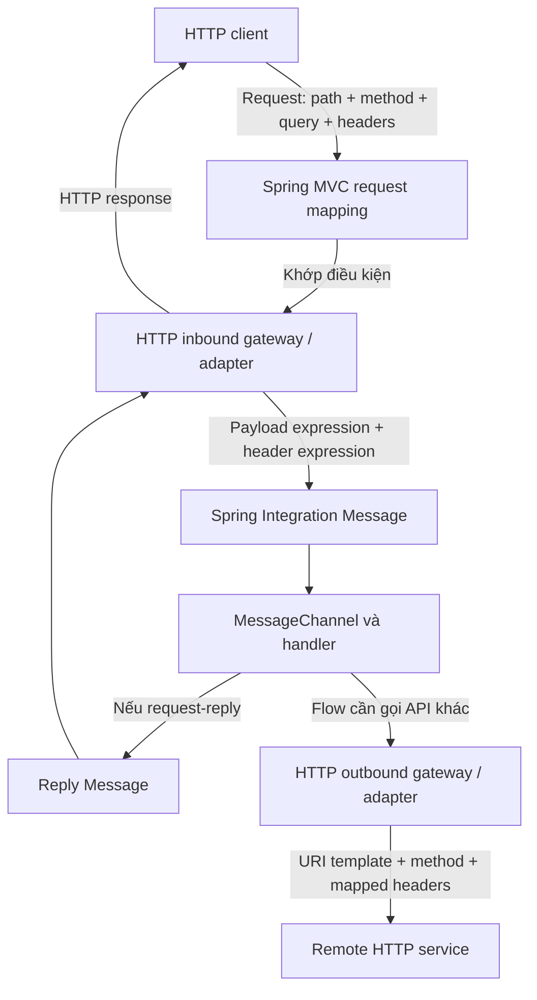

# Mapping path method query và header

## 1. Mapping HTTP trong Spring Integration là gì?

Trong chương **Adapter HTTP** của module **SPRING_INTEGRATION_ADAPTERS**, các endpoint HTTP là một cách đưa dữ liệu từ client vào `MessageChannel` hoặc gửi message nội bộ thành request tới dịch vụ ngoài. Cùng nguyên tắc kết nối bằng adapter, gateway và poller được áp dụng khi tích hợp file, SFTP, JMS, AMQP, Kafka hay cơ sở dữ liệu; điểm riêng của HTTP là **hợp đồng request** bao gồm đường dẫn, phương thức, query string, headers và body.

Một URL như:

```http
GET /api/catalog/BOOK-1?view=summary HTTP/1.1
Host: localhost:8080
Accept: application/json
X-Consumer: storefront
```

mang nhiều thông tin độc lập:

| Thành phần | Giá trị trong ví dụ | Mục đích |
|---|---|---|
| **Path** | `/api/catalog/BOOK-1` | Xác định tài nguyên hoặc endpoint được gọi. |
| **Path variable** | `itemId = BOOK-1` | Lấy giá trị động tại một vị trí trong path template. |
| **HTTP method** | `GET` | Xác định thao tác theo hợp đồng HTTP. |
| **Query parameter** | `view=summary` | Điều chỉnh lựa chọn, bộ lọc, phân trang hoặc dạng dữ liệu trả về. |
| **Request header** | `Accept: application/json` | Khai báo representation client muốn nhận. |
| **Custom request header** | `X-Consumer: storefront` | Metadata bổ sung theo hợp đồng ứng dụng; bản thân nó không chứng minh danh tính caller. |
| **Body** | Không có trong ví dụ GET | Nếu có, được đọc riêng theo content type và message converter. |

Mục tiêu của bài này là phân biệt **chọn endpoint theo điều kiện HTTP** với **trích xuất dữ liệu request vào message**, đồng thời làm rõ cách xây URL/headers cho **HTTP outbound**. Sau bài học, bạn có thể cấu hình mapping, đọc path variable, query parameter, header và xác định nguyên nhân request không vào flow.

## 2. Hai chiều mapping: inbound và outbound



Có ba thao tác không nên đánh đồng:

1. **HTTP inbound request mapping:** Spring MVC cùng `IntegrationRequestMappingHandlerMapping` quyết định endpoint có nhận một request hay không, dựa vào path, method, parameters, headers, `consumes` và `produces`.
2. **Inbound message mapping:** endpoint đã được chọn lấy path variable, query parameter hoặc HTTP header để tạo `Message.payload` và `Message.headers` cho flow.
3. **HTTP outbound mapping:** handler lấy payload/headers của Spring Integration message để dựng URI, method, HTTP headers và body khi gọi API bên ngoài.

Ví dụ, đặt điều kiện `params("view=summary")` **chỉ yêu cầu request có parameter đó với giá trị phù hợp**. Muốn sử dụng giá trị trong handler, bạn còn phải chọn cách lấy nó từ request, chẳng hạn `#requestParams.getFirst('view')` rồi đưa vào message header.

Tương tự, điều kiện `headers("X-Consumer=storefront")` dùng để chọn request. Nó **không tự xác thực** caller và không có nghĩa mọi HTTP header sẽ được sao chép nguyên vẹn vào integration message.

## 3. Mapping path: đường dẫn cố định và path variable

### 3.1. Khai báo path template

Hai đường dẫn sau có cùng cấu trúc nhưng tham chiếu hai item khác nhau:

```text
/api/catalog/BOOK-1
/api/catalog/BOOK-2
```

Một path template có thể gom chúng lại:

```text
/api/catalog/{itemId}
```

Khi request `GET /api/catalog/BOOK-1` khớp template, Spring MVC trích xuất:

```text
pathVariables["itemId"] = "BOOK-1"
```

Trong biểu thức SpEL của HTTP inbound endpoint, Spring Integration hỗ trợ biến `#pathVariables`. Ví dụ:

```java
.payloadExpression("#pathVariables['itemId']")
```

Đoạn này lấy biến `itemId` làm **payload** của Spring Integration message. Đây là biểu thức đánh giá sau khi HTTP request đã khớp mapping; nó không quy định HTTP method và không thay thế validation.

Có thể đưa nhiều giá trị path variable vào message headers:

```java
.headerExpression("itemId", "#pathVariables['itemId']")
.headerExpression("shopId", "#pathVariables['shopId']")
```

Khi đó path template cũng phải khai báo các biến tương ứng, ví dụ `/shops/{shopId}/items/{itemId}`.

### 3.2. Khác biệt giữa path variable và query parameter

| Trường hợp | Ví dụ | Nên xử lý |
|---|---|---|
| Định danh một tài nguyên | `/items/BOOK-1` | Path variable `itemId`. |
| Lọc danh sách | `/items?category=book` | Query parameter `category`. |
| Phân trang | `/items?page=2&size=20` | Query parameters `page`, `size`; cần giới hạn giá trị. |
| Chọn representation | `/items/BOOK-1?view=summary` | Query parameter `view`; kiểm tra giá trị hợp lệ. |
| Thông tin bảo mật | Bearer token hoặc mTLS | HTTP security mechanism; không đưa secret vào path/query. |

Dù là path variable hay query parameter, dữ liệu đến từ client vẫn **không đáng tin**. Cần kiểm tra kiểu, độ dài, định dạng và quyền truy cập với tài nguyên tương ứng. Tránh đưa thông tin bí mật vào URL vì URL thường xuất hiện trong lịch sử, access log và công cụ giám sát.

## 4. Mapping method: chọn thao tác trước khi tạo message

Cùng một path có thể hỗ trợ các HTTP method khác nhau:

| Method | Ví dụ | Ý nghĩa thường dùng |
|---|---|---|
| `GET` | `GET /items/BOOK-1` | Đọc dữ liệu; nên không tạo side effect nghiệp vụ. |
| `POST` | `POST /items` | Tạo hoặc gửi yêu cầu xử lý. |
| `PUT` | `PUT /items/BOOK-1` | Thay thế/cập nhật theo hợp đồng. |
| `PATCH` | `PATCH /items/BOOK-1` | Cập nhật một phần theo hợp đồng. |
| `DELETE` | `DELETE /items/BOOK-1` | Xóa hoặc đánh dấu xóa tài nguyên. |

Trong Spring Integration Java DSL, method inbound được chỉ định bằng `requestMapping`:

```java
.requestMapping(mapping -> mapping
    .methods(HttpMethod.GET)
    .produces(MediaType.APPLICATION_JSON_VALUE))
```

Điều này **khác** với:

```java
.handle(Http.outboundGateway("https://api.example.com/items")
    .httpMethod(HttpMethod.GET)
    .expectedResponseType(String.class))
```

Ở ví dụ đầu, `GET` là điều kiện cho request **đi vào** ứng dụng. Ở ví dụ thứ hai, `GET` là phương thức HTTP mà ứng dụng **gửi ra ngoài**.

Nếu request chỉ sai method, Spring MVC thường trả `405 Method Not Allowed` khi đường dẫn tương ứng tồn tại. Nếu sai path, thường là `404`. Tuy nhiên, filter, security hoặc cấu hình mapping khác có thể thay đổi response thực tế.

## 5. Query parameter: điều kiện match và cách lấy giá trị

Xét request:

```http
GET /api/catalog/BOOK-1?view=summary&tag=java&tag=spring HTTP/1.1
Accept: application/json
X-Consumer: storefront
```

`view` có một giá trị, nhưng `tag` xuất hiện hai lần. Spring Integration cung cấp biến biểu thức `#requestParams`, phản ánh các request parameters dưới dạng `MultiValueMap`.

Ví dụ SpEL:

```java
.payloadExpression("#requestParams.getFirst('view')")
.headerExpression("allTags", "#requestParams['tag']")
```

`getFirst('view')` đọc một giá trị. Khi cần xử lý nhiều `tag`, lấy danh sách tương ứng và quy định rõ cách lọc/validate. Không mặc định một query parameter luôn chỉ có một giá trị.

### 5.1. Ràng buộc param trong HTTP request mapping

```java
.requestMapping(mapping -> mapping
    .methods(HttpMethod.GET)
    .params("view=summary"))
```

Mapping chỉ nhận những request có parameter `view` mang giá trị `summary` theo điều kiện của Spring MVC. Các dạng điều kiện thường dùng:

| Điều kiện | Ý nghĩa |
|---|---|
| `params("view")` | Phải có parameter `view`. |
| `params("!view")` | Không được có parameter `view`. |
| `params("view=summary")` | Parameter `view` cần có giá trị `summary`. |
| `params("view!=full")` | Điều kiện phủ định theo quy tắc request mapping của Spring MVC. |

Lưu ý: request parameter ở tầng Servlet có thể bao gồm cả query string và form parameters tùy method/content type. Với ví dụ GET, các giá trị được lấy từ query string. Đừng dùng `params(...)` để thay thế kiểm tra nghiệp vụ (ví dụ phân trang âm, giá trị quá lớn hoặc injection trong chuỗi tìm kiếm).

### 5.2. Khi parameter là tùy chọn

Nếu `view` tùy chọn, **không** đưa `view=summary` vào mapping rồi kỳ vọng endpoint sẽ nhận cả request thiếu `view`. Hãy dùng mapping chỉ giới hạn path/method, sau đó lấy giá trị bằng `#requestParams` và xử lý mặc định/validation trong flow.

Tránh tạo quá nhiều HTTP endpoint chỉ để phân nhánh những biến thể query nhỏ. Có thể dùng một endpoint và router/transformer nội bộ khi hợp đồng endpoint thực sự chung.

## 6. Header: điều kiện request, ánh xạ và bảo mật

HTTP header có nhiều vai trò: content negotiation, auth, correlation, idempotency và metadata tùy biến. Cần phân biệt ba hành động:

| Hành động | Ví dụ | Công dụng |
|---|---|---|
| **Match request header** | `headers("X-Consumer=storefront")` | Chỉ chọn endpoint khi HTTP header thỏa điều kiện. |
| **Đọc một giá trị vào message** | `headerExpression("consumer", "#requestHeaders.getFirst('X-Consumer')")` | Tạo Spring Integration message header `consumer`. |
| **Ánh xạ nhiều HTTP headers** | `mappedRequestHeaders("X-Trace-Id")` | Chọn các HTTP headers cần đưa vào message hoặc gửi ra HTTP, tùy chiều endpoint. |

Biến SpEL `#requestHeaders` là đối tượng `HttpHeaders`. Các phương thức như `getFirst(...)` đọc một giá trị, và tên HTTP headers không phân biệt chữ hoa/chữ thường.

**Phân biệt HTTP header và integration header:** một HTTP header `X-Trace-Id` không tự biến thành header tên `traceId`. Nếu muốn tên nội bộ nhất quán, hãy ánh xạ bằng biểu thức hoặc header enricher; khi chuyển tiếp qua Kafka/JMS/SFTP, định nghĩa rõ header nào cần giữ.

### 6.1. Content-Type và Accept

- `Content-Type` mô tả **request body** gửi lên server. Điều kiện `consumes(MediaType.APPLICATION_JSON_VALUE)` xác định media type request được endpoint hỗ trợ; nó không tự xác thực cấu trúc JSON.
- `Accept` mô tả **response format** client mong muốn. Điều kiện `produces(MediaType.APPLICATION_JSON_VALUE)` tham gia content negotiation; ứng dụng vẫn cần HTTP message converter hỗ trợ chuyển reply payload.
- Với `GET` không có body, thường không cần `consumes`; với `POST` hoặc `PUT` nhận JSON, nên khai báo rõ theo hợp đồng.

Ví dụ:

```java
.requestMapping(mapping -> mapping
    .methods(HttpMethod.POST)
    .consumes(MediaType.APPLICATION_JSON_VALUE)
    .produces(MediaType.APPLICATION_JSON_VALUE))
```

Request với media type sai thường dẫn đến `415 Unsupported Media Type`; header `Accept` không tương thích với representation có thể dẫn tới `406 Not Acceptable`.

### 6.2. Đừng dùng custom header như bằng chứng xác thực

`headers("X-Consumer=storefront")` chỉ kiểm tra **chuỗi do client gửi**. Caller khác hoàn toàn có thể tự gửi cùng giá trị. API thật cần Spring Security, mTLS, JWT/OAuth2, HMAC webhook hoặc cơ chế xác thực/ủy quyền phù hợp. Không log raw `Authorization`, cookie, token hoặc dữ liệu cá nhân.

## 7. Ví dụ inbound gateway: kết hợp path, method, query và header

Ta xây dựng một HTTP endpoint có hợp đồng sau:

```text
GET /api/catalog/{itemId}?view=summary
Accept: application/json
X-Consumer: storefront
```

Gateway trả JSON cho client. Ví dụ dùng **Spring Boot + Spring MVC + Spring Integration HTTP**, Java 17 trở lên, và Jackson để serialize record thành JSON.

### 7.1. Dependencies Maven

Với dự án có Spring Boot dependency management:

```xml
<dependencies>
    <dependency>
        <groupId>org.springframework.boot</groupId>
        <artifactId>spring-boot-starter-web</artifactId>
    </dependency>
    <dependency>
        <groupId>org.springframework.boot</groupId>
        <artifactId>spring-boot-starter-integration</artifactId>
    </dependency>
    <dependency>
        <groupId>org.springframework.integration</groupId>
        <artifactId>spring-integration-http</artifactId>
    </dependency>
</dependencies>
```

### 7.2. Cấu hình request mapping và chuyển dữ liệu vào message

Tạo `CatalogInboundConfiguration.java`:

```java
package example.http;

import org.springframework.context.annotation.Bean;
import org.springframework.context.annotation.Configuration;
import org.springframework.http.HttpMethod;
import org.springframework.http.MediaType;
import org.springframework.integration.annotation.EnableIntegration;
import org.springframework.integration.channel.DirectChannel;
import org.springframework.integration.dsl.IntegrationFlow;
import org.springframework.integration.http.dsl.Http;
import org.springframework.messaging.MessageChannel;

@Configuration
@EnableIntegration
public class CatalogInboundConfiguration {

    @Bean
    public MessageChannel catalogRequests() {
        return new DirectChannel();
    }

    @Bean
    public IntegrationFlow catalogReadFlow() {
        return IntegrationFlow
            .from(Http.inboundGateway("/api/catalog/{itemId}")
                .requestMapping(mapping -> mapping
                    .methods(HttpMethod.GET)
                    .params("view=summary")
                    .headers("X-Consumer=storefront")
                    .produces(MediaType.APPLICATION_JSON_VALUE))
                .payloadExpression("#pathVariables['itemId']")
                .headerExpression(
                    "requestedView",
                    "#requestParams.getFirst('view')")
                .headerExpression(
                    "consumer",
                    "#requestHeaders.getFirst('X-Consumer')"))
            .channel("catalogRequests")
            .get();
    }
}
```

Ba phần quan trọng:

1. **`requestMapping(...)`** chọn request có path `/api/catalog/{itemId}`, HTTP method GET, query `view=summary`, header `X-Consumer=storefront` và chấp nhận JSON response.
2. **`payloadExpression(...)`** lấy `itemId` từ path và đặt vào `Message.payload`.
3. **`headerExpression(...)`** lấy query và HTTP header, rồi tạo các **integration headers** `requestedView` và `consumer`.

Các biểu thức này hoạt động trên HTTP request đã được Spring MVC chọn. Chúng không gây một HTTP request mới.

### 7.3. Service activator và reply JSON

Tạo `CatalogHandler.java` trong package được Spring Boot scan:

```java
package example.http;

import org.springframework.integration.annotation.ServiceActivator;
import org.springframework.messaging.Message;
import org.springframework.stereotype.Service;

@Service
public class CatalogHandler {

    @ServiceActivator(inputChannel = "catalogRequests")
    public CatalogResponse read(Message<String> message) {
        String itemId = message.getPayload();
        String view = (String) message.getHeaders().get("requestedView");
        String consumer = (String) message.getHeaders().get("consumer");

        if (itemId.isBlank()) {
            throw new IllegalArgumentException("itemId is required");
        }

        // Minh họa mapping; hệ thống thật cần tra cứu dữ liệu và kiểm tra quyền.
        return new CatalogResponse(
            itemId, view, consumer, "AVAILABLE");
    }

    public record CatalogResponse(
        String itemId,
        String view,
        String clientTag,
        String availability) {}
}
```

`@ServiceActivator` nhận message từ `catalogRequests` và trả record. Inbound gateway chờ reply message và dùng converter để tạo JSON response. Trường `clientTag` cho thấy header đã được ánh xạ; nó **không đại diện danh tính đã xác thực**.

### 7.4. Gọi bằng curl

```bash
curl -i \
  -H 'Accept: application/json' \
  -H 'X-Consumer: storefront' \
  'http://localhost:8080/api/catalog/BOOK-1?view=summary'
```

Body phản hồi minh họa:

```json
{
  "itemId": "BOOK-1",
  "view": "summary",
  "clientTag": "storefront",
  "availability": "AVAILABLE"
}
```

Mã status và response headers cụ thể phụ thuộc vào gateway, HTTP converter và cấu hình ứng dụng. Vì handler chỉ minh họa, `AVAILABLE` chưa được xác nhận từ cơ sở dữ liệu.

Thử thay đổi từng điều kiện:

| Request thử nghiệm | Kết quả cần quan sát |
|---|---|
| `GET` đúng path/query/header | Message tới `catalogRequests` và trả JSON. |
| `POST` cùng URL | Không khớp method GET; thường gặp HTTP 405. |
| `GET` thiếu `view` | Không thỏa `params("view=summary")`. |
| `GET` với `view=full` | Không thỏa giá trị query mapping. |
| `GET` thiếu `X-Consumer` | Không thỏa ràng buộc header mapping. |
| `GET` với `Accept: text/plain` | Không tương thích `produces(application/json)`; thường gặp 406. |
| `GET` tới path khác | Không khớp mapping; thường gặp 404. |

Các status HTTP từ trường hợp không khớp có thể khác khi ứng dụng có nhiều endpoint, filter, exception handler hoặc reverse proxy. Hãy kiểm tra rằng request bị từ chối **trước service activator**, thay vì chỉ kiểm tra mã response.

## 8. Outbound mapping: tạo path, query và HTTP headers từ message

Ở HTTP outbound gateway, ta xử lý chiều ngược lại: từ **message nội bộ** tạo một HTTP request tới hệ thống bên ngoài. Giả sử đối tác công bố API:

```http
GET /api/items/BOOK-1?region=vn-south HTTP/1.1
Host: partner.example
X-Tenant: shop-a
```

Trong Java DSL, có thể sử dụng **URI template** và `uriVariable(...)`:

```java
package example.http;

import org.springframework.context.annotation.Bean;
import org.springframework.context.annotation.Configuration;
import org.springframework.http.HttpMethod;
import org.springframework.integration.annotation.EnableIntegration;
import org.springframework.integration.dsl.IntegrationFlow;
import org.springframework.integration.http.dsl.Http;

@Configuration
@EnableIntegration
public class PartnerItemHttpConfiguration {

    @Bean
    public IntegrationFlow partnerItemLookupFlow() {
        return IntegrationFlow.from("partnerItemLookup")
            .handle(Http.outboundGateway(
                    "https://partner.example/api/items/{itemId}"
                    + "?region={region}")
                .httpMethod(HttpMethod.GET)
                .uriVariable("itemId", "payload")
                .uriVariable("region", "headers['region']")
                .mappedRequestHeaders("X-Tenant")
                .expectedResponseType(String.class))
            .get();
    }
}
```

Để tạo message đầu vào đúng hợp đồng, có thể dùng một **Java messaging gateway**:

```java
package example.http;

import org.springframework.integration.annotation.MessagingGateway;
import org.springframework.messaging.handler.annotation.Header;

@MessagingGateway(defaultRequestChannel = "partnerItemLookup")
public interface PartnerItemClient {

    String findItem(
        String itemId,
        @Header("region") String region,
        @Header("X-Tenant") String tenant);
}
```

Khi có `@IntegrationComponentScan` phù hợp hoặc Spring Boot cấu hình quét messaging gateways, lời gọi:

```java
String result = partnerItemClient.findItem(
    "BOOK-1", "vn-south", "shop-a");
```

sẽ tạo một integration message có:

```text
payload = "BOOK-1"
headers["region"] = "vn-south"
headers["X-Tenant"] = "shop-a"
```

Gateway HTTP outbound sử dụng:

- `payload` để thay biến `{itemId}` trong **path**.
- `headers['region']` để thay biến `{region}` trong **query string**.
- `mappedRequestHeaders("X-Tenant")` để ánh xạ message header `X-Tenant` thành **HTTP header**.
- `httpMethod(GET)` để chọn phương thức gửi request.
- `expectedResponseType(String.class)` để chuyển HTTP response body thành reply payload `String` khi dịch vụ trả dữ liệu phù hợp.

Từ bản ghi trên, HTTP request đích có cấu trúc `GET /api/items/BOOK-1?region=vn-south` kèm `X-Tenant: shop-a`. Domain `partner.example` là ví dụ tài liệu; để thực hành phải thay bằng mock HTTP service có thể truy cập và kiểm tra response thật.

**Điều kiện bổ sung:** đoạn code trên trình bày các class trong cùng package để dễ học. Nếu tạo dự án thực chạy, cần đăng ký interface `@MessagingGateway` bằng `@IntegrationComponentScan` trong một class cấu hình thuộc package phù hợp. Không tạo thêm HTTP controller nếu ứng dụng chỉ làm outbound client.

### 8.1. Vì sao cần URI template?

Không nên tự xây URL bằng nối chuỗi như:

```java
String url = baseUrl + "/" + itemId + "?region=" + region;
```

Vì `itemId` hoặc `region` có thể chứa dấu cách, dấu `&`, `?`, `/`, Unicode hoặc ký tự phải encode. URI template kết hợp cơ chế encoding của HTTP client giúp kiểm soát việc thay biến; vẫn cần validation và kiểm thử khi giá trị chứa ký tự đặc biệt.

Không đặt URL host hoàn toàn theo input từ client nếu chưa kiểm soát, vì có thể dẫn đến **SSRF**. Nên cấu hình base host từ ứng dụng và chỉ cho phép path/query variables theo danh sách giá trị hợp lệ. Với dữ liệu có sẵn dấu phần trăm đã encode, tránh double-encoding bằng cách sử dụng encoding mode và URI builder phù hợp; không tắt encoding tùy tiện.

### 8.2. Request header và response header là hai chiều khác nhau

Trong HTTP outbound endpoint:

- `mappedRequestHeaders(...)` chọn **integration headers → HTTP request headers**.
- `mappedResponseHeaders(...)` chọn **HTTP response headers → reply message headers**.

Trong HTTP inbound endpoint:

- `mappedRequestHeaders(...)` chọn **HTTP request headers → integration message headers**.
- `mappedResponseHeaders(...)` chọn **reply message headers → HTTP response headers**.

Tên phương thức giống nhau nhưng hướng ánh xạ phụ thuộc endpoint đang inbound hay outbound. `DefaultHttpHeaderMapper` hỗ trợ tập header mặc định và các pattern được cấu hình; đừng mặc định mọi header được ánh xạ.

## 9. Header mapping và dữ liệu nhạy cảm qua nhiều hệ thống

Một Spring Integration message có thể chứa nhiều header phục vụ routing, correlation, tracing hoặc reply:

```text
id
timestamp
replyChannel
errorChannel
correlationId
contentType
userDefinedHeader
```

Không phải header nào cũng phù hợp để gửi ra mạng. `replyChannel` hoặc `errorChannel` có thể chứa tham chiếu kênh trong bộ nhớ và không nên được xem là một HTTP header giao tiếp với đối tác.

Một hợp đồng HTTP outbound tốt nên nêu rõ:

| Header | Nguồn | Nguyên tắc |
|---|---|---|
| `Content-Type` | Payload/converter và cấu hình | Phù hợp body gửi đi, ví dụ `application/json`. |
| `Accept` | Yêu cầu của caller | Chọn representation response mong muốn. |
| `Authorization` | Security context hoặc token service | Chỉ thêm khi được phép; giấu khỏi log. |
| `X-Correlation-ID` | Trace/correlation ID đã kiểm soát | Cho phép liên hệ log giữa các service. |
| `Idempotency-Key` | Key nghiệp vụ ổn định | Giúp tránh side effect trùng khi retry, nếu đối tác hỗ trợ. |
| `X-Tenant` | Context tenant đã xác thực nội bộ | Không tin một header do client ngoài tùy ý gửi lên. |

Nếu message tiếp tục được chuyển qua JMS, AMQP hoặc Kafka, cơ chế serialize và mapping header của từng adapter có quy tắc riêng. Không dựa vào việc mọi HTTP header có thể tự đi xuyên suốt các giao thức; nên có hợp đồng rõ cho `correlationId`, event ID và metadata mà downstream thật sự cần.

## 10. Kiểm thử mapping theo từng lớp

Khi kiểm thử HTTP inbound, hãy kiểm tra **hai kết quả riêng biệt**: request có được chọn endpoint không, và dữ liệu có được chuyển chính xác vào message không.

### 10.1. Kiểm thử inbound

1. Gửi request đúng method, path, query, `Accept` và custom header; assert handler nhận `Message.payload = "BOOK-1"` và đúng `requestedView`, `consumer`.
2. Đổi từng điều kiện một: path sai, method sai, thiếu/khác query, thiếu/khác header, `Accept` không phù hợp.
3. Thử path chứa ký tự URL-encoded, query giá trị rỗng và query xuất hiện nhiều lần; xác định hợp đồng xử lý.
4. Nếu thêm `POST`, thử `Content-Type` sai, body JSON sai schema và body quá lớn.
5. Thử request thiếu authentication và thiếu quyền; xác minh Spring Security/filter chặn theo chính sách.
6. Kiểm tra reply payload, content type và lỗi từ service activator, không chỉ mã HTTP 200.

### 10.2. Kiểm thử outbound

Dùng mock HTTP server như WireMock hoặc MockWebServer để xác nhận:

| Trường hợp | Assertion |
|---|---|
| Path variable | `BOOK-1` xuất hiện đúng vị trí `/api/items/{itemId}`. |
| Query variable | `region=vn-south` được encode đúng. |
| Method | Gateway gửi `GET` đúng hợp đồng. |
| Mapped request header | Có `X-Tenant: shop-a` và không có header nội bộ ngoài ý muốn. |
| Response | Body JSON/text được convert sang `expectedResponseType`. |
| HTTP 4xx/5xx | Error handler/exception hoặc error flow phân loại lỗi theo cấu hình. |
| Timeout | HTTP client có connect/read timeout hữu hạn. |
| Retry | Retry không tạo side effect trùng, có idempotency key khi cần. |

Kiểm thử nên sử dụng mock server local, tránh phụ thuộc mạng của đối tác khi kiểm tra logic mapping.

### 10.3. Khi request không đến handler

Đối với inbound, truy vết theo thứ tự:

```text
Client
  -> Reverse proxy / Spring Security
  -> Path + HTTP method mapping
  -> params + headers + consumes + produces
  -> payloadExpression + headerExpression
  -> MessageChannel
  -> Service activator / Router
  -> Reply channel (nếu là gateway)
```

| HTTP status thường thấy | Điều cần kiểm tra |
|---|---|
| `404` | Sai path/context path hoặc không có endpoint phù hợp. |
| `405` | Path có handler nhưng method không được chấp nhận. |
| `415` | `Content-Type` không phù hợp `consumes`. |
| `406` | `Accept` không phù hợp `produces`. |
| `400` | Có thể thiếu query parameter bắt buộc, request body không hợp lệ hoặc converter lỗi. |
| `401/403` | Xác thực/ủy quyền hoặc filter chặn. |
| `5xx/timeout` | Handler, converter, downstream service, reply channel, timeout. |

Các mã trên là tình huống phổ biến, **không cam kết tuyệt đối** khi có nhiều mapping, exception resolver và API gateway tùy chỉnh. Đặc biệt, request không thỏa `params` hoặc `headers` có thể sinh status khác nhau tùy điều kiện và handler khác đang tồn tại.

## 11. Vòng đời, bảo mật và thiết kế hợp đồng

Mapping cần đúng cả ở thời điểm cấu hình và lúc vận hành:

- Endpoint inbound được đăng ký khi Spring application context khởi tạo; nếu mapping bị xung đột, ứng dụng có thể báo lỗi lúc startup hoặc khi dispatch.
- URL public có thể có servlet context path hoặc prefix từ reverse proxy; ghi rõ base path để client không nhầm.
- Endpoint outbound chỉ gọi dịch vụ khi có message đi vào channel; không cần poller nếu dùng `DirectChannel`.
- Kiểm soát body size, rate limit, concurrency và timeout, nhất là khi một inbound gateway đồng bộ gọi outbound gateway chậm.
- Chỉ ánh xạ header thật sự cần. Token, cookie và thông tin người dùng phải theo chính sách bảo mật, không được log hàng loạt.
- Khi thay đổi path, query parameter hoặc header bắt buộc, cần versioning hoặc kế hoạch tương thích; không đổi hợp đồng đang có client sử dụng một cách bất ngờ.
- Với sự kiện có side effect đi qua HTTP, JMS/Kafka hoặc database, cần idempotency, retry có giới hạn và mốc cam kết dữ liệu rõ ràng. Mapping chính xác không tự tạo transaction phân tán.

## 12. Những điều cần ghi nhớ

- **Path** xác định tài nguyên, **method** xác định thao tác; **query** bổ sung tham số; **header** cung cấp metadata hoặc thông tin content negotiation.
- `requestMapping(...methods/params/headers/consumes/produces...)` chọn request **trước khi** tạo Spring Integration message.
- `#pathVariables`, `#requestParams` và `#requestHeaders` được dùng trong `payloadExpression` hoặc `headerExpression` để **trích xuất dữ liệu vào payload/headers**.
- Với outbound gateway/adapter, `uriVariable(...)` dựng path và query từ message; `mappedRequestHeaders(...)` quyết định những HTTP request headers được xuất ra.
- `mappedResponseHeaders(...)` xử lý chiều về; không tự chuyển mọi header giữa các hệ thống.
- Cần kiểm tra validation, authentication, encoding, timeout, retry và idempotency ở ranh giới HTTP; một mapping đúng không chứng minh nghiệp vụ đã thành công.

### Tài liệu tham khảo chính thức

- [Spring Integration — HTTP Namespace Support: request mapping, URI variables và expressions](https://docs.spring.io/spring-integration/reference/http/namespace.html)
- [Spring Integration — Configuring HTTP Endpoints with Java](https://docs.spring.io/spring-integration/reference/http/java-config.html)
- [Spring Integration — HTTP Header Mapping](https://docs.spring.io/spring-integration/reference/http/header-mapping.html)
- [Spring Integration — HttpInboundEndpointSupportSpec API](https://docs.spring.io/spring-integration/api/org/springframework/integration/http/dsl/HttpInboundEndpointSupportSpec.html)
- [Spring Integration — BaseHttpMessageHandlerSpec API](https://docs.spring.io/spring-integration/api/org/springframework/integration/http/dsl/BaseHttpMessageHandlerSpec.html)
