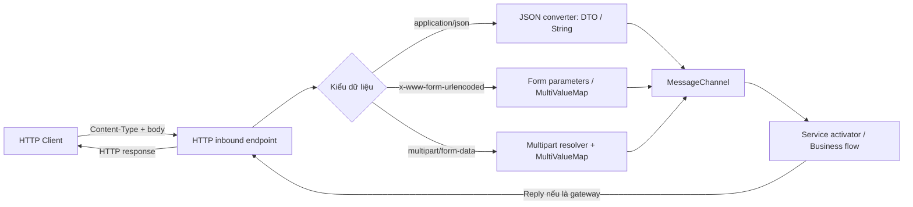
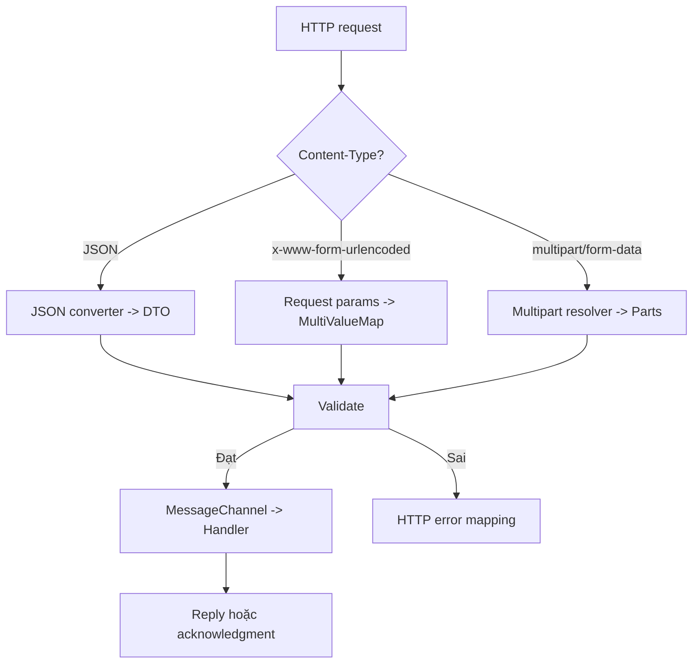

# Payload JSON form-data và multipart

## 1. Vì sao phải phân biệt ba kiểu payload?

Trong chương **Adapter HTTP** của module **SPRING_INTEGRATION_ADAPTERS**, HTTP inbound/outbound adapter và gateway trao đổi dữ liệu với hệ thống ngoài thông qua `MessageChannel`. Payload của một Spring Integration `Message<?>` là **đối tượng Java**; body của HTTP request/response là **dữ liệu được mã hóa theo media type**. HTTP message converter và cơ chế phân tích multipart quyết định cách chuyển giữa hai dạng đó.

Ba định dạng thường gặp:

| Định dạng HTTP | `Content-Type` | Body trên wire | Payload Java thường dùng |
|---|---|---|---|
| **JSON** | `application/json` | Văn bản JSON theo cấu trúc object/array | DTO/record, `Map`, `String` hoặc `byte[]` theo cấu hình |
| **Form URL-encoded** | `application/x-www-form-urlencoded` | `name=An&tag=java&tag=spring`, các ký tự được URL-encode | `MultiValueMap<String, String>` hoặc dữ liệu lấy từ request parameters |
| **Multipart form-data** | `multipart/form-data; boundary=...` | Nhiều part riêng, mỗi part có headers và body riêng | `MultiValueMap` chứa text, bytes hoặc `MultipartFile` tùy resolver/converter |

**Quan trọng:** `multipart/form-data` và `application/x-www-form-urlencoded` đều được gọi là “form-data” trong giao tiếp hằng ngày, nhưng **không cùng cấu trúc trên wire**. Form URL-encoded dành cho các cặp khóa/giá trị văn bản; multipart hỗ trợ hỗn hợp trường văn bản và dữ liệu nhị phân như tài liệu, ảnh hoặc file CSV.

Ví dụ nghiệp vụ:

- Một ứng dụng nhận đơn hàng JSON và trả kết quả kiểm tra.
- Một website gửi biểu mẫu đăng ký bằng `application/x-www-form-urlencoded`.
- Một người dùng gửi file đính kèm kèm mô tả qua `multipart/form-data`.
- Một flow Spring Integration gọi HTTP API của đối tác, chọn converter phù hợp để tạo JSON, form hoặc multipart.

Mục tiêu của bài là hiểu **hợp đồng body**, tạo endpoint inbound đúng định dạng, chuẩn bị payload outbound, xử lý lỗi conversion và bảo đảm an toàn khi nhận file. Các nguyên tắc hợp đồng message, retry và vòng đời kết nối cũng áp dụng khi flow chuyển tiếp dữ liệu tới file, SFTP, JMS, AMQP, Kafka hay cơ sở dữ liệu.

## 2. HTTP body trở thành Spring Integration Message như thế nào?



Ở **HTTP inbound gateway**, request được ánh xạ theo path, method và `consumes`; endpoint sau đó dùng converter hoặc payload expression để tạo message. Khi handler trả reply, gateway chuyển reply payload thành HTTP response bằng converter phù hợp.

Ở **HTTP inbound channel adapter**, request cũng được chuyển thành message nhưng flow không phát reply message nghiệp vụ cho client. Chọn inbound gateway khi cần trả JSON chứa kết quả; chọn inbound adapter khi hợp đồng chỉ cần xác nhận đã tiếp nhận.

Ở **HTTP outbound gateway**, chiều chuyển đổi ngược lại: payload/message headers trở thành HTTP request body/headers; HTTP response được chuyển thành reply message. Với **HTTP outbound channel adapter**, HTTP vẫn có response ở cấp giao thức, nhưng response body không được đưa tiếp thành reply message.

### 2.1. Bốn điểm quyết định kiểu payload

1. **`Content-Type` của request:** cho biết cách đọc body trên wire. Không thể quyết định hoàn toàn từ tên class Java.
2. **`requestPayloadType(...)` ở inbound:** định hướng `HttpMessageConverter` đọc body thành kiểu Java nào, ví dụ `OrderRequest.class`.
3. **`payloadExpression(...)` ở inbound:** có thể chọn dữ liệu khác làm payload, chẳng hạn `#requestParams` cho form parameters hoặc một path variable.
4. **Converters và multipart resolver hiện có:** nếu thiếu converter/resolver phù hợp, body có thể không được đọc như mong đợi hoặc phát sinh lỗi.

Nếu không khai báo `requestPayloadType`, tài liệu API inbound cho biết kiểu mặc định có thể là `String` với content type dạng text và `byte[]` cho các dạng khác. Tuy nhiên, **multipart là trường hợp đặc biệt** khi request đã được multipart resolver chuyển thành `MultipartHttpServletRequest`; payload có thể là `MultiValueMap`. Vì vậy cần kiểm thử kiểu thực tế của payload với phiên bản và cấu hình ứng dụng đang dùng.

## 3. Ví dụ 1: nhận JSON thành DTO bằng HTTP inbound gateway

Ta xây một API nhận yêu cầu kiểm tra đơn hàng, trả JSON kết quả. Mã ví dụ chạy với **Spring Boot, Spring MVC, Spring Integration HTTP và Java 17 trở lên**; chưa thực hiện lưu đơn hàng hay giao dịch ngoài hệ thống.

### 3.1. Dependencies Maven

Với Spring Boot dependency management:

```xml
<dependencies>
    <dependency>
        <groupId>org.springframework.boot</groupId>
        <artifactId>spring-boot-starter-web</artifactId>
    </dependency>
    <dependency>
        <groupId>org.springframework.boot</groupId>
        <artifactId>spring-boot-starter-integration</artifactId>
    </dependency>
    <dependency>
        <groupId>org.springframework.integration</groupId>
        <artifactId>spring-integration-http</artifactId>
    </dependency>
</dependencies>
```

`spring-boot-starter-web` cung cấp Spring MVC và converter JSON thường dùng qua Jackson; `spring-integration-http` cung cấp HTTP inbound/outbound endpoint. Bật scan component cho package ví dụ khi ghép vào ứng dụng.

### 3.2. DTO của request và reply

File `OrderPayloads.java`:

```java
package example.http;

public final class OrderPayloads {
    private OrderPayloads() {}

    public record OrderRequest(String sku, int quantity) {}

    public record OrderReply(String sku, String status) {}
}
```

Một request body hợp lệ về cú pháp:

```json
{"sku":"BOOK-1","quantity":2}
```

DTO chỉ mô tả cấu trúc dữ liệu. **Validation nghiệp vụ vẫn cần kiểm tra** `sku` rỗng, `quantity` không hợp lệ, quyền gọi API và những ràng buộc khác. JSON parse được thành record không chứng minh đơn hàng được chấp nhận.

### 3.3. Cấu hình endpoint

File `JsonInboundConfiguration.java`:

```java
package example.http;

import org.springframework.context.annotation.Bean;
import org.springframework.context.annotation.Configuration;
import org.springframework.http.HttpMethod;
import org.springframework.http.MediaType;
import org.springframework.integration.annotation.EnableIntegration;
import org.springframework.integration.channel.DirectChannel;
import org.springframework.integration.dsl.IntegrationFlow;
import org.springframework.integration.http.dsl.Http;
import org.springframework.messaging.MessageChannel;

@Configuration
@EnableIntegration
public class JsonInboundConfiguration {

    @Bean
    public MessageChannel jsonOrders() {
        return new DirectChannel();
    }

    @Bean
    public IntegrationFlow jsonOrderFlow() {
        return IntegrationFlow
            .from(Http.inboundGateway("/examples/json-orders")
                .requestMapping(m -> m
                    .methods(HttpMethod.POST)
                    .consumes(MediaType.APPLICATION_JSON_VALUE)
                    .produces(MediaType.APPLICATION_JSON_VALUE))
                .requestPayloadType(OrderPayloads.OrderRequest.class))
            .channel("jsonOrders")
            .get();
    }
}
```

File `JsonOrderHandler.java`:

```java
package example.http;

import org.springframework.integration.annotation.ServiceActivator;
import org.springframework.stereotype.Service;

@Service
public class JsonOrderHandler {

    @ServiceActivator(inputChannel = "jsonOrders")
    public OrderPayloads.OrderReply accept(
            OrderPayloads.OrderRequest request) {

        if (request.sku() == null || request.sku().isBlank()
                || request.quantity() <= 0) {
            throw new IllegalArgumentException("Invalid order payload");
        }

        // Chỉ minh họa chuyển đổi request -> reply, chưa lưu vào DB.
        return new OrderPayloads.OrderReply(request.sku(), "VALIDATED");
    }
}
```

Khi gọi:

```bash
curl -i -X POST 'http://localhost:8080/examples/json-orders' \
  -H 'Content-Type: application/json' \
  -H 'Accept: application/json' \
  -d '{"sku":"BOOK-1","quantity":2}'
```

body phản hồi điển hình là:

```json
{"sku":"BOOK-1","status":"VALIDATED"}
```

**`requestPayloadType(OrderRequest.class)`** khiến converter đọc JSON thành record. Nếu dùng `String.class`, message payload sẽ là chuỗi JSON và handler phải tự parse/validate. Nếu đặt `consumes(application/json)` nhưng gửi `text/plain`, request thường không thỏa mapping; nếu gửi JSON lỗi cú pháp, lỗi có thể xảy ra **trước khi** message vào `jsonOrders`.

Ví dụ handler ném `IllegalArgumentException` khi dữ liệu sai, nhưng nó **không tự bảo đảm một response 400 có JSON error chuẩn**. Cần thiết kế exception mapping/error flow phù hợp nếu API phải trả hợp đồng lỗi ổn định.

## 4. Ví dụ 2: application/x-www-form-urlencoded

Form URL-encoded không biểu diễn một JSON object. Nó là chuỗi các cặp tên/giá trị, ví dụ:

```http
POST /examples/preferences HTTP/1.1
Content-Type: application/x-www-form-urlencoded

customerId=C-100&language=vi&tag=java&tag=spring
```

Các ký tự đặc biệt được encode theo quy tắc form URL encoding; dấu `+` thường biểu diễn khoảng trắng trong giá trị form, còn ký tự `&`, `=` hoặc ký tự Unicode phải được mã hóa đúng. Query parameter và form parameter có thể có tên giống nhau; ứng dụng cần định nghĩa thứ tự/nguồn ưu tiên trước khi gộp.

### 4.1. Vì sao nên dùng MultiValueMap?

`tag` có thể xuất hiện nhiều lần. Nếu chuyển form thành `Map<String,String>` và giữ mỗi key một giá trị, dữ liệu bị mất.

```java
MultiValueMap<String, String> data = new LinkedMultiValueMap<>();
data.add("customerId", "C-100");
data.add("language", "vi");
data.add("tag", "java");
data.add("tag", "spring");
```

`MultiValueMap` lưu **danh sách giá trị cho cùng một key**. Đây là cấu trúc hữu ích cho `application/x-www-form-urlencoded` và cũng thường được dùng để chứa các part của multipart, dù **kiểu của value không giống nhau**.

### 4.2. Nhận form parameters bằng payloadExpression

Với HTTP inbound endpoint, `#requestParams` cho phép lấy các request parameters từ servlet request. Ví dụ này dùng `payloadExpression("#requestParams")` để tạo payload từ các tham số form mà Spring MVC đã parse:

```java
package example.http;

import org.springframework.context.annotation.Bean;
import org.springframework.context.annotation.Configuration;
import org.springframework.http.HttpMethod;
import org.springframework.http.MediaType;
import org.springframework.integration.annotation.EnableIntegration;
import org.springframework.integration.channel.DirectChannel;
import org.springframework.integration.dsl.IntegrationFlow;
import org.springframework.integration.http.dsl.Http;
import org.springframework.messaging.MessageChannel;

@Configuration
@EnableIntegration
public class FormInboundConfiguration {

    @Bean
    public MessageChannel preferenceForms() {
        return new DirectChannel();
    }

    @Bean
    public IntegrationFlow preferenceFormFlow() {
        return IntegrationFlow
            .from(Http.inboundGateway("/examples/preferences")
                .requestMapping(m -> m
                    .methods(HttpMethod.POST)
                    .consumes(
                        MediaType.APPLICATION_FORM_URLENCODED_VALUE)
                    .produces(MediaType.APPLICATION_JSON_VALUE))
                .payloadExpression("#requestParams"))
            .channel("preferenceForms")
            .get();
    }
}
```

Handler (file `PreferenceHandler.java`):

```java
package example.http;

import java.util.List;
import org.springframework.integration.annotation.ServiceActivator;
import org.springframework.stereotype.Service;
import org.springframework.util.MultiValueMap;

@Service
public class PreferenceHandler {

    @ServiceActivator(inputChannel = "preferenceForms")
    public PreferenceReply accept(
            MultiValueMap<String, String> parameters) {

        String customerId = parameters.getFirst("customerId");
        String language = parameters.getFirst("language");
        List<String> tags = parameters.get("tag");

        if (customerId == null || customerId.isBlank()) {
            throw new IllegalArgumentException("customerId required");
        }

        return new PreferenceReply(
            customerId,
            language == null ? "vi" : language,
            tags == null ? List.of() : List.copyOf(tags));
    }

    public record PreferenceReply(
        String customerId, String language, List<String> tags) {}
}
```

Gửi thử:

```bash
curl -i -X POST 'http://localhost:8080/examples/preferences' \
  -H 'Accept: application/json' \
  --data-urlencode 'customerId=C-100' \
  --data-urlencode 'language=vi' \
  --data-urlencode 'tag=java' \
  --data-urlencode 'tag=spring'
```

Khi dùng `--data-urlencode`, curl tạo form URL-encoded body và Content-Type phù hợp. Reply minh họa:

```json
{
  "customerId": "C-100",
  "language": "vi",
  "tags": ["java", "spring"]
}
```

**Lưu ý quan trọng:** `#requestParams` là tập request parameters của servlet, có thể bao gồm **query string và body form**, không dành riêng cho form body. Không gửi đồng thời `?customerId=A` và `customerId=B` trong body rồi suy ra `getFirst` luôn chọn một nguồn cụ thể. API có yêu cầu chữ ký hoặc chống parameter pollution cần xác định rõ cách từ chối key trùng và cách chuẩn hóa.

Một cách khác là dùng `requestPayloadType(MultiValueMap.class)` với converter form phù hợp, nhưng hành vi phải được kiểm tra theo Spring Integration/Spring MVC version, request wrapper và converter đang cấu hình. Bài dùng `#requestParams` để minh họa rõ nguồn dữ liệu.

## 5. Ví dụ 3: multipart/form-data và file upload

Multipart có các **part riêng** được phân cách bằng boundary. Mỗi part có headers của riêng nó. Ví dụ khái niệm:

```http
POST /examples/upload HTTP/1.1
Content-Type: multipart/form-data; boundary=----demoBoundary

------demoBoundary
Content-Disposition: form-data; name="description"

Profile image
------demoBoundary
Content-Disposition: form-data; name="document"; filename="avatar.png"
Content-Type: image/png

<binary PNG bytes>
------demoBoundary--
```

Giá trị `boundary` chỉ là minh họa. **Không tự đặt Content-Type chỉ là `multipart/form-data` và bỏ boundary** khi dùng HTTP client/curl có chức năng dựng multipart; client sẽ tự tạo boundary khớp body.

### 5.1. Spring Integration nhận multipart như thế nào?

Với servlet-based inbound HTTP endpoint, khi request được multipart resolver xử lý thành `MultipartHttpServletRequest`, Spring Integration có thể đưa các part vào payload dạng `MultiValueMap`. Giá trị của từng part có thể là `String`, `byte[]`, `MultipartFile` hoặc dạng khác tùy content type, resolver và converter.

Tài liệu HTTP inbound của Spring Integration nhấn mạnh cơ chế tìm bean `MultipartResolver` có tên `multipartResolver`. Trong Spring Boot MVC, multipart thường được auto-configure nếu hỗ trợ multipart được bật; khi cấu hình thủ công, cần kiểm tra resolver được đăng ký đúng. Nếu không có resolver phù hợp, **không giả định multipart tự động trở thành `MultipartFile`**.

### 5.2. Inbound gateway nhận multipart

File `UploadInboundConfiguration.java`:

```java
package example.http;

import org.springframework.context.annotation.Bean;
import org.springframework.context.annotation.Configuration;
import org.springframework.http.HttpMethod;
import org.springframework.http.MediaType;
import org.springframework.integration.annotation.EnableIntegration;
import org.springframework.integration.channel.DirectChannel;
import org.springframework.integration.dsl.IntegrationFlow;
import org.springframework.integration.http.dsl.Http;
import org.springframework.messaging.MessageChannel;

@Configuration
@EnableIntegration
public class UploadInboundConfiguration {

    @Bean
    public MessageChannel uploadRequests() {
        return new DirectChannel();
    }

    @Bean
    public IntegrationFlow uploadFlow() {
        return IntegrationFlow
            .from(Http.inboundGateway("/examples/upload")
                .requestMapping(m -> m
                    .methods(HttpMethod.POST)
                    .consumes(MediaType.MULTIPART_FORM_DATA_VALUE)
                    .produces(MediaType.APPLICATION_JSON_VALUE)))
            .channel("uploadRequests")
            .get();
    }
}
```

Ở đây, ví dụ **không ép toàn bộ multipart body thành DTO JSON**. Handler sẽ kiểm tra kiểu payload và part thật trước khi xử lý. Với request đã được resolver chuyển thành `MultipartHttpServletRequest`, converter mặc định có thể cung cấp `MultiValueMap`.

File `UploadHandler.java`:

```java
package example.http;

import org.springframework.integration.annotation.ServiceActivator;
import org.springframework.messaging.Message;
import org.springframework.stereotype.Service;
import org.springframework.util.MultiValueMap;
import org.springframework.web.multipart.MultipartFile;

@Service
public class UploadHandler {

    @ServiceActivator(inputChannel = "uploadRequests")
    public UploadReply accept(Message<?> message) {
        Object body = message.getPayload();

        if (!(body instanceof MultiValueMap<?, ?> parts)) {
            throw new IllegalArgumentException(
                "Expected multipart parts as MultiValueMap");
        }

        Object uploaded = parts.toSingleValueMap().get("document");
        if (uploaded == null) {
            throw new IllegalArgumentException("document part missing");
        }

        String filename;
        long bytes;

        if (uploaded instanceof MultipartFile file) {
            if (file.isEmpty()) {
                throw new IllegalArgumentException("Empty document");
            }
            // Tên gốc do client cung cấp, chưa an toàn để làm đường dẫn.
            filename = file.getOriginalFilename();
            bytes = file.getSize();
        } else if (uploaded instanceof byte[] content) {
            // Một số converter/part configuration trả byte[].
            filename = "unnamed-binary-part";
            bytes = content.length;
        } else {
            throw new IllegalArgumentException(
                "Unexpected part type: " + uploaded.getClass());
        }

        // Chỉ trả metadata minh họa; chưa lưu file.
        return new UploadReply(filename, bytes, "RECEIVED");
    }

    public record UploadReply(
        String originalFilename, long size, String status) {}
}
```

Đoạn code chủ động chấp nhận `MultipartFile` hoặc `byte[]`, và từ chối kiểu không được hỗ trợ; kiểu payload **không được bảo đảm chỉ bằng việc request có `Content-Type: multipart/form-data`**. Một handler sản xuất thường cần trích xuất cả `description`, các part cùng tên, kiểm tra số lượng file, MIME type, tên file và lưu file ở nơi an toàn.

**Không dùng `getOriginalFilename()` làm đường dẫn lưu file.** Đây là giá trị không đáng tin do client gửi. Sinh tên lưu riêng, kiểm tra extension/MIME/chữ ký file, giới hạn kích thước và scan nếu chính sách yêu cầu. Với nội dung tạm do servlet container quản lý, hoàn tất sao chép/lưu trước khi request kết thúc; nếu cần xử lý dài ở worker/broker, trước tiên hãy lưu bền vững và chuyển **định danh file** qua message.

### 5.3. Gửi multipart bằng curl

```bash
curl -i -X POST 'http://localhost:8080/examples/upload' \
  -H 'Accept: application/json' \
  -F 'description=Demo attachment' \
  -F 'document=@./demo.txt;type=text/plain'
```

`-F` khiến curl dựng multipart body và boundary. Với part `text/plain`, **kiểu payload của part `document` có thể là text thay vì `MultipartFile`/`byte[]`** theo converter: handler minh họa ở trên sẽ từ chối kiểu khác. Để thử nhánh binary một cách có kiểm soát, có thể dùng một file ảnh hoặc gửi part với media type `application/octet-stream`:

```bash
curl -i -X POST 'http://localhost:8080/examples/upload' \
  -H 'Accept: application/json' \
  -F 'document=@./demo.txt;type=application/octet-stream'
```

Cần có file `demo.txt` trong thư mục đang chạy lệnh. Kiểm tra request thực tế bằng mock server khi cần chắc chắn part headers và multipart resolver hoạt động đúng.

### 5.4. Giới hạn kích thước upload

Với Spring Boot MVC, có thể khai báo:

```yaml
spring:
  servlet:
    multipart:
      enabled: true
      max-file-size: 5MB
      max-request-size: 6MB
```

Đây là **ngưỡng minh họa**, cần điều chỉnh theo hợp đồng API và tải thực tế. Reverse proxy, web server và nơi lưu file có thể có ngưỡng riêng. Khi vượt giới hạn, lỗi có thể xảy ra ở multipart resolver trước khi message đến service activator. Ngoài dung lượng, hãy giới hạn số part, độ dài field, thời gian upload và tổng tài nguyên tiêu thụ.

## 6. Gửi JSON, form và multipart từ HTTP outbound gateway

Với outbound, Java DSL không tự suy ra định dạng từ tên endpoint: **payload object + `Content-Type` + converters** quyết định body HTTP.

### 6.1. Một flow outbound dùng chung, đổi theo message

Ví dụ demo gửi tới HTTP mock server ở `http://localhost:8081/receive` và đọc phản hồi body thành `String`:

```java
package example.http;

import org.springframework.context.annotation.Bean;
import org.springframework.context.annotation.Configuration;
import org.springframework.http.HttpMethod;
import org.springframework.integration.annotation.EnableIntegration;
import org.springframework.integration.dsl.IntegrationFlow;
import org.springframework.integration.http.dsl.Http;

@Configuration
@EnableIntegration
public class FormatOutboundConfiguration {

    @Bean
    public IntegrationFlow formattedHttpOutboundFlow() {
        return IntegrationFlow.from("outboundPayloads")
            .handle(Http.outboundGateway(
                    "http://localhost:8081/receive")
                .httpMethod(HttpMethod.POST)
                .expectedResponseType(String.class))
            .get();
    }
}
```

Producer phải gửi message có **payload thích hợp** và `contentType` tương ứng. Đoạn handler trên không tự xác định message nào là form hay multipart. Trong ứng dụng thật, thường tách channel/URL theo contract để mỗi tích hợp có schema, timeout và xử lý lỗi riêng.

### 6.2. Producer gửi JSON

```java
import org.springframework.http.MediaType;
import org.springframework.messaging.Message;
import org.springframework.messaging.MessageHeaders;
import org.springframework.messaging.support.MessageBuilder;

record CustomerEvent(String customerId, String action) {}

Message<CustomerEvent> jsonMessage =
    MessageBuilder
        .withPayload(new CustomerEvent("C-100", "UPDATED"))
        .setHeader(
            MessageHeaders.CONTENT_TYPE,
            MediaType.APPLICATION_JSON_VALUE)
        .build();
```

Gửi message này vào `outboundPayloads` qua một producer/messaging gateway tương ứng. Khi có JSON converter, HTTP request body sẽ được serialize như JSON.

### 6.3. Producer gửi form URL-encoded

```java
import org.springframework.http.MediaType;
import org.springframework.messaging.Message;
import org.springframework.messaging.MessageHeaders;
import org.springframework.messaging.support.MessageBuilder;
import org.springframework.util.LinkedMultiValueMap;
import org.springframework.util.MultiValueMap;

MultiValueMap<String, String> fields = new LinkedMultiValueMap<>();
fields.add("customerId", "C-100");
fields.add("language", "vi");
fields.add("tag", "java");
fields.add("tag", "spring");

Message<MultiValueMap<String, String>> formMessage =
    MessageBuilder.withPayload(fields)
        .setHeader(
            MessageHeaders.CONTENT_TYPE,
            MediaType.APPLICATION_FORM_URLENCODED_VALUE)
        .build();
```

`FormHttpMessageConverter` hoặc converter phù hợp sẽ biểu diễn `MultiValueMap<String,String>` thành một form body theo quy tắc URL encoding. Nếu có nhiều giá trị cùng tên, chúng được truyền dưới dạng các cặp cùng key. Không tự encode hai lần trước khi đưa giá trị cho converter.

### 6.4. Producer gửi multipart

```java
import java.nio.charset.StandardCharsets;
import org.springframework.core.io.ByteArrayResource;
import org.springframework.http.MediaType;
import org.springframework.messaging.Message;
import org.springframework.messaging.MessageHeaders;
import org.springframework.messaging.support.MessageBuilder;
import org.springframework.util.LinkedMultiValueMap;
import org.springframework.util.MultiValueMap;

byte[] fileBytes =
    "example,csv\n1,2\n".getBytes(StandardCharsets.UTF_8);

ByteArrayResource document = new ByteArrayResource(fileBytes) {
    @Override
    public String getFilename() {
        return "example.csv";
    }
};

MultiValueMap<String, Object> parts = new LinkedMultiValueMap<>();
parts.add("description", "Demo CSV");
parts.add("document", document);

Message<MultiValueMap<String, Object>> multipartMessage =
    MessageBuilder.withPayload(parts)
        .setHeader(
            MessageHeaders.CONTENT_TYPE,
            MediaType.MULTIPART_FORM_DATA_VALUE)
        .build();
```

Với converter multipart phù hợp, HTTP client dựng boundary và headers từng part. `Resource#getFilename()` cung cấp tên file trong `Content-Disposition`; dùng `ByteArrayResource` để ví dụ không cần truy cập file bên ngoài. Trong sản xuất, có thể dùng `FileSystemResource` hoặc cơ chế streaming được hỗ trợ để tránh đọc file lớn vào bộ nhớ.

**Không tự thêm `boundary` cố định vào `Content-Type`** nếu converter chịu trách nhiệm sinh multipart body. Khi cần chỉ định media type của *một part*, hãy bọc giá trị part trong `HttpEntity<?>` với part headers thích hợp.

### 6.5. Gửi message và nhận reply từ outbound gateway

Vì flow ở mục 6.1 sử dụng **HTTP outbound gateway** (`expectedResponseType(String.class)`), caller nên gửi message với một **reply channel**. Một cách thuận tiện là dùng interface `@MessagingGateway` để Spring Integration quản lý reply channel và trả kết quả cho Java method.

File `FormatClient.java`:

```java
package example.http;

import org.springframework.integration.annotation.MessagingGateway;
import org.springframework.messaging.Message;

@MessagingGateway(defaultRequestChannel = "outboundPayloads")
public interface FormatClient {

    String exchange(Message<?> request);
}
```

Thêm `@IntegrationComponentScan` vào class `@Configuration` của flow outbound (hoặc cấu hình scan tương đương) để interface này được đăng ký thành gateway proxy. Khi producer đã tạo một trong ba message ở các ví dụ trước, có thể gọi:

```java
String jsonReply = formatClient.exchange(jsonMessage);
String formReply = formatClient.exchange(formMessage);
String multipartReply = formatClient.exchange(multipartMessage);
```

Đoạn gọi trên nằm trong một service có `FormatClient formatClient` được tiêm qua constructor; `jsonMessage`, `formMessage` và `multipartMessage` đã được tạo theo mục 6.2–6.4. Mock server cần chấp nhận đúng media type của từng request rồi trả text cho `String.class`.

`MessageChannel.send(message)` chỉ cho biết việc chuyển message vào channel theo hợp đồng channel, **không tự trả về HTTP response body**. Nếu gửi trực tiếp đến flow có outbound gateway mà message thiếu reply channel/output channel thích hợp, reply có thể không có nơi nhận. Dùng `@MessagingGateway` request–reply như trên giúp caller nhận đúng kết quả.

## 7. Lỗi thường gặp khi chuyển đổi payload

| Triệu chứng | Nguyên nhân có thể | Kiểm tra |
|---|---|---|
| HTTP 415 Unsupported Media Type | `Content-Type` không khớp `consumes` hoặc thiếu converter đọc body | Request header, mapping và danh sách converter |
| JSON parse error | JSON sai cú pháp, sai kiểu field hoặc thiếu creator phù hợp | DTO, Jackson version, error mapping |
| JSON hợp lệ nhưng handler xử lý sai | Thiếu validation hoặc business contract | Schema/field ràng buộc, idempotency |
| Form mất một giá trị lặp | Dùng `Map<String,String>` thay vì `MultiValueMap` | `get("tag")`, nhiều value cùng key |
| Form parameter bị trộn | Query string và form body có key trùng | `#requestParams` và quy tắc parameter pollution |
| Multipart không có file part | Resolver/converter chưa cấu hình, tên part sai | `multipartResolver`, `Content-Disposition`, part name |
| Multipart body không parse được | Boundary thiếu/sai hoặc client tự đặt header sai | Để HTTP client/curl tạo boundary |
| File part không phải `MultipartFile` | Converter tạo `byte[]`, `String` hoặc loại khác | Kiểm tra part runtime type và content type |
| Request quá lớn | Multipart limit hoặc reverse proxy limit | `max-file-size`, `max-request-size`, proxy config |
| Outbound form gửi thành JSON | Chọn sai `contentType` hoặc payload type | `MessageHeaders.CONTENT_TYPE`, `MultiValueMap` |
| Outbound reply không về caller | Dùng outbound channel adapter hoặc thiếu reply routing | Chọn outbound gateway và giữ reply channel |

Với HTTP inbound, converter có thể ném exception **trước khi** handler nhận message. Với HTTP outbound, converter có thể thất bại **trước khi gửi**, hoặc response body có thể không đọc được **sau khi HTTP exchange đã xảy ra**. Cần phân biệt các giai đoạn để retry phù hợp.

## 8. Bảo mật và vận hành khi nhận form/file

- **Authentication/authorization:** endpoint upload và form phải kiểm tra quyền người gọi. Trường form hoặc custom header do client khai báo không thay thế xác thực.
- **CSRF:** nếu người dùng trình duyệt gửi form dựa trên cookie/session, cân nhắc Spring Security CSRF theo mô hình xác thực; API token-based có chính sách khác.
- **Validation:** giới hạn độ dài form fields, số lượng field và file; kiểm tra giá trị enum, mã hóa Unicode và schema JSON. Không đưa giá trị chưa kiểm tra trực tiếp vào SQL/path/log.
- **Tên file và file type:** không tin filename/extension hoặc Content-Type do client khai báo. Sinh tên lưu an toàn, kiểm tra chữ ký file và quét nội dung nếu yêu cầu.
- **Giới hạn tài nguyên:** tránh lưu file lớn trong heap/message queue; áp dụng upload limit, streaming hoặc staging file tùy tải.
- **Tạm lưu và vòng đời:** đối tượng `MultipartFile` thường gắn với request đang xử lý. Trước khi gửi sang `ExecutorChannel`, JMS hoặc Kafka để xử lý sau, hãy lưu file bền vững và truyền file ID/URL có quyền truy cập; không chuyển tham chiếu request-scoped object xuyên tiến trình.
- **Ghi log:** không log raw multipart body, access token, cookie hay dữ liệu người dùng nhạy cảm. Log request ID, kích thước, media type, số part và trạng thái lưu theo quy tắc bảo mật.
- **Idempotency:** retry upload hoặc POST sau timeout có thể tạo bản ghi/file trùng. Dùng event ID, checksum, request key hoặc quy tắc dedup phù hợp với nghiệp vụ.
- **Downstream:** nếu lưu file vào SFTP và metadata vào database/JMS/Kafka, các thao tác này không tự trở thành một transaction phân tán; cần outbox, trạng thái xử lý và quy tắc bù trừ khi lỗi.

## 9. Kịch bản kiểm thử nên có



**Inbound JSON:** thử JSON hợp lệ, field bắt buộc thiếu, sai kiểu `quantity`, JSON sai cú pháp, `Content-Type: text/plain` và body rỗng. Kiểm tra handler có được gọi hay bị từ chối trước channel.

**Inbound form:** thử nhiều `tag`, dấu cách, dấu `&`, Unicode, key rỗng, parameter lặp cùng tên giữa query và body, `Content-Type` sai. Xác nhận `MultiValueMap` giữ đúng danh sách giá trị.

**Inbound multipart:** thử file nhỏ, nhiều file cùng part name, thiếu `document`, part là text, file rỗng, file vượt limit, sai boundary, filename chứa `../`, MIME type giả mạo và việc xử lý sau request kết thúc. Kiểm tra phần mềm không chấp nhận file ngoài quy tắc cho phép.

**Outbound:** dùng mock HTTP server để so sánh method/path, `Content-Type`, JSON body, form fields lặp, multipart part names, file bytes, boundary, status 2xx/4xx/5xx, timeout và retry. Không phụ thuộc môi trường đối tác thật để kiểm thử converter.

Một chuỗi chẩn đoán hiệu quả là:

```text
HTTP Content-Type và boundary
  -> servlet/multipart resolver
  -> request mapping và converter
  -> payloadExpression / requestPayloadType
  -> MessageChannel
  -> service activator, validation, lưu dữ liệu
  -> reply converter / HTTP status
```

Khi payload sai định dạng, hãy kiểm tra **đúng lớp đang thực hiện chuyển đổi** thay vì sửa message handler theo cảm tính.

## 10. Những điều cần ghi nhớ

**JSON, form URL-encoded và multipart là ba hợp đồng HTTP khác nhau.** JSON thường được ánh xạ thành DTO bằng `requestPayloadType`; form có nhiều field trùng tên phù hợp với `MultiValueMap`; multipart cần HTTP multipart resolver và payload chứa các part có thể thuộc nhiều kiểu Java khác nhau.

Trong Spring Integration, việc chuyển đổi giữa HTTP body và `Message.payload` phụ thuộc content type, converter, payload expression và cấu hình endpoint. Khi gửi outbound, hãy truyền đúng payload, `Content-Type` và bảo đảm converter phù hợp; để client/converter sinh multipart boundary. Mọi endpoint cần validation, giới hạn tài nguyên, kiểm soát bảo mật, xử lý lỗi và chiến lược lưu bền vững riêng trước khi tiếp tục sang file, SFTP, JMS, AMQP, Kafka hoặc database.

### Tài liệu tham khảo chính thức

- [Spring Integration — HTTP Inbound Components](https://docs.spring.io/spring-integration/reference/http/inbound.html)
- [Spring Integration — HTTP Outbound Components](https://docs.spring.io/spring-integration/reference/http/outbound.html)
- [Spring Integration — HTTP Samples: multipart request](https://docs.spring.io/spring-integration/reference/http/samples.html)
- [Spring Integration — HttpInboundEndpointSupportSpec API](https://docs.spring.io/spring-integration/api/org/springframework/integration/http/dsl/HttpInboundEndpointSupportSpec.html)
- [Spring Integration — Messaging Gateways](https://docs.spring.io/spring-integration/reference/gateway.html)
- [Spring Framework — HTTP Message Conversion](https://docs.spring.io/spring-framework/reference/integration/rest-clients.html)
