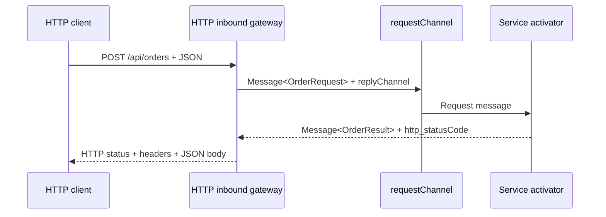

# HTTP status code và response entity

## 1. HTTP status và response nằm ở đâu trong Spring Integration?

Trong chương **Adapter HTTP** của module **SPRING_INTEGRATION_ADAPTERS**, các inbound/outbound adapter, gateway, poller và `MessageChannel` giúp Spring Integration trao đổi dữ liệu với hệ thống bên ngoài. Các flow có thể kết nối HTTP với file, SFTP, JMS, AMQP, Kafka hoặc cơ sở dữ liệu. Với HTTP, ngoài payload, người triển khai phải hiểu **mã trạng thái phản hồi**, **response headers** và **response body**, vì đây là hợp đồng mà HTTP client hoặc hệ thống downstream quan sát được.

Một HTTP response có cấu trúc:

```http
HTTP/1.1 201 Created
Content-Type: application/json
Location: /api/orders/ORD-1001
X-Request-ID: req-123

{"orderId":"ORD-1001","status":"CREATED"}
```

Bốn thông tin cần phân biệt:

- **Status code** (`201`): kết quả của yêu cầu ở cấp giao thức/hợp đồng HTTP.
- **Headers** (`Content-Type`, `Location`, `X-Request-ID`): metadata của phản hồi.
- **Body** (JSON): dữ liệu nghiệp vụ, khi loại phản hồi cho phép có body.
- **Spring Integration reply message**: `Message<?>` mang payload và headers để gateway chuyển thành HTTP response, hoặc để handler tiếp tục xử lý sau một HTTP outbound call.

Bài này giải thích cách ánh xạ những thành phần đó trong Spring Integration, đặc biệt là **`http_statusCode`** và **`org.springframework.http.ResponseEntity<T>`**. Sau khi học, bạn có thể đặt HTTP status cho inbound gateway, đọc status/body của outbound gateway, phân biệt phản hồi không có body, xử lý lỗi và viết kiểm thử theo hợp đồng.

> **Nguyên tắc:** HTTP status code mô tả điều hệ thống cam kết tại thời điểm trả lời. Một mã `200` hay `202` không tự bảo đảm database hoặc dịch vụ phía sau đã hoàn tất mọi bước nghiệp vụ.

## 2. Status code không phải payload

HTTP status là số nguyên gồm ba chữ số. Các nhóm chính:

| Nhóm | Ý nghĩa chung | Ví dụ |
|---|---|---|
| `1xx` | Phản hồi thông tin trong quá trình trao đổi HTTP | `100 Continue` |
| `2xx` | Request đã được xử lý thành công theo ngữ nghĩa status cụ thể | `200 OK`, `201 Created`, `202 Accepted`, `204 No Content` |
| `3xx` | Chuyển hướng hoặc xử lý điều kiện cache | `301 Moved Permanently`, `302 Found`, `304 Not Modified` |
| `4xx` | Request có vấn đề ở phía client hoặc vi phạm điều kiện hợp đồng | `400 Bad Request`, `401 Unauthorized`, `403 Forbidden`, `404 Not Found`, `409 Conflict`, `429 Too Many Requests` |
| `5xx` | Server hoặc một upstream dependency không hoàn thành yêu cầu | `500 Internal Server Error`, `502 Bad Gateway`, `503 Service Unavailable`, `504 Gateway Timeout` |

Một số status thường gặp trong luồng tích hợp:

| Status | Dùng khi | Lưu ý |
|---|---|---|
| `200 OK` | API xử lý thành công và trả nội dung kết quả | Có thể trả JSON/chuỗi theo `Content-Type`. |
| `201 Created` | Tài nguyên mới thực sự được tạo | Thường kèm ID tài nguyên và có thể có header `Location`. |
| `202 Accepted` | Yêu cầu được tiếp nhận để xử lý sau | Chưa nói công việc đã hoàn tất; nên có job ID hoặc cách tra cứu. |
| `204 No Content` | Xử lý thành công nhưng không có representation trong body | Không được gửi response body. |
| `400 Bad Request` | Cú pháp hoặc dữ liệu đầu vào không hợp lệ | Định nghĩa error body và validation tường minh. |
| `401/403` | Thiếu xác thực hoặc không có quyền | Chặn ở security boundary thích hợp. |
| `404 Not Found` | Không có tài nguyên/route theo hợp đồng | Phân biệt sai URL với ID tài nguyên không tồn tại. |
| `409 Conflict` | Conflict về phiên bản/trạng thái hoặc idempotency | Nêu điều kiện gây xung đột. |
| `422 Unprocessable Content` | Body có cú pháp hợp lệ nhưng vi phạm ngữ nghĩa API | Dùng nếu hợp đồng chọn 422 thay cho 400. |
| `429 Too Many Requests` | Bị giới hạn tốc độ | Có thể đi kèm `Retry-After`. |
| `500/503/504` | Lỗi hệ thống, dịch vụ không khả dụng hoặc timeout | Không được khẳng định mọi timeout mặc định là 504. |

**Phân biệt status và business status:** `HTTP 200` có thể chứa body `{"paymentStatus":"DECLINED"}` nếu đó là hợp đồng của API, mặc dù thao tác truy vấn/thử thanh toán được xử lý theo một cách xác định. Ngược lại, không nên gửi `200` nếu mọi tầng đều thất bại mà hợp đồng yêu cầu báo lỗi HTTP. Chọn status theo ngữ nghĩa API, không theo thói quen luôn trả 200.

## 3. Message, ResponseEntity và HttpHeaders: ba lớp dữ liệu khác nhau

Spring có các kiểu dữ liệu thường gặp:

| Kiểu | Nằm ở đâu? | Cung cấp gì? |
|---|---|---|
| `org.springframework.messaging.Message<T>` | Spring Integration flow | `payload` và `MessageHeaders` để định tuyến và xử lý. |
| `org.springframework.http.ResponseEntity<T>` | Spring HTTP client/server APIs | `statusCode`, `HttpHeaders` và `body` của một HTTP response. |
| `org.springframework.http.HttpHeaders` | HTTP boundary | HTTP headers như `Content-Type`, `ETag`, `Location`, `Retry-After`. |
| `org.springframework.http.HttpStatusCode` | Spring Framework 6+ | Trừu tượng cho mã HTTP status, kể cả mã không thuộc enum chuẩn. |
| `org.springframework.http.HttpStatus` | Spring Framework | Enum các HTTP status đã biết như `OK`, `CREATED`, `BAD_REQUEST`. |

Ví dụ tạo một `ResponseEntity` trong Spring MVC hoặc khi cần mô tả HTTP response:

```java
import java.net.URI;
import org.springframework.http.MediaType;
import org.springframework.http.ResponseEntity;

ResponseEntity<String> httpResponse =
    ResponseEntity.created(URI.create("/api/orders/ORD-1001"))
        .contentType(MediaType.APPLICATION_JSON)
        .body("{\"orderId\":\"ORD-1001\"}");

int code = httpResponse.getStatusCode().value(); // 201
String location =
    httpResponse.getHeaders().getLocation().toString();
String body = httpResponse.getBody();
```

**Đừng đồng nhất `ResponseEntity` với reply message.** Trong một Spring MVC `@RestController`, framework có thể dùng `ResponseEntity` làm giá trị trả về để xây HTTP response. Trong một **Spring Integration HTTP inbound gateway**, đường đi được tài liệu mô tả là **reply `Message<?>` → payload/headers → HTTP response**; cách đặt status rõ ràng là dùng header `http_statusCode`. Đưa cả `ResponseEntity` vào reply payload khi chưa xác định cơ chế extraction có thể khiến client nhận dữ liệu không đúng hợp đồng.

Ngược lại, **HTTP outbound gateway** có thể tạo reply message với payload là `ResponseEntity<?>` khi muốn giữ toàn bộ HTTP status/headers/body. Đây là tình huống rất hữu ích cho việc phân nhánh theo status.

## 4. Mapping status ở HTTP inbound gateway

### 4.1. Đường đi của reply



Trên chiều inbound, gateway thường thực hiện:

1. Spring MVC chọn endpoint dựa trên path, HTTP method, `consumes` và `produces`.
2. HTTP converter chuyển body thành payload Java.
3. Gateway đưa message vào request channel và đợi reply.
4. Service activator trả payload hoặc `Message<?>`.
5. Gateway đọc **header `http_statusCode` từ reply message** và dùng converter cùng header mapper để tạo HTTP response.

Tên header đặc biệt **`http_statusCode`** là điểm kết nối giữa Spring Integration và status HTTP. Đây là metadata nội bộ trong message, không phải header HTTP nguyên văn gửi ra client.

### 4.2. Ví dụ thực hành: trả JSON và mã 200/400

Ví dụ dùng Java 17+, Spring Boot có Spring MVC, Spring Integration và Jackson. Mục tiêu là **kiểm tra payload** và trả status phù hợp; chưa tạo hay lưu đơn hàng nên response thành công trả `200 OK`, không dùng `201 Created`.

Với dự án có Spring Boot dependency management, các Maven dependencies chính:

```xml
<dependencies>
    <dependency>
        <groupId>org.springframework.boot</groupId>
        <artifactId>spring-boot-starter-web</artifactId>
    </dependency>
    <dependency>
        <groupId>org.springframework.boot</groupId>
        <artifactId>spring-boot-starter-integration</artifactId>
    </dependency>
    <dependency>
        <groupId>org.springframework.integration</groupId>
        <artifactId>spring-integration-http</artifactId>
    </dependency>
</dependencies>
```

Tạo `OrderDtos.java`:

```java
package example.http;

public final class OrderDtos {
    private OrderDtos() {}

    public record OrderRequest(String sku, int quantity) {}

    public record OrderResult(String sku, String status) {}

    public record ApiError(String code, String message) {}
}
```

Tạo `OrderInboundConfiguration.java`:

```java
package example.http;

import org.springframework.context.annotation.Bean;
import org.springframework.context.annotation.Configuration;
import org.springframework.http.HttpMethod;
import org.springframework.http.MediaType;
import org.springframework.integration.annotation.EnableIntegration;
import org.springframework.integration.channel.DirectChannel;
import org.springframework.integration.dsl.IntegrationFlow;
import org.springframework.integration.http.dsl.Http;
import org.springframework.messaging.MessageChannel;

@Configuration
@EnableIntegration
public class OrderInboundConfiguration {

    @Bean
    public MessageChannel orderValidationRequests() {
        return new DirectChannel();
    }

    @Bean
    public IntegrationFlow orderValidationHttpFlow() {
        return IntegrationFlow
            .from(Http.inboundGateway("/api/orders/validate")
                .requestMapping(mapping -> mapping
                    .methods(HttpMethod.POST)
                    .consumes(MediaType.APPLICATION_JSON_VALUE)
                    .produces(MediaType.APPLICATION_JSON_VALUE))
                .requestPayloadType(OrderDtos.OrderRequest.class))
            .channel("orderValidationRequests")
            .get();
    }
}
```

Tạo `OrderValidationHandler.java` trong package được Spring Boot scan:

```java
package example.http;

import org.springframework.http.HttpStatus;
import org.springframework.http.MediaType;
import org.springframework.integration.annotation.ServiceActivator;
import org.springframework.messaging.Message;
import org.springframework.messaging.MessageHeaders;
import org.springframework.messaging.support.MessageBuilder;
import org.springframework.stereotype.Service;

@Service
public class OrderValidationHandler {

    @ServiceActivator(inputChannel = "orderValidationRequests")
    public Message<?> validate(OrderDtos.OrderRequest request) {
        if (request.sku() == null || request.sku().isBlank()
                || request.quantity() <= 0) {

            return MessageBuilder
                .withPayload(new OrderDtos.ApiError(
                    "INVALID_ORDER",
                    "sku is required and quantity must be positive"))
                .setHeader("http_statusCode", HttpStatus.BAD_REQUEST)
                .setHeader(
                    MessageHeaders.CONTENT_TYPE,
                    MediaType.APPLICATION_JSON_VALUE)
                .build();
        }

        // Demo chỉ kiểm tra dữ liệu; chưa lưu đơn hàng vào database.
        return MessageBuilder
            .withPayload(
                new OrderDtos.OrderResult(request.sku(), "VALIDATED"))
            .setHeader("http_statusCode", HttpStatus.OK)
            .setHeader(
                MessageHeaders.CONTENT_TYPE,
                MediaType.APPLICATION_JSON_VALUE)
            .build();
    }
}
```

Cấu hình này minh họa **hai kết quả đều là reply message hợp lệ**. Với message được trả về từ `@ServiceActivator`, Spring Integration định tuyến reply về gateway đang đợi. Gateway chọn HTTP status dựa trên `http_statusCode`, sau đó converter serialize DTO thành JSON.

Lưu ý: handler tự trả `BAD_REQUEST` cho ràng buộc nghiệp vụ. Nếu body **không parse được JSON** hoặc không thể tạo `OrderRequest`, lỗi có thể xuất hiện **trước khi** `@ServiceActivator` được gọi; trường hợp đó cần HTTP exception mapping hoặc error flow riêng.

### 4.3. Thử hai loại response bằng curl

Request hợp lệ:

```bash
curl -i -X POST 'http://localhost:8080/api/orders/validate' \
  -H 'Content-Type: application/json' \
  -H 'Accept: application/json' \
  -d '{"sku":"BOOK-1","quantity":2}'
```

Response dự kiến:

```http
HTTP/1.1 200 OK
Content-Type: application/json

{"sku":"BOOK-1","status":"VALIDATED"}
```

Request có quantity không hợp lệ:

```bash
curl -i -X POST 'http://localhost:8080/api/orders/validate' \
  -H 'Content-Type: application/json' \
  -H 'Accept: application/json' \
  -d '{"sku":"BOOK-1","quantity":0}'
```

Response dự kiến:

```http
HTTP/1.1 400 Bad Request
Content-Type: application/json

{"code":"INVALID_ORDER","message":"sku is required and quantity must be positive"}
```

Mã HTTP và body ở đây được **thiết kế tường minh trong handler**. Đây không phải hành vi mặc định áp dụng cho mọi exception. Các HTTP headers phụ như `Content-Length`, `Date` hoặc thứ tự field JSON phụ thuộc HTTP server và converter.

### 4.4. Khi nào trả 201 Created?

Chỉ sau khi thật sự tạo tài nguyên theo hợp đồng, ví dụ DB transaction đã commit thành công hoặc bước lưu đã đạt mốc được cam kết. Khi đó có thể tạo reply:

```java
import org.springframework.http.HttpStatus;
import org.springframework.messaging.Message;
import org.springframework.messaging.support.MessageBuilder;

Message<OrderDtos.OrderResult> reply =
    MessageBuilder
        .withPayload(
            new OrderDtos.OrderResult(savedOrderId, "CREATED"))
        .setHeader("http_statusCode", HttpStatus.CREATED)
        .build();

return reply;
```

Đây là đoạn **thay thế trong handler nghiệp vụ sau khi lưu thành công**, trong đó `savedOrderId` phải được lấy từ bước persistence thật. Để trả `Location: /api/orders/{id}`, cần khai báo response header mapping phù hợp trong inbound endpoint hoặc cấu hình header tương ứng theo hợp đồng và kiểm chứng bằng HTTP test. Chỉ đặt `CREATED` vào body trong khi chưa lưu tài nguyên có thể khiến client hiểu sai mốc thành công.

## 5. Inbound channel adapter: status của một chiều

**HTTP inbound channel adapter** đưa request vào Spring Integration dưới dạng message nhưng **không nhận reply message nghiệp vụ** để tạo response. Dù vậy, HTTP client vẫn nhận được status ở cấp giao thức.

Theo tài liệu Spring Integration, một inbound adapter bình thường có status mặc định **`200 OK`** nếu không cấu hình khác. Có thể dùng `statusCodeExpression` để trả một status xác định, ví dụ `202 Accepted`:

```java
@Bean
public IntegrationFlow eventInboundFlow() {
    return IntegrationFlow
        .from(Http.inboundChannelAdapter("/api/events")
            .requestMapping(m -> m.methods(HttpMethod.POST))
            .requestPayloadType(String.class)
            .statusCodeExpression(
                "T(org.springframework.http.HttpStatus).ACCEPTED"))
        .channel("incomingEvents")
        .get();
}
```

Đoạn mã này cần đặt trong class `@Configuration` có import `IntegrationFlow`, `Http`, `HttpMethod`, và bean `incomingEvents` cùng consumer phù hợp. Đây là ví dụ thể hiện **HTTP status ở cấp endpoint**, không phải cấu hình một response body nghiệp vụ.

**Cảnh báo ngữ nghĩa:** đặt `202 Accepted` không tự động làm xử lý bất đồng bộ hoặc bền vững. Nếu message chỉ được đẩy vào queue trong bộ nhớ, restart có thể làm mất việc đã được “accepted”. Khi hợp đồng `202` phải đảm bảo đã tiếp nhận bền vững, hãy ghi inbox/outbox hoặc publish broker có xác nhận trước khi tạo acknowledgment.

`statusCodeExpression` trên inbound endpoint còn được dùng trong tình huống **gateway không nhận được reply trước timeout**, nhưng với gateway request–reply có reply bình thường thì **`http_statusCode` trên reply message** mới là nguồn xác định HTTP status.

## 6. ResponseEntity ở HTTP outbound gateway

### 6.1. Khi nào reply payload là body và khi nào là ResponseEntity?

Giả sử một flow nội bộ gọi Pricing API hoặc Inventory API bên ngoài bằng `Http.outboundGateway(...)`. HTTP client nhận:

```http
HTTP/1.1 200 OK
Content-Type: application/json
ETag: "inventory-v3"

{"sku":"BOOK-1","available":true}
```

`HttpRequestExecutingMessageHandler` dùng HTTP client để thực hiện request, sau đó tạo Spring Integration **reply message**.

Có các cách tiếp nhận:

| Cấu hình/response | Reply payload điển hình |
|---|---|
| `expectedResponseType(InventoryReply.class)`, response 200 có JSON body, `extractResponseBody=true` (mặc định) | `InventoryReply` (DTO đã được convert). |
| `expectedResponseType(String.class)`, response 200 có text body | `String`. |
| `extractResponseBody(false)`, response thành công | **`ResponseEntity<?>`**, giữ status, HTTP headers và body. |
| Response **không có body**, ví dụ `204 No Content` | **`ResponseEntity<?>`** ngay cả khi cấu hình `expectedResponseType` và `extractResponseBody=true`. |
| Response 4xx/5xx với error handler HTTP client mặc định | Thường **ném exception**, không tạo reply payload bình thường. |

Hai chi tiết theo tài liệu Spring Integration rất dễ bỏ sót:

1. Khi body có dữ liệu, `expectedResponseType` phải phù hợp `Content-Type` và `HttpMessageConverter`. Nếu không đặt kiểu phản hồi thích hợp, gateway có thể trả `ResponseEntity` không chứa body đã convert theo kỳ vọng.
2. Từ Spring Integration **5.5**, `extractResponseBody` cho phép chọn reply payload là **body** hay toàn bộ **`ResponseEntity`**; khi body vắng mặt, handler vẫn trả `ResponseEntity`.

Dù response có body hay không, **header `http_statusCode` trên reply message của outbound gateway** cung cấp HTTP status để downstream có thể phân nhánh. Những header HTTP khác được ánh xạ tùy cấu hình mapper.

### 6.2. Ví dụ outbound gateway giữ toàn bộ ResponseEntity

Mock Inventory API tại `http://localhost:8081/inventory/{sku}` trả JSON khi tìm thấy item. Chúng ta muốn giữ status và `ETag` để phục vụ cache hoặc xử lý nghiệp vụ.

Tạo `InventoryReply.java`:

```java
package example.http;

public record InventoryReply(String sku, boolean available) {}
```

Tạo interface `InventoryClient.java`:

```java
package example.http;

import org.springframework.integration.annotation.MessagingGateway;
import org.springframework.messaging.Message;

@MessagingGateway(defaultRequestChannel = "inventoryLookups")
public interface InventoryClient {

    Message<?> lookup(String sku);
}
```

Cấu hình flow `InventoryOutboundConfiguration.java`:

```java
package example.http;

import org.springframework.context.annotation.Bean;
import org.springframework.context.annotation.Configuration;
import org.springframework.http.HttpMethod;
import org.springframework.integration.annotation.EnableIntegration;
import org.springframework.integration.annotation.IntegrationComponentScan;
import org.springframework.integration.dsl.IntegrationFlow;
import org.springframework.integration.http.dsl.Http;

@Configuration
@EnableIntegration
@IntegrationComponentScan
public class InventoryOutboundConfiguration {

    @Bean
    public IntegrationFlow inventoryLookupFlow() {
        return IntegrationFlow.from("inventoryLookups")
            .handle(Http.outboundGateway(
                    "http://localhost:8081/inventory/{sku}")
                .httpMethod(HttpMethod.GET)
                .uriVariable("sku", "payload")
                .expectedResponseType(InventoryReply.class)
                .extractResponseBody(false))
            .get();
    }
}
```

Bước tiêu thụ reply:

```java
import org.springframework.http.HttpStatusCode;
import org.springframework.http.ResponseEntity;
import org.springframework.messaging.Message;

Message<?> reply = inventoryClient.lookup("BOOK-1");

if (!(reply.getPayload() instanceof ResponseEntity<?> entity)) {
    throw new IllegalStateException(
        "Expected ResponseEntity as reply payload");
}

HttpStatusCode status = entity.getStatusCode();
String etag = entity.getHeaders().getETag();
Object body = entity.getBody();

if (status.is2xxSuccessful() && body instanceof InventoryReply data) {
    // Kiểm tra tồn kho và ETag theo hợp đồng Inventory API.
    System.out.println(data.sku() + " / " + data.available());
}
```

Đoạn tiêu thụ nằm trong service có instance `InventoryClient inventoryClient` được inject; import và package cần được điều chỉnh cho dự án. Mock HTTP service cần trả JSON hợp lệ cùng `Content-Type: application/json`. `HttpStatusCode` là API trong Spring Framework 6+, phù hợp với Java 17/Spring Boot 3+ của ví dụ.

Nếu chỉ cần `InventoryReply` trong nghiệp vụ và không cần HTTP headers/status, có thể **bỏ `extractResponseBody(false)`** và để inbound messaging gateway client trả DTO. Đó là contract đơn giản hơn.

### 6.3. Trường hợp 204 No Content và 304 Not Modified

Một HTTP response không có body:

```http
HTTP/1.1 204 No Content
ETag: "inventory-v3"
```

Trong HTTP outbound gateway, reply payload có thể là một **`ResponseEntity`** có `getBody()==null`, kể cả khi flow khai báo `expectedResponseType(InventoryReply.class)`. Vì vậy, code như sau không an toàn nếu dịch vụ đôi khi trả 204:

```java
InventoryReply data = (InventoryReply) reply.getPayload();
```

Hãy kiểm tra kiểu và status trước khi ép kiểu. Với `304 Not Modified`, các quy tắc no-body cũng cần được xem xét, nhưng cách HTTP client xử lý 3xx/redirect/caching có thể khác; đừng mặc định mọi client luôn chuyển `304` thành reply message bình thường.

Để xử lý rõ ràng:

```java
Object payload = reply.getPayload();

if (payload instanceof ResponseEntity<?> response) {
    int status = response.getStatusCode().value();
    if (status == 204) {
        // Không có body: xử lý theo hợp đồng.
    } else {
        // Kiểm tra response và body nếu có.
    }
} else if (payload instanceof InventoryReply data) {
    // Response có body và gateway đang ở chế độ extract body.
}
```

Trong thực tế, không nhất thiết phải dùng cả hai nhánh nếu bạn cố định `extractResponseBody(false)`. Ví dụ hai nhánh minh họa cách xử lý khi flow có thể tạo **hai loại payload** tùy cách cấu hình và HTTP response.

## 7. So sánh hai cách biểu diễn status trên inbound và outbound

| Tình huống | Nguồn HTTP status | Định dạng dữ liệu |
|---|---|---|
| **Inbound channel adapter** tiếp nhận one-way | Status mặc định của endpoint hoặc `statusCodeExpression` | Không có reply message nghiệp vụ. |
| **Inbound gateway** có reply bình thường | **Reply header `http_statusCode`** | Reply payload được converter ghi thành HTTP body. |
| **Inbound gateway** hết thời gian chờ reply | Quy tắc timeout status hoặc error flow được cấu hình | Có thể trả 500 mặc định; status/body custom cần cấu hình. |
| **Outbound channel adapter** gửi one-way | HTTP client vẫn nhận status, nhưng không phát reply message từ body | Lỗi non-2xx có thể ném exception tùy client. |
| **Outbound gateway** có body và extract body | Status trong reply header; payload là body được converter đọc | Thường là DTO/`String`. |
| **Outbound gateway** với `extractResponseBody(false)` | Status trong `ResponseEntity` và reply header | Payload là `ResponseEntity<?>`. |
| **Outbound gateway** nhận no-body response | Status trong `ResponseEntity` và reply header | Payload có thể là `ResponseEntity<?>` bất kể expected type. |

Điểm dễ sai: **`http_statusCode` là header Spring Integration**, còn `ResponseEntity.getStatusCode()` là dữ liệu HTTP đã được đóng gói trong một Java object. Chúng có thể cùng diễn tả một mã status, nhưng không phải cùng một vị trí lưu trữ.

## 8. Timeout và reply không đến

Với HTTP inbound gateway, nếu downstream không trả reply trước khi hết `replyTimeout`, request không có body nghiệp vụ để phản hồi. Theo tài liệu Spring Integration, từ phiên bản 4.2, tình huống timeout không có reply **mặc định trả `500 Internal Server Error`**, và có thể cấu hình status code expression hoặc error channel để thay đổi.

Ví dụ ý tưởng cho API muốn trả 504 khi xử lý quá deadline:

```text
HTTP inbound gateway
   -> request channel
   -> async worker
   -> reply quá chậm / không có reply
   -> timeout policy / error channel
   -> HTTP 504 Gateway Timeout theo contract API
```

Việc đặt status `504` là **quyết định hợp đồng của ứng dụng**, không phải mặc định duy nhất của framework.

Cần phân biệt:

| Timeout | Phạm vi | Ví dụ |
|---|---|---|
| `requestTimeout` của inbound gateway | Đợi gửi request message vào một channel có thể chặn | Queue bounded đầy. |
| `replyTimeout` của inbound gateway | Đợi reply message từ downstream | Worker không trả kết quả kịp. |
| HTTP connect timeout của outbound gateway | Thiết lập kết nối với remote service | Partner API không thể kết nối. |
| HTTP read/response timeout của outbound gateway | Chờ HTTP response | Partner API phản hồi quá chậm. |
| Servlet/proxy/client deadline | Giới hạn HTTP connection từ client bên ngoài | Nginx/ALB hoặc client timeout trước. |

**`replyTimeout` không tự ngắt một handler đang block đồng bộ trong `DirectChannel`.** Muốn bảo đảm latency ở HTTP boundary, phải cấu hình deadline thực tế ở các HTTP client/database/broker phía sau và cân nhắc channel đồng bộ hay bất đồng bộ.

## 9. HTTP lỗi có được trả dưới dạng ResponseEntity hay không?

Đây là chỗ rất dễ hiểu nhầm:

- **HTTP inbound gateway:** service activator **có thể chủ động tạo reply message** với `http_statusCode=400` hoặc `503` và payload `ApiError`. Gateway chuyển nó thành HTTP response bình thường theo contract.
- **HTTP outbound gateway:** khi remote server trả 4xx/5xx, `RestTemplate` và nhiều HTTP clients với default error handler **thường ném exception**. Flow có thể **không nhận được** reply payload `ResponseEntity` cho những status này.
- **Custom HTTP client/error handler:** có thể thay đổi chính sách để nhận và xử lý một số HTTP status như dữ liệu, nhưng phải cấu hình và kiểm thử cụ thể theo phiên bản Spring Integration/Spring Framework.

Vì vậy, code:

```java
ResponseEntity<?> response = (ResponseEntity<?>) reply.getPayload();
if (response.getStatusCode().value() == 404) {
    // ...
}
```

**không phải cách đáng tin cậy mặc định** để xử lý mọi HTTP 404 từ outbound gateway: default error handler có thể ném exception trước khi tạo reply.

### 9.1. Phân loại lỗi và phản ứng

| Kết quả từ remote HTTP | Phân loại | Cách xử lý gợi ý |
|---|---|---|
| 200 JSON hợp lệ | Thành công ở cấp HTTP | Parse, validate semantic contract, tiếp tục flow. |
| 201 với Location | Tài nguyên đã tạo theo hợp đồng remote | Lưu ID/Location và kiểm tra tính nhất quán. |
| 202 | Đã nhận xử lý bất đồng bộ | Lưu job ID/poll hoặc callback theo hợp đồng. |
| 204 | Không có body | Chấp nhận kiểu reply `ResponseEntity`; không ép sang DTO. |
| 400/422 | Dữ liệu/schema không hợp lệ | Sửa request, không retry vô điều kiện. |
| 401/403 | Auth/authorization lỗi | Kiểm tra credential/scope; không retry mù quáng. |
| 404 | Tài nguyên không tồn tại hoặc URL sai | Quyết định theo hợp đồng là expected miss hay lỗi. |
| 409 | Xung đột phiên bản/idempotency | Kiểm tra key, trạng thái remote và nghiệp vụ. |
| 429 | Bị rate-limit | Retry có giới hạn, xét `Retry-After` và backoff. |
| 500/503 | Remote không khả dụng | Retry có giới hạn/circuit breaker, ghi nhận lỗi. |
| Timeout/mất response | Không biết chắc remote đã thực hiện side effect | Idempotency key, truy vấn trạng thái trước khi retry. |

**Không coi HTTP 2xx là bằng chứng hoàn thành giao dịch phân tán.** Nếu flow vừa ghi DB vừa gọi HTTP rồi publish JMS/Kafka, các thao tác không tự nằm trong một transaction duy nhất; cần định nghĩa commit point, outbox, retry và cơ chế chống trùng.

### 9.2. Error message khác reply message

Trong Spring Integration, message bình thường có thể mang business result; error flow thường nhận `ErrorMessage` có exception làm payload. Để đưa error thành HTTP response JSON ở inbound gateway, cần **biến lỗi thành payload có thể serialize**, đặt status tương ứng và định tuyến về gateway đang chờ. Không mặc định rằng chỉ cần bean global `errorChannel` là mọi exception tự trở thành body lỗi đúng hợp đồng.

Một cấu trúc error body nên ổn định:

```json
{
  "code": "UPSTREAM_UNAVAILABLE",
  "message": "Pricing service is temporarily unavailable",
  "requestId": "req-123"
}
```

Không trả stack trace, SQL details, token hoặc thông tin nội bộ nhạy cảm cho client. Giữ correlation/request ID trong log và response headers theo chính sách.

## 10. Response headers và content negotiation

HTTP response không chỉ có status và body. Một số headers quan trọng:

| Header | Dùng khi | Chú ý |
|---|---|---|
| `Content-Type` | Cho biết định dạng body | Phải tương thích body và converter. |
| `Location` | Tài nguyên mới được tạo hoặc redirect | Khi 201, nên trỏ tới tài nguyên theo contract. |
| `ETag` | Cache validation/optimistic concurrency | Hợp đồng khi dùng `If-None-Match`/`If-Match` cần xác định rõ. |
| `Cache-Control` | Kiểm soát khả năng cache | Tránh cache dữ liệu nhạy cảm không đúng chính sách. |
| `Retry-After` | Gợi ý thời điểm thử lại, thường với 429/503 | Cần parse đúng dạng giây hoặc HTTP-date. |
| `X-Request-ID` / trace header | Correlation, quan sát request | Không chứa thông tin bí mật hay dữ liệu nhận dạng nhạy cảm. |
| `Set-Cookie` | Session/stateful integration khi có | Không tự chuyển cookie giữa các dịch vụ khi không cần. |

Với inbound gateway, `mappedResponseHeaders(...)` xác định những message headers nào được ánh xạ thành HTTP response headers. Với outbound gateway, `mappedResponseHeaders(...)` xác định HTTP response headers nào được đưa vào reply message. Cùng tên API nhưng **chiều ánh xạ phụ thuộc inbound hay outbound**.

**Header đặc biệt `http_statusCode` được xử lý riêng để xác định HTTP status**; đừng xem nó như một header tùy biến cần hiển thị ra HTTP client dưới tên `http_statusCode`.

Với response body JSON, `Accept: application/json` và mapping `produces(application/json)` giúp chọn representation, nhưng việc serialize phụ thuộc HTTP message converter. Ngược lại, một `204 No Content` không nên cố trả JSON chỉ vì client đã gửi `Accept: application/json`.

## 11. Vòng đời, bảo mật và quan sát

HTTP endpoint là một phần của Spring application context. Inbound mapping được đăng ký khi ứng dụng khởi động; outbound handler tạo HTTP request khi có message đến channel. Trạng thái hoạt động của endpoint **không đồng nghĩa** remote service, database hoặc broker downstream đang sẵn sàng.

Những điểm cần kiểm soát khi vận hành:

1. **Contract status:** định nghĩa rõ khi nào trả 200, 201, 202, 204, 4xx, 5xx; tách acknowledgment với hoàn tất nghiệp vụ.
2. **Validation:** lỗi parse/body/schema phải được xử lý cả trước và sau channel; tránh giả định mọi lỗi đều xuất hiện ở service activator.
3. **Timeout:** giới hạn request/reply và HTTP client deadline; theo dõi late reply từ executor/poller.
4. **Retry/idempotency:** client có thể retry sau timeout dù remote đã xử lý. Sử dụng request/event ID ổn định và dedup khi có side effect.
5. **Security:** authentication, authorization, mTLS/OAuth2, CORS nếu cần; kiểm soát headers được phản hồi để không lộ token/cookie.
6. **Giới hạn tài nguyên:** body size, HTTP connection pool, concurrency, queue capacity; tránh hệ thống bị chặn khi remote chậm.
7. **Metrics/log:** đo status theo nhóm 2xx/4xx/5xx, latency, timeout, retry, conversion error và correlation ID mà không log payload nhạy cảm.
8. **Giao dịch:** nếu HTTP flow ghi file/SFTP, JMS, AMQP, Kafka hoặc DB, lập kế hoạch bù trừ/outbox và mốc cam kết riêng cho mỗi hệ thống.

Khi cần trả `202 Accepted` cho một task chạy nhiều phút, hãy lưu bền vững task ID và trạng thái trước khi trả response. Khi client cần kết quả ngay, dùng inbound gateway request–reply nhưng phải đảm bảo toàn bộ downstream có thể đáp ứng trong deadline đã công bố.

## 12. Kiểm thử HTTP status và ResponseEntity

Một bộ kiểm thử tối thiểu nên bao phủ cả **HTTP boundary** lẫn **payload/headers trong Spring Integration**.

### 12.1. Inbound gateway

| Kịch bản | Assertion |
|---|---|
| Body hợp lệ | HTTP 200; response JSON có `sku` và `VALIDATED`. |
| `quantity=0` | HTTP 400 và JSON error contract; handler được gọi. |
| JSON sai cú pháp | Lỗi xảy ra trước handler; HTTP error mapping phải xác định. |
| Method sai | Mapping trả HTTP status phù hợp, thường 405. |
| `Content-Type` sai | Không khớp `consumes`, thường 415. |
| `Accept` không phù hợp | Content negotiation, thường 406. |
| Handler tạo reply header `http_statusCode` | HTTP status đúng giá trị header. |
| Handler không trả reply | Timeout status theo cấu hình; không mặc định 504. |
| Reply đến muộn | Không thể thay đổi response đã hoàn tất; ghi nhận late reply. |

### 12.2. Outbound gateway

Dùng mock HTTP service như WireMock hoặc MockWebServer tại `localhost:8081`:

| Mock response | Assertion |
|---|---|
| 200 JSON DTO | `expectedResponseType(InventoryReply.class)` đọc đúng body. |
| 200 JSON có `ETag` | Với `extractResponseBody(false)`, reply payload là `ResponseEntity` và có ETag. |
| 204 No Content | Reply payload xử lý được `ResponseEntity` không body. |
| 304 Not Modified | Kiểm tra behavior của HTTP client/redirect/cache; không giả định 200. |
| 400/404 | Error handler phân loại lỗi đúng; không đợi một reply bình thường nếu client ném exception. |
| 429 + `Retry-After` | Retry policy có giới hạn và không vượt quá budget của caller. |
| 500/503 | Error flow, retry/circuit breaker theo thiết kế. |
| Connection/read timeout | Lỗi hữu hạn, log correlation ID và xử lý tác dụng phụ không xác định. |
| Response body sai schema | Converter/validation không tạo một DTO sai mà không báo lỗi. |

### 12.3. Cách truy vết khi response sai

```text
HTTP client
  -> Request mapping (path / method / media type)
  -> Request converter
  -> Integration request channel
  -> Handler / outbound HTTP client
  -> Reply Message payload + http_statusCode
  -> Reply header mapper / HttpMessageConverter
  -> HTTP status + response headers + body
```

Nếu **status sai nhưng body đúng**, kiểm tra `http_statusCode` trên reply, chính sách timeout và exception resolver. Nếu **status đúng nhưng body sai**, kiểm tra reply payload type, HTTP converter, `Content-Type` và việc trích xuất `ResponseEntity`. Nếu **không có reply**, kiểm tra `replyChannel`, timeout, consumer và error flow.

## 13. Những điều cần nhớ

- HTTP response gồm **status, headers và body**; Spring Integration reply message gồm **payload và message headers**. Hai cấu trúc được gateway ánh xạ tại HTTP boundary.
- Với **inbound gateway**, đặt status nghiệp vụ bằng **header `http_statusCode`** trên reply message. Với **inbound channel adapter**, status thường lấy từ endpoint hoặc `statusCodeExpression`.
- Với **outbound gateway**, `expectedResponseType` và converters quyết định kiểu body; `extractResponseBody(false)` giữ **`ResponseEntity<?>`** làm reply payload.
- Khi response **không có body**, outbound gateway có thể trả `ResponseEntity` ngay cả khi đã cấu hình expected response type khác. Luôn xử lý `204` đúng hợp đồng.
- Một số 4xx/5xx có thể khiến HTTP client **ném exception trước khi tạo reply message**; cần error flow và retry riêng.
- Mã `202`, timeout, retry, idempotency và mốc commit phải mô tả chính xác mức bảo đảm nghiệp vụ trên toàn luồng HTTP, database và message broker.

### Tài liệu tham khảo chính thức

- [Spring Integration — HTTP Namespace Support: Response Status Code](https://docs.spring.io/spring-integration/reference/http/namespace.html)
- [Spring Integration — HTTP Outbound Components: Empty Response Bodies, ResponseEntity](https://docs.spring.io/spring-integration/reference/http/outbound.html)
- [Spring Integration — Timeout Handling](https://docs.spring.io/spring-integration/reference/http/timeout.html)
- [Spring Integration — HTTP Header Mappings](https://docs.spring.io/spring-integration/reference/http/header-mapping.html)
- [Spring Integration API — BaseHttpInboundEndpoint](https://docs.spring.io/spring-integration/api/org/springframework/integration/http/inbound/BaseHttpInboundEndpoint.html)
- [Spring Integration API — BaseHttpMessageHandlerSpec](https://docs.spring.io/spring-integration/api/org/springframework/integration/http/dsl/BaseHttpMessageHandlerSpec.html)
