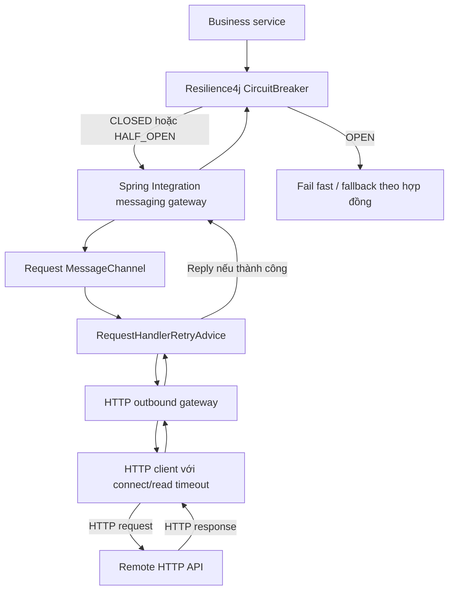
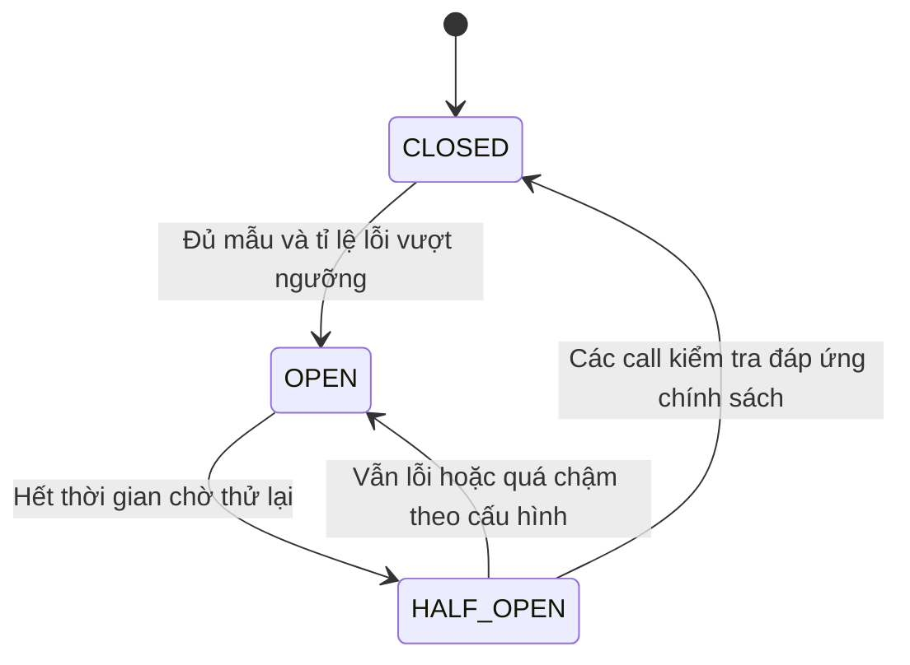
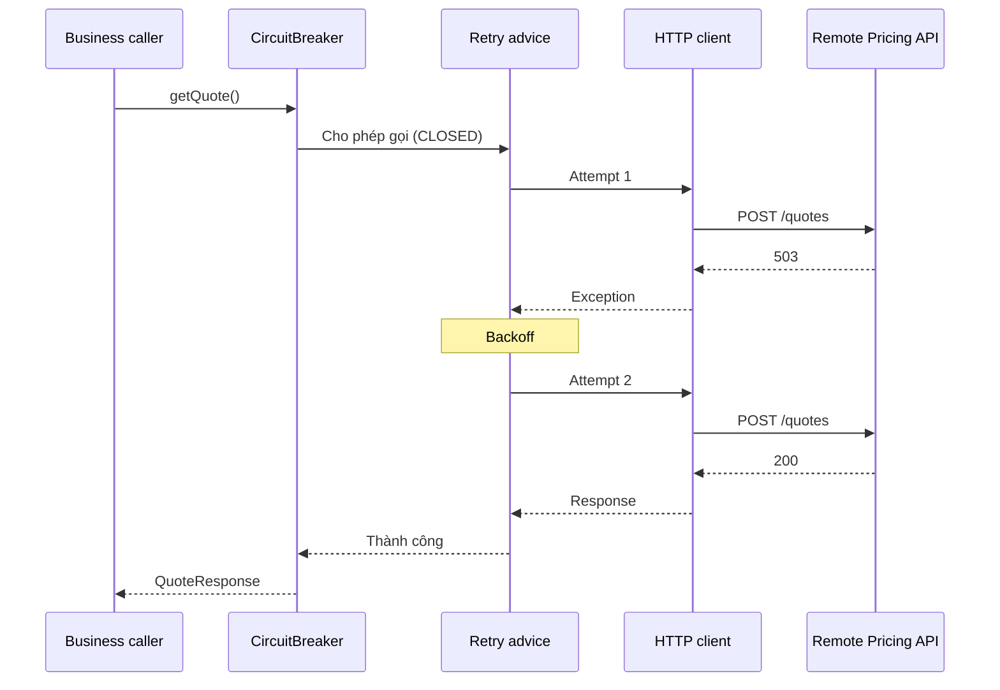

# Timeout retry và circuit breaker cho HTTP

## 1. Vấn đề: một HTTP service chậm có thể kéo sập cả integration flow

Trong module **SPRING_INTEGRATION_ADAPTERS**, Spring Integration dùng inbound/outbound adapter, gateway, poller và `MessageChannel` để trao đổi message với các hệ thống bên ngoài. Một flow có thể nhận yêu cầu HTTP, gọi HTTP service của đối tác rồi ghi cơ sở dữ liệu, gửi JMS/AMQP/Kafka, chuyển file hoặc SFTP. Vì mỗi ranh giới có khả năng lỗi riêng, **chờ vô hạn hay retry thiếu kiểm soát ở bước HTTP** có thể làm nghẽn toàn bộ chuỗi xử lý.

Xét luồng kiểm tra báo giá:

```text
Client -> HTTP inbound gateway -> MessageChannel
       -> HTTP outbound gateway -> Pricing API
       <- JSON báo giá          <- HTTP response
       <- reply message
Client <- HTTP response
```

Nếu Pricing API không phản hồi, có thể xảy ra:

- Thread xử lý request bị giữ lại trong lúc đợi remote server.
- Connection pool và queue dần bị sử dụng hết; nhiều request tốt cũng bị ảnh hưởng.
- Client hết thời gian chờ rồi gửi lại, trong khi request cũ chưa kết thúc.
- Retry đồng loạt khiến một dịch vụ đang quá tải càng khó phục hồi.
- Khi thao tác remote có tác dụng phụ, request đã xử lý nhưng mất response có thể bị gửi lại, dẫn đến tác dụng phụ trùng.

Ba kỹ thuật trong bài xử lý **ba loại vấn đề khác nhau**:

| Kỹ thuật | Câu hỏi được giải quyết | Không tự giải quyết |
|---|---|---|
| **Timeout** | Một lần chờ kết nối/response tối đa trong bao lâu? | Không tự thử lại, không chứng minh remote chưa thực hiện request. |
| **Retry** | Lỗi nào có khả năng tạm thời và nên thử lại tối đa mấy lần? | Không an toàn với side effect nếu thiếu idempotency; không bảo vệ khi retry quá tải. |
| **Circuit breaker** | Khi remote liên tục lỗi/chậm, có nên tạm từ chối gọi mới? | Không hủy tất cả request đang chạy, không tự cung cấp dữ liệu thay thế. |

Sau bài này, bạn sẽ phân biệt các loại timeout, gắn retry advice vào HTTP outbound gateway, dùng circuit breaker để **fail fast**, xác định thứ tự bảo vệ, xây dựng chính sách an toàn với idempotency và kiểm thử lỗi bằng mock HTTP server.

## 2. Kiến trúc kết hợp timeout, retry và circuit breaker



Trong ví dụ kiến trúc này:

1. **Circuit breaker** đứng bên ngoài một lần gọi nghiệp vụ, quyết định có cho phép truy cập Pricing API hay không.
2. **Retry advice** đứng ngay tại outbound HTTP handler, chỉ thử lại khi lỗi phù hợp với chính sách.
3. **HTTP client timeout** giới hạn thời gian của **mỗi attempt**, không phải tự động giới hạn cả vòng retry.
4. Nếu các attempt đều thất bại, lỗi đi về caller; circuit breaker ghi nhận **kết quả cuối cùng của một lần gọi**.
5. Khi breaker mở, call mới bị từ chối sớm, không tạo request tới remote. Caller phải xử lý theo hợp đồng: trả lỗi rõ ràng, dùng cache được phép hoặc chuyển việc sang xử lý sau.

Đặt breaker **bên ngoài retry** có nghĩa breaker thường đếm một lần gọi logic thay vì đếm từng attempt. Đặt breaker **bên trong retry** làm mỗi attempt có thể đi qua breaker; hai cách có ngữ nghĩa metrics và giới hạn tải khác nhau. Không có thứ tự “đúng cho mọi hệ thống”; bài này chọn thứ tự dễ diễn giải và thường hữu ích cho API đồng bộ.

> **Điểm cốt lõi:** one-way HTTP outbound channel adapter và request–reply HTTP outbound gateway đều cần timeout và có thể phát sinh lỗi. “Không tạo reply message” không có nghĩa là HTTP request chạy không chặn hoặc không cần xử lý exception.

## 3. Timeout: giới hạn ở tầng nào?

### 3.1. Các loại timeout dễ nhầm

| Timeout/deadline | Nằm ở đâu? | Khi hết hạn | Điều không bảo đảm |
|---|---|---|---|
| **Connect timeout** | HTTP client outbound | Không thiết lập kết nối trong giới hạn đã đặt. | Không giới hạn toàn bộ thời gian trao đổi. |
| **Read/response timeout** | HTTP client outbound | Không nhận được dữ liệu/response theo timeout của client. | Không nhất thiết là tổng deadline end-to-end, tùy implementation. |
| **Connection-pool acquisition timeout** | Pool của HTTP client | Không mượn được connection từ pool đủ nhanh. | Không được kiểm soát chỉ bằng connect timeout. |
| **`requestTimeout` của messaging gateway** | Spring Integration, bước gửi message | Gửi vào channel có blocking không hoàn tất kịp. | Không đồng nghĩa với connect timeout của HTTP. |
| **`replyTimeout` của messaging gateway** | Spring Integration, bước đợi reply | Không nhận reply message trong khoảng chờ quy định. | Không tự ngắt handler đang chặn trên cùng thread `DirectChannel`. |
| **HTTP server/proxy/client deadline** | Ranh giới inbound từ client | Client/proxy đóng hoặc hủy request. | Không tự rollback side effect ở remote server hay DB. |

**Connect timeout khác read timeout.** Một TCP/TLS connection có thể thiết lập được nhưng remote trì hoãn phản hồi. Ngược lại, read timeout có thể xảy ra sau khi remote đã xử lý request và đang gửi response. Lỗi timeout vì vậy **không chứng minh request chưa có side effect**.

**`replyTimeout` không cắt ngang handler đồng bộ.** Khi request đi qua `DirectChannel`, HTTP outbound handler thường chạy trên thread của caller. Nếu thread này đang block ở HTTP client, một reply timeout ở messaging gateway không phải cơ chế preemption. Phải đặt timeout trực tiếp vào HTTP client và mọi downstream blocking operation.

### 3.2. Lập ngân sách thời gian

Giả sử API inbound có hạn mức phản hồi 4 giây. Flow cần:

- Validate và ánh xạ request: khoảng 100 ms trong tình huống thông thường.
- Gọi Pricing API: nhiều attempt nếu retry.
- Biến đổi kết quả và ghi log: khoảng 100 ms.
- Chừa ngân sách cho queueing, scheduler, reverse proxy và mạng.

Nếu mỗi HTTP attempt có connect timeout 1 giây và read timeout 2 giây, ba lần retry có thể **dễ dàng vượt quá 4 giây**, đặc biệt khi có backoff. Các timeout riêng lẻ không tự cộng thành một deadline thống nhất.

Thiết kế production nên có **deadline tổng thể** theo hợp đồng API và phân bổ budget cho từng attempt. Khi budget không đủ cho attempt tiếp theo, dừng retry, trả trạng thái phù hợp và ghi nhận nguyên nhân. Với tác vụ rất dài, nên chuyển sang cơ chế trả `202 Accepted` sau khi đã lưu bền vững job, cho phép client tra cứu kết quả sau thay vì chờ một request đồng bộ.

### 3.3. Ví dụ cấu hình HTTP client timeout

Với Spring Framework sử dụng `ClientHttpRequestFactory`, có thể khai báo một request factory cấu hình timeout:

```java
package example.http;

import org.springframework.context.annotation.Bean;
import org.springframework.context.annotation.Configuration;
import org.springframework.http.client.ClientHttpRequestFactory;
import org.springframework.http.client.SimpleClientHttpRequestFactory;

@Configuration
public class PartnerHttpClientConfiguration {

    @Bean
    public ClientHttpRequestFactory partnerRequestFactory() {
        SimpleClientHttpRequestFactory factory =
            new SimpleClientHttpRequestFactory();
        factory.setConnectTimeout(1_000); // 1 giây
        factory.setReadTimeout(2_000);    // 2 giây
        return factory;
    }
}
```

Đây là cấu hình minh họa cho HTTP client kiểu Spring `RestTemplate`/request factory, không phải cách duy nhất cấu hình mọi phiên bản Spring Integration. Từ các phiên bản mới, outbound HTTP có hỗ trợ `RestClient` và API tùy biến riêng; hãy đối chiếu phiên bản dự án và **gắn factory vào đúng HTTP client mà handler thực sự sử dụng**.

Với một handler tạo trực tiếp ở những phiên bản hỗ trợ `setRequestFactory(...)`, cấu hình có dạng:

```java
import org.springframework.integration.http.outbound.HttpRequestExecutingMessageHandler;
import org.springframework.http.client.ClientHttpRequestFactory;

HttpRequestExecutingMessageHandler handler =
    new HttpRequestExecutingMessageHandler(
        "https://partner.example/api/quotes");

handler.setRequestFactory(partnerRequestFactory);
```

Đoạn trên chỉ minh họa bước **thiết lập handler**, trong đó `partnerRequestFactory` là bean đã khởi tạo. Cần cấu hình thêm method, response type và đăng ký handler vào channel. Không nên chỉ tạo một `RestTemplate` có timeout rồi giả định HTTP outbound handler tự sử dụng instance ấy.

## 4. Retry: thử lại đúng lỗi, đúng thời điểm

Retry phù hợp với những lỗi **có khả năng tạm thời**. Không nên tự động retry mọi exception phát sinh từ HTTP handler.

### 4.1. Bảng phân loại cơ bản

| Kết quả | Retry mặc định nên cân nhắc? | Vì sao |
|---|---|---|
| Connect timeout / connection refused | **Có điều kiện** | Có thể do mạng hoặc dịch vụ tạm không khả dụng; vẫn cần giới hạn và kiểm soát. |
| Read timeout / mất response | **Có điều kiện, rủi ro trùng** | Remote có thể đã xử lý request nhưng response bị mất. |
| HTTP `500`, `502`, `503`, `504` | Thường **có điều kiện** | Có thể hồi phục, nhưng retry ồ ạt làm tăng tải. |
| HTTP `429 Too Many Requests` | Theo hợp đồng `Retry-After`/rate limit | Không retry ngay lập tức; phải tôn trọng giới hạn đối tác. |
| HTTP `400`, `422` | Thường **không** | Payload/schema sai sẽ không tự sửa bằng retry. |
| HTTP `401`, `403` | Thường **không** | Credential/scope/quyền truy cập cần xử lý riêng. |
| HTTP `404`, `409` | Tùy ngữ nghĩa API | “Chưa tồn tại” hay “xung đột trạng thái” có thể là kết quả nghiệp vụ. |
| Conversion/serialization error | **Không** | Sai DTO, converter hoặc contract cần sửa. |
| `CallNotPermittedException` từ circuit breaker OPEN | **Không** | Breaker chủ ý từ chối, retry ngay sẽ gây tải vô ích. |

Lỗi một lần không nên làm toàn hệ thống thử lại vô hạn. Cần:

- **Max attempts** (kể cả lần đầu).
- **Exponential backoff** để tránh bắn liên tục.
- **Jitter** khi nhiều instance chạy cùng lúc, tránh *thundering herd*.
- **Retryable exception/status classification**, không chỉ dựa vào một nhóm HTTP code cứng nhắc.
- **Deadline tổng**, dừng thử khi ngân sách chờ đã hết.
- **Idempotency** hoặc bằng chứng thao tác có thể lặp an toàn.

### 4.2. Một cấu hình RetryTemplate giới hạn lỗi được phép retry

Spring Integration hỗ trợ `RequestHandlerRetryAdvice` dùng Spring Retry để bao quanh một message handler. Ví dụ sau nhắm tới HTTP client kiểu `RestTemplate`, với lỗi mạng `ResourceAccessException` hoặc phản hồi 5xx được biểu diễn bằng `HttpServerErrorException`.

```java
package example.http;

import java.util.HashMap;
import java.util.Map;

import org.springframework.context.annotation.Bean;
import org.springframework.context.annotation.Configuration;
import org.springframework.integration.handler.advice.RequestHandlerRetryAdvice;
import org.springframework.retry.backoff.ExponentialBackOffPolicy;
import org.springframework.retry.policy.SimpleRetryPolicy;
import org.springframework.retry.support.RetryTemplate;
import org.springframework.web.client.HttpServerErrorException;
import org.springframework.web.client.ResourceAccessException;

@Configuration
public class PartnerRetryConfiguration {

    @Bean
    public RequestHandlerRetryAdvice partnerRetryAdvice() {
        Map<Class<? extends Throwable>, Boolean> retryable =
            new HashMap<>();
        retryable.put(ResourceAccessException.class, true);
        retryable.put(HttpServerErrorException.class, true);

        // 3 attempts tổng cộng; tìm nguyên nhân ở sâu trong cause chain.
        SimpleRetryPolicy retryPolicy =
            new SimpleRetryPolicy(3, retryable, true);

        ExponentialBackOffPolicy backOff =
            new ExponentialBackOffPolicy();
        backOff.setInitialInterval(200L); // ms
        backOff.setMultiplier(2.0);
        backOff.setMaxInterval(1_000L);

        RetryTemplate retryTemplate = new RetryTemplate();
        retryTemplate.setRetryPolicy(retryPolicy);
        retryTemplate.setBackOffPolicy(backOff);

        RequestHandlerRetryAdvice advice =
            new RequestHandlerRetryAdvice();
        advice.setRetryTemplate(retryTemplate);
        return advice;
    }
}
```

Ý nghĩa của cấu hình:

1. `SimpleRetryPolicy(3, ...)` cho phép tối đa **ba attempt tính cả lần đầu**.
2. Cơ chế `traverseCauses=true` giúp phân loại ngoại lệ gốc khi Spring Integration hoặc messaging gateway bọc lỗi trong exception trung gian.
3. `ExponentialBackOffPolicy` tạo khoảng cách giữa các lần gọi. Ví dụ thông thường trước attempt hai và ba lần lượt khoảng 200 ms và 400 ms, chưa có jitter.
4. Chỉ những exception được cho phép mới retry. HTTP 400 và lỗi mapping không được đưa vào danh sách mặc định.
5. Khi exhausted, exception còn lại phải được xử lý ở caller/error flow; **retry advice không tự biến mọi lỗi thành HTTP response JSON**.

**Giới hạn của ví dụ:** Spring Integration, HTTP client và error handler có thể tạo kiểu exception khác nhau theo phiên bản. Phải kiểm thử exception thực tế, đặc biệt là 429 và lỗi được bọc nhiều lớp. Bảng trên là chính sách học tập có kiểm soát, không phải quy tắc chính xác cho mọi API đối tác.

## 5. Gắn retry advice vào HTTP outbound gateway

### 5.1. Dependency cần thiết

Ví dụ dùng Spring Boot 3+, Java 17+ và Spring Integration HTTP. Các dependency chính dưới đây giả định dự án có Spring Boot dependency management:

```xml
<dependencies>
    <dependency>
        <groupId>org.springframework.boot</groupId>
        <artifactId>spring-boot-starter-integration</artifactId>
    </dependency>
    <dependency>
        <groupId>org.springframework.boot</groupId>
        <artifactId>spring-boot-starter-web</artifactId>
    </dependency>
    <dependency>
        <groupId>org.springframework.integration</groupId>
        <artifactId>spring-integration-http</artifactId>
    </dependency>
    <dependency>
        <groupId>org.springframework.retry</groupId>
        <artifactId>spring-retry</artifactId>
    </dependency>
</dependencies>
```

Với dự án không dùng Spring Boot BOM, phải khai báo phiên bản dependency tương thích. `spring-retry` là thư viện áp dụng retry policy; bản thân Spring Integration HTTP không tự retry an toàn khi bạn chỉ khai báo một `Http.outboundGateway`.

### 5.2. DTO và messaging gateway

File `QuoteDtos.java`:

```java
package example.http;

public final class QuoteDtos {
    private QuoteDtos() {}

    public record QuoteRequest(String productId, int quantity) {}

    public record QuoteResponse(
        String quoteId, String currency, long amountMinorUnits) {}
}
```

File `QuoteClient.java`:

```java
package example.http;

import org.springframework.integration.annotation.MessagingGateway;

@MessagingGateway(defaultRequestChannel = "quoteRequests")
public interface QuoteClient {
    QuoteDtos.QuoteResponse quote(QuoteDtos.QuoteRequest request);
}
```

Java messaging gateway tạo request message và đợi reply từ flow. Kết quả được đọc thành `QuoteResponse`. Vì đây là hợp đồng request–reply, handler **phải dùng HTTP outbound gateway**, không phải outbound channel adapter.

### 5.3. HTTP outbound flow có retry advice

File `QuoteIntegrationConfiguration.java`:

```java
package example.http;

import org.springframework.beans.factory.annotation.Value;
import org.springframework.context.annotation.Bean;
import org.springframework.context.annotation.Configuration;
import org.springframework.http.HttpMethod;
import org.springframework.http.MediaType;
import org.springframework.integration.annotation.EnableIntegration;
import org.springframework.integration.annotation.IntegrationComponentScan;
import org.springframework.integration.dsl.IntegrationFlow;
import org.springframework.integration.handler.advice.RequestHandlerRetryAdvice;
import org.springframework.integration.http.dsl.Http;
import org.springframework.messaging.MessageHeaders;

@Configuration
@EnableIntegration
@IntegrationComponentScan
public class QuoteIntegrationConfiguration {

    @Bean
    public IntegrationFlow quoteOutboundFlow(
            @Value("${partner.quote.url}") String quoteUrl,
            RequestHandlerRetryAdvice partnerRetryAdvice) {

        return IntegrationFlow.from("quoteRequests")
            .enrichHeaders(headers -> headers.header(
                MessageHeaders.CONTENT_TYPE,
                MediaType.APPLICATION_JSON_VALUE))
            .handle(Http.outboundGateway(quoteUrl)
                .httpMethod(HttpMethod.POST)
                .expectedResponseType(QuoteDtos.QuoteResponse.class),
                endpoint -> endpoint.advice(partnerRetryAdvice))
            .get();
    }
}
```

`application.yml`:

```yaml
partner:
  quote:
    url: "http://localhost:8081/api/quotes"
```

Flow trên minh họa cách **gắn retry advice vào message handler** thông qua cấu hình endpoint của Java DSL. HTTP client thực tế sử dụng trong flow **vẫn cần được cấu hình timeout** như mục 3, chẳng hạn qua request factory hoặc HTTP client được inject/tùy biến theo API tương ứng của phiên bản Spring Integration.

Một lỗi thường gặp là định nghĩa `partnerRequestFactory` có timeout ở application context nhưng không gắn nó vào HTTP outbound gateway, rồi nghĩ timeout đã có hiệu lực. Hãy dùng mock server để xác nhận connect/read timeout thực sự xảy ra theo cấu hình trên endpoint được gọi.

### 5.4. Điều gì được retry?

Khi `QuoteClient.quote(...)` gửi message:

1. Retry advice kích hoạt HTTP handler.
2. Nếu handler nhận reply HTTP 200 JSON hợp lệ, reply message quay về caller, không retry.
3. Nếu HTTP client ném `HttpServerErrorException`, retry advice phân loại nguyên nhân và thử lại trong giới hạn.
4. Nếu HTTP client ném `HttpClientErrorException.BadRequest`, exception không thuộc nhóm retry nên trả về caller/error flow ngay.
5. Nếu HTTP client bị read timeout và exception gốc là `ResourceAccessException`, advice có thể retry; **side effect của request trước có thể đã xảy ra**.

Vì method ví dụ dùng **POST**, chỉ cho phép retry khi Pricing API có hợp đồng cho phép gửi lại cùng request hoặc hỗ trợ **idempotency key**. Nếu không có bảo đảm ấy, trong sản xuất phải thay đổi policy theo loại thao tác hoặc chỉ retry các trường hợp chắc chắn chưa gửi request, điều này đôi khi không thể xác định từ một exception đơn giản.

## 6. Circuit breaker: tránh liên tục gọi một dịch vụ đang lỗi

Retry thử lại một vài lần; **circuit breaker** theo dõi kết quả nhiều lần gọi theo thời gian và ngăn tạo request mới khi hệ thống đối tác không khỏe.

Ba trạng thái chính:

| Trạng thái | Hành vi |
|---|---|
| **CLOSED** | Cho phép gọi bình thường, ghi nhận thành công/thất bại theo cửa sổ thống kê. |
| **OPEN** | Từ chối call mới ngay; không thực hiện HTTP request. |
| **HALF_OPEN** | Cho một số call thử có giới hạn; thành công/thất bại quyết định đóng hoặc mở lại. |



Một breaker cần chính sách:

- **Sliding window:** cửa sổ theo số lần gọi hoặc thời gian.
- **Minimum number of calls:** tránh mở breaker chỉ vì một lần lỗi khi chưa đủ dữ liệu.
- **Failure rate threshold:** ngưỡng tỉ lệ lỗi trước khi mở.
- **Slow-call threshold:** nếu cấu hình, tỷ lệ call quá chậm cũng có thể mở breaker.
- **Open-state wait duration:** thời gian tạm ngừng trước khi thử lại.
- **Permitted calls in half-open:** số call thăm dò để đánh giá phục hồi.
- **Record/ignore exceptions:** lỗi do input sai (thường là HTTP 400) không nhất thiết là lỗi sức khỏe dependency.

**Circuit breaker không tạo timeout.** Một call được phép thực hiện vẫn cần HTTP client timeout. Nó cũng không hủy các request đã được gửi khi breaker chuyển từ CLOSED sang OPEN.

### 6.1. Ví dụ Resilience4j CircuitBreaker

Để minh họa một breaker có API độc lập với các annotation auto-configuration, dùng thư viện `resilience4j-circuitbreaker`. Thêm dependency Maven với **phiên bản tương thích được quản lý bởi BOM hoặc property của dự án**:

```xml
<dependency>
    <groupId>io.github.resilience4j</groupId>
    <artifactId>resilience4j-circuitbreaker</artifactId>
    <version>${resilience4j.version}</version>
</dependency>
```

Property `resilience4j.version` cần được khai báo bằng phiên bản phù hợp với dự án; không tự chọn một số phiên bản tùy ý. Ví dụ dưới đây dùng API phổ biến của Resilience4j 2.x.

Tạo `QuoteCircuitBreakerConfiguration.java`:

```java
package example.http;

import java.time.Duration;

import io.github.resilience4j.circuitbreaker.CircuitBreaker;
import io.github.resilience4j.circuitbreaker.CircuitBreakerConfig;
import org.springframework.context.annotation.Bean;
import org.springframework.context.annotation.Configuration;
import org.springframework.web.client.HttpClientErrorException;

@Configuration
public class QuoteCircuitBreakerConfiguration {

    @Bean
    public CircuitBreaker quoteCircuitBreaker() {
        CircuitBreakerConfig config = CircuitBreakerConfig.custom()
            .slidingWindowSize(20)
            .minimumNumberOfCalls(10)
            .failureRateThreshold(50.0f)
            .waitDurationInOpenState(Duration.ofSeconds(30))
            .permittedNumberOfCallsInHalfOpenState(3)
            .recordException(error -> {
                // Spring Integration có thể bọc lỗi HTTP nhiều lớp.
                Throwable current = error;
                while (current.getCause() != null) {
                    current = current.getCause();
                }
                // Demo: không coi HTTP 4xx do caller là lỗi sức khỏe remote.
                return !(current instanceof HttpClientErrorException);
            })
            .build();

        return CircuitBreaker.of("pricingApi", config);
    }
}
```

Cấu hình minh họa có nghĩa: khi đã có đủ 10 call trong cửa sổ gần nhất gồm tối đa 20 call, nếu tỉ lệ thất bại theo classification đạt ngưỡng 50%, breaker có thể mở. Sau 30 giây, breaker thử lại qua tối đa ba call HALF_OPEN. Quy tắc thực tế còn tùy trạng thái, record/ignore predicates và concurrency.

**Lưu ý:** demo bỏ qua toàn bộ nhóm 4xx, bao gồm `429`. Trong sản xuất, 429 có thể là tín hiệu quá tải và cần chính sách riêng; hãy phân loại theo HTTP status, hợp đồng `Retry-After` và loại lỗi thực tế. Nếu error handler bọc nhiều cấp, cần kiểm tra nguyên nhân đúng cách; không dựa mù quáng vào kiểu exception ngoài cùng. Phân loại exception sai có thể khiến breaker không bao giờ mở, hoặc mở bởi lỗi payload của caller.

### 6.2. Đặt breaker ngoài lần gọi Spring Integration

Tạo `ResilientQuoteService.java`:

```java
package example.http;

import io.github.resilience4j.circuitbreaker.CallNotPermittedException;
import io.github.resilience4j.circuitbreaker.CircuitBreaker;
import org.springframework.stereotype.Service;

@Service
public class ResilientQuoteService {

    private final QuoteClient quoteClient;
    private final CircuitBreaker quoteCircuitBreaker;

    public ResilientQuoteService(
            QuoteClient quoteClient,
            CircuitBreaker quoteCircuitBreaker) {
        this.quoteClient = quoteClient;
        this.quoteCircuitBreaker = quoteCircuitBreaker;
    }

    public QuoteDtos.QuoteResponse getQuote(
            QuoteDtos.QuoteRequest request) {

        if (request.productId() == null
                || request.productId().isBlank()
                || request.quantity() <= 0) {
            throw new IllegalArgumentException("Invalid quote request");
        }

        try {
            return CircuitBreaker.decorateSupplier(
                quoteCircuitBreaker,
                () -> quoteClient.quote(request)).get();
        } catch (CallNotPermittedException ex) {
            // Caller/API layer phải ánh xạ sang lỗi hợp đồng phù hợp.
            throw new IllegalStateException(
                "Pricing API is temporarily unavailable", ex);
        }
    }
}
```

Ở đây breaker bảo vệ **toàn bộ lời gọi `QuoteClient.quote(...)`**. Retry advice nằm trong outbound flow nên mỗi lần gọi logic được breaker ghi nhận sau khi các attempt đã kết thúc. Nếu breaker OPEN, lời gọi bị từ chối trước khi gửi message vào HTTP outbound flow.

Lớp service chỉ **ném một lỗi domain-facing đơn giản** khi breaker OPEN; không tự biến nó thành HTTP 503. Nếu service được gọi từ HTTP inbound gateway, cần cấu hình error flow hoặc handler để tạo reply/status chính xác. Nếu service được gọi từ JMS/Kafka consumer, cần chính sách retry/dead-letter phù hợp và tránh vòng retry vô hạn.

## 7. Retry + breaker + timeout: thứ tự và retry storm

Giả sử nhiều instance cùng gặp HTTP 503:



Một lần gọi của caller có thể sinh **nhiều HTTP requests**. Nếu 100 caller đồng thời và mỗi request được retry tối đa 3 lần, số lượng attempts trong tình huống xấu có thể tăng mạnh. Vì vậy retry cần đi cùng:

- Backoff và jitter để tránh tất cả instance thử lại cùng thời điểm.
- Concurrency limit, connection pool limit hoặc bulkhead để hạn chế số call đang chạy.
- Circuit breaker để tạm dừng khi remote liên tục lỗi.
- Rate limit theo `429` và `Retry-After` nếu đối tác công bố.
- Deadline tổng: dừng retry khi không còn đủ thời gian cho một attempt mới.
- Observability: phân biệt số **logical calls** và số **HTTP attempts**.

**Thứ tự thay đổi ý nghĩa đo lường.** Đặt breaker ngoài retry khiến breaker thấy kết quả cuối của một logical call. Đặt breaker trong retry có thể khiến nó thấy từng attempt; nếu OPEN giữa các attempts, các lần thử sau sẽ bị từ chối. Dù chọn cách nào, phải kiểm thử và công bố rõ metric SLI/SLO đang đo.

## 8. Idempotency: điều kiện bắt buộc khi retry request có side effect

Timeout có thể xuất hiện theo chuỗi:

```text
Caller                   Remote service
  |---- POST /orders ----->|
  |                        |  Ghi đơn hàng thành công
  |                        |  Commit transaction
  |<--- response bị mất ----|
  |
  |---- retry POST -------->|
  |                        |  Có nguy cơ tạo đơn thứ hai
```

Với API tạo đơn, chuyển tiền, đặt chỗ hoặc upload file, **retry không an toàn chỉ vì exception là timeout**. Cần cơ chế chống trùng theo hợp đồng:

1. Producer tạo `Idempotency-Key` hoặc `eventId` **ổn định cho cùng một thao tác**, không sinh giá trị mới ở mỗi attempt.
2. Remote service lưu kết quả hoặc trạng thái thực hiện theo key, gắn với dữ liệu request hợp lệ.
3. Khi nhận lại cùng key, remote trả kết quả đã có hoặc xử lý theo quy tắc xác định; không tạo side effect lần nữa.
4. Dùng transaction, unique constraint và khoảng thời gian lưu key phù hợp. Cache trong bộ nhớ một instance không đủ khi remote triển khai nhiều node.
5. Đối với kết quả không rõ do timeout, có thể cung cấp API truy vấn trạng thái theo key trước khi retry.

Ví dụ đưa idempotency key vào message:

```java
import org.springframework.messaging.Message;
import org.springframework.messaging.support.MessageBuilder;

Message<QuoteDtos.QuoteRequest> request =
    MessageBuilder
        .withPayload(new QuoteDtos.QuoteRequest("BOOK-1", 2))
        .setHeader("Idempotency-Key", "quote-req-12345")
        .build();
```

Header này **chỉ trở thành HTTP header nếu outbound HTTP header mapper cho phép**. Khi code gọi qua `@MessagingGateway` theo DTO, có thể bổ sung `@Header("Idempotency-Key")` cho method hoặc thêm header enricher và `mappedRequestHeaders(...)` trên handler. Không suy đoán integration header bất kỳ tự động xuất hiện trên wire.

Đối với **GET thuần tra cứu**, retry thường ít rủi ro hơn nhưng vẫn cần phân loại lỗi, backoff, giới hạn tải và giới hạn thời gian. Không đánh đồng HTTP method `POST` với việc chắc chắn không idempotent: các API POST cũng có thể cung cấp idempotency key và ngữ nghĩa cho phép retry.

## 9. Tránh sai lầm khi HTTP inbound gọi HTTP outbound

Một luồng thường gặp:

```text
External client
    -> HTTP inbound gateway
    -> DirectChannel
    -> HTTP outbound gateway
    -> Partner API
    -> reply message hoặc exception
    -> HTTP response cho client
```

Các nguyên tắc quan trọng:

- **Không mặc định chuyển exception thành status đúng hợp đồng.** Lỗi HTTP outbound có thể tới inbound gateway dưới dạng `MessagingException` với root cause `HttpServerErrorException` hoặc `ResourceAccessException`. Cần error flow hoặc handler biến lỗi thành JSON body và `http_statusCode` thích hợp.
- **Circuit OPEN không đồng nghĩa HTTP 503 tự được phát.** `CallNotPermittedException` cần được xử lý tại ranh giới API hoặc ứng dụng.
- **`replyTimeout` không thay thế HTTP client timeout.** Với `DirectChannel`, blocking call vẫn cần cấu hình riêng.
- **Không báo 200 khi downstream chưa đạt mốc cam kết.** Nếu trả `202 Accepted`, cần chắc chắn task đã được nhận bền vững theo contract.
- **Không retry toàn bộ flow sau khi đã ghi dữ liệu nếu chỉ phần HTTP thất bại.** Hãy giới hạn retry quanh outbound handler hoặc sử dụng outbox để tránh chạy lại nghiệp vụ có side effect.
- **Phân biệt synchronous và asynchronous error.** Với `ExecutorChannel`/`QueueChannel` + poller, lỗi có thể xuất hiện sau khi HTTP client đã đóng kết nối; cần error channel, lưu thất bại, metrics và khả năng phát lại có kiểm soát.

Khi flow kết nối tiếp file, SFTP, JMS, AMQP, Kafka hoặc cơ sở dữ liệu, timeout/retry của HTTP **không tự tạo một transaction thống nhất**. Mỗi bước cần mốc commit và quy tắc khôi phục riêng, có thể dùng outbox/inbox hoặc saga tùy yêu cầu.

## 10. Quan sát breaker, retry và timeout trong sản xuất

Metrics cần phân tách:

| Metric | Cho biết |
|---|---|
| `http_client_request_duration` theo endpoint/status | Latency của attempt HTTP, không đồng nhất với logical call. |
| `retry_attempts_total` | Số attempt và lỗi khiến retry. |
| `retry_exhausted_total` | Số logical calls thất bại sau khi hết retry. |
| Circuit breaker state | CLOSED, OPEN, HALF_OPEN theo từng dependency. |
| Failure rate, slow-call rate | Nguyên nhân breaker mở theo cửa sổ thống kê. |
| `call_not_permitted_total` | Số call bị từ chối khi breaker OPEN. |
| Timeout count | Phân biệt connect, read, acquisition và deadline của caller. |
| Queue depth / executor active threads | Tín hiệu nghẽn và backpressure trước handler. |
| Business outcome / idempotency duplicates | Remote đã áp dụng side effect hay chưa. |

Log nên ghi `correlationId`, `eventId`, request target **đã loại secrets**, số attempt, thời gian tiêu thụ và nguyên nhân cuối. Không ghi raw `Authorization`, cookie, access token hoặc payload cá nhân nhạy cảm.

Với Resilience4j, có thể quan sát event/state và tích hợp metrics tương ứng khi dự án có Micrometer. Tuy nhiên, thư viện core `resilience4j-circuitbreaker` **không tự bảo đảm dashboard, alert hoặc persistence**; cần cấu hình metrics, exporter và ngưỡng cảnh báo theo môi trường.

### Bảo mật và tài nguyên

- Dùng HTTPS, xác thực token/mTLS và quản lý secrets ngoài source code.
- Giới hạn URI đích để tránh SSRF nếu endpoint hoặc path được lấy từ dữ liệu ngoài.
- Kết hợp retry/breaker với **bulkhead** hoặc connection pool giới hạn. Circuit breaker không thay thế concurrency limit.
- Đặt giới hạn body/response size, timeout, queue capacity, số concurrent requests; không chất vô hạn các request đang đợi.
- Có chiến lược graceful shutdown: dừng nhận công việc mới, hoàn tất hoặc lưu bền vững các message đang xử lý và giải phóng HTTP client resources.

## 11. Kiểm thử bằng mock HTTP server

Không cần gây lỗi trên Pricing API thật để kiểm chứng retry và breaker. Sử dụng WireMock, MockWebServer hoặc stub server giả lập HTTP response.

### 11.1. Ma trận kiểm thử

| Mock behavior | Điều cần xác nhận |
|---|---|
| `200` ngay lần đầu | Một HTTP attempt, nhận `QuoteResponse`; breaker ghi thành công. |
| `503` hai lần, sau đó `200` | Tổng ba attempts, có backoff; logical call thành công. |
| `400` ngay lần đầu | Không retry, lỗi được phân loại đúng. |
| `401` hoặc `403` | Không retry mù quáng với cùng credential. |
| `429` và `Retry-After` | Áp dụng chính sách riêng; không xem là lỗi có thể retry tức thì. |
| Remote delay vượt read timeout | Attempt dừng hữu hạn và có thể retry nếu policy cho phép. |
| TCP connection refused | Xác nhận connect error và retry classification. |
| Nhiều logical calls thất bại liên tiếp | Breaker mở khi đủ mẫu và đạt ngưỡng. |
| Breaker OPEN | Call mới bị từ chối, **không có HTTP request** tới mock server. |
| Hết open wait duration | Có số call HALF_OPEN giới hạn và breaker đóng/mở lại theo kết quả. |
| 204/response không có body | Handler/caller không ép kiểu DTO mù quáng. |
| Reply đến sau deadline của HTTP inbound caller | Không cố trả response cho client đã ngắt; lỗi/late reply được ghi nhận. |
| POST timeout nhưng remote đã commit | Retry không tạo side effect trùng nhờ idempotency key. |

### 11.2. Kiểm tra retry policy bằng số lần request

Ví dụ test fixture: mock server trả `503` cho hai request đầu và `200` ở request thứ ba. Gọi `QuoteClient.quote(...)` **một lần** và assert:

- Mock server nhận đúng **ba** request (maxAttempts bao gồm lần đầu).
- Tất cả attempts mang cùng payload và idempotency key nếu có hợp đồng.
- Caller nhận JSON reply được deserialize thành `QuoteResponse`.
- Metrics phân biệt ba HTTP attempts với một logical call.

Thử lại với `400`: mock server phải nhận đúng **một** request, không phải ba. Nếu request bị gửi ba lần, retry classification hoặc cách bọc exception trong Spring Integration đang sai.

### 11.3. Kiểm tra circuit breaker có state rõ ràng

Breaker dùng cửa sổ mẫu nên các test cần độc lập, có thể khởi tạo một breaker riêng cho mỗi test để tránh rò rỉ trạng thái. Không dùng `Thread.sleep` kéo dài trong test nếu có khả năng điều khiển clock, state transition hoặc test utilities của thư viện.

Các assertions:

1. Ở CLOSED, lời gọi được cho phép.
2. Sau đủ số kết quả lỗi được record, breaker chuyển OPEN.
3. Trong OPEN, caller nhận lỗi fail-fast và **không có attempt HTTP mới**.
4. Khi cho phép thử lại, số call HALF_OPEN bị giới hạn.
5. Kết quả thăm dò tốt khiến breaker về CLOSED, kết quả xấu có thể mở lại.
6. Lỗi đầu vào (ví dụ HTTP 400) được bỏ qua trong health metrics nếu hợp đồng và predicate đã quyết định như vậy.

### 11.4. Truy vết khi hệ thống vẫn chậm

```text
Caller deadline
   -> Circuit breaker state
   -> MessageChannel / executor / queue
   -> Retry advice + số attempts
   -> HTTP client connection acquisition
   -> Connect timeout / read timeout
   -> Remote HTTP status
   -> Reply conversion / errorChannel
   -> Reply timeout của caller
```

Nếu response quá chậm, đo thời gian từng chặng thay vì chỉ tăng `replyTimeout`. Nếu breaker không mở mặc dù remote trả `500`, kiểm tra **exception classifier**, `minimumNumberOfCalls` và vị trí đặt breaker so với retry. Nếu breaker mở dù chỉ có lỗi `400`, kiểm tra root cause của exception đã được phân loại đúng chưa.

## 12. Những điều cần ghi nhớ

**Timeout** bảo vệ thời gian chờ của mỗi lớp; **retry** xử lý lỗi tạm thời nhưng phải có giới hạn và backoff; **circuit breaker** ngăn tiếp tục gọi remote khi dấu hiệu lỗi vượt ngưỡng. Ba cơ chế bổ sung nhau nhưng không thay thế cho nhau.

Với Spring Integration HTTP:

1. Đặt **connect/read timeout ở đúng HTTP client** đang được outbound handler sử dụng.
2. Dùng `RequestHandlerRetryAdvice` để retry gần HTTP handler, phân loại exception và cân nhắc hành vi HTTP client đang dùng.
3. Đặt Resilience4j circuit breaker quanh lời gọi messaging gateway nếu muốn breaker thấy **kết quả cuối của logical call**, không đếm từng attempt như một call độc lập.
4. Không coi `replyTimeout` là cơ chế cắt ngang một handler đồng bộ đang chờ HTTP response.
5. Với POST/PUT hoặc thao tác có side effect, **idempotency key và khả năng xác minh trạng thái** là điều kiện quan trọng khi retry timeout.
6. Khi caller dùng HTTP inbound gateway, phải biến lỗi retry exhausted, circuit OPEN và timeout thành **HTTP status/body có hợp đồng rõ ràng**; một exception không tự biến thành 503 hoặc 504.

Độ tin cậy end-to-end còn phụ thuộc vào cách flow xử lý file/SFTP, JMS/AMQP/Kafka, database, transaction, khả năng lưu bền vững, backpressure và vòng đời kết nối. Hãy kiểm thử bằng mock server và quan sát cả **logical calls** lẫn **HTTP attempts** trước khi đưa vào production.

### Tài liệu tham khảo chính thức

- [Spring Integration — HTTP Outbound Components](https://docs.spring.io/spring-integration/reference/http/outbound.html)
- [Spring Integration — Retry Advice](https://docs.spring.io/spring-integration/reference/handler-advice/classes.html)
- [Spring Integration — HTTP Timeout Handling](https://docs.spring.io/spring-integration/reference/http/timeout.html)
- [Spring Retry — Reference](https://docs.spring.io/spring-retry/reference/)
- [Resilience4j — CircuitBreaker Documentation](https://resilience4j.readme.io/docs/circuitbreaker)
- [Spring Framework — HTTP Client Request Factories](https://docs.spring.io/spring-framework/reference/integration/rest-clients.html)
