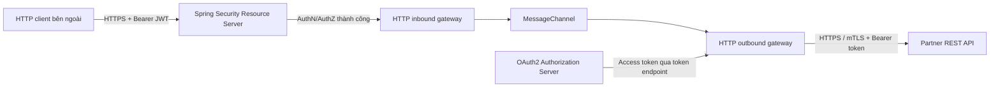
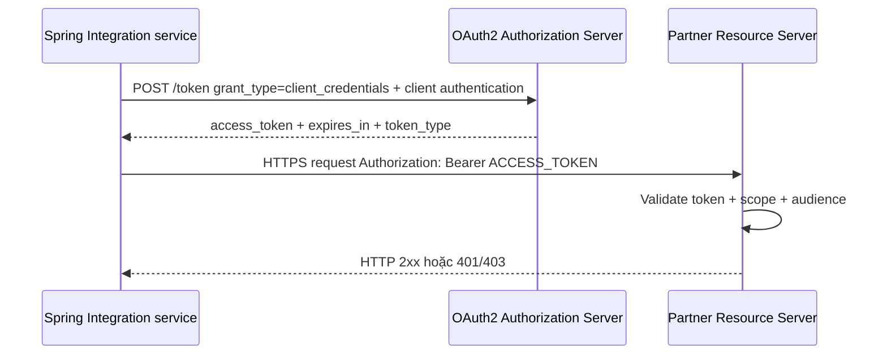

# Xác thực TLS OAuth2 và credential

## 1. Mục tiêu và phạm vi bảo mật của HTTP adapter

Trong module **SPRING_INTEGRATION_ADAPTERS**, Spring Integration kết nối các hệ thống ngoài bằng inbound/outbound adapter, gateway, poller và `MessageChannel`. Một integration flow có thể nhận HTTP request, gửi tiếp sang HTTP API đối tác, ghi database hoặc chuyển thông điệp qua file, SFTP, JMS, AMQP và Kafka. Mỗi bước vượt qua một **ranh giới tin cậy**: ai được kết nối, ai được gọi nghiệp vụ và hệ thống có đang nói chuyện với đúng đối tác hay không?

Chủ đề **“Xác thực TLS OAuth2 và credential”** tập trung vào ba cơ chế bổ trợ nhau:

- **TLS/HTTPS**: mã hóa đường truyền và xác minh danh tính server thông qua chứng chỉ số, trust chain và hostname.
- **Mutual TLS (mTLS)**: bổ sung chứng chỉ client để **hai bên** có thể xác thực danh tính ở tầng kết nối.
- **OAuth2**: cấp và sử dụng **access token** mang quyền hạn; client gửi token cho protected resource, server xác thực token và kiểm tra scope/quyền.

Các loại **credential** như client ID/client secret, private key trong keystore, token hoặc API key phải được quản lý xuyên suốt vòng đời sử dụng: cấp phát, giới hạn quyền, lưu trữ an toàn, xoay vòng và thu hồi.

Sau bài này, bạn có thể phân biệt TLS với authorization, cấu hình một HTTP inbound gateway được Spring Security bảo vệ, gọi HTTP outbound gateway bằng OAuth2 `client_credentials`, đưa TLS truststore/mTLS vào HTTP client, và xây kế hoạch kiểm thử 401/403/TLS handshake/token expiry.

**Phạm vi:** ví dụ Java hướng tới **Spring Boot 3.2+, Spring Framework 6.1+ và Spring Integration 6.x** (Java 17+), sử dụng `RestTemplate` để minh họa HTTP outbound. Một số API client đã thay đổi hoặc bị deprecate ở các nhánh Spring Integration mới hơn có `RestClient`. Khi áp dụng, chọn API tương thích với version thực tế; không coi code có thể chạy nguyên vẹn trên mọi đời Spring.

## 2. Phân biệt TLS, mTLS, OAuth2 và API key

| Cơ chế | Bằng chứng | Xác minh điều gì? | Không tự làm được |
|---|---|---|---|
| **TLS server authentication** | Certificate chain và hostname | Client đang kết nối tới server có chứng chỉ đáng tin cho hostname cần gọi. | Không xác định user có quyền gọi API. |
| **mTLS** | Certificate của cả server và client | Server có thể xác thực client tại kết nối TLS, ngoài việc client xác thực server. | Không tự biểu diễn quyền nghiệp vụ chi tiết như `orders.write`. |
| **OAuth2 access token** | Bearer token/JWT/opaque token | Resource server xác thực token rồi áp dụng scopes, audience, tenant và quyền liên quan. | Không mã hóa HTTP traffic nếu thiếu TLS. |
| **OAuth2 client ID/secret** | Credential của OAuth2 client | Cho authorization server xác thực client khi cấp token theo grant phù hợp. | Không phải access token để gửi trực tiếp cho mọi resource server. |
| **API key** | Khóa do đối tác phát hành | Nhận diện hoặc cho phép client theo quy định riêng của dịch vụ. | Không mặc định có tiêu chuẩn scopes/lifecycle như OAuth2; không thay thế TLS. |

**Authentication** trả lời “đang kết nối/gọi bằng danh tính nào?”; **authorization** trả lời “danh tính đó được phép làm gì?”. TLS chỉ bảo vệ/xác thực ranh giới kết nối; OAuth2 access token hỗ trợ policy ở ranh giới ứng dụng. Tùy yêu cầu bảo mật, một API có thể đồng thời yêu cầu **mTLS + access token**.

### Sơ đồ các ranh giới



Sơ đồ biểu diễn luồng logic: việc lấy token thường được **OAuth2 client manager** kích hoạt trước khi gửi HTTP request, rồi HTTP interceptor gắn token vào header. Không tự copy token inbound từ client sang outbound API nếu không có giao thức ủy quyền/delegation được thiết kế riêng.

## 3. TLS và mTLS hoạt động như thế nào?

### 3.1. TLS một chiều

Khi outbound gateway gọi `https://api.partner.example/v1/quotes`:

1. HTTP client mở kết nối tới hostname đã cấu hình.
2. Server đưa certificate chain trong quá trình TLS handshake.
3. Client xác minh thời hạn chứng chỉ, signature chain tới CA trong **truststore** và hostname đối chiếu **SAN (Subject Alternative Name)**.
4. Hai bên thỏa thuận khóa phiên và mã hóa traffic.
5. Sau khi TLS được thiết lập, HTTP method, headers, body và access token mới được gửi trong kênh đã được bảo vệ.

TLS có thể thất bại ngay trong handshake: khi đó **không có HTTP response status 401/403/500 từ resource server**. Thường thấy SSL handshake exception, certificate path validation error, hostname mismatch hoặc lỗi cấu hình TLS protocol/cipher.

### 3.2. mTLS

Trong mTLS, server còn yêu cầu client trình chứng chỉ; client chứng minh sở hữu private key tương ứng. Server có thể ánh xạ subject/SAN/thumbprint thành một danh tính kỹ thuật hoặc kiểm tra certificate policy. Tuy nhiên, quyền gọi từng API vẫn cần được xác định bởi policy của server.

| Vật liệu TLS | Nơi thường lưu | Cần bảo vệ |
|---|---|---|
| **Truststore** chứa CA/cert được tin cậy | Phía HTTP client hoặc JVM | Toàn vẹn và kiểm soát thay đổi; tránh thêm CA không cần thiết. |
| **Keystore** chứa client private key và certificate chain | Phía client khi dùng mTLS | Bí mật private key, mật khẩu, quyền file và access của tiến trình. |
| **Server key + certificate** | Server/reverse proxy/Ingress | Private key, quyền triển khai, thời hạn và vòng đời xoay vòng. |
| **Public CA certificates** | Hệ thống trust hoặc trust bundle | Không cần giữ bí mật, nhưng cần kiểm soát nguồn gốc/độ tin cậy. |

**Keystore và truststore không đồng nghĩa.** Keystore chứa danh tính/key mà phía này trình ra; truststore chứa các CA/certificate mà phía này **tin** khi xác minh đối tác.

Không sử dụng `TrustAll`/`NoopHostnameVerifier`/`verify=false` để “sửa nhanh” lỗi TLS, kể cả trong môi trường staging dùng chung. Khi certificate self-signed được dùng cho mock local, hãy tạo CA thử nghiệm và thêm đúng CA đó vào truststore của test client; không tắt cơ chế xác minh.

### 3.3. TLS termination tại reverse proxy

HTTP inbound gateway có thể đứng sau Nginx/Ingress/API Gateway:

```text
Client --HTTPS--> Reverse proxy --HTTP hoặc HTTPS--> Spring Boot
```

Nếu proxy kết thúc TLS, ứng dụng Spring Boot phía sau **không trực tiếp xác thực chứng chỉ client** trừ khi có cơ chế chuyển danh tính đáng tin hoặc TLS end-to-end. Không tin một HTTP header như `X-Client-Cert` do người gọi bên ngoài tự cung cấp. Khi proxy truyền identity, chỉ nhận header từ proxy đã xác thực, lọc header đầu vào giả mạo và giới hạn đường mạng giữa proxy với ứng dụng.

Cấu hình forwarded headers/`X-Forwarded-Proto` phải kiểm soát nguồn tin cậy; nếu không, ứng dụng có thể tạo redirect hoặc absolute URL sai hay bị đánh lừa về giao thức gốc.

## 4. OAuth2: token không phải client secret

Trong mô hình **OAuth2 Client Credentials Grant**, một dịch vụ backend không đại diện cho một user cụ thể. Nó xác thực danh tính ứng dụng với authorization server, xin access token cho scopes được cấp, rồi dùng token khi gọi protected API:



Phân biệt:

- **Client ID** thường không bí mật, nhưng xác định ứng dụng đã đăng ký.
- **Client secret/private key** là credential để authorization server xác thực client. Không được nhúng trực tiếp trong HTTP request của resource server nếu hợp đồng yêu cầu Bearer token.
- **Access token** là thông tin mang quyền truy cập, có thời hạn. Bearer token bị lộ có thể bị sử dụng bởi bên không được phép cho đến khi hết hạn hoặc bị thu hồi theo cơ chế hiện có.
- **Refresh token** không phải lúc nào được cấp; trong `client_credentials` thông thường client **xin access token mới** khi token cũ hết hạn.
- **Scopes** mô tả quyền theo registration/token, ví dụ `quotes.read` hoặc `orders.write`. Một scope trên token không thay thế kiểm tra quyền theo tenant và tài nguyên.

Một access token có thể là:

| Token format | Resource server thường kiểm tra |
|---|---|
| **JWT** | Signature qua JWKs/khóa tin cậy, `iss`, `exp`, `nbf`, **audience**, scope, thuật toán được phép và các claim nghiệp vụ. |
| **Opaque token** | Gọi introspection endpoint hoặc cơ chế xác thực token của IdP để biết token còn hiệu lực/quyền; bảo vệ credential introspection và cache theo chính sách. |

**Không tự giải mã JWT rồi tin các claim.** Base64 decode không tương đương kiểm tra signature, issuer và audience. Spring Security Resource Server được dùng để xác thực token trước khi request đến HTTP inbound endpoint.

### 4.1. 401 và 403 khác nhau

- **401 Unauthorized**: không có thông tin xác thực hợp lệ hoặc token sai/hết hạn; thường có `WWW-Authenticate` challenge.
- **403 Forbidden**: danh tính đã được xác thực nhưng thiếu quyền/scope theo security policy.
- **TLS handshake failure**: xảy ra **trước** HTTP application layer, nên có thể **không có HTTP status** từ server.
- **429/5xx từ authorization server**: lấy token thất bại; không được nhầm thành lỗi nghiệp vụ của Pricing API.

Một token hợp lệ nhưng **audience dành cho API khác** phải bị từ chối nếu hợp đồng yêu cầu audience cụ thể. Chỉ kiểm tra signature và issuer là chưa đủ cho một hệ thống nhiều resource server.

## 5. Ví dụ inbound: HTTP gateway được bảo vệ bằng OAuth2 Resource Server

Ví dụ inbound nhận `POST /integrations/orders/validate` và trả JSON kiểm tra tối thiểu. Spring Security chạy **trước** HTTP inbound gateway: request không có token đúng quyền không được chuyển thành Spring Integration message.

### 5.1. Dependencies

Trong dự án Spring Boot có dependency management:

```xml
<dependencies>
    <dependency>
        <groupId>org.springframework.boot</groupId>
        <artifactId>spring-boot-starter-web</artifactId>
    </dependency>
    <dependency>
        <groupId>org.springframework.boot</groupId>
        <artifactId>spring-boot-starter-integration</artifactId>
    </dependency>
    <dependency>
        <groupId>org.springframework.integration</groupId>
        <artifactId>spring-integration-http</artifactId>
    </dependency>
    <dependency>
        <groupId>org.springframework.boot</groupId>
        <artifactId>spring-boot-starter-oauth2-resource-server</artifactId>
    </dependency>
</dependencies>
```

Với JWT, cấu hình issuer ví dụ trong `application.yml`:

```yaml
spring:
  security:
    oauth2:
      resourceserver:
        jwt:
          issuer-uri: "https://idp.example.com/realms/integrations"
```

Đây là URL minh họa: ứng dụng thực cần IdP/JWKs có thể truy cập, issuer khớp token và kiểm soát đúng trust của kết nối tới IdP. Mặc định provider thường xác minh signature, issuer và thời hạn; **audience/tenant validation cần được bổ sung theo hợp đồng API** nếu chưa được security framework cấu hình sẵn. Với opaque token, thay bằng cấu hình introspection theo nhà cung cấp, không sử dụng cấu hình JWT trên.

### 5.2. SecurityFilterChain cho API inbound

```java
package example.http;

import org.springframework.context.annotation.Bean;
import org.springframework.context.annotation.Configuration;
import org.springframework.http.HttpMethod;
import org.springframework.security.config.Customizer;
import org.springframework.security.config.annotation.web.builders.HttpSecurity;
import org.springframework.security.config.annotation.web.configurers.AbstractHttpConfigurer;
import org.springframework.security.config.http.SessionCreationPolicy;
import org.springframework.security.web.SecurityFilterChain;

@Configuration
public class IntegrationApiSecurity {

    @Bean
    SecurityFilterChain orderApiSecurity(HttpSecurity http)
            throws Exception {

        return http
            .securityMatcher("/integrations/orders/**")
            .authorizeHttpRequests(auth -> auth
                .requestMatchers(
                    HttpMethod.POST,
                    "/integrations/orders/validate")
                .hasAuthority("SCOPE_orders.validate")
                .anyRequest().denyAll())
            .oauth2ResourceServer(oauth2 ->
                oauth2.jwt(Customizer.withDefaults()))
            .sessionManagement(session -> session
                .sessionCreationPolicy(SessionCreationPolicy.STATELESS))
            // Chỉ áp dụng cho chain Bearer token stateless được match.
            .csrf(AbstractHttpConfigurer::disable)
            .build();
    }
}
```

Giải thích:

1. `securityMatcher` giới hạn filter chain trong `/integrations/orders/**`. Các route khác của ứng dụng cần **SecurityFilterChain riêng** phù hợp; không dựa vào chain này để bảo vệ toàn bộ ứng dụng.
2. Chỉ `POST /integrations/orders/validate` với authority `SCOPE_orders.validate` được phép. Trong cấu hình mặc định, Spring Security map scope `orders.validate` thành authority có prefix `SCOPE_`.
3. `oauth2ResourceServer(...jwt(...))` xác minh JWT trước khi request vào inbound gateway.
4. Session được cấu hình stateless. Ở ví dụ bearer-token API này, CSRF bị tắt **trong chain đã được scope**; không áp dụng điều đó một cách máy móc cho browser session/cookie authentication.

Chỉ có Bearer token hợp lệ **chưa đủ** nếu user/application không được truy cập tenant hoặc order cụ thể. Cần kiểm tra authorization ở tầng nghiệp vụ và tránh rò rỉ thông tin giữa tenant.

### 5.3. IntegrationFlow được bảo vệ

```java
package example.http;

import org.springframework.context.annotation.Bean;
import org.springframework.context.annotation.Configuration;
import org.springframework.http.HttpMethod;
import org.springframework.http.MediaType;
import org.springframework.integration.annotation.EnableIntegration;
import org.springframework.integration.dsl.IntegrationFlow;
import org.springframework.integration.http.dsl.Http;

@Configuration
@EnableIntegration
public class OrderValidationFlow {

    public record OrderRequest(String sku, int quantity) {}
    public record ValidationReply(String sku, String status) {}

    @Bean
    IntegrationFlow validateOrderInboundFlow() {
        return IntegrationFlow
            .from(Http.inboundGateway(
                    "/integrations/orders/validate")
                .requestMapping(mapping -> mapping
                    .methods(HttpMethod.POST)
                    .consumes(MediaType.APPLICATION_JSON_VALUE)
                    .produces(MediaType.APPLICATION_JSON_VALUE))
                .requestPayloadType(OrderRequest.class))
            .handle(OrderRequest.class, (request, headers) -> {
                if (request.sku() == null
                        || request.sku().isBlank()
                        || request.quantity() <= 0) {
                    throw new IllegalArgumentException(
                        "Invalid order payload");
                }
                return new ValidationReply(
                    request.sku(), "VALIDATED");
            })
            .get();
    }
}
```

Với token thật có scope `orders.validate`:

```bash
curl -i -X POST \
  'https://localhost:8443/integrations/orders/validate' \
  -H "Authorization: Bearer $ACCESS_TOKEN" \
  -H "Content-Type: application/json" \
  -H "Accept: application/json" \
  -d '{"sku":"BOOK-1","quantity":2}'
```

URL `https://localhost:8443` chỉ hoạt động nếu bạn đã cấu hình HTTPS server/certificate tương ứng. Kết quả thành công có thể là:

```json
{"sku":"BOOK-1","status":"VALIDATED"}
```

**Không sử dụng `curl -k` để bỏ qua xác minh server certificate** trong bài kiểm thử bảo mật. Với môi trường local CA riêng, đưa CA đó vào trust store hoặc dùng tùy chọn CA hợp lệ. Nếu thiếu token, token không hợp lệ hoặc thiếu scope, request bị chặn tại Spring Security và **không nên chạy handler**.

Handler minh họa ném `IllegalArgumentException` khi body sai; đó là lỗi validation nghiệp vụ, **không tự có JSON error 400** nếu chưa thiết kế exception mapping. Đừng nhầm lỗi validation sau khi được xác thực với lỗi OAuth2 401/403.

## 6. Outbound OAuth2 client_credentials: xin token trước khi gọi đối tác

Một application gửi message qua HTTP outbound gateway thường đóng vai trò **OAuth2 Client** và **HTTP client**. Khi gọi Pricing API, nó cần lấy access token đúng client registration, thêm `Authorization: Bearer ...` và gửi request qua HTTPS.

Ví dụ này sử dụng **machine-to-machine client_credentials**, phù hợp khi ứng dụng hành động với danh tính của chính nó, không phải thay mặt một end user. Nếu cần truyền danh tính user sang đối tác, hãy dùng token exchange/delegation được các bên hỗ trợ thay vì chuyển nguyên token inbound tới resource server khác.

### 6.1. Dependencies và cấu hình registration

Bổ sung dependency OAuth2 Client:

```xml
<dependency>
    <groupId>org.springframework.boot</groupId>
    <artifactId>spring-boot-starter-oauth2-client</artifactId>
</dependency>
```

Trong `application.yml`, các giá trị bí mật lấy từ môi trường hoặc secret manager:

```yaml
spring:
  security:
    oauth2:
      client:
        registration:
          pricing-partner:
            provider: pricing-idp
            client-id: "${PARTNER_CLIENT_ID}"
            client-secret: "${PARTNER_CLIENT_SECRET}"
            authorization-grant-type: client_credentials
            scope: quotes.read
        provider:
          pricing-idp:
            token-uri: "https://idp.partner.example/oauth2/token"

partner:
  pricing:
    url: "https://api.partner.example/v1/quotes"
```

`pricing-partner` là **registration ID** để ứng dụng lấy đúng credential và token endpoint. Không gửi `client-secret` sang Pricing API trong HTTP `Authorization` header; secret được dùng để xác thực với **authorization server** trong quá trình xin token.

Không commit secret vào `application.yml`, Docker image, Git hoặc build log. Biến môi trường chỉ là một cách cung cấp cấu hình; với hệ thống thật, dùng secret manager, secret volume được cấp quyền hoặc cơ chế workload identity nếu IdP hỗ trợ. Giới hạn scopes và thường xuyên rà soát quyền đăng ký client.

### 6.2. AuthorizedClientManager không phụ thuộc request Servlet

Một HTTP outbound flow có thể chạy từ Kafka/JMS consumer, poller hoặc scheduled task, **không có HTTP servlet request**. Vì vậy nên sử dụng `AuthorizedClientServiceOAuth2AuthorizedClientManager`, thay vì phụ thuộc một manager chỉ hoạt động trong context web request.

```java
package example.http;

import org.springframework.context.annotation.Bean;
import org.springframework.context.annotation.Configuration;
import org.springframework.security.oauth2.client.AuthorizedClientServiceOAuth2AuthorizedClientManager;
import org.springframework.security.oauth2.client.OAuth2AuthorizedClientManager;
import org.springframework.security.oauth2.client.OAuth2AuthorizedClientProviderBuilder;
import org.springframework.security.oauth2.client.OAuth2AuthorizedClientService;
import org.springframework.security.oauth2.client.registration.ClientRegistrationRepository;

@Configuration
public class OAuth2ClientConfiguration {

    @Bean
    OAuth2AuthorizedClientManager partnerAuthorizedClientManager(
            ClientRegistrationRepository registrations,
            OAuth2AuthorizedClientService authorizedClients) {

        var manager =
            new AuthorizedClientServiceOAuth2AuthorizedClientManager(
                registrations, authorizedClients);

        manager.setAuthorizedClientProvider(
            OAuth2AuthorizedClientProviderBuilder.builder()
                .clientCredentials()
                .build());

        return manager;
    }
}
```

Manager dùng client registration/provider để xin token và quản lý authorized client theo service tương ứng. Khi token hết hạn, client credentials provider có thể xin token mới theo policy. Không viết logic lưu token vào file hoặc cố tự parse `expires_in` theo cách thủ công.

Nếu token endpoint yêu cầu **mTLS hoặc CA riêng**, phải cấu hình **HTTP client gọi token endpoint** tương ứng. TLS bundle chỉ gắn vào Pricing API client **không tự bảo đảm** OAuth2 token request cũng sử dụng cùng TLS context.

### 6.3. Interceptor gắn Bearer token tại HTTP boundary

Mục tiêu là token **không trở thành payload hoặc message header** đi xuyên Spring Integration flow và message broker. HTTP client interceptor chỉ gắn token **ngay trước khi gửi HTTP request outbound**.

```java
package example.http;

import org.springframework.context.annotation.Bean;
import org.springframework.context.annotation.Configuration;
import org.springframework.http.client.ClientHttpRequestInterceptor;
import org.springframework.security.oauth2.client.OAuth2AuthorizeRequest;
import org.springframework.security.oauth2.client.OAuth2AuthorizedClient;
import org.springframework.security.oauth2.client.OAuth2AuthorizedClientManager;

@Configuration
public class PartnerTokenInterceptorConfiguration {

    @Bean
    ClientHttpRequestInterceptor partnerBearerTokenInterceptor(
            OAuth2AuthorizedClientManager manager) {

        return (request, body, execution) -> {
            OAuth2AuthorizeRequest authRequest =
                OAuth2AuthorizeRequest
                    .withClientRegistrationId("pricing-partner")
                    .principal("spring-integration-pricing-service")
                    .build();

            OAuth2AuthorizedClient authorizedClient =
                manager.authorize(authRequest);

            if (authorizedClient == null) {
                throw new IllegalStateException(
                    "Unable to authorize pricing-partner client");
            }

            request.getHeaders().setBearerAuth(
                authorizedClient.getAccessToken().getTokenValue());

            return execution.execute(request, body);
        };
    }
}
```

`principal("spring-integration-pricing-service")` là **định danh kỹ thuật ổn định cho authorized client trong ứng dụng**, không phải JWT của user bên ngoài. Khi dùng nhiều tenant hoặc nhiều danh tính client, cần xác định cách phân tách authorized client/token cache để không trộn token giữa các tenant.

Đừng log `authorizedClient`, access token hoặc toàn bộ outgoing HTTP headers. Nếu có request logging interceptor, phải **redact `Authorization`, `Cookie` và các secret headers**.

### 6.4. RestTemplate với TLS truststore/mTLS bằng SSL bundle

Ví dụ dưới đây dùng Spring Boot SSL bundles và Java `HttpClient`. Cấu hình SSL bundle thích hợp cho client giúp giữ việc tin cậy CA/trình chứng chỉ tách khỏi business logic.

Với **TLS server-authentication**, có thể chỉ khai báo truststore; nếu đối tác yêu cầu **mTLS**, bổ sung keystore chứa private key/certificate của client:

```yaml
spring:
  ssl:
    bundle:
      jks:
        pricing-partner:
          truststore:
            location: "file:/run/secrets/pricing-truststore.p12"
            password: "${PARTNER_TRUSTSTORE_PASSWORD}"
            type: PKCS12
          keystore:
            location: "file:/run/secrets/pricing-client.p12"
            password: "${PARTNER_KEYSTORE_PASSWORD}"
            type: PKCS12
```

Đường dẫn `/run/secrets/...` chỉ minh họa một deployment cung cấp file an toàn, **không phải file có sẵn trong repository**. Khi chỉ cần TLS thông thường tới server dùng public CA, có thể dùng trust mặc định của JVM và không cần tạo truststore riêng. Khi có mTLS, keystore phải chứa đúng certificate chain và private key của client.

Ví dụ tạo `RestTemplate`:

```java
package example.http;

import java.net.http.HttpClient;
import java.time.Duration;

import org.springframework.beans.factory.annotation.Qualifier;
import org.springframework.boot.ssl.SslBundles;
import org.springframework.context.annotation.Bean;
import org.springframework.context.annotation.Configuration;
import org.springframework.http.client.ClientHttpRequestInterceptor;
import org.springframework.http.client.JdkClientHttpRequestFactory;
import org.springframework.web.client.RestTemplate;

@Configuration
public class PartnerHttpTransportConfiguration {

    @Bean("partnerRestTemplate")
    RestTemplate partnerRestTemplate(
            SslBundles sslBundles,
            @Qualifier("partnerBearerTokenInterceptor")
            ClientHttpRequestInterceptor oauthInterceptor) {

        var sslContext = sslBundles
            .getBundle("pricing-partner")
            .createSslContext();

        HttpClient httpClient = HttpClient.newBuilder()
            .sslContext(sslContext)
            .connectTimeout(Duration.ofSeconds(2))
            .followRedirects(HttpClient.Redirect.NEVER)
            .build();

        JdkClientHttpRequestFactory factory =
            new JdkClientHttpRequestFactory(httpClient);
        factory.setReadTimeout(Duration.ofSeconds(5));

        RestTemplate template = new RestTemplate(factory);
        template.getInterceptors().add(oauthInterceptor);

        return template;
    }
}
```

Những điểm cần nhớ:

- **SSLContext** tạo từ SSL bundle mang thông tin truststore và, nếu cấu hình, client key material phục vụ mTLS.
- **Connect timeout** giới hạn thời gian thiết lập kết nối, **read timeout** giới hạn chờ dữ liệu theo client implementation; không thay cho deadline end-to-end.
- Chỉ bật redirect nếu hợp đồng yêu cầu và đã đánh giá rủi ro token/header bị gửi sang host khác. Ở đây chọn `Redirect.NEVER` để làm rõ việc kiểm soát đích.
- Đặt `Authorization` ở interceptor thay vì copy token vào `MessageHeaders`.
- Spring Integration 7.1+ có đường cấu hình outbound qua `RestClient`; khi dùng phiên bản đó, cập nhật transport/client integration theo API tương ứng thay vì mặc định chỉ dùng `RestTemplate`.

Chứng chỉ và private key xoay vòng cần được thay đổi theo cách ứng dụng thực sự nạp lại: nhiều implementation SSL bundle/HTTP client tạo SSLContext một lần khi tạo bean, **không tự nạp lại certificate mới** sau khi file được cập nhật. Hãy xác minh cơ chế reload hoặc rollout/restart an toàn trước ngày hết hạn.

### 6.5. Gắn HTTP client bảo mật vào outbound gateway

Tạo DTO và Java messaging gateway:

```java
// File: QuoteDtos.java
package example.http;

public final class QuoteDtos {
    private QuoteDtos() {}

    public record QuoteRequest(String productCode, int quantity) {}

    public record QuoteReply(
        String quoteId, String currency, long amountMinorUnits) {}
}
```

```java
// File: PartnerQuoteClient.java
package example.http;

import org.springframework.integration.annotation.MessagingGateway;
import org.springframework.integration.annotation.Gateway;
import org.springframework.integration.annotation.GatewayHeader;
import org.springframework.messaging.MessageHeaders;

@MessagingGateway(defaultRequestChannel = "securedQuoteRequests")
public interface PartnerQuoteClient {

    @Gateway(headers = @GatewayHeader(
        name = MessageHeaders.CONTENT_TYPE,
        value = "application/json"))
    QuoteDtos.QuoteReply requestQuote(QuoteDtos.QuoteRequest request);
}
```

Dùng `HttpRequestExecutingMessageHandler` được gắn với `@ServiceActivator` để kiểm soát instance `RestTemplate` cụ thể:

```java
package example.http;

import org.springframework.beans.factory.annotation.Qualifier;
import org.springframework.beans.factory.annotation.Value;
import org.springframework.context.annotation.Bean;
import org.springframework.context.annotation.Configuration;
import org.springframework.http.HttpMethod;
import org.springframework.integration.annotation.EnableIntegration;
import org.springframework.integration.annotation.IntegrationComponentScan;
import org.springframework.integration.annotation.ServiceActivator;
import org.springframework.integration.http.outbound.HttpRequestExecutingMessageHandler;
import org.springframework.web.client.RestTemplate;

@Configuration
@EnableIntegration
@IntegrationComponentScan
public class SecuredQuoteOutboundConfiguration {

    @Bean
    @ServiceActivator(inputChannel = "securedQuoteRequests")
    public HttpRequestExecutingMessageHandler securedQuoteHandler(
            @Value("${partner.pricing.url}") String pricingUrl,
            @Qualifier("partnerRestTemplate") RestTemplate template) {

        HttpRequestExecutingMessageHandler handler =
            new HttpRequestExecutingMessageHandler(pricingUrl);

        handler.setHttpMethod(HttpMethod.POST);
        handler.setExpectedResponseType(QuoteDtos.QuoteReply.class);
        handler.setRestTemplate(template);
        handler.setExpectReply(true);

        return handler;
    }
}
```

Khi một service gọi:

```java
QuoteDtos.QuoteReply quote =
    partnerQuoteClient.requestQuote(
        new QuoteDtos.QuoteRequest("BOOK-1", 2));
```

luồng dự kiến:

1. `@MessagingGateway` gửi request message tới `securedQuoteRequests`, đặt content type JSON và reply channel.
2. `HttpRequestExecutingMessageHandler` dùng `partnerRestTemplate`, serializes DTO thành JSON bằng converter phù hợp và gửi HTTP POST qua TLS.
3. HTTP interceptor dùng OAuth2 manager để lấy access token còn hiệu lực và thêm `Authorization: Bearer ...`.
4. Đối tác xác minh TLS identity (nếu yêu cầu mTLS), access token, audience và scope, rồi trả HTTP response.
5. Handler đọc body JSON thành `QuoteReply` và gửi reply message về proxy `PartnerQuoteClient`.

Ví dụ là **hai ứng dụng/vai trò độc lập**: phần inbound bảo vệ API của ứng dụng bằng Resource Server; phần outbound cho ứng dụng gọi đối tác bằng client_credentials. Chúng có thể cùng nằm trong một service nếu nghiệp vụ cần, nhưng **credential nhận inbound không tự được forward sang outbound**.

Nếu HTTP client của phiên bản Spring Integration bạn dùng chuyển sang `RestClient`, cần thiết kế lại phần inject client theo API mới. Không cố trộn interceptor `RestTemplate` vào một HTTP handler đã cấu hình dùng client khác.

## 7. Credential lifecycle: bí mật nằm ở đâu và được xoay vòng ra sao?

Mỗi loại credential có vòng đời và rủi ro riêng:

| Credential | Dùng ở bước nào? | Quy tắc bảo vệ |
|---|---|---|
| **Client secret** | OAuth2 token endpoint, khi xin token | Cất trong secret manager/secret volume; không đưa vào code hoặc URL. |
| **Access token** | Gửi tới resource server đã được cho phép | Giữ trong memory/cache an toàn, thời hạn ngắn, không log; chỉ gửi qua HTTPS đúng audience. |
| **Client private key** | mTLS hoặc private_key_jwt | Không xuất key vào log, backup công khai; hạn chế quyền file và truy cập tiến trình. |
| **Truststore/CA** | Xác minh peer certificate | Quản lý tính toàn vẹn; thay CA có kiểm thử chain và hostname. |
| **API key** | Một số API legacy | Chỉ gửi tới host quy định, giới hạn quyền; ưu tiên header theo hợp đồng thay vì query string. |

Quy trình tối thiểu cho production:

1. **Provision** qua IdP/PKI và cấp riêng credential theo môi trường, ứng dụng hoặc tenant; không dùng chung rộng rãi.
2. **Least privilege**: scopes/audience và quyền endpoint giới hạn đúng nhu cầu.
3. **Distribution**: secret manager, KMS, file mount hoặc workload identity; giới hạn IAM, owner và vòng đời deploy.
4. **Rotation**: cho phép giai đoạn overlap khi đổi secret/certificate nếu đối tác hỗ trợ; kiểm tra cả token cache và certificate load/reload.
5. **Revocation**: có quy trình khóa client, xóa/thu hồi certificate hoặc vô hiệu hóa token/key khi rò rỉ.
6. **Audit**: ghi ai cấp/quay vòng credential và thời điểm; không ghi chính giá trị secret.

**Không sử dụng một token vô thời hạn** vì việc token chưa hết hạn hoặc chưa bị thu hồi làm tăng phạm vi ảnh hưởng nếu rò rỉ. Với client_credentials, ứng dụng thường tự xin token mới khi gần hết hạn; cần xử lý chênh lệch đồng hồ và retry token endpoint có giới hạn.

### 7.1. Token caching và concurrency

Một dịch vụ nhiều worker có thể cùng gọi `OAuth2AuthorizedClientManager`. Cần xem xét:

- Authorized-client service lưu token theo client registration và principal; dùng một danh tính ổn định cho một machine client.
- Tránh để hàng trăm worker đồng loạt xin token khi cache miss hoặc hết hạn (*token stampede*); thư viện có xử lý riêng, nhưng production vẫn cần quan sát và rate limit phù hợp.
- Trong triển khai nhiều instance, mỗi instance có thể có cache riêng. Đừng yêu cầu token được tự chia sẻ giữa các node nếu không thiết kế storage tương ứng.
- Mọi trường hợp `401` từ partner API không đồng nghĩa phải tự động retry mãi hoặc lấy token vô hạn. Có thể do token bị revoke, sai audience, sai scope hoặc mTLS identity không đúng.

Khi thay client secret, token đã cấp trước đó có thể vẫn hiệu lực đến khi hết hạn tùy IdP. Khi cần chặn ngay lập tức, cần quy trình revocation/disable ở server, không chỉ thay giá trị secret trong app.

### 7.2. Không tự chuyển tiếp token người dùng

Inbound request có thể chứa access token dành cho **API A**. HTTP outbound gateway lại gọi **API B**. Chuyển nguyên token từ A sang B có thể vi phạm audience, scope, tenant hoặc chính sách tin cậy. Một số môi trường có token exchange/delegation đúng chuẩn, nhưng phải thiết kế và cấp quyền rõ ràng.

Với backend-to-backend, `client_credentials` thường phù hợp khi API B cho phép ứng dụng A hành động bằng danh tính riêng. Nếu cần hành động **thay mặt người dùng**, kiểm tra cơ chế delegated grant/token exchange mà IdP và API B thực sự hỗ trợ.

## 8. Xử lý lỗi và sự khác biệt 401/403/TLS/HTTP status

| Quan sát | Khả năng xảy ra | Hướng xử lý |
|---|---|---|
| TLS `PKIX path building failed` | Truststore thiếu CA/chứng chỉ hoặc chain sai. | Kiểm tra chain và CA được tin cậy; không tắt certificate validation. |
| TLS hostname mismatch | SAN không khớp hostname của URL. | Dùng đúng FQDN/certificate; không tắt hostname verification. |
| TLS client certificate rejected | mTLS key/chain sai, certificate hết hạn hoặc server không trust CA. | Kiểm tra keystore, alias, quyền và CA hai phía. |
| Token endpoint 400/401 | Client ID/secret, grant hoặc scope sai. | Kiểm tra registration, token endpoint và credential lifecycle. |
| Resource server 401 | Token thiếu, hết hạn, signature/issuer/audience sai. | Kiểm tra token claims, clock skew, JWKS, token cache. |
| Resource server 403 | Token hợp lệ nhưng thiếu scope/quyền/tenant access. | Kiểm tra authorization policy, không tăng quyền tùy tiện. |
| 429 Too Many Requests | IdP hoặc partner resource server giới hạn tốc độ. | Backoff, quota, `Retry-After` và giảm concurrency. |
| 502/503/504 hoặc socket timeout | Partner/proxy/backend lỗi hoặc chậm. | Timeout, circuit breaker, retry giới hạn theo loại request và idempotency. |
| JSON conversion error | Response body không khớp DTO/media type. | Sửa hợp đồng converter/schema; không xem là auth failure. |

Với Spring Integration outbound HTTP, ngoại lệ từ `RestTemplate` có thể được bọc thành messaging exception. **Default HTTP error handler thường ném exception đối với 4xx/5xx** trước khi tạo reply message, nên không nên thiết kế flow như thể mọi 401/403 luôn tới downstream dưới dạng DTO.

Một lỗi TLS có thể khiến outbound handler không gửi được HTTP request body; lỗi read timeout sau khi server đã nhận request thì **không đảm bảo side effect chưa xảy ra**. Nếu API có thao tác tạo/gửi tiền/upload, áp dụng idempotency key và truy vấn trạng thái trước khi retry.

### 8.1. Không để credential lọt vào log/error channel

Các nguồn dễ rò rỉ:

- Logging interceptor in toàn bộ request headers, đặc biệt `Authorization`.
- Exception message chứa URL với query parameter bí mật.
- Spring Integration `ErrorMessage` lưu lại original message có payload PII hoặc secret nhúng trong headers.
- Tracing/span attributes chứa raw token, client secret hoặc nội dung form.
- Cấu hình actuator/env diagnostics lộ secrets nếu quyền truy cập và sanitization không đúng.

Giới hạn log ở request ID, loại endpoint, status, latency và error category; redact token/private key/secret và tránh log raw HTTP body nếu chứa dữ liệu nhạy cảm. Error handler không nên trả stack trace, client secret hay certificate details cho caller.

## 9. Bảo mật giao thức và thiết kế flow end-to-end

### 9.1. Inbound bảo vệ trước khi message đi vào channel

```text
External caller
 -> HTTPS / mTLS (nếu áp dụng ở Ingress)
 -> Spring Security Resource Server: validate JWT/opaque token
 -> Authorization theo method, path, scope, tenant
 -> Spring Integration HTTP inbound gateway
 -> MessageChannel -> handler
```

Nếu request thiếu token hoặc không đủ scope, Spring Security sẽ chặn trước khi inbound endpoint tạo business message. Đây là lợi ích quan trọng: không nên dựa vào một service activator phía sau để làm xác thực cơ bản.

Khi xác thực danh tính ở edge rồi truyền vào message header nội bộ, cần phân biệt **thông tin đã được server xác minh** với header do client tự gửi. Không tin `X-User-ID` hoặc `X-Tenant-ID` nếu không có cơ chế proxy xác thực và loại bỏ header giả mạo trước khi chuyển tiếp.

### 9.2. Outbound gắn credential ngay tại chỗ gọi HTTP

```text
Business service / JMS-Kafka poller
 -> MessageChannel với payload nghiệp vụ
 -> HTTP outbound gateway
 -> OAuth2 client obtains cached/new access token
 -> HTTP interceptor adds Bearer token
 -> TLS/mTLS request to allowlisted host
 -> Protected partner API
 -> HTTP response -> reply Message / error flow
```

Token không nên bị sao chép sang JMS, Kafka, SFTP hoặc log vì các hệ thống trung gian có trust boundary và chính sách lưu trữ riêng. Khi cần thông tin định danh cho audit downstream, truyền **correlation ID** hoặc một identity claim đã được chấp thuận, không chuyển secret.

### 9.3. Reliability vẫn là vấn đề riêng

Bảo mật không giải quyết toàn bộ lỗi tích hợp:

- **Timeout** tại HTTP client, token endpoint, connect/read, reply channel và proxy cần được cấu hình riêng.
- **Retry** phải giới hạn và phân loại đúng: 401/403 thường không retry mù quáng; 429/503 có thể backoff theo chính sách; POST có side effect phải có idempotency.
- **Circuit breaker** giảm tải khi partner thường xuyên lỗi, nhưng không tự làm mới token hoặc sửa certificate.
- **Transaction** qua HTTP, DB, JMS/AMQP/Kafka hoặc SFTP không tự động là một transaction phân tán; thiết kế outbox/inbox hoặc cơ chế bù trừ theo nghiệp vụ.
- **Connection lifecycle** gồm pool, idle connections, TLS session, token/certificate rotation và graceful shutdown.

## 10. Kịch bản kiểm thử và vận hành

Nên chia kiểm thử thành **TLS**, **OAuth2 resource server**, **OAuth2 client outbound**, **message flow** và **vận hành secret**. Dùng test IdP, local CA và mock HTTP service để không phải cố tình làm hỏng credential thật.

| Kịch bản | Kết quả cần kiểm tra |
|---|---|
| HTTPS server có certificate hợp lệ, hostname khớp | TLS handshake thành công, inbound/outbound API hoạt động. |
| Truststore thiếu CA hoặc hostname sai | TLS handshake thất bại; **không bỏ qua xác minh**. |
| mTLS thiếu client certificate | Server từ chối handshake hoặc không cho truy cập theo cấu hình. |
| mTLS cert hết hạn/thu hồi | Connection bị từ chối theo cơ chế server/PKI. |
| Inbound không có Bearer token | Spring Security trả 401, handler không chạy. |
| Inbound JWT sai signature/issuer/audience/expiry | Request bị từ chối, không có business message vào channel. |
| Token hợp lệ nhưng thiếu `orders.validate` | HTTP 403; handler không chạy. |
| Token hợp lệ, đúng scope | Inbound gateway tạo message và trả response nghiệp vụ. |
| OAuth2 client_credentials hợp lệ | Client manager lấy token, outbound interceptor thêm đúng Bearer header. |
| Client secret sai hoặc token endpoint lỗi | Không gọi Pricing API khi chưa có token hợp lệ; lỗi được phân loại. |
| Access token hết hạn | Manager xin token mới theo policy; tránh retry vô hạn. |
| Outbound token audience/scope sai | Partner API từ chối 401/403; không xem là lỗi network. |
| Retry khi Pricing API 503 | Retry/backoff có giới hạn; token không bị log; idempotency nếu POST có side effect. |
| Reload/rotation certificate | Kết nối mới dùng certificate đúng sau rollout/reload được thiết kế. |
| Log/error channel/trace | Không lộ `Authorization`, private key, client secret hay raw JWT. |

### 10.1. Ví dụ kiểm thử bằng curl

Sau khi có một **test access token hợp lệ** từ IdP của môi trường kiểm thử, gửi request inbound:

```bash
curl --fail-with-body -i \
  -H "Authorization: Bearer $ACCESS_TOKEN" \
  -H "Content-Type: application/json" \
  -d '{"sku":"BOOK-1","quantity":2}' \
  'https://localhost:8443/integrations/orders/validate'
```

Kiểm tra lại khi bỏ `Authorization` header hoặc sử dụng token sai scope. Với TLS có CA private, dùng CA bundle được cấp riêng cho môi trường test, không dùng `-k` để vô hiệu hóa certificate verification.

### 10.2. Checklist triển khai production

1. Mọi host/URL được cấu hình đúng, HTTPS được xác minh và danh sách đích outbound được giới hạn.
2. CA trust, server certificate, client mTLS certificate, OAuth2 client secret và token endpoint được quản lý đúng chủ sở hữu.
3. Access token chỉ gửi tới đúng host/audience; scopes được cấp tối thiểu.
4. Resource server kiểm tra signature/introspection, issuer, expiry, audience và authorization policy theo tenant.
5. TLS certificate và secret có lịch rotation, cảnh báo trước hạn, quy trình rollback và cơ chế reload/restart được kiểm thử.
6. Token cache và client_credentials renewal hoạt động khi chạy không có Servlet request (Kafka/JMS/poller).
7. Log/trace/error channel được redact; file secret và dashboard config có quyền truy cập giới hạn.
8. HTTP timeout, retry, circuit breaker, rate limit và idempotency không gây nhân đôi side effect.
9. Các tình huống 401, 403, TLS handshake, token endpoint outage và partner API outage có alert và hướng khôi phục.
10. Quy trình incident cho rò rỉ secret gồm revoke/disable, rotation, đánh giá token đã cấp và rà soát audit trail.

## 11. Tổng kết

**TLS xác thực và bảo vệ kết nối; mTLS xác thực thêm phía client; OAuth2 access token thể hiện quyền truy cập ở tầng API.** Client ID/secret, private key và access token là những loại credential khác nhau, cần được cấp, bảo vệ, sử dụng và xoay vòng theo mục đích riêng.

Trong **Spring Integration HTTP**:

- Với **inbound gateway**, để Spring Security Resource Server kiểm tra token **trước** khi tạo Spring Integration message.
- Với **outbound gateway**, dùng OAuth2 `client_credentials` và một HTTP client interceptor/token provider để thêm Bearer token **ngay tại HTTP boundary**, không đưa token qua toàn bộ message flow.
- Cấu hình truststore/keystore đúng với HTTPS/mTLS, xác minh hostname và tránh mọi giải pháp “trust all”.
- Chọn API HTTP client phù hợp phiên bản Spring Integration, gắn timeout vào đúng client instance và kiểm thử việc token/certificate được nạp lại.
- Không nhầm 401/403 với TLS handshake failure; không nhầm token expiry với lỗi chuyển đổi JSON hay timeout.
- Khi tiếp tục tới database, file/SFTP, JMS, AMQP hoặc Kafka, vẫn cần hợp đồng message, idempotency, bảo mật metadata và vòng đời kết nối riêng.

### Tài liệu tham khảo chính thức

- [Spring Integration — HTTP Support](https://docs.spring.io/spring-integration/reference/http.html)
- [Spring Integration — HTTP Outbound Components](https://docs.spring.io/spring-integration/reference/http/outbound.html)
- [Spring Security — OAuth2 Resource Server JWT](https://docs.spring.io/spring-security/reference/servlet/oauth2/resource-server/jwt.html)
- [Spring Security — OAuth2 Client Core Interfaces](https://docs.spring.io/spring-security/reference/servlet/oauth2/client/core.html)
- [Spring Boot — SSL Bundles](https://docs.spring.io/spring-boot/reference/features/ssl.html)
- [Spring Framework — REST Clients](https://docs.spring.io/spring-framework/reference/integration/rest-clients.html)
