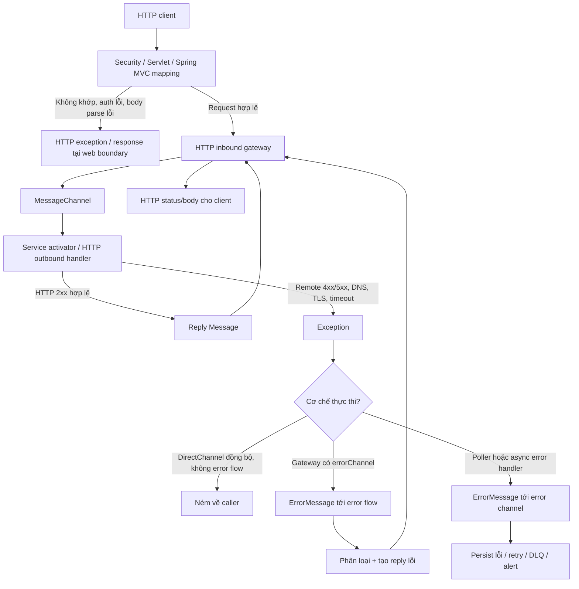
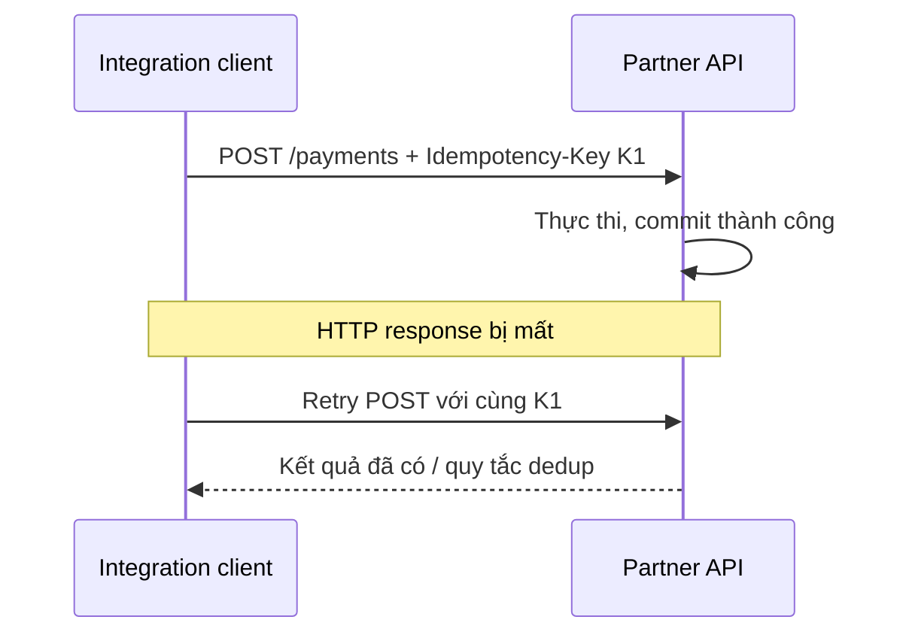

# HTTP error channel và xử lý lỗi từ xa

## 1. Vì sao HTTP error channel là chủ đề riêng?

Trong **SPRING_INTEGRATION_ADAPTERS**, các inbound/outbound adapter, gateway, poller và `MessageChannel` nối ứng dụng với HTTP, file, SFTP, JMS, AMQP, Kafka và cơ sở dữ liệu. Một lỗi tại HTTP boundary có thể ảnh hưởng đến cả luồng: request từ client không parse được, dịch vụ đối tác trả 503, HTTP client bị timeout, handler downstream ném exception hoặc một worker bất đồng bộ xử lý thất bại sau khi caller đã rời đi.

Ví dụ flow:

```text
HTTP client
  -> HTTP inbound gateway
  -> MessageChannel
  -> HTTP outbound gateway -> Pricing API
  <- reply payload hoặc exception <- HTTP response / lỗi mạng
  <- reply message hoặc error flow
HTTP client <- HTTP status + JSON body
```

Tùy lỗi phát sinh ở đâu và luồng đồng bộ hay bất đồng bộ, Spring Integration có thể:

1. **Ném exception ngược về caller** trên cùng thread.
2. **Gửi `ErrorMessage` đến error channel** do gateway, message header, poller hoặc error handler cấu hình.
3. **Để tầng Spring MVC/Spring Security xử lý** khi lỗi xảy ra trước lúc tạo integration message.
4. **Tạo reply message lỗi theo hợp đồng** cho HTTP inbound gateway còn đang chờ.
5. **Ghi nhận công việc thất bại để xử lý lại** trong một flow asynchronous đã thiết kế độ bền dữ liệu.

Sau bài này, bạn sẽ phân biệt các đường lỗi đó, đọc `ErrorMessage` và `MessagingException`, cấu hình error channel cho HTTP inbound gateway, phân loại HTTP 4xx/5xx từ outbound gateway, xử lý lỗi ở poller, thiết kế response an toàn và kiểm thử bằng mock server.

> **Điểm cốt lõi:** `errorChannel` là một cơ chế định tuyến **message chứa lỗi**, không phải HTTP header mang tên `errorChannel`, cũng không phải “nơi bắt tự động mọi exception trong ứng dụng”. Nó không mặc định là dead-letter queue bền vững.

## 2. Bản đồ lỗi: xảy ra trước, trong hay sau flow?



Có ba lớp cần tách biệt:

| Lớp | Ví dụ | Đường xử lý điển hình |
|---|---|---|
| **Web boundary** | Sai method/path, `Content-Type` không khớp, Bearer token thiếu, JSON bị từ chối trước khi handler | Spring MVC, Spring Security, converter, exception resolver; có tình huống gateway error channel được cấu hình để nhận lỗi chuẩn bị request. |
| **Synchronous messaging flow** | Service activator hoặc HTTP outbound handler ném exception trên `DirectChannel` | Exception được truyền về sender/messaging gateway; nếu gateway có `errorChannel`, lỗi có thể chuyển tới error flow để tạo reply. |
| **Asynchronous flow** | Poller đọc `QueueChannel` rồi gọi HTTP đối tác; worker gặp lỗi khi sender đã thoát | Lỗi được đóng thành `ErrorMessage` và chuyển theo `errorChannel`/poller error handler; phải có cơ chế lưu và khôi phục. |

Không thể sửa HTTP 401 do Spring Security từ chối bằng cách thêm một subscriber `errorChannel` ở cuối flow: **request có thể chưa từng vào Spring Integration**. Tương tự, một lỗi timeout của outbound HTTP client cần được phân loại theo transport/remote API, không đồng nhất với `replyTimeout` của messaging gateway.

## 3. `ErrorMessage` và `errorChannel` hoạt động ra sao?

### 3.1. Kiểu dữ liệu cốt lõi

`ErrorMessage` thuộc Spring Messaging và bản thân là một `Message<Throwable>`:

```java
import org.springframework.messaging.Message;
import org.springframework.messaging.MessagingException;
import org.springframework.messaging.support.ErrorMessage;

void inspect(ErrorMessage error) {
    Throwable failure = error.getPayload(); // Throwable
    Message<?> original = error.getOriginalMessage();

    if (original == null && failure instanceof MessagingException ex) {
        original = ex.getFailedMessage();
    }

    // Chỉ dùng metadata đã được phép để ghi log hoặc khôi phục.
}
```

Một exception có thể được Spring Integration bọc thành `MessagingException` hoặc `MessageHandlingException`, chứa `failedMessage`. Khi phân loại lỗi HTTP, cần nhìn **cause chain** để tìm ngoại lệ HTTP client bên dưới. `getOriginalMessage()` và `getFailedMessage()` không phải lúc nào cũng hiện diện; không ép kiểu hoặc dereference khi chưa kiểm tra `null`.

Các header liên quan:

| Thông tin | Ý nghĩa |
|---|---|
| `MessageHeaders.ERROR_CHANNEL` / `errorChannel` | Địa chỉ channel nội bộ dùng để nhận `ErrorMessage` khi cơ chế error publishing áp dụng. |
| `MessageHeaders.REPLY_CHANNEL` / `replyChannel` | Nơi nhận reply message bình thường hoặc kết quả từ error flow khi gateway còn chờ. |
| `ErrorMessage.payload` | Exception (`Throwable`), không phải DTO lỗi HTTP có thể serialize trực tiếp. |
| `ErrorMessage.originalMessage` | Message gắn với sự cố khi error message strategy hỗ trợ. |
| `MessagingException.failedMessage` | Message mà exception liên quan tới, nếu có. |
| `http_statusCode` | Header dành cho **HTTP status trên reply message** của HTTP inbound gateway, không phải địa chỉ error channel. |

Không trả thẳng `Throwable` làm JSON response. Exception có thể chứa URL nội bộ, SQL detail, raw payload, access token, credentials hoặc stack trace; phải chuyển thành **error DTO an toàn** với mã lỗi công khai và correlation/request ID phù hợp.

### 3.2. Error channel toàn cục và theo flow

Spring Integration tạo một **global `errorChannel`** mặc định nếu ứng dụng không khai báo khác. Nó thường là `PublishSubscribeChannel` với logging handler để ghi nhận lỗi bất đồng bộ. Nhưng chỉ nhìn thấy log không đồng nghĩa lỗi đã được **lưu bền vững** hoặc đã được retry.

Khi có một error publisher, việc chọn channel thường theo thứ tự:

1. `errorChannel` header của message hiện tại, nếu publisher hỗ trợ và header trỏ đến channel phù hợp.
2. Error channel được cấu hình cụ thể tại gateway, poller hoặc error handler.
3. Global channel tên `errorChannel` khi không có đích cụ thể.

Thứ tự ưu tiên chính xác phụ thuộc thành phần phát lỗi và đường đi request; không nên giả định một header luôn ghi đè mọi cấu hình. **Thiết kế contract error theo điểm phát lỗi**, đồng thời xác minh bằng test.

Một `MessageChannel` dùng cho error flow có thể là `DirectChannel` hoặc `PublishSubscribeChannel`:

- `DirectChannel` phù hợp khi cần một consumer nhận `ErrorMessage` và trả response đồng bộ.
- `PublishSubscribeChannel` phù hợp khi nhiều subscriber giám sát cùng lỗi; phải cân nhắc policy nếu một subscriber ném exception hoặc không có subscriber.
- `QueueChannel` phù hợp với xử lý do poller kéo, nhưng mặc định vẫn **ở bộ nhớ**, không tự là DLQ durable.

### 3.3. Vì sao `DirectChannel` thường không gửi vào global errorChannel?

Trong luồng đồng bộ, handler chạy trên thread caller và ngoại lệ được **ném trở lại qua call stack**, tương tự một phương thức Java. Vì không cần cơ chế báo lỗi bất đồng bộ, global `errorChannel` không tự bắt mọi lỗi đó.

```text
Sender -> DirectChannel -> HTTP outbound handler -> exception
   ^                                              |
   |------------------ thrown back ----------------|
```

Ngược lại, với executor/poller:

```text
Sender -> QueueChannel -> trả quyền điều khiển
                          |
                      Poller worker
                          -> HTTP outbound -> exception
                          -> ErrorMessage -> errorChannel
```

Sender có thể đã nhận “message enqueued” trước khi HTTP request được gửi. Do đó **thành công khi enqueue không bằng thành công của remote HTTP API**.

## 4. HTTP 4xx/5xx từ remote: reply hay exception?

Một HTTP outbound gateway thường dùng `HttpRequestExecutingMessageHandler` để gọi API bên ngoài. Với những triển khai dựa trên `RestTemplate` và error handler mặc định, HTTP 4xx/5xx thường làm HTTP client ném exception **trước khi handler tạo reply message bình thường**.

| Trường hợp | Kiểu lỗi/kết quả thường gặp | Ý nghĩa |
|---|---|---|
| HTTP 200 + JSON hợp lệ | Reply DTO qua `expectedResponseType` | Xử lý tiếp trong flow. |
| HTTP 201/202 có body | Reply theo converter, nếu cấu hình phù hợp | Cần hiểu đã tạo tài nguyên hay mới chấp nhận job. |
| HTTP 204 No Content | Có thể có reply payload dạng `ResponseEntity`, không có body | Không ép kiểu DTO mù quáng. |
| HTTP 400/422 | `HttpClientErrorException` hoặc `RestClientResponseException` | Có thể request sai contract; thường không retry. |
| HTTP 401/403 từ đối tác | Lỗi HTTP client được ném | Kiểm tra token, scope, audience, credential; không mặc định trả nguyên 401 cho client nội bộ. |
| HTTP 404/409 | Lỗi HTTP client hoặc kết quả nghiệp vụ theo custom policy | Phải quy định API có chấp nhận missing/conflict như dữ liệu không. |
| HTTP 429 | Lỗi HTTP client có status 429 | Xem quota và `Retry-After`; không retry tức thì vô hạn. |
| HTTP 500/502/503/504 | `HttpServerErrorException` hoặc `RestClientResponseException` | Dependency lỗi; phân loại khả năng retry và circuit breaker. |
| DNS/connect/read timeout | `ResourceAccessException` hoặc IO/transport exception được bọc | Có thể không có HTTP status; kết quả side effect có thể không xác định. |
| TLS handshake/hostname lỗi | SSL exception thường nằm trong cause chain | Lỗi bảo mật/transport; không tắt TLS verification. |
| Response body sai schema | Converter/deserialization exception | HTTP exchange có thể đã thành công nhưng payload không đọc được. |

**Lưu ý phiên bản:** từ Spring Integration 7.1, HTTP outbound có hỗ trợ `RestClient` và các cấu hình dựa trên `RestTemplate` bắt đầu bị deprecate; từ 7.2 có các tùy chọn status/error handler cho `RestClient`. API và kiểu exception có thể khác theo client. Vì vậy ví dụ sau dùng mô hình thường gặp **Spring Boot 3 / Spring Integration 6.x / `RestTemplate` mặc định**, rồi nêu rõ chỗ phải điều chỉnh nếu dự án dùng client khác.

### 4.1. Không trả nguyên status của đối tác một cách máy móc

Nếu client ngoài gọi API của bạn, và outbound Pricing API trả 401, điều đó thường có nghĩa **credential giữa ứng dụng của bạn và đối tác** lỗi, **không có nghĩa client ngoài của bạn thiếu đăng nhập**. Trả nguyên 401 có thể làm caller hiểu sai trách nhiệm.

Một chính sách public API hợp lý có thể là:

| Sự cố ở remote | Status public có thể chọn | Lưu ý |
|---|---|---|
| Remote 400 do ứng dụng dựng payload sai | `502 Bad Gateway` hoặc lỗi nội bộ theo contract | Không đổ lỗi cho caller nếu input caller hợp lệ; cần alert bug tích hợp. |
| Remote 401/403 do service credential | `502` hoặc `503` | Ẩn chi tiết credential; điều tra client registration/secret. |
| Remote 404 cho tài nguyên caller truy vấn | `404` **nếu** hợp đồng định nghĩa tương đương | Nếu là URL tích hợp sai, nên là upstream error thay vì 404 public. |
| Remote 429 | `503` hoặc `429` tùy quota nào bị vượt | Chỉ truyền `Retry-After` khi được cho phép và còn phù hợp với client. |
| Remote 5xx | `502` hoặc `503` tùy ý nghĩa dependency | Trả error DTO ổn định, không lộ raw response body. |
| Remote read timeout | `504 Gateway Timeout` khi thật sự timeout ở ranh giới upstream | Không tự suy ra mọi IO exception đều là 504. |
| Remote network unreachable | `503 Service Unavailable` | Có thể mở circuit breaker. |
| Remote response parse lỗi | `502` hoặc lỗi contract nội bộ | Cần kiểm tra schema/version/converter. |

Đây là **gợi ý thiết kế hợp đồng**, không phải bảng ánh xạ bắt buộc của Spring Integration. Phải thống nhất với API owner và kiểm thử hành vi thực tế.

## 5. Ví dụ inbound gateway xử lý lỗi từ HTTP outbound gateway

Ta xây một **API request–reply**: client gửi yêu cầu báo giá tới ứng dụng, ứng dụng gọi Pricing API, rồi trả JSON hoặc error JSON an toàn.

Các giả định:

- Java 17+, Spring Boot 3.x và Spring Integration HTTP 6.x.
- Pricing API mock ở `http://localhost:8081/api/quotes`.
- API public ở `POST http://localhost:8080/api/quotes/check`.
- Remote API trả JSON báo giá khi HTTP 200; các 4xx/5xx được HTTP client mặc định báo bằng exception.
- Demo chỉ phân loại lỗi cơ bản. Production cần thêm authentication, authorization, idempotency, timeout và telemetry.

### 5.1. Maven dependencies

Với Spring Boot dependency management:

```xml
<dependencies>
    <dependency>
        <groupId>org.springframework.boot</groupId>
        <artifactId>spring-boot-starter-web</artifactId>
    </dependency>
    <dependency>
        <groupId>org.springframework.boot</groupId>
        <artifactId>spring-boot-starter-integration</artifactId>
    </dependency>
    <dependency>
        <groupId>org.springframework.integration</groupId>
        <artifactId>spring-integration-http</artifactId>
    </dependency>
</dependencies>
```

Ứng dụng không cần tự công bố một `@RestController` chỉ để nhận `/api/quotes/check`; `Http.inboundGateway(...)` đăng ký một HTTP inbound endpoint thông qua cơ chế tích hợp với Spring MVC.

### 5.2. DTO và exception nghiệp vụ

File `QuoteDtos.java`:

```java
package example.http;

public final class QuoteDtos {
    private QuoteDtos() {}

    public record QuoteRequest(String sku, int quantity) {}

    public record QuoteReply(
        String quoteId, String currency, long amountMinorUnits) {}

    public record ApiError(String code, String message) {}
}
```

File `InvalidQuoteRequestException.java`:

```java
package example.http;

public final class InvalidQuoteRequestException
        extends RuntimeException {

    public InvalidQuoteRequestException(String message) {
        super(message);
    }
}
```

Exception riêng giúp phân biệt **input client sai** với **upstream HTTP service lỗi**. Trường `amountMinorUnits` biểu diễn số tiền theo đơn vị nhỏ nhất đã thỏa thuận, tránh dùng `double` cho phép tính tiền.

### 5.3. Flow request–reply với error channel tường minh

File `QuoteHttpConfiguration.java`:

```java
package example.http;

import org.springframework.context.annotation.Bean;
import org.springframework.context.annotation.Configuration;
import org.springframework.http.HttpMethod;
import org.springframework.http.MediaType;
import org.springframework.integration.annotation.EnableIntegration;
import org.springframework.integration.dsl.IntegrationFlow;
import org.springframework.integration.http.dsl.Http;
import org.springframework.messaging.MessageHeaders;

@Configuration
@EnableIntegration
public class QuoteHttpConfiguration {

    @Bean
    public IntegrationFlow quoteHttpFlow() {
        return IntegrationFlow
            .from(Http.inboundGateway("/api/quotes/check")
                .requestMapping(mapping -> mapping
                    .methods(HttpMethod.POST)
                    .consumes(MediaType.APPLICATION_JSON_VALUE)
                    .produces(MediaType.APPLICATION_JSON_VALUE))
                .requestPayloadType(QuoteDtos.QuoteRequest.class)
                .errorChannel("quoteHttpErrors"))
            .handle(QuoteDtos.QuoteRequest.class, (request, headers) -> {
                if (request.sku() == null
                        || request.sku().isBlank()
                        || request.quantity() <= 0) {
                    throw new InvalidQuoteRequestException(
                        "sku and quantity are invalid");
                }
                return request;
            })
            .enrichHeaders(headers -> headers.header(
                MessageHeaders.CONTENT_TYPE,
                MediaType.APPLICATION_JSON_VALUE))
            .handle(Http.outboundGateway(
                    "http://localhost:8081/api/quotes")
                .httpMethod(HttpMethod.POST)
                .expectedResponseType(QuoteDtos.QuoteReply.class))
            .get();
    }
}
```

Phân tích luồng:

1. Inbound gateway nhận JSON `QuoteRequest` và tạo request message.
2. `errorChannel("quoteHttpErrors")` chỉ định **error flow của HTTP gateway**. Khi gateway nhận lỗi thuộc phạm vi nó xử lý và còn có thể trả response, error flow có cơ hội tạo reply thay vì ném lỗi trực tiếp.
3. Handler đầu tiên kiểm tra dữ liệu và ném `InvalidQuoteRequestException` nếu input không hợp lệ.
4. Header `contentType=application/json` giúp outbound converter chuẩn bị JSON.
5. `Http.outboundGateway(...)` gọi Pricing API và trả `QuoteReply` nếu thành công.
6. Remote HTTP 4xx/5xx hoặc transport failure có thể ném exception, được gateway/error handling đưa tới error channel đã cấu hình.

**Không nhầm `errorChannel` của HTTP inbound gateway với global `errorChannel`.** Chúng có thể là các channel khác nhau. Một channel được chỉ định tường minh giúp hợp đồng trả lỗi HTTP không phụ thuộc subscriber logging toàn cục.

### 5.4. Error flow chuyển `ErrorMessage` thành reply DTO an toàn

Tạo `QuoteHttpErrorConfiguration.java`:

```java
package example.http;

import org.springframework.context.annotation.Bean;
import org.springframework.context.annotation.Configuration;
import org.springframework.http.HttpStatus;
import org.springframework.http.MediaType;
import org.springframework.integration.dsl.IntegrationFlow;
import org.springframework.messaging.Message;
import org.springframework.messaging.MessageHeaders;
import org.springframework.messaging.support.MessageBuilder;
import org.springframework.web.client.ResourceAccessException;
import org.springframework.web.client.RestClientResponseException;

@Configuration
public class QuoteHttpErrorConfiguration {

    @Bean
    public IntegrationFlow quoteHttpErrorFlow() {
        return IntegrationFlow.from("quoteHttpErrors")
            // GenericHandler nhận payload Throwable của ErrorMessage.
            .handle(Throwable.class, (failure, headers) ->
                toPublicReply(failure))
            .get();
    }

    private Message<QuoteDtos.ApiError> toPublicReply(
            Throwable failure) {

        HttpStatus status;
        String code;
        String message;

        if (findCause(failure, InvalidQuoteRequestException.class)
                != null) {
            status = HttpStatus.BAD_REQUEST;
            code = "INVALID_QUOTE_REQUEST";
            message = "sku or quantity is invalid";
        } else if (findCause(
                failure, RestClientResponseException.class) != null) {
            // Remote trả 4xx/5xx: không chuyển trực tiếp status,
            // body hoặc message có thể chứa dữ liệu nội bộ.
            status = HttpStatus.BAD_GATEWAY;
            code = "UPSTREAM_HTTP_ERROR";
            message = "Pricing service returned an invalid response";
        } else if (findCause(
                failure, ResourceAccessException.class) != null) {
            // IO/network/TLS/timeout có thể nằm trong cause chain.
            status = HttpStatus.SERVICE_UNAVAILABLE;
            code = "UPSTREAM_UNREACHABLE";
            message = "Pricing service is temporarily unavailable";
        } else {
            status = HttpStatus.INTERNAL_SERVER_ERROR;
            code = "INTEGRATION_FAILURE";
            message = "Unable to process quote request";
        }

        return MessageBuilder
            .withPayload(new QuoteDtos.ApiError(code, message))
            .setHeader("http_statusCode", status)
            .setHeader(
                MessageHeaders.CONTENT_TYPE,
                MediaType.APPLICATION_JSON_VALUE)
            .build();
    }

    private static <T extends Throwable> T findCause(
            Throwable failure, Class<T> expected) {

        for (Throwable current = failure;
                current != null;
                current = current.getCause()) {
            if (expected.isInstance(current)) {
                return expected.cast(current);
            }
            if (current.getCause() == current) {
                break;
            }
        }
        return null;
    }
}
```

Các đặc điểm quan trọng:

- `ErrorMessage.payload` là exception; error flow **không trả exception thẳng ra HTTP**.
- `findCause(...)` tìm exception thực trong chuỗi bọc bởi Spring Integration. Điều này hữu ích khi outbound handler báo `MessageHandlingException` với `RestClientResponseException` nằm phía dưới.
- Reply error là một `Message<ApiError>`, có header `http_statusCode` để inbound gateway tạo HTTP response đúng status.
- Mọi lỗi remote 4xx/5xx trong ví dụ được **quy về 502**, không sao chép `Authorization` hoặc response body bên ngoài.
- Mọi `ResourceAccessException` đang quy về **503**. Production cần phân loại chính xác timeout, DNS, TLS, connect/read và có thể dùng 504 cho những trường hợp deadline upstream phù hợp.

Với **HTTP inbound gateway**, khi error flow trả reply kịp thời, gateway có thể gửi response theo header `http_statusCode`. Nếu error flow lại ném exception hoặc không trả reply, fallback/timeout status phụ thuộc cấu hình gateway; không được giả định nó sẽ luôn trả `ApiError`.

### 5.5. Thử thành công, lỗi input và lỗi upstream

Khi Pricing API mock trả HTTP 200 với:

```json
{
  "quoteId": "Q-1001",
  "currency": "VND",
  "amountMinorUnits": 240000
}
```

gửi:

```bash
curl -i -X POST 'http://localhost:8080/api/quotes/check' \
  -H 'Content-Type: application/json' \
  -H 'Accept: application/json' \
  -d '{"sku":"BOOK-1","quantity":2}'
```

Response ví dụ:

```http
HTTP/1.1 200 OK
Content-Type: application/json

{"quoteId":"Q-1001","currency":"VND","amountMinorUnits":240000}
```

Gửi quantity không hợp lệ:

```bash
curl -i -X POST 'http://localhost:8080/api/quotes/check' \
  -H 'Content-Type: application/json' \
  -H 'Accept: application/json' \
  -d '{"sku":"BOOK-1","quantity":0}'
```

Response mục tiêu:

```http
HTTP/1.1 400 Bad Request
Content-Type: application/json

{"code":"INVALID_QUOTE_REQUEST","message":"sku or quantity is invalid"}
```

Nếu mock Pricing API trả HTTP 503, error flow trong ví dụ ánh xạ thành:

```http
HTTP/1.1 502 Bad Gateway
Content-Type: application/json

{"code":"UPSTREAM_HTTP_ERROR","message":"Pricing service returned an invalid response"}
```

**Các response ở trên là hành vi theo cấu hình ví dụ**, không phải mặc định framework với mọi ứng dụng. Nếu cấu hình HTTP client đã thay default error handler, status 503 có thể được xử lý như dữ liệu thay vì ném exception; khi đó phải cập nhật thiết kế error flow tương ứng.

## 6. Lỗi trước khi message vào channel: trường hợp nào error flow không thấy?

Không phải tất cả lỗi của một HTTP request đều xuất hiện như `ErrorMessage` trong `quoteHttpErrors`.

| Giai đoạn | Ví dụ | Cơ chế xử lý |
|---|---|---|
| Reverse proxy / firewall | Kết nối bị chặn, TLS thất bại | Có thể request không tới ứng dụng. |
| Spring Security | Thiếu Bearer token, sai scope | `AuthenticationEntryPoint` / `AccessDeniedHandler` trả 401/403 trước integration gateway. |
| Spring MVC request mapping | Sai path/method, `consumes`, `produces` | Thường 404/405/415/406 do web layer; không vào request channel. |
| HTTP request body parsing | JSON sai cú pháp, converter không tạo DTO | Có thể bị web layer xử lý; ở các phiên bản Spring Integration hỗ trợ, lỗi **chuẩn bị request message** có thể được gửi tới inbound gateway error channel nếu cấu hình. |
| Spring Integration handler | Validation nghiệp vụ, outbound HTTP 5xx, converter reply lỗi | Thường có thể tới gateway error channel khi có cấu hình; nếu không, exception truyền về caller. |
| HTTP response writing | Client đóng kết nối, response không ghi được | Có thể quá muộn để gửi error body khác; chỉ còn logging/metrics. |

Từ Spring Integration **5.4**, lỗi trong bước **chuẩn bị request message** của HTTP inbound endpoint có thể được gửi tới error channel đã cấu hình. Nhưng request bị Spring MVC không chọn mapping hoặc bị Spring Security chặn **không thể** mặc định được xử lý như lỗi của flow nghiệp vụ.

Nếu API yêu cầu tất cả lỗi đều dùng cùng schema JSON, cần phối hợp:

- Security exception handler cho 401/403.
- `@ControllerAdvice`/`HandlerExceptionResolver` cho lỗi MVC/converter nằm ngoài flow.
- Gateway error flow cho những lỗi được Spring Integration nhận.
- HTTP server/proxy error responses cho lỗi ở lớp hạ tầng.

Không giả định chỉ một `IntegrationFlow.from("quoteHttpErrors")` có thể thay thế tất cả các lớp trên.

## 7. Global `errorChannel`, poller và xử lý lỗi bất đồng bộ

### 7.1. Khi không có caller đang chờ reply

Giả sử một webhook được đưa vào `QueueChannel` để poller gọi HTTP outbound channel adapter:

```text
Producer -> QueueChannel (đã enqueue)
                      |
                   Poller
                      |
             HTTP outbound adapter -> remote server
                      |
                  Exception
                      |
             ErrorMessage -> webhookErrors
                      |
                  Log / DLQ / retry
```

Trong mô hình này, producer có thể được báo đã enqueue **trước khi** poller chạy. Error channel không có nhiệm vụ “quay ngược thời gian” để biến kết quả enqueue thành HTTP response khác.

### 7.2. Ví dụ poller với error channel riêng

File `AsyncWebhookConfiguration.java`:

```java
package example.http;

import org.springframework.context.annotation.Bean;
import org.springframework.context.annotation.Configuration;
import org.springframework.http.HttpMethod;
import org.springframework.integration.annotation.EnableIntegration;
import org.springframework.integration.annotation.ServiceActivator;
import org.springframework.integration.annotation.Poller;
import org.springframework.integration.channel.QueueChannel;
import org.springframework.integration.http.outbound.HttpRequestExecutingMessageHandler;

@Configuration
@EnableIntegration
public class AsyncWebhookConfiguration {

    @Bean
    public QueueChannel pendingWebhooks() {
        return new QueueChannel(100); // Queue bộ nhớ, có giới hạn.
    }

    @Bean
    @ServiceActivator(
        inputChannel = "pendingWebhooks",
        poller = @Poller(
            fixedDelay = "1000",
            maxMessagesPerPoll = "1",
            errorChannel = "webhookErrors"))
    public HttpRequestExecutingMessageHandler webhookSender() {
        HttpRequestExecutingMessageHandler handler =
            new HttpRequestExecutingMessageHandler(
                "http://localhost:8081/webhooks");

        handler.setHttpMethod(HttpMethod.POST);
        handler.setExpectReply(false);
        return handler;
    }
}
```

File `WebhookErrorHandler.java`:

```java
package example.http;

import org.slf4j.Logger;
import org.slf4j.LoggerFactory;
import org.springframework.integration.annotation.ServiceActivator;
import org.springframework.messaging.Message;
import org.springframework.messaging.MessagingException;
import org.springframework.messaging.support.ErrorMessage;
import org.springframework.stereotype.Service;

@Service
public class WebhookErrorHandler {

    private static final Logger log =
        LoggerFactory.getLogger(WebhookErrorHandler.class);

    @ServiceActivator(inputChannel = "webhookErrors")
    public void onFailure(ErrorMessage error) {
        Message<?> original = error.getOriginalMessage();

        if (original == null
                && error.getPayload() instanceof MessagingException ex) {
            original = ex.getFailedMessage();
        }

        Object eventId = original == null
            ? "unknown"
            : original.getHeaders().getOrDefault("eventId", "unknown");

        // Minh họa: chỉ ghi ID và loại lỗi, không log raw token/body.
        log.error("Webhook delivery failed: eventId={}, type={}",
            eventId, error.getPayload().getClass().getSimpleName());

        // Production: lưu lỗi + eventId + attempt/nextRetryAt vào
        // persistent outbox/DLQ, hoặc chuyển tới recovery channel.
    }
}
```

Điểm chính:

1. `pendingWebhooks` là `QueueChannel` bounded, **không bền vững sau restart** nếu không gắn persistent message store.
2. `@Poller(...errorChannel="webhookErrors")` chọn nơi phát `ErrorMessage` khi poller gặp lỗi.
3. `HttpRequestExecutingMessageHandler` với `setExpectReply(false)` là HTTP outbound **channel adapter**, phù hợp webhook one-way ở mức message; HTTP client vẫn nhận status/exception ở tầng giao thức.
4. `@ServiceActivator(inputChannel="webhookErrors")` nhận error message, truy xuất event ID nếu có.
5. Logging **không phải cơ chế recovery**. Với sự kiện quan trọng, error sink phải lưu bền vững hoặc chuyển sang queue/DLQ có ack và giám sát, rồi mới coi sự cố đã được tiếp nhận an toàn.

**Giới hạn của demo:** khi queue đầy, lời gọi gửi message có thể thất bại hoặc block tùy timeout; khi JVM chết, message trong queue có thể mất. Production nên dùng persistent outbox/JMS/Kafka/MessageStore với chính sách retry, ack, dedup và dead-letter phù hợp, thay vì chỉ chờ `webhookErrors` ghi log.

### 7.3. Trường hợp `ExecutorChannel`

`ExecutorChannel` đưa xử lý tới thread pool; exception có thể được phát qua `MessagePublishingErrorHandler` theo header `errorChannel` hoặc global error channel tùy cơ chế. Caller đồng bộ thường **không còn nhận trực tiếp** exception trên call stack ban đầu.

Thiết kế cần giới hạn executor queue, đặt timeout, xử lý khi pool bị từ chối task và phân biệt “đã gửi vào executor” với “đã xử lý HTTP thành công”. Đừng suy đoán global `errorChannel` có thể trả lỗi HTTP cho client bên ngoài nếu client đó đã nhận một `202 Accepted`.

## 8. Retry, recoverer và dead-letter: khác gì error channel?

**Retry** là quyết định **thử lại thao tác**; **error channel** là cơ chế **thông báo/chuyển hướng lỗi**; **dead-letter** là nơi lưu thất bại sau khi không thể xử lý theo chính sách. Chúng thường kết hợp nhưng không thay thế nhau.

| Cơ chế | Vai trò | Bẫy thường gặp |
|---|---|---|
| `RequestHandlerRetryAdvice` | Retry quanh message handler, có backoff/policy. | Retry cả HTTP 400 hoặc POST không có idempotency. |
| `ErrorMessageSendingRecoverer` | Chuyển lỗi sau khi retry exhausted thành `ErrorMessage` gửi tới recovery channel. | Tưởng gửi lỗi là đã lưu bền vững; channel có thể ở bộ nhớ. |
| Gateway `errorChannel` | Xử lý exception của request–reply flow và có thể tạo reply HTTP an toàn. | Error flow trả `Throwable` hoặc bị timeout, không có body public đúng schema. |
| Poller `errorChannel` | Đưa lỗi worker không có caller đồng bộ vào error flow. | Chỉ log, không lưu message để phát lại. |
| Persistent DLQ/outbox | Lưu event lỗi và thông tin retry/attempt, phục vụ replay. | Không có dedup/idempotency, gây thực thi trùng khi replay. |
| Circuit breaker | Tránh tiếp tục gọi remote đang lỗi; fail fast. | Không tự sửa payload sai và không thực hiện recovery. |

### 8.1. Chính sách retry lỗi từ xa

| Lỗi | Retry? | Lý do |
|---|---|---|
| Remote `400`/`422` | Thường **không** | Payload/schema sai, cần sửa trước. |
| Remote `401`/`403` | Thường **không** với cùng credential | Kiểm tra token, scope, mTLS hoặc quyền API. |
| Remote `404`/`409` | Tùy hợp đồng | Có thể là kết quả nghiệp vụ, hoặc endpoint sai. |
| Remote `429` | Theo quota và `Retry-After` | Cần backoff, jitter, rate limit. |
| Remote `502`/`503`/`504` | Có điều kiện | Phù hợp transient failure, nhưng vẫn cần max attempts và deadline. |
| Read timeout | Chỉ retry khi an toàn | Remote có thể đã hoàn tất side effect trước khi response bị mất. |
| DNS/TLS config sai | Thường không retry liên tục | Lỗi cấu hình/trust có thể kéo dài đến khi vận hành sửa. |
| Response converter lỗi | Không retry mù quáng | Sai contract/version hoặc dữ liệu không hợp lệ. |

`RequestHandlerRetryAdvice` có thể xử lý lỗi trước khi chúng tới error channel. Sau khi hết retry, dùng exception propagation hoặc recovery channel theo thiết kế; **không để cả nhiều lớp retry tự động nhân số attempt lên quá mức**.

### 8.2. Vì sao POST timeout cần idempotency?



Nếu client tự sinh key mới ở từng attempt, một lần retry có thể tạo giao dịch thứ hai. Cần:

- `eventId`/`Idempotency-Key` ổn định xuyên attempts.
- Quy tắc dedup do remote hỗ trợ; unique constraint/transaction phù hợp.
- Trạng thái xử lý bền vững; cơ chế tra cứu kết quả khi response bị mất.
- Giới hạn số lần retry, backoff và thời hạn lưu key.
- Không requeue vô hạn cùng một lỗi mang tính permanent.

Một `ErrorMessage` có thể cung cấp failed message cho recovery, nhưng không tự giải quyết vấn đề request đã được xử lý ở hệ thống ngoài.

## 9. Kiểm soát timeout và error reply

Có nhiều timeout nằm ở các lớp khác nhau:

| Timeout | Tác động |
|---|---|
| HTTP outbound connect timeout | Không thể thiết lập kết nối đủ nhanh; thường là transport exception. |
| HTTP outbound read/response timeout | Chờ remote response quá lâu; side effect có thể đã xảy ra. |
| Messaging gateway `requestTimeout` | Đợi gửi message vào channel có thể block. |
| Messaging gateway `replyTimeout` | Đợi reply message; quan trọng với executor/queue. |
| HTTP inbound request/proxy timeout | Caller/proxy ngừng chờ; có thể không còn ghi được error response. |

**Một `replyTimeout` không tự cắt ngang HTTP handler đang block trong `DirectChannel`.** Phải đặt connect/read timeout ở HTTP client thực sự được outbound handler sử dụng.

Với HTTP inbound gateway, khi downstream không gửi reply trước `replyTimeout`, Spring Integration từ phiên bản 4.2 mặc định có thể trả **HTTP 500** khi không có reply. Có thể tùy biến với timeout status expression hoặc error channel. Một flow xử lý `MessageTimeoutException` phải chuyển throwable thành **payload serialize được** (ví dụ `ApiError` hoặc `String`) và đặt `http_statusCode` phù hợp, thay vì đưa nguyên exception ra HTTP body.

Nếu muốn dùng **504 Gateway Timeout** cho deadline upstream, đó là lựa chọn **theo hợp đồng API**; không phải cứ lỗi nào cũng mặc định 504. Nếu client đã đóng connection, error flow còn lại chủ yếu để logging, metrics hoặc recovery, không thể chắc chắn gửi phản hồi mới.

## 10. Bảo mật: error flow có thể làm lộ dữ liệu

Exception trong Spring Integration có thể mang `failedMessage`, URI, headers, payload, stack trace và thông tin đối tác. Khi tạo HTTP error reply hoặc log, kiểm soát:

- **Không lộ credential:** không trả/log Bearer token, API key, client secret, cookie, private key hoặc raw signed URL.
- **Không echo raw upstream body:** remote error body có thể chứa PII, nội dung debug hoặc dữ liệu độc hại. Chỉ trả mã lỗi và thông điệp an toàn.
- **Không để caller giả mạo phân loại lỗi:** header `X-Tenant`/`X-User` chưa được xác thực không phải bằng chứng danh tính.
- **Không log payload mặc định:** file upload, form, JSON hoặc message chuyển qua broker có thể chứa dữ liệu nhạy cảm.
- **Không biến lỗi xác thực nội bộ thành lỗi đăng nhập của caller:** remote 401 do client credential hết hạn thường là **upstream integration failure**, không phải 401 của API public.
- **Giới hạn cardinality metrics:** log/metric theo loại lỗi, endpoint template, HTTP status và correlation ID; tránh đưa raw URL/query chứa dữ liệu cá nhân làm nhãn.
- **Chống SSRF:** HTTP outbound URL phải được kiểm soát, không lấy nguyên host từ exception hoặc input chưa xác thực để gọi lại.
- **Ghi nhận nguyên nhân đủ để debug:** log nội bộ nên gắn trace ID, failure category, attempt count và thời điểm, nhưng không cần phơi nội dung secret.

Nếu trả `5xx` với `Retry-After`, chỉ dùng khi có chính sách retry phù hợp và không khuyến khích client retry trùng giao dịch. Với `4xx` nghiệp vụ, error message nên ổn định, có code để client xử lý thay vì buộc client parse câu chữ.

## 11. Quan sát và vận hành error channel

Các số liệu nên có:

| Metric / log | Giúp phát hiện |
|---|---|
| HTTP inbound request count theo method/path template/status | API public đang gặp lỗi ở ranh giới nào. |
| HTTP outbound attempts và latency | Độ trễ remote/timeout, không nhầm attempt với logical call. |
| Remote 4xx/5xx theo dependency | Sai auth/contract, rate limit hoặc remote outage. |
| `ErrorMessage` count theo error channel và exception class | Error flow đang nhận lỗi nào, channel có quá tải không. |
| Retry attempts/exhausted | Có retry storm hay không, lỗi permanent có bị retry sai không. |
| Queue depth, oldest pending age | Webhook/job có bị kẹt trước HTTP handler. |
| DLQ depth/replay success | Khả năng khôi phục thực tế sau sự cố. |
| Circuit breaker state | Remote được bảo vệ đang OPEN/HALF_OPEN hay CLOSED. |
| Timeout/connection pool saturation | Hệ thống có đang giữ quá nhiều thread/connection không. |

**Error channel cũng có thể lỗi.** Error handler có thể ném exception, subscriber không sẵn sàng hoặc DLQ gặp sự cố. Cần có đường fallback, metrics và alert khi **error-handling path** thất bại; không thiết kế một vòng đệ quy gửi lỗi của error handler về chính error channel mãi mãi.

Với ứng dụng sử dụng JMS/AMQP/Kafka hay database làm hệ thống lưu sự kiện, phải định nghĩa lúc nào ack/commit nguồn được thực hiện. Đã gửi `ErrorMessage` vào channel trong JVM **không tương đương** đã commit bản ghi DLQ hay rollback message nguồn.

## 12. Kịch bản kiểm thử bằng mock HTTP server

Sử dụng WireMock, MockWebServer hoặc stub server ở `localhost:8081`. Kiểm thử **cả status HTTP** và **message đến error channel hay không**, thay vì chỉ nhìn exception log.

### 12.1. Ma trận test cho synchronous HTTP gateway

| Kịch bản | Kết quả kỳ vọng |
|---|---|
| Pricing API trả 200 JSON đúng contract | Inbound gateway trả 200 và `QuoteReply`; không vào `quoteHttpErrors`. |
| Input có `quantity=0` | Validation ném domain exception; error flow trả `400 INVALID_QUOTE_REQUEST`. |
| Pricing API trả 400 | Outbound client thường ném exception; error flow demo trả `502 UPSTREAM_HTTP_ERROR`. |
| Pricing API trả 401/403 | Không rò token/remote body; demo trả lỗi 502 đã chuẩn hóa. |
| Pricing API trả 429/503 | Lỗi được phân loại; nếu có retry, áp dụng đúng policy và có giới hạn. |
| Pricing API không kết nối được | `ResourceAccessException` hoặc cause tương ứng; demo trả `503 UPSTREAM_UNREACHABLE`. |
| Pricing API trả JSON không parse được | Converter exception; phải có error reply an toàn, không lộ stack trace. |
| Payload inbound JSON sai cú pháp | Test web exception mapping, không mặc định handler business được gọi. |
| Thiếu Bearer token hoặc sai scope | Spring Security trả 401/403; request không vào business flow. |
| Handler/error flow không trả reply | Timeout status phù hợp; không treo request vô hạn. |
| Caller đóng kết nối sớm | Không cố ghi HTTP response đã hoàn tất; lỗi được quan sát ở server. |

### 12.2. Ma trận test cho asynchronous webhook poller

| Kịch bản | Kết quả kỳ vọng |
|---|---|
| Message enqueue và remote 200 | Poller xử lý một HTTP attempt thành công. |
| Remote 500 | `webhookErrors` nhận `ErrorMessage` chứa nguyên nhân và metadata sự kiện khi có. |
| Remote 400 | Phân loại permanent; không retry vô hạn. |
| Remote timeout sau khi nhận request | Idempotency key ổn định khi replay, tránh tạo side effect trùng. |
| Queue đầy | Producer nhận kết quả timeout/rejection theo hợp đồng; không silently drop. |
| JVM restart khi queue còn dữ liệu | Nếu QueueChannel memory, có nguy cơ mất message; production phải dùng storage bền vững. |
| Error handler/DLQ thất bại | Có alert và policy không mất lỗi âm thầm. |
| Error message thiếu originalMessage | Handler kiểm tra null an toàn và vẫn ghi nhận failure category. |

### 12.3. Kiểm thử nội dung error DTO

Có thể thực hiện kiểm tra black-box bằng curl. Với mock remote `503`:

```bash
curl -i -X POST 'http://localhost:8080/api/quotes/check' \
  -H 'Content-Type: application/json' \
  -H 'Accept: application/json' \
  -d '{"sku":"BOOK-1","quantity":2}'
```

Các assertion quan trọng:

1. Status public là `502` theo mapping của demo.
2. Body có `code=UPSTREAM_HTTP_ERROR` và thông điệp công khai.
3. Body không chứa stack trace, URL nội bộ có secret, Bearer token hoặc raw response text.
4. Message lỗi được phân loại đúng nguồn, không rơi vào 400 đầu vào.
5. Nếu thêm retry, số HTTP attempts khớp max attempts; không có side effect trùng.
6. Correlation ID/trace ID liên hệ được log inbound và outbound nếu được triển khai.

### 12.4. Cách debug khi error flow không chạy

```text
HTTP client
 -> Security / request mapping / request converter
 -> HTTP inbound gateway (errorChannel đã được gắn?)
 -> request channel
 -> DirectChannel handler hoặc executor/poller
 -> HTTP outbound handler / HTTP client exception
 -> ErrorMessage được publish tại đâu?
 -> quoteHttpErrors / webhookErrors / global errorChannel
 -> handler có subscriber? có ném lỗi không?
 -> reply message có http_statusCode + serializable payload?
 -> HTTP response / DLQ
```

Nếu không thấy `ErrorMessage`, hãy hỏi trước tiên **lỗi có thật xảy ra trong Spring Integration flow không**. Nếu có exception trên `DirectChannel` nhưng chưa cấu hình gateway error channel, exception có thể đã bị ném về caller. Nếu lỗi phát sinh từ HTTP client ngoài request thread, hãy kiểm tra task executor/poller và vị trí publisher lấy `errorChannel`.

## 13. Checklist thiết kế production

1. **Vẽ ranh giới lỗi:** web/security/mapping, inbound gateway, outbound HTTP client, message handler, executor/poller, broker/database.
2. **Định nghĩa error contract public:** status, error code, message, request ID; tách lỗi client và lỗi dependency.
3. **Chọn error channel đúng phạm vi:** gateway error flow cho request–reply; poller/async error flow cho message đã rời caller.
4. **Không trả Throwable:** chuyển lỗi thành DTO có thể serialize, đặt `http_statusCode` trên reply message và kiểm tra content type.
5. **Cấu hình HTTP client rõ ràng:** connect/read timeout, connection pool, TLS/mTLS, OAuth2 credential và response status handler.
6. **Phân loại retry:** không retry mù 400/401/403; dùng backoff/jitter, giới hạn attempts, deadline và circuit breaker.
7. **Bảo đảm side effect:** idempotency key, outbox/inbox, dedup và khả năng tra cứu trạng thái remote.
8. **Lưu thất bại bền vững:** DLQ/outbox hoặc broker; không chỉ ghi log hay dùng QueueChannel memory.
9. **Giám sát cả đường lỗi:** queue depth, retry exhausted, error-channel delivery failure, DLQ/replay, timeout và HTTP status.
10. **Test các tầng riêng:** HTTP security, MVC conversion, synchronized exception propagation, gateway error reply và poller asynchronous error publishing.

## 14. Ghi nhớ

**`errorChannel` trong Spring Integration là đường chuyển `ErrorMessage<Throwable>` đến error flow khi thành phần phát lỗi sử dụng cơ chế đó.** Nó không đồng nghĩa với HTTP response; muốn trả lỗi cho HTTP client, cần tạo **reply message có payload an toàn** và đặt **`http_statusCode`**.

Với HTTP inbound gateway, error channel tường minh có thể chuẩn hóa lỗi downstream thành JSON/status theo hợp đồng. Với HTTP outbound gateway, response 4xx/5xx từ dịch vụ ngoài thường trở thành **exception của HTTP client**, không phải reply DTO bình thường theo cấu hình mặc định. Với poller/`ExecutorChannel`, lỗi xảy ra ngoài caller thread cần `ErrorMessage`, monitoring và cơ chế khôi phục bền vững.

Cuối cùng, retry, timeout, circuit breaker và DLQ phải được thiết kế cùng idempotency/transaction boundary của file, SFTP, JMS, AMQP, Kafka hoặc database. Một flow nhận được error message **chưa chắc đã khôi phục hay lưu lỗi thành công**.

### Tài liệu tham khảo chính thức

- [Spring Integration — Error Handling](https://docs.spring.io/spring-integration/reference/error-handling.html)
- [Spring Integration — HTTP Namespace Support: error-channel và timeout](https://docs.spring.io/spring-integration/reference/http/namespace.html)
- [Spring Integration — HTTP Outbound Components](https://docs.spring.io/spring-integration/reference/http/outbound.html)
- [Spring Integration — Messaging Gateways: Error Handling](https://docs.spring.io/spring-integration/reference/gateway.html)
- [Spring Integration — Message Endpoints và Pollers](https://docs.spring.io/spring-integration/reference/endpoint.html)
- [Spring Integration — Retry Advice](https://docs.spring.io/spring-integration/reference/handler-advice/classes.html)
