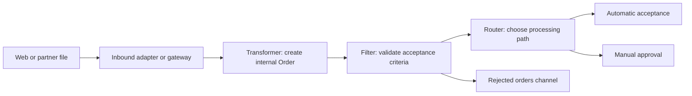

# What Is Spring Integration?

## Lesson Objectives

In the **Spring Integration Fundamentals** chapter of the `SPRING_INTEGRATION_CORE` module, this lesson introduces how to build message-processing flows directly within a Spring application. After completing this lesson, you will be able to:

- Explain which integration problems Spring Integration solves.
- Distinguish between `Message`, `MessageChannel`, endpoint, and gateway.
- Read a Java DSL flow and describe the path of data.
- Recognize the roles of transformer, filter, router, splitter, and aggregator.
- Distinguish between sending a message and completing processing, while identifying points that require testing and error handling.

You should know basic Java, Spring beans, dependency injection, and how to read `@Configuration`/`@Bean` configuration. Kafka, RabbitMQ, or a distributed system are not needed to get started.

## 1. The Problem: When Integration Becomes a Processing Flow

Suppose a store receives orders from a web interface and from files sent by partners. Incoming data may have different formats, but all of it needs to go through the following steps:

1. Convert to an internal order model.
2. Validate required data and quantities.
3. Classify into regular orders or orders requiring manual approval.
4. Invoke the order acceptance business logic.
5. Return the result or record the failure reason.

Everything could be written using plain Java method calls. Difficulty arises when each source reimplements conversion, branching, error handling, and external system calls. A change in output easily ripples into changes across many inputs.

Spring Integration lets you express those steps as a **message flow**: data is packaged into messages, travels through channels, and is processed by components with clear responsibilities. As a result, the rules connecting steps are separated from business methods.

For example, the `acceptOrder(order)` method remains focused on accepting orders. Flow configuration decides which messages are allowed to reach that method, after which transformation step, and where the result goes.

## 2. Definition and Place in the Spring Ecosystem

**Spring Integration is a framework that extends the Spring programming model to build integration applications based on messaging and Enterprise Integration Patterns, commonly abbreviated as EIP.** Flow components are managed in the Spring `ApplicationContext`; the framework supports integrating external systems via adapters. [Source: Overview of Spring Integration Framework](https://docs.spring.io/spring-integration/reference/overview.html).

EIP are patterns that solve recurring integration problems: format transformation, routing, message splitting, result aggregation, or system connectivity. Instead of inventing a different set of conventions for each project, development teams can use the same terminology and the same mental model.

A flow can run entirely within a single JVM. When communication with external systems is needed, components supporting the corresponding protocol are added. Using `Message` does not automatically turn an application into microservices or make every operation asynchronous.

| Component | Typical Responsibility | Relationship with Spring Integration |
| --- | --- | --- |
| Spring Framework | Manage beans, dependency injection, transactions, and application infrastructure | Provides the foundation for configuring and executing flow components |
| Spring Boot | Configure and bootstrap Spring applications by convention | Can be used to package and start an application containing an integration flow |
| Spring Integration | Connect processing steps using messaging and EIP | The subject studied in this module |
| Kafka or RabbitMQ | Transport messages between processes according to each product's capabilities | Can be connected at the flow boundary; not required for internal examples |
| Business service | Execute rules such as accepting orders or calculating fees | Invoked by an endpoint when a message reaches the corresponding step |

The learning examples in this lesson use internal flows to clearly show the core mechanism. Message acknowledgment from a broker, durable storage, or network communication must be designed separately according to real-world infrastructure.

## 3. Four Concepts to Distinguish

### 3.1. Message: Data Along with Processing Context

`Message<T>` contains two parts: the **payload** is the data, and **headers** are accompanying metadata. Foundational types such as `Message` and `MessageChannel` reside in the `org.springframework.messaging` package, while many implementations and endpoints reside in Spring Integration.

Example of creating a message:

```java
import org.springframework.messaging.Message;
import org.springframework.messaging.support.MessageBuilder;

Message<String> message = MessageBuilder
        .withPayload("  order-1001  ")
        .setHeader("source", "partner-file")
        .setHeader("businessRequestId", "request-2026-001")
        .build();
```

Here, the payload is an unnormalized order ID string. `source` indicates the input source; `businessRequestId` is an application-assigned ID for tracing a business request.

The headers structure does not allow direct modification, and you cannot replace the payload reference on an already-created message. However, if the payload is an `ArrayList`, the list's contents can still be modified. Immutability of the wrapper does not mean every object inside it is immutable. [Source: Message](https://docs.spring.io/spring-integration/reference/message.html).

When you need to change the payload or headers, create a new message, for example via `MessageBuilder.fromMessage(...)`. For data shared across multiple branches, prefer immutable types or an appropriate copying strategy.

Some notable headers:

| Header | Meaning |
| --- | --- |
| `id` | Identifier of the message instance; should not be treated as a stable business order ID across steps that create new messages |
| `replyChannel` | Reply destination when a component produces a response and has no suitable explicit output |
| `errorChannel` | Error destination when the corresponding error-handling mechanism uses this header |
| `businessRequestId` | Custom header in the example for tracing a business request |

The payload should contain enough data for the next step to understand the business contract. Headers are useful for transport and processing context, but should not become a hiding place for required data unknown to readers of the contract.

### 3.2. MessageChannel: Message Delivery Path

A channel is the connection point between a sender and a processor. The sender knows the target channel rather than having to know all downstream components directly.

Four common types:

| Channel Type | Delivery Mechanism | Key Points to Remember |
| --- | --- | --- |
| `DirectChannel` | Dispatches to a single handler on the sender's thread | Sending a message can result in synchronous processing right inside that call |
| `QueueChannel` | Buffers messages for receivers to pull | Consuming endpoints typically need a poller; the default queue is in-memory |
| `ExecutorChannel` | Hands work off to an executor | Must consider thread pool, errors, and load limits; does not inherit the sender thread's transaction by default |
| `PublishSubscribeChannel` | Broadcasts to subscribers | Not a competing-consumer queue; can configure an executor to change execution behavior |

These delivery characteristics are described in [Message Channel Implementations](https://docs.spring.io/spring-integration/reference/channel/implementations.html).

With `DirectChannel`, having multiple subscribers does not mean each subscriber receives a copy like a broadcast. With `QueueChannel`, a successful send may only mean the data was placed into the queue; business logic may not have run yet.

Therefore, when designing a flow, ask two separate questions: **has the message been accepted into the channel** and **has the business operation completed**. A return value from a send operation is not general proof of a successful database update or delivery.

### 3.3. Endpoint: Where Channels Connect to Processing Behavior

An endpoint attaches processing logic to the flow. You can think of an endpoint as the part responsible for receiving messages from a channel via an appropriate mechanism and passing them to the corresponding handler or logic.

One example is a **service activator**: when a message arrives, it invokes a method on a business bean. The business bean does not necessarily have to accept `Message<?>`; it can accept just a payload object such as `Order`.

Separating these two responsibilities makes testing clear:

- Test the business method to verify order acceptance rules.
- Test the integration flow to verify that data is transformed, branched, and routed to the right method.

If the input channel supports subscription, the endpoint can be triggered on the send event. If consuming from a pollable channel, appropriate polling must be configured. A queue does not automatically create a business-processing loop just because there is data inside it.

### 3.4. Gateway: An Entry Point with a Java Contract

A messaging gateway can expose a Java interface to calling code. A proxy generated by the framework turns method calls into message exchanges. As a result, code using the gateway only needs to know the input and return types. [Source: Messaging Gateways](https://docs.spring.io/spring-integration/reference/gateway.html).

Example of the contract shape:

```java
public interface OrderGateway {
    String submit(String rawOrderId);
}
```

This interface expresses a request–reply exchange style: the caller expects a string response. To work, it still needs to be registered as a messaging gateway and bound to a request channel; the hands-on section below provides that full configuration.

Do not equate a gateway with a channel. A gateway is a contract at the communication boundary; a channel is an internal message-passing path. An outbound gateway at an external system boundary also represents a request–reply exchange, whereas a channel adapter typically serves one-way inbound or outbound communication.

## 4. Viewing a Flow Through Enterprise Integration Patterns

An order intake flow can be described as follows. This is a conceptual diagram for the order scenario, independent of the string-normalization example later on.



| Component | Question It Answers | Example in the Store |
| --- | --- | --- |
| Transformer | How does the data representation need to be changed? | Convert partner data into an internal `Order` |
| Filter | Is the message allowed to proceed? | Reject requests with invalid quantities |
| Router | Which branch should the message go to? | Route high-value orders to manual approval |
| Service activator | Which business behavior should be invoked? | Invoke the order acceptance service |
| Splitter | Which parts should the message be split into? | Split an order into line items |
| Aggregator | When and how should related parts be combined? | Aggregate line-item check results into an overall order result |
| Channel adapter | Which one-way source or destination should the flow connect to? | Read input files or write data to a target system |

A filter differs from a router in its primary decision: a filter decides whether to pass or reject, whereas a router chooses a destination. A transformer changes data, while a service activator invokes behavior. These steps can appear together, but responsibilities should remain easy to read.

An aggregator is stateful because it must remember messages that have already arrived. When used to aggregate line-item checks, it needs to know the correlation key linking them to an order, the completion condition to release the result, how to handle missing lines, and how to clean up expired groups. It is not simply a `collect()` operation on an already-complete list.

In an introductory lesson, the goal is to identify each role accurately. Detailed configuration of routers, aggregators, state stores, and retries should be studied alongside their dedicated lessons.

## 5. Hands-On: Order ID Normalization Flow with Java DSL

### 5.1. Scope and Setup

We build the contract:

```text
"  order-1001  "  ->  "ACCEPTED:ORDER-1001"
"     "          ->  rejected with an exception
```

The example uses Java 17 or higher and Spring Integration **6.x** managed with compatible Spring Framework versions. This is the API baseline for the example, not a requirement to upgrade an existing project. Do not mix arbitrary versions of Spring Framework, Spring Boot, and Spring Integration.

If a Maven project already uses the appropriate Spring Boot dependency management, declare:

```xml
<dependency>
    <groupId>org.springframework.boot</groupId>
    <artifactId>spring-boot-starter-integration</artifactId>
</dependency>
```

This dependency snippet assumes a Boot BOM or parent is already configured. If using plain Spring, you need the `org.springframework.integration:spring-integration-core` dependency and compatible version management. Java DSL is already included in core; there is no need to look for a separate Java DSL library for this example.

### 5.2. Complete Configuration

Create the `OrderIntegrationConfig.java` class in the practice application's source code:

```java
package example.integration;

import java.util.Locale;

import org.springframework.context.annotation.Bean;
import org.springframework.context.annotation.Configuration;
import org.springframework.integration.annotation.IntegrationComponentScan;
import org.springframework.integration.annotation.MessagingGateway;
import org.springframework.integration.channel.DirectChannel;
import org.springframework.integration.config.EnableIntegration;
import org.springframework.integration.dsl.IntegrationFlow;
import org.springframework.messaging.MessageChannel;

@Configuration
@EnableIntegration
@IntegrationComponentScan(basePackageClasses = OrderIntegrationConfig.class)
public class OrderIntegrationConfig {

    @MessagingGateway(defaultRequestChannel = "orderInput")
    public interface OrderGateway {
        String submit(String rawOrderId);
    }

    @Bean
    public MessageChannel orderInput() {
        return new DirectChannel();
    }

    @Bean
    public IntegrationFlow orderFlow() {
        return IntegrationFlow.from("orderInput")
                .transform(String.class, String::trim)
                .filter(String.class,
                        value -> !value.isEmpty(),
                        spec -> spec.throwExceptionOnRejection(true))
                .transform(String.class,
                        value -> value.toUpperCase(Locale.ROOT))
                .handle(String.class,
                        (orderId, headers) -> "ACCEPTED:" + orderId)
                .get();
    }
}
```

`@IntegrationComponentScan` registers the `@MessagingGateway` interface. Do not assume regular component scanning will create a proxy for an interface. `@EnableIntegration` enables the integration infrastructure in this example's plain Spring configuration.

Java DSL is a fluent configuration API: `IntegrationFlow` describes channels and endpoints for Spring to register in the context. Calls like `.transform(...)` here declare the steps of the flow; they do not execute order ID transformation at bean creation time. [Source: Java DSL](https://docs.spring.io/spring-integration/reference/dsl.html).

### 5.3. Calling via the Spring Context

The `Demo.java` class below uses the Spring context directly, without needing an HTTP server:

```java
package example.integration;

import org.springframework.context.annotation.AnnotationConfigApplicationContext;
import org.springframework.messaging.MessagingException;

public class Demo {

    public static void main(String[] args) {
        try (var context = new AnnotationConfigApplicationContext(
                OrderIntegrationConfig.class)) {

            var gateway = context.getBean(
                    OrderIntegrationConfig.OrderGateway.class);

            System.out.println(gateway.submit("  order-1001  "));

            try {
                gateway.submit("     ");
            } catch (MessagingException ex) {
                System.out.println("REJECTED");
            }
        }
    }
}
```

Expected output:

```text
ACCEPTED:ORDER-1001
REJECTED
```

These two classes are examples for learners to place in a project with appropriate dependencies. The output above is the expected result for comparison during practice, not a run report from the current repository.

### 5.4. Tracing a Single Call

When calling `gateway.submit("  order-1001  ")`:

1. The gateway proxy creates a message from the argument and sets up the reply path.
2. The message is sent to `orderInput`, a `DirectChannel`.
3. The first transformer trims leading and trailing whitespace from the payload.
4. The filter lets non-empty strings proceed.
5. The second transformer converts the ID to uppercase using `Locale.ROOT`.
6. The final handler produces the string `ACCEPTED:ORDER-1001`.
7. The reply returns to the gateway and becomes the return value of `submit`.

The channels implicitly connecting the steps in this flow are direct channels. There is no handoff to an executor or queue, so processing runs on the calling thread. Chaining steps in syntax does not imply parallel execution.

The `ACCEPTED:` string merely illustrates producing a reply. The example does not yet check order existence, save to a database, or call inventory. When expanding into a real flow, replace the final handler with a call to a service that has a clear business contract.

### 5.5. Why Is the Filter Configured to Throw an Exception?

For a whitespace-only string, the `trim()` step produces an empty string. The filter rejects it, and `throwExceptionOnRejection(true)` makes this path terminate with an explicit error.

If a filter silently drops a message in a request–reply flow, the caller will not receive a successful response from that branch. When designing a gateway, you need to fully define the reply path, the rejection path, and the wait policy. `replyTimeout` governs how long to wait for a reply; it should not be treated as a mechanism to interrupt a long-running synchronous handler. [Source: Messaging Gateways](https://docs.spring.io/spring-integration/reference/gateway.html).

## 6. Understanding Errors and Execution Boundaries Early

In the example, handlers run on the calling thread via direct channels. Processing errors propagate back to the caller by default through the messaging/gateway mechanism. There is no guarantee that every exception in a flow is automatically sent to the global `errorChannel`.

When a poller or asynchronous execution via an executor is involved, you cannot rely solely on a `try/catch` around the send operation to catch errors thrown later on another thread. The framework's error-handling mechanism can create an `ErrorMessage`, prioritizing the channel from the `errorChannel` header and then the global error channel when applicable. Gateway configuration can also define a dedicated error-handling path. [Source: Error Handling](https://docs.spring.io/spring-integration/reference/7.0/error-handling.html).

For an order application, three categories of scenarios should be identified upfront:

| Scenario | Meaning | Handling Approach to Design |
| --- | --- | --- |
| Empty order ID | Invalid data | Reject with a reason; retrying with the same data usually does not help |
| Inventory service temporarily unavailable | May be a transient infrastructure failure | Consider bounded retries and control side effects |
| Order recorded but reply lost | Caller may resend the request | Need a business key or idempotency strategy to avoid double recording |

Switching from `DirectChannel` to `ExecutorChannel` is a change in execution model, not merely a performance tweak. You must review transactions, thread-bound context, processing ordering, executor queue policies, and error observability. A transaction bound to the sending thread is not automatically shared with the processing thread. [Source: Configuring Message Channels](https://docs.spring.io/spring-integration/reference/channel/configuration.html).

## 7. Testing What Needs Protection

Learning Spring Integration Core requires both logic testing and flow-wiring testing. A correct transformer placed on the wrong branch can still produce an incorrect flow.

For the current example, the minimum practice test cases are:

| Input | What to Verify |
| --- | --- |
| `"  order-1001  "` | Returns `"ACCEPTED:ORDER-1001"` accurately |
| `"OrDeR-2"` | Normalizes uppercase consistently |
| `"     "` | Rejected with an error, without reaching the success handler |

When expanding the example into real order intake, also test the connection points: partner data is mapped accurately, high-value orders go to the approval branch, rejected orders include a reason, and line-item results are aggregated back to the right order.

No broker is needed to test a flow that only uses internal channels. If you later add an adapter for network communication, you must also test that adapter's contract and error scenarios. Pure logic tests do not prove that external system connection configuration is correct.

## 8. When Should You Apply It?

Spring Integration fits when a problem has processing steps that need to be connected and changed independently: receiving multiple data sources, transforming formats, routing, calling external systems, aggregating results, or organizing an error-handling path.

For example, the store adds an order source from SFTP. If a clear internal `Order` contract already exists, the new part can focus on reading files and converting them to that contract, then feeding data into the appropriate point of the intake flow. Downstream validation and branching steps have a chance to be reused.

In return, the team must be able to read the flow topology and understand message/channel rules. For a simple CRUD operation, a direct service call may already be clear enough. Choose the framework based on actual integration complexity and the team's maintainability.

## 9. Common Misconceptions

| Misconception | More Accurate Understanding |
| --- | --- |
| Having messages means having asynchrony | Channels and endpoints determine execution behavior; the lesson's example runs synchronously |
| A channel is a topic on a broker | A channel can simply be an internal bean inside the JVM |
| `QueueChannel` persists data across restarts by default | Appropriate durable storage must be configured if that requirement exists |
| A gateway guarantees business success | A gateway provides the communication contract; business correctness depends on processing steps |
| The flow guarantees exactly-once by itself | It must be designed across the data source, transactions, delivery mechanisms, and idempotency |
| A transformer should handle every operation | Transformation responsibility should stay clear; persisting data and calling business logic should be expressed transparently |
| An aggregator returns a result whenever it receives a message | It needs correlation rules, group release conditions, and handling for missing data |

## 10. Self-Check of Understanding

Try explaining in your own words:

1. If you change the order source from web to file, which parts of the flow can be kept?
2. Why does `DirectChannel` still create structural loose coupling even though it runs synchronously?
3. Why can a mutable payload object cause issues when branching?
4. If a filter drops a message while the caller is waiting for a result, how is the request–reply contract affected?
5. When splitting an order into multiple lines, what information does the aggregator need so it does not mix up two orders?

You have mastered the fundamentals when you can pinpoint **which message the data is in, which channel carries it, which endpoint processes it, what reply the caller expects, and where errors will be observed**. That is the foundation for studying Java DSL, transformers, routers, filters, aggregators, and testing integration patterns in depth in this module.