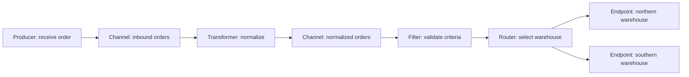

# Message-Driven Integration Problems

## 1. Objectives and Context

In the **Spring Integration Fundamentals** chapter of the `SPRING_INTEGRATION_CORE` module, this lesson answers the question: when multiple components or systems must exchange data, why should that exchange be modeled with messages and an explicit processing flow?

After this lesson, you will be able to:

- Identify dependencies around format, protocol, timing, and errors in an integration workflow.
- Separate business data, orchestration metadata, transport paths, and processing locations into `Message`, `MessageChannel`, and endpoints.
- Choose the roles of gateway, transformer, filter, router, and aggregator in a flow.
- Read a simple Java DSL example and explain the moments of successful send, successful processing, and business completion.
- Ask the right questions about timeouts, retries, duplicates, transactions, and testing before putting a flow into production.

The focus is on how to model an integration problem. Examples use core components inside a Java process; connecting to HTTP, a broker, or a database requires the corresponding adapters and configuration.

## 2. From a Method Call to an Integration Problem

Suppose a store receives orders from a website and from partner files. After intake, the system needs to normalize data, validate conditions, route the order to an appropriate warehouse, and send notifications of the result.

The first version is often an orchestrating method:

```java
public void receive(PartnerOrder input) {
    Order order = convert(input);
    validate(order);
    warehouseClient.reserve(order);
    accountingClient.record(order);
    notificationClient.send(order);
}
```

This code is easy to understand when all operations are short and stable. The problem changes when the following requirements appear:

| Scenario | Resulting Design Question |
| --- | --- |
| Website sends JSON, partner sends CSV | Where should normalization happen so business logic does not depend on each format? |
| Warehouse responds slowly during peak hours | Does the order receiver need to wait for the warehouse? Where is waiting data held? |
| One order includes items from multiple warehouses | How do we split work, track each warehouse's result, and combine results? |
| Accounting recorded it, but notification failed | Does the entire workflow need to run again? |
| Partner resends the same order | How do we avoid reserving stock or recording twice? |
| Need to add a new intake channel | How much orchestration code must change? |

The problem is not just being able to call another system's API. It is managing **data contracts, routing paths, progress, and processing outcomes** across parties with different characteristics.

### 2.1. Types of Dependencies to Identify

**Format dependency:** consumers directly understand each source's specific structure. Any change at a source can leak into business logic.

**Address and protocol dependency:** business code itself knows the URL, directory, authentication method, or API of the recipient.

**Temporal dependency:** the sender can only continue once the receiver finishes processing. This may fit instant queries, but causes trouble when tasks take a long time.

**Ordering and outcome dependency:** steps are tied together in a single call stack, while real requirements may need branching, waiting for multiple results, or recovering individual steps independently.

Message-driven integration helps express these dependencies as named decisions with clear configuration locations. It does not eliminate contracts between parties; it makes the contracts and coordination explicit.

## 3. The Message Model: Data Flowing Through a Pipeline

In this model, a producer creates the data to exchange, sends it through a channel, and a consumer receives it for processing. A consumer may produce the next message for the following step.



The diagram shows the direction of data movement; it does not prescribe whether steps run on the same thread or different threads, whether a broker is involved, or whether data is stored durably. Those properties must be designed separately.

Spring Integration implements Enterprise Integration Patterns using composable components. The goal is to separate integration logic from plain Java business logic so business objects do not have to interact directly with messaging infrastructure. See the [official Spring Integration overview](https://docs.spring.io/spring-integration/reference/overview.html).

### 3.1. A Message Consists of Payload and Headers

A message has two main parts:

- **Payload:** the data to be processed, such as an order.
- **Headers:** metadata supporting exchange and orchestration, such as the sending source or a request ID.

Example of an application-defined contract:

```text
Message<Order>
  payload:
    orderId = "ORD-2048"
    amount = 1250000
    currency = "VND"
  headers:
    sourceSystem = "partner-portal"
    requestId = "REQ-731"
    schemaVersion = "1"
```

`sourceSystem`, `requestId`, and `schemaVersion` here are custom headers and have no special built-in meaning to the framework. Both sides must agree on how to read and propagate them. Technical headers such as `replyChannel` or `errorChannel` have specific roles in Spring Integration.

Keep data that drives business decisions, such as amount and currency, inside the domain model. Do not move them into headers just because headers are convenient to access during routing.

In Spring Messaging, a message's structure and headers map cannot be modified directly after creation. This does not make every object inside deeply immutable: if the payload is a mutable `List`, its elements can still be modified. Therefore, prefer immutable payloads and create a new message when structural changes are needed. See [Message](https://docs.spring.io/spring-integration/reference/message.html).

### 3.2. Distinguishing Command, Event, and Document

These are three common ways to interpret a message's intent, not three mandatory Java classes:

| Semantic Type | Example | What Must Be Agreed Upon |
| --- | --- | --- |
| Command: request to perform an action | `ReserveStock` | Who is responsible for executing it and returning the result? |
| Event: notification that something happened | `OrderAccepted` | What does the event assert has been completed? |
| Document: carries exchanged data | Order list from partner | What are the format, version, and data scope? |

Do not name a message `OrderCompleted` when it has only just been placed onto a queue. That name leads consumers to believe the business process has finished when in reality work has only been accepted.

### 3.3. Message ID Does Not Replace a Business Key

A retry of the same order can create a new message with a new ID. If the goal is to avoid reserving stock twice for `ORD-2048`, the control key must be business-based, such as the pair `(orderId, operation)` or an idempotency key agreed upon upfront.

Similarly, a correlation/trace ID used to link logs across steps is not necessarily a deduplication key. A single request may generate multiple messages and multiple distinct business operations.

## 4. What Do MessageChannel, Endpoint, and Gateway Solve?

### 4.1. MessageChannel Is the Connection Point Between Steps

Producers send to a channel rather than holding direct references to specific consumers. As a result, processing locations can be swapped or intermediate steps added through flow configuration.

Some common choices:

| Channel | Delivery Mechanism | Implications to Understand |
| --- | --- | --- |
| `DirectChannel` | Invokes one subscriber on the sender's thread | Downstream typically runs right inside the `send()` call |
| `QueueChannel` | Holds messages for a consumer to pull | Must have a `receive()` caller or polling consumer; defaults to an in-memory queue |
| `ExecutorChannel` | Dispatches through a `TaskExecutor` | Execution behavior depends on the executor; typically used to hand work off to workers |
| `PublishSubscribeChannel` | Broadcasts to subscribers | Not equivalent to a competing-consumer mechanism sharing each message with one worker |

`QueueChannel` can accept a capacity limit; `PublishSubscribeChannel` can use an executor. A channel inside a JVM does not automatically become a distributed queue. See [MessageChannel Implementations](https://docs.spring.io/spring-integration/reference/channel/implementations.html).

Design example: if immediate feedback on whether data is valid is needed, a synchronous flow segment may fit. If work must be buffered for later processing, you must also decide queue capacity, wait times, and how to recover when the process stops.

### 4.2. Endpoint Connects Processing Behavior to a Channel

An endpoint is where behavior is attached to the flow: where to receive from, how to process, and where to forward the result. For channels that support subscriber registration, consumers can be invoked on send events. For channels requiring active retrieval, a polling consumer must be configured if you want the framework to pull and process automatically.

A service activator is a common role: invoking a method on a business service when a message arrives. A method like `reserve(Order order)` can continue accepting a plain Java object, while integration configuration handles wiring it to the channel. See [Message Endpoints](https://docs.spring.io/spring-integration/reference/7.0/endpoint.html).

### 4.3. Gateway Creates a Calling Boundary from Application Code

A gateway lets callers interact through a Java interface instead of manually building messages and calling channels. Example of the contract shape:

```java
@MessagingGateway(defaultRequestChannel = "reserveRequests")
public interface StockGateway {
    ReservationResult reserve(Order order);
}
```

This is a contract illustration, not a complete configuration: the application needs to register the gateway, such as via `@IntegrationComponentScan`, and have a flow listening on `reserveRequests` that returns `ReservationResult`. The gateway does not implement stock reservation itself.

A method returning a result expresses a request–reply need. If one branch of the flow does not produce a reply, the caller may have to wait until the wait mechanism expires. You must define timeouts, behavior when no result arrives, and reply paths for every branch. See [Messaging Gateways](https://docs.spring.io/spring-integration/reference/gateway.html).

## 5. Mapping Integration Needs to Processing Patterns

Not every step should be written as one large orchestrating service. You can name the responsibility of each step:

| Need in the Order Flow | Appropriate Role | Question That Step Answers |
| --- | --- | --- |
| Convert partner DTO to internal model | Transformer | What shape does the data need? |
| Reject records outside acceptance scope | Filter | Should the message continue? |
| Choose warehouse by delivery region | Router | Which channel should the message go to? |
| Perform stock reservation | Service activator | Which business behavior needs to be invoked? |
| Split order into work units | Splitter | Which child messages does one message produce? |
| Combine results from warehouses | Aggregator | Which results belong to the same group and when is it complete? |

### 5.1. Transformer: Separating Source Format from the Internal Model

Suppose a partner uses string `total_amount` and lowercase `currency_code`. A transformer can convert them into `BigDecimal` and a standard currency code before entering business processing.

Normalization should not guess missing data. If the source omits the currency, a clear contract rule is needed rather than an arbitrary default. A transformer should also not silently reserve stock or process payments: those side effects need a separately observable business step. See [Transformer](https://docs.spring.io/spring-integration/reference/transformer.html).

### 5.2. Filter and Router: Two Distinct Decisions

A filter answers "should this continue or not". If a message is rejected, the design must specify whether it is intentionally dropped, routed to a discard channel, or throws an error. In the hands-on example below, invalid data is rejected with an exception so the sender knows immediately. See [Filter](https://docs.spring.io/spring-integration/reference/filter.html).

A router answers "where should it go", and can pick one or more channels depending on router type and conditions. For example, domestic orders go to the domestic warehouse flow, and international orders go to the export check flow. If no branch matches, define a default path or an error outcome. See the [Routers overview](https://docs.spring.io/spring-integration/reference/router/overview.html).

### 5.3. Aggregator: Needs State and a Completion Condition

If an order splits into requests for two warehouses, the aggregator needs to know which results belong to the same order and when it can emit the combined result. This is stateful processing, requiring storage for message groups along with correlation and release rules. See [Aggregator](https://docs.spring.io/spring-integration/reference/aggregator.html).

Store design example:

- The correlation key is the order processing attempt ID, avoiding mixing results from an old attempt with a new one.
- Both warehouses must respond with an explicit business outcome, even when refusing stock reservation.
- If one warehouse fails to respond, waiting must terminate under an agreed policy and record a missing-result state.
- If the process can restart while waiting, you must decide whether held groups need to survive restarts.

Placing an aggregator on a diagram does not automatically solve scenarios where one branch loses its result or sends a duplicate result.

## 6. Four Properties That Must Not Be Equated

### 6.1. Message-Driven Does Not Mean Asynchronous

A flow over `DirectChannel` can still run entirely on the caller's thread. The value of this organization is separating responsibilities and modeling the flow, even when no new threads are introduced.

Conversely, adding a queue or executor can change when the caller resumes, how errors return, processing order, and transaction boundaries. That is a change in execution semantics, not merely a speed optimization.

### 6.2. Asynchronous Does Not Mean Durable Data

Putting messages into an in-memory queue decouples send and receive timing. If the process loses in-memory data, unprocessed messages can be lost along with it.

If the requirement is "once an order is accepted, it must not be lost", the design needs durable storage, intake acknowledgment rules, and a recovery strategy. Options include an appropriate message store, a broker, or persisting work in a database; each option requires configuration and verification against the desired contract.

### 6.3. Successful Send Is Not Always Business Success

Separate three milestones:

1. **Accepted:** the system has taken responsibility for the data under a specific condition.
2. **Handed off:** the message has been delivered to the next channel or infrastructure layer.
3. **Completed:** the required business effect has occurred and the outcome is recorded.

With a queue, `send()` may finish as soon as the message is enqueued. With a synchronous flow segment, `send()` may finish only after handlers have run. Do not build success-reporting APIs assuming the same semantics for both cases.

### 6.4. Channels Do Not Create Distributed Transactions

Spring's thread-bound transaction can travel along a synchronous flow segment. When switching to another thread, that transaction does not automatically follow to encompass all downstream work. See [Transaction Support](https://docs.spring.io/spring-integration/reference/transactions.html).

In a scenario where the warehouse already reserved stock but accounting failed, a local database rollback does not automatically undo the warehouse's side effect. The design team must decide whether to retry the accounting step, cancel the reservation via a compensating action, or move to a state requiring follow-up handling. Emitting messages and writing business data also need a consistency strategy if both operations must be guaranteed together.

## 7. Hands-On: An In-Memory Order Intake Flow

This example is intentionally small: it receives an `Order`, validates data, normalizes the currency code, produces an acceptance result, and places the result into a `QueueChannel` to read back. It does not call a warehouse, write to a database, or guarantee durable storage yet.

### 7.1. Prerequisites

The example uses Java 17 or higher for `record` syntax, Spring Integration 6.x, and compatible Spring dependencies. In a Spring Boot project, you can use the following starter with its version managed by your project's dependency management:

```xml
<dependency>
    <groupId>org.springframework.boot</groupId>
    <artifactId>spring-boot-starter-integration</artifactId>
</dependency>
```

If using a newer Spring line, follow that line's JDK and version-alignment requirements; using Java 17 syntax in the example does not mean every Spring version runs on JDK 17.

### 7.2. Configuration and Runnable Demo

The class below can run via `main` once the dependencies are on the classpath. No broker or poller is needed in the example because the program calls `receive()` directly on the result channel.

```java
import java.math.BigDecimal;
import java.util.Locale;

import org.springframework.context.annotation.AnnotationConfigApplicationContext;
import org.springframework.context.annotation.Bean;
import org.springframework.context.annotation.Configuration;
import org.springframework.integration.channel.DirectChannel;
import org.springframework.integration.channel.QueueChannel;
import org.springframework.integration.config.EnableIntegration;
import org.springframework.integration.dsl.IntegrationFlow;
import org.springframework.messaging.Message;
import org.springframework.messaging.MessageChannel;
import org.springframework.messaging.MessagingException;
import org.springframework.messaging.support.MessageBuilder;

@Configuration
@EnableIntegration
public class OrderIntegrationExample {

    public record Order(String orderId, BigDecimal amount, String currency) {}

    public record Acceptance(String orderId, String status, String currency) {}

    @Bean
    public MessageChannel ordersIn() {
        return new DirectChannel();
    }

    @Bean
    public QueueChannel orderResults() {
        return new QueueChannel(10);
    }

    @Bean
    public IntegrationFlow orderFlow() {
        return IntegrationFlow.from("ordersIn")
                .filter(Order.class,
                        order -> order.orderId() != null
                                && !order.orderId().isBlank()
                                && order.amount() != null
                                && order.amount().signum() > 0
                                && order.currency() != null
                                && !order.currency().isBlank(),
                        spec -> spec.throwExceptionOnRejection(true))
                .<Order, Order>transform(order -> new Order(
                        order.orderId().trim(),
                        order.amount(),
                        order.currency().trim().toUpperCase(Locale.ROOT)))
                .<Order, Acceptance>transform(order -> new Acceptance(
                        order.orderId(), "ACCEPTED", order.currency()))
                .channel("orderResults")
                .get();
    }

    public static void main(String[] args) {
        try (var context = new AnnotationConfigApplicationContext(
                OrderIntegrationExample.class)) {
            MessageChannel input = context.getBean("ordersIn", MessageChannel.class);
            QueueChannel results = context.getBean("orderResults", QueueChannel.class);

            Message<Order> valid = MessageBuilder.withPayload(
                            new Order(" ORD-2048 ", new BigDecimal("1250000"), " vnd "))
                    .setHeader("sourceSystem", "website")
                    .setHeader("requestId", "REQ-731")
                    .build();

            boolean sent = input.send(valid, 1000);
            Message<?> result = results.receive(1000);

            if (!sent || result == null) {
                throw new IllegalStateException("No result received in the example");
            }

            System.out.println(result.getPayload());
            System.out.println(result.getHeaders().get("requestId"));

            Message<Order> invalid = MessageBuilder.withPayload(
                    new Order("ORD-2049", new BigDecimal("-100"), "VND")).build();

            try {
                input.send(invalid, 1000);
                throw new IllegalStateException("Invalid order was not rejected");
            }
            catch (MessagingException ex) {
                System.out.println("Order rejected: " + ex.getClass().getSimpleName());
            }
        }
    }
}
```

Java DSL expresses flow configuration through `IntegrationFlow`; the framework registers the necessary channels and endpoints in the application context. The builder chain is neither a broker nor a separate transaction mechanism. See [Java DSL](https://docs.spring.io/spring-integration/reference/dsl.html).

### 7.3. Tracing a Valid Message

With the sample data, the expected progression is:

1. `ordersIn` receives `Message<Order>` on the `main` thread.
2. The filter accepts it because order ID, amount, and currency satisfy the illustrative conditions.
3. The transformer creates a new `Order` with `orderId = "ORD-2048"` and `currency = "VND"`.
4. The next transformer creates an `Acceptance` with status `ACCEPTED`.
5. The result is placed into `orderResults`, and `receive(1000)` pulls it out to print.

The two main output lines look like:

```text
Acceptance[orderId=ORD-2048, status=ACCEPTED, currency=VND]
REQ-731
```

Transformers return new payloads and the framework propagates standard headers, so `requestId` can still correlate the result with the request. The `ACCEPTED` status only means the data passed the example's intake condition; there is no stock reservation, payment, or durable order storage yet.

### 7.4. Tracing an Invalid Message

An order with a negative amount is rejected by the filter. Because `throwExceptionOnRejection(true)` is configured and the flow segment runs synchronously, the caller receives a `MessagingException` from the message-rejection error group or a corresponding wrapped exception. This order does not produce an `Acceptance` in `orderResults`.

If you remove the exception-throwing configuration, do not continue assuming the caller always knows data was dropped. When replacing it with a discard channel, there must be a consumer handling the rejected branch and an appropriate reply contract if the caller is waiting for a result.

### 7.5. Intentional Limitations of the Example

The filter only demonstrates minimal conditions and does not check a currency code allowlist or order ID length. The result queue has capacity 10 and data stays in memory only. If expanded to multiple sends without reading results, you must design a policy for when the queue is full; a timeout on sending into `DirectChannel` is not a deadline for the entire downstream flow.

The example also lacks deduplication. Resending `ORD-2048` produces another acceptance result. Guarding against repeated business operations must be added where real side effects occur.

## 8. Designing Error Paths Alongside Happy Paths

An integration flow is incomplete if it only describes valid data. Consider at least three categories of scenarios:

| Scenario Category | Example | Handling Direction in the Order Problem |
| --- | --- | --- |
| Invalid input data | Negative amount, missing currency | Reject with a clear reason; require data correction |
| Transient infrastructure failure | Warehouse overloaded, flaky connection | Retry with limits if the operation is safe to repeat |
| Uncertain outcome | Warehouse may have reserved stock, but the response was lost | Query state or use a deduplication key before resending |

With synchronous processing, downstream exceptions can propagate back to the caller. With work running in Spring Integration's asynchronous task infrastructure, errors can be published as an `ErrorMessage` to a configured error path; `errorChannel` selection depends on context and configuration. Do not assume every exception on every thread automatically goes to `errorChannel`. See [Error Handling](https://docs.spring.io/spring-integration/reference/7.0/error-handling.html).

In the store's design, every error should carry enough information to identify which order, which step, and which processing attempt failed. A log entry stating only "timeout" is insufficient to decide whether it is safe to reserve stock again.

### 8.1. Retries Must Go Hand-in-Hand with Idempotent Handling

Suppose a stock reservation request reached the warehouse, but the response was lost on the way back. A caller timeout does not prove the warehouse did not process it. Blindly retrying could reserve stock a second time.

One design approach is requiring the warehouse to accept a stable `reservationRequestId` for the same operation. Upon receiving that key again, the warehouse returns the previously recorded result instead of performing another side effect. Key checking and inventory updates must have appropriate consistency, even when two workers process concurrently.

Do not use retries to fix data that is definitely invalid. For transient errors, limit the attempt count, backoff interval, and total duration; once self-recovery is exhausted, transition work into a state that can be monitored and handled further.

### 8.2. Monitor Pending Work Volume Too

Beyond success rates, operational design should be able to answer:

- How many orders are pending, and how long has the oldest one waited?
- Which step has a request reached, or which system is it waiting on?
- How many retries have occurred for the same operation?
- Are there rejected orders whose outcomes have not been communicated yet?
- Has any aggregation group waited too long or missed responses?

Do not log entire payloads containing sensitive data solely to support tracing. Select correlation IDs, statuses, and error details sufficient for investigation.

## 9. How to Approach Designing a New Flow

A practical sequence for the order problem:

1. **Define outcomes:** how do "order accepted" and "order placed successfully" differ?
2. **Identify boundaries:** where does data enter, who owns each side effect, and where can things fail independently?
3. **Lock down contracts:** payload types, currency units, versions, business keys, and tracing metadata.
4. **Map the path:** normalization, filtering, branching, invoking business logic, and aggregating results if needed.
5. **Mark execution boundaries:** which segments are synchronous, which hand off work; where is data actually persisted durably?
6. **Map failure paths:** invalid data, timeouts, retries, duplicates, missing results, and compensating actions.
7. **Pick observation and test points:** prove the outcome of each case, even before calling real external systems.

Do not start by picking a channel type and forcing business requirements to fit it. Start from intake responsibilities and completion criteria.

### 9.1. When Does This Organization Add Value?

Message-driven design is useful when there are multiple data formats or sources, multiple transformation and routing steps, different processing cadences, or needs to monitor and recover individual stages independently.

If there is only a simple internal operation, one service calling another may be clear enough and meet requirements. Adding gateways, channels, and endpoints increases the number of components to understand; the benefit should come from clearly expressing a genuine integration problem.

Spring Integration can operate inside a single application and connect out to other systems via adapters. It does not require splitting a system into microservices, and using the framework does not by itself provide all guarantees of a distributed messaging platform.

## 10. Verifying Behavior and Practice Exercises

At the fundamentals stage, describe verification criteria before expanding the flow:

| Case | What to Observe |
| --- | --- |
| Valid order, currency has whitespace | Receives one result, currency code is normalized |
| Order with zero or negative amount | Rejected; no acceptance result created |
| Input has `requestId` | Result remains correlated with the right request |
| Resend the same order ID | Recognize that the current example does not deduplicate yet |
| Result queue full | Waiting or failure behavior must be defined before increasing load |
| Replace a synchronous segment with delegated execution | Revisit how errors return and criteria for reporting success |

These are criteria for learners to verify the example in their own project, not a claim that tests have been executed on a specific dependency set.

### Exercise 1: Branch by Currency

After the normalization step, add a router: `VND` goes to the domestic flow, `USD` goes to the foreign-currency flow, and other codes go to a rejection branch. State clearly what result each branch produces; do not let unmatched branches vanish without an explicit decision.

### Exercise 2: Distinguish Intake and Completion

Suppose the store must return a request ID immediately and process warehouse reservation afterward. Sketch two flows: intake and work processing. Indicate where data is stored durably before replying to the customer, how progress is queried, and what happens if the process stops between the two steps.

### Exercise 3: Aggregate Results from Two Warehouses

Design each warehouse's result payload, the correlation key, the release condition for the combined result, and the missing-response policy. Include scenarios where a warehouse resends a result or responds after the order has already timed out.

### Self-Check Questions

1. Why is a producer that knows only a channel name less coupled to specific consumers than calling each client directly?
2. Switching from `DirectChannel` to a handoff step can change what besides throughput/speed?
3. Why is a successful `send()` not enough to assert that stock has been reserved for an order?
4. When do you need a transformer, when a router, and when an aggregator?
5. Does a caller timeout prove that the business side effect has not occurred?
6. Why might a message ID, a trace/correlation ID, and a deduplication key differ?

The key takeaway is the ability to trace a request from intake to final outcome: what the data means, what each step is responsible for, and whether the system can explain what happened when a step does not complete.