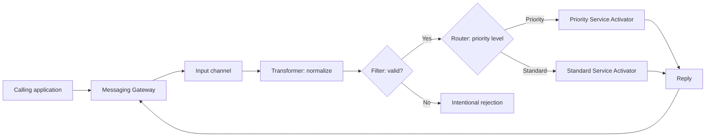
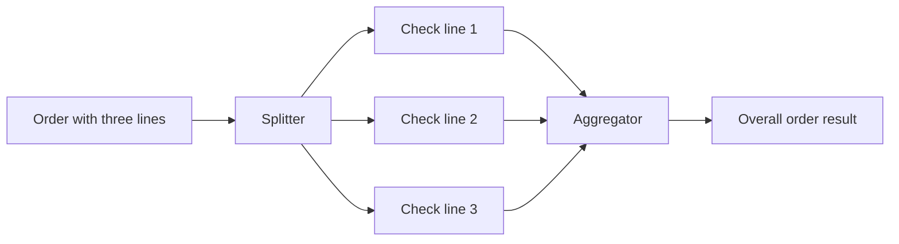

# Enterprise Integration Patterns in Spring

## Objectives and Context

This lesson belongs to the **Spring Integration Fundamentals** chapter of the `SPRING_INTEGRATION_CORE` module. The goal is to use Enterprise Integration Patterns (EIP) to describe an integration problem, then map that design to `Message`, `MessageChannel`, endpoint, gateway, and Java DSL. After this lesson, you should be able to read a message flow, choose the right transformer/router/filter, recognize when a splitter/aggregator is needed, and identify where errors are handled.

Consider a system that receives orders from a website and from partners. The two sources use different formats; valid orders must be normalized, routed by priority, invoke a business service, and return a result. If all the work sits in one large method, routing rules easily get mixed with data transformation code, network calls, and error recording. When adding a new source, many unrelated parts may have to change at once.

EIP provides a shared language to divide responsibilities: which step transforms data, which chooses a path, which invokes business logic, and which aggregates results. Spring Integration implements these patterns as Spring-managed components. It is a way to build an integration layer inside a Spring application and connect external systems through adapters. [Spring Integration Reference Overview](https://docs.spring.io/spring-integration/reference/overview.html).

## 1. From Business Requirements to a Message Flow

EIP are patterns for solving common problems when multiple components exchange information. A pattern describes a design intent; classes, annotations, and DSL are how that intent is implemented.

For example, the requirement "priority orders go to a dedicated processor" leads to a **Content-Based Router**. The requirement "convert partner data to the internal order model" leads to a **Message Translator**, typically implemented with a transformer. These two requirements are independent: changing priority rules should not force edits to the format converter.

A simple flow can be designed as follows:



The diagram shows the logical path. It does not yet indicate which step runs on which thread, whether data is durable, or how many times errors are retried. Those characteristics must be designed additionally via channel types, executors, transactions, message stores, and error-handling policies.

## 2. Three Foundational Components: Message, Channel, and Endpoint

### 2.1. Message: Data Traveling with Context

You can picture a message as consisting of:

```text
Message<T>
├── payload: data being processed
└── headers: metadata supporting processing and transport
```

The payload can be an `Order`, a JSON string, or binary data. Headers can carry `orderId`, intake source, a correlation/grouping key, or a reply address. The data contract must clearly state the payload type and required headers at each boundary.

Example of creating a message in Spring:

```java
import org.springframework.messaging.Message;
import org.springframework.messaging.support.MessageBuilder;

Message<String> message = MessageBuilder
        .withPayload("ORDER-1042")
        .setHeader("sourceSystem", "partner-a")
        .setHeader("businessRequestId", "request-781")
        .build();
```

`businessRequestId` is an application-defined key. Do not implicitly use a message's technical ID as a business deduplication key: the same request can be resent in a new message.

Payload design should avoid having multiple branches mutate the same mutable object. When an order travels to both an auditing branch and a business-processing branch, immutable data or intentional copies keep branches from causing unintended side effects on one another.

### 2.2. MessageChannel: The Handoff Contract

A producer sends to a channel; a consumer receives from a channel. The producer needs to know the channel's input contract without having to call the consumer's implementation directly.

| Channel Type | Handoff Mechanism | Design Implications |
|---|---|---|
| `DirectChannel` | Invokes a handler on the sending thread; one handler processes on a normal successful dispatch | Fits synchronous chains; multiple subscribers do not mean broadcast |
| `QueueChannel` | Stores messages in a queue for consumers to receive | Decouples send and receive timing; polling consumers require a poller |
| `PublishSubscribeChannel` | Broadcasts to subscribers | Used when multiple parties must be notified; does not create parallel execution by default |
| `ExecutorChannel` | Hands off via a `TaskExecutor` | Creates an execution boundary; must evaluate executor, errors, and transactions |

A default in-memory `QueueChannel` does not guarantee message recovery after a process stops. Pub/sub with an executor can process asynchronously, but branch completion ordering must be considered separately. [MessageChannel Implementations](https://docs.spring.io/spring-integration/reference/channel/implementations.html).

When choosing a channel, start with concrete questions: does the caller need to wait for a result; is load buffering needed; must one or many consumers receive the message; and what happens to pending data when the process stops.

### 2.3. Message Endpoint: Connecting Logic to Infrastructure

An endpoint receives messages from a channel and performs a single responsibility. That responsibility may be transforming data, choosing a path, invoking a service, or connecting to an external system.

For example, the `reserveStock(Order order)` method contains stock reservation business logic. A service activator serves as the bridge so a message arriving on a channel can trigger that method. Thus, the business logic can be tested directly with an `Order` without spinning up the entire integration flow.

In **Pipes and Filters** architecture, "pipes" are the connectors and "filters" are processing steps in general. The term "filters" here has a broader meaning than the **Message Filter** endpoint, which specifically decides whether a message may continue.

## 3. Mapping EIP to Spring Integration

The table below is an orientation map. A pattern can have multiple configuration styles, and a DSL method can accept different kinds of handlers.

| Pattern or Role | Question Solved | Commonly Used Component |
|---|---|---|
| Message | Which unit of data is exchanged? | `Message<T>`, payload, headers |
| Message Channel | Where do steps hand off? | `MessageChannel` and its implementations |
| Message Endpoint | How does application logic participate in the flow? | Consumer endpoints and handlers |
| Message Translator | How is the data representation changed? | Transformer, `.transform(...)` |
| Content Enricher | How is missing data supplemented? | Enricher, header enricher |
| Message Filter | Does the message meet criteria to proceed? | Filter, `.filter(...)` |
| Content-Based Router | Which branch should the message go to? | Router, `.route(...)` |
| Splitter | How is one piece of work split into multiple parts? | Splitter, `.split(...)` |
| Aggregator | How are related results combined? | Aggregator, `.aggregate(...)` |
| Resequencer | How is output processing order restored? | Resequencer |
| Service Activator | How is business logic invoked from a message? | `.handle(...)`, `@ServiceActivator` |
| Messaging Gateway | Through which API does calling code interact with the flow? | `@MessagingGateway` |
| Channel Adapter | How is data brought into or sent out of a system? | Inbound/outbound channel adapters |
| Wire Tap | How is a flow observed via a side branch? | `.wireTap(...)` |
| Idempotent Receiver | How are repeated business side effects avoided? | Idempotent receiver interceptor and metadata store |

Verbs like `.transform()`, `.filter()`, `.route()`, `.split()`, `.aggregate()`, and `.handle()` in Java DSL align step names closely with pattern intent. `IntegrationFlow` is configuration for Spring to build runtime components in the application context. [Java DSL Basics](https://docs.spring.io/spring-integration/reference/dsl/java-basics.html).

## 4. Distinguishing Commonly Confused Patterns

### 4.1. Transformer, Enricher, and Service Activator

**Transformer** fits when you need to change data representation. For example: from `PartnerOrder` to `Order`, converting weight units, or normalizing country codes. The output is the transformed data.

**Enricher** fits when you need to add information missing from the initial message. For example: using `customerId` to look up a customer tier before routing. Do not use headers as a dumping ground for all business data just to avoid redesigning the payload.

**Service activator** fits when invoking a business capability, such as reserving stock or creating an invoice. `.handle(...)` can call a POJO; when there is a return value and no output channel is configured, the reply mechanism can use the `replyChannel` header. A handler ending in `void` does not produce a result for a waiting caller on its own. [Service Activator](https://docs.spring.io/spring-integration/reference/service-activator.html).

To choose a pattern, describe the effect of the step. "Changing the order structure" is data transformation. "Creating a stock reservation request in the warehouse" is a business side effect. The fact that both can be written as a Java lambda does not make their responsibilities identical.

### 4.2. Filter and Router

**Filter** answers the question "does this message continue?". For example: only orders with a positive total are accepted. Messages that fail may be dropped, routed to a discard channel, or cause an error depending on configuration.

**Router** answers the question "where does this message go?". For example: priority orders go to `priorityOrders`, standard orders go to `standardOrders`. When no matching route is found, there must be a clear policy: a default branch, rejection, or error.

With a filter in a request-reply flow, dropping a message without producing a reply can leave the caller waiting until timeout. Therefore, rejected cases also need a termination contract. [Message Filter](https://docs.spring.io/spring-integration/reference/filter.html).

Design examples for invalid orders:

- Synchronous API: return a clear input error to the caller.
- Batch data-ingestion flow: route the record to a rejection branch and log the reason.
- Event flow where skipping is acceptable: record metrics appropriate for operational needs.

Do not turn every "do not want to process" case into a silent message drop. Operators need to distinguish intentionally rejected records from data-loss bugs.

### 4.3. Router and Publish-Subscribe

A router selects destinations by rule; depending on the router type, the result can be one or multiple destinations. Publish-subscribe expresses that all subscribers need to be notified.

For the requirement "pick one of two delivery routes", a router is appropriate. For the requirement "once an order is accepted, notify both accounting and auditing", pub/sub expresses the intent more clearly.

Separating these two prevents duplicate business effects: if the same stock-reservation command were broadcast to two reservation handlers, stock could be reserved twice for the order.

### 4.4. Gateway and Channel Adapter

A gateway provides an exchange boundary, typically request-reply. With `@MessagingGateway`, application code can call a Java interface without manually building and sending a `Message`. The gateway manages a temporary reply channel for typical calls. The interface can also declare `void` methods when no return value is required. [Messaging Gateways](https://docs.spring.io/spring-integration/reference/gateway.html).

A channel adapter typically serves one-way exchange. An inbound adapter reads data from an external system and injects messages into the flow; an outbound adapter receives messages and performs an outgoing send operation. "Inbound" and "outbound" are viewed from the integration application's perspective.

Design examples:

| Need | Choice by Intent |
|---|---|
| Java service submits an order and receives an intake ID | Messaging gateway |
| Poll and read files from a directory on a schedule | Inbound channel adapter |
| Write a report to a file without receiving business reply content | Outbound channel adapter |
| Send a request to another system and use the response content for further processing | Outbound gateway |

A protocol supporting responses does not mean every endpoint using that protocol shares the same business contract. Check whether a specific endpoint provides an adapter or a gateway and what its output is.

## 5. Java DSL Example: Order Intake and Routing

This example implements **Gateway → Filter → Router → Transformer → Reply**. The two branches only create confirmation strings to clarify the message path; when connecting a real system, the confirmation step can be replaced by a service activator invoking business logic.

Prerequisites for integrating the example into a project:

- Spring Integration Core and Spring Context on the classpath; versions managed consistently by the project.
- Java supporting `record`, such as Java 17 or higher; the chosen Spring version may require a newer JDK.
- The classes below placed in the same package `example.integration`.
- `@IntegrationComponentScan` registers the proxy for the gateway interface; `@EnableIntegration` enables integration infrastructure in a plain Spring context.

### 5.1. Data Contract

Sample file `Order.java`:

```java
package example.integration;

import java.math.BigDecimal;
import java.util.Objects;

public record Order(String id, BigDecimal total, boolean priority) {
    public Order {
        Objects.requireNonNull(id, "id");
        Objects.requireNonNull(total, "total");
        if (id.isBlank()) {
            throw new IllegalArgumentException("id must not be blank");
        }
    }
}
```

The constructor enforces minimal structural invariants. The positive-total rule is placed in the flow to demonstrate Message Filter. In a real application, validation placement must be consistent with the domain contract and data-intake boundary.

### 5.2. Caller-Facing API

Sample file `OrderGateway.java`:

```java
package example.integration;

import org.springframework.integration.annotation.MessagingGateway;

@MessagingGateway(
        defaultRequestChannel = "orderRequests",
        defaultReplyTimeout = "2000")
public interface OrderGateway {
    String submit(Order order);
}
```

Callers only see `submit(Order)`. The timeout is declared explicitly for waiting on a reply; this value does not create a cancellation mechanism for a synchronous method running on the caller thread. If a handler later calls HTTP or a database, configure corresponding timeouts on those resources.

### 5.3. Channels and Flows

Sample file `OrderIntegrationConfiguration.java`:

```java
package example.integration;

import org.springframework.context.annotation.Bean;
import org.springframework.context.annotation.Configuration;
import org.springframework.integration.channel.DirectChannel;
import org.springframework.integration.config.EnableIntegration;
import org.springframework.integration.annotation.IntegrationComponentScan;
import org.springframework.integration.dsl.IntegrationFlow;
import org.springframework.messaging.MessageChannel;

@Configuration
@EnableIntegration
@IntegrationComponentScan(basePackageClasses = OrderGateway.class)
public class OrderIntegrationConfiguration {

    @Bean
    public MessageChannel orderRequests() {
        return new DirectChannel();
    }

    @Bean
    public MessageChannel priorityOrders() {
        return new DirectChannel();
    }

    @Bean
    public MessageChannel standardOrders() {
        return new DirectChannel();
    }

    @Bean
    public IntegrationFlow orderRoutingFlow() {
        return IntegrationFlow.from("orderRequests")
                .filter(Order.class,
                        order -> order.total().signum() > 0,
                        filter -> filter.throwExceptionOnRejection(true))
                .<Order, String>route(
                        order -> order.priority() ? "PRIORITY" : "STANDARD",
                        router -> router
                                .channelMapping("PRIORITY", "priorityOrders")
                                .channelMapping("STANDARD", "standardOrders"))
                .get();
    }

    @Bean
    public IntegrationFlow priorityOrderFlow() {
        return IntegrationFlow.from("priorityOrders")
                .<Order, String>transform(
                        order -> "PRIORITY:" + order.id())
                .get();
    }

    @Bean
    public IntegrationFlow standardOrderFlow() {
        return IntegrationFlow.from("standardOrders")
                .<Order, String>transform(
                        order -> "STANDARD:" + order.id())
                .get();
    }
}
```

You can read the configuration contract by contract:

1. `orderRequests` accepts an `Order` payload.
2. The filter accepts when `total > 0`; otherwise, it throws a rejection error so the call ends with a clear outcome.
3. The router produces the key `PRIORITY` or `STANDARD` and maps it to the corresponding channel.
4. Each target flow produces a `String` payload as confirmation.
5. No output channel is set after the final transformer; the reply is sent to the request's `replyChannel` created by the gateway.

Because the example uses `DirectChannel`, processing runs synchronously on the calling thread. This configuration does not create a durable queue, does not automatically retry, and does not spawn a separate out-of-process service.

### 5.4. Expected Behavior and How to Test

Functional test table for the example:

| Input | Expected Result |
|---|---|
| `Order("A-01", 100, true)` | `PRIORITY:A-01` |
| `Order("A-02", 100, false)` | `STANDARD:A-02` |
| `Order("A-03", 0, false)` | Message rejection error; does not enter either branch |
| `Order("A-04", -10, true)` | Message rejection error |

Numeric values in the table are shorthand; Java code uses `BigDecimal`.

JUnit 5 test example, once the project has the corresponding test dependencies:

```java
package example.integration;

import java.math.BigDecimal;
import org.junit.jupiter.api.Test;
import org.springframework.context.annotation.AnnotationConfigApplicationContext;
import org.springframework.integration.MessageRejectedException;

import static org.junit.jupiter.api.Assertions.assertEquals;
import static org.junit.jupiter.api.Assertions.assertThrows;

class OrderIntegrationTest {
    @Test
    void routesOrdersAndRejectsInvalidTotals() {
        try (var context = new AnnotationConfigApplicationContext(
                OrderIntegrationConfiguration.class)) {
            OrderGateway gateway = context.getBean(OrderGateway.class);

            assertEquals("PRIORITY:A-01", gateway.submit(
                    new Order("A-01", new BigDecimal("100"), true)));

            assertEquals("STANDARD:A-02", gateway.submit(
                    new Order("A-02", new BigDecimal("100"), false)));

            assertThrows(MessageRejectedException.class,
                    () -> gateway.submit(new Order(
                            "A-03", BigDecimal.ZERO, false)));
        }
    }
}
```

This tests the message path and output through a real context, rather than only checking that a lambda returns `true`. When adding external adapters, separate flow-logic tests from protocol tests so routing bugs are not mixed up with connectivity bugs.

## 6. Splitter and Aggregator: Handling a Multi-Part Request

Suppose an order has three product lines. Each line needs an inventory check, and then the results must be combined into one outcome for the entire order.



The diagram shows three pieces of work; it does not claim they execute in parallel. Parallel execution requires designing an executor boundary or an appropriate coordination mechanism.

A splitter creates child messages and sequence metadata to aid tracking, typically including `correlationId`, `sequenceNumber`, and `sequenceSize`. For sources whose size is unknown upfront, such as an iterator, do not assume a useful sequence size will always be present for the default completion condition. [Splitter](https://docs.spring.io/spring-integration/reference/splitter.html).

An aggregator must distinguish three responsibilities:

| Responsibility | Question | Design Example |
|---|---|---|
| Correlation strategy | Which messages belong to the same group? | Same validation attempt of an order |
| Release strategy | When can the group emit its result? | Results have arrived for every line to be checked |
| Output processing | What output is produced from the ready group? | List of results or order acceptance decision |

An aggregator holds group state in a message store. Default configuration uses correlation headers and sequence size metadata to determine when a group is complete; timeout, expiration, and state persistence policies must be weighed in real usage. [Aggregator](https://docs.spring.io/spring-integration/reference/aggregator.html).

### 6.1. Group Keys Must Distinguish Individual Processing Attempts

Suppose order `A-01` is rechecked after a quantity edit. If only `orderId` is used as the group key, old and new results risk landing in the same group under a custom design that does not distinguish runs.

A suitable business key could be `(orderId, validationRunId)`. Agree on how to generate and propagate this key before distributing work across multiple workers.

### 6.2. A Filter After a Splitter Can Prevent Group Completion

For example, a splitter emits three messages, but a filter drops a line with invalid data. The aggregator receives two results while the group contract still expects three. The group may wait until a timeout or expiration policy kicks in.

A better design when an overall order result is needed is to always produce one result per line:

```text
Valid line        -> LineResult(status = AVAILABLE)
Invalid data line -> LineResult(status = INVALID_INPUT)
Out-of-stock line -> LineResult(status = OUT_OF_STOCK)
```

Then the aggregator still receives the full count of results, and a business decision step determines whether the whole order is accepted. If you want to omit certain elements, redesign the completion condition rather than merely inserting a filter.

### 6.3. Ordering, Duplicate Messages, and Late Arrivals

If line 3's result arrives before line 1's, receiving all data does not automatically guarantee business order of the output. If the caller needs original line order, retain the line index and sort results per that contract, or use a resequencer where appropriate.

Similarly, "receiving three messages" is not enough to prove "results for three distinct lines have arrived" when the delivery mechanism can redeliver. The design needs an identifier key per part, a deduplication policy, and handling for data arriving after an aggregation has already completed.

## 7. Errors, Retries, and Correctness of Business Side Effects

### 7.1. Thread Boundaries Determine Error Paths

With a synchronous chain using `DirectChannel`, exceptions can propagate back to the caller along the call stack. With asynchronous components managed by the framework, errors must be routed to an appropriate handling mechanism; an `ErrorMessage` carries the exception in its payload. When that error handler resolves a target, the `errorChannel` header can specify a custom channel; otherwise, the shared `errorChannel` is used. [Error Handling](https://docs.spring.io/spring-integration/reference/error-handling.html).

Do not infer that simply setting the `errorChannel` header turns every synchronous exception into an error message automatically. Gateways and endpoints have their own error-handling configurations, and tasks spawned manually by the application outside the integration infrastructure also need their own error handling.

### 7.2. Classify Outcomes Before Deciding to Retry

| Scenario | Handling Approach in Order Design |
|---|---|
| Negative total or missing required data | Reject or require data correction |
| Inventory service temporarily unreachable | Retry with bounds when the operation permits |
| Out of stock | Return a business outcome; do not treat as a network error |
| Retries exhausted | Record failure for investigation or follow-up handling |
| Caller timed out while receiver state is unknown | Query by business key before resending |

Retries can repeat side effects. For instance, the warehouse reserved stock but the response was lost; the next send could reserve stock a second time if the receiver lacks an idempotency contract.

For operations with side effects, define a deduplication key and where processing outcomes are stored. When designing an idempotent receiver, consider atomicity between checking the key and executing business logic: saving a "message seen" flag before business logic finishes can prevent failed requests from being properly re-executed.

### 7.3. A Timeout Is Not a Rollback

A caller receiving a timeout only indicates the caller did not receive a result within the wait window. It is not enough to conclude that business logic did not run, stopped, or was rolled back.

Likewise, a local thread-bound transaction does not automatically extend across an executor, a broker, or another system call. When side effects span multiple systems, you need confirmation contracts, idempotency, or compensating steps suited to the business domain.

## 8. Designing a Flow from Real Requirements

You can follow this sequence for the requirement "accept partner orders, validate, and reply":

1. **Define inputs and outputs.** What do sources send, does the caller need an immediate reply or receive results later, and how are input errors represented?
2. **Lock down message contracts.** Which payload is the internal model; which headers carry source, request key, and correlation metadata?
3. **Divide responsibilities using patterns.** Use a transformer to change formats; a router to pick destinations; a service activator to invoke stock reservation.
4. **Choose handoff mechanisms.** Which steps are synchronous, which need queues, what queue bounds exist, and what is the policy when full?
5. **Design every termination path.** Success, rejection, no route, transient error, timeout, and late-arriving data.
6. **Identify state to preserve.** Aggregator groups, deduplication keys, and recovery requirements after process stops.
7. **Test with business scenarios.** Verify both returned outcomes and permitted side effects.

A readable flow usually has channel names that express their role, such as `validatedOrders` or `stockCheckRequests`. Names like `channel1` and `nextStep` tell readers nothing about the data contract or handoff meaning.

## 9. Common Design Mistakes

| Mistake | Consequence | What to Clarify |
|---|---|---|
| Using `DirectChannel` and assuming the producer is non-blocking | Caller bears the handler's execution time | Which thread executes each step? |
| Using pub/sub to pick exactly one business processor | Multiple branches can trigger multiple side effects | Is this notifying multiple parties or selecting one route? |
| Filter drops a request while the gateway still waits for a reply | Caller times out without a reason | How does the rejection branch terminate the call? |
| Handler returns `void` at the end of a flow expecting a reply | Expected business result is never produced | Where is the request-reply contract fulfilled? |
| Dropping a child message while keeping the old full-group release condition | Aggregator never has enough data to complete | Does every part produce a final result or not? |
| Assuming an in-memory queue is durable storage | Pending data is lost when the process stops | How does state need to be recovered? |
| Retrying infinitely on commands with side effects | Repeated side effects and amplified load during failures | What are the retry limits and idempotency key? |
| Putting all business logic into one giant handler | Flow no longer expresses processing intent | Which independent responsibilities can be split out? |

## 10. Hands-On Practice Exercises

Extend the order example according to these requirements:

1. Add a `PartnerOrder` input with an order ID field containing whitespace. Normalize it into `Order` before entering the filter and router.
2. Replace the confirmation-string transformer with a service activator calling a mock service. Have the service still return a confirmation so the gateway gets a reply.
3. Add a rejection branch returning a result carrying a reason instead of throwing an exception. Redefine the gateway return type to represent both success and rejection.
4. Describe how to check inventory per line item and aggregate results for a single check attempt; also handle the case where one line is invalid.
5. List what needs to change if you switch the inventory check step to asynchronous execution.

Completion criteria: explain each step's pattern; identify payload and thread at key boundaries; every request has a termination path; never treat timeout as proof of rollback; and include test cases for rejection branches, technical errors, and groups with missing data.

## Key Takeaways

EIP helps express responsibilities and how steps collaborate in an integration flow. In Spring Integration, messages carry data, channels organize handoffs, endpoints perform work, and gateways provide contracts to callers. When reading a flow, inspect data paths, execution boundaries, held state, and how each branch terminates at the same time.