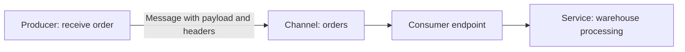
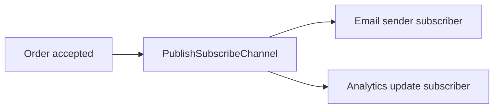

# Producer, Channel, and Consumer

## Lesson Objectives

In the **Spring Integration Fundamentals** chapter of the `SPRING_INTEGRATION_CORE` module, this lesson builds a mental model for reading and designing a message flow: which component produces data, where messages travel, and which component processes them. This forms the basis for studying gateways, Java DSL, transformers, routers, filters, aggregators, error handling, and testing enterprise integration patterns.

After this lesson, you will be able to:

- Identify the producer, channel, and consumer in an integration flow.
- Distinguish between sending a message, receiving a message, and completing business processing.
- Choose between direct handoff, queue buffering, and broadcasting to multiple subscribers.
- Read Java DSL configuration to determine how consumers receive messages.
- Explain how channel choices affect threads, errors, and processing throughput.

## 1. Starting from a Business Requirement

Suppose a system accepts orders from a checkout screen. Each order must be passed to the warehouse processing module. If the screen directly calls a warehouse processing class, the intake point becomes coupled to that class's calling convention. Whenever a data normalization step is added or work distribution changes, the call path must change too.

A message-based design can be represented as follows:



The producer sends to the channel. The consumer connects to the channel through an endpoint. The channel creates the connection point between components; the endpoint feeds messages into the processing logic. This model aligns with how Spring Integration organizes components within a Spring application. [Source: Overview of Spring Integration](https://docs.spring.io/spring-integration/reference/overview.html).

Example data contract for an order:

```text
payload:
  orderId: ORD-1001
  quantity: 2

headers:
  source: checkout
```

When discussing the design, clarify whether `ORD-1001` is a command to process or an event announcing that something happened. A warehouse processing request usually needs a single responsible processor. An "order accepted" event might need to reach both an email-sending module and a statistics module.

## 2. Three Roles and the Contracts Between Them

| Role | Responsibility | Example in the Order Flow |
| --- | --- | --- |
| Producer | Creates or injects messages into the flow | Application code sending a newly accepted order |
| Channel | Provides the transport path and delivery rules | `orders` dispatches directly or holds orders in a queue |
| Consumer | Receives and processes messages from the channel | Validation step or recording a warehouse work request |

### 2.1. Producer Creates Input for a Stage

A producer can be code calling `send()`, a gateway receiving a Java method call, or an inbound adapter reading external data. It is a role within a flow, not necessarily the name of a single class.

Define the contract a producer must satisfy before wiring it up:

- What is the payload type, and which fields are required?
- Which headers identify the source or trace the request?
- What does the send result mean to the caller?
- What must the caller do if sending fails?

In this lesson's example, the producer creates `Message<Order>` and sends it to the orders channel. `orderId` is a business key; do not assume by default that it equals the technical ID of each `Message`.

### 2.2. Channel Defines Delivery Semantics

The core APIs belong to the `org.springframework.messaging` package. `MessageChannel` enables sending; `PollableChannel` adds active receiving; `SubscribableChannel` lets handlers register to be called when messages arrive. [Source: The MessageChannel Interface](https://docs.spring.io/spring-integration/reference/channel/interfaces.html).

```java
// Core signatures, omitting annotations and constants.
public interface MessageChannel {
    boolean send(Message<?> message);
    boolean send(Message<?> message, long timeout);
}

public interface PollableChannel extends MessageChannel {
    Message<?> receive();
    Message<?> receive(long timeout);
}

public interface SubscribableChannel extends MessageChannel {
    boolean subscribe(MessageHandler handler);
    boolean unsubscribe(MessageHandler handler);
}
```

A channel is typically not the place to write business rules like "only accept orders with positive quantities". That rule belongs in a validation step or filter. Channels express decisions about how components are connected and how messages are delivered.

### 2.3. Consumer, Handler, and Endpoint

At the API level, `MessageHandler` provides the `handleMessage(Message<?>)` callback. An endpoint manages the connection between a channel and a handler: for subscribable channels, the framework uses `EventDrivenConsumer`; for pollable channels, the framework uses `PollingConsumer`. [Source: Message Endpoints](https://docs.spring.io/spring-integration/reference/endpoint.html).

```text
Channel → consumer endpoint → handler → business method
```

This helps separate two questions when debugging:

1. Did the endpoint receive the message?
2. Did the business method process the message correctly?

A bean with an `acceptOrder()` method does not automatically become a message receiver. Configuration must connect that method to a channel, such as via a service activator or `.handle()` in Java DSL.

### 2.4. One Step Can Receive and Then Emit Forward

Consider the planned flow:

```text
checkout → rawOrders → normalize → validOrders → warehouse processing
```

The normalization step acts as a consumer of `rawOrders`. If it produces output and sends it onward to `validOrders`, it simultaneously acts as a producer for the next stage. When reading a large diagram, identify roles per edge rather than sticking one permanent label on an entire component.

## 3. Two Independent Decisions When Choosing a Channel

The first decision is **whether one message is delivered to a single processor or broadcast to multiple subscribers**. The second decision is **whether the processing step is invoked immediately or buffered/handed off**. These two decisions should be evaluated separately. [Source: Message Channel Implementations](https://docs.spring.io/spring-integration/reference/channel/implementations.html).

| Channel | Delivery in the Normal Case | How Consumers Receive | Execution Characteristics |
| --- | --- | --- | --- |
| `DirectChannel` | One handler | Subscription | Invokes handler on the sending thread |
| `QueueChannel` | One receiver takes one message | `receive()` or polling endpoint | Buffers before receiving |
| `PublishSubscribeChannel` | Broadcasts to subscribers | Subscription | Invokes on the sending thread by default; can use an executor |
| `ExecutorChannel` | One handler | Subscription | Delegates dispatching to an executor |

The corresponding API characteristics are documented in [DirectChannel](https://docs.spring.io/spring-integration/api/org/springframework/integration/channel/DirectChannel.html), [QueueChannel](https://docs.spring.io/spring-integration/api/org/springframework/integration/channel/QueueChannel.html), [PublishSubscribeChannel](https://docs.spring.io/spring-integration/api/org/springframework/integration/channel/PublishSubscribeChannel.html), and [ExecutorChannel](https://docs.spring.io/spring-integration/api/org/springframework/integration/channel/ExecutorChannel.html).

### 3.1. DirectChannel: Invoke One Handler Immediately

`DirectChannel` fits short processing stages where the caller expects to wait for handler execution on the same call stack. Having multiple subscribers does not mean every subscriber receives the same message. The dispatcher has a subscriber-selection strategy and can fail over on error; therefore, you must not infer an "execute business logic exactly once" guarantee either. [Source: DirectChannel configuration](https://docs.spring.io/spring-integration/reference/channel/configuration.html#channel-configuration-directchannel).

Design example: a format-validation request is handed to a validation handler. If two handlers perform that same role to share work, it is still a point-to-point stage.

### 3.2. QueueChannel: Hold Messages for Later Retrieval

With `QueueChannel`, a producer can send before a consumer receives. For example, `new QueueChannel(100)` caps the number of waiting messages. When full, the outcome depends on the send timeout; with `send(message, 0)`, the call does not wait for space. With `receive(0)`, the receiver does not wait if the queue is empty. [Source: QueueChannel behavior](https://docs.spring.io/spring-integration/reference/channel/implementations.html#channel-implementations-queuechannel).

An in-memory queue does not provide recovery after a process stops. If business requirements demand preserving work across failures, you must design appropriate durable storage and recovery mechanisms. Spring Integration supports configuring queues backed by a message store. [Source: Persistent QueueChannel Configuration](https://docs.spring.io/spring-integration/reference/channel/configuration.html#channel-configuration-queuechannel).

Buffering also does not guarantee that the consumer runs on a different thread: your code could call `send()` and then `receive()` immediately on the same thread. In flows using a polling endpoint triggered by a scheduler, receiving usually happens later inside a polling task.

### 3.3. PublishSubscribeChannel: Broadcast Events

If both email and analytics need to receive an order-accepted event, consider `PublishSubscribeChannel`. Its default constructor invokes handlers on the sending thread. Broadcasting to multiple subscribers does not automatically spawn multiple threads; an error can also affect calling subsequent subscribers depending on configuration. [Source: PublishSubscribeChannel API](https://docs.spring.io/spring-integration/api/org/springframework/integration/channel/PublishSubscribeChannel.html).

Design goal example:



If the two tasks must recover independently after a failure, specify that requirement explicitly before adding separate queues or persistence media for each branch.

### 3.4. ExecutorChannel: Delegate Dispatching to an Executor

`ExecutorChannel` still belongs to the subscribable group. Actual dispatch behavior depends on the executor; do not deduce that consumers always run on a separate thread solely from the channel name. When a thread handoff occurs, a transaction bound to the sending thread is not automatically shared with the handler. [Source: ExecutorChannel API](https://docs.spring.io/spring-integration/api/org/springframework/integration/channel/ExecutorChannel.html).

For warehouse processing, handing work off to an executor must be accompanied by decisions on worker count, pending work limits, and how to react when the executor rejects additional tasks.

## 4. Java Example: Observing Direct Delivery

The examples assume `spring-integration-core` and compatible Spring libraries are on the classpath, managed consistently by the project. The examples use `record`, requiring Java 17 or higher and a JDK matching the Spring version in use. The snippets are illustrative content; this lesson does not install dependencies or run builds.

The program below registers a handler manually to clarify the channel mechanism. In a real application, let Spring manage channels and endpoints.

```java
import org.springframework.integration.channel.DirectChannel;
import org.springframework.messaging.Message;
import org.springframework.messaging.support.MessageBuilder;

public class DirectChannelDemo {

    record Order(String orderId, int quantity) {}

    public static void main(String[] args) {
        DirectChannel orders = new DirectChannel();

        orders.subscribe(message -> {
            Order order = (Order) message.getPayload();
            System.out.println("consumer: " + order.orderId()
                    + ", thread=" + Thread.currentThread().getName());
        });

        Message<Order> message = MessageBuilder
                .withPayload(new Order("ORD-1001", 2))
                .setHeader("source", "checkout")
                .build();

        System.out.println("producer: before send");
        boolean sent = orders.send(message);
        System.out.println("producer: after send, sent=" + sent);
    }
}
```

With this single subscriber and no errors, expected output:

```text
producer: before send
consumer: ORD-1001, thread=main
producer: after send, sent=true
```

Let's trace the program:

1. `subscribe()` connects the callback to the channel.
2. The producer creates a message conforming to the `Order` contract.
3. `send()` delivers the message to the callback.
4. Only after the callback returns does the producer print the final line.

If you replace the callback body with an operation taking two seconds, that wait occurs inside the `send()` call. A send timeout should not be understood as a mechanism that forcibly cancels a running business method.

Casting to `Order` is acceptable here because the example tightly controls input. In a flow accepting multiple formats, place transformation and contract-validation steps before calling business services.

## 5. Java Example: Distinguishing Sent vs. Processed

The next program uses a queue with capacity one so that state is predictable without background threads or `Thread.sleep()`:

```java
import org.springframework.integration.channel.QueueChannel;
import org.springframework.messaging.Message;
import org.springframework.messaging.support.MessageBuilder;

public class QueueChannelDemo {

    public static void main(String[] args) {
        QueueChannel orders = new QueueChannel(1);

        Message<String> first = MessageBuilder
                .withPayload("ORD-1001").build();
        Message<String> second = MessageBuilder
                .withPayload("ORD-1002").build();

        System.out.println(orders.send(first, 0));
        System.out.println(orders.send(second, 0));

        Message<?> received = orders.receive(0);
        if (received != null) {
            System.out.println("Received: " + received.getPayload());
        }

        System.out.println(orders.send(second, 0));
    }
}
```

Expected output:

```text
true
false
Received: ORD-1001
true
```

After the first `true`, the program has not run any order-processing business logic yet. It has only placed the message into the queue. When `receive()` pulls the message out, that is when receiving code obtains the data to begin processing.

In this example, the second message has not been received when the program exits. No background worker is created simply by instantiating `QueueChannel`.

Name business states according to actual events:

| Event in the Example | State That Can Be Recorded |
| --- | --- |
| `send(first, 0)` returns `true` | Enqueued in the in-process queue |
| `receive(0)` returns a message | Pulled work from the queue |
| Warehouse processing function completes | Warehouse processing step completed |

If the UI needs to report "warehouse processed", a successful send to the queue is insufficient proof. You need a reply outcome or a business status updated after processing.

## 6. Wiring with Spring and Java DSL

The following example uses a plain Spring context to include producer, channel, and consumer endpoint together. Both channel beans are declared explicitly, making inputs and outputs easy to observe.

```java
import org.springframework.context.annotation.AnnotationConfigApplicationContext;
import org.springframework.context.annotation.Bean;
import org.springframework.context.annotation.Configuration;
import org.springframework.integration.config.EnableIntegration;
import org.springframework.integration.channel.DirectChannel;
import org.springframework.integration.channel.QueueChannel;
import org.springframework.integration.dsl.IntegrationFlow;
import org.springframework.messaging.Message;
import org.springframework.messaging.support.MessageBuilder;

public class OrdersFlowDemo {

    public record Order(String orderId, int quantity) {}

    public static class OrderService {
        public String accept(Order order) {
            if (order.quantity() <= 0) {
                throw new IllegalArgumentException("quantity must be greater than 0");
            }
            return "ACCEPTED:" + order.orderId();
        }
    }

    @Configuration
    @EnableIntegration
    public static class FlowConfig {

        @Bean
        public DirectChannel orders() {
            return new DirectChannel();
        }

        @Bean
        public QueueChannel acceptedOrders() {
            return new QueueChannel(10);
        }

        @Bean
        public OrderService orderService() {
            return new OrderService();
        }

        @Bean
        public IntegrationFlow acceptOrderFlow() {
            return IntegrationFlow.from(orders())
                    .handle(orderService(), "accept")
                    .channel(acceptedOrders())
                    .get();
        }
    }

    public static void main(String[] args) {
        try (var context =
                     new AnnotationConfigApplicationContext(FlowConfig.class)) {

            DirectChannel input =
                    context.getBean("orders", DirectChannel.class);
            QueueChannel output =
                    context.getBean("acceptedOrders", QueueChannel.class);

            boolean sent = input.send(MessageBuilder
                    .withPayload(new Order("ORD-1001", 2))
                    .setHeader("source", "checkout")
                    .build());

            Message<?> reply = output.receive(1000);
            if (!sent || reply == null) {
                throw new IllegalStateException("No result received");
            }

            System.out.println(reply.getPayload());
        }
    }
}
```

The expected business output is `ACCEPTED:ORD-1001`, aside from logs emitted by Spring or the logging system.

In this configuration, `.handle(orderService(), "accept")` represents a service activator. The framework extracts the payload to call `accept`, then turns the return value into the step's output. `.channel(acceptedOrders())` specifies where the result is sent. [Source: Service Activator](https://docs.spring.io/spring-integration/reference/service-activator.html).

Reading the flow stage by stage:

```text
main creates Message<Order>
  → orders: DirectChannel
  → endpoint calls OrderService.accept(Order)
  → acceptedOrders: QueueChannel
  → main receives Message containing result String
```

The service only knows `Order`; wiring code belongs to integration configuration. Java DSL describes the flow topology, while execution threads are determined by the channels and endpoints in the flow. [Source: Java DSL](https://docs.spring.io/spring-integration/reference/dsl.html).

Because the demo sends only one message, the output queue has space. If expanded into a continuous flow, ensure results are consumed; when the output queue fills up, sending results can even block the original calling thread.

### What Must Be Added When Switching Input to a Queue?

Suppose the application should put orders onto a queue for a consumer to receive on a schedule. You can replace the two corresponding methods in `FlowConfig` with the snippet below while keeping the rest intact. Add imports for `java.time.Duration` and `org.springframework.integration.dsl.Pollers`.

```java
@Bean
public QueueChannel orders() {
    return new QueueChannel(100);
}

@Bean
public IntegrationFlow acceptOrderFlow() {
    return IntegrationFlow.from(orders())
            .handle(orderService(), "accept",
                    endpoint -> endpoint.poller(
                            Pollers.fixedDelay(Duration.ofMillis(200))
                                    .maxMessagesPerPoll(10)))
            .channel(acceptedOrders())
            .get();
}
```

In `main`, change the variable type and bean-lookup type for the input channel to `QueueChannel`. When sending, use a finite timeout and check `sent` before waiting for a result. For the single-order example, expected output remains the acceptance string, but processing is triggered by the poller.

The poller here actively receives from the channel and then invokes the handler. `maxMessagesPerPoll(10)` limits how many messages are handled in one poll cycle; it does not create ten parallel consumers. `fixedDelay` sets the pause between one polling execution finishing and the next starting, so it is not a guarantee that every order is always processed within 200 ms. [Source: Poller](https://docs.spring.io/spring-integration/reference/polling-consumer.html), [Message Endpoints](https://docs.spring.io/spring-integration/reference/endpoint.html).

An endpoint receiving from a pollable channel needs an appropriate poller configuration, either directly or via a default poller. Missing that configuration is a flow-wiring error; adding a queue does not create a polling schedule automatically.

## 7. Threads, Errors, and the Meaning of Success

### 7.1. Tracing Thread Boundaries

With the original `DirectChannel` flow:

```text
calling thread: send → accept → send result → send returns
```

With the queue-and-poller variant:

```text
calling thread: send to queue → continue other work
poll task:      receive → accept → send result
```

In a synchronous stage, handler errors can propagate back to the caller. Once processing moves to a background task, the caller cannot use a `try/catch` around the earlier send to catch an error thrown later. Spring Integration has a mechanism to publish an `ErrorMessage` to an error channel for supported tasks; the target can be specified by the `errorChannel` header or fall back to the shared `errorChannel`. Not every exception on a `DirectChannel` turns into an error message automatically. [Source: Error Handling](https://docs.spring.io/spring-integration/reference/error-handling.html).

For the polling variant, imagine an order with `quantity = 0`: the service throws an error before producing an acceptance result. Waiting on `acceptedOrders` does not automatically act as an error-receiving mechanism. The design needs a dedicated error path or failure-status update mechanism.

### 7.2. Asking Concrete Questions About Delivery Guarantees

In real systems, distinguish at least three milestones:

1. The producer has handed the message to the delivery mechanism.
2. The consumer has begun processing.
3. The business outcome has been successfully recorded.

A `true` result does not serve as proof for all three milestones across every channel type. The queue example in section 5 directly shows the first milestone occurring when no consumer has processed anything yet.

If the business allows resending a request when the outcome is uncertain, design the consumer to detect duplicate requests, for example using `orderId` combined with operation type. Automatically resending an operation that already produced a side effect can record the same request twice.

### 7.3. Estimating Buffer Capacity with Hypothetical Numbers

Suppose during a traffic spike:

- Producers enqueue 80 orders per second.
- Consumers process 50 orders per second.
- The queue starts empty with 300 slots remaining.

Assuming steady rates and no other factors, the backlog grows by roughly `80 - 50 = 30` orders per second. The queue will fill up after about `300 / 30 = 10` seconds. This is a back-of-the-envelope estimate for a hypothetical scenario, not Spring Integration throughput.

This calculation helps ask the right operational questions: how long must the queue absorb traffic spikes, how long can senders wait, and once full, should we return an error or persist work elsewhere? Increasing capacity only extends the buffer window if arrival rate continues to exceed processing rate.

## 8. Common Design Mistakes

| Symptom or Assumption | What to Check |
| --- | --- |
| Sending to `DirectChannel` reports no subscribers | Is the endpoint registered and started; is it the exact same channel instance? |
| Putting messages into `QueueChannel` does not run business logic | Is there `receive()` code or an endpoint with a poller? |
| Only one of two steps receives orders on `DirectChannel` | Should the two steps be broadcast, or chained sequentially into two stages? |
| UI reports business completion on successful send | Which milestone in processing does the send result actually prove? |
| Added a queue, yet the producer still waits a long time | Is the queue full; how are send timeout and receive rate configured? |
| Publishing an event still blocks the calling thread | Is `PublishSubscribeChannel` invoking synchronously or using an executor? |
| Catching errors around `send()` misses later failures | Is there a background task boundary; where is the error-reporting path? |

When inspecting a flow, document channel names, payload types, consumer types, and where outcomes are recorded. That information separates data-contract bugs from connectivity issues or insufficient processing capacity.

## 9. Hands-On Reading and Predicting Flows

The following exercises directly extend the examples in the lesson. They are practice suggestions for learners, not test results that have been executed.

### Exercise 1: Verify Invocation Order

In `DirectChannelDemo`, add log lines at the start and end of the callback. Predict the order of the four log lines before running. Then throw an `IllegalArgumentException` inside the callback and observe which line is no longer printed.

Point to explain: why the sender observes the error in a synchronous stage and why lines after `send()` may not execute.

### Exercise 2: Verify a Full Queue

In `QueueChannelDemo`, increase capacity to 2 while keeping the first two sends unchanged. Predict how the boolean values change. Then call `receive(0)` three times in a row and handle the `null` case.

Point to explain: capacity counts waiting messages, while retrieving a message still does not prove business logic has completed.

### Exercise 3: Choose a Distribution Style

For the requirement "every order must be recorded in the warehouse and trigger an email", sketch two designs:

- Two sequential steps, where the first produces output for the next.
- Two subscribers receiving one event from a publish-subscribe channel.

Compare when the event is emitted, the impact when one step fails, and where each task's state is stored. Choose a design based on the specific dependency requirements between warehouse and email.

### Exercise 4: Switch to Polling

Apply the queue variant from section 6. Log the thread name in the producer and inside `accept()`. Test a valid order and then an order with quantity 0; describe where the outcome should be observed and where the error should be observed.

Before moving on to more complex endpoints, you should be able to explain: who creates the message, how the channel delivers it, which endpoint triggers the handler, and what evidence proves the business operation is complete.