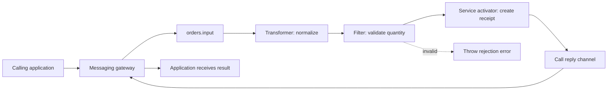
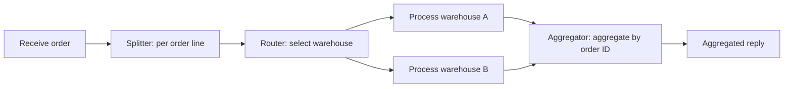

# Message Flow from Input to Output

## 1. Objectives and Context

In the **Spring Integration Fundamentals** chapter of the **SPRING_INTEGRATION_CORE** module, this lesson presents how a message travels from where data is received, through processing steps, to where the result is delivered. This is the foundation for designing flows with `Message`, `MessageChannel`, endpoints, gateways, and Java DSL, and then expanding into transformers, routers, filters, aggregators, error handling, and testing.

After this lesson, you will be able to:

- Draw the path of a message and point out each component's responsibility.
- Distinguish between input, channels, processing steps, and output of a flow.
- Build a request–reply flow using Java DSL.
- Explain why adding a queue changes execution timing, result retrieval, and error observation.
- Identify where data validation, monitoring, and tests should be placed.

The running example is order intake: the application sends a request, the flow normalizes the order ID, validates quantity, creates a receipt, and returns the result. The example focuses on message paths and does not yet implement database persistence or external service calls.

## 2. A Flow Is a Message-Processing Graph

A **message flow** describes how components collaborate through messages. A simple flow is linear; real-world flows can branch, split, aggregate, or terminate at multiple different destinations.



The diagram shows the logical path. It does not yet tell you how many threads exist, whether data is persisted durably, or which steps participate in a transaction. To answer those questions, inspect channel types, pollers, executors, transaction configuration, and how endpoints execute.

In Java DSL, many channels connecting steps are created implicitly. Therefore, the number of `.channel(...)` calls in source code does not necessarily equal the number of connections in the flow.

### 2.1. Roles Along the Path

| Component | Role | Example in the Order Flow |
|---|---|---|
| Data source | Where data originates before entering the messaging system | A Java call, HTTP request, or scheduled record read |
| Inbound adapter or gateway | Brings data across the flow boundary | Gateway converts a `submit(...)` call into a message |
| `Message` | Carries payload and headers between steps | Payload is the order placement request |
| `MessageChannel` | Connects sender to receiver and partly governs delivery semantics | `orders.input` is a `DirectChannel` |
| Endpoint | Connects processing behavior to messaging infrastructure | Transformer, filter, service activator |
| Output | Where a branch's result is sent | Reply channel, result queue, or external system |

Channels do not execute business rules on their own. Transformers do not become data sources on their own. Gateways do not replace downstream processing steps. Separating roles helps pinpoint the exact place to fix bugs or adjust the flow.

## 3. Data Travels as a Message

A `Message<T>` has two main parts:

```text
Message<T>
├── payload: data to be processed
└── headers: orchestration and context metadata
```

Example of constructing a message in Java:

```java
import org.springframework.messaging.Message;
import org.springframework.messaging.support.MessageBuilder;

Message<String> message = MessageBuilder
        .withPayload("  ORD-1001  ")
        .setHeader("source", "web")
        .setHeader("traceId", "trace-1001")
        .build();
```

Here, the payload is an order ID string. Headers `source` and `traceId` add context without needing to mix them into that string.

Common headers along the path:

| Header | Meaning |
|---|---|
| `id` | Identifier of a single message; should not replace a business transaction key across the flow |
| `timestamp` | Creation time of the message, when timestamp generation is enabled |
| `replyChannel` | Hint for where to send a reply when no suitable explicit output destination is set |
| `errorChannel` | Error-handling destination in mechanisms that support header-based error routing |
| `correlationId` | Links messages belonging to the same processing group when a flow uses correlation |
| Custom business headers | E.g., `orderId`, `tenantId`, `traceId` for tracing context |

### 3.1. Do Not View a Flow as One Continuously Mutated Message Object

`Message` provides an envelope without typical setter APIs. A transformer can return a new payload; infrastructure builds the output message and usually propagates appropriate headers. Do not assume `id` and `timestamp` stay identical across every step.

Nor does a payload automatically become immutable simply by sitting inside a `Message`. If the payload is a mutable `List`, multiple branches referencing it can still affect one another. For fan-out or asynchronous processing, prefer immutable payloads or explicit copies when needed.

To trace an order end-to-end, use a business key or application-managed tracing header; do not depend solely on `MessageHeaders.ID`.

## 4. Channels Determine How Messages Proceed

Two flows with the same business steps but different channel types can exhibit very different runtime behavior.

| Channel | Basic Message Delivery | What to Understand |
|---|---|---|
| `DirectChannel` | Sends directly to one selected subscriber, on the sending thread in typical setup | Next step finishes or throws an error directly within the current call path |
| `QueueChannel` | Holds messages in a queue for consumers to pull | Requires `receive` calls or a polling consumer; successful send does not mean business completion |
| `ExecutorChannel` | Uses an executor to dispatch handling to one subscriber | Typically creates an async execution boundary; exact behavior depends on executor and rejection policy |
| `PublishSubscribeChannel` | Distributes to subscribers | Used when every branch must receive the message; can configure an executor |

Having multiple subscribers on a `DirectChannel` does not mean every subscriber receives each message. To broadcast to multiple branches, choose a publish–subscribe mechanism or appropriate routing design.

### 4.1. Three Moments Not to Conflate

1. **Channel send succeeds**: the channel accepted the send according to its contract.
2. **Endpoint finishes processing**: one step completed its own work.
3. **Business operation completes**: the entire required chain succeeded as defined by the application.

With a synchronous chain using `DirectChannel`, all three moments may occur within a single call. With a queue or executor, they are usually decoupled. A `true` return from `send(...)` is not general proof that the order has been recorded completely across all target systems.

## 5. Complete Example: Gateway → Normalize → Validate → Confirm

The example below uses a Spring application with Spring Integration infrastructure, such as a Spring Boot app with the `spring-boot-starter-integration` dependency. The `record` types require Java 17 or higher in this example. Specific Spring versions should follow the project's dependency configuration.

Create separate Java files in the `example.integration` package. The code intentionally simulates in-memory processing only; sample inputs have a non-`null` `orderId`.

### 5.1. Data Types

```java
// SubmitOrder.java
package example.integration;

public record SubmitOrder(String orderId, int quantity) {
}
```

```java
// Order.java
package example.integration;

public record Order(String orderId, int quantity) {
}
```

```java
// OrderReceipt.java
package example.integration;

public record OrderReceipt(String orderId, String status) {
}
```

`SubmitOrder` represents intake data. `Order` is data after normalization. `OrderReceipt` is the flow's result. Separating types clarifies input and output contracts for each stage.

### 5.2. Gateway as the Entry Point for Application Code

```java
// OrderGateway.java
package example.integration;

import org.springframework.integration.annotation.MessagingGateway;

@MessagingGateway(
        defaultRequestChannel = "orders.input",
        defaultReplyTimeout = "3000"
)
public interface OrderGateway {
    OrderReceipt submit(SubmitOrder request);
}
```

Spring generates a proxy for the gateway interface. When the application calls `submit(...)`, the proxy builds a request message, sends it to `orders.input`, and waits for a reply to return `OrderReceipt`.

`defaultReplyTimeout` governs waiting for a reply; it is not a deadline capable of forcibly halting downstream work. In particular, a synchronous handler running on the calling thread can hold the call longer than this value.

### 5.3. Declaring Channels and Flows with Java DSL

```java
// OrderFlowConfiguration.java
package example.integration;

import org.springframework.context.annotation.Bean;
import org.springframework.context.annotation.Configuration;
import org.springframework.integration.channel.DirectChannel;
import org.springframework.integration.config.EnableIntegration;
import org.springframework.integration.config.IntegrationComponentScan;
import org.springframework.integration.dsl.IntegrationFlow;
import org.springframework.messaging.MessageChannel;

@Configuration
@EnableIntegration
@IntegrationComponentScan(basePackageClasses = OrderGateway.class)
public class OrderFlowConfiguration {

    @Bean(name = "orders.input")
    public MessageChannel ordersInput() {
        return new DirectChannel();
    }

    @Bean
    public IntegrationFlow orderFlow() {
        return IntegrationFlow.from("orders.input")
                .transform(SubmitOrder.class, request ->
                        new Order(
                                request.orderId().trim(),
                                request.quantity()
                        ))
                .filter(Order.class,
                        order -> order.quantity() > 0,
                        endpoint -> endpoint.throwExceptionOnRejection(true))
                .handle(Order.class, (order, headers) ->
                        new OrderReceipt(order.orderId(), "ACCEPTED"))
                .get();
    }
}
```

The application must load `OrderFlowConfiguration`, for example via Spring Boot component scanning from a parent package or via `@Import`. `@IntegrationComponentScan` discovers interfaces annotated with `@MessagingGateway`; ordinary component scanning does not substitute for this role for gateway interfaces.

The DSL clauses have the following meanings:

| Code Segment | Purpose |
|---|---|
| `from("orders.input")` | Connects the start of the flow to the named channel |
| `transform(...)` | Converts payload from `SubmitOrder` to `Order` |
| `filter(...)` | Allows the message to proceed if quantity is greater than 0 |
| `throwExceptionOnRejection(true)` | Turns failing the condition into an explicit error |
| `handle(...)` | Invokes business logic and uses the return value as the reply payload |
| `get()` | Completes building the `IntegrationFlow` configuration object |

Calling `.get()` does not trigger an order. The flow is registered in Spring; messages only begin flowing when data is sent to the channel.

### 5.4. Calling from Another Spring Bean

```java
package example.integration;

import org.springframework.stereotype.Service;

@Service
public class CheckoutService {
    private final OrderGateway orderGateway;

    public CheckoutService(OrderGateway orderGateway) {
        this.orderGateway = orderGateway;
    }

    public OrderReceipt checkout() {
        return orderGateway.submit(new SubmitOrder("  ORD-1001  ", 2));
    }
}
```

Expected output:

```text
OrderReceipt[orderId=ORD-1001, status=ACCEPTED]
```

Do not call `new OrderGateway(...)`: the gateway is an interface backed by a Spring-managed proxy. Nor should you call the `orderFlow()` method directly to send data; that method builds configuration, not a business-processing API.

## 6. Tracing a Call End-to-End

Consider the call:

```java
orderGateway.submit(new SubmitOrder("  ORD-1001  ", 2));
```

### Step 1 — Gateway Builds the Input Message

The payload is `SubmitOrder`. Gateway infrastructure sets up reply handling for the call. Calling code does not have to manually build messages or manage temporary reply channels in this example.

### Step 2 — `orders.input` Dispatches the Message to the First Endpoint

`orders.input` is a `DirectChannel`. In this illustrative chain without an intervening queue or executor, subsequent steps continue executing on the calling thread.

If the channel has no active subscribers yet, sending a message does not mean it waits automatically until the flow is ready. `DirectChannel` is not a buffering queue.

### Step 3 — Transformer Produces the Normalized Payload

```text
Before: SubmitOrder("  ORD-1001  ", 2)
After:  Order("ORD-1001", 2)
```

The next step receives `Order`, so both the filter predicate and handler declare type `Order`. Mismatched type declarations between steps can cause conversion or runtime processing errors.

### Step 4 — Filter Decides Whether to Proceed

With quantity `2`, the message is forwarded. With quantity `0`, `throwExceptionOnRejection(true)` raises a rejection error; the receipt-creation handler is not executed.

This is a choice for the example. Another system might route invalid requests to a branch that builds a rejection response or to a manual-review channel.

### Step 5 — Handler Produces the Reply

The handler returns `OrderReceipt`. In a request–reply chain, the return value of an endpoint capable of replying is used to construct the next message.

If a handler ending a chain returns `null`, usually no reply is generated by that step. The gateway may wait until timeout if no other branch sends a reply. When a handler must always produce a reply, configure reply-required enforcement on the appropriate endpoint.

### Step 6 — Result Returns to the Caller

The example does not declare an explicit output channel after the final handler. Infrastructure uses the request's reply path to bring `OrderReceipt` back to the gateway, and the gateway returns the payload to `CheckoutService`.

Payload transformations can be summarized as follows:

```text
SubmitOrder
    → Order
    → Order accepted by filter
    → OrderReceipt
```

A flow does not require the payload to keep the same type from start to finish. What matters is that contracts match at every connection.

## 7. Explicit Output and Reply Channels

An endpoint can send its result to a configured output channel, or use the request's reply mechanism when appropriate.

For example, replacing the end of the flow with:

```java
.handle(Order.class, (order, headers) ->
        new OrderReceipt(order.orderId(), "ACCEPTED"))
.channel("orders.receipts")
.get();
```

The result is now routed to `orders.receipts`. If that is a `QueueChannel` and no consumer routes the reply back to the reply path, the gateway does not automatically know to fetch results from this queue.

Therefore, before adding an output channel, clarify:

- Is the caller waiting for a reply to the same request?
- Is the result meant for the caller or for a different process?
- Which component consumes the output, and which component is responsible for returning the reply?

A one-way flow can end with an outbound adapter sending to an external system without producing a reply. A request–reply flow needs a complete reply path. Calling something "output" only describes logical position; it does not guarantee the result reached the caller.

### 7.1. Adapters and Gateways at Flow Boundaries

A **channel adapter** connects one-way receiving or sending at an integration boundary. A **messaging gateway** provides request–reply interaction when the usage contract requires a response, while also allowing one-way methods.

For example:

- An inbound adapter reads files and emits messages into the flow: there is no Java call waiting for a return value per file.
- Gateway `OrderGateway.submit(...)`: the caller expects an `OrderReceipt`.
- An outbound adapter writes results to a file: sending outbound does not automatically create a business reply for the original caller.

Do not pick a gateway just because the flow has a final step; pick based on the communication contract at the boundary.

## 8. When Adding QueueChannel: Processing Decouples in Time

The standalone example below accepts strings into a queue, polls periodically to uppercase them, and places results into an output queue. The configuration assumes Spring Integration is enabled as in the previous section.

```java
package example.integration;

import java.util.Locale;

import org.springframework.context.annotation.Bean;
import org.springframework.context.annotation.Configuration;
import org.springframework.integration.channel.QueueChannel;
import org.springframework.integration.dsl.IntegrationFlow;
import org.springframework.integration.dsl.Pollers;
import org.springframework.messaging.PollableChannel;

@Configuration
public class QueuedJobConfiguration {

    @Bean(name = "jobs.queue")
    public PollableChannel jobsQueue() {
        return new QueueChannel(100);
    }

    @Bean(name = "jobs.results")
    public PollableChannel jobsResults() {
        return new QueueChannel(100);
    }

    @Bean
    public IntegrationFlow queuedJobFlow() {
        return IntegrationFlow.from("jobs.queue")
                .handle(String.class,
                        (payload, headers) -> payload.toUpperCase(Locale.ROOT),
                        endpoint -> endpoint.poller(
                                Pollers.fixedDelay(200)
                                        .maxMessagesPerPoll(10)))
                .channel("jobs.results")
                .get();
    }
}
```

`jobs.queue` is a `PollableChannel`. The poller attached to the consuming endpoint lets it actively pull messages. `fixedDelay(200)` sets the delay between poll runs; `maxMessagesPerPoll(10)` caps messages handled in one poll cycle. These values do not guarantee fixed throughput because processing time also depends on the handler and system resources.

Example of sending and receiving in code with both channels injected by name:

```java
import org.springframework.messaging.Message;
import org.springframework.messaging.PollableChannel;
import org.springframework.messaging.support.MessageBuilder;

// jobsQueue and jobsResults are the jobs.queue and jobs.results beans, respectively.
boolean accepted = jobsQueue.send(
        MessageBuilder.withPayload("spring integration").build(),
        1_000);

if (!accepted) {
    throw new IllegalStateException("Failed to send to jobs.queue");
}

Message<?> result = jobsResults.receive(3_000);
if (result == null) {
    throw new IllegalStateException("No result received within the timeout");
}

System.out.println(result.getPayload()); // SPRING INTEGRATION
```

This send/receive snippet only illustrates one message in a practice setting. When multiple requests run concurrently, consumers must not take an arbitrary result from a shared queue and assume it belongs to the current request. You need request–reply correlation or a job-ID-based result tracking mechanism.

### 8.1. Consequences of a Queue Boundary

- The sending thread may finish before the handler finishes processing.
- Without a poller or a consumer calling `receive`, messages do not move forward on their own.
- A bounded queue can fill up; choose timeouts and a policy for failed sends.
- `QueueChannel` in the example holds data in memory. It does not guarantee survival across process stops.
- Transactions and thread context on the sending side do not automatically cover processing after the queue.
- Errors in handlers behind the queue are not automatically thrown back to the already-completed `send(...)` call.

Adding a queue should stem from needs like load smoothing or decoupling intake rate from processing rate. At the same time, it introduces responsibilities for managing backlogs, errors, and recovery.

## 9. Real Flows Can Branch, Split, and Aggregate

Beyond the linear path of the example, integration patterns frequently reshape flow structure:

| Component | How Does It Change the Path? | Questions to Answer |
|---|---|---|
| Transformer | Creates a new data shape for the next step | Is the output the right type with sufficient context? |
| Filter | Retains or drops messages by condition | Where do dropped messages go; does the caller receive a result? |
| Router | Selects destinations based on payload or headers | Which channel does each case go to; is there a default target? |
| Splitter | Creates multiple messages from one input | How is each part identified and correlated with the input? |
| Aggregator | Combines correlated messages into a result | When is a group ready to complete; how are incomplete groups handled? |
| Service activator | Invokes business behavior | Are there side effects; does it produce a reply? |

The multi-line order example can be expanded into:



In this structure, one branch finishing does not mean the entire order is complete. The aggregator needs correlation rules, a release condition, and handling for incomplete groups. Simply sending all messages into one channel does not automatically turn them into an aggregated result.

Configuration details for each pattern should be studied separately; when reading a diagram, first locate where a message is transformed, multiplied into several messages, or merged with other messages.

## 10. Errors Also Have Paths That Must Be Designed

### 10.1. Errors in a Synchronous Chain

In the order flow using `DirectChannel`, normalization errors or filter rejections can return to the gateway-calling thread as messaging-infrastructure exceptions, potentially wrapping the root cause.

The application must distinguish business-data errors from technical errors so it can translate them into appropriate responses at its boundary. Do not assume all exceptions share the same type or meaning.

There is no universal rule that "having an `errorChannel` bean means every error from every endpoint goes there automatically". Error propagation depends on endpoint type, execution mode, and gateway or consumer error-handling configuration.

### 10.2. Errors After an Asynchronous Boundary

With a poller or executor, errors occur after the sender may have already finished. An appropriate error-handling path is needed, such as an error flow receiving `ErrorMessage`, logging the cause, and deciding whether to retry, move to an error store, or mark the job failed.

A useful error flow preserves sufficient facts:

- Business key or trace ID of the job.
- Failed step and root cause.
- Failing payload or a reference capable of retrieving data for reprocessing.
- State of side effects that occurred before the error.

An error channel is the destination for error messages under configured mechanisms; it is not an automatic rollback action across all external systems.

### 10.3. Filter Message Rejection Is Not Necessarily a Technical Error

A filter can drop messages without throwing an error if exception-on-rejection is not enabled. In request–reply, if the rejection branch produces no reply, the caller can wait until timeout.

Three common design options:

| Option | When Appropriate | Consequence for Caller |
|---|---|---|
| Throw error on rejection | Input contract violations must be reported immediately | Caller receives an error on the appropriate synchronous path |
| Route to a discard channel | Rejected messages need separate logging or handling | Must design extra handling if the caller needs a reply from this branch |
| Return a rejection result via an explicit branch | Rejection is a normal business outcome | Caller receives a result type representing the rejected status |

Never infinitely retry data that is inherently invalid. For operations with side effects, retries also require deduplication design, since resending a message can repeat work that was partially executed.

## 11. Testing Against Input and Output Contracts

When testing a flow, the goal is to verify observable behavior across its boundaries.

For the gateway flow in section 5, the main scenarios are:

| Input or Scenario | What to Verify |
|---|---|
| `SubmitOrder("  ORD-1001  ", 2)` | Receives `OrderReceipt` with trimmed ID and status `ACCEPTED` |
| Quantity zero or negative | Rejected; no success receipt created |
| Wrong-type payload sent directly to channel | Error is observed through the corresponding handling mechanism |
| Final handler produces no reply | Wait and timeout behavior matches the chosen contract |
| Asynchronous step inserted | Test waits with a bound and verifies the right correlated result |

You can test the gateway with Spring Test and JUnit in an application context loading the flow:

```java
package example.integration;

import org.junit.jupiter.api.Test;
import org.springframework.beans.factory.annotation.Autowired;
import org.springframework.test.context.junit.jupiter.SpringJUnitConfig;

import static org.junit.jupiter.api.Assertions.assertEquals;

@SpringJUnitConfig(OrderFlowConfiguration.class)
class OrderFlowTest {

    @Autowired
    OrderGateway gateway;

    @Test
    void returnsReceiptWithNormalizedOrderId() {
        OrderReceipt receipt = gateway.submit(
                new SubmitOrder("  ORD-1001  ", 2));

        assertEquals("ORD-1001", receipt.orderId());
        assertEquals("ACCEPTED", receipt.status());
    }
}
```

This test requires the project's corresponding test dependencies, such as `spring-boot-starter-test` when using Spring Boot. It verifies the public path from gateway to reply without depending on names of channels implicitly created by the DSL.

With queues, use receive operations or bounded wait mechanisms. Avoid just calling `Thread.sleep(...)` and assuming the flow finished; that makes tests slow or flaky. When testing rejection branches, verify both the rejection error/output and that the success branch performed no side effects.

## 12. Common Misconceptions

| Misconception | Accurate Understanding |
|---|---|
| Every DSL call creates a new thread | Channel type and execution mechanism determine thread boundaries |
| `send(...)` returning `true` means business logic is done | Check channel and consumer; a queue may only have accepted the message |
| `DirectChannel` holds messages until a consumer exists | It is not a buffering queue |
| Having `QueueChannel` is enough for automatic processing | Requires a consumer calling receive or an endpoint with a poller |
| `handle(...)` always ends the flow | A handler producing a reply can keep passing results to subsequent steps |
| Setting an output channel means the gateway receives the result | An actual reply path back to the waiting call is required |
| If a filter drops a message, the caller is always notified | The rejection branch must explicitly throw or return a result by design |
| Same flow means same transaction | Thread and resource boundaries determine transaction scope |
| All errors automatically reach `errorChannel` | Error paths depend on execution mechanisms and endpoint/gateway configuration |
| In-memory queues guarantee no data loss on app shutdown | Durable storage and recovery must be designed if required |

## 13. Self-Check Practice

### Exercise 1 — Trace the Payload Path

Use the flow in section 5 and write down payload types before/after each step. For an input with quantity `0`, identify which step executes last and why no successful `OrderReceipt` appears.

### Exercise 2 — Add Tracing Context

Design how to attach `traceId` to messages at the start of the flow. Identify where this header is read when logging. Use the same business key to match inputs and outputs instead of assuming message IDs remain unchanged.

### Exercise 3 — Change the Output Contract

Suppose the business only accepts requests and processes them in the background. Redraw the flow with a queue and a store for job status. Distinguish "accepted" from "processed"; describe how callers query results by job ID.

### Exercise 4 — Design a Rejection Path

Replace the filter's throw-exception requirement with returning a business rejection result. Define the branches, shared result type, and reply path so callers always receive an appropriate result for every request in the exercise contract.

## 14. Key Takeaways

A complete message flow must answer: where data enters, what payload and headers carry, how channels transfer messages, how endpoints transform or route them, where results go, and where errors are observed.

For simple synchronous flows, gateways and `DirectChannel` connect Java calls to processing chains and replies. When queues, executors, parallel branches, or aggregators appear, you must add completion criteria, result correlation, and error handling. A message-path diagram is the starting point; channel and endpoint configuration determine actual runtime behavior.