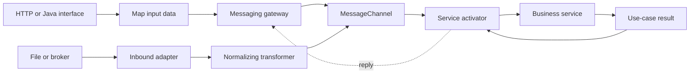

# Separating Connectivity from Business Logic

## 1. Objectives and Scope

In the **Spring Integration Fundamentals** chapter of the `SPRING_INTEGRATION_CORE` module, this lesson explains how to draw a boundary between external-communication code and business-rule execution code. The goal is to design a flow where HTTP, files, or brokers can change without forcing business calculations to change with them.

After this lesson, you will be able to:

- Distinguish the responsibilities of an adapter, messaging gateway, channel, and service activator.
- Design data contracts so business logic does not have to understand HTTP requests, broker messages, or file locations.
- Use Java DSL to connect a gateway with a plain Java service.
- Explain why decoupling dependencies does not automatically mean asynchronous processing or deploying multiple services.
- Test business rules separately and test message wiring separately.

The examples focus on order intake. Transformers, routers, filters, and aggregators are placed in their proper architectural positions; detailed configuration techniques for each pattern are not the focus of this lesson.

## 2. The Problem: One Method Carrying Too Many Responsibilities

Suppose a system receives orders over HTTP. An initial design might bundle everything into one method:

```java
// Illustrates mixed responsibilities; not complete application code.
public void receive(HttpServletRequest request) {
    String customerId = request.getParameter("customerId");
    int quantity = Integer.parseInt(request.getParameter("quantity"));
    String correlationId = request.getHeader("X-Correlation-Id");

    // Manually check authorization, calculate total, persist data,
    // send request to partner, then decide the HTTP response.
}
```

The issue is not having an HTTP controller. The issue is that business decisions are coupled to HTTP structure and connection lifecycles. When adding CSV order intake, the team easily ends up duplicating logic or faking an HTTP request to reuse that method.

Consequences show up on multiple fronts:

| Change | Impact When Responsibilities Are Mixed |
|---|---|
| Partner renames a JSON field | Total-calculation method must change alongside request-parsing code |
| Add order intake from a broker | Consumer must duplicate logic sitting inside the controller |
| Validate invalid quantities | Tests must spin up a servlet even when not testing HTTP |
| Partner service is slow | Business processing duration gets tied to connection timeouts |
| Change retry policy | Ordering rules might be invoked repeatedly without being designed for it |

A helpful shift is moving from asking "which method calls which method?" to "what contract does this component accept, and what is it responsible for?". Spring Integration provides messaging components to express those boundaries.

## 3. What Does Separating Connectivity Mean?

### 3.1. Separate Communication Technology

Business code should accept data meaningful to the use case, such as `OrderCommand`, instead of `HttpServletRequest`, `jakarta.jms.Message`, or an object describing a downloaded file.

The communication layer is responsible for protocol details, boundary authentication, how data is read, and how responses are formatted for callers. The business layer is responsible for order validity conditions and processing outcomes.

For example, unparseable JSON belongs at the intake boundary. A quantity of zero violates an ordering rule even when the JSON is completely valid. These two errors must be distinguished because they have different causes and different response semantics.

### 3.2. Separate Knowledge of the Receiving Component

The sending component can know the `orderRequests` channel without knowing which class handles it. Integration configuration decides which service activator is connected to the channel.

This separation still requires a shared contract: payload type, data semantics, and how results are represented. Channels reduce coupling to specific recipients; they do not remove the need to agree on contracts.

### 3.3. Separate Execution Timing When Needed

A design can decouple communication technology while still running synchronously on the same execution thread. Only when requirements call for load buffering, background execution, or concurrency limits should you consider adding an execution boundary.

Distinguish three decisions:

| Decision | Question to Answer |
|---|---|
| Responsibility boundary | Who understands the protocol, and who applies business rules? |
| Execution boundary | Does the caller directly execute the downstream work? |
| Deployment boundary | Do components run in the same JVM or in separate processes? |

These three decisions are related, not interchangeable. A single Spring application can still cleanly separate responsibilities. Conversely, two microservices can still be tightly coupled if every data change forces both to deploy together.

## 4. Assigning Roles in Spring Integration



This is a responsibility diagram, not an implication that every input source must go through the same gateway or reply the same way. An HTTP branch can wait for a result; a file-intake branch can record results to a different channel.

### 4.1. Message: Data and Delivery Context

A `Message<T>` consists of payload and headers. In this design:

- The payload is the data contract to process, such as `OrderCommand`.
- Headers hold delivery and operational context, such as a trace ID or intake source.

Data required to make business decisions should be stated explicitly in the domain contract. For instance, if pricing depends on market, a `market` field should enter business data explicitly; do not make the service hunt for an arbitrary header to decide pricing.

### 4.2. MessageChannel: Connection Point Between Components

A channel is the target a producer sends messages to and a consumer receives messages from. Channel type also influences execution. `DirectChannel` passes messages directly on the sender's thread; `QueueChannel` buffers messages for consumers to pull later. Choose channels for concrete operational requirements. [Channel Implementations Documentation](https://docs.spring.io/spring-integration/reference/channel/implementations.html).

Channel names should express intent, such as `orderRequests` or `orderResults`. Names like `httpToMethodXChannel` expose current wiring structure and become confusing when another input source is added.

### 4.3. Endpoint: Where Messages Trigger Behavior

An endpoint binds message receipt to a behavior: transforming, routing, filtering, aggregating, or invoking a service. With a service activator, Java DSL can invoke a method on a bean and use the return value as the next result. If no output channel is configured, the reply mechanism can use the request's `replyChannel`. [Service Activator Documentation](https://docs.spring.io/spring-integration/reference/service-activator.html).

As a result, the business class can keep a normal method signature:

```java
OrderResult place(OrderCommand command)
```

It does not need to extract payloads, look up reply channels, or construct a result `Message` itself.

### 4.4. Messaging Gateway: A Java Interface at the Messaging Boundary

A messaging gateway allows callers to use a Java interface rather than directly constructing and sending `Message` instances. Spring Integration generates a proxy that translates between method calls and message interactions. [Messaging Gateway Documentation](https://docs.spring.io/spring-integration/reference/gateway.html).

Distinguish clearly:

| Component | Role in This Lesson |
|---|---|
| Messaging gateway | Entry point from Java code into a message flow |
| Inbound adapter | Brings data from an external source into the flow using that source's intake mechanism |
| Outbound adapter | Performs one-way interaction with an external destination |
| Outbound gateway | Interacts with an external system in a request-and-reply model |

An interface annotated with `@MessagingGateway` does not open an HTTP port or create a broker consumer on its own. If HTTP intake is needed, you still need an appropriate HTTP controller or endpoint. If reading from a broker is needed, you still need an integration component for that broker.

## 5. End-to-End Example: Placing Orders Through a Shared Contract

### 5.1. Assumptions for Running the Example

The example uses Java records and Java DSL with `IntegrationFlow`. The project needs Spring Integration Core; if using Spring Boot, you can declare the following starter in a project whose versions are managed by Spring Boot:

```xml
<dependency>
    <groupId>org.springframework.boot</groupId>
    <artifactId>spring-boot-starter-integration</artifactId>
</dependency>
```

Do not manually force a Spring Integration version different from the dependency set managed by your project. Choose a JDK matching the requirements of the Spring Boot/Spring Integration version in use; record syntax alone does not define the framework's full JDK requirements.

The Java snippets below belong to package `demo.orders`. When placing them in a project, each `public` type goes in a file of the same name. This lesson presents illustrative code only and does not generate Java files or build configs for you.

### 5.2. Business Contract

```java
package demo.orders;

import java.math.BigDecimal;

public record OrderCommand(
        String orderId,
        String customerId,
        int quantity,
        BigDecimal unitPrice) {
}
```

```java
package demo.orders;

import java.math.BigDecimal;

public record OrderResult(
        String orderId,
        BigDecimal totalAmount,
        String status) {
}
```

The example assumes `unitPrice` has been determined by a trusted component before sending the command. In a real system, do not treat an arbitrary client-supplied price as the authoritative selling price; replace it with a product code and look up pricing through a business port/service.

`orderId` is the order identifier for the use case. It should not be replaced by a technical ID freshly generated on each message transmission, because the same order may be sent multiple times.

### 5.3. Service That Only Knows Ordering Rules

```java
package demo.orders;

import java.math.BigDecimal;
import java.util.Objects;

public final class OrderService {

    public OrderResult place(OrderCommand command) {
        Objects.requireNonNull(command, "command must not be null");
        requireText(command.orderId(), "orderId");
        requireText(command.customerId(), "customerId");

        if (command.quantity() <= 0) {
            throw new IllegalArgumentException("quantity must be positive");
        }
        if (command.unitPrice() == null
                || command.unitPrice().signum() < 0) {
            throw new IllegalArgumentException("unitPrice must not be negative");
        }

        BigDecimal total = command.unitPrice()
                .multiply(BigDecimal.valueOf(command.quantity()));

        return new OrderResult(command.orderId(), total, "VALIDATED");
    }

    private static void requireText(String value, String field) {
        if (value == null || value.isBlank()) {
            throw new IllegalArgumentException(field + " must not be blank");
        }
    }
}
```

This class does not import Spring Integration, knows nothing of channels, reads no HTTP headers, and decides no HTTP status codes. Given the same command, the same rules apply whether the source is REST, a file, or a message.

The `VALIDATED` result only means the order passed the checks in the example. The code does not yet save to a database, reserve stock, process payment, or guarantee deduplication. Do not use names like `PAID` or `COMPLETED` if the corresponding behaviors have not occurred.

### 5.4. Gateway Hiding Message Creation and Receipt

```java
package demo.orders;

import org.springframework.integration.annotation.MessagingGateway;

@MessagingGateway(
        defaultRequestChannel = "orderRequests",
        defaultRequestTimeout = "1000",
        defaultReplyTimeout = "3000")
public interface OrderGateway {

    OrderResult submit(OrderCommand command);
}
```

Callers receive an `OrderGateway` via dependency injection and invoke `submit(command)`. The interface still expresses order-placement intent, while the annotation marks the integration boundary.

There are two levels of decoupling to recognize clearly: callers do not have to use `MessageChannel`, yet the interface above still carries a Spring Integration annotation. If you want the application contract completely independent of the framework, define a separate annotation-free port interface, then write an adapter implementing that interface and delegating to the gateway.

### 5.5. Java DSL Connecting Channel to Service Activator

```java
package demo.orders;

import org.springframework.context.annotation.Bean;
import org.springframework.context.annotation.Configuration;
import org.springframework.integration.annotation.IntegrationComponentScan;
import org.springframework.integration.channel.DirectChannel;
import org.springframework.integration.config.EnableIntegration;
import org.springframework.integration.dsl.IntegrationFlow;
import org.springframework.messaging.MessageChannel;

@Configuration
@EnableIntegration
@IntegrationComponentScan(basePackageClasses = OrderGateway.class)
public class OrderIntegrationConfig {

    @Bean
    public MessageChannel orderRequests() {
        return new DirectChannel();
    }

    @Bean
    public OrderService orderService() {
        return new OrderService();
    }

    @Bean
    public IntegrationFlow orderFlow(OrderService orderService) {
        return IntegrationFlow.from("orderRequests")
                .handle(orderService, "place")
                .get();
    }
}
```

Configuration registers the service as a bean and uses a service activator to invoke `place`. In Java DSL, `.handle(...)` represents the processing invocation step; steps in the flow are wired with channels per DSL configuration. [Java DSL Channel Documentation](https://docs.spring.io/spring-integration/reference/dsl/java-channels.html).

The path in this configuration is:

1. Caller invokes `OrderGateway.submit(command)`.
2. Gateway proxy wraps the command into a message and sets up the reply context.
3. The message reaches `orderRequests`.
4. The service activator invokes `OrderService.place(...)` with the matching payload.
5. `OrderResult` returns to the gateway through the flow's reply mechanism.
6. The caller receives the result from the Java call.

There is no need to configure an extra result channel just to demonstrate this simple request/reply. However, if you add a step that constructs a new `Message`, preserve the reply context rather than accidentally dropping headers the flow relies on.

### 5.6. What Remains the Responsibility of the HTTP Side?

A controller still needs to read the HTTP body, enforce boundary authentication/authorization, and map input data to `OrderCommand`. Then it calls the gateway. Upon receiving the result, the controller converts it into an appropriate response.

You do not need to build a real controller just to understand the principle. The desired boundary can be written concisely as:

```text
HTTP body
  -> API DTO
  -> structural validation + mapping + trusted price lookup
  -> OrderCommand
  -> OrderGateway.submit(...)
  -> OrderResult
  -> response DTO + HTTP status
```

Business logic still checks critical invariants because the controller is not the only entry point. Structural validation at HTTP helps respond early; business validation in the service keeps rules consistent across all input sources.

## 6. Adding an Input Source Without Modifying Business Algorithms

Suppose a partner later sends a CSV file with columns `partner_order_no`, `buyer_code`, `qty`, and `product_code`. You should not pass raw CSV rows into `OrderService` and make it figure out where they came from.

A better design:

```text
HTTP branch:
API DTO -> map + price lookup -> OrderCommand -> orderRequests

File branch:
inbound adapter -> read row -> map product code + price lookup
                -> OrderCommand -> orderRequests
```

The shared point is the `OrderCommand` contract and business behavior. Code for reading CSV, handling encodings, tracking which files were processed, and reporting row-level errors stays in the file-integration branch.

Sharing an input contract does not force both branches to handle results identically. An HTTP call can wait for `OrderResult`; file ingestion can route results to a report-persistence channel. If sending directly to `orderRequests`, the file branch must provide a place to receive results or configure appropriate output routing. Reusing a request/reply flow's channel while ignoring the reply path can cause errors when the service returns a value.

Do not reuse at all costs. If "instant ordering" and "historical order import" follow different rules, create distinct commands and use cases. A shared data type only helps when business meaning is also shared.

## 7. Where Do Transformer, Router, Filter, and Aggregator Belong?

Integration patterns help express a flow, but they should not turn every business rule into one long configuration expression.

| Component | Suitable Work at the Integration Boundary | Things to Consider |
|---|---|---|
| Transformer | Convert partner format into system commands | Separate structural mapping from pricing policies or approval decisions |
| Router | Choose branches by message type or processing target | Complex business rules may warrant a separately tested policy/service |
| Filter | Exclude out-of-scope data per explicit contracts | For callers awaiting replies, decide how to report rejection rather than losing replies |
| Aggregator | Combine related data parts before invoking a use case | Define group keys, completion criteria, and handling for incomplete groups |
| Service activator | Invoke the service executing a use case | Avoid letting the service directly control channels or broker acks |

For example, "CSV has all required columns" belongs to input transformation. "Customer must not exceed credit limit" belongs to business logic. "Lines sharing an order ID must all be gathered before confirming the order" needs both aggregation configuration and rules defining a complete order; the rule portion should have a clear name, contract, and tests.

A sign that further separation is needed is a DSL lambda that simultaneously reads source headers, calls repositories, computes discounts, and chooses HTTP statuses. At that point, the flow is holding all responsibilities instead of expressing how responsibilities connect.

## 8. Decoupling Dependencies and Asynchrony Are Two Different Things

### 8.1. The Current Configuration Is Still Synchronous

In the example, `DirectChannel` keeps service invocation on the sender's thread. Consequently, `submit(...)` completes after downstream synchronous work finishes or throws an error. This is still a connectivity-decoupled design: the service knows nothing about HTTP, and callers do not manually send messages.

If `place(...)` calls an external system and takes 20 seconds, adding a gateway and `DirectChannel` does not make those 20 seconds disappear. You must measure and configure timeouts on the external call itself.

### 8.2. When Adding a Queue

You can consider `QueueChannel` when you need to buffer inputs and let consumers process later. Then you need a consumer with a poller, capacity limits, and overload handling. A default in-memory queue does not persist across restarts. [QueueChannel and Message Storage Documentation](https://docs.spring.io/spring-integration/reference/channel/implementations.html).

More important than class names is the contract with the caller:

- If the gateway still returns `OrderResult`, the caller is still waiting for the business result even if the consumer runs on another thread.
- If the API only acknowledges intake, you need an intake contract and a way to query or receive result notifications later.
- If the API promises data is stored durably, simply pushing into an in-memory queue is not enough to fulfill that promise.

You cannot just swap `new DirectChannel()` for `new QueueChannel()` and assume everything else behaves the same. Receive setup, errors, timeouts, and transaction boundaries all need review.

### 8.3. Timeouts Do Not Cancel Work Automatically

In the sample gateway, request timeout relates to waiting when sending to a channel that supports waiting, while reply timeout relates to waiting for a reply. They are not timers that can interrupt arbitrary downstream operations.

Specifically, a synchronous handler running over `DirectChannel` is not automatically interrupted when the reply timeout expires. With execution on another thread, a caller timing out does not mean work has stopped or has not produced side effects. [Gateway Waiting Behavior Documentation](https://docs.spring.io/spring-integration/reference/gateway.html).

Therefore, if a caller retries after a timeout, the system must distinguish "not received", "in progress", and "completed". This is one reason to use stable business identifiers and deduplication for operations with side effects.

## 9. Handling Errors at the Right Boundary

### 9.1. Which Contract Does an Error Belong To?

Errors in the example can be categorized as follows:

| Scenario | Appropriate Detection Point | Handling Direction |
|---|---|---|
| Unreadable request body | HTTP boundary | Return API format error response |
| CSV row missing columns | File-import branch | Record row error per import workflow |
| Non-positive quantity | Business service | Return rejection info per use-case contract |
| External target unresponsive | Outbound adapter/gateway | Apply timeouts, conditional retries, and explicit status reporting |
| Cannot send into flow | Messaging boundary | Report intake error or trigger designed recovery mechanism |

The example uses `IllegalArgumentException` to keep code concise. In real applications, you can use exceptions carrying business codes or result types representing rejection states. When propagating exceptions through a gateway, account for the possibility of exceptions being wrapped in messaging exceptions; do not assume a controller will always receive the raw original exception class directly.

### 9.2. Synchronous Errors vs. Background Task Errors

In a synchronous flow, exceptions can propagate back to the caller. For asynchronous tasks managed by Spring Integration infrastructure, errors typically need to travel via `ErrorMessage` and configured error-handling paths. Having a bean named `errorChannel` does not automatically redirect every synchronous exception there; nor does it automatically collect errors from arbitrary executors outside the infrastructure. [Error Handling Documentation](https://docs.spring.io/spring-integration/reference/error-handling.html).

Ask one concrete question for each branch: "If processing fails here, who knows, how do they know, and what can happen next?". The answer might be the HTTP caller, an import-status record, or a recovery flow for broker messages.

### 9.3. Retries Must Align with Business Semantics

Do not retry a zero-quantity error with the same data, because waiting longer will not make the order valid. Retries can fit transient connection errors, but must be bounded in count and consider whether the previous attempt may already have succeeded.

If an operation just recorded an order when the reply was lost, retrying everything can cause a second side effect. A deduplication strategy needs an identifier like `orderId` and appropriately persisted state. `OrderService` in this lesson only computes a total, so it has not implemented that mechanism yet.

## 10. Transactions and Consistency

Separating connectivity organizes code; it does not automatically create a transaction spanning all components.

In a single-thread synchronous flow, calls can join an existing transaction if the transaction manager and resources are configured appropriately. The current example declares no transactions and accesses no data stores, so no implicit transactional guarantees are added.

When handing work across a queue for processing on another thread, do not assume a transaction bound to the caller's thread travels with the message. If you need to both update data and publish an event, design a consistency mechanism, such as saving the state change and an outbox record in the same local transaction and dispatching afterward.

With a broker, "message acked", "database committed", and "reply sent" are distinct milestones. Coordinating those milestones belongs in the application/integration layer and resource configuration, and should not be buried inside a pricing method.

## 11. Testing the Separation of Responsibilities

### 11.1. Testing Business Logic Without Spring

Two useful cases are calculating totals accurately and rejecting invalid quantities:

```java
package demo.orders;

import java.math.BigDecimal;
import org.junit.jupiter.api.Test;

import static org.junit.jupiter.api.Assertions.assertEquals;
import static org.junit.jupiter.api.Assertions.assertThrows;

class OrderServiceTest {

    private final OrderService service = new OrderService();

    @Test
    void calculatesTotalForValidOrder() {
        OrderResult result = service.place(new OrderCommand(
                "ORD-101", "CUS-01", 3, new BigDecimal("125000")));

        assertEquals("ORD-101", result.orderId());
        assertEquals(0, new BigDecimal("375000")
                .compareTo(result.totalAmount()));
        assertEquals("VALIDATED", result.status());
    }

    @Test
    void rejectsNonPositiveQuantity() {
        assertThrows(IllegalArgumentException.class, () -> service.place(
                new OrderCommand(
                        "ORD-102", "CUS-01", 0,
                        new BigDecimal("125000"))));
    }
}
```

There is no servlet, broker, or application context in this test. That is an observable benefit of separating business logic from connectivity.

### 11.2. Testing the Contract Through the Gateway

An integration test verifies that gateway scanning, channel registration, service invocation, and reply return are wired properly. It requires Spring Test and JUnit Jupiter; with Spring Boot, tests typically use the Boot-managed test starter dependency.

```java
package demo.orders;

import java.math.BigDecimal;
import org.junit.jupiter.api.Test;
import org.springframework.beans.factory.annotation.Autowired;
import org.springframework.test.context.junit.jupiter.SpringJUnitConfig;

import static org.junit.jupiter.api.Assertions.assertEquals;
import static org.junit.jupiter.api.Assertions.assertNotNull;

@SpringJUnitConfig(OrderIntegrationConfig.class)
class OrderFlowTest {

    @Autowired
    private OrderGateway gateway;

    @Test
    void returnsBusinessResultThroughGateway() {
        OrderResult result = gateway.submit(new OrderCommand(
                "ORD-201", "CUS-02", 2, new BigDecimal("80000")));

        assertNotNull(result);
        assertEquals("ORD-201", result.orderId());
        assertEquals(0, new BigDecimal("160000")
                .compareTo(result.totalAmount()));
        assertEquals("VALIDATED", result.status());
    }
}
```

This test provides evidence about flow configuration; it does not replace business logic tests. When adding HTTP or files, test input mapping for each branch. You do not need HTTP calls in every test case just to check a total-price calculation.

### 11.3. Testing Source Replaceability

A practical architectural check is taking two external inputs with the same meaning, such as an HTTP DTO and a CSV row, and confirming both map to identical `OrderCommand` contents.

Then confirm each branch has result and error handling suited to its source. Two sources sharing business logic does not mean they share every response or intake-acknowledgment mechanism.

The test snippets above are guides to place into a project; this lesson does not claim to have compiled or executed them in the current environment.

## 12. Common Mistakes

| Mistake | Why It Causes Problems | How to Adjust |
|---|---|---|
| Passing HTTP request into the service | Business rules depend on servlet and request structure | Map to a command at the boundary |
| Using `Map<String, Object>` across every step | Contracts become opaque; easy to mistype field names or types | Define payload types per use case |
| Letting the service send messages to the next channel | Service must know flow topology | Return a result and let flow configuration wire the next step |
| Tying pricing rules to technical headers | Results depend on implicit context | Put business-significant facts explicitly into the contract |
| Adding a queue just to "decouple architecture" | Increases state, error, and operational needs prematurely | Separate responsibilities first; pick execution model by requirement |
| Assuming `void` means background execution | Return type does not decide execution thread | Inspect channels and consumer configuration |
| Assuming timeout guarantees definitive failure | Work may still be running or have caused side effects | Track state and deduplicate by business identifier |
| Returning a reply from a service with no receiver | Flow loses reply path or triggers result-routing errors | Design output/reply per input source |
| Filtering out a request a caller is waiting on | Caller receives no explicit rejection decision | Return an error or rejection result per contract |
| Treating an in-memory queue like a durable broker | Data may be lost if the process stops | Choose storage and protocols matching intake guarantees |

## 13. Hands-On Exercises

### Exercise 1: Add a CSV Input

Design a function mapping a partner data row to `OrderCommand`. Identify which fields come directly from the row and which require lookup from a trusted source. Do not modify the total calculation in `OrderService`.

Your result should cover two cases: a valid row entering the use case and a malformed row recorded at the import branch. State clearly where `OrderResult` goes for this branch.

### Exercise 2: Change Intake Requirements

Suppose the caller wants a tracking ID immediately and retrieves the result later. Redraw the flow with intake, durable storage, and completion milestones. State clearly which milestone the API confirms, rather than just changing the gateway signature to `void`.

Also explain what happens if the process stops right after returning the intake response. If the design cannot uphold the promise, adjust where data is stored or revise the promise.

### Exercise 3: Handle Duplicate Submissions

A client times out and resends the same `orderId`. List the states the first submission could be in. Propose rules for returning a response on the retry and where processing traces are stored.

Distinguish pure computation operations from side-effecting operations like recording an order or deducting inventory. Identify which operations need deduplication and why.

## 14. Key Takeaways

Separating connectivity from business logic starts with data contracts and responsibility boundaries. Adapters understand sources/targets, gateways provide messaging entry points for Java code, channels connect components, and service activators invoke business services.

A flow using `DirectChannel` can still cleanly separate responsibilities. When adding asynchrony, you must also design intake, replies, errors, timeouts, and transactions. The degree of separation should be judged by how easily input sources can change, whether rules can be tested independently, and how clearly processing guarantees are expressed.