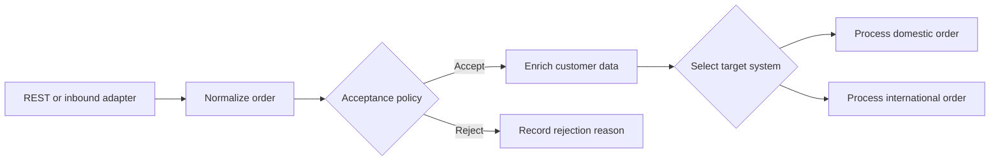

# When to Use Spring Integration Instead of Direct Calls

## 1. The Choice in a Spring Application

Calling a Java method is the natural way for one component to use another's functionality. For many business operations, an application service calling a repository and a few domain services before returning a result is a clear and sufficient design.

Spring Integration is useful when the primary problem shifts from **calling a function** to **organizing how data flows across multiple processing steps or multiple systems**. The `SPRING_INTEGRATION_CORE` module focuses on expressing those flows with `Message`, `MessageChannel`, endpoints, gateways, and Java DSL, along with transformers, routers, filters, aggregators, error handling, and testing.

The question to answer is not "how many services require Spring Integration?", but rather:

> Have the message-routing and transformation rules become important, complex, and frequently changing enough to warrant modeling them as a dedicated architectural concern?

After this lesson, you will be able to:

- Recognize cases where direct calls should be kept.
- Recognize flows suited to enterprise integration patterns.
- Compare the same business operation written with method calls versus Java DSL.
- Distinguish structural decoupling from asynchrony, durability, and transaction boundaries.
- Adopt Spring Integration incrementally and choose appropriate testing strategies.

## 2. What Do Direct Calls Provide?

### 2.1. Example of a Simple Use Case

Suppose the application receives an order-placement request. The types and classes below illustrate the structure; repository and service definitions are omitted:

```java
@Service
public class PlaceOrderService {

    private final OrderValidator validator;
    private final OrderRepository repository;
    private final PriceService priceService;

    public PlaceOrderService(
            OrderValidator validator,
            OrderRepository repository,
            PriceService priceService) {
        this.validator = validator;
        this.repository = repository;
        this.priceService = priceService;
    }

    @Transactional
    public OrderResult place(OrderCommand command) {
        validator.validate(command);
        Money total = priceService.calculate(command);
        Order order = repository.save(Order.create(command, total));
        return new OrderResult(order.getId(), total);
    }
}
```

If these steps operate mostly within the same application and the same data source, with a stable sequence and immediate return values, this approach offers clear advantages:

- Control flow sits in one method, easy to read sequentially.
- The compiler checks argument and return types.
- Errors propagate along familiar call stacks and stack traces.
- Business logic is easy to test with plain objects or mock dependencies.
- No extra channel names, endpoints, pollers, or header-propagation rules to manage.

`@Transactional` only takes effect when the call passes through Spring's transaction mechanism and the transaction manager manages the involved resources. This annotation does not automatically turn HTTP calls, emails, or external operations into a rollbackable transaction.

### 2.2. When Direct Calls Are Still Enough

A method calling three or five collaborators is not automatically a design flaw. Keep direct calls if:

- The relationship between caller and callee is stable.
- Steps are mostly calculations, domain invariant checks, or local data access.
- There is no need for queuing, independent consumption, dynamic routing, or aggregating replies.
- Failures can be handled within a clear call scope.
- The team can easily describe and operate the existing flow.

You can extract long methods, introduce strategies, or split application services before bringing in an integration framework. Spring Integration is not a prerequisite for well-modularized code.

## 3. Signs a Flow Has Become an Integration Problem

Consider a system accepting orders from REST, partner files, and message queues. Each source uses a different format. Orders are normalized, filtered by acceptance policy, enriched with customer data, and routed to the right downstream system. Some partners are slow or temporarily lose connectivity.

If written entirely inside an application service, the method can accumulate:

- Conditional branches by source, customer, and region.
- Conversion code between multiple data formats.
- Retry, timeout, and error-classification logic.
- Background execution, queuing, and concurrency limits.
- State waiting on multiple replies before returning an aggregated result.
- Protocol-specific integration library code.

These parts describe **data paths and processing policies**, not just the behavior of a domain object. That is the signal to consider Spring Integration.

### 3.1. Mapping Needs to Core Components

| Need | Suitable Component or Pattern | Value of Modeling Separately |
|---|---|---|
| Carry data with processing metadata | `Message<T>` | Separates payload from headers such as correlation ID or routing info |
| Connect flow steps | `MessageChannel` | Sender knows the destination; wiring is governed by configuration |
| Normalize formats | Transformer | Clarifies where data changes shape |
| Keep or reject messages by condition | Filter | Centralizes acceptance policies and the path for rejected messages |
| Choose processing branch | Router | Separates destination-selection rules from each destination's logic |
| Invoke business capability | Service activator | Lets the flow use existing Java services |
| Split one input into multiple parts | Splitter | Expresses per-element processing |
| Combine multiple related messages | Aggregator | Declares correlation, completion criteria, and group timeouts |
| Let Java code call into a flow | Messaging gateway | Provides a communication boundary via a business interface |
| Connect an external protocol or system | Channel adapter or outbound gateway | Places external communication logic at the flow boundary |

Not every problem needs every component. A small flow consisting of only a transformer and a service activator may suffice.

### 3.2. Order Intake Flow Example



The diagram shows data-routing decisions. It does not yet specify which steps run asynchronously, where messages are persisted durably, or which operations share a transaction. Those properties must be designed separately.

## 4. Comparing the Same Business Logic Two Ways

This example uses in-memory processing solely to highlight structural differences. It is not meant to prove that Spring Integration is always better than a Java method.

The business logic has three steps: normalize customer code, validate data rules, and accept the order.

### 4.1. Shared Data Types and Business Logic

The `public` types below belong in matching Java files in a real project. `record` requires a Java version supporting it, such as Java 17 or higher. Choose library versions compatible with your application; the example does not mandate a specific Spring version.

```java
import java.math.BigDecimal;

public record OrderRequest(String customerCode, BigDecimal amount) {
}
```

```java
import java.math.BigDecimal;

public record NormalizedOrder(String customerCode, BigDecimal amount) {
}
```

```java
public record OrderReceipt(String customerCode, String status) {
}
```

```java
import java.util.Locale;
import java.util.Objects;
import org.springframework.stereotype.Service;

@Service
public class OrderOperations {

    public NormalizedOrder normalize(OrderRequest request) {
        Objects.requireNonNull(request, "request is required");
        Objects.requireNonNull(
                request.customerCode(), "customerCode is required");
        Objects.requireNonNull(request.amount(), "amount is required");

        return new NormalizedOrder(
                request.customerCode().trim().toUpperCase(Locale.ROOT),
                request.amount());
    }

    public NormalizedOrder validate(NormalizedOrder order) {
        if (order.customerCode().isBlank()) {
            throw new IllegalArgumentException("customerCode must not be blank");
        }
        if (order.amount().signum() <= 0) {
            throw new IllegalArgumentException("amount must be positive");
        }
        return order;
    }

    public OrderReceipt accept(NormalizedOrder order) {
        return new OrderReceipt(order.customerCode(), "ACCEPTED");
    }
}
```

`accept` only builds an illustrative response without saving data, charging money, or calling partners. Domain logic stays in the service so both orchestration approaches can use it.

### 4.2. Approach A: Orchestrating with Method Calls

```java
import org.springframework.stereotype.Service;

@Service
public class DirectOrderService {

    private final OrderOperations operations;

    public DirectOrderService(OrderOperations operations) {
        this.operations = operations;
    }

    public OrderReceipt submit(OrderRequest request) {
        NormalizedOrder normalized = operations.normalize(request);
        NormalizedOrder validated = operations.validate(normalized);
        return operations.accept(validated);
    }
}
```

For the exact current requirements, this is a sensible choice. Readers immediately see inputs, processing order, and outputs. There is no clear integration need forcing a switch to messaging.

### 4.3. Approach B: Orchestrating with Spring Integration Java DSL

To use this in a Spring Boot application, add Spring Integration support via your project's dependency management, typically Spring Boot's Integration starter. Place classes within the application's component scan scope. The gateway interface below must be discovered by `@IntegrationComponentScan`.

```java
import org.springframework.integration.annotation.MessagingGateway;

@MessagingGateway(defaultRequestChannel = "orders.input")
public interface OrderGateway {

    OrderReceipt submit(OrderRequest request);
}
```

```java
import org.springframework.context.annotation.Bean;
import org.springframework.context.annotation.Configuration;
import org.springframework.integration.annotation.IntegrationComponentScan;
import org.springframework.integration.channel.DirectChannel;
import org.springframework.integration.config.EnableIntegration;
import org.springframework.integration.dsl.IntegrationFlow;
import org.springframework.messaging.MessageChannel;

@Configuration
@EnableIntegration
@IntegrationComponentScan(basePackageClasses = OrderGateway.class)
public class OrderIntegrationConfiguration {

    @Bean(name = "orders.input")
    public MessageChannel ordersInput() {
        return new DirectChannel();
    }

    @Bean
    public IntegrationFlow orderFlow(OrderOperations operations) {
        return IntegrationFlow.from("orders.input")
                .transform(OrderRequest.class, operations::normalize)
                .handle(operations, "validate")
                .handle(operations, "accept")
                .get();
    }
}
```

Here:

1. `OrderGateway` exposes a Java method to callers.
2. The gateway creates a message with payload `OrderRequest` and sends it to `orders.input`.
3. `DirectChannel` passes the message to the next endpoint on the current calling thread.
4. The transformer creates a `NormalizedOrder` payload.
5. Two service activators invoke `validate` and `accept`.
6. The final result returns via the gateway's request–reply mechanism.

Callers only need to inject `OrderGateway` and call `submit`. They do not have to construct `Message` objects or know channel names. That is a boundary benefit, though an ordinary service interface can also hide implementation details. Spring Integration's distinct value lies in how steps inside the flow are modeled and wired.

In this example, Java DSL is longer than direct calls and does not yet deliver substantial business value. The value appears as routing policies, transformations, adapter connections, or consumption controls grow.

### 4.4. When the Flow Needs to Expand

Suppose orders later need to go to one of two processing systems. An illustrative router snippet inside the flow could look like:

```java
.route(NormalizedOrder.class,
        order -> order.amount().compareTo(new BigDecimal("10000000")) >= 0,
        mapping -> mapping
                .channelMapping(true, "orders.manualReview")
                .channelMapping(false, "orders.standard"))
```

This is a snippet replacing the routing point in an expanded flow, not a complete configuration to drop directly into the previous example. You must declare and register consumers for both target channels, as well as define a consistent reply type if the gateway still returns `OrderReceipt`.

If one branch terminates without replying, a request–reply call can wait until timeout or fail to receive the expected reply, depending on configuration. Adding branches on paper does not automatically complete the reply contract.

The monetary threshold in the example merely illustrates routing. For complex rules, let a policy service compute the decision and have the router choose the target from that result, avoiding cramming full business logic into DSL lambdas.

## 5. Guarantees Spring Integration Does Not Provide Automatically

### 5.1. Having a Channel Does Not Mean Asynchronous

`DirectChannel` normally executes handler calls on the sender's thread. Therefore, replacing a service call with a gateway and `DirectChannel` does not automatically make the system process in the background or respond faster.

| Connection Style | Basic Execution Model | What Else Must Be Designed |
|---|---|---|
| Direct call | Same thread, unless called code switches threads itself | I/O timeouts, transactions, and errors |
| `DirectChannel` | Handler runs on the sender's thread | Execution time and errors affect the caller |
| `ExecutorChannel` | Usually hands work off via an executor; final behavior depends on the executor | Pool size, executor queue, rejection policy, thread context |
| `QueueChannel` | Holds messages for consumers to pull later; polling endpoints typically need a poller | Capacity, poll schedule, consumer count, storage, and backlog handling |
| Broker adapter | Depends on protocol, client, and configuration | Ack, retry, redelivery, persistence, and load limits |

An executor configured with caller-runs policy on overload can alter the assumption that work "moved to another thread". Understand actual configuration instead of relying solely on channel class names.

### 5.2. An In-Memory Queue Is Not a Durable Queue

A default in-memory `QueueChannel` does not guarantee message recovery after a process stops. If restart survival is needed, design an appropriate message store or use properly configured durable messaging infrastructure.

Queue capacity also needs sensible bounds. Pushing work onto a queue does not eliminate processing cost; it converts cost into wait time and storage resources. When arrival rate exceeds processing rate for a sustained period, you need throttling, rejection, or scaling policies.

### 5.3. Changing Threads Can Change Transaction Boundaries

With synchronous processing over `DirectChannel`, subsequent operations can participate in an active transaction on the thread if configuration and resources allow. Merely using `DirectChannel` does not start a transaction on its own.

When switching to an executor or queue, never assume a transaction bound to the caller's thread continues to span the consumer. Consumers typically need their own transaction boundaries. Define clearly:

- Which operations commit before a message is sent or consumed.
- If database persistence succeeds but outbound sending fails, how the system recovers.
- If an external party already received it while local processing rolled back, whether resending causes duplicate side effects.

When consistency between database updates and event publishing is required, you may need the outbox pattern alongside forwarding and deduplication mechanisms. Spring Integration can participate in implementing that flow, but simply adding a channel does not solve that consistency problem.

### 5.4. Retries Do Not Mean Exactly-Once Processing

Retries fit potentially transient failures, such as interrupted connections. Retrying a payment after a timeout can create a duplicate payment if the partner already processed it and the response was lost.

Define the unit of retry: a single outbound call, a handler, or the entire consumption pipeline. If retry wraps a step that already caused side effects, that step can execute again. For sensitive operations, use idempotency keys or stable business IDs, persist processing results, and build reconciliation mechanisms.

### 5.5. Decoupling Does Not Mean Zero Dependencies

Channels reduce direct dependencies on receiver objects, yet components must still agree on:

- Payload types and semantics.
- Required headers, correlation IDs, and how they are propagated.
- Request–reply or one-way contracts.
- Timeouts, error reporting, and tolerance for duplicate messages.
- Processing order, concurrency capability, and schema compatibility.

If payloads are `Object`, headers are ad hoc, and channel names are scattered everywhere, dependencies can actually become harder to see. Use strongly typed DTOs, gateways with concrete contracts, and consistent channel names to keep architecture understandable.

## 6. Error Handling Must Accompany Architectural Choices

### 6.1. Synchronous Errors vs. Asynchronous Errors

With direct calls, exceptions typically unwind the stack to the caller. In a synchronous flow using `DirectChannel`, handler errors can also return to the caller; Spring messaging may wrap errors in exceptions carrying message context. Do not assume callers always catch the exact original business exception class directly.

With tasks running on another thread or polled later, the original call stack is no longer a natural error receiver. Configure error-reporting mechanisms suited to executors, pollers, and endpoints. Spring Integration supports representing errors with `ErrorMessage` and routing errors through error channels.

Do not assume every exception in every flow automatically goes to `errorChannel`. Check where the error occurs, which component catches it, and which error-publishing mechanism is configured. Nor does an `ErrorMessage` automatically translate into a success or failure business reply for the original gateway.

### 6.2. Classify Errors to Decide Behavior

| Scenario | Typically Appropriate Behavior | What to Avoid Doing Mechanically |
|---|---|---|
| Invalid data | Return deterministic error or route to rejection branch | Infinitely retrying the exact same data |
| Temporary connection loss | Bounded retries with backoff | Aggressive tight retries that overload partners |
| Unknown whether external operation succeeded | Check status by business key, reconcile | Resending side effects without idempotency |
| Unprocessable after allowed attempts | Persist details for investigation and controlled replay | Merely logging and losing track of the message |
| Partial data missing during aggregation | Apply timeout and policy for incomplete results | Holding message groups indefinitely |

Filters require particular care in request–reply flows. If a filter drops a message without producing a reply or raising an error per the chosen contract, the gateway may fail to get the expected answer. "Do not process further" and "return a rejection decision" are two different behaviors.

## 7. Practical Decision Table

| Problem Characteristics | Initial Preference | Rationale |
|---|---|---|
| CRUD and a few local business steps | Direct calls | Short flow, clear contracts, minimal operational config |
| Complex domain calculations with minimal integration flow | Service or domain model | Complexity lies in business logic, not message routing |
| Multiple input sources sharing a normalization step | Consider Spring Integration | Adapters and transformers establish a unified intake boundary |
| Routing changes independently of each target's logic | Consider Spring Integration | Routers express destination-selection rules separately |
| Split data then aggregate results by correlation key | Consider splitter and aggregator | Clear model for splitting, correlation, and completion rules |
| Need very simple background execution | Evaluate executors or built-in mechanisms first | Not every background task needs a full flow framework |
| Consume from broker, transform, and call multiple systems | Consider Spring Integration | Combines integration patterns and boundary error policies |
| Multi-day workflows needing human tasks and business state history | Evaluate dedicated workflow engines | These needs go beyond wiring endpoints |

This table is a starting point. The final choice also depends on team operational maturity, existing libraries, and data recovery requirements. Having multiple external systems is a signal, not a mandatory rule.

### 7.1. Five Questions Before Adopting It in a Project

1. **Where does the complexity live?** If in pricing formulas, clarify domain services. If in routing and transforming across systems, flows can help.
2. **What is the caller contract?** Is an immediate processing result required, or only intake acknowledgment? For async intake, return a tracking ID and provide status lookup when needed.
3. **What if the process stops?** Identify what data can be lost, what must be recovered, and where intake proof resides.
4. **What if the same message arrives twice?** Define business-level idempotency and how already-executed work is detected.
5. **Who operates the flow?** The team needs visibility into inputs, backlogs, failures, timeouts, and safe replay procedures.

Do not turn these questions into a mechanical scorecard. A single strict durability requirement can outweigh many small gains in code brevity.

## 8. Incremental Adoption in an Existing System

A controlled migration picks one flow with clear boundaries, such as partner data intake:

1. **Document current behavior.** Identify inputs, outputs, errors, side effects, and ordering requirements.
2. **Keep business logic in strongly typed services.** Avoid rewriting domain rules just to move into DSL.
3. **Place a gateway at the boundary.** Give callers a stable contract that is easy to substitute in tests.
4. **Start with a synchronous flow if appropriate.** Use `DirectChannel` to validate flow structure before adding execution-timing changes.
5. **Separate integration policies.** Put normalization in transformers, branching in routers, and external communication in appropriate endpoints.
6. **Add queues or executors for specific reasons.** At the same time decide capacity, timeouts, transactions, errors, and durability.
7. **Evaluate by behavior and operability.** Compare flow clarity, scope of change when adding sources/targets, and monitoring/recovery costs.

You do not need to convert every repository, domain service, or internal call into channels. A common effective design orchestrates integration at the outer layer and invokes ordinary Java business services inside.

Also pay attention to ordering requirements. Increasing consumer count or parallel processing can make completion order differ from intake order. If all events for the same order must process sequentially, use appropriate partitioning or serialization policies; an aggregator alone does not solve all ordering needs.

## 9. Testing to Protect Design Decisions

Moving from direct calls to a flow should preserve committed business behavior. Test both step logic and how steps are wired together.

### 9.1. Testing Business Logic Without a Spring Context

The JUnit example below tests the normalization step shared by both orchestration approaches:

```java
import static org.junit.jupiter.api.Assertions.assertEquals;

import java.math.BigDecimal;
import org.junit.jupiter.api.Test;

class OrderOperationsTest {

    @Test
    void normalizesCustomerCode() {
        OrderOperations operations = new OrderOperations();
        NormalizedOrder result = operations.normalize(
                new OrderRequest("  vn-001  ", new BigDecimal("150000")));

        assertEquals("VN-001", result.customerCode());
        assertEquals(new BigDecimal("150000"), result.amount());
    }
}
```

This test does not verify the flow, gateway, or channels. It protects data-transformation rules independently of orchestration technology.

### 9.2. Testing the Gateway Contract and Flow Wiring

If the project uses Spring Boot Test, you can initialize a minimal context with the illustrated configuration and service:

```java
import static org.junit.jupiter.api.Assertions.assertEquals;

import java.math.BigDecimal;
import org.junit.jupiter.api.Test;
import org.springframework.beans.factory.annotation.Autowired;
import org.springframework.boot.test.context.SpringBootTest;

@SpringBootTest(classes = {
        OrderIntegrationConfiguration.class,
        OrderOperations.class
})
class OrderFlowTest {

    @Autowired
    private OrderGateway gateway;

    @Test
    void returnsReceiptAfterNormalizationAndValidation() {
        OrderReceipt receipt = gateway.submit(
                new OrderRequest("  vn-001  ", new BigDecimal("150000")));

        assertEquals("VN-001", receipt.customerCode());
        assertEquals("ACCEPTED", receipt.status());
    }
}
```

Test examples are guides for applying inside a Java project with matching dependencies; they are not evidence that code was executed in this lesson's environment.

When flows have multiple branches or external communication, add meaningful scenarios:

- Router sends each order type to the right target and has clear behavior for unmapped cases.
- Filtered-out messages produce the contracted result or error without leaving the gateway waiting unexpectedly.
- Transient outbound errors retry within bounds, while data errors terminate deterministically.
- Duplicate messages do not trigger extra side effects when business rules require idempotency.
- Aggregation timeouts produce defined behavior without retaining state forever.
- When capacity is exceeded, the system responds according to the chosen load policy.

For asynchronous processing, tests should wait with bounded conditions or use appropriate wait utilities rather than relying on fixed sleep durations. For external adapters or brokers, integration tests must also verify real protocol behavior, acknowledgments, and recovery; in-memory tests are insufficient to validate those guarantees.

## 10. Decision-Making Exercises

### Scenario A: Calculating Cart Total

An API receives line items, calculates discounts from local rules, and returns the total amount. There are no other intake sources, no background processing, and no routing needs.

**Suggested choice:** keep the application service and direct calls. If discount rules grow, consider policies or strategies. Spring Integration does not solve a clear data-routing need in this scenario.

### Scenario B: Syncing Catalogs from Multiple Partners

Three partners send data via files and HTTP. Data must be normalized, validated, batched, and sent to two target systems. When a target system temporarily fails, evidence must be retained for controlled retries.

**Suggested choice:** consider Spring Integration for intake and orchestration. Describe inbound adapters, normalizing transformers, destination routers, sending mechanisms, and error paths. Separately decide where durable data is stored, idempotency keys, and retry limits. Do not conclude that merely writing DSL satisfies recovery requirements.

### Scenario C: Aggregating Shipping Quotes

An application calls three carriers and aggregates quotes by request ID, accepting partial results after a deadline.

**Suggested choice:** if the system already has multiple integration flows, branching and an aggregator can clearly express correlation and completion conditions. If this is just one small operation in an application, concurrent Java utilities with explicit timeouts can also suffice. Weigh state-management costs, late-reply handling, and error observability rather than picking a framework merely because there are three calls.

### Self-Check Questions

1. Why does combining a gateway with `DirectChannel` not automatically make a method asynchronous?
2. After decoupling a sender from a concrete service name, what dependencies still remain?
3. If a filter drops a request in a request–reply flow, what else must be decided?
4. Why can retrying a payment call after a timeout cause duplicate side effects?
5. In your current system, does complexity lie in domain rules or in data routing paths?

Choose Spring Integration when modeling message paths makes the system easier to change, test, and operate. Keep direct calls when they still express the use case clearly. Both can coexist: flows handle integration orchestration, while Java services hold business rules.