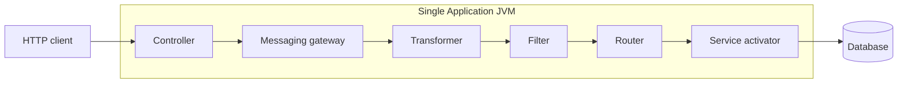

# Limitations of In-Process Message Flows

In the **Spring Integration Fundamentals** chapter of the **SPRING_INTEGRATION_CORE** module, this lesson defines the guarantees an in-application message flow can provide. Understanding those boundaries helps you choose `Message`, `MessageChannel`, endpoints, gateways, and Java DSL appropriately, while avoiding attributing properties to transformers, routers, filters, or aggregators that they do not inherently possess.

A flow separating processing steps with messages and channels can make source code easier to change. However, splitting into multiple endpoints does not automatically create durable storage, recovery after a JVM stop, or the ability to deploy individual steps independently.

## 1. Learning Objectives

After this lesson, you will be able to:

- Distinguish component boundaries, thread boundaries, and process boundaries.
- Explain why asynchronous processing alone is insufficient to guarantee zero message loss.
- Identify how channels impact errors, timeouts, and transactions.
- Analyze memory pressure, processing order, and aggregator state as load or instance count increases.
- Choose between an in-process flow, a persistent message store, and external messaging infrastructure based on business requirements.

## 2. What Is an In-Process Flow?

An **in-process message flow** has components exchanging messages inside the same application process, typically within the same JVM and Spring `ApplicationContext`. For example, the application receives an order request, normalizes data, filters invalid requests, routes, and invokes a business service.



The database in the diagram is an external resource. An endpoint writing to a database does not make messages sitting in RAM during earlier steps durable.

Three boundaries must be distinguished:

| Boundary | Example | What Actually Changes |
| --- | --- | --- |
| Component | Transformer passes message to router | Code organization and responsibilities |
| Thread | Producer hands work off to an executor | Scheduling, waiting semantics, and context propagation |
| Process | Application A sends data to Application B over a transport | Failure domains, data contracts, and transport mechanisms |

Switching to another thread still keeps work inside the same JVM. For another process to receive messages, you need a transport or a shared storage and coordination mechanism designed for that purpose.

## 3. MessageChannel Does Not Become a Broker on Its Own

`DirectChannel`, `ExecutorChannel`, and `QueueChannel` solve different problems. You cannot deduce a flow's guarantees solely from its use of the `MessageChannel` interface.

| Channel Type in Typical Configuration | How Work Is Handed Off | Key Caveats |
| --- | --- | --- |
| `DirectChannel` | Invokes handler on sending thread | Slow handlers block the calling thread; no durable queue |
| `ExecutorChannel` with async executor | Hands work off to executor | Introduces pool limits and task queues; still same process |
| Default `QueueChannel` | Holds messages in RAM for receivers to pull | Pending messages can be lost if the JVM stops |
| `PublishSubscribeChannel` without executor | Invokes subscribers synchronously | In-process broadcast is not equivalent to a durable topic across apps |

`DirectChannel` lets the handler execute before the `send()` call returns. With `ExecutorChannel`, actual behavior also depends on the executor and rejection policy; do not assume every call always runs on another thread. See [Message Channel Implementations](https://docs.spring.io/spring-integration/reference/channel/implementations.html).

A channel name like `orders` is a component name inside the application. Two instances both declaring `orders` do not share a single queue because of the matching name. Each instance holds its own channel object and its own set of messages.

### Java DSL Example: Multiple Endpoints Can Still Share One Call Stack

The configuration snippet below lives inside a Spring application with Spring Integration enabled. The `orderPrinter` bean demonstrates a one-way flow that simply logs results to the console.

```java
import java.util.Locale;

import org.springframework.context.annotation.Bean;
import org.springframework.context.annotation.Configuration;
import org.springframework.integration.config.EnableIntegration;
import org.springframework.integration.dsl.IntegrationFlow;

@Configuration
@EnableIntegration
public class LocalFlowConfiguration {

    @Bean
    public IntegrationFlow orderPrinter() {
        return IntegrationFlow.from("ordersInput")
                .transform(String.class,
                        value -> value.trim().toUpperCase(Locale.ROOT))
                .handle(String.class, (payload, headers) -> {
                    System.out.println(payload);
                    return null;
                })
                .get();
    }
}
```

Here, no queue, executor, or asynchronous step is declared. Java DSL connects endpoints using `DirectChannel` by default; see [Message Channels in Java DSL](https://docs.spring.io/spring-integration/reference/dsl/java-channels.html). Consequently, a caller sending directly to `ordersInput` executes both the transformer and the handler on the calling thread.

If the handler is replaced by an I/O operation taking two seconds, writing the flow in DSL does not remove those two seconds from the caller's wait time.

## 4. Limitations in Durability and Recovery

### 4.1. Enqueuing Differs from Business Completion

Consider an order moving through points in time:

```text
T0: application receives request
T1: message is placed into in-RAM QueueChannel
T2: worker pulls message out
T3: business logic successfully persists data
T4: result is returned to the caller
```

If relying solely on an in-RAM queue:

- JVM stops between T1 and T2: unprocessed messages can disappear.
- Worker fails after T2: there is no guarantee of returning the message to the queue unless a corresponding mechanism is designed.
- JVM stops after T3 but before T4: the caller may not know the operation succeeded and resend the request.

This analyzes failure windows in the example, not a claim that every channel shares identical delivery mechanics.

For APIs returning an "accepted" status, the system must define clearly what acceptance means. If it promises to process even after an application restart, returning success must be tied to an appropriate durable persistence mechanism.

### 4.2. Persistence Can Be Added, but Scope Must Be Understood

Spring Integration supports persistent stores for stateful message-holding components. `QueueChannel` can be configured with a store such as `JdbcChannelMessageStore`; the default channel does not use a database automatically. See [Persistent QueueChannel Configuration](https://docs.spring.io/spring-integration/reference/channel/configuration.html).

Persistence solves only part of the problem. You must still determine:

1. At what exact moment is writing the message to the store committed?
2. When pulling a message out, is removing it from the store in the same transaction as business processing?
3. If business logic already caused side effects but the acknowledgment step fails, will the message be re-executed?
4. Which payloads and headers can be validly serialized, restored, and used after a restart?

Do not arbitrarily persist bean references, open resources, or objects meaningful only inside the current process. The [Message Store](https://docs.spring.io/spring-integration/reference/message-store.html) documentation specifically notes issues around restoring headers containing objects like reply channels or error channels.

Nor does a persistent store turn a flow into a system with historical replay, backlog management, and consumer coordination equivalent to every kind of broker.

## 5. Load Limits: Buffering Only Buys Time

Suppose during a traffic surge:

- Producers send an average of 500 messages/second.
- Consumers process 300 messages/second.
- The queue is currently empty with a capacity of 2,000 messages.

The backlog grows by approximately:

```text
500 - 300 = 200 messages/second
Time until full ≈ 2,000 / 200 = 10 seconds
```

This is an estimate under steady rates, excluding variance and per-message processing time. Increasing queue size only delays hitting the limit; it does not fix a sustained throughput mismatch.

With an in-RAM buffer, memory usage also includes payloads, headers, referenced objects, and queue management overhead. Suppose each message holds roughly 20 KiB of data; 10,000 messages already take around 195 MiB for hypothetical payload data alone; actual heap usage can be higher.

### Example: Bounded Queue and Send Timeout

This is a standalone Java program requiring Spring Integration Core and Spring Messaging dependencies on the classpath. It intentionally creates no consumer so you can observe the queue rejecting admissions when full.

```java
import org.springframework.integration.channel.QueueChannel;
import org.springframework.messaging.support.MessageBuilder;

public class LocalQueueProbe {

    public static void main(String[] args) {
        QueueChannel queue = new QueueChannel(1);

        boolean first = queue.send(
                MessageBuilder.withPayload("order-001").build(), 0);

        boolean second = queue.send(
                MessageBuilder.withPayload("order-002").build(), 100);

        System.out.println("first=" + first);
        System.out.println("second=" + second);
        System.out.println("queued=" + queue.getQueueSize());
    }
}
```

Expected output:

```text
first=true
second=false
queued=1
```

`100` is the send timeout in milliseconds. The second send waits for space and returns `false` when the timeout expires; no business logic has processed any message yet. Bounded queue configuration is covered in [QueueChannel Configuration](https://docs.spring.io/spring-integration/reference/channel/configuration.html).

This snippet calls `QueueChannel.send()` directly. When going through a gateway or another API, rejection can be surfaced as an exception depending on the API and configuration used.

The application must decide how to react on overload: controlled rejection, bounded waiting, throttling intake sources, or writing to durable storage. Avoid immediate infinite retries, which amplify traffic right when the system lacks capacity.

## 6. Transaction Limits When Changing Threads or Resources

With standard thread-bound transactions, a synchronous processing chain can join an existing transaction if the transaction manager, propagation, and resources are configured appropriately.

```text
Request-receiving thread, transaction T1:
  save order
  -> DirectChannel
  -> update inventory in the same database
  -> commit T1
```

Switching to an asynchronous step changes the boundary:

```text
Thread A, transaction T1:
  save order -> hand work to executor -> commit T1

Thread B:
  receive work -> process inventory in its own context
```

If Thread B fails after T1 has committed, T1 cannot automatically roll back. Nor does `DirectChannel` start a transaction itself; it merely preserves synchronous execution so a configured transaction can encompass appropriate steps. See [Transaction Support](https://docs.spring.io/spring-integration/reference/transactions.html).

Even on the same thread, sending an email or calling a payment API does not automatically roll back with a database transaction. Therefore, analyze both **thread boundaries** and **resource transactional participation**.

For example, the requirement "save the order and reliably publish an event" can lead to a transactional outbox design:

1. Save the order and an outbox record in the same database transaction.
2. An event-publishing process reads unprocessed outbox records.
3. Publish the event to the transport and update status according to the chosen mechanism.
4. Consumers process idempotently to tolerate redelivery.

This is a design approach for the scenario, not a feature automatically activated when declaring an integration flow. Failure windows between publishing events and updating the outbox must still be handled.

## 7. Limitations of Error Handling and Gateway Timeouts

### 7.1. Exceptions Follow the Execution Model

In a synchronous flow, exceptions can unwind the call stack back to the caller. Once work runs asynchronously, a `try/catch` around the already-completed send cannot catch errors thrown later on a worker thread.

For tasks managed by Spring Integration, async errors can be wrapped in an `ErrorMessage` and routed via the `errorChannel` header or the global error channel. Custom executors, schedulers, and gateways must be configured appropriately; not every exception in an application automatically goes there. See [Error Handling](https://docs.spring.io/spring-integration/reference/error-handling.html).

Sending an error to a channel only establishes an error-handling path. The design must also decide which errors are retried, which are persisted durably, who monitors them, and how failed work is recovered. If an error channel is held solely in RAM, it still risks losing data when the process stops.

### 7.2. A Gateway Is an Entry Point, Not a Completion Guarantee

A messaging gateway hides messaging APIs behind a business interface. The interface's return contract must match the flow: a one-way flow does not gain a business answer merely because it is invoked through a gateway. See [Messaging Gateways](https://docs.spring.io/spring-integration/reference/gateway.html).

Distinguish carefully:

| Concept | Question to Answer |
| --- | --- |
| Send timeout | How long to wait for the channel to accept at most, if the channel supports waiting? |
| Reply timeout | How long to wait for a response at most? |
| Business deadline | After what point should work no longer be executed? |
| I/O timeout | How long can a single external system call take? |

A reply timeout is not a mechanism that cancels and rolls back all work. In a synchronous flow, a handler can hold the calling thread inside the send call itself; reply timeout cannot be treated as a hard cap on handler runtime. In an async flow, workers can keep running after the caller stops waiting.

For instance, a caller waits three seconds and resends the same request while the first attempt finishes at second five. Without a stable business key and deduplication, both attempts can produce side effects.

## 8. Ordering and State Limits When Scaling

### 8.1. FIFO Does Not Mean In-Order Completion

Suppose message A is pulled before B, yet two workers process in parallel. A takes two seconds, B takes 100 milliseconds: B can finish before A.

If the requirement is "events for the same order must be applied in order", define a partition/grouping key, distribution strategy, worker count, and business version checks. You do not need to force all orders through a single sequential pipeline if ordering is only required per order.

### 8.2. Aggregators Depend on Where Message Groups Are Stored

An aggregator maintains group state by correlation key and release strategy. With RAM-only state, a restart can lose already-received parts. When running multiple instances with separate stores, parts of the same group can also scatter across different instances.

Using a shared persistent store can help share state, but the design must account for cross-instance locking, correlation keys, group expiration, and cleanup. A shared store does not automatically resolve all races. See [Aggregator State Management](https://docs.spring.io/spring-integration/reference/aggregator.html).

For example, an order-check result group requires three parts: payment, inventory, and shipping. When only two parts arrive, define how long to wait, whether partial results are emitted, and how late third parts are handled. "Wait until all arrive before replying" without a bound can retain state indefinitely.

### 8.3. Adding Instances Does Not Share Heap

Doubling instance count can increase request-intake capacity, yet each instance still has its own queues, pools, and memory. An instance with a large backlog does not automatically move in-RAM messages to a less busy instance.

To deploy handlers independently, pull work from a shared durable source, or recover work from a stopped instance, add an appropriate transport or coordination mechanism.

## 9. Data and Context Limits Within a JVM

A message has payload and headers, yet wrapping a Java object in a message does not deep-copy it or make it immutable. If two branches hold the same mutable object, mutations from one branch can affect the other.

To reduce hidden coupling, use payloads with clear contracts and avoid mutating sent objects directly. When sending across processes, also design serialization, schema versioning, and compatibility rules.

Similarly, data in `ThreadLocal`, MDC, or security context is not automatically preserved simply because a message passes through an executor. Choose an appropriate context-propagation mechanism and place only necessary fields in headers. A stable correlation ID helps link logs across steps, though it does not replace authorization or deduplication mechanisms.

## 10. Do Not Infer Exactly-Once from an In-Process Flow

A request can be resent due to timeouts, retries, restarts, or operator replays. What matters is the **business effect** when the same work arrives multiple times.

For example, a `paymentRequestId` key preserved by the sender across attempts is more meaningful than generating a new message ID per send. The receiver can use unique constraints in a database or idempotency-aware APIs to avoid creating duplicate payment transactions for the same request.

Spring Integration provides `IdempotentReceiverInterceptor` to help detect or handle duplicate messages, yet full idempotency logic remains the application's responsibility. If using an in-RAM-only metadata store, duplicate-detection state does not survive restarts. See [Idempotent Receiver](https://docs.spring.io/spring-integration/reference/handler-advice/idempotent-receiver.html).

The design must clarify whether recording the deduplication key is safely coupled with the business effect. Recording the key too early and crashing before processing can wrongly reject retries; recording too late can allow two side effects to happen. A standalone interceptor does not turn multiple independent resources into a single transaction.

## 11. Choosing Infrastructure Level by Requirement

The table below suggests architectural directions; final decisions depend on data criticality and operational commitments.

| Requirement | Design Direction to Consider |
| --- | --- |
| Normalize, filter, and route data in a short request | Synchronous in-JVM flow with clear I/O timeouts |
| Reconstructible background tasks; losing queued items on crash is acceptable | Bounded in-process queue or executor with regeneration mechanism |
| Pending messages must survive restarts | Persistent store or durable transport; define commit boundaries |
| Producers and consumers deploy and scale independently | External messaging or appropriate inter-process communication |
| Need to store and replay event history | Event storage system meeting retention and replay policies |
| Update database and reliably emit events together | Evaluate outbox or appropriate transaction coordination |
| Replies may arrive after the caller stops waiting | Job ID, durable state, lookup API, or callbacks |

Using a broker still requires configuring durability, acknowledgments, retries, and load limits properly. Network failures or external side effects do not vanish simply because messages moved onto another transport.

Spring Integration can continue executing transformers, routers, filters, aggregators, and endpoints on both sides of a transport. Adding messaging transport infrastructure does not require discarding the flow model already built.

## 12. Boundary-Analysis Practice Exercises

The scenarios below are for practicing reasoning and test design in real applications.

### Scenario A: Sent but Not Yet Processed

Run the `LocalQueueProbe` example and explain why `first=true` despite having no consumer. Then add a controlled consumer and record three moments separately: send, start processing, and completion.

**Key takeaway:** a successful send reflects the channel's intake contract at that boundary; it does not represent all downstream side effects.

### Scenario B: Crash Before Worker Processes

Pause the consumer using a controlled synchronization mechanism, send one message into the RAM queue, and terminate the process in a test environment. Restart and check whether any data remains to recover the work.

**Key takeaway:** graceful shutdown and crash are two different cases. Draining work during normal shutdown does not prove recovery during an abrupt process stop.

### Scenario C: Timeout Followed by Resend

Simulate a worker taking longer than the caller's wait timeout. Resend the same business key after timeout and count how many side effects are recorded in a test database.

**Key takeaway:** observe final state, not just caller exceptions. Use stable keys, data constraints, and appropriate transactions to protect side effects.

### Scenario D: Aggregator Running Across Two Instances

Send parts sharing one correlation key to two instances with separate stores, then analyze why neither instance has enough data to release the group.

**Key takeaway:** you need a strategy to route parts to the same processor or configure shared state and coordination appropriately.

When designing concurrency tests, prefer latches, barriers, or bounded wait utilities instead of guessing with fixed sleep durations.

## 13. Questions to Answer Before Putting a Flow into Production

1. Is success confirmed at intake, commit, or business completion?
2. What happens to queued and in-flight messages if the JVM stops right now?
3. Which thread executes each segment, and which transaction actually covers it?
4. When a queue is full or an executor rejects a task, what result does the sender receive?
5. When a caller times out, does work continue and can it be resent?
6. Must ordering be guaranteed globally or per business key?
7. Where are aggregator state, deduplication state, and job progress stored?
8. Can you measure backlog, message age, processing duration, error rate, and retry counts?

The limitations of an in-process flow lie in the scope of its configured guarantees: it organizes in-application message processing very effectively, whereas durability, recovery, cross-instance coordination, and safety of business side effects must be explicitly designed at each boundary.