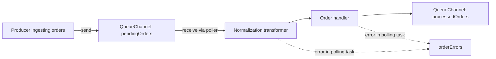

# QueueChannel and the internal queue

## 1. The problem: fast ingestion, processing at its own pace

An application receives order synchronization requests. Normally, requests arrive at a fairly steady rate; when a partner sends data in batches, the request volume spikes suddenly. If every ingestion call had to wait for all normalization steps and downstream service calls to complete, response times would depend directly on that processing speed.

In the **SPRING_INTEGRATION_CORE** module, chapter **Queue and pollable channel**, `QueueChannel` is the tool for placing a message buffer between two stages. This lesson walks from `Message` and `MessageChannel` to polling endpoints, Java DSL configuration, and the limits you need to understand before using a buffer.

After this lesson, you can:

- Distinguish the `PollableChannel` contract from the `QueueChannel` implementation.
- Explain where a message resides after `send()` and when it leaves the queue.
- Choose capacity, send timeout, and poller configuration for a concrete flow.
- Identify thread boundaries, processing order, and behavior when downstream fails.
- Write time-bounded tests for ingestion, receiving messages, and processing through a flow.

End-to-end flow used throughout the lesson:



A queue creates a waiting area for work. Actual processing throughput is still determined by endpoints, system resources, and target services.

## 2. PollableChannel is the contract, QueueChannel is an implementation

`MessageChannel` provides the send operation. `PollableChannel` extends that contract and adds an active message-receiving operation:

```java
// Simplified to illustrate the contract, not a replacement for the library interface.
public interface PollableChannel extends MessageChannel {
    Message<?> receive();
    Message<?> receive(long timeout);
}
```

A consumer calls `receive()` to pull data. A call with a timeout can return `null` when the wait expires; an interrupted receive can also result in `null`. The timeout unit is milliseconds. See the [PollableChannel contract](https://docs.spring.io/spring-framework/docs/current/javadoc-api/org/springframework/messaging/PollableChannel.html).

`QueueChannel` belongs to the `org.springframework.integration.channel` package; `Message`, `MessageChannel`, and `PollableChannel` belong to `org.springframework.messaging`.

| Component | Role in the order example |
| --- | --- |
| `Message<?>` | Carries the order payload and headers such as request ID |
| `QueueChannel` | Accepts and holds waiting messages |
| `PollableChannel` | Contract type for consumers to pull messages |
| Polling endpoint | Schedules pulling messages and invokes the handler |
| Transformer | Normalizes order content |
| Handler | Performs business work |

Declaring a `QueueChannel` bean does not create a consumer by itself. If producers keep sending while nothing calls `receive()` and no polling endpoint is configured, messages will accumulate.

## 3. What does the internal queue hold and how does it work?

### 3.1. Default structure

With the constructor taking capacity, the current implementation creates a `LinkedBlockingQueue<Message<?>>`. The no-argument constructor uses a `LinkedBlockingQueue` with the default limit of `Integer.MAX_VALUE`. This is an implementation detail of the standard constructors, not a guarantee that every passed-in queue has the same behavior. See the [QueueChannel source code](https://raw.githubusercontent.com/spring-projects/spring-integration/main/spring-integration-core/src/main/java/org/springframework/integration/channel/QueueChannel.java).

```java
QueueChannel bounded = new QueueChannel(100);
QueueChannel practicallyUnbounded = new QueueChannel();
```

Capacity is measured in **number of messages**, not bytes. One hundred messages carrying short order IDs and one hundred messages carrying large payloads can put very different pressure on memory.

The default queue lives in JVM memory. For a message sitting in the queue, the application retains the necessary references to its payload and headers. Do not infer from `Message` having an immutable structure that every payload object inside it is deeply immutable: if a producer keeps mutating a mutable object that was already sent, the consumer can observe unexpected state. In the examples, payloads are `String` values to avoid this shared-state issue.

### 3.2. Lifecycle of a message

Suppose the queue has capacity 2:

```text
Initial                 []
send(A, 0) -> true      [A]
send(B, 0) -> true      [A, B]
send(C, 0) -> false     [A, B]
receive(0) -> A         [B]
send(C, 0) -> true      [B, C]
```

At the step where `A` is received, the message has already left the queue before business processing of `A` completes. Therefore, there can be 2 waiting messages plus additional messages currently being processed. Queue capacity does not bound the total amount of work in flight across the entire application.

If multiple receivers pull from the same `QueueChannel`, the receivers compete to consume messages. Each message is pulled by one receiver; the channel does not copy a message to every consumer. Standard queues dequeue in FIFO order. See [QueueChannel semantics](https://docs.spring.io/spring-integration/reference/channel/implementations.html#channel-implementations-queuechannel).

### 3.3. Customizing the internal queue

The API also provides a constructor accepting a `Queue<Message<?>>`. For example, when you want to use another `BlockingQueue` with a specific capacity:

```java
import java.util.concurrent.ArrayBlockingQueue;

import org.springframework.integration.channel.QueueChannel;
import org.springframework.messaging.Message;

QueueChannel channel = new QueueChannel(
        new ArrayBlockingQueue<Message<?>>(100));
```

When passing a custom queue, verify concurrency safety, element ordering, and timed-wait support. Do not generalize `BlockingQueue` behavior to every implementation that only implements `Queue`. Do not manipulate the underlying queue directly after handing it to the channel; let sends and receives go through the channel API.

For the common requirement of in-memory FIFO with bounded capacity, `new QueueChannel(capacity)` is usually sufficient. Capacity must be greater than 0; if you need direct handoff without buffering, consider `RendezvousChannel`. Constructors and management methods are described in the [QueueChannel API](https://docs.spring.io/spring-integration/docs/current/api/org/springframework/integration/channel/QueueChannel.html).

## 4. send, receive, and timeouts

For a `QueueChannel` backed by a standard `BlockingQueue`, the two states that cause waiting are **sending to a full queue** and **receiving from an empty queue**.

| Call | When executable immediately | When queue is full or empty respectively |
| --- | --- | --- |
| `send(message, 0)` | Enqueues the message, returns `true` | Returns `false` immediately when queue is full |
| `send(message, 200)` | Enqueues the message, returns `true` | Waits up to 200 ms for space; returns `false` on expiry |
| `send(message)` | Enqueues the message, returns `true` | Waits indefinitely when queue is full |
| `receive(0)` | Retrieves and removes message from queue | Returns `null` immediately when queue is empty |
| `receive(200)` | Retrieves and removes message from queue | Waits up to 200 ms; returns `null` on expiry |
| `receive()` | Retrieves and removes message from queue | Waits indefinitely when queue is empty |

A negative timeout value denotes an indefinite wait. The table describes waiting caused by queue state; scheduling, interceptors, and error handling can still affect an actual call. The [Message Channel Implementations](https://docs.spring.io/spring-integration/reference/channel/implementations.html) documentation explains these waiting variants.

Distinctions to keep clear:

- **Send timeout** bounds waiting for space in the queue, not how long the handler takes to process.
- **Receive timeout** bounds waiting for a message, not message lifespan.
- **Message TTL** does not appear automatically just because you set a timeout on `send()` or `receive()`.
- `true` from `send()` is the result of acceptance into the channel in this case; it does not prove the order has been processed.

Do not use `getRemainingCapacity()` as a guarantee that a send will succeed:

```java
// The observed result can change before the next send.
if (channel.getRemainingCapacity() > 0) {
    channel.send(message, 0);
}
```

Another producer can take the slot just observed. Rely on the return value of the send operation itself:

```java
boolean accepted = channel.send(message, 200);
if (!accepted) {
    // Decide at the ingestion boundary: report busy, store for retry,
    // or reject according to the business contract.
    throw new IllegalStateException("Unable to accept more orders");
}
```

This is an example of handling a `false` result. Other failures, such as an interceptor throwing an exception, still need appropriate handling in the caller.

## 5. Minimal example: observing FIFO and capacity limits

The following example only needs Spring Integration Core on the classpath, without starting a Spring context:

```java
import org.springframework.integration.channel.QueueChannel;
import org.springframework.messaging.Message;
import org.springframework.messaging.support.MessageBuilder;

public class QueueChannelDemo {

    public static void main(String[] args) {
        QueueChannel pendingOrders = new QueueChannel(2);

        Message<String> first = order("ORDER-001");
        Message<String> second = order("ORDER-002");
        Message<String> third = order("ORDER-003");

        System.out.println(pendingOrders.send(first, 0));  // true
        System.out.println(pendingOrders.send(second, 0)); // true
        System.out.println(pendingOrders.send(third, 0));  // false

        printPayload(pendingOrders.receive(0)); // ORDER-001
        System.out.println(pendingOrders.send(third, 0)); // true
        printPayload(pendingOrders.receive(0)); // ORDER-002
        printPayload(pendingOrders.receive(0)); // ORDER-003
        printPayload(pendingOrders.receive(0)); // EMPTY
    }

    private static Message<String> order(String orderId) {
        return MessageBuilder.withPayload(orderId)
                .setHeader("requestId", "req-" + orderId)
                .build();
    }

    private static void printPayload(Message<?> message) {
        System.out.println(message == null ? "EMPTY" : message.getPayload());
    }
}
```

The key observation is that the third send failing does not make `ORDER-003` wait automatically somewhere inside the framework. The producer remains responsible for the unaccepted message. Only after receiving `ORDER-001` does retrying `ORDER-003` succeed.

## 6. Connecting QueueChannel to an endpoint with Java DSL

### 6.1. The poller lives on the consuming endpoint

A `QueueChannel` does not create worker threads on its own. When a handler connects to a `PollableChannel`, Spring Integration uses a `PollingConsumer` to pull messages and invoke the handler. With a `SubscribableChannel`, the framework uses an event-driven endpoint model. See [Polling Consumer](https://docs.spring.io/spring-integration/reference/polling-consumer.html).

In Java DSL, the poller configuration is attached to the **endpoint that reads directly from the queue**. If a transformer is the first step after `pendingOrders`, the poller must be attached to the transformer. Downstream steps wired synchronously after it run within the same polling task until another execution boundary is reached.

### 6.2. Complete configuration

The example uses `IntegrationFlow.from(...)` and `Duration`, suited to the Java DSL API in modern Spring Integration releases. The project requires `spring-integration-core`; if using Spring Boot, you can use the Integration starter and let Boot's BOM manage compatible versions. This example does not require a broker or a database.

```java
import java.time.Duration;
import java.util.Locale;
import java.util.logging.Level;
import java.util.logging.Logger;

import org.springframework.context.annotation.Bean;
import org.springframework.context.annotation.Configuration;
import org.springframework.integration.channel.QueueChannel;
import org.springframework.integration.config.EnableIntegration;
import org.springframework.integration.dsl.IntegrationFlow;
import org.springframework.integration.dsl.Pollers;

@Configuration
@EnableIntegration
public class OrderQueueConfiguration {

    private static final Logger LOG =
            Logger.getLogger(OrderQueueConfiguration.class.getName());

    @Bean
    public QueueChannel pendingOrders() {
        return new QueueChannel(100);
    }

    @Bean
    public QueueChannel processedOrders() {
        return new QueueChannel(100);
    }

    @Bean
    public QueueChannel orderErrors() {
        return new QueueChannel(20);
    }

    @Bean
    public IntegrationFlow orderFlow() {
        return IntegrationFlow.from("pendingOrders")
                .transform(String.class,
                        value -> value.trim().toUpperCase(Locale.ROOT),
                        endpoint -> endpoint.poller(
                                Pollers.fixedDelay(Duration.ofMillis(100))
                                        .receiveTimeout(0)
                                        .maxMessagesPerPoll(10)
                                        .errorChannel("orderErrors")))
                .<String, String>handle((orderId, headers) -> {
                    if (orderId.startsWith("FAIL-")) {
                        throw new IllegalArgumentException(
                                "Invalid order: " + orderId);
                    }
                    return "PROCESSED:" + orderId;
                })
                .channel("processedOrders")
                .get();
    }

    @Bean
    public IntegrationFlow orderErrorFlow() {
        return IntegrationFlow.from("orderErrors")
                .handle(message -> LOG.log(
                                Level.SEVERE,
                                "Order processing failed",
                                (Throwable) message.getPayload()),
                        endpoint -> endpoint.poller(
                                Pollers.fixedDelay(Duration.ofMillis(100))
                                        .receiveTimeout(0)
                                        .maxMessagesPerPoll(10)))
                .get();
    }
}
```

In this example, `orderErrors` is dedicated to receiving `ErrorMessage` instances whose payload is the error. Do not send arbitrary business payloads to this channel because the sample handler casts the payload to `Throwable`.

The three polling parameters each have a distinct meaning:

| Configuration | Meaning in this flow |
| --- | --- |
| `fixedDelay(100 ms)` | Waits 100 ms after the polling task completes before the next cycle |
| `receiveTimeout(0)` | When the queue is empty, the receive finishes immediately |
| `maxMessagesPerPoll(10)` | In one cycle, pulls at most 10 messages; stops early if `null` is received |

`maxMessagesPerPoll(10)` does not create 10 workers. In this configuration without a dedicated executor, messages in a cycle are processed sequentially. The [Pollers](https://docs.spring.io/spring-integration/docs/current/api/org/springframework/integration/dsl/Pollers.html) API describes fixed-delay scheduling; [Message Endpoints](https://docs.spring.io/spring-integration/reference/endpoint.html) describes per-poll limits and receive timeouts. DSL options such as `errorChannel(...)` and `receiveTimeout(...)` are in [PollerSpec](https://docs.spring.io/spring-integration/docs/current/api/org/springframework/integration/dsl/PollerSpec.html).

### 6.3. Sending into the flow and receiving the result

In an application that has loaded `OrderQueueConfiguration`, you can use the channels directly as follows. The `context` variable represents the running `ApplicationContext`:

```java
QueueChannel input = context.getBean("pendingOrders", QueueChannel.class);
QueueChannel output = context.getBean("processedOrders", QueueChannel.class);

Message<String> request = MessageBuilder.withPayload(" order-001 ")
        .setHeader("requestId", "req-001")
        .build();

if (!input.send(request, 200)) {
    throw new IllegalStateException("Ingestion queue is full");
}

Message<?> result = output.receive(2_000);
if (result == null) {
    throw new IllegalStateException("No result received within 2 seconds");
}

System.out.println(result.getPayload()); // PROCESSED:ORDER-001
```

In a real application with many concurrent requests, do not use pulling the next element from a shared output queue as a request-response matching mechanism. You need correlation or an appropriate request-reply design. This snippet only illustrates an isolated request.

`processedOrders` also has finite capacity and needs a consumer. If the application only sends without receiving results, the output queue can fill up and block the upstream flow. Buffer design must look at the entire path, including result and error channels.

## 7. Thread boundaries, gateways, and ordering

### 7.1. Having a queue does not automatically create a new thread

In the minimal example, both `send()` and `receive()` are called from `main`; there is no automatic asynchrony. In the Spring DSL example, the poller task actively pulls messages, so work is decoupled from the producer call according to the configured scheduling model.

```text
Ingestion thread:   build Message -> send -> continue other work
Poller task:                        receive -> transform -> handle
```

If a producer has already sent successfully and an error later occurs in the handler inside the poller task, that exception cannot unwind back onto the producer's already-finished call stack. That is why the flow needs a separate error-handling path.

A gateway provides a Java interface for messaging interaction, but the gateway contract must reflect the actual need: one-way ingestion differs from waiting for a business result. For a request-reply gateway, a reply path and reply timeout are needed; a gateway timeout does not automatically cancel a message that is still queued or being processed. Returning "accepted" to a client also needs to be separated from "order processed successfully".

### 7.2. Queue FIFO does not guarantee completion order

Suppose two workers pull `ORDER-001` and then `ORDER-002`. If the first order takes 500 ms while the second takes 20 ms, the second can finish first.

If business rules require strict ordering per customer, you need to design key-based partitioning and serialization within each group. Increasing concurrency without considering ordering requirements can break state-update rules even though the queue still dequeues messages in stored order.

## 8. When downstream fails

Consider the message `FAIL-002` in the flow:

1. The producer sends successfully into `pendingOrders`.
2. The poller pulls the message out of the queue.
3. The transformer normalizes the payload.
4. The handler throws `IllegalArgumentException`.
5. The poller's error handling sends an `ErrorMessage` to `orderErrors`.
6. `orderErrorFlow` pulls the error and logs it.

Spring Integration supports turning errors from a polling task into error messages. Error routing is also affected by the error handler configuration and the `errorChannel` header on the request. The example uses a dedicated error channel on the poller and sets no overriding header. See [Error Handling](https://docs.spring.io/spring-integration/reference/error-handling.html).

Core point: **a message already pulled from an in-memory queue does not automatically return to it just because the handler throws an exception**. Logging an error does not mean the work has been retried or recovered either.

A recovery policy needs to answer concrete business questions:

- Should data errors be rejected immediately instead of retried?
- Should transient errors when calling a service be retried with a bounded count and backoff?
- After retries are exhausted, where is the work stored for investigation or reprocessing?
- If it is unclear whether a previous call succeeded, is the operation idempotent by order ID?

Do not use an infinite loop that re-sends back into the same full queue: that can tie up threads, increase load, and prevent the system from recovering. If you use a buffered error channel, make sure the error consumption path is also working; it can itself become a bottleneck.

### Durability and transactions

The default `QueueChannel` only holds data in memory; a process crash can lose the backlog. Wrapping a downstream database write in a transaction does not automatically turn the internal queue into a transactional resource capable of rollback.

When durability is needed, Spring Integration supports configuring a channel with a message store, such as `JdbcChannelMessageStore`. With a transactional store and a poller participating in the corresponding transaction, message retrieval can be tied to commit or rollback outcomes. You still need to design transaction boundaries and external side effects; a persistent queue alone does not create end-to-end exactly-once business guarantees. See [Persistent QueueChannel Configuration](https://docs.spring.io/spring-integration/reference/channel/configuration.html).

If application processes need to share the same queue, appropriate shared infrastructure must also be designed. Two application instances, each creating `new QueueChannel(100)`, have two separate queues.

## 9. Choosing capacity and consumption pace using a concrete scenario

Suppose a system receives 300 orders/second during a 5-second peak burst; measured processing capacity is 200 orders/second. Assuming zero initial backlog and steady rates during that burst:

```text
Backlog growth rate = 300 - 200 = 100 messages/second
Backlog after 5 seconds = 100 × 5 = 500 messages
```

This is an estimation model and does not account for variance, retries, or a target service stalling completely. A capacity of 500 leaves almost no headroom under these assumptions. If producers keep sending 300 orders/second indefinitely while consumers only process 200 orders/second, any finite queue will eventually fill up.

Suppose after the peak, the arrival rate drops to 100 orders/second; then the capacity available to drain the backlog is:

```text
200 - 100 = 100 messages/second
Time to drain 500-message backlog ≈ 500 / 100 = 5 seconds
```

When choosing capacity, weigh all of these factors together:

| Factor | Question to resolve |
| --- | --- |
| Memory | How much data and how many references does one message retain? |
| Latency | How long may work wait before processing begins? |
| Traffic bursts | How long can an inbound/outbound rate mismatch last? |
| When full | Does the producer wait, reject, or route to alternate storage? |
| Recovery | After a peak, how much capacity remains to drain the backlog? |
| Crashes | Is waiting work allowed to be lost if the application stops unexpectedly? |

Do not estimate throughput merely as `maxMessagesPerPoll / fixedDelay`. In a sequential flow, if each handler takes 50 ms, a batch of 10 messages can take around 500 ms to process followed by 100 ms of delay. With a continuously full backlog, a simple model yields around `10 / 0.6 ≈ 16.7 messages/second`, before other overheads. Reducing the delay will not fix an inherently slow handler.

Finite capacity creates a backpressure signal through send waiting or rejection. This mechanism must be paired with timeouts and proper responses at the ingestion boundary; it does not by itself provide a demand-signaling protocol like Reactive Streams.

## 10. Testing critical behaviors

The snippets below are JUnit Jupiter test examples to place in a project with appropriate dependencies configured. They focus on observable behavior and use bounded wait times, avoiding reliance on `Thread.sleep()`.

### 10.1. Full queue, FIFO receive, and space freed after receive

```java
import org.junit.jupiter.api.Test;
import org.springframework.integration.channel.QueueChannel;
import org.springframework.messaging.Message;
import org.springframework.messaging.support.GenericMessage;

import static org.junit.jupiter.api.Assertions.*;

class QueueChannelContractTest {

    @Test
    void rejectsWhenFullAndAcceptsAfterReceive() {
        QueueChannel queue = new QueueChannel(2);
        Message<String> first = new GenericMessage<>("ORDER-001");
        Message<String> second = new GenericMessage<>("ORDER-002");
        Message<String> third = new GenericMessage<>("ORDER-003");

        assertTrue(queue.send(first, 0));
        assertTrue(queue.send(second, 0));
        assertFalse(queue.send(third, 0));

        assertSame(first, queue.receive(0));
        assertTrue(queue.send(third, 0));
        assertSame(second, queue.receive(0));
        assertSame(third, queue.receive(0));
        assertNull(queue.receive(0));
    }
}
```

Here there are no background consumers or message-modifying interceptors, so reference and ordering assertions are deterministic. Do not extrapolate queue size measurements from a single-threaded example to a system with concurrent producers/consumers.

### 10.2. Flow actually pulls messages and produces output

Place the following test in the same package as `OrderQueueConfiguration` above:

```java
import org.junit.jupiter.api.Test;
import org.springframework.context.annotation.AnnotationConfigApplicationContext;
import org.springframework.integration.channel.QueueChannel;
import org.springframework.messaging.Message;
import org.springframework.messaging.support.MessageBuilder;

import static org.junit.jupiter.api.Assertions.*;

class OrderQueueFlowTest {

    @Test
    void pollsNormalizesAndProcessesOrder() {
        try (var context = new AnnotationConfigApplicationContext(
                OrderQueueConfiguration.class)) {

            QueueChannel input = context.getBean(
                    "pendingOrders", QueueChannel.class);
            QueueChannel output = context.getBean(
                    "processedOrders", QueueChannel.class);

            assertTrue(input.send(
                    MessageBuilder.withPayload(" order-001 ")
                            .setHeader("requestId", "req-001")
                            .build(),
                    200));

            Message<?> result = output.receive(2_000);
            assertNotNull(result, "Flow did not produce a result within the timeout");
            assertEquals("PROCESSED:ORDER-001", result.getPayload());
            assertEquals("req-001", result.getHeaders().get("requestId"));
        }
    }
}
```

The second test verifies wiring, the poller, and downstream processing together. If you only assert that `send()` returns `true`, a flow missing its consumer can still pass without processing a single order.

For the error branch, you can build a test configuration that captures `ErrorMessage` on the error channel and verifies the failed message and cause. Do not leave `orderErrorFlow` consuming logs while also calling `receive()` from the test to await the same error message: the two consumers will compete and make the test flaky.

## 11. Observing and troubleshooting abnormal symptoms

| Symptom | First thing to check |
| --- | --- |
| `send()` blocks for a long time | Queue is full, consumer stopped, or downstream is blocked |
| Queue grows continuously | Ingestion rate exceeds consumption capacity over a sustained period |
| Messages exist but are not processed | Endpoint not running, missing poller, or wrong input channel configured |
| Queue is nearly empty yet clients wait long | Message is currently processing, output queue is backed up, or reply path is missing |
| `send()` succeeds but no output appears | Check error branch, downstream filters/routers, and correlation |
| Adding workers scrambles result order | Completion order shifts under concurrent processing |
| Restart loses pending work | In-memory queue does not meet durability requirements |

`getQueueSize()` and `getRemainingCapacity()` are useful for point-in-time observation; they are not synchronization locks between producers and consumers. Beyond queue depth, monitor send wait time, rejection counts, end-to-end latency from ingestion to completion, and processing error counts. Metric names and export formats should follow your project's observability configuration.

For example, a short queue does not necessarily mean a healthy system: a worker may be hung on a target service while few items remain waiting. Conversely, a queue with a short-lived backlog that drains steadily may be performing its intended role of absorbing a burst.

## 12. Applying this in message flow design

For the order flow we built, each decision should be expressed as an explicit contract: how long a producer waits to be accepted, how many messages the internal queue holds at most, which endpoint is responsible for polling, where business results go, and how errors are recovered.

Downstream transformers, routers, filters, or aggregators can all participate in the flow, but each step must preserve a clear definition of success. A message dropped by a filter or routed to another branch will not necessarily appear on the output observed by the original producer. An aggregator also maintains its own group state; the input `QueueChannel` capacity does not bound all of that state.

`QueueChannel` fits when you need an explicitly bounded buffer between stages inside an application and the chosen storage characteristics are acceptable. When requirements include crash recovery, sharing across multiple processes, or business guarantees after retries, the design needs to add a message store, broker, transactions, and idempotency matching the exact scope of those requirements.
