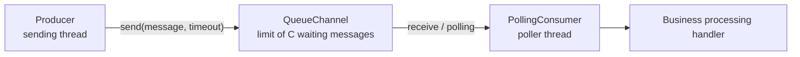

# Queue capacity

In the **Queue and pollable channel** chapter of the **SPRING_INTEGRATION_CORE** module, this lesson explains how to bound the number of waiting messages in a `QueueChannel`. This decision directly affects memory, producer wait time, and how the system responds when downstream slows down.

An order-ingestion system might receive 500 messages/second during a peak burst while the processing service completes only 300 messages/second. A queue absorbs that mismatch for a window of time; if the condition persists, the system still needs to reduce ingestion or increase processing capacity.

## 1. Goals and prerequisites

After this lesson, you can:

- Distinguish capacity, waiting message count, and in-flight message count.
- Predict send behavior when the queue is full and receive behavior when the queue is empty.
- Configure a bounded `QueueChannel` with a polling endpoint using Java DSL.
- Estimate capacity from traffic bursts, memory budget, and allowed wait time.
- Choose a handling policy when no more messages can be admitted into the queue.

You should know that `Message<T>` carries a payload and headers, `MessageChannel` provides the send operation, and `PollableChannel` adds `receive()` for active message retrieval by consumers. Examples use `spring-integration-core` and Spring Context APIs; a Spring Boot project can use the Integration starter to provide the corresponding dependencies. No message broker is required for the in-memory queue examples below. The active-receive contract is described in the [PollableChannel API](https://docs.spring.io/spring-framework/docs/current/javadoc-api/org/springframework/messaging/PollableChannel.html).

## 2. What does capacity limit?

**Queue capacity** is the maximum number of messages that can wait in the queue. With standard instantiation:

```java
QueueChannel orderQueue = new QueueChannel(200);
```

The value `200` is measured in **messages**, not bytes, milliseconds, or worker count. The constructor taking capacity requires a positive integer. If you need a handoff mechanism with no buffer, use `RendezvousChannel` instead of passing `0` to this constructor. The `new QueueChannel()` constructor uses a limit of `Integer.MAX_VALUE`, which is commonly treated as practically unbounded. These constructor rules are documented in the [QueueChannel API](https://docs.spring.io/spring-integration/api/org/springframework/integration/channel/QueueChannel.html).

With capacity `C = 200`:

- Queue currently holds 150 messages: 50 slots remain for new messages.
- Queue currently holds 200 messages: the producer must apply a waiting policy or fail to send.
- A consumer takes one message out: that slot is freed, even while the handler is still processing the retrieved message.

Therefore, a queue with capacity 200 can still be accompanied by many messages currently in flight outside the queue. When sizing resources for the entire flow, add waiting messages, in-flight messages, and buffers at downstream endpoints.



A standard `QueueChannel` has point-to-point semantics: multiple consumers can compete to receive messages, and each receive delivers a message to one consumer. By default the queue dequeues in FIFO order, though multiple consumers can finish work out of dequeue order. See [Message Channel Implementations](https://docs.spring.io/spring-integration/reference/channel/implementations.html#channel-implementations-queuechannel).

### Capacity is not an absolute memory budget

Two queues with the same capacity of 200 can retain vastly different amounts of data. A queue holding short order IDs differs from a queue holding image `byte[]` arrays or large object graphs.

An initial estimate for an in-memory queue:

```text
Memory retained by queue ≈ waiting message count × additional retained memory per message
```

The per-message figure must include payload, headers, wrapper objects, and queue structure overhead. You cannot simply take a JSON size and treat it as exact heap cost. Shared references across messages can also throw off a simple multiplication.

If you assume each message retains an average of 8 KiB, 2,000 messages correspond to roughly 15.6 MiB. These are hypothetical numbers for illustration; measure with real payloads and leave headroom for the rest of the application.

## 3. Sending messages when the queue is full

For a standard queue without custom interceptors, a direct `send` call returns a `boolean` indicating whether the send was accepted. The timeout parameter is in milliseconds. The send timeout contract is described in the [MessageChannel API](https://docs.spring.io/spring-framework/docs/current/javadoc-api/org/springframework/messaging/MessageChannel.html).

| Call on QueueChannel | When space is available | When the queue is full |
| --- | --- | --- |
| `send(message)` | Enqueues message, returns `true` | Waits until space is available; no wait time limit |
| `send(message, 0)` | Enqueues message, returns `true` | Does not wait for space, returns `false` |
| `send(message, 200)` | Enqueues message, returns `true` | Waits for space up to 200 ms; if time expires without sending, returns `false` |
| `send(message, -1)` | Enqueues message, returns `true` | Waits indefinitely like the call without a timeout |

Actual observed duration is also affected by thread scheduling and other JVM activity. Send timeout is not a deadline for business completion.

This example ignores a critical return value:

```java
orderQueue.send(message, 0);
```

If the queue is full, the caller keeps running even though the message was not accepted. You must handle the result explicitly:

```java
boolean accepted = orderQueue.send(message, 200);

if (!accepted) {
    throw new IllegalStateException(
            "Unable to accept more orders within the allowed time");
}
```

`IllegalStateException` here is an illustrative choice for the application. At a real ingestion boundary, you can use a business result or a dedicated exception type so callers know the request was not accepted.

### Three concepts to keep separate

**Queued:** `send()` returned `true`.

**Processed:** the handler has finished the business task; this happens after receiving the message.

**Durably stored:** data can be recovered after a crash; the default in-memory queue does not provide this guarantee.

If the application layer sends through `MessagingTemplate` or a gateway, check that layer's contract. Timeouts and send failures may be represented as exceptions instead of returning the channel's raw `boolean`. Do not infer gateway behavior from a direct `QueueChannel.send()` call. Template timeout settings are covered in the [GenericMessagingTemplate API](https://docs.spring.io/spring-framework/docs/current/javadoc-api/org/springframework/messaging/core/GenericMessagingTemplate.html).

## 4. Observing capacity with a standalone Java example

The following snippet does not require starting a Spring context. It creates a queue with two slots and runs sequentially so results are easy to observe. All timeouts are `0` so the program does not block waiting for a message or for queue space.

```java
import org.springframework.integration.channel.QueueChannel;
import org.springframework.messaging.Message;
import org.springframework.messaging.support.GenericMessage;

public class QueueCapacityDemo {

    public static void main(String[] args) {
        QueueChannel queue = new QueueChannel(2);

        Message<String> first = new GenericMessage<>("ORDER-001");
        Message<String> second = new GenericMessage<>("ORDER-002");
        Message<String> third = new GenericMessage<>("ORDER-003");

        System.out.println(queue.send(first, 0));   // true
        System.out.println(queue.send(second, 0));  // true

        System.out.println(queue.getQueueSize());          // 2
        System.out.println(queue.getRemainingCapacity());  // 0

        System.out.println(queue.send(third, 0));   // false

        Message<?> received = queue.receive(0);
        if (received == null) {
            throw new IllegalStateException("Example must receive ORDER-001");
        }
        System.out.println(received.getPayload()); // ORDER-001

        System.out.println(queue.send(third, 0));   // true

        Message<?> next;
        while ((next = queue.receive(0)) != null) {
            System.out.println(next.getPayload());
        }

        System.out.println(queue.getQueueSize());  // 0
        System.out.println(queue.receive(0));       // null
    }
}
```

Sequence of queue states:

| Operation | Result | Queue contents after operation |
| --- | --- | --- |
| Send `ORDER-001` | `true` | `[ORDER-001]` |
| Send `ORDER-002` | `true` | `[ORDER-001, ORDER-002]` |
| Send `ORDER-003` when full | `false` | `[ORDER-001, ORDER-002]` |
| Receive one message | `ORDER-001` | `[ORDER-002]` |
| Resend `ORDER-003` | `true` | `[ORDER-002, ORDER-003]` |

An unsuccessful send does not automatically evict an older message or route the new message into another queue. The application still holds the `third` object and explicitly resends it once space is available.

On the receiving side, `receive(0)` returns `null` if the queue is empty; `receive(timeout)` can wait for a message, while `receive()` sets no wait time limit. Do not place an unbounded receive call at the end of an example when no producer is active. See the [PollableChannel receive contract](https://docs.spring.io/spring-framework/docs/current/javadoc-api/org/springframework/messaging/PollableChannel.html).

## 5. Configuring a queue and endpoint with Java DSL

A queue stores messages but does not automatically create workers to process them. In Spring Integration, an endpoint pulling from a `PollableChannel` needs a poller configuration, either directly on the endpoint or via the context default poller. The example below attaches the poller directly so the behavior is easy to pinpoint. The relationship between channel types and endpoint types is explained in [Message Endpoints](https://docs.spring.io/spring-integration/reference/endpoint.html).

```java
import java.time.Duration;

import org.springframework.beans.factory.annotation.Qualifier;
import org.springframework.context.annotation.Bean;
import org.springframework.context.annotation.Configuration;
import org.springframework.integration.channel.QueueChannel;
import org.springframework.integration.config.EnableIntegration;
import org.springframework.integration.dsl.IntegrationFlow;
import org.springframework.integration.dsl.Pollers;
import org.springframework.messaging.support.GenericMessage;

@Configuration
@EnableIntegration
public class QueueCapacityConfig {

    @Bean
    public QueueChannel orderQueue() {
        return new QueueChannel(200);
    }

    @Bean
    public IntegrationFlow orderProcessingFlow(
            @Qualifier("orderQueue") QueueChannel orderQueue) {

        return IntegrationFlow.from(orderQueue)
                .handle(String.class, (orderId, headers) -> {
                    // Replace with actual business operation.
                    System.out.println("Processing order: " + orderId);
                    return null;
                }, endpoint -> endpoint.poller(
                        Pollers.fixedDelay(Duration.ofMillis(100))
                                .maxMessagesPerPoll(10)
                                .receiveTimeout(0)))
                .get();
    }

    @Bean
    public OrderIngress orderIngress(
            @Qualifier("orderQueue") QueueChannel orderQueue) {

        return new OrderIngress(orderQueue);
    }

    public static class OrderIngress {

        private final QueueChannel orderQueue;

        public OrderIngress(QueueChannel orderQueue) {
            this.orderQueue = orderQueue;
        }

        public boolean tryAccept(String orderId) {
            return this.orderQueue.send(
                    new GenericMessage<>(orderId), 200);
        }
    }
}
```

Spring must load this configuration into an application context for the poller to be managed and started. Simply calling `new QueueChannel(200)` in Java code does not start the example's endpoint.

The application retrieves the `OrderIngress` bean and calls `tryAccept(orderId)`. If the result is `false`, the caller needs to report that the request was not accepted or apply the designed retry policy. This bean returns the acceptance result, not the order processing result.

The handler returns `null` because it is the end of processing in this example. Printing to the console is just for observation; in a real application, replace it with a service call and proper error handling.

The three poller parameters play distinct roles:

| Setting | Role in the example |
| --- | --- |
| `fixedDelay(100 ms)` | Sets the pause between when one polling cycle completes and the next is scheduled, with the direct execution used here |
| `maxMessagesPerPoll(10)` | Allows processing at most 10 messages in one polling cycle |
| `receiveTimeout(0)` | Each receive does not wait if the queue is empty |

`maxMessagesPerPoll(10)` does not mean creating 10 workers. In this configuration, messages within a polling cycle are processed sequentially. Configuration APIs are described in [PollerSpec](https://docs.spring.io/spring-integration/api/org/springframework/integration/dsl/PollerSpec.html); fixed-delay semantics are in [Pollers](https://docs.spring.io/spring-integration/api/org/springframework/integration/dsl/Pollers.html).

## 6. Capacity and consumption rate must be designed together

Increasing capacity lets you hold more waiting work, but it does not make an HTTP call, database query, or handler run any faster.

In the Java DSL example, suppose:

- Each message takes 20 ms to process.
- One polling cycle receives a full batch of 10 messages.
- After that batch, there is a 100 ms pause.
- There is no extra executor and other overheads are ignored.

Estimate:

```text
Processing time per batch = 10 × 20 ms = 200 ms
Cycle including pause ≈ 200 ms + 100 ms = 300 ms
Consumption rate ≈ 10 / 0.3 = 33.3 messages/second
```

Therefore, you cannot calculate throughput as `10 messages / 100 ms = 100 messages/second` while ignoring processing time.

This calculation is a simplified model for the configuration shown. If you add an executor, multiple consumers, or asynchronous downstream operations, you must re-measure the entire flow.

To improve processing speed, locate the bottleneck first: handler duration, connection pool, remote service, or polling schedule. Adding consumers only helps when downstream can serve more concurrent requests; if the target resource is already saturated, more workers can increase contention and timeouts.

## 7. Choosing capacity from three constraints

No single capacity number fits every system. You can start from a simple load model, then measure and tune with real traffic.

### 7.1. Burst absorption capability

Notation:

| Symbol | Meaning |
| --- | --- |
| `C` | Capacity, in messages |
| `q0` | Number of messages waiting when the burst starts |
| `λ` | Rate at which messages arrive at the queue, messages/second |
| `μ` | Sustainable rate at which consumers pull and process messages, messages/second |
| `T` | Burst duration, seconds |

Assuming arrival and processing rates are roughly steady during the interval under review and no messages have been rejected yet:

```text
If λ > μ:
    backlog at end of burst ≈ q0 + (λ - μ) × T
    time until full ≈ (C - q0) / (λ - μ)
```

An illustrative sizing example:

```text
q0 = 200 messages
λ  = 500 messages/second
μ  = 300 messages/second
T  = 8 seconds

Additional backlog = (500 - 300) × 8 = 1,600 messages
Backlog at end of burst ≈ 200 + 1,600 = 1,800 messages
```

A capacity of 2,000 can absorb this burst under the model, leaving 200 messages of headroom. If the high rate continues:

```text
Time until full ≈ (2,000 - 200) / 200 = 9 seconds
```

This is a continuous-flow estimate. Polling schedules, simultaneous arrivals, and variable processing times can cause the queue to fill sooner.

### 7.2. Allowed wait time

When `q` messages are ahead in the queue, a rough estimate of wait time is:

```text
Wait time in queue ≈ q / μ
```

With `q = 1,800` and `μ = 300`, the wait time is around 6 seconds, before adding the processing time of that message and subsequent steps.

If the business only tolerates about 2 seconds of queuing delay:

```text
Corresponding waiting messages ≈ 300 × 2 = 600
```

Thus, needing to hold 1,800 messages during the burst conflicts with the target of waiting only about 2 seconds. Choosing capacity 2,000 solves holding the backlog in the model, but fails this latency goal.

At least one factor must change: increase processing speed, reduce ingestion, break up bursts, or adjust the business deadline. The wait-time formula is only an approximation and does not guarantee a hard maximum latency for every individual message.

### 7.3. Memory budget

Suppose we allocate at most 32 MiB for waiting data and measure an average cost of about 8 KiB/message:

```text
Memory-based limit ≈ 32 MiB / 8 KiB = 4,096 messages
```

In this example:

| Constraint | Estimate |
| --- | --- |
| Hold entire end-of-burst backlog | Needs at least about 1,800 slots |
| Memory budget | Allows about 4,096 slots based on assumed average cost |
| ~2-second wait target | Corresponds to only about 600 waiting messages |

The first two requirements can both be satisfied, but the latency requirement conflicts with the load. Do not choose a large capacity just because the heap has room.

### 7.4. Backlog drain capability

After the peak, suppose the send rate drops to 120 messages/second while the consumer still processes 300 messages/second:

```text
Backlog drain rate = 300 - 120 = 180 messages/second
Time to clear backlog ≈ 1,800 / 180 = 10 seconds
```

If the next burst arrives before the backlog clears, the queue starts the new burst with leftover messages. A short load test can mask accumulation across multiple cycles.

When the sustained average send rate exceeds the processing rate, every finite queue eventually fills up. Capacity then determines how much time the system has before it must throttle ingestion or reject additional requests.

## 8. Policies when the queue is full

A bounded queue establishes a clear limit on waiting work. For that limit to take effect, the producer must take a concrete action when a send fails.

| Policy | When to use | Design consideration |
| --- | --- | --- |
| Do not wait, use `send(message, 0)` | Caller needs fast feedback | Return a not-accepted result; never ignore `false` |
| Bounded wait | Short delay is acceptable to smooth jitter | Timeout must fit the caller's deadline |
| Bounded retry with backoff | Overload may self-recover | Bound attempts, total time, and retry rate |
| Slow down reading from source | Source supports throttling | Monitor backlog buildup at that source itself |
| Offload to durable storage | Work must survive crashes | Design ingestion ack, recovery, and deduplication |
| Intentional drop | Business allows losing certain events | Define clearly which types may be dropped and track metrics |

Do not use a tight retry loop with no backoff. It can burn CPU and increase pressure right when the system is already slow.

A standard `QueueChannel` does not automatically switch to a "drop oldest message" policy. If you want to drop messages or route them to another branch, the application must implement that behavior explicitly and understand its business consequences.

Waiting on send can be viewed as propagating backpressure to the producer at the execution-thread level. However, a bounded queue does not turn the whole flow into Reactive Streams backpressure. If producers keep spawning more threads to get past wait times, pressure shifts onto thread pools and hanging requests.

## 9. Avoiding thread deadlocks caused by capacity

A dangerous scenario:

1. A task is running on a single-threaded executor.
2. The task sends to a full queue using `send(message)`.
3. The consumer also needs that exact same executor to pull messages.
4. The sole thread is blocked waiting for space, so the consumer can never run to free space.

The bounded queue is still following its contract, yet sharing the resource prevents the entire flow from making progress.

A similar situation occurs when a producer holds a resource the consumer needs—for example, the producer holds a lock while waiting to send, and the consumer must acquire that lock before it can continue processing.

When designing a flow:

- Avoid unbounded send waits inside requests that have deadlines.
- Do not hold locks or scarce resources across a send operation that might wait for long.
- Check the relationship between executors of producers, pollers, and handlers.
- Bound the total number of in-flight requests at the ingestion boundary.

Timeouts help detect and exit a single wait; they do not fix a resource-dependency graph that causes deadlock.

## 10. Full queues, handler errors, and durability

The following three scenarios each need distinct handling.

### 10.1. Queue cannot accept a new message

With direct calls in the examples, `send(message, timeout)` returns `false` if the message cannot be placed into the queue within the wait window. This is an admission decision at the producer.

Do not assume a `false` return automatically generates an `ErrorMessage` sent to `errorChannel`. The producer must check the result and decide how to respond.

### 10.2. Queue accepted the message, but the handler fails

When a handler invoked by the poller on another thread throws an exception, that exception cannot unwind back into the already-completed `send()` call. Spring Integration has a mechanism to convert asynchronous errors into `ErrorMessage` instances via an error channel; the application must configure an appropriate error-handling branch. See [Error Handling](https://docs.spring.io/spring-integration/reference/error-handling.html).

A standard in-memory queue also does not automatically put a dequeued message back into the queue just because the handler failed. If retry or recovery is needed, you must explicitly design retry scope and duplicate-handling conditions.

### 10.3. Process stops while messages are waiting

The default queue holds messages in process memory. Finite capacity controls backlog size, but does not guarantee crash recovery.

Spring Integration supports queues backed by a message store, where storage and transactions have their own rules. Do not copy in-memory queue capacity assumptions verbatim onto a persistent store configuration; for example, the XML `capacity` attribute cannot be used alongside `message-store` on `<queue>`. See [Persistent QueueChannel Configuration](https://docs.spring.io/spring-integration/reference/channel/configuration.html#channel-configuration-queuechannel).

If you run three instances, each with its own `new QueueChannel(200)`, they have three separate buffers in three processes. That is not a shared queue capable of automatically shifting messages from a full instance to an idle instance.

## 11. Monitoring capacity in operations

Queue depth reflects only part of processing health. Observe these together:

| Metric | What it reveals |
| --- | --- |
| Waiting message count | Current backlog |
| Fill ratio | Headroom before admission limit |
| Inbound and outbound rates | Whether the queue is accumulating or draining |
| Failed send count | Number of requests not admitted |
| Send wait duration | Delay experienced by producers |
| Time spent in queue | Pre-processing latency |
| Handler duration and error count | Actual downstream capability |
| Heap, GC, and active threads | Resource cost across the whole application |

For a queue with a configured capacity:

```text
Fill ratio = waiting message count / configured capacity
```

`getQueueSize()` and `getRemainingCapacity()` help inspect the queue. However, in a multithreaded environment, observed values can change right before the next send. Never use a "check for space then assume the send will definitely succeed" pattern. Only the `send()` call itself decides whether the message is accepted at the moment of operation. Pre-checking under concurrency is also discussed in the [BlockingQueue.remainingCapacity API](https://docs.oracle.com/en/java/javase/21/docs/api/java.base/java/util/concurrent/BlockingQueue.html#remainingCapacity()).

A queue with few messages while handlers are frequently stuck on a remote service can still violate business deadlines. Conversely, a queue that spikes and then drains completely after each burst may be performing its intended burst-absorption role.

You can set alerts when the fill ratio exceeds a threshold over a time window, but thresholds should be grounded in backlog growth rate and allowed deadlines. A single metric sample is not enough to conclude that capacity must be increased.

## 12. Common misconceptions

| Misconception | Correct understanding and handling |
| --- | --- |
| Larger capacity means higher throughput | Measure consumer processing capacity; a larger queue mostly increases how much work can wait |
| `new QueueChannel()` automatically protects the heap | Set an explicit bound and measure the memory of real payloads |
| Capacity 0 is a valid non-storing queue | The capacity constructor requires a positive integer; look at `RendezvousChannel` when handoff is needed |
| When full, old messages are automatically dropped | Choose an overload policy at the producer or a component with explicitly designed eviction behavior |
| `maxMessagesPerPoll` is the worker count | It is the cap on messages processed in a single polling cycle |
| `send()` returning `true` means business work is done | Design processing results, replies, or completion events separately |
| Small enough queue needs no send timeout | Set timeouts based on the caller's deadline and resources |
| A FIFO queue guarantees all tasks finish in order | Account for consumer count and execution time of each task |

## 13. Practice: designing admission limits

Practice in a test project; no broker is needed for steps using in-memory queues.

### Step 1: Observe a full queue with no consumer

Use the `QueueCapacityDemo` example with capacity 2.

Expected outcome: the first two messages are accepted; the third returns `false`; after receiving one message, resending the third succeeds. The two existing messages are not evicted to make room.

### Step 2: Observe a finite timeout

Create a `QueueChannel(1)`, fill the queue, then send another message with a 100 ms timeout and no running consumer.

Expected outcome: the second send is not accepted and returns `false` after roughly the corresponding wait. Do not assert that the measured time is always exactly 100 ms; the first message remains in the queue.

### Step 3: Observe queue and poller working together

Load `QueueCapacityConfig` into a Spring context, use a smaller capacity such as 5, and replace the handler with an operation having a controllable delay in the test environment. Send more messages than can be processed immediately.

Record how many times `tryAccept()` returns `true`, how many times it returns `false`, send durations, and queue depth. Do not hardcode an expected rejection count because the poller can dequeue messages interleaved with the producer.

### Step 4: Demonstrate that increasing capacity does not fix insufficient processing throughput

Keep the handler and poller unchanged, and test a smaller capacity followed by a larger one against the same sufficiently long load sequence.

Observe when failed sends begin, backlog levels, and pre-processing latency. A larger capacity usually delays when the queue fills and lets more work wait; if the source remains faster than the consumer, admission limits will still be hit.

### Step 5: Document the decision for a real flow

For an order-ingestion or data-sync flow, write down:

- Normal send rate, peak rate, and burst duration.
- Measured processing rate under the current poller configuration.
- Memory cost per message and acceptable wait time.
- Chosen capacity along with the assumptions used to compute it.
- Action when a send fails and who is responsible for retrying.
- Crash-recovery requirements and behavior when the handler fails.

A complete decision needs to explain both admission limits and how work is handled after entering the queue.
