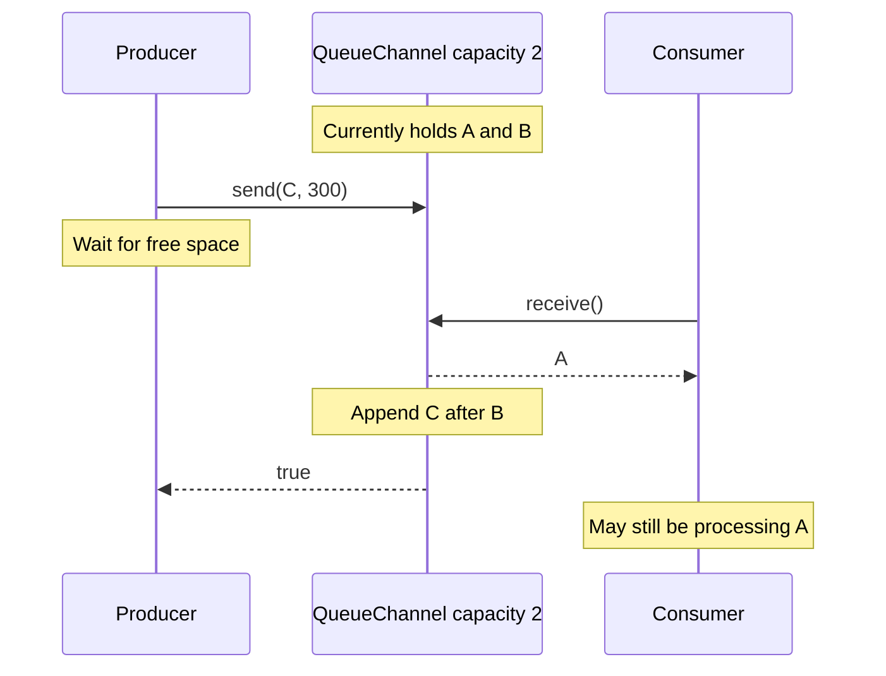

# Send timeout in QueueChannel

In the **Queue and pollable channel** chapter of the `SPRING_INTEGRATION_CORE` module, this lesson explains how to bound how long a producer waits to place a `Message` into a queue. This is part of designing message flows with channels, endpoints, gateways, and Java DSL: a queue decouples send rate from processing rate, yet the producer still needs to decide what to do when the queue has no room left.

After this lesson, you can choose timeout values, handle send results, and configure wait limits at the right component. The examples use an in-memory `QueueChannel` with finite capacity; do not generalize all of its behaviors to channels backed by custom queues or persistent message stores.

## 1. Which stage does send timeout bound?

Consider a report-export request ingestion flow:

```text
Producer --send(message, timeout)--> QueueChannel --> Polling consumer
                                                        |
                                                        v
                                                Create report
```

There are three distinct points in time:

1. The producer begins calling `send`.
2. The channel admits the message into the queue.
3. The consumer pulls the message out and performs business work.

**Send timeout bounds waiting to send at the channel.** For a full bounded queue, that is the wait time for space to add the message. A successful `send` confirms placing the message into the queue; it does not confirm that the report has been created. [Reference on QueueChannel behavior](https://docs.spring.io/spring-integration/reference/channel/implementations.html).

Illustrative scenario in this lesson: a queue with capacity 2 currently holds `A` and `B`; the producer wants to send `C` with a 300 ms timeout.



If no consumer pulls a message out during the wait window, sending `C` can expire and return `false`. Message `C` was not added to the queue by that send. Increasing the timeout only gives the producer a chance to wait longer; it does not make the consumer process faster.

## 2. API and meaning of each value

`MessageChannel` provides two send methods:

```java
boolean send(Message<?> message);
boolean send(Message<?> message, long timeout);
```

The `timeout` parameter is in **milliseconds**. For a `QueueChannel` created with `new QueueChannel(capacity)`, use the following conventions:

| Call | When queue is full | Common purpose |
| --- | --- | --- |
| `send(message, 0)` | Try sending immediately, do not wait for space | Fail fast on overload |
| `send(message, 200)` | Wait for space up to a 200 ms budget | Absorb a short stall |
| `send(message, MessageChannel.INDEFINITE_TIMEOUT)` | Wait with no predetermined deadline | Use only when holding the sending thread is acceptable |
| `send(message)` | May wait indefinitely | Requires care with a bounded queue |

`MessageChannel.INDEFINITE_TIMEOUT` has the value `-1`. When the queue has room, it does not wait out the timeout before sending: the timeout is a wait limit, not a mandatory delay. [MessageChannel contract](https://docs.spring.io/spring-framework/docs/current/javadoc-api/org/springframework/messaging/MessageChannel.html).

Do not use `0` thinking it means "wait forever." That mistake can cause the application to reject batches of messages as soon as a traffic spike happens.

At the implementation level for queues supporting blocking, the branches correspond to immediate try-add, timed add, and potentially unbounded waiting add. If the thread is interrupted while waiting, `QueueChannel` returns `false` and restores the interrupt flag. Therefore, `false` alone does not prove the entire timeout elapsed. [QueueChannel source code](https://raw.githubusercontent.com/spring-projects/spring-integration/main/spring-integration-core/src/main/java/org/springframework/integration/channel/QueueChannel.java).

## 3. Minimal example: full queue and retry sending

The following example only needs `spring-integration-core` and its Spring dependencies. It uses the channel directly without creating an application context or poller.

```java
import org.springframework.integration.channel.QueueChannel;
import org.springframework.messaging.Message;
import org.springframework.messaging.support.MessageBuilder;

public class SendTimeoutDemo {

    public static void main(String[] args) {
        QueueChannel channel = new QueueChannel(1);

        Message<String> first = MessageBuilder
                .withPayload("report-001")
                .build();
        Message<String> second = MessageBuilder
                .withPayload("report-002")
                .build();

        boolean firstAccepted = channel.send(first, 0);
        boolean secondAccepted = channel.send(second, 100);

        System.out.println(firstAccepted);  // true
        System.out.println(secondAccepted); // false: nobody has taken first out yet

        Message<?> received = channel.receive(0);
        System.out.println(received.getPayload()); // report-001

        boolean acceptedAfterReceive = channel.send(second, 0);
        System.out.println(acceptedAfterReceive); // true
    }
}
```

In this scenario, the second send does not automatically replace the first message. Only after `receive(0)` takes the first message out can the producer insert the second message.

The example also shows that a queue holds messages on its own without an active consumer. If you rerun with `new QueueChannel(2)`, both initial sends succeed; expected results then change with capacity.

## 4. Handling the result on the producer side

With direct calls, never ignore the `boolean` return value:

```java
// Easy to lose track of rejected requests if result is not checked.
reportRequests.send(message, 200);
```

A clearer way to express it is to bring the acceptance outcome into the application contract:

```java
import org.springframework.messaging.MessageChannel;
import org.springframework.messaging.support.MessageBuilder;

public final class ReportSubmissionService {

    public enum SubmissionResult {
        ACCEPTED,
        NOT_ACCEPTED,
        INTERRUPTED
    }

    private final MessageChannel requests;

    public ReportSubmissionService(MessageChannel requests) {
        this.requests = requests;
    }

    public SubmissionResult submit(String requestId) {
        var message = MessageBuilder.withPayload(requestId)
                .setHeader("requestId", requestId)
                .build();

        boolean accepted = this.requests.send(message, 200);

        if (accepted) {
            return SubmissionResult.ACCEPTED;
        }
        if (Thread.currentThread().isInterrupted()) {
            return SubmissionResult.INTERRUPTED;
        }
        return SubmissionResult.NOT_ACCEPTED;
    }
}
```

In this example, `ACCEPTED` only means the system accepted the message into the channel. `NOT_ACCEPTED` lets the caller decide whether to return an overload response, record it for reprocessing, or apply another policy. The `INTERRUPTED` branch preserves the stop signal; do not call `Thread.interrupted()` merely to check, because that method clears the interrupt flag.

Runtime errors can still be thrown, such as from validation or interceptors. Do not lump every exception into "queue full": handling configuration errors differs from handling overload. [Message sending API](https://docs.spring.io/spring-framework/docs/current/javadoc-api/org/springframework/messaging/MessageChannel.html), [channel interceptor infrastructure](https://docs.spring.io/spring-integration/api/org/springframework/integration/channel/AbstractMessageChannel.html).

## 5. Configuring QueueChannel and consumer with Java DSL

Capacity is configured on the channel; send timeout is chosen where the send operation happens. These two decisions are related, but they are not the same property.

```java
import java.time.Duration;

import org.springframework.context.annotation.Bean;
import org.springframework.context.annotation.Configuration;
import org.springframework.integration.channel.QueueChannel;
import org.springframework.integration.config.EnableIntegration;
import org.springframework.integration.dsl.IntegrationFlow;
import org.springframework.integration.dsl.Pollers;

@Configuration
@EnableIntegration
public class ReportFlowConfiguration {

    @Bean
    public QueueChannel reportRequests() {
        return new QueueChannel(20);
    }

    @Bean
    public IntegrationFlow reportFlow(QueueChannel reportRequests) {
        return IntegrationFlow.from(reportRequests)
                .handle(String.class, (requestId, headers) -> {
                    // Replace with the report-generation service call in the application.
                    System.out.println("Processing " + requestId);
                    return null; // End of one-way flow.
                }, endpoint -> endpoint.poller(
                        Pollers.fixedDelay(Duration.ofMillis(50))
                                .receiveTimeout(0)
                                .maxMessagesPerPoll(5)))
                .get();
    }
}
```

This is a standalone configuration to import into a Spring context; the application needs `spring-integration-core`. The consumer is a polling endpoint because the input is a `PollableChannel`. Java DSL provides `Pollers` to configure schedules and polling properties. [Channel configuration](https://docs.spring.io/spring-integration/reference/channel/configuration.html), [Pollers in Java DSL](https://docs.spring.io/spring-integration/reference/dsl/java-pollers.html).

In the example configuration:

- Capacity 20 limits the number of messages currently sitting in the queue.
- `fixedDelay(50 ms)` controls the pause between polling cycles.
- `receiveTimeout(0)` makes the receive operation not wait when the queue is empty.
- `maxMessagesPerPoll(5)` caps the number of messages in one poll cycle; it does not create five parallel consumers.

The producer still must call `reportRequests.send(message, 200)` or use a sending component configured with a timeout. Setting `receiveTimeout(0)` on the poller does not automatically make the producer switch to non-waiting sends.

The queue decrements its element count as soon as the consumer takes a message out. Therefore, a capacity of 20 does not mean the entire system has at most 20 unfinished jobs: there may also be work currently being processed by consumers.

## 6. Using MessagingTemplate: send failure becomes an exception

When sending through `MessagingTemplate`, the call contract differs from calling `MessageChannel.send` directly:

```java
import org.springframework.integration.channel.QueueChannel;
import org.springframework.integration.core.MessagingTemplate;
import org.springframework.messaging.MessageDeliveryException;
import org.springframework.messaging.support.MessageBuilder;

QueueChannel channel = new QueueChannel(1);
channel.send(MessageBuilder.withPayload("existing-report").build(), 0);

MessagingTemplate template = new MessagingTemplate();
template.setSendTimeout(150);

try {
    template.send(channel,
            MessageBuilder.withPayload("new-report").build());
} catch (MessageDeliveryException ex) {
    // Example with no consumer: queue remains full after the send wait.
    System.out.println("Request was not accepted by the channel");
}
```

The snippet above is an illustrative body to place inside a method. `template.send(...)` returns `void`; when the underlying channel send returns `false`, the template throws `MessageDeliveryException`. Where you use a template, handle the exception according to application policy instead of expecting a `boolean` return. [MessagingTemplate API](https://docs.spring.io/spring-integration/api/org/springframework/integration/core/MessagingTemplate.html), [GenericMessagingTemplate implementation](https://raw.githubusercontent.com/spring-projects/spring-framework/main/spring-messaging/src/main/java/org/springframework/messaging/core/GenericMessagingTemplate.java).

A message having a `sendTimeout` header does not mean every channel automatically reads that header. With a template, a timeout header can override the default value according to the template's mechanism; whereas a direct call `channel.send(message, 150)` uses the passed timeout argument. Setting the timeout at the sending site avoids confusion about which component actually enforces it. [Template timeout mechanism](https://raw.githubusercontent.com/spring-projects/spring-framework/main/spring-messaging/src/main/java/org/springframework/messaging/core/GenericMessagingTemplate.java).

## 7. Gateway: distinguishing request timeout and reply timeout

A gateway can hide the messaging API from business code, yet it still needs a wait limit for sending into the request channel:

```java
import org.springframework.integration.annotation.MessagingGateway;

@MessagingGateway(
        defaultRequestChannel = "reportRequests",
        defaultRequestTimeout = "200")
public interface ReportGateway {
    void submit(String requestId);
}
```

The application must register the gateway, for example with `@IntegrationComponentScan` on a configuration class in the appropriate package. `defaultRequestTimeout` applies to a potentially blocking request send, such as when the request channel is a full queue. A `void` method expresses a one-way flow; returning normally does not confirm the report has finished. [MessagingGateway API](https://docs.spring.io/spring-integration/api/org/springframework/integration/annotation/MessagingGateway.html).

For a gateway that returns a business result, you need a consumer that produces a reply and preserves reply correlation info. In that case:

| Limit | What is being waited for |
| --- | --- |
| Request/send timeout | Getting the request sent into the channel |
| Reply timeout | Receiving the reply message |
| HTTP/DB call timeout in consumer | Completion of the corresponding library call |

`defaultReplyTimeout` configures how long the gateway waits for a reply. It does not automatically turn request timeout into a limit for every step of the flow. [Gateway timeout attributes](https://docs.spring.io/spring-integration/api/org/springframework/integration/annotation/MessagingGateway.html).

Illustrative example: sending to the queue takes 120 ms, then the consumer takes 2 seconds to generate the report. A 200 ms send timeout still satisfies the send step. If the business needs completion within 1 second, the design must allocate separate budgets for processing and reply.

## 8. Backpressure and choosing a wait budget

A bounded queue paired with send timeout creates a point where overload surfaces: the producer must wait or receive a not-accepted outcome. From there the application can throttle send rate. However, timeouts do not reduce incoming external traffic on their own; a policy is needed at the caller layer.

A hypothetical design scenario:

- The producer generates 100 requests per second.
- The consumer processes an average of only 60 requests per second.
- The queue has capacity 200 and starts empty.

If rates stay steady with no rejections and ignoring jitter, the backlog grows by about 40 messages per second; the queue hits its limit after roughly `200 / 40 = 5` seconds. This is a design-reasoning estimate, not a performance guarantee of Spring Integration.

Increasing send timeout from 200 ms to 5 seconds does not fix a sustained rate mismatch. It can keep more producer threads blocked longer. Increasing capacity only extends the time before the queue fills and can increase queuing delay.

Derive the wait budget from the caller's requirements. For example, suppose the desired total response time is 500 ms, with the ingress layer budgeting 100 ms for validation and message creation and 50 ms for building the response. Choosing a 200 ms send timeout leaves a margin for jitter. These numbers must be measured and adjusted in the concrete application.

Send timeout is also not a hard stopwatch for the entire method. Observed duration is also affected by thread scheduling and work such as interceptors before or after the queue operation. Do not use it to assume every call will finish at the exact configured timestamp. [Interceptor-capable channels](https://docs.spring.io/spring-integration/api/org/springframework/integration/channel/AbstractMessageChannel.html).

## 9. Retries, errors, and reliability

When a direct send to a standard queue returns `false` because waiting for space timed out, that message was not added by that send. The application must retain enough context to reject cleanly or retry. A tight loop calling `send(message, 0)` repeatedly can burn CPU and add pressure while the consumer is already overloaded.

If retrying, bound attempt count, total elapsed time, and backoff together; add jitter when multiple producers may retry simultaneously. For critical business work, one architectural option is persisting the request durably and reprocessing in a controlled manner. These are application policies, not built-in behaviors of `send`.

Send errors and consumer errors belong to two distinct stages:

```text
send returns false --> Producer handles unaccepted request

send returns true  --> Message entered the queue
                         |
                         v
                  Consumer pulls it out
                         |
                         v
                  Business logic may fail
```

Do not assume that `send` returning `false` causes Spring to route the message to `errorChannel`. Nor should you treat a successful enqueue as an exactly-once processing guarantee. If a producer times out in an outer layer while inner ingestion already occurred, retrying the entire request can create duplicates; use a business key and appropriate idempotency mechanisms.

The default `QueueChannel` stores in memory. Surviving process crashes requires a dedicated storage design; configuring timeouts does not provide persistence or automatically put a dequeued message back into the queue. [QueueChannel and persistent storage](https://docs.spring.io/spring-integration/reference/channel/configuration.html).

## 10. Testing send behavior

The JUnit 5 examples below are practice code for learners. They verify outcomes and queue contents rather than asserting millisecond-exact clocks.

```java
import org.junit.jupiter.api.Test;
import org.springframework.integration.channel.QueueChannel;
import org.springframework.messaging.Message;
import org.springframework.messaging.support.MessageBuilder;

import static org.junit.jupiter.api.Assertions.*;

class QueueSendTimeoutTest {

    private Message<String> message(String payload) {
        return MessageBuilder.withPayload(payload).build();
    }

    @Test
    void rejectsImmediatelyWhenQueueIsFull() {
        QueueChannel channel = new QueueChannel(1);
        Message<String> first = message("A");
        Message<String> second = message("B");

        assertTrue(channel.send(first, 0));
        assertFalse(channel.send(second, 0));

        assertSame(first, channel.receive(0));
        assertNull(channel.receive(0));
    }

    @Test
    void rejectsAfterBoundedWaitWhenNobodyReceives() {
        QueueChannel channel = new QueueChannel(1);
        Message<String> first = message("A");

        assertTrue(channel.send(first, 0));
        assertFalse(channel.send(message("B"), 40));

        assertSame(first, channel.receive(0));
        assertNull(channel.receive(0));
    }

    @Test
    void acceptsAnotherMessageAfterSpaceIsReleased() {
        QueueChannel channel = new QueueChannel(1);
        Message<String> first = message("A");
        Message<String> second = message("B");

        assertTrue(channel.send(first, 0));
        assertSame(first, channel.receive(0));

        assertTrue(channel.send(second, 100));
        assertSame(second, channel.receive(0));
    }
}
```

The second test has no consumer, so the queue cannot free space on its own. The third test checks sending after space is released, not waking up a blocked producer. When adding multithreaded practice for that scenario, use proper synchronization and test-suite deadlines, avoiding relying solely on `Thread.sleep` to guess which step a thread has reached.

Additional cases worth observing in an application are the template throwing an exception on failed sends and task cancellation while a producer is waiting. Do not write a test that intentionally calls `send(message)` on a full queue on the main test thread without a release or cancellation mechanism: the test can hang indefinitely.

## 11. Misconceptions to avoid

| Claim | Correct understanding in this lesson |
| --- | --- |
| Timeout 0 means wait forever | Timeout 0 tries sending immediately |
| `send` succeeding means business work is done | For QueueChannel, the message was placed into the queue |
| Having a `sendTimeout` header means channels always apply it | Check which component reads the header; templates have their own mechanism |
| Poller having receive timeout gives producer a send timeout | Both sides configure two separate operations |
| Queue is async so producer can never block | Producers can still wait when the queue is full |
| When queue has space, it still waits the full timeout | Messages can be added immediately |
| Increasing timeout fixes insufficient processing throughput | Adjust incoming load, consumers, or overload policy |
| Switching to DirectChannel still stops handler at send timeout | Do not use that parameter as a synchronous handler cancellation mechanism |

The last point is especially important during architectural changes: `DirectChannel` invokes the handler on the sending thread, unlike the enqueue step of `QueueChannel`. The send timeout parameter is not a mechanism to forcibly abort a running handler. [DirectChannel](https://docs.spring.io/spring-integration/reference/channel/implementations.html).

## 12. Self-check practice

1. Run the capacity-1 example and explain why the second send fails.
2. Change capacity to 2 and predict the outcome before running.
3. Replace the positive timeout with 0; observe the same rejection when the queue is full but a different waiting policy.
4. Route the send operation through `MessagingTemplate`, handling `MessageDeliveryException` instead of a `boolean` return.
5. Integrate a consumer with Java DSL and track how many sends are not accepted as load increases.
6. State three separate budgets: waiting to enter the queue, waiting for a reply, and calling external services.

For a real flow, record send durations, unaccepted counts, queue depth, and consumer processing times. Read those metrics together to decide whether to adjust timeout, capacity, or processing capacity; a single timeout number does not fully explain a bottleneck.
