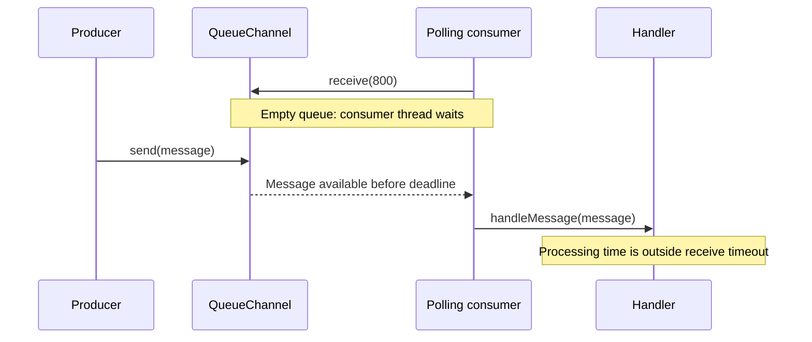

# Receive timeout in Queue and pollable channel

In Spring Integration Core, `receive timeout` is the duration a receiver is willing to wait to pull a `Message` from a `PollableChannel` when no message is ready yet. Understanding this parameter accurately helps you design message flows with suitable latency, allocate execution threads properly, and avoid confusing waiting for data with processing data.

This lesson belongs to the **Queue and pollable channel** chapter and focuses on `QueueChannel` backed by an in-memory queue and polling endpoints consuming from it. Examples use Spring Integration APIs and Java DSL; the project needs `spring-integration-core` with a consistently managed version, such as via Spring Boot dependency management.

## 1. Where receive timeout sits in a message flow

A producer builds a message and sends it to a `QueueChannel`. A consumer pulls the message out before passing it to a transformer, router, filter, service activator, or another processing component.



With `QueueChannel`, each message is pulled by a single consumer, even when multiple consumers read from the same channel. If the queue already contains data, the receive operation can return immediately; the timeout parameter only applies to waiting when no data is available yet. This queue behavior is described in the [Message Channel Implementations documentation](https://docs.spring.io/spring-integration/reference/channel/implementations.html).

Self-constructed example: an order-processing flow calls `receive(800)`, and an order arrives after about 120 ms. The consumer can receive that order then; it does not have to wait the full 800 ms. If processing the order then takes 2 seconds, the 800 ms value does not interrupt the handler either.

## 2. Meaning of the receive call variants

`PollableChannel` belongs to the `org.springframework.messaging` package. The two calls to distinguish are:

```java
Message<?> receive();
Message<?> receive(long timeout);
```

For a standard `QueueChannel`:

| Call | If queue is empty | If a message is received |
| --- | --- | --- |
| `receive(0)` | Returns `null` immediately, does not wait for data | Returns the message |
| `receive(300)` | Waits up to roughly 300 ms for data | Returns immediately as soon as a message is retrieved |
| `receive(-1)` | Waits indefinitely until data arrives or thread is interrupted | Returns when a message is retrieved |
| `receive()` | Waits indefinitely, same as negative values | Returns when a message is retrieved |

The unit of `long timeout` is **milliseconds**. Any negative value denotes an indefinite wait, not only `-1`. `AbstractPollableChannel` allows returning `null` when the wait expires or when the receiving thread is interrupted. See the [AbstractPollableChannel Javadoc](https://docs.spring.io/spring-integration/api/org/springframework/integration/channel/AbstractPollableChannel.html).

"Do not wait" in `receive(0)` means not waiting for a message to appear. The call still incurs execution cost, internal locking, and interceptors; do not interpret it as an operation of literally zero duration. Likewise, a finite timeout is not a hard real-time guarantee for the entire call under all system conditions.

### 2.1. Receiving directly and handling missing data

```java
import org.springframework.integration.channel.QueueChannel;
import org.springframework.messaging.Message;
import org.springframework.messaging.support.MessageBuilder;

public class ReceiveTimeoutDemo {

    public static void main(String[] args) {
        QueueChannel orders = new QueueChannel(10);

        Message<?> absent = orders.receive(0);
        System.out.println(absent == null); // true: queue is empty

        boolean accepted = orders.send(
                MessageBuilder.withPayload("order-101").build(), 0);
        if (!accepted) {
            throw new IllegalStateException("Failed to enqueue order");
        }

        Message<?> received = orders.receive(500);
        if (received != null) {
            System.out.println(received.getPayload()); // order-101
        }

        Message<?> noNextOrder = orders.receive(100);
        if (noNextOrder == null) {
            System.out.println("No next order received yet");
        }
    }
}
```

The example sends a message before receiving, so `receive(500)` does not need to wait the full 500 ms. The final call uses a finite wait so the program can continue if no new order arrives.

Never call `getPayload()` before checking the receive result. `null` indicates no message was received; it is not a `Message` with an empty payload.

## 3. Distinguishing commonly confused timeouts

| Configuration | Question it answers | What cannot be inferred |
| --- | --- | --- |
| `queue.receive(timeout)` | How long does the consumer wait to pull one message? | That the handler will finish within that window |
| `queue.send(message, timeout)` | How long does the producer wait to insert a message when the queue is full? | That the consumer has processed it successfully |
| Poller `receiveTimeout` | Which wait duration does each receive call of the polling consumer use? | That an entire poll cycle lasts only that long |
| Gateway reply wait | How long does the caller wait for a request/reply flow's response? | That downstream work was cancelled when the caller timed out |
| HTTP/JDBC or business library timeout | How is a specific I/O operation timed out? | That the queue automatically enforces the same limit |

This table is a design-analysis tool: each wait duration belongs to a different boundary. To bound end-to-end time from request arrival to response, design a time budget for the whole chain.

For example, a gateway waits 1 second for a reply while a handler calls an external service taking up to 3 seconds. Lowering the queue's receive timeout from 500 ms to 50 ms only changes the phase spent waiting to pull the message. Cancelling or continuing the service call must be decided separately via the handler and I/O library mechanisms.

## 4. Receive timeout of a polling endpoint

When an endpoint reads from a `PollableChannel`, Spring Integration uses a `PollingConsumer` to connect the channel to a `MessageHandler`. This consumer has a default receive timeout of **1,000 ms**, per the [PollingConsumer Javadoc](https://docs.spring.io/spring-integration/api/org/springframework/integration/endpoint/PollingConsumer.html).

Keep two defaults distinct:

- Calling `queue.receive()` yourself with no arguments: may wait indefinitely when the queue is empty.
- Letting a polling endpoint use its default receive timeout: the consumer uses its finite wait duration.

Do not infer the endpoint's default configuration from the behavior of the no-argument method call.

Three parameters usually need to be considered together:

| Parameter | Role |
| --- | --- |
| Trigger, such as `fixedDelay` | Determines the start schedule of poll cycles |
| `receiveTimeout` | Wait window for data on each receive call |
| `maxMessagesPerPoll` | Cap on messages received in a single poll cycle |

According to the [Message Endpoints documentation](https://docs.spring.io/spring-integration/reference/endpoint.html), a poll cycle can receive multiple messages and ends when no data is received or the cap is reached. Therefore, do not equate one poll cycle with a single `receive()` call.

### 4.1. Complete Java DSL example

The following example declares an order queue, a transformer that normalizes order codes, and a result channel. The poller is attached to the transformer because it is the first endpoint reading from the queue.

```java
import java.time.Duration;
import java.util.Locale;

import org.springframework.context.annotation.Bean;
import org.springframework.context.annotation.Configuration;
import org.springframework.integration.channel.QueueChannel;
import org.springframework.integration.config.EnableIntegration;
import org.springframework.integration.dsl.IntegrationFlow;
import org.springframework.integration.dsl.Pollers;

@Configuration
@EnableIntegration
public class OrderFlowConfiguration {

    @Bean
    public QueueChannel orderInput() {
        return new QueueChannel(100);
    }

    @Bean
    public QueueChannel normalizedOrders() {
        return new QueueChannel(100);
    }

    @Bean
    public IntegrationFlow normalizeOrdersFlow() {
        return IntegrationFlow.from(orderInput())
                .<String, String>transform(
                        value -> value.trim().toUpperCase(Locale.ROOT),
                        endpoint -> endpoint.poller(
                                Pollers.fixedDelay(Duration.ofMillis(200))
                                        .receiveTimeout(800)
                                        .maxMessagesPerPoll(1)))
                .channel(normalizedOrders())
                .get();
    }
}
```

In a Spring application context loaded with this configuration, producers send string payloads to the `orderInput` bean; readers retrieve results from `normalizedOrders`. Java DSL provides `receiveTimeout(long)` taking milliseconds, documented in the [PollerSpec Javadoc](https://docs.spring.io/spring-integration/api/org/springframework/integration/dsl/PollerSpec.html).

The values 200 ms, 800 ms, and capacity 100 are illustrative choices. Walk through the example step by step:

1. A poll cycle starts and tries to pull one message from `orderInput`.
2. If the queue is empty, the polling thread can wait up to roughly 800 ms.
3. If a message arrives while waiting, the transformer processes it as soon as it is received.
4. Due to the limit of one message per cycle, the consumer does not pull a second order in that same cycle.
5. With a fixed-delay schedule and synchronous execution as shown here, the next cycle is scheduled after the current cycle finishes plus the delay interval.

The output channel is also a bounded queue. If there is no reader and it fills up, sending the result can block, lengthening the poll cycle. The input receive timeout does not bound that outbound send step. In real deployments, ensure an output consumer and a sending policy matched to processing capacity.

## 5. Timelines to understand latency

The following timelines are a simplified model of the example, ignoring scheduling, interceptor, processing, and outbound send times; assuming a single poller, no asynchronous executor, and `maxMessagesPerPoll = 1`.

### 5.1. Queue is always empty

With `receiveTimeout = 800 ms` and `fixedDelay = 200 ms`:

```text
0 ms        800 ms       1000 ms       1800 ms
|-- wait to receive --|-- pause --|-- wait to receive --|
```

An empty cycle spends roughly 800 ms waiting for data. Only after that comes the 200 ms delay. In this model, two consecutive poll starts are about 1,000 ms apart.

If an order arrives at 350 ms, the consumer is already waiting and can pick it up around that time. If an order arrives at 850 ms, the consumer is in its delay interval and must wait for the cycle starting around 1,000 ms.

### 5.2. Receive timeout equal to 0

With `receiveTimeout = 0` and `fixedDelay = 200 ms`, receiving from an empty queue returns quickly, and the poller sleeps according to its schedule. An order arriving right after the check may have to wait nearly a full delay interval before being seen, in this simple model.

A value of 0 does not turn a queue into an event-push channel. It only skips the wait phase of the current receive call.

### 5.3. Queue has a backlog

If an order is always available at the start of each cycle, receive waiting is almost never the bottleneck. With a limit of one order/cycle and a 200 ms delay, throughput in this model is governed by poll frequency and processing time. Raising receive timeout from 800 to 5,000 ms will not pull more orders per cycle.

To drain a backlog faster, inspect handler duration, `maxMessagesPerPoll`, poll schedule, consumer count, and target system capacity. These changes must preserve business ordering requirements and load limits.

## 6. Combining with maxMessagesPerPoll

Suppose the same example's configuration is changed to:

```java
Pollers.fixedDelay(Duration.ofMillis(200))
        .receiveTimeout(800)
        .maxMessagesPerPoll(10);
```

Imagine the queue has three orders at the start of a cycle and no new orders arrive:

```text
receive #1 -> order A -> process
receive #2 -> order B -> process
receive #3 -> order C -> process
receive #4 -> wait for data -> wait expires -> null -> cycle ends
```

This cycle can contain three processing passes plus one empty wait. Therefore, 800 ms cannot be treated as a cap on the total duration of the cycle.

If new orders keep arriving just before each wait expires, multiple receives within the same cycle can each spend part of a wait window. Measure the duration of the entire cycle when evaluating resource usage, rather than measuring only a single receive call.

Be careful with negative `maxMessagesPerPoll` values: count limits will not end the cycle; against a continuously populated source, the cycle can run for a long time. Use an explicit positive limit in learning examples so behavior is easy to observe.

## 7. Long polling and execution resources

A long receive wait gives messages arriving while the consumer is waiting a chance to be picked up promptly. In return, the poll task holds a thread during the wait phase. Spring Integration documentation calls this combination [long polling](https://docs.spring.io/spring-integration/reference/endpoint.html).

A thread blocked waiting on a queue does not mean it is spinning in a busy loop burning CPU. However, it is still an execution resource occupied by that task. If many endpoints wait simultaneously on a scheduler with few threads, other endpoints may have to wait for their turn.

The options below are design directions to measure under your application's load:

| Scenario | Experiment direction | Metrics to watch |
| --- | --- | --- |
| Sparse arrivals, want prompt pickup | Increase finite receive wait, reduce pause if needed | Idle latency, waiting thread count |
| Many pollers sharing a scheduler | Shorten thread-hold duration or allocate dedicated resources | Scheduling delay across endpoints |
| Queue frequently has backlog | Tune per-cycle limit and processing capacity | Queue depth, throughput, message age |
| Need predictable shutdown | Avoid indefinite waits without an explicit interrupt strategy | Stop duration when queue is empty |

If a `taskExecutor` is added, polling tasks move to the specified executor. You must then evaluate thread count, task queue depth, and whether multiple poll cycles can overlap; the synchronous timeline above no longer applies verbatim. This execution model is described in the [polling consumer documentation](https://docs.spring.io/spring-integration/reference/endpoint.html).

## 8. Timeouts, errors, and message lifecycle

### 8.1. Receive timeout expiration is not a processing error

If the queue is empty and `receive(300)` returns `null`, the application simply did not retrieve a message in that call. There is no basis to raise a business error for a specific order, because the consumer has not received any order.

In monitoring design, you can count empty poll cycles. Escalate to an alert only when appropriate for data expectations—for example, when a source expected to emit periodic messages stays silent longer than an agreed operational threshold.

### 8.2. Do not treat null as sole proof of timeout

Receive can also return `null` when the thread is interrupted under the `AbstractPollableChannel` contract. If the application runs a custom receive loop, respect interrupt status and shutdown plans. Do not catch every no-data outcome and loop forever regardless of stop requests.

In a Spring-managed flow, prefer endpoint lifecycle management over creating extra custom consumer loops that unintentionally compete with the endpoint.

### 8.3. No automatic retry or message recovery

Receive timeout does not configure retries, create a dead-letter queue, or grant exactly-once processing semantics. Once a message is pulled from an in-memory `QueueChannel`, a handler failure does not make the queue put the message back automatically.

For example, an order is pulled from the queue and then the transformer throws an exception. You need an error-handling path and recovery policy at the endpoint/handler level, or an appropriate storage and delivery solution. Changing receive timeout does not solve recovery.

Receive timeout is not a message TTL either. An order sitting in the queue is not deleted just because a receive call at another time expired while waiting.

## 9. Testing receive branches

The JUnit 5 test snippet below can be placed in a project with Spring Integration Core and JUnit Jupiter. It demonstrates three key outcomes without standing up a full application context.

```java
import java.util.concurrent.ExecutorService;
import java.util.concurrent.Executors;
import java.util.concurrent.Future;
import java.util.concurrent.TimeUnit;

import org.junit.jupiter.api.Test;
import org.springframework.integration.channel.QueueChannel;
import org.springframework.messaging.Message;
import org.springframework.messaging.support.MessageBuilder;

import static org.junit.jupiter.api.Assertions.*;

class QueueReceiveTimeoutTest {

    @Test
    void emptyQueueReturnsNullWithoutWaitingForData() {
        QueueChannel channel = new QueueChannel(1);
        assertNull(channel.receive(0));
    }

    @Test
    void emptyQueueEventuallyReturnsNullWithFiniteTimeout() {
        QueueChannel channel = new QueueChannel(1);
        assertNull(channel.receive(50));
    }

    @Test
    void consumerCanReceiveMessageSentFromAnotherThread() throws Exception {
        QueueChannel channel = new QueueChannel(1);
        ExecutorService executor = Executors.newSingleThreadExecutor();
        Future<Message<?>> result = null;
        try {
            result = executor.submit(() -> channel.receive(5_000));

            assertTrue(channel.send(
                    MessageBuilder.withPayload("order-102").build(), 0));

            Message<?> received = result.get(6, TimeUnit.SECONDS);
            assertNotNull(received);
            assertEquals("order-102", received.getPayload());
            assertNull(channel.receive(0));
        }
        finally {
            if (result != null) {
                result.cancel(true);
            }
            executor.shutdownNow();
        }
    }
}
```

The third test verifies handoff between two threads and the receive result; it does not prove the consumer thread was definitely blocked before the producer sent. Scheduling order may allow the message to be sent before the consumer begins receiving.

To prove specifically the "message arrives while consumer is waiting" branch, add appropriate synchronization or wait-state observation. Do not treat an arbitrary `sleep` call as reliable proof.

Timing tests should leave margin for the runtime environment. Do not assert that execution duration equals exactly 50 ms; the goal is verifying the outcome and timely completion within a reasonable bound. `Future.get` in the example is the test thread's wait limit, separate from the consumer's receive timeout.

## 10. Practice: choosing timeouts for an order flow

Use the Java DSL configuration above as a starting point and observe three scenarios:

1. **Order arrives after an idle period:** send an order while the poller is waiting and compare latency against `receiveTimeout(0)`.
2. **A burst of many orders:** send 20 orders and observe the difference between `maxMessagesPerPoll(1)` and `maxMessagesPerPoll(10)`. Always drain the output channel so a full output queue does not skew observations.
3. **Slow handler:** add a controlled delay in the handler in a learning environment, then confirm a small receive timeout does not interrupt that handler.

Measure from when the producer sends successfully to when the consumer starts processing, and separately measure handler duration. Separating those two intervals shows whether delay comes from the receive schedule or from business processing.

When explaining the results, be able to answer:

- Why can `receive(5_000)` return after just a few milliseconds?
- Why does `receiveTimeout(0)` still need a poller to keep checking the queue?
- Why does increasing receive timeout fail to solve a backlog when the queue always has data?
- Why can one poll cycle take longer than receive timeout?
- Why must `null` be handled and distinguished from an exception thrown by the handler?

These questions form the basis for choosing timeouts from target latency, execution resources, and empty-queue behavior, rather than applying a fixed number to every flow.
