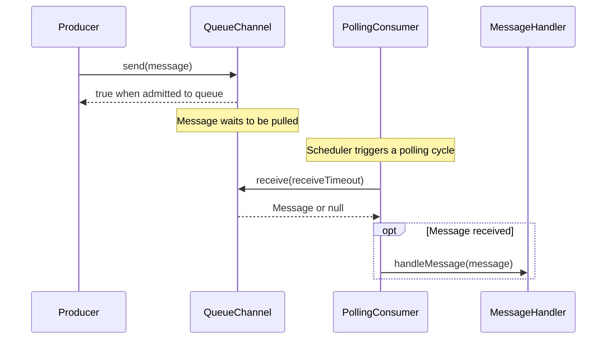
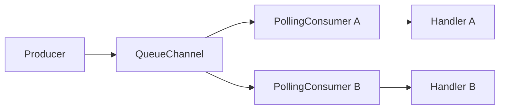

# PollingConsumer reading QueueChannel

## Lesson objectives

In the `SPRING_INTEGRATION_CORE` module, understanding how endpoints pull messages from a channel helps you design message flows with a clear processing cadence. This lesson belongs to the **Queue and pollable channel** chapter and focuses on how `PollingConsumer` reads from a `QueueChannel` and hands messages to a `MessageHandler`.

After this lesson, you can:

- Distinguish where messages are stored, the mechanism that pulls them, and the business logic that processes them.
- Configure a consumer with Java DSL or annotations.
- Explain the impact of polling period, `receiveTimeout`, and `maxMessagesPerPoll`.
- Spot queue bottlenecks, competition between consumers, and potential message loss during error handling.
- Design time-bounded tests for polling flows.

## 1. Why does QueueChannel need a consumer that actively pulls messages?

`QueueChannel` is an implementation of `PollableChannel`. A producer puts a `Message<?>` into the queue via `send(...)`; the receiver pulls the message via `receive(...)`.

Unlike `DirectChannel`, sending to a `QueueChannel` does not invoke the business handler directly. A successful send only indicates that the channel accepted the message. The handler may not have run yet or may fail later during processing.



In a standard synchronous polling configuration, the handler runs on the thread executing the poll cycle. Producer and handler are thus decoupled by the queue, yet `QueueChannel` does not spawn a background processing thread on its own. The scheduler and endpoint provide that execution mechanism.

### Three roles to keep separate

| Component | Responsibility | Does not guarantee on its own |
| --- | --- | --- |
| `QueueChannel` | Holds waiting messages and provides `send`/`receive` | Invoking business logic, retries, or persistence across restarts |
| `PollingConsumer` | On schedule, receives messages from a `PollableChannel` and invokes the handler | Doing business work instead of the handler or putting every failed message back on the queue |
| `MessageHandler` | Executes the transformer, service activator, filter, or corresponding processing step | Scheduling queue reads itself |

Real-world example: an API accepts report-generation requests and places them into a queue. A background endpoint pulls each request to generate the report. The "accepted" response and the "report completed" status are two separate events.

## 2. Where does PollingConsumer sit inside an endpoint?

When a service activator takes a `QueueChannel` as input, Spring Integration needs a polling endpoint to connect the channel to the handler. `PollingConsumer` is the endpoint for pulling messages from a `PollableChannel` and delivering them to a `MessageHandler`.

Not every component with a poller is a `PollingConsumer`:

- **Polling consumer:** reads messages already sitting in a channel, such as a `QueueChannel`.
- **Source polling channel adapter:** invokes a `MessageSource` to fetch data from a source, such as a file source or a custom application source, and sends messages into the flow.

The distinction is **what is being polled**. This lesson covers a channel that already holds messages.

With Java DSL, you typically declare the channel, handler, and poller; the framework creates the appropriate endpoint. You do not need to write your own `while (true)` loop calling `receive()`.

## 3. How does a polling cycle proceed?

The model below describes a basic configuration without transactions, advice, or a dedicated task executor:

```text
Scheduler triggers a polling cycle
    |
    +-- receive(receiveTimeout)
    |      |
    |      +-- No message: end polling cycle
    |      |
    |      +-- Message present: invoke handler
    |                         |
    |                         +-- Success: consider reading next message
    |                         +-- Throws error: pass to error handling mechanism
    |
    +-- Stop when maxMessagesPerPoll is reached or when no message is received
```

This is an explanatory model, not framework source code. When enabling transactions, retries, advice, or a dedicated executor, also inspect the execution scope of each mechanism.

### 3.1. The trigger decides when a cycle starts

Two common options:

- `fixedDelay`: waits a given interval after the scheduled task finishes before triggering the next cycle.
- `fixedRate`: targets a periodic trigger cadence based on time.

`fixedRate` does not guarantee multiple handlers run in parallel and does not guarantee each message is processed once per interval. Concurrency also depends on the scheduler, executor, and endpoint configuration.

### 3.2. receiveTimeout decides how long to wait for a message

For `QueueChannel`, receive timeout works as follows:

| Value | Message receiving behavior |
| --- | --- |
| `0` | Checks immediately; returns `null` if the queue is empty |
| Positive number | Waits up to that many milliseconds if no message is available yet |
| Negative number | Can wait indefinitely until a message arrives or the thread is interrupted |

In pollers running on shared scheduler resources, finite timeouts are usually easier to manage. A `receive` waiting for a long time can hold a thread that other endpoints also need.

Timeout is not a rest pause between two messages. If the queue always has data, the consumer can pull the next message right after finishing the previous one.

### 3.3. maxMessagesPerPoll caps messages per cycle

With the configuration:

```java
Pollers.fixedDelay(500)
    .receiveTimeout(0)
    .maxMessagesPerPoll(5)
```

one polling cycle processes **at most 5 messages**. If only 2 messages exist and then the queue becomes empty, that cycle can finish after 2 messages. It is not a requirement to wait for a batch of 5 items.

This limit does not turn payloads into a list either. The handler is still invoked once per message. Combining multiple messages into a single result requires another pattern, such as an aggregator.

Set an explicit positive value while learning and whenever you want to bound work per cycle. Do not treat `0` as a way to enable unlimited mode; on a polling endpoint, it can cause poll cycles not to perform message receives. Negative values enable an unlimited count per cycle; if the queue is continuously fed, a single cycle can stretch on and occupy execution resources.

## 4. Complete example with Java DSL

Assume the application already has compatible Spring Integration Core and Spring Context dependencies. The example below uses Spring Integration 6.x APIs and Java 17 or newer. Durations in `fixedDelay(...)` and `receiveTimeout(...)` are in milliseconds.

```java
import org.springframework.context.annotation.Bean;
import org.springframework.context.annotation.Configuration;
import org.springframework.integration.channel.QueueChannel;
import org.springframework.integration.config.EnableIntegration;
import org.springframework.integration.dsl.IntegrationFlow;
import org.springframework.integration.dsl.Pollers;

@Configuration
@EnableIntegration
public class OrderFlowConfig {

    public record OrderRequest(String orderId, int quantity) {}

    @Bean
    public QueueChannel ordersQueue() {
        return new QueueChannel(100);
    }

    @Bean
    public IntegrationFlow processOrders(QueueChannel ordersQueue) {
        return IntegrationFlow.from(ordersQueue)
            .handle(OrderRequest.class, (order, headers) -> {
                if (order.quantity() <= 0) {
                    throw new IllegalArgumentException(
                        "quantity must be greater than 0: " + order.orderId());
                }

                System.out.println("Processing order " + order.orderId());
                return null;
            }, endpoint -> endpoint.poller(
                Pollers.fixedDelay(500)
                    .receiveTimeout(0)
                    .maxMessagesPerPoll(5)))
            .get();
    }
}
```

Key points to read accurately in the configuration:

1. `ordersQueue` holds at most 100 waiting messages in this example configuration.
2. `IntegrationFlow.from(ordersQueue)` specifies that the input is a pollable channel.
3. `.handle(...)` creates a handler processing each `OrderRequest` payload.
4. `.poller(...)` attaches the message-receiving schedule to the queue-consuming endpoint.
5. `return null` indicates the handler finishes the processing step without emitting a reply message.

The poller belongs to the endpoint reading from the queue. There is no "attach a schedule to the queue" operation that makes every consumer of that queue share the same schedule automatically.

### Sending messages from a producer

A producer can use the injected `ordersQueue` bean:

```java
import org.springframework.integration.channel.QueueChannel;
import org.springframework.messaging.support.MessageBuilder;

public class OrderProducer {

    private final QueueChannel ordersQueue;

    public OrderProducer(QueueChannel ordersQueue) {
        this.ordersQueue = ordersQueue;
    }

    public void submit(String orderId, int quantity) {
        var message = MessageBuilder
            .withPayload(new OrderFlowConfig.OrderRequest(orderId, quantity))
            .setHeader("requestOrigin", "web")
            .build();

        boolean accepted = ordersQueue.send(message, 200);
        if (!accepted) {
            throw new IllegalStateException(
                "Queue is full, failed to accept order " + orderId);
        }
    }
}
```

`send(message, 200)` waits up to 200 ms to enqueue when needed. It does not wait for order-processing business logic to complete. Register `OrderProducer` as a bean or instantiate it with the channel retrieved from the application context when using this class.

Capacity 100 bounds the number of messages currently sitting in the queue; it does not bound the total number of messages already dequeued and being processed on other threads.

## 5. Equivalent configuration with annotations

If using annotations, you can place `@Poller` inside `@ServiceActivator`. The snippet below is an **alternative** to the `processOrders` bean in the DSL section. Keep the `ordersQueue` bean and `@EnableIntegration` configuration, and allow component scanning to detect this service.

```java
import org.springframework.integration.annotation.Poller;
import org.springframework.integration.annotation.ServiceActivator;
import org.springframework.stereotype.Component;

@Component
public class OrderHandler {

    @ServiceActivator(
        inputChannel = "ordersQueue",
        poller = @Poller(
            fixedDelay = "500",
            receiveTimeout = "0",
            maxMessagesPerPoll = "5"))
    public void process(OrderFlowConfig.OrderRequest order) {
        if (order.quantity() <= 0) {
            throw new IllegalArgumentException(
                "quantity must be greater than 0: " + order.orderId());
        }
        System.out.println("Processing order " + order.orderId());
    }
}
```

Do not keep both endpoints active just to "configure the same handler two ways." If both are active, they become two competing consumers reading `ordersQueue`.

When a pollable input channel has no local poller, the endpoint can use a default poller declared in the application. Without an appropriate poller configuration, the application may fail to initialize the endpoint. Declaring the poller directly on the endpoint keeps the example self-contained and easy to read.

## 6. Reading processing cadence and load capacity

Suppose:

- `fixedDelay = 500 ms`.
- `maxMessagesPerPoll = 5`.
- `receiveTimeout = 0`.
- One consumer processes synchronously, taking roughly 100 ms per message.
- The queue always has enough messages and no errors occur.

One cycle takes about `5 × 100 = 500 ms` to process, then pauses about 500 ms. Estimated throughput is:

```text
throughput ≈ messages per cycle / (cycle processing time + fixedDelay)
           ≈ 5 / (0.5 + 0.5)
           ≈ 5 messages/second
```

This is an estimate under the stated conditions, excluding scheduler, receive, and ancillary overheads. You cannot conclude "5 messages every 500 ms means 10 messages/second always," because processing also takes time.

If producers keep sending 8 messages/second while the consumer processes only around 5 messages/second, the backlog tends to grow by about 3 messages/second until the queue fills or traffic changes.

### When the queue is empty

With `receiveTimeout = 0`, the consumer checks and ends the cycle very quickly. A message arriving right after the check may have to wait until the next cycle.

With `receiveTimeout = 200`, the consumer can pick up a message that appears within that wait window. In return, it can hold the thread waiting up to 200 ms on any receive without data. Even after processing several messages, the next receive in the same cycle may still have to wait if the queue just became empty.

### Choosing parameters by goal

| Goal | Adjustment to consider | What to monitor |
| --- | --- | --- |
| Reduce latency at low load | Shorten polling interval or use finite receive wait | Empty poll count and thread utilization |
| Drain backlog faster | Increase messages per cycle, optimize handler | Single-cycle duration, database and target service load |
| Avoid holding resources too long | Cap messages per cycle and timeout | Queue depth, oldest waiting message age |
| Limit messages waiting in memory | Set finite capacity and explicit send timeout | Enqueue failure rate, producer rate |

No single parameter set is optimal for every system. Measure alongside producer rate, handler duration, and downstream resource limits.

## 7. Multiple consumers, ordering, and threads

A standard `QueueChannel` delivers each successfully received message to one receiver. Two consumers reading the same queue are **competing consumers**: they split the work rather than each consumer receiving a copy.



In a standard FIFO configuration, the order messages are pulled from the queue does not guarantee completion order when multiple consumers exist. For example, A takes order 1 and needs 2 seconds, while B takes order 2 and needs 100 ms: order 2 can finish before order 1.

To preserve processing order, inspect the whole flow: consumer count, executors, subsequent channels, and business grouping keys. Adding threads will not raise throughput if every handler contends on the same bottlenecked resource.

If you configure a dedicated task executor for the poller, also evaluate tasks queued inside the executor. A shrinking input queue does not prove business work is finished; work may be waiting in another queue.

## 8. Errors after receive: does the message return to the queue?

With `new QueueChannel(100)` as shown, the message is removed from the queue when `receive` succeeds. If the handler throws an error afterward, the channel does not automatically put the message back.

```text
enqueue succeeds
    → receive succeeds, message leaves queue
    → handler calls external service
    → external service fails
    → explicit error-handling or recovery mechanism is needed
```

In scheduler-managed polling, errors do not propagate back to the `send()` call that already returned earlier. Spring Integration's default error-handling infrastructure can emit an `ErrorMessage` to the appropriate error channel; exact behavior depends on error handler configuration, headers, and error flows.

### Protection layers address different problems

| Mechanism | Purpose | Limitation to remember |
| --- | --- | --- |
| Error flow | Observe errors, alert, record failed processing details | Logging alone does not recover failed work |
| Retry around handler | Retry an operation that may fail transiently | Exhausted retries still need recovery; operations may repeat side effects |
| Recovery or business error channel | Store failed work for later handling | Requires storage, retry, and deduplication policies |
| Persistent message store with suitable transaction support | Retain messages and support recovery per store capabilities | Must verify actual transaction scope and participating resources |
| Idempotency by business key | Reduce side effects from duplicate processing | Does not provide persistence or delivery on its own |

The default `QueueChannel` holds data in memory; a process stop can lose unprocessed messages. Attaching a transaction manager to the poller does not automatically turn an in-memory queue into a durable queue capable of rolling back message receives.

For high-reliability requirements, design together with a message store or broker, appropriate transactions, retries, and idempotency. Do not infer an "exactly once" guarantee merely from having a queue and a poller.

## 9. Testing polling behavior

Separate two questions:

1. Does the handler process payloads and business rules correctly?
2. Does the endpoint actually pull messages from the queue as configured and pass them to the handler?

Handler tests can call the business method directly. Endpoint tests should start a Spring context and wait for a completion signal with a timeout.

The JUnit 5 example below uses a `CountDownLatch` as the signal. It requires JUnit Jupiter on the test classpath alongside the previous example's dependencies.

```java
import java.util.concurrent.CountDownLatch;
import java.util.concurrent.TimeUnit;

import org.junit.jupiter.api.Test;
import org.springframework.context.annotation.AnnotationConfigApplicationContext;
import org.springframework.context.annotation.Bean;
import org.springframework.context.annotation.Configuration;
import org.springframework.integration.channel.QueueChannel;
import org.springframework.integration.config.EnableIntegration;
import org.springframework.integration.dsl.IntegrationFlow;
import org.springframework.integration.dsl.Pollers;
import org.springframework.messaging.support.MessageBuilder;

import static org.junit.jupiter.api.Assertions.assertTrue;

class QueuePollingTest {

    @Test
    void consumesMessageFromQueue() throws InterruptedException {
        try (var context = new AnnotationConfigApplicationContext(TestConfig.class)) {
            var queue = context.getBean("testQueue", QueueChannel.class);
            var handled = context.getBean(CountDownLatch.class);

            assertTrue(queue.send(MessageBuilder.withPayload("order-42").build(), 0));
            assertTrue(handled.await(2, TimeUnit.SECONDS),
                "Consumer did not process message within allowed time");
        }
    }

    @Configuration
    @EnableIntegration
    static class TestConfig {

        @Bean
        QueueChannel testQueue() {
            return new QueueChannel(10);
        }

        @Bean
        CountDownLatch handled() {
            return new CountDownLatch(1);
        }

        @Bean
        IntegrationFlow testFlow(QueueChannel testQueue, CountDownLatch handled) {
            return IntegrationFlow.from(testQueue)
                .handle(String.class, (payload, headers) -> {
                    if ("order-42".equals(payload)) {
                        handled.countDown();
                    }
                    return null;
                }, endpoint -> endpoint.poller(
                    Pollers.fixedDelay(20)
                        .receiveTimeout(0)
                        .maxMessagesPerPoll(1)))
                .get();
        }
    }
}
```

The test confirms a message with the expected payload travels through the endpoint to the handler. It does not prove throughput, retries, transactions, or data durability.

Avoid testing asynchronous flows with `Thread.sleep(500)` and assuming the handler ran. Machine speed and scheduler timing vary; a completion signal with a timeout lets the test wait for the exact event being observed. Nor should you call `queue.receive()` in the test to "peek at messages" while the endpoint is running: the test becomes a competing receiver and can steal messages from the handler.

### Additional scenarios worth testing when needed

- Full queue: producer receives failure result matching send timeout.
- Handler failure: error flow receives error and recovery follows policy.
- Multiple consumers: each request ID is processed according to business rules without assuming completion order.
- Context shutdown: polling tasks stop and resources are released.
- Sustained load: backlog, wait times, and downstream resources stay within acceptable bounds.

## 10. Common issues and how to diagnose them

| Symptom | Cause to check | Action to take |
| --- | --- | --- |
| `send()` succeeds but handler does not run | Endpoint not started, missing poller, or wrong channel bean | Inspect endpoint lifecycle, input channel configuration, and poller |
| Messages wait long under low load | Long polling interval or busy scheduler | Measure enqueue-to-start latency; inspect trigger and threads |
| Queue grows continuously | Arrival rate exceeds processing rate | Measure handler duration, target resources, and actual throughput |
| Producer blocks when queue is full | Finite capacity with long or unbounded send timeout | Set explicit admission policy and timeout intentionally |
| Only some consumers see each message | Multiple consumers competing on the same queue | Reassess whether you need work sharing or broadcasting copies to multiple branches |
| Message disappears after error | Message was already received, no suitable recovery configured | Design error flow, retries, and recovery storage |
| `maxMessagesPerPoll = 5` yet only 2 messages processed | Queue drained mid-cycle or an error stopped the cycle | Remember this is a maximum cap; check queue and error flow |
| Queue shrinks yet latency keeps climbing | Work waiting in an executor or downstream step | Observe the entire flow, not only input queue depth |

## 11. Practice exercises

1. Use the DSL example with queue capacity 10, `fixedDelay = 500`, `maxMessagesPerPoll = 2`, `receiveTimeout = 0`. Send 6 messages and record when processing begins for each message.
2. Add a simulated 200 ms delay in the handler. Observe one cycle processing two messages followed by the `fixedDelay` pause. Use simulated delays only in practice, never in real business code.
3. Change `maxMessagesPerPoll` to 1 and then to 5. Compare time to drain the backlog and duration of each cycle.
4. Intentionally throw an error for one order ID. Observe the error path and verify that the in-memory queue does not put that order back automatically.
5. Create two consumers reading the same queue. Log order IDs and thread names to observe work sharing and differences between receive order and completion order.

Results should be explainable in terms of four factors: **where the message is waiting, who performs the receive, when the receive happens, and what happens after the handler succeeds or fails**. That is the foundation for expanding to transformers, routers, filters, aggregators, and gateways in flows with pollable inputs.
