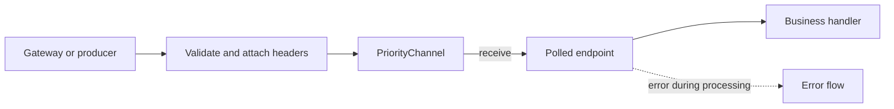

# PriorityChannel and Comparator

## 1. Objectives and use case

In the **SPRING_INTEGRATION_CORE** module, chapter **Queue and pollable channel**, this lesson covers controlling message retrieval order with `PriorityChannel` and `Comparator<Message<?>>`. After this lesson, you can build a work ingestion flow, attach priority levels, place messages into the channel, and have a polled endpoint pull and process them; you will also know how to verify ordering and handle overload situations.

Suppose a support-request processing system has three kinds of work:

| Task | Application-defined priority level | Desired behavior |
| --- | ---: | --- |
| Generate scheduled report | 1 | Can wait |
| Handle customer request | 5 | Process before waiting reports |
| Resolve critical incident | 9 | Process before both other waiting types |

A FIFO queue could leave incident requests stuck behind many reports. `PriorityChannel` provides a coordination point to select waiting work by priority level. It fits when service order matters more than strict arrival order.

Examples in this lesson use Java 17 and Spring Integration 6.x APIs; details on default priority values and tie-breaking order are verified against source **6.4.2**. The required dependency is `org.springframework.integration:spring-integration-core`; in a Spring Boot application, let the project BOM manage compatible versions. Test examples use JUnit Jupiter as instructional code for learners to run in their own projects.

## 2. Where does PriorityChannel sit in the message flow?

`PriorityChannel` extends `QueueChannel` and is a `PollableChannel`: producers call `send`, and consumers call `receive`, or a polling endpoint performs receiving on the application's behalf. By default the channel uses the `priority` header; you can pass a comparator to apply another rule. See [Message Channel Implementations](https://docs.spring.io/spring-integration/reference/channel/implementations.html).



In the diagram, each component has a distinct responsibility:

- `Message` carries the work payload and headers used to choose order.
- The channel holds messages not yet retrieved.
- The poller determines when the endpoint attempts to receive a message.
- The handler runs business logic after the message is received.

Distinguish **dequeue order**, **execution start order**, and **completion order**. Prioritizing at the channel directly affects the next `receive`. If messages then pass through an executor or multiple handlers running in parallel, completion timing also depends on each task's runtime.

### Example of priority scope

If A, B, and C were sent in order with priorities 1, 9, and 5 while the consumer has not run yet, the expected receive order is B, C, A.

If the consumer already pulled A and is processing it, and B arrives afterward, the channel does not recall A from the handler. B is only considered on subsequent receives. Therefore, logs from a live system will not necessarily show a strictly descending priority sequence across the entire history.

This is a consequence of ordering only the set of **waiting** messages, which must be factored into how test results and SLA requirements are interpreted.

## 3. Default rules of the priority header

For `PriorityChannel` using the in-memory queue in Spring Integration 6.4.2:

- Higher `Integer` values are retrieved first.
- A missing `priority` header is treated as `0`.
- When two messages tie, the channel uses an internal sequence number as a secondary criterion. With sequential sends from a producer, this preserves send order within the same priority group, even when a custom comparator returns `0`.

These rules are implemented in `SequenceFallbackComparator` of the [PriorityChannel 6.4.2 source code](https://github.com/spring-projects/spring-integration/blob/v6.4.2/spring-integration-core/src/main/java/org/springframework/integration/channel/PriorityChannel.java). When multiple producers send concurrently, the internal sequence number is not a guarantee of business chronological order across machines or requests.

Levels 1, 5, and 9 are just conventions for this example. The application must define what each level means and constrain input data. The string `"9"` is not a safe substitute for the integer `9` in this standard header.

### Direct send and receive example

```java
import org.springframework.integration.IntegrationMessageHeaderAccessor;
import org.springframework.integration.channel.PriorityChannel;
import org.springframework.messaging.Message;
import org.springframework.messaging.support.MessageBuilder;

public class PriorityChannelDemo {

    public static void main(String[] args) {
        PriorityChannel channel = new PriorityChannel(10);

        send(channel, job("REPORT", 1));
        send(channel, job("INCIDENT", 9));
        send(channel, job("CUSTOMER", 5));

        for (int i = 0; i < 3; i++) {
            Message<?> message = channel.receive(0);
            if (message == null) {
                throw new IllegalStateException("Missing job in example");
            }
            System.out.println(message.getPayload());
        }
    }

    private static Message<String> job(String id, int priority) {
        return MessageBuilder.withPayload(id)
                .setHeader(IntegrationMessageHeaderAccessor.PRIORITY, priority)
                .build();
    }

    private static void send(PriorityChannel channel, Message<?> message) {
        if (!channel.send(message, 0)) {
            throw new IllegalStateException("Queue is full");
        }
    }
}
```

Expected output:

```text
INCIDENT
CUSTOMER
REPORT
```

The example intentionally sends all three messages before receiving, making the selection rule easy to observe without racing against a poller. A successful `send` means the channel accepted the message; the application still needs a separate mechanism to know when work is complete.

## 4. Capacity and timeout: priority does not solve a full queue

Common constructors include:

```java
new PriorityChannel();                 // No finite limit set
new PriorityChannel(100);              // At most 100 waiting messages
new PriorityChannel(comparator);       // Custom comparator
new PriorityChannel(100, comparator);  // Limit and custom comparator
```

The constructor without capacity creates a queue with no configured bound; a non-positive capacity also means unbounded. Thus, `new PriorityChannel(0)` does not create a direct handoff channel. See the [PriorityChannel API](https://docs.spring.io/spring-integration/docs/6.4.2/api/org/springframework/integration/channel/PriorityChannel.html).

For the direct send/receive calls in this lesson:

| Call | Behavior when completion condition is not yet met |
| --- | --- |
| `send(message, 0)` | Does not wait for space; returns `false` if full |
| `send(message, 200)` | Waits up to 200 ms for space |
| `receive(0)` | Does not wait for a message; returns `null` if empty |
| `receive(200)` | Waits up to 200 ms for a message |
| `send(message)` or `receive()` | May wait indefinitely if the condition is not met |

This is the queue behavior described in the [QueueChannel documentation](https://docs.spring.io/spring-integration/reference/channel/implementations.html). If a call errors or is interrupted, an exception may occur; the table above describes normal waiting cases.

If capacity is 2 and two priority-1 messages already occupy all slots, a priority-9 message sent with timeout 0 is still rejected. The channel does not automatically evict lower-priority work to make room.

Admission design therefore needs a concrete answer: when full, is the request rejected for the caller to retry, shifted to durable storage, or sent to an overload-handling flow? Check the `send` return value; never let work vanish by ignoring `false`.

Capacity also bounds only messages waiting at the channel. If a consumer pulls fast and piles work onto an executor with a large queue, the backlog has merely moved elsewhere and still consumes resources.

## 5. Comparator: expressing the exact business order

The comparator type accepted by the channel is:

```java
Comparator<Message<?>>
```

The comparator compares **messages**, so it can read either payload or headers. Do not cast the received object to `GenericMessage` or a custom message class; use the `Message` interface, because the channel may wrap messages internally while managing ordering.

Sign convention:

| Result of `compare(a, b)` | Ordering meaning |
| --- | --- |
| Negative | A comes before B |
| 0 | The two messages are equal under your criteria |
| Positive | A comes after B |

A comparator must be antisymmetric in sign and transitive. Java provides `comparingInt`, `comparingLong`, `thenComparing`, and `reversed` to combine criteria, per the [Java Comparator API](https://docs.oracle.com/en/java/javase/17/docs/api/java.base/java/util/Comparator.html).

### 5.1. When smaller numbers are more important

Many systems define P1 as the most urgent incident, P2 lower, P3 lower still. If you put 1, 2, 3 directly into the `priority` header and use the default comparator, P3 will be pulled before P1.

There are two sensible ways to implement this:

1. Map business levels to priority scores: P1 → 9, P2 → 5, P3 → 1, then use the default.
2. Keep the business level in a separate header such as `slaRank`, and use an ascending comparator.

The second approach separates the meaning of "SLA rank" from the meaning of the standard `priority` header. Avoid using the same header name with conflicting interpretations across different producers.

### 5.2. Example comparator by SLA then deadline

Rules for the next example:

- Smaller `slaRank` is selected first.
- With the same SLA rank, smaller `deadlineEpochMs` is selected first.
- Missing rank or deadline sorts after declared values.
- Wrong data type is an input contract error.

```java
import java.util.Comparator;

import org.springframework.messaging.Message;

public final class WorkOrderComparator implements Comparator<Message<?>> {

    public static final String SLA_RANK = "slaRank";
    public static final String DEADLINE = "deadlineEpochMs";

    private static final Comparator<Message<?>> ORDER =
            Comparator.<Message<?>>comparingInt(WorkOrderComparator::slaRank)
                    .thenComparingLong(WorkOrderComparator::deadline);

    @Override
    public int compare(Message<?> left, Message<?> right) {
        return ORDER.compare(left, right);
    }

    public static void validate(Message<?> message) {
        slaRank(message);
        deadline(message);
    }

    private static int slaRank(Message<?> message) {
        Object value = message.getHeaders().get(SLA_RANK);
        if (value == null) {
            return Integer.MAX_VALUE;
        }
        if (value instanceof Integer rank && rank >= 1 && rank <= 3) {
            return rank;
        }
        throw new IllegalArgumentException("slaRank must be an Integer from 1 to 3");
    }

    private static long deadline(Message<?> message) {
        Object value = message.getHeaders().get(DEADLINE);
        if (value == null) {
            return Long.MAX_VALUE;
        }
        if (value instanceof Long epochMs && epochMs >= 0) {
            return epochMs;
        }
        throw new IllegalArgumentException("deadlineEpochMs must be a non-negative Long");
    }
}
```

Instantiation and sending:

```java
PriorityChannel queue = new PriorityChannel(100, new WorkOrderComparator());

Message<String> message = MessageBuilder.withPayload("INCIDENT-42")
        .setHeader(WorkOrderComparator.SLA_RANK, 1)
        .setHeader(WorkOrderComparator.DEADLINE, 1_900_000_000_000L)
        .build();

WorkOrderComparator.validate(message);
boolean accepted = queue.send(message, 0);
if (!accepted) {
    throw new IllegalStateException("No space left to accept work");
}
```

This snippet uses the same `PriorityChannel`, `Message`, and `MessageBuilder` imports as the earlier example, plus the `WorkOrderComparator` class just defined.

Call `validate` at the ingestion boundary: when the queue is empty, inserting the first message may not invoke comparison yet. Therefore, do not rely on the comparator as the sole mechanism to detect invalid data. In a real flow, this validation can run in the ingress service or an endpoint preceding the channel.

Under the chosen policy, the expected order is:

| Send order | Payload | slaRank | deadlineEpochMs |
| ---: | --- | ---: | ---: |
| 1 | REPORT | 3 | 1000 |
| 2 | INCIDENT-LATER | 1 | 3000 |
| 3 | INCIDENT-EARLIER | 1 | 2000 |

```text
INCIDENT-EARLIER → INCIDENT-LATER → REPORT
```

REPORT has the earliest deadline yet still comes last because SLA is the primary criterion. This is the business choice of this example. If the real requirement is "earliest deadline first," make deadline the primary criterion and verify again with tie cases.

When a comparator is supplied, the primary criteria are decided by that comparator; the `priority` header is not automatically appended to that policy. If you want to use both, write the comparison order explicitly.

### 5.3. Patterns that easily cause bugs

Do not use subtraction to compare numbers:

```java
// Prone to overflow with wide value ranges.
return rightPriority - leftPriority;

// Clear intent: higher score comes first.
return Integer.compare(rightPriority, leftPriority);
```

Do not make HTTP calls, query databases, mutate state, or continuously read clocks to compute results inside a comparator. It is called during queue management; only read stable data already present on the message.

If you need "the longer it waits, the higher its priority," a time-dependent comparator can change relationships between items already inside the heap without triggering a full heap re-organization. Design a scheduling mechanism or pull messages out to recompute and re-enqueue in a controlled way. A fixed deadline attached before sending is easier to reason about than mutating scores from outside.

Avoid taking sort keys from a mutable payload and then mutating that payload after enqueueing. Keep priority keys immutable for the entire time the message waits to be processed.

## 6. Connecting PriorityChannel to an endpoint with Java DSL

The configuration below uses the default policy based on the `priority` header. It illustrates a one-way handler and a separate error-receiving flow.

```java
import java.time.Duration;

import org.springframework.context.annotation.Bean;
import org.springframework.context.annotation.Configuration;
import org.springframework.integration.channel.DirectChannel;
import org.springframework.integration.channel.PriorityChannel;
import org.springframework.integration.config.EnableIntegration;
import org.springframework.integration.dsl.IntegrationFlow;
import org.springframework.integration.dsl.Pollers;
import org.springframework.messaging.MessageHandler;

@Configuration
@EnableIntegration
public class PriorityWorkConfiguration {

    @Bean
    public PriorityChannel workQueue() {
        return new PriorityChannel(100);
    }

    @Bean
    public DirectChannel workErrors() {
        return new DirectChannel();
    }

    @Bean
    public IntegrationFlow workFlow(PriorityChannel workQueue) {
        return IntegrationFlow.from(workQueue)
                .handle((MessageHandler) message -> {
                    System.out.println("Processing: " + message.getPayload());
                    // Call business service here.
                }, endpoint -> endpoint.poller(
                        Pollers.fixedDelay(Duration.ofMillis(100))
                                .receiveTimeout(0)
                                .maxMessagesPerPoll(5)
                                .errorChannel("workErrors")))
                .get();
    }

    @Bean
    public IntegrationFlow workErrorFlow() {
        return IntegrationFlow.from("workErrors")
                .handle((MessageHandler) message -> {
                    System.err.println("Work error: " + message.getPayload());
                    // In practice: persist error, alert, or coordinate recovery.
                })
                .get();
    }
}
```

Java DSL lets you configure pollers using `Pollers`; see [Pollers in Java DSL](https://docs.spring.io/spring-integration/reference/dsl/java-pollers.html).

How to read the configuration:

- The first endpoint after `workQueue` receives from a pollable channel, so it has a poller attached.
- `fixedDelay(100 ms)` inserts a pause after the previous poll task completes; it does not guarantee exactly one message is processed every 100 ms.
- `receiveTimeout(0)` prevents the receive call from waiting when the queue is empty.
- `maxMessagesPerPoll(5)` caps the number of messages processed in one poll cycle; it does not create five parallel workers.

Fixed-delay semantics are described in the [Pollers API](https://docs.spring.io/spring-integration/api/org/springframework/integration/dsl/Pollers.html). No separate executor is configured in this example, so the handler runs inside the poll task; business processing time contributes to the duration of that poll cycle.

To use `WorkOrderComparator`, replace the bean creation with:

```java
return new PriorityChannel(100, new WorkOrderComparator());
```

Also validate `slaRank` and `deadlineEpochMs` before sending into `workQueue`. Do not leave producers setting only the `priority` header and expect the new comparator to understand SLA ranks.

### Notes when using a gateway

A one-way gateway can place requests into a channel for later processing. A request-reply gateway also needs a reply path and an appropriate timeout. The caller's wait time can include the time the message spends waiting in the queue; being accepted into the queue does not mean a business result has been received.

Do not let callers invoke synchronously and wait indefinitely just because a task has high priority. Priority does not guarantee a completion deadline.

## 7. Error handling at asynchronous boundaries

Distinguish three error points in the example:

| Point in time | Example | Where to handle |
| --- | --- | --- |
| Before enqueue | `slaRank` is a string or out of range | Ingestion boundary, return data error |
| During enqueue | Capacity exhausted, `send` returns `false` | Producer or load-shedding mechanism |
| After dequeue | Handler fails calling target system | Error flow and recovery policy |

In the configuration above, errors from the poll task are routed to `workErrors` as an `ErrorMessage`. The producer may have already returned from its send call, so you cannot expect business exceptions to surface inside a `try/catch` wrapping that earlier `send`. See [Spring Integration Error Handling](https://docs.spring.io/spring-integration/reference/error-handling.html).

`errorChannel` only provides a route to receive errors; it does not set up retries, transactions, or re-insertion into the queue. With this in-memory channel and no transaction in the example, a message already pulled out does not automatically reappear when the handler fails.

If you design retries, bound attempt counts, include backoff, and provide a place to keep final failures. A failing job continuously re-sent with high priority can starve other work. For operations with side effects, use a business key to avoid duplicate execution during recovery.

## 8. Verifying behavior with JUnit

To verify ordering, first use a standalone channel: send the entire dataset, then call `receive(0)`. When testing a full application with a poller, stop the endpoint or control when it starts; if the consumer pulls right after the first send, expecting the entire dataset to be sorted no longer applies.

The following tests do not need a Spring application context:

```java
import org.junit.jupiter.api.Test;
import org.springframework.integration.IntegrationMessageHeaderAccessor;
import org.springframework.integration.channel.PriorityChannel;
import org.springframework.messaging.Message;
import org.springframework.messaging.support.MessageBuilder;

import static org.junit.jupiter.api.Assertions.*;

class PriorityChannelTest {

    @Test
    void higherPriorityIsReceivedFirstAndTiesKeepSequentialSendOrder() {
        PriorityChannel queue = new PriorityChannel(10);

        assertTrue(queue.send(job("LOW", 1), 0));
        assertTrue(queue.send(job("HIGH-A", 9), 0));
        assertTrue(queue.send(job("HIGH-B", 9), 0));

        assertEquals("HIGH-A", nextPayload(queue));
        assertEquals("HIGH-B", nextPayload(queue));
        assertEquals("LOW", nextPayload(queue));
        assertNull(queue.receive(0));
    }

    @Test
    void missingPriorityActsAsZero() {
        PriorityChannel queue = new PriorityChannel(10);

        assertTrue(queue.send(job("NEGATIVE", -1), 0));
        assertTrue(queue.send(MessageBuilder.withPayload("MISSING").build(), 0));
        assertTrue(queue.send(job("POSITIVE", 1), 0));

        assertEquals("POSITIVE", nextPayload(queue));
        assertEquals("MISSING", nextPayload(queue));
        assertEquals("NEGATIVE", nextPayload(queue));
    }

    @Test
    void urgentMessageDoesNotEvictExistingMessageWhenFull() {
        PriorityChannel queue = new PriorityChannel(1);

        assertTrue(queue.send(job("LOW", 1), 0));
        assertFalse(queue.send(job("URGENT", 9), 0));
        assertEquals("LOW", nextPayload(queue));
        assertNull(queue.receive(0));
    }

    private static Message<String> job(String id, int priority) {
        return MessageBuilder.withPayload(id)
                .setHeader(IntegrationMessageHeaderAccessor.PRIORITY, priority)
                .build();
    }

    private static Object nextPayload(PriorityChannel queue) {
        Message<?> message = queue.receive(0);
        assertNotNull(message);
        return message.getPayload();
    }
}
```

For the SLA comparator, add contract-oriented cases:

| Input | Outcome to prove |
| --- | --- |
| P3 deadline 1000, P1 deadline 3000 | P1 is selected first |
| Two P1 items with deadlines 3000 and 2000 | Deadline 2000 is selected first |
| Same SLA and deadline, sent sequentially A then B | A then B on the verified in-memory channel |
| Missing SLA, compared with valid P3 | Message with valid SLA is selected first |
| `slaRank = "1"` | `validate` rejects before enqueue |
| Pull LOW out first, then send HIGH afterward | LOW remains the already-received job |

Never use `Thread.sleep` to guess when a poller has finished running. When testing an asynchronous endpoint, wait for a completion signal with a timeout, such as a message on an output channel or a latch signaled by the handler; separate verifying dequeue order from verifying business completion timing.

## 9. Limits to factor into your design

### 9.1. Starvation: low-priority work can wait for a very long time

If priority-9 traffic continuously consumes all processing capacity, priority-1 messages may not be picked for a long time. That is a consequence of a strict priority policy.

Example design options: split levels across multiple queues and schedule by quota, or reserve a share of capacity for regular work. These are mechanisms you must implement explicitly; changing the comparator will not create fairness by itself.

Monitor the age of the oldest waiting message per priority level as well. A short queue can still contain a low-priority task that has waited far too long.

### 9.2. Local priority and distributed flows

Two application instances with two in-memory `PriorityChannel` instances have two independent waiting sets. One instance may process priority 1 while another still holds priority 9. If you need a single global service order, design a shared coordination point and consider the desired degree of parallelism.

Also inspect downstream buffers in the flow. A downstream FIFO executor may already be holding many low-priority jobs; a high-priority job that just left `PriorityChannel` still has to wait there.

### 9.3. Durability and message stores

An in-memory channel does not retain its backlog across a process stop. When persistence is required, you can use a priority-capable message store or an appropriate broker. Store-backed configurations have their own rules; do not assume the current Java comparator runs inside the database. Configuration documentation requires a priority-capable store and states constraints on comparator/capacity in XML configuration: [PriorityChannel Configuration](https://docs.spring.io/spring-integration/reference/channel/configuration.html).

Before switching to a store, define how priority is represented, tie-breaking order, transaction support, and behavior when multiple instances pull messages concurrently. Persistence and preventing duplicate processing are two requirements that must be designed separately.

## 10. Checklist for applying to a real flow

1. Agree on the meaning of priority levels and who is authorized to assign urgent levels.
2. Choose either the standard `priority` header or a custom key set with explicit data types.
3. Validate and normalize keys before enqueueing, and keep them stable while waiting.
4. Set an appropriate finite capacity and handle `send` outcomes when full.
5. Attach a poller to the endpoint reading from the channel; tune poll batches according to actual processing time.
6. Set up an error path, retry policy, and duplicate-side-effect protection if needed.
7. Verify ordering on fully enqueued data first, then test concurrency of the full flow separately.
8. Monitor wait times per priority level to detect overload or starvation.

`PriorityChannel` is useful when you need to choose the next task by an explicit policy. A complete design must also answer when work is admitted, where it waits, where errors go, and what confirms the work is finished.
