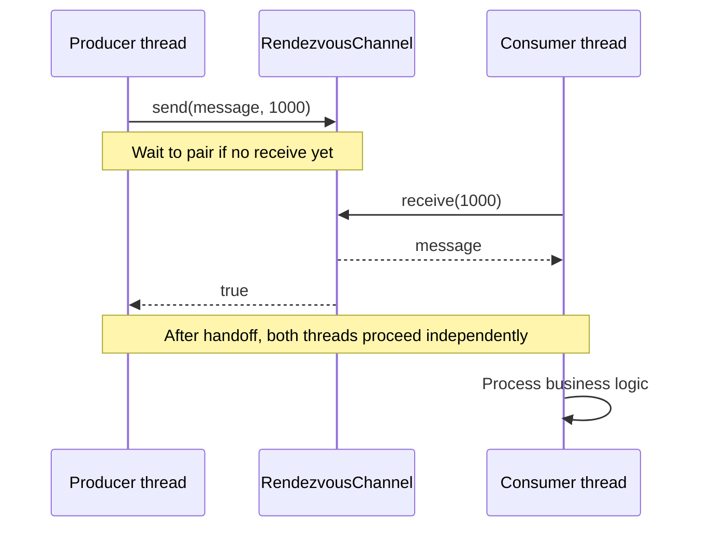

# RendezvousChannel handoff

## Lesson objectives

In the **Queue and pollable channel** chapter of **SPRING_INTEGRATION_CORE**, `RendezvousChannel` models a specific situation: a producer can only hand off a `Message` when a consumer is there to receive it. It is a coordination point between two execution threads, not a place to accumulate pending work.

After this lesson, you can:

- Explain the unbuffered handoff mechanism of `RendezvousChannel`.
- Distinguish message receipt from completion of business processing.
- Use `send(message, timeout)` and `receive(timeout)` to bound wait time.
- Connect the channel to a polling endpoint with Java DSL.
- Identify backpressure, deadlock risks, and the limits of in-memory handoff.

## 1. Why do we need a channel for direct handoff?

Suppose an application receives report-generation requests. One thread accepts requests, and another thread pulls requests to process them. You want the sender to proceed only when a receiver actually takes the message, rather than placing requests into a queue and letting them pile up.

`RendezvousChannel` provides that meeting point. Sender and receiver must meet at the handoff operation:

- Sender arrives first: waits for a receiver, within the timeout limit if provided.
- Receiver arrives first: waits for a sender, within the timeout limit if provided.
- Both operations pair up successfully: the message transfers from sender to receiver.

The channel uses Java's `SynchronousQueue` mechanism. That structure has no capacity to store items waiting to be taken. Having the word "queue" in the underlying class name does not mean messages sit inside a buffer like in a standard `QueueChannel`.

> Having no buffer does not mean zero resource cost: a waiting producer still holds a thread, stack, and references to message objects.

## 2. Role in the Spring Integration model

A Spring Integration message flow consists of `Message`, `MessageChannel`, and endpoints performing work. A channel coordinates how messages move; transformers, filters, routers, or service activators handle the corresponding processing behavior.

`RendezvousChannel` is a `PollableChannel`. Consumers receive messages via `receive(...)`; the channel does not invoke subscribers directly like `DirectChannel`.

| Component | Role in the handoff example |
|---|---|
| `Message<T>` | Holds the request payload and headers |
| Producer | Calls `send(...)` to offer message handoff |
| `RendezvousChannel` | Pairs one send with one receive, without buffering messages |
| Consumer or polling endpoint | Calls `receive(...)` to pull messages |
| Handler | Processes the message taken out of the channel |
| Gateway, if used | Provides an entry interface into the flow and can await replies per its own configuration |

For each successfully handed-off message, only one consumer receives it. This is not a channel that broadcasts the same message to all consumers.

## 3. Handoff sequence between two threads



The diagram shows the handoff relationship; the exact ordering between when `send` returns and when the consumer starts executing the handler depends on thread scheduling. There is no guarantee that the producer resumes before or after the handler's first statement.

### What `send(...) == true` confirms

A message was taken by a consumer via a receive operation. It does not confirm that:

- The handler has finished processing the payload.
- The consumer's database transaction has committed.
- A reply has been created or sent back.
- The data has been durably persisted.

For instance, the consumer may take the report request and then hit a database query failure. The producer may still have received `true` from `send` before the error happened.

If you need to know the business outcome, add a reply or confirmation event per the system's contract. Do not use the boolean result of `send` as a substitute for the business result.

## 4. send and receive timeouts

Both sides have independent wait times:

| Call | Meaning | Normal result |
|---|---|---|
| `send(message, 500)` | Wait up to roughly 500 ms for handoff | `true` if handed off, `false` if wait expires |
| `receive(500)` | Wait up to roughly 500 ms to receive | `Message<?>` if received, `null` if wait expires |
| `send(message, 0)` | Try handoff immediately without waiting for a receiver to appear | `true` or `false` |
| `receive(0)` | Try receiving immediately without waiting for a sender to appear | Message or `null` |
| `send(message)` | Wait for handoff with no finite limit imposed by this call | May wait indefinitely if no consumer exists |
| `receive()` | Wait to receive with no finite limit imposed by this call | May wait indefinitely if no producer exists |

Timeout values in the examples are in milliseconds. Actual observed duration is also affected by thread scheduling; timeouts are not hard real-time guarantees.

In cases with timeout `0`, success depends on a matching counterpart operation being ready to pair at that exact instant. Merely spawning a consumer thread does not guarantee the consumer has already entered `receive`.

The outcomes in the table describe normal error-free scenarios. Errors from interceptors or thread interruption can produce exceptions. Do not write logic assuming every failed send only returns `false`.

### Timeout does not cancel work already received

If `send(message, 500)` returns `false` because it timed out before pairing, that message was not handed off by this send and does not remain in any buffer for a consumer to pick up later.

Conversely, once `send` returns `true`, the send call's timeout does not govern the subsequent processing lifecycle. To cancel a task that has already been received, you need a dedicated cancellation mechanism.

## 5. Java example: two threads meeting at the channel

The following example assumes the project has Spring Integration Core and corresponding Spring dependencies. It uses JDK 17 or newer, with an `ExecutorService` to create an independent consumer.

```java
import java.util.concurrent.ExecutorService;
import java.util.concurrent.Executors;
import java.util.concurrent.Future;
import java.util.concurrent.TimeUnit;

import org.springframework.integration.channel.RendezvousChannel;
import org.springframework.messaging.Message;
import org.springframework.messaging.support.MessageBuilder;

public class RendezvousDemo {

    public static void main(String[] args) throws Exception {
        RendezvousChannel channel = new RendezvousChannel();
        ExecutorService executor = Executors.newSingleThreadExecutor();

        try {
            Future<String> handled = executor.submit(() -> {
                Message<?> received = channel.receive(2_000);
                if (received == null) {
                    throw new IllegalStateException("No message received");
                }

                String reportId = (String) received.getPayload();
                // Represents the processing step after receiving the message.
                return "Processed: " + reportId;
            });

            Message<String> request = MessageBuilder
                    .withPayload("report-42")
                    .setHeader("requestType", "CREATE_REPORT")
                    .build();

            boolean handedOff = channel.send(request, 1_000);
            if (!handedOff) {
                throw new IllegalStateException("Timed out waiting for handoff");
            }

            System.out.println("Consumer received the message");
            System.out.println(handled.get(3, TimeUnit.SECONDS));
        } finally {
            executor.shutdownNow();
        }
    }
}
```

There are two distinct milestones in the snippet:

1. `send` returns `true`: the channel handed off the message to the matching `receive`.
2. `handled.get(...)` returns a value: the consumer task finished executing and returned the result string.

`Future` here only illustrates the difference between those two milestones; it is not an automatic Spring Integration request-reply mechanism.

Consumer and producer do not need to start at the exact same moment. Timeouts let whichever side arrives first wait for the other. If the consumer thread is delayed too long, the example fails according to the configured wait limit.

## 6. Java DSL example with a polling endpoint

In a real flow, a polling endpoint can perform `receive` instead of manual consumer code.

```java
import org.springframework.context.annotation.Bean;
import org.springframework.context.annotation.Configuration;
import org.springframework.integration.channel.RendezvousChannel;
import org.springframework.integration.config.EnableIntegration;
import org.springframework.integration.dsl.IntegrationFlow;
import org.springframework.integration.dsl.Pollers;

@Configuration
@EnableIntegration
public class ReportHandoffConfiguration {

    @Bean
    public RendezvousChannel reportHandoffChannel() {
        return new RendezvousChannel();
    }

    @Bean
    public IntegrationFlow reportHandoffFlow() {
        return IntegrationFlow.from("reportHandoffChannel")
                .handle(String.class, (reportId, headers) -> {
                    System.out.println("Starting report generation: " + reportId);
                    // Call business service here.
                    return null;
                }, endpoint -> endpoint.poller(
                        Pollers.fixedDelay(100)
                                .receiveTimeout(50)
                                .maxMessagesPerPoll(1)))
                .get();
    }
}
```

This is a one-way flow: the handler returns `null`, producing no reply. The context must be initialized and the endpoint must be running for the poller to perform receives.

The producer obtains the channel bean and sends a message with a finite timeout:

```java
import org.springframework.integration.channel.RendezvousChannel;
import org.springframework.messaging.support.MessageBuilder;

public class ReportSubmissionService {

    private final RendezvousChannel handoffChannel;

    public ReportSubmissionService(RendezvousChannel handoffChannel) {
        this.handoffChannel = handoffChannel;
    }

    public boolean submit(String reportId) {
        return handoffChannel.send(
                MessageBuilder.withPayload(reportId).build(),
                1_000);
    }
}
```

This example illustrates a scheduled consumer. With sequential processing and no extra executor for the handler:

- The poller enters `receive`, waiting up to 50 ms if no message is present yet.
- When paired with a producer, the poller receives the message and invokes the handler.
- While the handler is running, that same poll task has not returned to receive the next message yet.
- `maxMessagesPerPoll(1)` limits each poll cycle to one message; it does not create a worker pool and does not bound the total number of producers waiting to send.
- `fixedDelay(100)` sets the delay between poll cycles after the previous cycle completes in this configuration.

The producer must choose a timeout compatible with polling delay, handler duration, and system load. The values 50, 100, and 1,000 ms are examples to understand the mechanics, not optimal settings for every application.

### When adding transformers, filters, or routers

You can add endpoints after the receive point to transform, filter, or route messages. However, a successful handoff into `RendezvousChannel` still proves only that a consumer received the message.

For example, if a downstream filter drops the message based on a business condition, the producer does not retroactively receive `false` from the earlier `send` that already handed it off. If you need "accepted" vs. "rejected" feedback, design an explicit reply.

Likewise, this channel does not perform correlation, grouping, or message release like an aggregator. Do not use the count of successful handoffs to infer that a group of messages has been completely processed.

## 7. Comparison with QueueChannel and DirectChannel

| Criterion | Buffered `QueueChannel` | `RendezvousChannel` | `DirectChannel` |
|---|---|---|---|
| Receive model | Consumer polls | Consumer polls | Channel invokes subscriber |
| Buffers waiting messages | Yes, per capacity and message store | No | No internal queue |
| When sending without a ready receiver | Can enqueue if space remains | Waits for handoff or times out | Dispatches to registered handler; typically errors if no subscriber |
| Thread running handler | Consumer/poller thread | Consumer/poller thread | Typically the sending thread |
| Typical `send` success milestone | Message admitted to queue | Message taken by a consumer | Dispatch call to handler completed per channel/handler contract |
| Absorbing short load spikes | Uses queue capacity | Producers must wait or fail | Handler call duration directly affects producer |

The table describes standard configurations. Interceptors, executors, transactions, and asynchronous work spawned inside handlers can change the observed behavior of the whole flow.

An easy point of confusion is the word "synchronous." `RendezvousChannel` synchronizes **the moment of handoff** between sender and receiver; it does not force the producer to wait for the entire business logic like a direct handler call on the same thread.

## 8. Backpressure and practical limits

Having no buffer creates backpressure: when no consumer is ready to receive, producers must wait or accept a timeout outcome. This is useful when the application needs assurance that a receiver is present at the handoff point.

Even so, this mechanism does not cap total system resources on its own. If 10,000 producers call `send` simultaneously and wait, you can still end up with 10,000 tasks holding references to messages or waiting to run.

When designing, determine:

- How many producers can send concurrently?
- How long can a producer hold a waiting thread at most?
- After a timeout, does the system reject the request, return a busy response, or retry?
- Does the consumer process sequentially or can receives run concurrently?
- Does the scheduler or executor have enough capacity to run the consumer while producers are blocked?

`RendezvousChannel` has no thread pool of its own and does not run consumers itself. Those resources belong to the application, poller, or endpoints.

## 9. Hang and deadlock scenarios

### 9.1. Sending and receiving on the same thread

```java
RendezvousChannel channel = new RendezvousChannel();

channel.send(message);  // Waits for a receiver.
channel.receive();      // Never reaches here unless another thread receives.
```

Without an independent consumer, the first call can wait forever. Adding a finite timeout lets it escape waiting, but does not make the snippet above a valid handoff model: the send times out before that same thread ever reaches the receive step.

### 9.2. Producer and consumer sharing a single-threaded executor

Suppose a producer task runs first on a single-threaded executor and calls `send` with no wait limit. The consumer task has already been submitted, but is waiting in the executor's queue. The producer waits for the consumer, while the consumer waits for the thread held by the producer.

Design execution resources so the receiver can run independently. Timeouts limit the blast radius of misconfiguration; they do not replace proper thread design.

### 9.3. Producer holds a lock needed by consumer before receiving

If a producer acquires a lock and then sends, while the consumer must acquire that exact lock before calling `receive`, both sides can wait on each other. Avoid holding locks or exclusive resources across a handoff that may block.

If the consumer receives first and only then needs the lock, the producer may already have exited `send`; that scenario has a different wait graph. Analyze the exact point where the message is received instead of assuming every lock around a handler causes the same deadlock.

## 10. Errors, retries, and durability

### Expiration before handoff

A `send` returning `false` due to timeout means no consumer received the message via that call. The producer can handle the busy state or apply bounded retries.

Do not retry continuously in a loop with no pause: that causes CPU contention and can overload the system further. Retries need bounds on attempts, wait intervals, and total allowed time.

### Error after consumer receives

The consumer-side handler may throw an exception after handoff. An exception thrown on the consumer thread does not propagate back into the already-completed `send` call on the producer.

With a polling endpoint, error handling depends on poller and error-handler configuration; an error flow can use `errorChannel` to collect failures. Inspect endpoint configuration instead of assuming the producer will catch exceptions from the handler.

If an `ErrorMessage` is sent to a `RendezvousChannel`, that error channel itself also needs an active receiver. Choose an error flow such that reporting errors does not introduce another indefinite block.

### No persistence or automatic transaction confirmation

`RendezvousChannel` is an in-memory handoff mechanism inside the application. On its own it does not provide:

- Saving messages for recovery after a process stops.
- Redelivery when a handler fails after receiving.
- Exactly-once processing.
- Confirmation that the consumer's business transaction committed.

If the requirement is losing no work across restarts, evaluate a durable message store or broker along with an appropriate acknowledgment protocol. You cannot achieve that merely by increasing handoff timeouts.

When retrying an entire request due to a missing business result, account for the possibility that the earlier attempt succeeded even though the reply never arrived. A business key and idempotent processing may be necessary to curb duplicate side effects.

## 11. Relationship with gateways and request-reply

Request-reply typically has two legs:

1. Sending the request to the processing side.
2. Waiting for the reply to come back from the processing side.

Request send timeout and reply wait timeout serve two different purposes. `RendezvousChannel` only coordinates sends and receives passing through that channel itself.

Conceptual illustration:

```text
Producer --request--> RendezvousChannel --receive--> Consumer
Producer <--reply via separate path--------------- Consumer
```

If a gateway returns a reply-timeout error, you cannot conclude from that alone that the request was never received. The request may already have been handed off and be in progress.

Nor should you assume every gateway uses `RendezvousChannel` as an internal reply channel. Reply channels and wait mechanics depend on configuration, invocation style, and gateway implementation. When you need to control them, configure and test the request-reply contract explicitly.

## 12. How to verify behavior

The following scenarios are for writing tests in practice exercises. They are not pre-run results from a specific project.

| Scenario | Setup | What to verify |
|---|---|---|
| Send with no consumer | Do not start a receiver | `send(message, 50)` returns `false` |
| Receive with no producer | No sender | `receive(50)` returns `null` |
| Successful handoff | Run send and receive on independent threads with adequate timeout | Send returns `true`, receiver gets the expected message |
| Message not retained after timeout | Let send expire, then call receive afterward | Receive expires and returns `null` |
| Handoff differs from business completion | Block handler after receiving using a separate latch | Send can finish while handler is still unfinished |
| Error after handoff | Consumer receives then throws an exception | Observe error at consumer/error flow; do not expect already-returned send result to change |
| Multiple consumers | Have multiple receivers wait, send only one message | Only one receiver gets that message |

Minimal JUnit 5 example for the no-consumer case:

```java
import static org.junit.jupiter.api.Assertions.assertFalse;
import static org.junit.jupiter.api.Assertions.assertNull;

import org.junit.jupiter.api.Test;
import org.springframework.integration.channel.RendezvousChannel;
import org.springframework.messaging.support.MessageBuilder;

class RendezvousChannelTest {

    @Test
    void timedOutMessageIsNotRetained() {
        RendezvousChannel channel = new RendezvousChannel();

        boolean sent = channel.send(
                MessageBuilder.withPayload("report-42").build(),
                50);

        assertFalse(sent);
        assertNull(channel.receive(50));
    }
}
```

With multithreaded tests, prefer `CountDownLatch`, `Future`, and finite timeouts instead of relying on `Thread.sleep` to guess that another thread is ready. A latch signaling that a task started does not prove the thread is already inside `receive`; the test structure must give both operations enough time to pair.

Never assert that runtime equals the exact timeout value. CI machines can be busy or reschedule threads. Clean up executors in a `finally` block so failing tests do not leave threads waiting forever.

## 13. Applied exercise

Build a report-generation request handoff flow with payload `reportId`:

1. Producer sends with a 300 ms timeout and returns "handed off" or "system busy".
2. Consumer processes the request in roughly one second.
3. Send multiple consecutive requests and log separately: send start time, handoff completion time, processing start time, and processing completion time.
4. Compare behavior when replacing with a `QueueChannel` of capacity 10.
5. Stop the consumer and confirm the producer exits on timeout.
6. Make the handler throw an error after receiving; observe why handoff status cannot represent business outcome.

When explaining the results, answer: "Where was the message while the producer was still waiting?" and "After `send` returns true, who is responsible for detecting processing failures?" Those two questions separate channel capacity, waiting threads, and business state.

## 14. Key takeaways

`RendezvousChannel` is a direct-handoff `PollableChannel` based on `SynchronousQueue`, with no message buffer. Each send must pair with a receive; whichever arrives first may have to wait.

A successful `send` confirms message receipt at the channel. To confirm business completion, use an explicit reply or acknowledgment contract. Always design timeouts, independent consumer execution, and error handling alongside the handoff mechanism.
