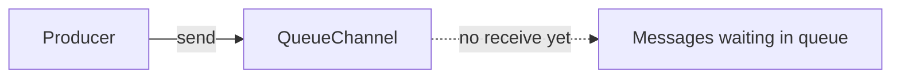
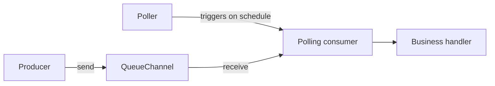

# Queue with no consumer

## 1. Objectives and scenario

In the **SPRING_INTEGRATION_CORE** module, chapter **Queue and pollable channel**, this lesson explains what happens when a producer sends a `Message` into a `QueueChannel` while nothing pulls messages out. This knowledge helps you design flows with endpoints, gateways, and Java DSL without mistaking queue admission for business completion.

After this lesson, you can:

- Explain why sending to a queue still succeeds when no consumer is present yet.
- Predict behavior when the queue has room, is full, or times out waiting.
- Distinguish declaring a channel from declaring an endpoint that consumes that channel.
- Diagnose backlogs and add an appropriate polling consumer.
- Design responses, error handling, and verifications for queue-backed flows.

Suppose an API accepts report-export requests and sends them into `reportQueue`. The API reports that requests were accepted, yet no reports are ever generated. One possibility to check is that the application declared the queue and producer without declaring an endpoint reading the queue. That is an issue with the flow's structure or runtime state; it is not necessarily a bug in the report-generation logic.

## 2. The queue stores messages; the consumer performs the work

`QueueChannel` is an implementation of `PollableChannel`. Producers call `send(...)` to put messages in; receivers call `receive(...)` to take messages out. For a standard channel backed by an in-memory queue, lacking a consumer does not immediately make sends fail as long as space remains. See [Message Channel Implementations](https://docs.spring.io/spring-integration/reference/channel/implementations.html).



A queue bean does not create processing logic on its own, nor does it automatically start a consumer just because a new message arrived. When using Spring Integration endpoints, you must wire an endpoint to that queue and supply an appropriate poller.



In the second diagram:

- **Message** carries payload and headers, such as request ID and correlation ID.
- **QueueChannel** holds waiting messages.
- **Polling consumer** is the endpoint actively pulling messages via polling.
- **Handler** runs the business work, such as invoking the report-generation service.

Handler and consumer are not completely synonymous terms. A processing service bean may already exist without an endpoint connecting that bean to the queue.

## 3. States to distinguish

When you observe messages piling up, do not jump straight to concluding the system has no consumer.

| State | Example cause | How to verify |
|---|---|---|
| No consumer configured | Only a `QueueChannel` bean exists | Search for an endpoint whose input channel is that queue |
| Consumer not running | Endpoint was stopped or does not auto-start | Check lifecycle and startup configuration |
| Polling inactive | Scheduler is stalled or next run has not arrived | Check schedule, resources, and latest poll timestamp |
| Consumer reads the wrong queue | Producer and endpoint use two different instances | Compare injected beans and the endpoint's channel |
| Consumer is slow | Handler calls a slow external service | Measure processing rate and execution duration |
| Pulled out but processing fails | Handler throws an exception | Track errors and business status by request ID |

For example, `new QueueChannel(100)` inside the producer and another `new QueueChannel(100)` inside endpoint configuration create two independent queues. Having the same capacity does not make them share messages.

## 4. What does a successful send mean?

For a direct `QueueChannel.send(message, timeout)` call, a successful return only confirms that placing the message into the queue succeeded. It does not confirm that a handler read it, a database updated, or the task completed.

Distinguish three milestones in business design:

1. **Accepted:** the producer got the request into the queue.
2. **Processing:** a consumer has begun executing the request.
3. **Completed or failed:** the business outcome has been recorded.

For instance, a report-export API can return a request ID upon acceptance. The UI uses that ID to query status afterward. If the UI displays "Report created" right after `send(...)` returns `true`, the response's claimed meaning goes beyond what the send operation actually guarantees.

### Queue with room vs. full queue

For a standard `QueueChannel` with finite capacity:

| Call | Queue has space | Queue full, no consumer |
|---|---|---|
| `send(message, 0)` | Places in queue and returns `true` | Returns `false`, does not wait for space |
| `send(message, 500)` | Places in queue and returns `true` | Waits for space up to timeout, then returns `false` if still full |
| `send(message)` | Places in queue and returns `true` | Waits for space with no finite timeout |

The timeout unit is milliseconds. A finite timeout is an operational wait limit, not a millisecond-exact response-time guarantee for the entire application. Refer to the API contract in the [QueueChannel Javadoc](https://docs.spring.io/spring-integration/docs/current/api/org/springframework/integration/channel/QueueChannel.html).

The outcomes in the table describe normal queue operation. Exceptions from interceptors, thread interruption, or custom components still need handling appropriate to the usage context. In addition, templates or gateways may turn send failures into exceptions; do not assume every API wrapping a channel returns a boolean.

## 5. Example observing a queue with no consumer

The following example uses Spring Integration Core on the classpath and runs as a standard Java program. No Spring application context is needed for direct queue operations. Public class names correspond to file names when you run the example yourself.

```java
import org.springframework.integration.channel.QueueChannel;
import org.springframework.messaging.Message;
import org.springframework.messaging.support.MessageBuilder;

public class QueueWithoutConsumerDemo {

    public static void main(String[] args) {
        QueueChannel queue = new QueueChannel(2);

        boolean first = queue.send(request("REPORT-001"), 0);
        boolean second = queue.send(request("REPORT-002"), 0);
        boolean third = queue.send(request("REPORT-003"), 0);

        System.out.println("first=" + first);
        System.out.println("second=" + second);
        System.out.println("third=" + third);
        System.out.println("queued=" + queue.getQueueSize());

        // From here main acts as a manual receiver.
        Message<?> received = queue.receive(0);
        System.out.println("received="
                + (received == null ? "none" : received.getPayload()));

        boolean retried = queue.send(request("REPORT-003"), 0);
        System.out.println("retried=" + retried);
        System.out.println("queuedAfterRetry=" + queue.getQueueSize());
    }

    private static Message<String> request(String requestId) {
        return MessageBuilder.withPayload(requestId)
                .setHeader("requestId", requestId)
                .build();
    }
}
```

Expected output in a single-threaded run with no other receiver:

```text
first=true
second=true
third=false
queued=2
received=REPORT-001
retried=true
queuedAfterRetry=2
```

The first two sends succeed even with no consumer yet. The third fails because the queue is full. After `receive(0)` removes one message, the queue has room for the subsequent send.

Notice that `REPORT-001` was merely pulled out and printed; the example did not execute report-generation business logic. Dequeueing and completing business work remain two separate events.

If you change the third send to `send(request("REPORT-003"))`, the program can block right there. Because `receive(...)` sits further down on the same thread, execution never reaches the code that frees space. This is an obvious example of a producer blocking due to faulty execution ordering.

## 6. Adding a polling consumer with Java DSL

The solution is to declare an endpoint reading the right queue, rather than merely increasing capacity. The configuration illustrated below uses Spring Integration 6.x/7.x Java DSL APIs; the application needs a Spring Integration Core dependency compatible with the Spring version in use.

```java
import org.springframework.context.annotation.Bean;
import org.springframework.context.annotation.Configuration;
import org.springframework.integration.channel.QueueChannel;
import org.springframework.integration.config.EnableIntegration;
import org.springframework.integration.dsl.IntegrationFlow;
import org.springframework.integration.dsl.Pollers;

@Configuration
@EnableIntegration
public class ReportIntegrationConfiguration {

    @Bean
    public QueueChannel reportQueue() {
        return new QueueChannel(100);
    }

    @Bean
    public IntegrationFlow reportConsumerFlow(QueueChannel reportQueue) {
        return IntegrationFlow.from(reportQueue)
                .handle(String.class, (requestId, headers) -> {
                    System.out.println("Processing " + requestId);
                    // Call the report-generation service here.
                    return null;
                }, endpoint -> endpoint
                        .id("reportConsumer")
                        .poller(Pollers.fixedDelay(200)
                                .receiveTimeout(0)
                                .maxMessagesPerPoll(5)))
                .get();
    }
}
```

This configuration must be loaded into a running Spring application context. The `IntegrationFlow` bean creates an endpoint consuming from `reportQueue`; the poller is configured directly on that endpoint. The lambda returns `null` because this is a one-way processing example producing no reply.

Values were chosen to make behavior easy to observe:

- `fixedDelay(200)`: sets the delay between poll cycles; actual timing is also affected by work in the previous cycle and execution resources.
- `receiveTimeout(0)`: when the queue is empty, do not hold the poll cycle waiting for new messages.
- `maxMessagesPerPoll(5)`: caps how many messages are processed in one cycle; does not create five parallel consumers.

Do not conclude this configuration is guaranteed to process 25 messages/second. If each report takes two seconds, handler time dominates throughput. Increasing parallelism requires additional design, along with checking processing order and thread-safety of the business service.

A default poller only provides shared configuration for endpoints that need polling. It does not automatically discover every queue and consume them. There must first be an endpoint connected to the queue; here that endpoint is created by `.handle(...)` following `.from(reportQueue)`.

If multiple `QueueChannel` beans exist, use `@Qualifier("reportQueue")` at injection points to name the bean explicitly. Producers must also receive this same bean from Spring rather than instantiating a new queue themselves.

## 7. Impact on gateways, transformers, routers, and filters

A queue often sits between multiple integration flow components. When a queue has no consumer, the effect depends on where it sits:

| Queue position | Observable symptom |
|---|---|
| Before transformer | Payloads entered the queue but were never transformed |
| Before router | Messages were never branched |
| Before filter | No accept or drop decision was made |
| Before aggregator | Data parts never reached the aggregator to be grouped |
| After request-sending gateway | Requests may have entered the queue, yet no component produces a reply |

Downstream components after the queue do not run merely because a producer called `send(...)`. They require an active consumption path from the queue to the corresponding endpoint.

### Request-reply gateways

For example, a gateway method returning a report result needs both a request-sending path and a reply-receiving path. If requests sit forever in a queue, no handler produces a reply. Callers may have to wait until timeout or according to the configured wait policy.

Therefore you must distinguish:

- **Send wait time:** waiting for the queue to have space to admit the request.
- **Reply wait time:** waiting for the result after the request has been admitted.

Increasing reply timeout does not fix a missing consumer. For long-running tasks, you can design a one-way submit method and track status by request ID; or keep request-reply if the business genuinely needs a result within a defined deadline.

### Aggregator lacking complete data

If one branch sends messages into an unconsumed queue before an aggregator, the correlation group may miss part of its data. When the aggregator emits no output, the cause can lie in an upstream queue rather than only in the release strategy. When investigating, trace the same correlation ID across branches.

## 8. Backlog, capacity, and endurance window

In the report-export scenario, suppose the queue has capacity `C = 1,000`, currently holds `Q0 = 200` messages, and the producer sends steadily at `λ = 40` messages/second. With no consumer and every send before full accepted, estimated time until full is:

```text
T_fill ≈ (C - Q0) / λ
       ≈ (1,000 - 200) / 40
       ≈ 20 seconds
```

This is a planning calculation for the example, not a framework timing guarantee. It ignores traffic variance and execution overhead.

If a consumer is restored but processes only `μ = 30` messages/second while input stays at `40`, the backlog keeps growing. If `μ = 60`, the backlog drains at roughly `20` messages/second under steady conditions. Having a consumer is not enough; processing capacity must match input.

Queue capacity is counted in messages, while memory usage depends on payload, headers, and related objects. One thousand messages containing only report IDs and one thousand messages containing large image payloads have very different costs.

The default queue is not durable storage across process crashes. If the problem requires preserving requests across restarts, design suitable storage or a broker along with a recovery mechanism. Increasing capacity does not satisfy that requirement. See [QueueChannel Configuration](https://docs.spring.io/spring-integration/reference/channel/configuration.html).

## 9. Designing the response when the queue is full

On the producer side, inspect the send outcome and tie it to business policy. The snippet below is an illustrative method in the ingestion service layer:

```java
public boolean tryAccept(
        QueueChannel reportQueue,
        Message<String> request) {

    boolean accepted = reportQueue.send(request, 200);
    if (!accepted) {
        // Record rejection metric or return busy status to caller.
        // Do not record this request as already placed in the queue.
        return false;
    }
    return true;
}
```

Concrete policies include returning busy so callers can retry, throttling input, or persisting requests to recoverable storage. If retrying, include appropriate backoff and bounds. Continuous retries while the consumer is still absent only add more load to the system.

Do not automatically spill into another unmonitored queue. Moving backlog elsewhere does not prove requests will ever be processed.

If callers may resend because they did not receive a response, the request ID should help detect duplicates at the business layer. Losing a response after acceptance and failing before acceptance are two distinct situations for retries.

## 10. Error handling once a consumer exists

Lacking a consumer does not automatically generate a business-processing exception for each waiting message. Because the handler has not run, do not expect `errorChannel` to notify you about every stuck request on its own.

When a consumer is active and a handler throws an exception inside a Spring Integration polling task, the error is normally routed through the task's error-handling mechanism, which may publish an `ErrorMessage` to the corresponding error channel. This differs from the caller directly catching a handler exception on the same call stack. Refer to [Error Handling](https://docs.spring.io/spring-integration/reference/error-handling.html).

For the report example, answer two operational questions separately:

1. Which requests never started processing?
2. Which requests were pulled out yet failed during report generation?

If using only an in-memory `QueueChannel`, never assume a handler error automatically puts the message back in the queue. Retries, error recovery, and failure tracking must be designed explicitly. Likewise, successful dequeue does not carry durable acknowledgment semantics like a broker with acks.

If you replace the error channel with a `QueueChannel`, you must also provide a consumption path for that error queue. Otherwise, errors can become a second backlog, making investigation harder.

## 11. Evidence-based diagnostic workflow

### Step 1: Confirm where the producer sends

Verify the injected channel bean, queue name, and send call return value. Log the request ID at ingestion time. Do not treat a "sending..." log line as proof that sending succeeded.

### Step 2: Confirm an endpoint reads the queue

Cross-check `.from(reportQueue)` or equivalent input channel configuration. Having a `ReportService` bean in the application context does not prove the queue is wired to that service.

### Step 3: Check that the endpoint and poller are running

Inspect lifecycle state, auto-startup settings, poll schedule, and scheduler/executor resources. If the endpoint was intentionally stopped for maintenance, know the backlog limit for that maintenance window.

### Step 4: Monitor queue depth alongside business progress

In a concurrent system, a single `getQueueSize()` read is just a snapshot at the observation instant. Do not check `getQueueSize() < capacity` and then send assuming space is guaranteed; another producer may send in between. Only the `send(...)` return value decides whether that send was accepted.

Signals to collect for the report scenario:

| Signal | Question it answers |
|---|---|
| Queue depth over time | Is the number of waiting requests climbing continuously? |
| Rejected or timed-out send count | Is ingestion already impacted? |
| Most recent processing start time | Is the consumer still making progress? |
| Wait time from admission to start | How long are requests waiting? |
| Completed and failed task counts | Is there business progress or only dequeue activity? |

These are signals to design collection for, not a claim that every metric name exists out of the box. Alert thresholds should be grounded in traffic, capacity, and the application's business deadlines.

### Step 5: Verify outcomes downstream of the queue

A shrinking queue does not prove processing succeeded. Messages may have been dropped by a filter, routed to another branch, or handled as errors. Use request IDs and correlation IDs to verify the full journey.

## 12. Verifications you should run yourself

Examples in this lesson are illustrative material; when applying them to a project, run them against that project's actual dependencies and configuration.

| Scenario | Setup | Result to confirm |
|---|---|---|
| Queue without consumer, room available | Capacity-2 queue, send one message with timeout 0 | Send succeeds, message stays waiting |
| Queue without consumer, full | Send three messages to capacity-2 queue | First two succeed, third returns `false` |
| Manual space release | Pull one message via `receive(0)`, then send again | Retry send is accepted |
| Consumer active | Load DSL config and send a specific request ID | Handler receives that exact ID within verification deadline |
| Consumer stopped | Stop endpoint then continue sending within capacity | Backlog grows, no new processing occurs |
| Handler fails | Trigger an intentional error in a test environment | Observe the error and corresponding business state |

When verifying asynchronously, use a confirmation signal from the handler, such as a latch with a timeout, instead of merely sleeping for a fixed duration. Never call `receive(...)` on the input queue from test code concurrently with the consumer assuming it is passive observation: that call removes the message from the queue and can steal work from the handler.

## 13. Self-check questions

**Why can a producer report success yet business logic never runs?**

Because the queue may have admitted the message while no endpoint is pulling it out. Check the consumer and processing progress.

**Does raising capacity from 100 to 10,000 fix a missing consumer?**

No. It only extends how long it takes before the queue fills and can increase memory cost and queuing delay.

**Can you declare a default poller and omit the endpoint?**

No. A poller is configuration serving endpoints that need polling; you still need an endpoint wired to the queue.

**Is an empty queue enough to conclude every request succeeded?**

No. You must cross-check business status, paths after dequeue, and processing errors.

**Can a consumer be attached after messages were already sent?**

Yes, provided the messages are still in that queue and the endpoint reads the exact same instance. With an in-memory queue, remember the process must still be alive; do not assume data survives a restart.

## 14. Principles to apply

In a flow with `QueueChannel`, clearly define who sends, who receives, when receives happen, what happens when full, and what proves business completion. Use finite capacity and suitable timeouts to bound producer wait times. Monitor backlogs alongside business progress, and design storage and error handling to match real requirements.

The core lesson of a **queue with no consumer** is that admission capacity can remain non-zero while processing capacity is zero. That decoupling lets integration components operate independently, yet also demands complete endpoint configuration and monitoring.
