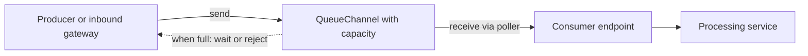
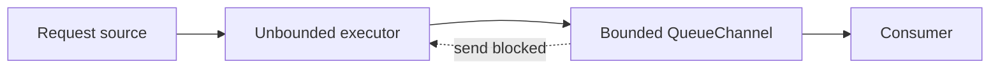

# Full queue and backpressure

## 1. The problem: producer faster than consumer

In Spring Integration Core, `QueueChannel` stores `Message<?>` instances for a consumer to pull and process later. Because it is a `PollableChannel`, the consumer actively calls `receive()`; in an integration flow, this is usually done by an endpoint with a poller.

For example, an order-ingestion system might accept 150 messages/second while the downstream service processes only 100 messages/second. A queue absorbs short traffic spikes. If the mismatch persists, waiting messages still grow by roughly 50 messages every second.

When the queue hits its limit, the system must decide: wait for space, reject new messages, throttle ingestion, or spill to another storage mechanism. That decision is part of the message admission contract, not merely a technical channel setting.

After this lesson, you can:

- Explain send behavior into a bounded `QueueChannel`.
- Distinguish a bounded queue from a complete backpressure mechanism.
- Combine capacity, send timeout, poller settings, and overload policies.
- Distinguish admission errors from processing errors at the endpoint.
- Test full-queue scenarios without hanging tests indefinitely.

## 2. QueueChannel creates a boundary between admission and processing



In this model, a successful send means the channel admitted the message into the queue. It does not prove the consumer finished processing or that the business task succeeded.

The consumer runs on the poller's schedule, typically on a different thread from the sender. If the consumer hits an error after pulling the message, that error does not propagate back to the `send()` call that already finished earlier.

This is a key difference from `DirectChannel`: with `DirectChannel` and a typical synchronous consumer, the sending thread executes the handler chain directly. With `QueueChannel`, the queue creates a buffer point and decouples send time from processing time.

### 2.1. Setting an explicit limit

```java
QueueChannel orders = new QueueChannel(100);
```

This queue holds at most 100 waiting messages. A `QueueChannel` created with the no-arg constructor has a very large default capacity, so it is unsuitable when the goal is an operationally meaningful memory limit.

Capacity is counted in messages, not bytes. One hundred messages carrying small strings differ drastically from one hundred messages holding references to large byte arrays. When choosing a limit, account for payload, headers, and the objects they retain in memory.

### 2.2. Capacity does not count all work in flight

When a consumer pulls a message out of the queue, a slot is freed immediately. That message may still be in the middle of processing.

Therefore:

```text
Unfinished work
  = messages waiting in the channel
  + messages currently being processed
  + messages waiting in other buffers
```

A queue with capacity 100 does not guarantee the entire application holds only 100 items of work. Executors, network connections, retries, and downstream channels can all hold additional work.

## 3. Full queue: what will send() do?

When interacting directly with a bounded `QueueChannel`, you can choose among three ways to send:

| Call | When no space remains | Meaning for the producer |
|---|---|---|
| `send(message, 0)` | Does not wait; returns `false` if unable to accept | Producer must handle rejection immediately |
| `send(message, timeoutMillis)` with positive timeout | Waits up to the given duration; returns `false` if still unable to send | Bounds wait duration at the send point |
| `send(message)` or negative timeout | May wait indefinitely until space opens | Sending thread can be held indefinitely |

These descriptions assume the operation encounters no exceptions or interruptions. Send timeout is the wait limit for channel admission, not business processing time.

Example:

```java
QueueChannel queue = new QueueChannel(1);

Message<String> first = MessageBuilder.withPayload("order-001").build();
Message<String> second = MessageBuilder.withPayload("order-002").build();

boolean acceptedFirst = queue.send(first, 0);   // true
boolean acceptedSecond = queue.send(second, 0); // false: queue is full
```

The second message was not placed into the queue. The first message remains in the queue; the channel does not automatically evict it to accept the new one.

### 3.1. Do not ignore the return value

The code below can cause the application to report success even though the message was never accepted:

```java
// Wrong if caller interprets this method as successful acceptance.
queue.send(message, 0);
return;
```

Clearer handling:

```java
boolean accepted = queue.send(message, 200);
if (!accepted) {
    throw new IntakeOverloadedException("Queue cannot accept more orders yet");
}
```

With direct operations on the channel, timeout expiration is typically indicated by `false`. Intermediary layers such as messaging templates or endpoints may convert failed sends into exceptions. When reading logs or designing error handling, know which API you are calling.

### 3.2. Each layer can have its own timeout

A request travels across multiple layers:

```text
Client → HTTP endpoint → messaging gateway → QueueChannel → consumer
```

HTTP client timeout, channel request send timeout, and reply wait timeout are not the same thing.

- Send timeout bounds waiting for the channel to accept the message.
- Reply timeout bounds waiting for the reply message in a request/reply flow.
- Client timeout bounds how long the caller waits for a response over the network.

Avoid setting a send timeout substantially longer than the request's remaining wait budget. If the client has already given up while the server keeps trying to send, the work can still be accepted later. Client retries can create duplicate requests; use business identifiers and idempotency mechanisms when that matters.

## 4. A bounded queue alone does not create complete backpressure

Backpressure is how information about downstream admission capacity propagates back upstream to throttle new incoming work.

With `QueueChannel`, signals can be:

- `send()` waits longer because the queue is nearly or completely full.
- `send()` returns `false` after its wait window.
- An intermediary reports a send failure, and the caller slows down or rejects requests.

But signals only work if upstream reacts. If the producer keeps creating tasks and piling them into an unbounded executor before calling `send()`, the backlog simply moves from the channel to the executor.



In this diagram, the channel limit does not bound the number of tasks queued in the executor. To control end-to-end load, examine buffers and concurrency limits across the entire pipeline.

`QueueChannel` also does not provide an element-by-element demand-request protocol like Reactive Streams. Do not infer that picking a bounded queue gives you reactive backpressure out of the box.

## 5. Choosing an overload policy

| Policy | Fits when | Must be designed alongside |
|---|---|---|
| Short, bounded wait | Load usually spikes in brief bursts | Latency budget and waiting-thread limit |
| Reject immediately | Sender can retry or self-throttle | Clear response, bounded retries |
| Slow down reading from source | Ingestion or task-generation rate is controllable | Rate limits, concurrency caps, adapter-appropriate pause mechanisms |
| Offload to durable storage | Critical work must survive restarts | Durable write confirmation, deduplication, recovery |
| Drop messages by policy | Data loss is tolerable, e.g., certain telemetry | Explicit drop rules and observability counters |

### 5.1. Bounded wait

Letting producers wait briefly can absorb small jitter. However, 500 concurrent requests waiting on the queue can still tie up 500 threads or request-bound resources, depending on execution architecture.

Never choose an indefinite wait just to avoid returning an error. If downstream stops working, calls can block forever and exhaust the ingress side's thread pool.

### 5.2. Explicit rejection

If the queue has not accepted the message, return a rejection result to the sender per the system's contract. In an API, the HTTP layer can map overload errors to responses matching API conventions; never return success before knowing whether admission succeeded.

Retries should have a maximum attempt count or deadline, backoff, and jitter. Immediate retries from many producers add load right when downstream is already overloaded.

### 5.3. Moving to a broker or persistent message store

A default in-memory `QueueChannel` is not a durable queue. If the application stops, messages still sitting in the queue can be lost.

You can design persistence via an appropriate message store or use a broker, though that is a different architectural decision. You must define when an item counts as durably accepted, how recovery works, processing order, and duplicate handling. Do not change one setting and conclude you now have exactly-once delivery.

### 5.4. Dropping messages is a business decision

`QueueChannel` does not automatically drop old messages when full. If you want to discard new data or replace old data, you must implement an intentional policy.

Do not apply silent dropping to orders, payments, or mandatory business tasks. Even when dropping some telemetry data is permitted, count drops to track quality degradation.

## 6. Java DSL example: bounded queue and timed ingress

The following example uses Spring Integration Java DSL APIs and Java 17+ `record` syntax. The application needs Spring Integration Core, component scanning for the ingress class, and standard configuration to start the Spring context.

Goals:

- Hold at most 100 pending orders in the channel.
- Wait at most 200 ms per send.
- Poller pulls at most 10 messages per poll cycle.
- If the queue has not accepted the message, report an admission error to the caller.

### 6.1. Payload and processing service

Place the declarations below in separate Java files in the appropriate application package.

```java
public record Order(String id) {
}
```

```java
public interface OrderProcessor {
    void process(Order order);
}
```

The application provides a bean implementing `OrderProcessor`. A real implementation might call an inventory service or record processing state in a database.

### 6.2. Declaring QueueChannel and consumer

```java
import org.springframework.context.annotation.Bean;
import org.springframework.context.annotation.Configuration;
import org.springframework.integration.channel.QueueChannel;
import org.springframework.integration.config.EnableIntegration;
import org.springframework.integration.dsl.IntegrationFlow;
import org.springframework.integration.dsl.Pollers;

@Configuration
@EnableIntegration
public class OrderIntegrationConfiguration {

    @Bean
    public QueueChannel ordersQueue() {
        return new QueueChannel(100);
    }

    @Bean
    public IntegrationFlow orderFlow(
            QueueChannel ordersQueue,
            OrderProcessor processor) {

        return IntegrationFlow
                .from(ordersQueue, endpoint -> endpoint.poller(
                        Pollers.fixedDelay(100)
                                .maxMessagesPerPoll(10)))
                .handle(Order.class, (order, headers) -> {
                    processor.process(order);
                    return null;
                })
                .get();
    }
}
```

The handler returns `null` because the example ends with one-way processing and sends no reply upstream. If multiple beans of type `QueueChannel` exist, add `@Qualifier("ordersQueue")` to the corresponding parameter.

`maxMessagesPerPoll(10)` is the maximum number of messages pulled in one poll cycle. It does not create 10 concurrent consumers and does not guarantee 100 messages/second.

In this synchronous processing setup, handler execution time falls inside the poll cycle runtime. With fixed delay, the next run adds a pause after the current cycle finishes. Each order's processing duration therefore directly affects how fast the queue drains.

### 6.3. Bounding send duration at ingress

```java
public class IntakeOverloadedException extends RuntimeException {
    public IntakeOverloadedException(String message) {
        super(message);
    }
}
```

```java
import org.springframework.beans.factory.annotation.Qualifier;
import org.springframework.messaging.Message;
import org.springframework.messaging.MessageChannel;
import org.springframework.messaging.support.MessageBuilder;
import org.springframework.stereotype.Service;

@Service
public class OrderIngress {

    private final MessageChannel ordersQueue;

    public OrderIngress(
            @Qualifier("ordersQueue") MessageChannel ordersQueue) {
        this.ordersQueue = ordersQueue;
    }

    public void submit(Order order) {
        Message<Order> message = MessageBuilder
                .withPayload(order)
                .setHeader("orderId", order.id())
                .build();

        boolean accepted = ordersQueue.send(message, 200);
        if (!accepted) {
            throw new IntakeOverloadedException(
                    "System is busy; order not accepted yet: " + order.id());
        }
    }
}
```

When `submit()` returns normally, the order has been admitted by the channel. If `processor.process()` fails afterward, ingress does not automatically learn that outcome.

The code above handles a `false` result from failing to send within the wait window. Other exceptions during sending still propagate; do not lump every error into "queue full."

The numbers 100, 200 ms, and 10 are illustrative choices. Tune them based on real traffic, message size, target latency, and downstream service capacity.

### 6.4. If using a messaging gateway

A gateway lets business code work against an interface rather than constructing `Message` objects manually. When replacing ingress with a gateway, still explicitly configure the request-send wait duration and, if there is a reply, the reply wait duration.

Do not confuse a gateway successfully sending into a queue with order processing being complete. For a one-way contract, describe the result as "accepted." For a contract awaiting processing results, design a reply channel, timeouts, and behavior when the client times out.

## 7. Tuning the poller and concurrency

### 7.1. Poll frequency solves only part of the problem

Reducing fixed delay lets the consumer check the queue more frequently. If the bottleneck is a 200 ms downstream call, lowering delay from 100 ms to 10 ms will not make that call any faster.

Increasing `maxMessagesPerPoll` lets one cycle process more messages. Too large a value can also cause a single poll cycle to run long and hold resources longer than expected.

### 7.2. Increasing concurrency conditionally

You can design parallel processing tasks, provided you verify:

- Whether handlers and shared components are thread-safe under concurrent execution.
- Whether database pools and downstream services can handle the added request volume.
- Whether business rules require per-order or per-customer ordering.
- Whether the executor has bounded queues and an appropriate rejection policy.

If you add a task executor to the poller or introduce an async boundary, re-examine everywhere backlogs can accumulate. An executor with an unbounded queue can make `ordersQueue` look uncongested while the application still piles up work elsewhere.

With parallel processing, the order messages are pulled from the queue does not guarantee business completion order either.

### 7.3. Avoid creating a closed wait loop

An easy-to-miss scenario:

1. The sole consumer pulls a message from the queue.
2. Another producer quickly fills the newly freed slot.
3. The consumer encounters an error and tries to re-send the message back into that same queue with an indefinite timeout.
4. The queue is full, and the sole consumer is blocked on the re-send call.

No consumer remains free to drain the queue, so the flow can deadlock. Use bounded retries, a separate recovery path, and appropriate timeouts; never re-send unboundedly back into the very queue the current consumer is responsible for draining.

## 8. Distinguishing admission errors from processing errors

| Scenario | Did message enter the queue? | Where to react |
|---|---|---|
| `send(message, 0)` returns `false` because queue is full | No | Producer or ingress |
| Send waits until timeout expires without success | No | Producer or sending intermediary |
| Handler fails after poller pulls message | Entered, then was pulled out | Endpoint/poller error handling mechanism |
| Application stops while in-memory queue still holds messages | Entered, not guaranteed processed | Storage and recovery design |

For a polling endpoint using the framework's default error handling, asynchronous errors during polling/processing are typically published as `ErrorMessage` instances to the appropriate error channel. You can configure the poller's error handler or error channel to apply custom policies.

However, a direct `send()` returning `false` does not automatically create an `ErrorMessage` on `errorChannel`. The producer must handle that outcome. Do not expect a downstream error-catching flow to catch every full-queue condition at ingress.

Furthermore, once a message is pulled from an in-memory queue, a handler failure does not automatically put that message back in the queue. If retry or recovery is required, design that mechanism explicitly. Wrapping processing in a transaction does not automatically turn an in-memory `QueueChannel` into a durably rollback-capable queue either.

The error-handling path needs its own capacity and overload policy. If the error flow itself blocks indefinitely, an initial error can cascade into a pipeline-wide stall.

## 9. Choosing capacity with numbers

Suppose during a traffic surge:

```text
Arrival rate:              150 messages/second
Actual processing rate:    100 messages/second
Burst duration:            10 seconds
Additional backlog:        (150 - 100) × 10 = 500 messages
```

If the queue starts empty and zero rejections are tolerated during this surge, you need room for roughly 500 accumulated messages, plus headroom for variance. This is a simplified estimate, excluding processing-time distributions and intervals when downstream pauses.

With queue capacity 100, if producers keep feeding exactly 150 messages/second while consumers process 100 messages/second, the queue can fill in roughly:

```text
100 / (150 - 100) = 2 seconds
```

Once producers start blocking or being rejected, the effective arrival rate changes; do not keep applying linear math as if every message still enters the queue.

### 9.1. Large queues increase wait time

If roughly 500 messages sit ahead of a message and the system drains steadily at 100 messages/second, preliminary queuing delay can be around 5 seconds, not counting processing time for that message itself.

Large queues can reduce short-term rejections, yet increase latency and retained backlog. If average arrival rate persistently exceeds departure rate, no finite capacity solves the sustained imbalance.

### 9.2. Little's Law for steady state

In a stable system, you can use the relation:

```text
L = λ × W
```

Where `L` is the average number of work items inside the measured scope, `λ` is the average throughput through that scope, and `W` is the average time work spends inside that scope.

If measuring only queuing, use queue wait time. If measuring the whole system, include work in flight. Do not apply this formula to a continuously growing queue and treat it as a steady state.

## 10. Testing a full queue

The two small tests below focus on the admission contract. Do not start a poller so a background consumer does not drain messages and make the full-queue condition disappear unexpectedly.

```java
import org.junit.jupiter.api.Test;
import org.springframework.integration.channel.QueueChannel;
import org.springframework.messaging.Message;
import org.springframework.messaging.support.MessageBuilder;

import static org.junit.jupiter.api.Assertions.*;

class QueueCapacityTest {

    @Test
    void rejectsNewMessageWhenQueueIsFull() {
        QueueChannel queue = new QueueChannel(1);
        Message<String> first = MessageBuilder.withPayload("first").build();
        Message<String> second = MessageBuilder.withPayload("second").build();

        assertTrue(queue.send(first, 0));
        assertFalse(queue.send(second, 0));

        // Accepted message remains; rejected message was not inserted.
        assertSame(first, queue.receive(0));
        assertNull(queue.receive(0));
    }

    @Test
    void acceptsNewMessageAfterConsumerFreesCapacity() {
        QueueChannel queue = new QueueChannel(1);
        Message<String> first = MessageBuilder.withPayload("first").build();
        Message<String> second = MessageBuilder.withPayload("second").build();

        assertTrue(queue.send(first, 0));
        assertSame(first, queue.receive(0));

        assertTrue(queue.send(second, 0));
        assertSame(second, queue.receive(0));
    }
}
```

These tests use timeout 0, so they never wait indefinitely. They directly verify two essential behaviors: rejecting when full and accepting again once space opens.

To test ingress, you can create a `QueueChannel(1)`, fill the queue, then call `OrderIngress.submit()` and assert `IntakeOverloadedException`. To test waiting sends, use a worker thread with a synchronization signal such as `CountDownLatch` and a timeout limit for the entire test; do not rely on a fragile sequence of `Thread.sleep()` timings.

For integration tests with a poller, add slow or failing handler cases to verify that admission responses and processing outcomes are observed independently.

## 11. Observability and diagnostics

Measure these signal groups together:

| Signal | Question it answers |
|---|---|
| Waiting message count and capacity | How much of the queue limit is in use? |
| Accepted send rate and completed processing rate | Is the backlog trending up or down? |
| Rejection count, send timeouts, and send wait duration | How much pressure are producers experiencing? |
| Waiting message age and processing latency | How much delay is the queue adding to work? |
| Tasks queued in executors, busy workers | Has the backlog shifted elsewhere? |
| Downstream errors, connection timeouts, connection pool usage | Which component limits throughput? |

`QueueChannel.getQueueSize()` helps observe queue depth at an instant. It is a snapshot that can change immediately whenever other producers or consumers act. Never use a "check size before sending" pattern to guarantee space; the return value of `send()` itself decides admission.

A queue constantly near full is a warning sign to investigate. An empty queue alone does not prove the system is healthy either: consumers may have offloaded many jobs onto another executor or be processing them very slowly.

When downstream fails, avoid logging entire large payloads on every full-queue occurrence. Log business IDs, channel names, wait durations, and appropriate counters so you can diagnose issues without adding I/O pressure.

## 12. Common design mistakes

- **Raising capacity every time a timeout occurs:** only delays hitting full if the bottleneck is untouched, while increasing memory and latency.
- **Calling `send()` with no timeout on request paths:** easily holds threads too long when downstream stops working.
- **Ignoring `false` return values:** can report acceptance while the message never entered the queue.
- **Setting a reply timeout and thinking sends are bounded:** the two wait durations belong to different stages.
- **Increasing poller concurrency without checking downstream:** can overload the target service further.
- **Retrying immediately and endlessly:** adds load right when the system lacks admission capacity.
- **Assuming handler errors automatically recover messages:** in-memory queues do not provide reliable reprocessing on their own.
- **Assuming channel capacity protects all buffers:** executors or other channels can still accumulate work unboundedly.
- **Using an in-memory queue as a durability guarantee:** restarts can lose unprocessed work.

## 13. Applied exercise

Design an email-sending request ingestion flow with these assumptions:

- Normal arrival rate is 40 requests/second.
- During a 5-second peak, arrival rate is 100 requests/second.
- The email-sending service sustains 60 requests/second.
- Callers must receive the admission outcome within at most 300 ms.

Complete the following:

1. Estimate backlog growth during the peak if no requests are rejected.
2. Choose capacity based on backlog, message size, and acceptable latency.
3. Choose a send timeout inside the response budget while leaving room for other steps.
4. Describe the response when the queue is full and the caller's retry rules.
5. State how work is protected across application restarts.
6. Write tests for a full queue, accepting again after space frees up, and consumer errors.

Quantitative hint: preliminary backlog growth is `(100 - 60) × 5 = 200` messages. If arrival rate returns to 40 requests/second after the peak, net drain rate is `60 - 40 = 20` messages/second, so draining the accumulated work takes about 10 seconds in this simple model.

## 14. Key takeaways

A bounded `QueueChannel` defines how many messages can wait at a point in the flow. When the queue is full, send timeout decides how long the producer waits; the send outcome and upstream policy decide whether backpressure actually reaches the source.

Good design combines capacity, send timeout, poll pace, concurrency level, downstream limits, and overload responses. At the same time, keep two guarantees separate: "admitted into the channel" and "business processing succeeded."
