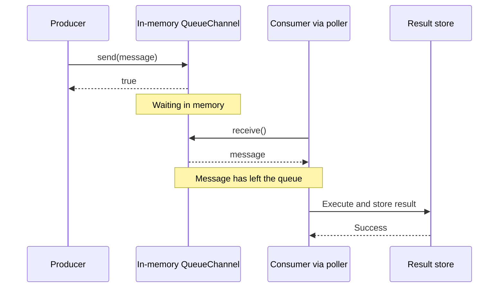

# Durability of in-memory queues

## 1. Under what conditions does a queue retain messages?

In the **SPRING_INTEGRATION_CORE** module, `Message` represents data and metadata, `MessageChannel` connects components, and endpoints perform work such as transformation, routing, or business invocation. `QueueChannel` adds a buffer so a producer can send ahead and a consumer can receive later.

**The default in-memory `QueueChannel` does not guarantee preserving messages across an application restart.** It fits smoothing rates between stages inside a single process, yet does not create a durable work store on its own. Spring Integration lets you swap in a persistent message store when you need to overcome this limit. See [QueueChannel configuration and persistent queues](https://docs.spring.io/spring-integration/reference/channel/configuration.html).

For example, a service receives thumbnail-generation requests and puts them into a queue. If thumbnails can be regenerated from source data, losing some requests may be acceptable. For payment charges or order capture requests, keeping work only in RAM usually does not satisfy recovery requirements.

In this lesson, **durability** means the ability to recover a message already accepted by the system after a crash. Keep it separate from other properties:

| Property | Question to answer |
|---|---|
| Buffering | Can work be held while consumers are not ready yet? |
| Thread safety | Can multiple threads send and receive concurrently and correctly? |
| Durability | When the process dies, can accepted work still be recovered? |
| Redelivery | When processing fails, who puts the work back to retry? |
| Duplicate side-effect protection | If reprocessed, will money be charged or goods shipped twice? |

A buffered, thread-safe channel can still lack durability. Nor can you infer retry/redelivery capability merely from the word "queue."

## 2. Message lifecycle and data-loss windows

Consider a work ingestion flow:



There are at least three independent milestones:

1. **Accepted by queue:** the producer handed the message to the buffer.
2. **Received by consumer:** the message was pulled out of the queue.
3. **Business completion:** side effects or results have been confirmed per the application contract.

With a standard `QueueChannel`, `send(message)` can succeed before any consumer receives. `receive()` removes the message from the queue; the API does not provide a `receive → ack/nack` cycle like some message brokers. Send/receive operations and timeouts are described in [Message Channel Implementations](https://docs.spring.io/spring-integration/reference/channel/implementations.html).

From this lifecycle, we can analyze the following scenarios:

| Failure point | What happened | Consequence for an in-memory queue |
|---|---|---|
| Before send succeeds | Queue has not accepted the work | Producer must detect and handle the failed handoff |
| After send, before receive | Work is sitting in the queue | Abrupt process stop loses buffered items not saved elsewhere |
| After receive, before writing result | Consumer already pulled the work out | Queue no longer holds a waiting copy to replay automatically |
| After side effect, before saving completion state | Part of the business work may have succeeded | Replaying from another source can cause duplicate side effects |
| During application redeployment | Old instance still has unprocessed work | New instance does not inherit the old instance's heap queue automatically |

Reasoning example: an API replies "accepted" immediately after putting a payment command into RAM. If the application dies before a consumer receives the command, the client may already have seen a success response while no durable record exists for the system to continue. That is an admission-contract problem, unsolvable merely by adding consumers.

## 3. Minimal Java experiment

The example below uses core classes and requires no Spring container. It simulates two phenomena: an error after `receive()` does not put the message back automatically, and a new channel does not contain the old channel's buffer.

```java
import org.springframework.integration.channel.QueueChannel;
import org.springframework.messaging.Message;
import org.springframework.messaging.support.MessageBuilder;

public class InMemoryQueueDurabilityDemo {

    public static void main(String[] args) {
        QueueChannel queue = new QueueChannel(10);

        Message<String> request = MessageBuilder
                .withPayload("create-thumbnail:photo-42")
                .setHeader("jobId", "thumbnail-photo-42-v1")
                .build();

        boolean accepted = queue.send(request, 0);
        System.out.println("accepted=" + accepted);
        System.out.println("queued-before-receive=" + queue.getQueueSize());

        Message<?> received = queue.receive(0);
        if (received == null) {
            throw new IllegalStateException("Expected a queued message");
        }

        try {
            process(received);
        } catch (IllegalStateException ex) {
            System.out.println("processing-error=" + ex.getMessage());
        }

        System.out.println("queued-after-failure=" + queue.getQueueSize());
        System.out.println("next-receive=" + queue.receive(0));

        queue.send(MessageBuilder.withPayload("pending-job").build(), 0);
        QueueChannel recreatedQueue = new QueueChannel(10);

        System.out.println("old-queue-size=" + queue.getQueueSize());
        System.out.println("new-queue-size=" + recreatedQueue.getQueueSize());
    }

    private static void process(Message<?> message) {
        throw new IllegalStateException("Image storage unavailable");
    }
}
```

Expected output:

```text
accepted=true
queued-before-receive=1
processing-error=Image storage unavailable
queued-after-failure=0
next-receive=null
old-queue-size=1
new-queue-size=0
```

In the program, the old queue still exists for observation. Creating a new instance only illustrates that the buffer belongs to each object; it is **not an actual crash/restart test**. To test restarts, you must run two consecutive processes as in the practice exercise at the end of this lesson.

In addition, the `catch` here is written by the demo code itself. The example has no poller, `errorChannel`, retry advice, or automatic recovery mechanism.

## 4. Placing the queue in a Java DSL flow

The following example places the buffer between a producer and a processing endpoint. `MessageHandler` is used as the final step so no unintended reply message is created.

```java
import org.springframework.context.annotation.Bean;
import org.springframework.context.annotation.Configuration;
import org.springframework.integration.channel.QueueChannel;
import org.springframework.integration.config.EnableIntegration;
import org.springframework.integration.dsl.IntegrationFlow;
import org.springframework.integration.dsl.Pollers;
import org.springframework.messaging.MessageHandler;

@Configuration
@EnableIntegration
public class ThumbnailFlowConfiguration {

    @Bean
    public QueueChannel thumbnailJobs() {
        return new QueueChannel(100);
    }

    @Bean
    public IntegrationFlow thumbnailFlow(QueueChannel thumbnailJobs) {
        MessageHandler worker = message -> {
            String job = (String) message.getPayload();
            // Replace with the thumbnail-generation service call.
            System.out.println("Processing " + job);
        };

        return IntegrationFlow.from(thumbnailJobs)
                .handle(worker, endpoint -> endpoint.poller(
                        Pollers.fixedDelay(200)
                                .maxMessagesPerPoll(10)))
                .get();
    }
}
```

This is a Java configuration to load into a running Spring application context with Spring Integration libraries; it omits build configuration and application bootstrap code. Producers send string payloads according to the example's contract.

Here:

- `thumbnailJobs` is the buffer point, holding at most 100 waiting messages.
- The poller triggers receives and invokes the handler on schedule; endpoint configuration adds no durable storage.
- `maxMessagesPerPoll(10)` limits messages pulled per poll cycle; it does not create 10 consumers and does not promise every message completes within 200 ms.
- If the worker throws an error after the message has left the queue, a separate error-handling policy is needed.

Poller and endpoint configuration are presented in [Message Endpoints](https://docs.spring.io/spring-integration/reference/endpoint.html).

If you replace the worker with a transformer, router, or filter, keep asking which messages are valid outputs and which must be saved for further processing. For example, a filter intentionally dropping invalid data is a business decision; it differs from accidentally losing work when a process dies.

A gateway placed in front of the queue can offer a convenient Java interface. Still, a method-call interface does not change where messages are stored. With a one-way design, define clearly whether "call succeeded" means accepted into RAM or durably persisted as a job. With a request/reply design, define which business milestone the reply proves is finished.

## 5. Capacity and timeout protect resources, not durability

An unbounded default queue is still bounded by physical memory. The Javadoc recommends using a bounded queue to avoid out-of-memory risk; waiting element count can be observed via `getQueueSize()`. See the [QueueChannel API](https://docs.spring.io/spring-integration/api/org/springframework/integration/channel/QueueChannel.html).

Example setting capacity to 1:

```java
QueueChannel queue = new QueueChannel(1);

boolean first = queue.send(
        MessageBuilder.withPayload("job-1").build(), 0);
boolean second = queue.send(
        MessageBuilder.withPayload("job-2").build(), 0);

System.out.println(first);  // true
System.out.println(second); // false because queue is full
```

`send(message, 0)` tries sending immediately without waiting for space. A positive timeout bounds wait time; it is not a time-to-live for messages already placed in the queue. With the default queue, an overload without timeout can block when full; similarly, `receive()` can block when empty. In demo code, pass explicit timeouts to avoid unintended hangs.

An estimation approach for experimental design:

```text
Producer: 500 jobs/second
Consumer: 300 jobs/second
Backlog growth rate: 200 jobs/second
Capacity: 2,000 jobs, initially empty
Time until full: approximately 2,000 / 200 = 10 seconds
```

This is an average-rate calculation assuming steady rates and ignoring jitter. It helps show that enlarging the queue only extends how long the system tolerates load exceeding capacity. Large payloads can also cause the application to run out of memory before hitting expected capacity.

Producers must handle `false` results or send errors according to their contract. For instance, reject admission so callers can retry, or persist the job durably. Ignoring send results can lose work even when the application never restarts.

## 6. Why transactions, errorChannel, and retries are not enough

### 6.1. A business transaction does not automatically roll back an in-memory buffer

Consider a worker that pulls a message and then writes data inside a `@Transactional` method. If the database write fails, the transaction can roll back the database changes participating in it. That does not mean pulling from the default `QueueChannel` is undone.

The reason to check is **which resources actually participate in the transaction**, not merely whether an annotation is present. Spring Integration supports wrapping polling operations in a transaction, but rolling back a receive requires the receive source to have matching transactional semantics. Thread-bound transactions also do not automatically span work handed off to another thread. See [Transaction Support](https://docs.spring.io/spring-integration/reference/transactions.html).

Design takeaway: if the queue sits in RAM and the database is the only transactional resource, database rollback is not proof of work replayability. Re-inspect the queue or authoritative job source.

### 6.2. errorChannel carries error information

In typical polling configurations, Spring Integration can wrap errors into an `ErrorMessage` and send them to the error handling channel. The default `errorChannel` uses a `PublishSubscribeChannel` with a subscriber that logs at error level. Details are in [Error Handling](https://docs.spring.io/spring-integration/reference/error-handling.html).

Recording an error tells operations what happened, but does not automatically create a replayable copy of the job. If you configure the error channel yourself using an in-memory `QueueChannel`, queued error data shares the exact same restart limitation.

Reasoning example: after reading an email-send command, the worker hits an SMTP error and only logs it. The input queue is now empty; a log line is not a list of unfinished work. To recover, the application must save sufficient job information and have an explicitly designed replay path.

### 6.3. Retries handle transient errors within configured bounds

Retries can re-invoke a failed operation while the process stays alive. If all retry state lives solely in RAM, a process crash loses that state too.

When designing retries, determine:

- Which operation is retried and what side effects may already have occurred?
- After retries are exhausted, where does the job go?
- Does the place storing failed jobs survive restarts?
- Who is authorized to replay them and which key prevents duplicate side effects?

Re-sending infinitely back into the original queue is not a complete recovery policy. For instance, a malformed payload can loop endlessly and waste resources; a full queue can cause the re-send itself to block or fail.

## 7. When durability is required, change where work is stored

### 7.1. Persistent message store

Spring Integration has different message store implementations. An in-memory store like `SimpleMessageStore` does not become durable just because its name contains "store." When using a persistent store, also check serialization of payloads and headers. A temporary reply target belonging to an old process will not automatically become a valid reply path after a restart either. See [Message Store](https://docs.spring.io/spring-integration/reference/message-store.html).

For JDBC, `JdbcChannelMessageStore` is the channel-specific implementation. Prepare the schema and query provider matching your database per [JDBC Message Store](https://docs.spring.io/spring-integration/reference/jdbc/message-store.html).

A migration plan can start with these steps:

1. Choose a database persisted outside the application process's lifecycle; an in-memory-only database does not pass this restart test.
2. Prepare schema matching your library version and configure the store.
3. Use a stable queue group identifier across restarts to locate the same work again.
4. Enclose message retrieval and business steps needing atomicity in an appropriate transaction.
5. Verify payloads, headers, and business data remain readable after deploying new versions.

With a transaction-capable persistent store such as JDBC and a transaction-configured poller, message retrieval can roll back when processing fails. That is a change in storage and transaction mechanics; it is not an inherent property of an in-memory queue. See [Persistent QueueChannel Configuration](https://docs.spring.io/spring-integration/reference/channel/configuration.html).

Do not assume any arbitrary database or broker satisfies every durability tier. Reasoning example: swapping an out-of-process database for an in-memory-only database leaves Java class names unchanged, yet recovery after losing the database is completely different.

### 7.2. Brokers and replayable job sources

Another approach is placing work on a broker and connecting via appropriate adapters/channels. When evaluating this approach, specify storage configuration, acknowledgment timing, and replay mechanics. Selecting a specific product is outside this lesson on in-memory queues.

An application can also treat a persisted job table or event store as the source of truth. In that case, the in-memory queue only holds processing hints; losing the queue can be recovered by rebuilding from unfinished jobs.

Design example for a report-generation system:

```text
Ingestion transaction:
  Save report_job(job_id, status=PENDING)
  Commit

Scheduling step:
  Find PENDING jobs
  Put job_id into in-memory queue for worker processing

Worker:
  Receive job_id
  Check/acquire claim to process job
  Generate report by business key
  Save completion status

After restart:
  Re-read jobs still needing processing from the database
```

This is an architectural sketch, not a complete multi-worker algorithm. Implementation must handle claim contention, workers crashing mid-job, and lease expiration. The core value of the design is that the queue is no longer the sole copy of the request.

### 7.3. Durable storage does not equal once-only side effects

Reasoning example: a worker sends an email successfully and then dies before saving completion status. When the job source replays, the email may be sent again. The queue may have done its job preserving the work, yet the business logic still needs deduplication.

Use a stable business key such as `jobId`, `orderId + operationType`, or an idempotency key supported by the target service to identify reprocessing. Do not assume `MessageHeaders.ID` stays the same across message reconstructions.

If a transaction both writes business data and needs to publish work to another system, consider the transactional outbox pattern: save the work to publish in the same transaction as business data, then let a separate process dispatch it. This is a design choice that narrows the data-loss window, while still requiring handling for duplicate dispatch.

## 8. Shutdown, multiple instances, and operational observability

Graceful shutdown reduces in-flight work. An operational sequence might be:

1. Stop accepting new requests or stop producers.
2. Let consumers drain remaining backlog within an allowed grace period.
3. Monitor in-flight work alongside queue item counts.
4. When time runs out, handle remaining work per your chosen data-loss contract or recovery source.

This sequence must be configured and tested for the specific application; it is not an automatic guarantee of every Spring context. Nor does it protect against power loss or a forced kill mid-flight.

Two-instance reasoning example: A holds 50 jobs in its RAM queue; B has an empty RAM queue. If A dies, B cannot read A's heap to take over. Adding replicas increases processing capacity, yet does not turn local queues into a shared durable queue.

For observability, distinguish these metrics:

| Metric | What does it help reveal? |
|---|---|
| Waiting job count | Whether the buffer is growing |
| In-flight job count | Queue may be empty while workers are still unfinished |
| Oldest job age | Whether a subset of jobs is starving |
| Rejected or timed-out send count | Producers have hit admission limits |
| Error count and jobs awaiting recovery | Whether failures are accumulating |
| Completion count by business key | Whether inputs reconcile against outputs |

`getQueueSize() == 0` only tells you no items are waiting at the moment of inspection; it does not prove all business work is complete. A message pulled out and immediately failing also decreases queue size.

## 9. Practice labs to test durability assumptions

### Practice A: does waiting work survive a restart?

1. Build an app with a `QueueChannel(10)` and leave the consumer turned off temporarily.
2. Send three messages with `jobId` values `job-1`, `job-2`, `job-3`; record send outcomes.
3. Confirm the queue holds three items, then stop the process.
4. Start the app again, ensuring startup code does not resend the three messages automatically.
5. Inspect the new queue and reconcile `jobId` values against business results.

Expected result for an in-memory queue: the new queue is empty. If messages reappear, trace what resent them, such as startup logic or an upstream system. Never conclude the RAM queue persisted data solely from that observation.

### Practice B: do errors after receive replay automatically?

1. Send a job with a distinct key.
2. Let the worker receive it and intentionally throw an error before recording completion.
3. Observe the queue and the actual error path.
4. Check whether any component actively retries, resends, or saves failed work.

With the default queue and no added recovery mechanism, a dequeued message will not reappear automatically just because the handler threw an error. With any other configuration, be able to explain which component produces replay behavior.

### Practice C: compare against a persistent store

Once an appropriate persistent store configuration is in place, repeat test A with the same queue identifier and durable database. For test B, configure transactions on the poller and verify that an error genuinely rolls back the transaction.

Record three observations separately: whether the job remains in the store, whether business state committed, and whether external side effects occurred. Do not collapse all three questions into a single remark of "no messages lost."

These practice exercises are guides for learners; code and expected results in documentation do not replace running tests in a real application.

## 10. Choosing an in-memory queue based on the work contract

| Work type | When can an in-memory queue fit? | What must be clarified |
|---|---|---|
| Cache warming or thumbnails | Source data exists and can be rebuilt | Who detects and regenerates missing items? |
| Ephemeral in-process work | Losing work on process loss is acceptable | How are producers notified when the queue is full? |
| Running jobs stored in a database | Queue is only a buffer, reloadable | How workers claim jobs and recover interrupted ones |
| Order capture or payment commands | Do not use RAM as sole copy if accepted requests must be kept | Durable write point, transactions, and deduplication keys |

Before placing an in-memory `QueueChannel` into a flow, be able to answer: **if the process dies right after the acceptance response, where will the system recover the work from?** If the answer is only "from the queue of the process that just died," the design lacks a recovery path for that work.
