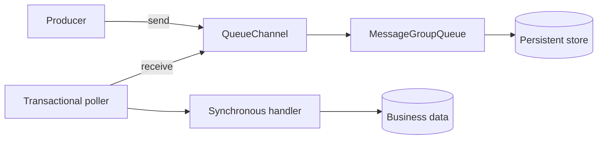

# When you need a MessageStore-backed channel

## 1. The problem: accepted messages must survive a restart

In the **Queue and pollable channel** chapter of the **SPRING_INTEGRATION_CORE** module, this lesson explains when to persist a queue to durable storage and how to connect that store to an endpoint using Java DSL. The focus is on design decisions, transaction boundaries, and message-flow recovery.

Suppose a sales system receives invoice-generation requests. The customer already received a request ID, yet the worker has not finished processing when the application must redeploy. If requests exist only in RAM, the system has no data left to resume work after starting up.

The default `QueueChannel` holds messages in memory. It provides a buffer and an active consumer mechanism via `receive()`, but does not bring recovery after process loss on its own. When durability is needed, you can use a channel backed by a persistent message store or an external messaging system. [Channel types documentation](https://docs.spring.io/spring-integration/reference/channel/implementations.html).

Objectives after this lesson:

- Identify which requirements genuinely need a durable queue.
- Distinguish channel, queue adapter, and message store.
- Configure a JDBC flow with a transactional poller.
- Explain scenarios of message loss or duplicate processing.
- Design tests for restarts, rollbacks, and data errors.

## 2. How does a MessageStore-backed channel work?

A MessageStore-backed channel is a channel that uses a message store to hold waiting messages. Durability depends on the store implementation and underlying infrastructure; the name `MessageStore` alone does not prove data was written to durable storage.

Roles to keep separate:

| Component | Responsibility |
|---|---|
| `Message<?>` | Carries payload and headers across the integration flow |
| `QueueChannel` | Provides point-to-point send and receive interface |
| `MessageGroupQueue` | Maps queue operations onto operations on a group in the store |
| Message store | Stores and retrieves message data |
| Polling consumer | Pulls messages and invokes the handler on the poller schedule |

`MessageGroupQueue` implements `BlockingQueue<Message<?>>` on top of a `BasicMessageGroupStore`. `groupId` identifies the logical queue; you must keep the same value across restarts to read back the same data group. Rollback capability requires a transaction-capable store; surviving process crashes requires a durable store. [MessageGroupQueue API](https://docs.spring.io/spring-integration/api/org/springframework/integration/store/MessageGroupQueue.html).



The diagram shows the roles, not two independent copies of the queue. In a configuration using `MessageGroupQueue`, waiting data is manipulated through the store.

## 3. When should you choose it?

Start with the business question: **If the application stops right after admission, is this request allowed to vanish?** If the answer is no, determine where it is durably stored before confirming acceptance.

| Scenario | Design direction to consider |
|---|---|
| Invoicing tasks must continue after deployment | Durable queue and stable request identifiers |
| UI events can be rebuilt from source data | In-memory queue may suffice |
| No queuing needed; short, synchronous work | `DirectChannel` may fit |
| Many independent services exchanging high volume | Evaluate a broker and JMS/AMQP adapters |
| Business data and queue share one RDBMS | Evaluate JDBC store with local transactions |
| Just need the handler to run on another thread | Not enough reason to put data in a database |

These are design hints, not conclusions for every load profile. For instance, an invoicing system handling only tens of requests per minute may comfortably accept extra JDBC operations, while an event-distribution platform serving dozens of services typically calls for a dedicated messaging architecture evaluation.

Spring Integration documentation recommends considering JMS or AMQP rather than using a database as a queue. With a JDBC channel store, pick the query provider for your database and evaluate your RDBMS's concurrent polling capacity. [JDBC Message Store](https://docs.spring.io/spring-integration/reference/jdbc/message-store.html).

## 4. Choosing the right store type

Do not swap stores around simply because their names look similar:

| Option | Purpose in this lesson |
|---|---|
| `SimpleMessageStore` | In-memory store; does not solve surviving restarts |
| `JdbcMessageStore` | General-purpose store, usable for group-holding components such as aggregators |
| `JdbcChannelMessageStore` | JDBC store specialized for message channels |

`JdbcChannelMessageStore` implements channel-specific interfaces and uses database-specific SQL queries. It is not a drop-in replacement for an aggregator store. Configuration must supply a `DataSource` and a `ChannelMessageStoreQueryProvider`. [JdbcChannelMessageStore API](https://docs.spring.io/spring-integration/api/org/springframework/integration/jdbc/store/JdbcChannelMessageStore.html).

A flow with a durable queue followed by an aggregator still has two stateful places: the queue backlog and the aggregator's accumulating groups. Protecting the first does not automatically protect the second. You must separately decide what data needs recovery at each buffer point.

Payloads and headers must also fit the store's serialization strategy. Temporary channel objects in `replyChannel` or `errorChannel` are one example to watch out for when persisting messages. Turning a channel into a lookup name does not keep a gateway's waiting thread alive across a restart. [Message Store and serialization limits](https://docs.spring.io/spring-integration/reference/message-store.html).

## 5. Example: invoicing queue using PostgreSQL

The example uses a `String` `orderId` as payload to focus on queue mechanics. Assume the application has:

- Compatible `spring-integration-core`, `spring-integration-jdbc`, Spring JDBC, and PostgreSQL driver within the same dependency management system.
- A `DataSource` connected to PostgreSQL whose data persists across restarts.
- The message store schema created from the corresponding script in the `spring-integration-jdbc` JAR of the version in use.
- A business table `invoice_job(order_id varchar(100) primary key, status varchar(30) not null)`.

The store schema must be managed like application schema: deployed before consumers run, migration-controlled, and preserved across restarts. Never use a drop-and-recreate-on-startup mode for recovery testing.

```java
package example.integration;

import javax.sql.DataSource;

import org.springframework.beans.factory.annotation.Qualifier;
import org.springframework.context.annotation.Bean;
import org.springframework.context.annotation.Configuration;
import org.springframework.integration.annotation.IntegrationComponentScan;
import org.springframework.integration.annotation.MessagingGateway;
import org.springframework.integration.channel.QueueChannel;
import org.springframework.integration.config.EnableIntegration;
import org.springframework.integration.dsl.IntegrationFlow;
import org.springframework.integration.dsl.Pollers;
import org.springframework.integration.jdbc.store.JdbcChannelMessageStore;
import org.springframework.integration.jdbc.store.channel
        .PostgresChannelMessageStoreQueryProvider;
import org.springframework.integration.store.MessageGroupQueue;
import org.springframework.jdbc.core.JdbcTemplate;
import org.springframework.jdbc.datasource.DataSourceTransactionManager;
import org.springframework.messaging.PollableChannel;
import org.springframework.transaction.PlatformTransactionManager;

@Configuration
@EnableIntegration
@IntegrationComponentScan(basePackageClasses = InvoiceFlowConfig.class)
public class InvoiceFlowConfig {

    @Bean
    public JdbcChannelMessageStore invoiceStore(DataSource dataSource) {
        JdbcChannelMessageStore store =
                new JdbcChannelMessageStore(dataSource);
        store.setChannelMessageStoreQueryProvider(
                new PostgresChannelMessageStoreQueryProvider());
        store.setRegion("billing");
        return store;
    }

    @Bean
    public PollableChannel invoiceRequests(
            JdbcChannelMessageStore invoiceStore) {
        return new QueueChannel(
                new MessageGroupQueue(invoiceStore, "invoice-requests-v1"));
    }

    @Bean
    public PlatformTransactionManager invoiceTransactionManager(
            DataSource dataSource) {
        return new DataSourceTransactionManager(dataSource);
    }

    @Bean
    public IntegrationFlow invoiceFlow(
            @Qualifier("invoiceRequests") PollableChannel invoiceRequests,
            @Qualifier("invoiceTransactionManager")
                    PlatformTransactionManager transactionManager,
            DataSource dataSource) {
        JdbcTemplate jdbc = new JdbcTemplate(dataSource);

        return IntegrationFlow.from(invoiceRequests)
                .handle(String.class, (orderId, headers) -> {
                    jdbc.update("""
                            insert into invoice_job(order_id, status)
                            values (?, 'READY')
                            on conflict (order_id) do nothing
                            """, orderId);
                    return null;
                }, endpoint -> endpoint
                        .id("invoiceWorker")
                        .poller(Pollers.fixedDelay(500)
                                .receiveTimeout(0)
                                .maxMessagesPerPoll(1)
                                .transactional(transactionManager)))
                .get();
    }

    @MessagingGateway(defaultRequestChannel = "invoiceRequests")
    public interface InvoiceGateway {
        void submit(String orderId);
    }
}
```

This is an illustrative configuration to integrate into an application that already has a datasource and schema, not a standalone project. Text blocks require an appropriate Java level; the `on conflict` SQL clause is specific to PostgreSQL.

The gateway returns `void`, expressing a contract of accepting work for later processing. The handler returns `null` to end the one-way flow. The code above records a ready job; it does not issue an invoice or call an external service yet.

`region = "billing"` and `groupId = "invoice-requests-v1"` are chosen explicitly. When a new deployment needs to continue the old backlog, reuse those exact values and the same database. If intentionally changing the group, plan how to migrate or drain old data.

The poller pulls one message per cycle to make the example easy to observe. `receiveTimeout(0)` does not wait when the queue is empty; `fixedDelay(500)` governs polling cadence; `.transactional(transactionManager)` applies a transaction to the polling task. These are separate controls, not a guarantee of processing exactly one message every 500 ms. [PollerSpec API](https://docs.spring.io/spring-integration/api/org/springframework/integration/dsl/PollerSpec.html).

### Java DSL channel declaration variant

You can replace just the `invoiceRequests` bean with the declaration below while keeping the other beans. Do not declare two beans with the same name simultaneously:

```java
import org.springframework.integration.dsl.MessageChannels;
import org.springframework.integration.dsl.QueueChannelSpec;

@Bean
public QueueChannelSpec.MessageStoreSpec invoiceRequests(
        JdbcChannelMessageStore invoiceStore) {
    return MessageChannels.queue(
            invoiceStore, "invoice-requests-v1");
}
```

Spring uses the spec bean to construct the channel. `MessageChannels.queue(store, groupId)` is the DSL API expressing the same relationship between the store and the logical queue. [MessageChannels API](https://docs.spring.io/spring-integration/api/org/springframework/integration/dsl/MessageChannels.html).

## 6. Transactions determine recoverability

Persistence only protects data that has been written successfully. Examine two stages separately: producer putting into the queue and consumer pulling to process.

### Producer side

If the send operation participates in an active transaction, `send()` returning does not mean the transaction has committed. A "durably accepted" contract must be tied to a successful commit. If you both write an order and enqueue a message in the same database, you can design them to share a local transaction; ensure they use the same resource and transaction manager.

Example to analyze: writing the order succeeds and then the process dies before enqueueing. A durable queue cannot conjure up a message that was never written. The design needs a shared transaction or an appropriate outbox and relay mechanism.

### Consumer side

The message is pulled from the store during polling. With a transaction-capable store and a transactional poller, removal only takes final effect when the transaction commits; rollback allows the message to be received again. [Persistent QueueChannel configuration](https://docs.spring.io/spring-integration/reference/channel/configuration.html).

In the example, the desired timeline is:

```text
BEGIN
  receive orderId from invoiceRequests
  write invoice_job via the same DataSource
COMMIT
```

If the handler throws an error and the transaction rolls back, both the message removal and business changes in that transaction are undone. If the handler catches the error and returns normally, the transaction can commit and the message is gone from the queue even though the business work did not finish.

Spring transactions are bound to the thread in this model. Subsequent synchronous steps can join the same transaction; crossing to another thread via an async boundary does not carry the transaction along automatically. Therefore, inserting an `ExecutorChannel` between the poller and the business operation changes the protection boundary and must be analyzed. [Transaction Support](https://docs.spring.io/spring-integration/reference/transactions.html).

An HTTP call does not become a resource of a local JDBC transaction either. For example, the external system issued an invoice, yet the application died before commit: redelivery can call the issue operation again. Use business identifiers and duplicate-protection contracts on the side with side effects.

## 7. Persistence does not equal exactly-once

In a design with rollbacks or retries, prepare for messages to be reprocessed. `orderId` in the example both identifies the job and acts as the unique key of the `invoice_job` table. `on conflict ... do nothing` prevents creating two jobs for the same order; it does not prove every subsequent invoice-issuing operation is idempotent.

A strategy for real workloads:

1. Define a business key such as `invoiceRequestId` supplied by the producer and kept stable across retries.
2. Record job state using a uniqueness constraint in the database.
3. For external APIs, pass the same idempotency key on retries if the API supports it.
4. Consider work complete only when corresponding business evidence exists.

Do not rely solely on `MessageHeaders.ID` as a deduplication key if the producer might construct a new message for the same request: a new message may carry a different ID.

## 8. Error handling and unprocessable messages

Errors from a handler invoked by a poller occur after the producer enqueued; they cannot be treated as exceptions returned synchronously to the original send call. Spring Integration has a mechanism to create an `ErrorMessage` and route it to an error channel for asynchronous tasks, including errors in a scheduled poller. [Error Handling](https://docs.spring.io/spring-integration/reference/error-handling.html).

Separate two design goals:

| Goal | Example |
|---|---|
| Observe errors | Logs, metrics, alerts by request ID |
| Decide message fate | Roll back to retry, or move to quarantine |

Having logs on `errorChannel` does not prove you have bounded retries or durable quarantine. The example configuration does not include those policies yet.

A malformed payload that always triggers a rollback can keep reappearing and block progress. Set appropriate retry limits, separate transient errors from data errors, and design a path moving failed work for manual inspection. If "remove from source queue and write to error queue" must be atomic, verify both participate in the corresponding transaction.

Do not expect an in-memory counter to survive restarts. Nor should you assume mutating a header and then rolling back persists the attempt count; you need an explicit retry-state storage design.

## 9. Cost and operational limits

Moving the backlog to a database shifts cost from holding objects in RAM to writes, reads, serialization, and transactions. That is a resource trade-off, not infinite scaling.

Hypothetical example where a producer sends 120 messages/second and a consumer processes only 80 messages/second for 10 minutes:

```text
Backlog growth = (120 - 80) × 600 = 24,000 messages
```

If each record averages 4 KiB, message data alone is roughly 94 MiB, before indexes, transaction logs, and database overhead. These numbers are hypothetical for estimation practice, not a Spring Integration benchmark.

Monitor queue depth, oldest message age, enqueue/dequeue rates, rollback rate, query latency, and connection pool utilization. Backlog age helps spot stuck work even when total record count looks small.

Do not infer from `new QueueChannel(100)` that a store-backed configuration has an equivalent limit. XML `<queue message-store="...">` syntax does not allow combining a `capacity` attribute. If you need backpressure, design admission limits via appropriate APIs and cross-instance coordination, then measure under load. [QueueChannel configuration](https://docs.spring.io/spring-integration/reference/channel/configuration.html).

When multiple consumers process concurrently, dequeue order does not guarantee completion order: an earlier job may run slower. If business rules require per-customer ordering, design partitioning or dedicated serialization rather than assuming it from the word FIFO.

## 10. Verifications to run

The steps below are a practice plan for learners; this article does not claim these tests have already been executed. Use a dedicated database and the exact target engine for integration testing.

### 10.1. Verifying survival across restarts

1. Stop the `invoiceWorker` endpoint so messages are not consumed yet.
2. Send `ORDER-001`, `ORDER-002`; ensure those writes committed.
3. Shut down the application, keeping the database and data intact.
4. Start up again with the same region and group ID, with the endpoint running.
5. Verify two business jobs exist and the backlog was consumed.

Comparing against an in-memory queue makes the difference clear. A graceful restart test verifies only part of the story; also test terminating the process after enqueueing has committed.

### 10.2. Verifying consumer rollback

In a test environment, add an exception right after `jdbc.update(...)`. After the failed attempt finishes, stop the endpoint and observe:

- No business record was committed from that attempt.
- The message can still be received again.
- After removing the simulated error, the job processes successfully.

Do not pull a message with an outside-transaction `receive()` and then invoke the handler yourself to test poller rollback: that changes the exact boundary being verified.

### 10.3. Verifying deduplication and hard failure modes

| Test | What to prove |
|---|---|
| Send two distinct messages with the same `orderId` | Only one business job is created per unique key |
| Change group ID while backlog exists | Old data is not automatically moved to the new queue |
| Send payload incompatible with store | Acceptance is not confirmed when persistence fails |
| Database disconnects during send | Producer receives an error outcome matching the contract |
| Handler always fails | Mechanism exists to detect, halt, or quarantine failing work |
| Two instances process concurrently | No duplicate business outcomes beyond allowed policy |

Inspect both queue state and business results. Seeing only a "handler ran" log line is not enough to prove commit, recovery, or deduplication.

## 11. Self-check on design decisions

Before choosing a MessageStore-backed channel, answer:

- Which data must never be lost, and when does the producer confirm acceptance?
- Where does the store actually persist data, using what schema and backup policy?
- Are region and group ID kept stable across deployments?
- Are the poller and business logic inside the intended transaction?
- Which side effects sit outside the JDBC transaction?
- How are deduplication keys, retry limits, and error quarantine designed?
- Does a JDBC queue fit the expected load, or should a broker be evaluated?

Choose a durable channel when you need to recover accepted work. To meet business requirements, combine durable storage with properly scoped transactions, clear admission contracts, safe retry handling, and tests that observe post-crash outcomes.
