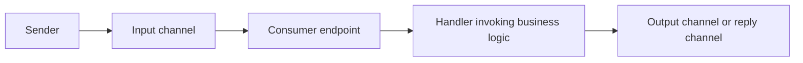
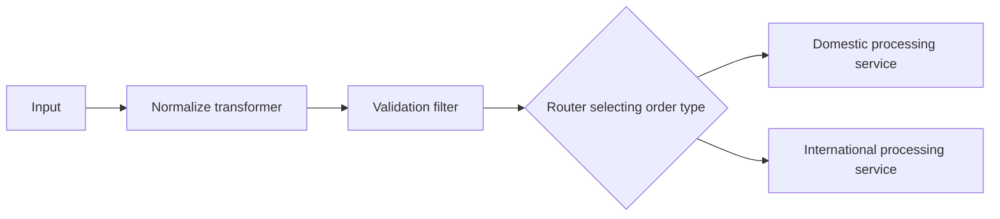

# What is a Message Endpoint?

## 1. Lesson Objectives

In the **SPRING_INTEGRATION_CORE** module, a message endpoint is the concept that connects the `Message` and `MessageChannel` model to actual processing work. Once you understand endpoints, you can read a Java DSL flow and explain where a message goes, who processes it, which thread it runs on, and where errors are routed.

After this lesson, you will be able to:

- Distinguish between a message, channel, handler, endpoint, and gateway.
- Explain why the same business method can be invoked via either an event-driven or a polling mechanism.
- Create endpoints using Java DSL or annotations.
- Recognize the roles of a transformer, filter, router, splitter, and aggregator in a flow.
- Verify processing results, lifecycle behavior, and basic error scenarios.

The running example throughout this lesson is an order code normalization flow: receive the string `"  order-42  "`, trim leading and trailing whitespace, convert it to `"ORDER-42"`, and forward the result to an output channel.

## 2. An Endpoint Connects the Application to the Message Flow

**A message endpoint is an integration component that enables an application to send, receive, or process messages at a specific point in a messaging system.**

In a typical processing step, an endpoint connects an input channel to processing logic. If that step produces a result, the result can be forwarded to an output channel or an appropriate reply destination.



This is a conceptual diagram. It does not mean that a handler and an endpoint are always two separate beans that the application developer must instantiate manually. Spring Integration typically creates and wires those components from configuration.

For a consumer endpoint, you can think of it as:

```text
Consumer endpoint
  = binding to an input channel
  + message receiving mechanism
  + lifecycle management for receiving
  + handler performing the processing
```

The expression above is a learning model, not a universal formula for every endpoint. An inbound adapter can actively fetch data from an external system and emit it into a channel, so it does not have an internal input channel under this consumer model.

The Spring Integration documentation describes an endpoint as the component that connects messaging components to channels; the two primary message-receiving mechanisms are event-driven and polling. See [Message Endpoints](https://docs.spring.io/spring-integration/reference/endpoint.html).

### An Endpoint Is Not Necessarily an HTTP Endpoint

In REST, the word endpoint usually suggests a URL like `POST /orders`. In Spring Integration, an endpoint can exist purely in application memory: receiving messages from a `DirectChannel` and invoking a Java method. It does not require a URL, a network port, or a message broker.

An HTTP inbound gateway is a case with HTTP connectivity; a service activator reading from an internal channel is another case. Both belong to the Spring Integration endpoint ecosystem.

## 3. Distinguishing Closely Related Components

| Component | Primary Responsibility | Example in the Order Flow |
|---|---|---|
| `Message<T>` | Carries payload and headers | Payload is `"  order-42  "`, header holds a trace ID |
| `MessageChannel` | Delivers or buffers messages according to channel semantics | Channel receiving normalization requests |
| `MessageHandler` | Performs an action when receiving a message | Calls the order code normalization function |
| Consumer endpoint | Connects a handler to a channel-receiving mechanism | Subscribes the handler or schedules polling for messages |
| Messaging gateway | Provides an invocation interface for application code, hiding messaging APIs | `orderGateway.normalize(code)` |
| Business logic | Executes domain rules | `trim()` and uppercase conversion |

`MessageHandler` has the core method:

```java
void handleMessage(Message<?> message);
```

The `void` return type does not mean every handler is one-way. A handler supporting request-reply can build and send a result message from inside its execution. With typical configuration, you provide a method or lambda that returns a value; the framework handles adapting it to the messaging mechanism.

A Java method also does not automatically become an endpoint merely because it is named `handleOrder`. It must be registered in a flow or wired using appropriate annotation/XML configuration.

A gateway lets calling code use a business interface instead of manually constructing messages and interacting directly with channels. A gateway and a service activator can both participate in a request-reply flow: the gateway is the entry point for the caller, and the service activator is the step that invokes the processing service. See [Messaging Gateways](https://docs.spring.io/spring-integration/reference/gateway.html).

## 4. Two Message-Receiving Mechanisms of a Consumer Endpoint

### 4.1. Event-Driven Consumer

With a channel that supports subscription, the endpoint registers a handler so the channel can dispatch messages to the handler whenever a message is sent to it.

```text
sender.send(message)
    → channel dispatches message
    → handler is invoked
```

`EventDrivenConsumer` is the implementation supporting this mechanism. Common channel examples include `DirectChannel` and `ExecutorChannel`.

**Event-driven does not automatically mean asynchronous.** With `DirectChannel`, the handler usually runs directly on the thread calling `send()`. With `ExecutorChannel`, invoking the handler is handed off to an executor; the exact threading behavior also depends on the executor's configuration and execution policy.

### 4.2. Polling Consumer

With a channel that supports active retrieval, such as `QueueChannel`, the endpoint uses a poller to retrieve messages and pass them to the handler.

```text
scheduler triggers poll
    → calls receive() on the channel
    → if a message is received, invokes the handler
```

`PollingConsumer` handles this case. You cannot assume a message will be processed immediately just because sending to the queue succeeded; there must be an active consumer and an appropriate poller configuration. How the consumer is chosen based on channel type is described in [Poller](https://docs.spring.io/spring-integration/reference/6.5/polling-consumer.html).

### 4.3. Comparison Table

| Criterion | `DirectChannel` | `ExecutorChannel` | `QueueChannel` |
|---|---|---|---|
| Delivery to handler | Subscription | Subscription and executor | Consumer calls `receive()` |
| Typical consumer | `EventDrivenConsumer` | `EventDrivenConsumer` | `PollingConsumer` |
| Requires poller on consumer | No | No | Yes |
| Where processing executes | Sending thread | According to executor | Poller thread or poller's executor |
| Queue buffer inside the channel itself | No | No; executor may have its own queue | Yes |

By default, `QueueChannel` holds messages in memory. It does not automatically provide durability across process restarts. If persistence is needed, you must design a message store or use appropriate infrastructure.

In addition, `DirectChannel` dispatches each message to one selected subscriber; it is not a broadcast mechanism. When you want to broadcast to multiple subscribers, consider `PublishSubscribeChannel`. Details on these differences are available at [Message Channel Implementations](https://docs.spring.io/spring-integration/reference/channel/implementations.html).

## 5. What Do Endpoints Do in Integration Patterns?

At the flow-design level, names such as transformer or router describe the meaning of a processing step. At runtime, the framework connects that logic to message-receiving and forwarding mechanisms.

| Component Type | Question the Processing Step Answers | Example |
|---|---|---|
| Service activator | Which service or method should be invoked? | Call the order validation service |
| Transformer | What representation should the message be converted into? | Convert a JSON string into an order object |
| Filter | Should this message continue? | Accept only orders with valid codes |
| Router | Which branch should this message go to? | Choose the domestic or international branch |
| Splitter | What parts should the message be split into? | Split an order into individual line items |
| Aggregator | When are related parts ready to be combined? | Aggregate check results for items of the same order |
| Inbound channel adapter | How does external data enter a channel? | Read a file and emit a message |
| Outbound channel adapter | How is a message sent out to an external system? | Write data to a file |
| Gateway | How does a request/reply interaction cross a boundary? | Make an HTTP call and bring the response back into the flow |

Not every endpoint produces exactly one output for one input. A filter can stop a message; a router can select multiple branches depending on configuration; a splitter can emit multiple messages; an aggregator can hold state before emitting a result.

Extended order flow example:



In this lesson, the focus is on how steps are attached to the messaging system. Correlation, release, and state-storage strategies for an aggregator should be studied separately before using it in real aggregation flows.

## 6. Java DSL Example: Same Logic, Two Receiving Mechanisms

### 6.1. Prerequisites

The following example uses the Java DSL API from `spring-integration-core`, following the common configuration style in Spring Integration 6.x and later. Use a JDK compatible with your application's Spring Framework/Spring Integration version; the 6.x line specifically requires Java 17 or higher. If the project uses Spring Boot, let Boot's BOM manage compatible versions.

To run the example standalone, you need the `org.springframework.integration:spring-integration-core` library along with its transitive dependencies. The example uses `AnnotationConfigApplicationContext` and requires no web server or broker.

Java DSL is a configuration API: calls in the builder are interpreted by the framework to register channels, handlers, and endpoints into the application context. Declaring a lambda in the DSL does not execute the business method immediately at bean-creation time. See [Java DSL](https://docs.spring.io/spring-integration/reference/dsl.html).

### 6.2. Complete Example Code

Save the example to `EndpointDemo.java` in a Java project with the appropriate dependencies:

```java
import java.util.Locale;

import org.springframework.context.annotation.AnnotationConfigApplicationContext;
import org.springframework.context.annotation.Bean;
import org.springframework.context.annotation.Configuration;
import org.springframework.integration.channel.DirectChannel;
import org.springframework.integration.channel.QueueChannel;
import org.springframework.integration.config.EnableIntegration;
import org.springframework.integration.dsl.IntegrationFlow;
import org.springframework.integration.dsl.Pollers;
import org.springframework.messaging.Message;
import org.springframework.messaging.support.MessageBuilder;

public class EndpointDemo {

    public static void main(String[] args) {
        try (var context =
                new AnnotationConfigApplicationContext(FlowConfig.class)) {

            DirectChannel directInput =
                    context.getBean("directInput", DirectChannel.class);
            QueueChannel directResults =
                    context.getBean("directResults", QueueChannel.class);

            boolean directAccepted = directInput.send(
                    MessageBuilder.withPayload("  order-42  ")
                            .setHeader("traceId", "demo-direct")
                            .build());

            if (!directAccepted) {
                throw new IllegalStateException("Direct input rejected");
            }
            verifyResult(directResults.receive(1000),
                    "ORDER-42", "demo-direct");

            QueueChannel queuedInput =
                    context.getBean("queuedInput", QueueChannel.class);
            QueueChannel queuedResults =
                    context.getBean("queuedResults", QueueChannel.class);

            boolean queuedAccepted = queuedInput.send(
                    MessageBuilder.withPayload("  order-43  ")
                            .setHeader("traceId", "demo-queued")
                            .build(),
                    1000);

            if (!queuedAccepted) {
                throw new IllegalStateException("Queued input timed out");
            }
            verifyResult(queuedResults.receive(3000),
                    "ORDER-43", "demo-queued");

            System.out.println("Both endpoint paths passed");
        }
    }

    private static void verifyResult(
            Message<?> result, String expected, String expectedTraceId) {

        if (result == null) {
            throw new AssertionError("No result before timeout");
        }
        if (!expected.equals(result.getPayload())) {
            throw new AssertionError("Unexpected payload: "
                    + result.getPayload());
        }
        if (!expectedTraceId.equals(result.getHeaders().get("traceId"))) {
            throw new AssertionError("Trace header was not propagated");
        }
    }

    static String normalize(String code) {
        if (code.isBlank()) {
            throw new IllegalArgumentException("Order code must not be blank");
        }
        return code.trim().toUpperCase(Locale.ROOT);
    }

    @Configuration
    @EnableIntegration
    public static class FlowConfig {

        @Bean
        public DirectChannel directInput() {
            return new DirectChannel();
        }

        @Bean
        public QueueChannel directResults() {
            return new QueueChannel(10);
        }

        @Bean
        public QueueChannel queuedInput() {
            return new QueueChannel(100);
        }

        @Bean
        public QueueChannel queuedResults() {
            return new QueueChannel(10);
        }

        @Bean
        public IntegrationFlow directFlow() {
            return IntegrationFlow.from(directInput())
                    .handle(String.class,
                            (payload, headers) -> normalize(payload),
                            endpoint -> endpoint.id("directNormalizeEndpoint"))
                    .channel(directResults())
                    .get();
        }

        @Bean
        public IntegrationFlow queuedFlow() {
            return IntegrationFlow.from(queuedInput())
                    .handle(String.class,
                            (payload, headers) -> normalize(payload),
                            endpoint -> endpoint
                                    .id("queuedNormalizeEndpoint")
                                    .poller(Pollers.fixedDelay(100)
                                            .maxMessagesPerPoll(10)))
                    .channel(queuedResults())
                    .get();
        }
    }
}
```

### 6.3. Reading the Direct Flow

```text
main thread
  → directInput.send(...)
  → endpoint triggers handler
  → normalize(...)
  → sends result to directResults
  → send(...) returns
```

In this specific configuration, the normalization step and the result-sending step run synchronously on the calling thread. When `send()` returns successfully, the result has already been placed into the output queue. That still does not mean an external system has received or persisted the data; the example ends at an internal queue.

`directResults` is a `QueueChannel` so that the test snippet can actively call `receive()`. It does not need a framework poller because the test code itself is the receiver. A poller needs to be configured when you attach a framework consumer endpoint to automatically consume from a pollable channel.

### 6.4. Reading the Queued Flow

```text
main thread                         poller thread
  → queuedInput.send(...)             → receive() from queuedInput
  → send(...) returns                 → normalize(...)
                                      → sends to queuedResults
```

The two columns illustrate the decoupling between the sender and the processor. You should not rely on strict execution ordering: the poller can process very quickly, even before the sender observes the return value of `send()`.

In the example:

- `fixedDelay(100)` configures a 100-millisecond delay between the completion of one poll task and the start of the next under the active scheduler configuration.
- `maxMessagesPerPoll(10)` sets a maximum limit of 10 messages per poll cycle; this is not a thread count or a retry count.
- If no message is available, the receive operation is also affected by `receiveTimeout`. The poll interval is not a strict latency guarantee for each message.
- The queue has a bounded capacity. When full, send operations may have to wait; the example specifies a timeout for sending into `queuedInput`.

No `taskExecutor` is configured for the poller in this example. When adding an executor, you must review concurrency levels, work-queue capacity, processing order, and the load tolerance of downstream services.

## 7. Equivalent Configuration with Annotations

You can keep the business logic in a method and use `@ServiceActivator` to connect that method to channels. This is an **alternative to `directFlow()`**, not something you register additionally onto the same input channel in the example above.

Inside a `@Configuration` class with `@EnableIntegration`, alongside the two beans `directInput` and `directResults`, declare the following method:

```java
import org.springframework.integration.annotation.ServiceActivator;

@ServiceActivator(
        inputChannel = "directInput",
        outputChannel = "directResults")
public String normalizeOrderCode(String code) {
    return EndpointDemo.normalize(code);
}
```

The snippet above is an alternative configuration fragment, not a standalone Java file. `EndpointDemo.normalize()` is called within the same package as the example class.

If the input is `queuedInput`, the annotation can specify a poller:

```java
import org.springframework.integration.annotation.Poller;
import org.springframework.integration.annotation.ServiceActivator;

@ServiceActivator(
        inputChannel = "queuedInput",
        outputChannel = "queuedResults",
        poller = @Poller(fixedDelay = "100", maxMessagesPerPoll = "10"))
public String normalizeQueuedOrderCode(String code) {
    return EndpointDemo.normalize(code);
}
```

This snippet replaces `queuedFlow()`. Do not create two consumers simultaneously and assume each consumer will receive every message from the same queue.

`@MessageEndpoint` is a stereotype based on `@Component` that allows a class to be discovered via component scanning. Selecting handler methods and wiring channels still relies on annotations such as `@ServiceActivator`. Merely adding `@MessageEndpoint` to a class does not automatically build a complete flow with input/output channels. See [Annotation Support](https://docs.spring.io/spring-integration/reference/configuration/annotations.html).

## 8. Results, Output Channel, and Reply Channel

For a service activator that returns a value, the framework can use that value to create a result message. When an output channel is configured, the result is sent there. When no output channel is configured, a reply-capable component can use the request's `replyChannel` header to determine where to send the reply.

```text
Method returns String
  → handler creates reply message
  → configured output channel
     or request's replyChannel if applicable
```

In the example, the output channel is already declared via `.channel(...)`, so there is no need to set `replyChannel` manually.

A method returning `void` usually fits a one-way action, such as writing an audit record. A method returning `null` usually produces no reply. If the contract requires a reply, `requiresReply` can be used to detect the absence of a result rather than leaving the caller waiting for a reply that never arrives.

`requiresReply` checks whether the handler produces a reply; it does not replace timeouts, retries, or recovery policies. Service activator return rules are described at [Service Activator](https://docs.spring.io/spring-integration/reference/service-activator.html).

## 9. Where Errors Go Depends on Execution Boundaries

### 9.1. The Direct Path

If you send a whitespace-only string to `directInput`, `normalize()` throws `IllegalArgumentException`. Because the handler runs on the sending thread, the processing error can propagate back to the `send()` call; the original error is typically wrapped in a messaging exception.

The following test snippet is placed in a scope where `directInput` is available:

```java
try {
    directInput.send(MessageBuilder.withPayload("   ").build());
    throw new AssertionError("Expected message processing to fail");
}
catch (org.springframework.messaging.MessagingException ex) {
    System.out.println("Processing failed: " + ex.getMessage());
}
```

Do not assume that merely setting an `errorChannel` header will automatically turn every synchronous error from a `DirectChannel` into an error message. A gateway or advice can add dedicated error-handling behavior.

### 9.2. The Polling Path

With `queuedInput`, the sender may have already completed before `normalize()` fails. In that case, a `try/catch` around `queuedInput.send()` cannot catch business errors raised later on the poller thread.

With the poller's default error-handling mechanism, the error can be wrapped in an `ErrorMessage` and sent to an error channel. The message's `errorChannel` header is used if present; otherwise, the framework uses the default error channel named `errorChannel`.

The actual routing also depends on the error handler configuration. Receiving an `ErrorMessage` does not automatically mean the message was retried or restored to the queue. See [Error Handling](https://docs.spring.io/spring-integration/reference/error-handling.html).

For the order flow, you should clearly determine:

- Will data errors like a blank order code be rejected or routed for manual inspection?
- Do transient errors when calling external systems need retries, and with what retry limits?
- If the business operation has side effects, could reprocessing the same order cause duplicate writes?
- What information should an error message carry for tracing without exposing sensitive data?

Putting a message onto a queue and completing business processing successfully are two distinct events. Ensuring resilience requires designing durability, transactions, and idempotency tailored to the real system.

## 10. Endpoint Lifecycle

Consumer endpoints have a lifecycle to start or stop receiving messages. In the Java DSL example, `.id("queuedNormalizeEndpoint")` names the endpoint, which is convenient when you need to manage or observe it.

You can try this in a scope where `context` is available:

```java
import org.springframework.integration.endpoint.AbstractEndpoint;

AbstractEndpoint endpoint = context.getBean(
        "queuedNormalizeEndpoint", AbstractEndpoint.class);

endpoint.stop();
boolean runningAfterStop = endpoint.isRunning();
endpoint.start();
```

`stop()` stops the endpoint's mechanism for accepting new work; it should not be interpreted as a guarantee that all currently running handlers are canceled or that all in-flight work has finished.

When a polling endpoint stops, unpolled messages may remain in the queue. When an event-driven endpoint stops, its handler is unsubscribed; for a `DirectChannel` with no remaining subscribers, sending a message can raise a delivery error.

If you need to control endpoints in operations, give them clear business-meaningful names, such as `validateOrderEndpoint`. The name of an `IntegrationFlow` and the names of endpoints inside the flow serve different audiences; a single flow can contain multiple endpoints.

## 11. Testing at Three Levels

### 11.1. Testing Business Logic

Test `normalize()` directly to verify normalization rules:

| Input | Expected Result |
|---|---|
| `"  order-42  "` | `"ORDER-42"` |
| `"ORDER-42"` | `"ORDER-42"` |
| `"   "` | Throws `IllegalArgumentException` |

This level separates business-rule bugs from messaging-configuration bugs.

### 11.2. Testing Endpoint Wiring

The `main()` example demonstrated a smoke check for both processing paths: sending real messages through the input channel and receiving results on the output channel. It verifies both the payload and a custom header.

When turning this into JUnit tests, verify that:

1. Messages reach the right handler and the right output channel.
2. Required business headers are propagated according to contract.
3. Errors on the direct path are observed on the caller side.
4. Errors on the polling path are observed on the configured error channel.

`receive(timeout)` returning `null` means no result was received before the deadline; it does not prove the endpoint discarded the message. You must also check endpoint state, queues, logs, and error branches.

### 11.3. Testing Operational Behavior

For a polling endpoint, you can stop the endpoint, send a message into the queue, verify no result arrives during a check window, then start it again and wait for the result to appear. Avoid relying on a short `Thread.sleep()` to conclude that asynchronous work has finished.

Spring Integration provides additional mocking utilities and flow-testing support in `spring-integration-test` and `spring-integration-test-support`. Use them only when your tests need to isolate or replace integration components. See [Testing Support](https://docs.spring.io/spring-integration/reference/testing.html).

The test snippets here are practical guidelines. Providing documentation does not mean the examples have already been compiled or executed in the learner's project.

## 12. Common Misconceptions

| Misconception | Correct Understanding and Handling |
|---|---|
| An endpoint is a service URL | A messaging endpoint can simply connect objects inside the same JVM |
| Handler and endpoint are always the same object | Distinguish processing logic from the component managing message reception |
| Using event-driven guarantees a different thread | Check the channel type and executor configuration |
| Putting a message into `QueueChannel` makes the handler run automatically | Requires an active consumer and an appropriate poller |
| Every `QueueChannel` must declare a poller | Application code or tests can call `receive()` directly |
| `send()` returning `true` means business processing completed | For a queue, this only confirms the message was sent to the channel |
| Adding a poller to `DirectChannel` makes it process periodically | Polling requires a source/channel with an appropriate receive mechanism |
| `maxMessagesPerPoll(10)` creates 10 workers | This is the maximum number of messages per poll cycle |
| Having an error channel means retries happen | Retry and recovery policies must be configured separately |
| Stopping an endpoint deletes waiting messages | Stopping a consumer does not automatically clear the queue |

## 13. Hands-On Exercises

### Exercise 1: Identify Components

For the flow `input → normalize → output`, identify the message, the two channels, the handler, and the endpoint. Then replace the input `DirectChannel` with a `QueueChannel` and explain why a poller must be added.

**Pass criteria:** Explain the change in the receiving mechanism while keeping the `normalize()` method unchanged.

### Exercise 2: Add a Transformer and Filter

Create a separate flow that uses a transformer to normalize the order code, then uses a filter so only codes starting with `ORDER-` proceed. Configure a discard channel to observe messages that fail the condition.

**Pass criteria:** Valid codes reach the output, invalid codes reach the discard channel; the learner explains why the filter step may emit no reply on the success path.

### Exercise 3: Observe Asynchronous Errors

On the queued path, use a separate `QueueChannel` as the error destination and set that channel in the `errorChannel` header of a test message. Send a whitespace-only payload, then use `receive(timeout)` to wait for the error message.

**Pass criteria:** The sender observes the enqueue operation succeed, while the error check observes the exception thrown during normalization. Do not use a `try/catch` around enqueue as proof that business processing succeeded.

### Exercise 4: Explain Design Decisions

Suppose the next step must call an API with a response time of several seconds. Choose the channel mechanism, worker count, and buffer capacity, then explain how to avoid unbounded backlogs. Also address duplicate-order handling when an API call times out even though the external system may have already processed it.

**Pass criteria:** Distinguish message reception, business execution, and result acknowledgment; do not infer exactly-once processing guarantees solely from having an endpoint or a queue.

## 14. Key Takeaways

- An endpoint places processing logic at a specific point in a messaging system.
- The channel determines how messages are delivered or stored; the handler determines the processing action; the consumer endpoint connects the two and manages reception.
- `DirectChannel` typically leads to execution on the sending thread; `QueueChannel` typically requires a polling consumer for automatic processing.
- Java DSL and annotations are ways to declare Spring-managed integration components.
- Understanding an endpoint requires looking at its input, output, thread boundaries, errors, and lifecycle.
