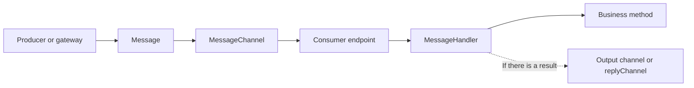
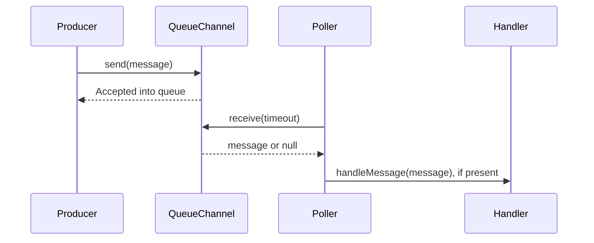

# MessageConsumer

## 1. Objectives and Scope

In the **Message endpoint** chapter of the **SPRING_INTEGRATION_CORE** module, `MessageConsumer` represents the role of receiving messages from a channel to perform a processing step. This lesson helps you choose how to receive messages, configure endpoints with Java DSL, determine where business logic executes, and test both success and error paths.

After this lesson, you should be able to explain the flow `Message → MessageChannel → consumer endpoint → MessageHandler`, choose between event-driven and polling reception, and distinguish between accepting a message and completing business processing.

The examples use APIs common in Spring Integration 6.x/7.x and Java 17 syntax. They assume the project already has `spring-integration-core`; the testing section requires `spring-test`, JUnit Jupiter, and the corresponding JUnit runner. Use your project's BOM or dependency management to keep Spring versions compatible.

## 2. What Role Does MessageConsumer Play?

The lesson title **MessageConsumer** describes the consumer role. When configuring Spring Integration Core, the types to recognize are `MessageHandler`, `EventDrivenConsumer`, and `PollingConsumer`; do not infer that you must create a class or import an interface named `MessageConsumer`.

The endpoint connects the channel to the handler. The handler decides how to process the message; the endpoint handles the receiving mechanism and lifecycle. As a result, the same business logic can sit behind a subscribable channel or a pollable channel. See [Message Endpoints](https://docs.spring.io/spring-integration/reference/endpoint.html).

| Component | Question the Component Answers | Example |
| --- | --- | --- |
| `Message<?>` | What data and context are being passed? | Order code payload, `correlationId` header |
| `MessageChannel` | Where does the message travel through? | `DirectChannel`, `QueueChannel` |
| Consumer endpoint | How are messages received and how is activity managed? | `EventDrivenConsumer`, `PollingConsumer` |
| `MessageHandler` | What processing step is performed? | Calls the order confirmation service |
| Business method | What are the specific domain rules? | Check inventory, update status |



## 3. Event-Driven Consumer

`EventDrivenConsumer` connects a `SubscribableChannel` to a `MessageHandler`. When the endpoint starts, the handler is subscribed; when it stops, the subscription is removed. No schedule for calling `receive()` is needed. Its API and lifecycle are documented in [EventDrivenConsumer Javadoc](https://docs.spring.io/spring-integration/api/org/springframework/integration/endpoint/EventDrivenConsumer.html).

The low-level example below is only meant to show the subscription mechanism. In applications, prefer beans or DSL so Spring manages the lifecycle:

```java
import org.springframework.integration.channel.DirectChannel;
import org.springframework.integration.endpoint.EventDrivenConsumer;
import org.springframework.messaging.MessageHandler;
import org.springframework.messaging.support.MessageBuilder;

DirectChannel channel = new DirectChannel();
MessageHandler handler = message ->
        System.out.println("Received: " + message.getPayload());
EventDrivenConsumer endpoint = new EventDrivenConsumer(channel, handler);

endpoint.start();
try {
    channel.send(MessageBuilder.withPayload("ORDER-101").build());
} finally {
    endpoint.stop();
}
```

**Event-driven does not automatically mean asynchronous.** With `DirectChannel`, the handler runs on the thread calling `send()`. `ExecutorChannel` can hand off work through an executor. Threading behavior belongs to the channel/executor configuration; the consumer name alone is not enough to conclude it.

`DirectChannel` delivers each message to one subscriber. `PublishSubscribeChannel` broadcasts messages to subscribers. Adding consumers to `DirectChannel` does not turn it into a broadcast channel. See [Message Channel Implementations](https://docs.spring.io/spring-integration/reference/channel/implementations.html).

## 4. Polling Consumer

`PollingConsumer` connects a `PollableChannel`, such as `QueueChannel`, to a handler. A polling task calls receive, then passes the retrieved message to the handler. `receiveTimeout` limits how long a single receive waits when the queue is empty; this is not a business-processing timeout. See [PollingConsumer Javadoc](https://docs.spring.io/spring-integration/api/org/springframework/integration/endpoint/PollingConsumer.html).



A `PollingConsumer` receives from an internal channel; `SourcePollingChannelAdapter` pulls data from a `MessageSource` and emits it into a channel. Both can use a poller, but they sit in different positions. When declaring a consumer on a pollable channel, configure a poller on the endpoint or provide a global default poller. See [Poller](https://docs.spring.io/spring-integration/reference/polling-consumer.html).

| Factor | How to Understand It for Configuration |
| --- | --- |
| `fixedDelay` | Pause interval after a task completes, in a simple synchronous polling setup |
| `fixedRate` | Period based on scheduled start times |
| `maxMessagesPerPoll` | Limit on the number of messages per poll cycle, not thread count |
| `receiveTimeout` | Wait time for each individual receive call, not the whole cycle |
| Executor | Can change task execution and resource contention |

`Pollers` provides scheduling configurations such as `fixedDelay`, `fixedRate`, and `cron`. When adding an executor, you must re-evaluate task queuing instead of treating the poll period as a hard rate limit. See [Pollers Javadoc](https://docs.spring.io/spring-integration/api/org/springframework/integration/dsl/Pollers.html).

For `maxMessagesPerPoll`, a positive number sets a cap, a negative number allows continuing until a receive returns no data, and `0` temporarily pauses receiving. If the source always has messages, a negative value can make a single cycle run for a long time. See [AbstractPollingEndpoint Javadoc](https://docs.spring.io/spring-integration/api/org/springframework/integration/endpoint/AbstractPollingEndpoint.html).

Design calculation example: if one cycle processes at most 5 messages, each message takes about 40 ms, and then rests 100 ms, then when data is continuously available, the estimated rate is `5 / (0.2 + 0.1) ≈ 16.7 messages/second`. This figure assumes a single synchronous task and ignores other overhead; it is not a throughput guarantee.

## 5. Handlers and Return Values

The foundational callback interface has the method `void handleMessage(Message<?> message)`. The callback's `void` return type does not mean every endpoint terminates the flow: reply-producing handlers send results onward themselves. This is the mechanism behind many transformers, routers, filters, and aggregators. See [Message Handler](https://docs.spring.io/spring-integration/reference/endpoint.html#message-handler).

With a service activator, a method returning a non-`null` result can produce a reply. The destination is the configured output channel or the request's `replyChannel` when there is no fixed output. A `void` method fits steps that only cause side effects. When a result is mandatory, see the `requiresReply` setting; an unexpected `null` value can cause a caller waiting for a reply to time out. See [Service Activator](https://docs.spring.io/spring-integration/reference/service-activator.html).

Order example: a consumer that records payment may return a new status so the flow continues; a consumer that writes an audit log may end with `void`. If a gateway waits for a status while the final step only writes an audit log, the request–reply contract needs to be redesigned.

## 6. Java DSL Practice: Same Business Logic, Two Receiving Modes

The self-contained example below normalizes order codes. It uses one direct input and one queued input, with two separate outputs for easy observation. `consumerErrors` receives polling errors in the exercise when the request specifies the corresponding header.

```java
import java.util.Locale;

import org.springframework.context.annotation.Bean;
import org.springframework.context.annotation.Configuration;
import org.springframework.integration.channel.DirectChannel;
import org.springframework.integration.channel.QueueChannel;
import org.springframework.integration.config.EnableIntegration;
import org.springframework.integration.dsl.IntegrationFlow;
import org.springframework.integration.dsl.Pollers;

@Configuration
@EnableIntegration
public class ConsumerDemoConfig {

    @Bean
    public DirectChannel directOrders() {
        return new DirectChannel();
    }

    @Bean
    public QueueChannel queuedOrders() {
        return new QueueChannel(100);
    }

    @Bean
    public QueueChannel directResults() {
        return new QueueChannel(100);
    }

    @Bean
    public QueueChannel queuedResults() {
        return new QueueChannel(100);
    }

    @Bean
    public QueueChannel consumerErrors() {
        return new QueueChannel(100);
    }

    @Bean
    public IntegrationFlow directOrderFlow() {
        return IntegrationFlow.from(directOrders())
                .handle(String.class,
                        (payload, headers) -> normalize(payload),
                        endpoint -> endpoint.id("directOrderConsumer"))
                .channel(directResults())
                .get();
    }

    @Bean
    public IntegrationFlow queuedOrderFlow() {
        return IntegrationFlow.from(queuedOrders())
                .handle(String.class,
                        (payload, headers) -> normalize(payload),
                        endpoint -> endpoint
                                .id("queuedOrderConsumer")
                                .poller(Pollers.fixedDelay(100)
                                        .maxMessagesPerPoll(5)
                                        .receiveTimeout(0)))
                .channel(queuedResults())
                .get();
    }

    private static String normalize(String input) {
        String orderId = input.trim();
        if (orderId.isEmpty()) {
            throw new IllegalArgumentException("Order code must not be empty");
        }
        return orderId.toUpperCase(Locale.ROOT);
    }
}
```

Endpoints are created through the framework's configuration mechanism; `ConsumerEndpointFactoryBean` chooses the consumer type suited to the input channel. Beyond the two models in this lesson, the framework also supports reactive consumers. See [ConsumerEndpointFactoryBean Javadoc](https://docs.spring.io/spring-integration/docs/7.0.x/api/org/springframework/integration/config/ConsumerEndpointFactoryBean.html).

In the example:

- Sending `" order-101 "` to `directOrders` produces `"ORDER-101"` in `directResults` before the successful send call returns.
- Sending to `queuedOrders` only waits for queue capacity; the poller processes it afterward. `receiveTimeout(0)` lets a receive return immediately when no data is present.
- The outputs also have a capacity of 100. In the demo, you must read the output; if an output fills up, processing tasks can block when sending results.
- The poller is placed on `.handle(...)` because that handler directly receives from `queuedOrders`.

If you insert `.transform(...)` right after `queuedOrders`, the transformer becomes the queue's consumer. In that case, move the poller configuration to the transformer endpoint; do not keep the poller on a downstream handler sitting behind a direct channel created by the DSL between steps.

### Equivalent Representation Using Annotations

This is an **alternative** to the polling flow above. Do not enable both simultaneously on the same `queuedOrders` channel if the goal is for each message to run through only one option.

```java
import org.springframework.integration.annotation.Poller;
import org.springframework.integration.annotation.ServiceActivator;
import org.springframework.messaging.handler.annotation.Header;
import org.springframework.stereotype.Component;

@Component
public class OrderConsumer {

    @ServiceActivator(
            inputChannel = "queuedOrders",
            outputChannel = "queuedResults",
            poller = @Poller(
                    fixedDelay = "100",
                    maxMessagesPerPoll = "5",
                    receiveTimeout = "0"))
    public String accept(
            String payload,
            @Header(name = "tenantId", required = false) String tenantId) {
        return payload.trim().toUpperCase(java.util.Locale.ROOT);
    }
}
```

The class must be component-scanned and integration infrastructure must be enabled. This is a payload/header binding example and does not yet perform the empty-code check from the DSL configuration. Annotations are processed into endpoints and handlers; the business method can accept the payload, the entire message, or headers. See [Annotation Support](https://docs.spring.io/spring-integration/reference/configuration/annotations.html).

## 7. Where Do Errors Go?

On the `DirectChannel` path, handler exceptions propagate up the call stack to the sender. On the polling path using the default scheduler infrastructure, errors are sent as an `ErrorMessage`; the request's `errorChannel` header specifies the destination, falling back to the global `errorChannel` if missing. Do not assume that adding the header alone is enough to automatically convert every synchronous error into a message. See [Error Handling](https://docs.spring.io/spring-integration/reference/error-handling.html).

```java
import org.springframework.messaging.MessageHeaders;
import org.springframework.messaging.support.MessageBuilder;

// queuedOrders is the QueueChannel bean from the configuration above.
boolean accepted = queuedOrders.send(
        MessageBuilder.withPayload("   ")
                .setHeader(MessageHeaders.ERROR_CHANNEL, "consumerErrors")
                .setHeader("businessKey", "ORDER-101")
                .build(),
        1_000);
```

In this scenario, `accepted == true` can happen before `normalize` throws an exception. The receiver of `consumerErrors` must decide whether to persist the incident, fix the data, or route to a manual handling workflow. Logging alone does not resolve a failing order.

Retry is also a separate configuration decision. `RequestHandlerRetryAdvice` supports retrying at the handler; you must choose retry limits and exhaustion behavior. If the business logic already produced side effects before failing, retrying can repeat those side effects. See [Provided Advice Classes](https://docs.spring.io/spring-integration/reference/handler-advice/classes.html).

## 8. Testing Consumer Behavior

The test below uses `ConsumerDemoConfig` directly. It requires no Spring Boot or broker. It tests the direct result, the polling result, and asynchronous errors using finite timeouts.

```java
import org.junit.jupiter.api.Test;
import org.springframework.beans.factory.annotation.Autowired;
import org.springframework.beans.factory.annotation.Qualifier;
import org.springframework.messaging.Message;
import org.springframework.messaging.MessageChannel;
import org.springframework.messaging.MessageHeaders;
import org.springframework.messaging.PollableChannel;
import org.springframework.messaging.support.ErrorMessage;
import org.springframework.messaging.support.MessageBuilder;
import org.springframework.test.context.junit.jupiter.SpringJUnitConfig;

import static org.junit.jupiter.api.Assertions.*;

@SpringJUnitConfig(ConsumerDemoConfig.class)
class ConsumerDemoTest {

    @Autowired
    @Qualifier("directOrders")
    MessageChannel directOrders;

    @Autowired
    @Qualifier("queuedOrders")
    MessageChannel queuedOrders;

    @Autowired
    @Qualifier("directResults")
    PollableChannel directResults;

    @Autowired
    @Qualifier("queuedResults")
    PollableChannel queuedResults;

    @Autowired
    @Qualifier("consumerErrors")
    PollableChannel consumerErrors;

    @Test
    void directConsumerProducesResultBeforeSendReturns() {
        assertTrue(directOrders.send(
                MessageBuilder.withPayload(" order-101 ").build(), 1_000));

        Message<?> result = directResults.receive(0);
        assertNotNull(result);
        assertEquals("ORDER-101", result.getPayload());
    }

    @Test
    void pollingConsumerEventuallyProducesResult() {
        assertTrue(queuedOrders.send(
                MessageBuilder.withPayload(" order-202 ").build(), 1_000));

        Message<?> result = queuedResults.receive(3_000);
        assertNotNull(result);
        assertEquals("ORDER-202", result.getPayload());
    }

    @Test
    void pollingFailureIsPublishedToRequestedErrorChannel() {
        assertTrue(queuedOrders.send(
                MessageBuilder.withPayload("   ")
                        .setHeader(MessageHeaders.ERROR_CHANNEL, "consumerErrors")
                        .build(), 1_000));

        Message<?> error = consumerErrors.receive(3_000);
        assertNotNull(error);
        assertInstanceOf(ErrorMessage.class, error);

        Throwable root = ((ErrorMessage) error).getPayload();
        while (root.getCause() != null) {
            root = root.getCause();
        }
        assertInstanceOf(IllegalArgumentException.class, root);
    }
}
```

`receive(timeout)` waits for a specific result, helping you avoid `Thread.sleep` with a guessed delay. If CI environments are slow, choose timeouts according to your practical test budget. Keep the tests above running sequentially because they share the application context and queues. Spring Integration also provides `@SpringIntegrationTest` and `MockIntegrationContext` when you need to control endpoints or swap handlers to isolate a flow. See [Testing support](https://docs.spring.io/spring-integration/reference/testing.html).

Cases to expand on when applying this to real orders: synchronous errors returned to the caller, paused endpoints, full queues, and the same business key appearing twice. For payments, what you need to verify is how many times side effects are recorded, not just how many messages were received.

## 9. Lifecycle and Transaction Boundaries

An endpoint has a running state; having a bean in the context does not mean the endpoint is actively receiving messages. You can look up an endpoint by its DSL ID to control it:

```java
import org.springframework.context.ConfigurableApplicationContext;
import org.springframework.integration.endpoint.AbstractEndpoint;

// context is the running application context.
AbstractEndpoint endpoint = context.getBean(
        "queuedOrderConsumer", AbstractEndpoint.class);
endpoint.stop();
// Check operational state or perform maintenance here.
endpoint.start();
```

Stopping a consumer does not delete messages in the channel or immediately cancel an in-flight task. During maintenance, you must define how to wait for in-flight tasks to finish. Endpoint IDs also help correlate logs with configuration. See [EventDrivenConsumer API](https://docs.spring.io/spring-integration/api/org/springframework/integration/endpoint/EventDrivenConsumer.html) and [PollingConsumer API](https://docs.spring.io/spring-integration/api/org/springframework/integration/endpoint/PollingConsumer.html).

Transactions bound to a calling thread do not automatically cross asynchronous boundaries. With a poller, you can configure transactions for receiving and processing work; rollback/redelivery still depends on the participating resources. Do not infer that an in-memory `QueueChannel` automatically puts a message back onto the queue when the handler fails. See [Transaction Support](https://docs.spring.io/spring-integration/reference/transactions.html).

Therefore, a payment-recording design must answer three separate questions: is the input data durable, is the business operation transactional, and is reprocessing safe? An idempotency key such as `paymentId` is usually more suitable than a new message ID generated during replay.

## 10. Choosing Configuration and Diagnostics

| Scenario | Suitable Starting Point | What to Verify |
| --- | --- | --- |
| Fast data normalization, caller needs result | Consumer behind `DirectChannel` | Latency and errors propagated to caller |
| Need to buffer a bounded amount of work | Consumer behind a bounded queue and poller | Accumulation rate, timeout when full |
| Multiple branches receive the same event | Consumer behind publish–subscribe | Error isolation between branches |
| Must survive restarts | Durable channel/store or broker | Acknowledgment and replay mechanism |

An in-memory queue does not automatically provide durability across restarts. `send(message, timeout)` lets you bound the wait time when the queue is full; you must handle the case where it returns `false`. See [QueueChannel](https://docs.spring.io/spring-integration/reference/channel/implementations.html#queuechannel).

When an order is not processed, diagnose along its specific path:

1. Confirm it was sent to the right channel and the send call succeeded.
2. Check that the endpoint is running and the poller is placed on the step receiving from the queue.
3. Verify the payload/headers satisfy the handler's contract.
4. Check for errors at the caller or at the error channel corresponding to the flow boundary.
5. Check whether the output is full or a reply lacks a destination.

This is a diagnostic sequence for the example, not a conclusion that every issue is caused by the poller. In particular, increasing `maxMessagesPerPoll` only raises the work cap per cycle; to improve slow processing, you must measure business execution time and resource bottlenecks.

## 11. Applied Exercises

Use the DSL configuration above as a starting point:

1. Send 12 order codes to `queuedOrders`, read all results, and observe the cap of at most 5 messages per cycle. Do not test against a fragile absolute timestamp.
2. Insert a transformer after the queue and move the poller to the transformer. Explain which endpoint is performing the receive from the queue.
3. Send an empty code through both inputs. Describe the difference between an exception at the caller and an `ErrorMessage` received via a channel.
4. Design a payment-confirmation consumer carrying a `paymentId`. Describe how to prevent duplicate recording when the same command is replayed.

Completion criteria: identify the consumer endpoint, handler, input channel, execution thread, and error destination for each path; and prove with test results that sending to a queue and completing business processing are two separate events.