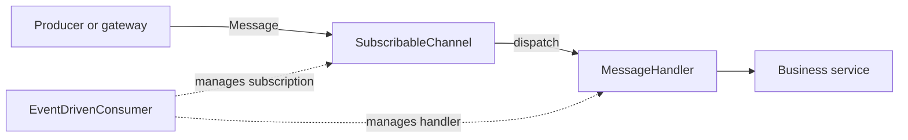

# EventDrivenConsumer

## Objectives and Position in the Integration Flow

In the `SPRING_INTEGRATION_CORE` module, this lesson belongs to the **Message endpoint** chapter and focuses on how an endpoint receives messages from a channel that supports subscriber registration. After this lesson, you will be able to explain the relationship between `Message`, `MessageChannel`, handlers, and endpoints; create consumers using Java DSL; choose an appropriate execution model; determine error propagation paths; and test message-receiving behavior.

The running scenario is an application receiving create-order commands. Once a command enters an internal channel, the application needs to invoke the business service as soon as a message arrives. There is no need for a periodic schedule to look for new commands.

## 1. What Problem Does EventDrivenConsumer Solve?

`EventDrivenConsumer` is an endpoint that connects a `SubscribableChannel` to a `MessageHandler`. The channel can push messages to the registered handler; the consumer does not need to call `receive()` periodically. This is a callback mechanism between components inside the application. See [Message Endpoints](https://docs.spring.io/spring-integration/reference/endpoint.html).

Distinguish the responsibilities:

| Component | Responsibility | Example in This Lesson |
| --- | --- | --- |
| `Message<?>` | Carries payload and headers | Payload is a create-order command |
| Channel | Decides how messages are delivered | `DirectChannel` delivers to one handler |
| Endpoint | Manages attaching the handler to a message source | `EventDrivenConsumer` manages the subscription |
| Handler | Performs processing when invoked | Validates quantity and records the order |

An endpoint is not the business function itself. The same type of handler can be wired via different endpoints depending on the input channel type.



Dashed arrows represent management relationships. Messages flow through the channel to the handler; do not think of the endpoint as an intermediate queue.

## 2. Subscription Mechanism and Lifecycle

The core constructor API looks like:

```java
new EventDrivenConsumer(inputChannel, handler);
```

Here `inputChannel` must be a `SubscribableChannel`, and `handler` implements `MessageHandler`. The endpoint participates in the Spring lifecycle via `SmartLifecycle`; merely calling the constructor does not mean the consumer has started receiving messages. See [EventDrivenConsumer API](https://docs.spring.io/spring-integration/api/org/springframework/integration/endpoint/EventDrivenConsumer.html).

Operationally:

1. Spring creates and initializes the related beans.
2. When the endpoint starts, the handler is subscribed to the input channel.
3. When a producer sends a message, the channel's dispatcher invokes the handler according to the channel's rules.
4. When the endpoint stops, the handler is unsubscribed.

Typically, you should let Spring manage the endpoint as a bean, or let Java DSL create the endpoint. Do not manually call `subscribe()` again on a handler already managed by an endpoint, as that makes lifecycle responsibilities hard to track.

Stopping the endpoint means ending the subscription for future dispatches. With asynchronous processing, tasks already handed off to an executor may still be running; executor and business shutdown must be designed separately.

## 3. Event-Driven and Asynchronous Are Two Different Choices

Event-driven describes **how the handler is triggered**. Synchronous vs. asynchronous describes **which thread executes the handler**. You cannot infer the second choice from the name `EventDrivenConsumer` alone.

| Input Channel | Receiving Mechanism | Typical Execution Thread | Delivery Pattern |
| --- | --- | --- | --- |
| `DirectChannel` | Subscription | Thread calling `send()` | Point-to-point |
| `ExecutorChannel` | Subscription | Determined by executor | Point-to-point |
| `PublishSubscribeChannel` without executor | Subscription | Thread calling `send()` | Broadcast |
| `PublishSubscribeChannel` with executor | Subscription | Determined by executor | Broadcast |
| `QueueChannel` | Polling or calling `receive()` | Determined by receiver | Point-to-point |

With `DirectChannel`, the handler is invoked before `send()` completes. With `ExecutorChannel` using a thread pool, the sender can continue before business work finishes. An executor that runs directly or a caller-runs rejection policy can still cause tasks to run on the sending thread. For channel details, see [Message Channel Implementations](https://docs.spring.io/spring-integration/reference/channel/implementations.html).

Two design consequences:

- If a handler calls a slow external service on a `DirectChannel`, that wait time adds directly to the producer's latency.
- If you switch to a thread pool, you must decide on task-queue bounds, concurrency level, overload handling, and how business outcomes are reported.

Do not switch a channel to asynchronous just to hide latency. Determine whether the caller needs the final result or only needs to know the request has been accepted.

## 4. Minimal Example with an Explicit Endpoint

The following example illustrates the direct subscription mechanism. In real applications, annotations and Java DSL usually make configuration much cleaner.

```java
package example.integration;

import org.springframework.context.annotation.Bean;
import org.springframework.context.annotation.Configuration;
import org.springframework.integration.channel.DirectChannel;
import org.springframework.integration.config.EnableIntegration;
import org.springframework.integration.endpoint.EventDrivenConsumer;
import org.springframework.messaging.MessageHandler;

@Configuration
@EnableIntegration
public class ExplicitConsumerConfig {

    @Bean
    public DirectChannel textInput() {
        return new DirectChannel();
    }

    @Bean
    public EventDrivenConsumer textConsumer(DirectChannel textInput) {
        MessageHandler handler = message ->
                System.out.println("Received: " + message.getPayload());
        return new EventDrivenConsumer(textInput, handler);
    }
}
```

You can observe message reception in a plain Java program:

```java
try (var context = new org.springframework.context.annotation
        .AnnotationConfigApplicationContext(ExplicitConsumerConfig.class)) {
    var input = context.getBean("textInput", DirectChannel.class);
    input.send(new org.springframework.messaging.support
            .GenericMessage<>("Hello Spring Integration"));
}
```

When the context refreshes, the endpoint starts according to the default lifecycle configuration. The message is processed on the sending thread. The example uses `System.out` only to observe the mechanism; real applications should use proper logging and business services.

Declaring a standalone handler bean does not automatically make that handler a subscriber of any channel. You must configure the connection via an endpoint, annotation, or DSL.

## 5. Create-Order Flow with Java DSL

The example below is an independent configuration from Section 4. Use `spring-integration-core` with compatible Spring dependencies; if using Spring Boot, you can use `spring-boot-starter-integration` and let Boot manage versions. Do not manually mix Spring versions from different release lines. The sample uses a Java `record`, so it requires a Java level that supports this syntax and meets the requirements of your chosen framework version.

```java
package example.integration;

import java.util.Map;
import java.util.concurrent.ConcurrentHashMap;

import org.springframework.context.annotation.Bean;
import org.springframework.context.annotation.Configuration;
import org.springframework.integration.channel.DirectChannel;
import org.springframework.integration.config.EnableIntegration;
import org.springframework.integration.dsl.IntegrationFlow;

@Configuration
@EnableIntegration
public class OrderFlowConfig {

    public record CreateOrder(String orderId, int quantity) {}

    public static class OrderService {
        private final Map<String, Integer> accepted = new ConcurrentHashMap<>();

        public void accept(CreateOrder command) {
            if (command.orderId() == null || command.orderId().isBlank()) {
                throw new IllegalArgumentException("orderId must have a value");
            }
            if (command.quantity() <= 0) {
                throw new IllegalArgumentException("quantity must be greater than 0");
            }
            accepted.put(command.orderId(), command.quantity());
        }

        public Integer quantityOf(String orderId) {
            return accepted.get(orderId);
        }
    }

    @Bean
    public DirectChannel orderInput() {
        return new DirectChannel();
    }

    @Bean
    public OrderService orderService() {
        return new OrderService();
    }

    @Bean
    public IntegrationFlow orderFlow(
            DirectChannel orderInput, OrderService orderService) {
        return IntegrationFlow.from(orderInput)
                .handle(CreateOrder.class, (command, headers) -> {
                    orderService.accept(command);
                    return null;
                }, endpoint -> endpoint.id("acceptOrderEndpoint"))
                .get();
    }
}
```

Configuration explanation:

- `orderInput` is a subscribable channel.
- `.handle(...)` declares the business invocation step; the DSL creates the appropriate handler and an endpoint connecting the handler to the channel.
- Because the input is a `DirectChannel`, this processing step is served by an event-driven consumer.
- `acceptOrderEndpoint` identifies the endpoint for monitoring or lifecycle control.
- The lambda returns `null` because this is one-way processing, producing no reply for a downstream step.

Do not attach `.poller(...)` to a step receiving from `DirectChannel`. If you replace the input with a `QueueChannel`, you must switch to the corresponding polling configuration; that is a different receiving model.

`ConcurrentHashMap` only makes the demonstration data thread-safe at the map-operation level. Data is lost when the process exits, and `put()` is no substitute for real idempotency or transactional order-persistence design.

### Sending a Message into the Flow

```java
import org.springframework.messaging.support.MessageBuilder;

var message = MessageBuilder
        .withPayload(new OrderFlowConfig.CreateOrder("ORD-1001", 2))
        .setHeader("traceId", "trace-order-1001")
        .build();

boolean sent = orderInput.send(message);
```

`traceId` is a demonstration header set by the application. The handler currently uses only the payload; headers can be read when business logs need to be correlated with the sender.

With the current configuration, once `send()` returns normally, the `orderService.accept()` call has completed. This does not guarantee data durability, because the example writes only to memory. If replaced with a thread-pool channel, the send result also would not prove the order finished processing.

A gateway can sit in front of `orderInput` so callers use a Java interface instead of building `Message` instances manually. Having a gateway does not automatically change the subscription mechanism at downstream endpoints; you must inspect the channel and the gateway's request-reply contract.

## 6. Annotation-Based Variant

If you want to invoke the service method directly using annotations, you can configure:

```java
@Bean
@org.springframework.integration.annotation.ServiceActivator(
        inputChannel = "orderInput")
public org.springframework.messaging.MessageHandler orderHandler(
        OrderService orderService) {
    return message -> orderService.accept((CreateOrder) message.getPayload());
}
```

This snippet goes inside `OrderFlowConfig` to use the nested types `OrderService`, `CreateOrder`, and the declared channel. **Replace the `orderFlow` bean with this bean**; do not keep both to process the same business logic.

If you keep both the DSL flow and the annotation subscribed to `DirectChannel`, you create competing consumers. That can cause messages to go to a different handler than expected. If the goal is for every message to reach multiple independent branches, design an explicit broadcast flow.

## 7. Where Do Errors Go?

### 7.1. Synchronous Path

With `DirectChannel`, errors from the handler return to the thread calling `send()`. The framework may wrap business errors in a `MessagingException`, so when diagnosing, examine both the exception and its `cause` chain.

For example, sending `CreateOrder("ORD-INVALID", 0)` causes the quantity check to fail. The caller can catch the error and decide how to respond or roll back according to the established transaction boundaries.

Merely setting an `errorChannel` header does not automatically redirect every synchronous error to an error channel. A gateway or advice can add dedicated error-handling behavior, but it must be configured intentionally.

### 7.2. Asynchronous Path

When a handler runs on a worker thread, the sender has usually already left the send call. Processing errors must be observed through an appropriate mechanism, such as `ErrorMessage` and an error channel. With standard error-publishing behavior, the channel in the `errorChannel` header takes priority; if absent, the global error channel is used. Refer to [Error Handling](https://docs.spring.io/spring-integration/reference/error-handling.html).

When designing the error branch, decide:

| Error Type in the Order Scenario | Appropriate Handling Direction |
| --- | --- |
| Invalid quantity | Record rejection and respond per contract |
| Dependent service temporarily unavailable | Bounded retry with backoff/delay |
| Retries exhausted | Persist sufficient data for investigation or reprocessing |
| Message replayed | Check business key to avoid duplicate side effects |

These are application-level decisions. `EventDrivenConsumer` does not inherently provide retries, durable error storage, or exactly-once guarantees. Logging an exception should not be treated as completing the recovery process.

## 8. Threads, Transactions, and Processing Order

A singleton handler can be called concurrently by multiple threads, even when using `DirectChannel`: multiple producers can call `send()` simultaneously. Avoid storing per-message state in shared handler fields.

For the order flow, verify three design assumptions:

1. **Transactions:** If saving an order and updating related data must happen in the same transaction, establish transaction boundaries at the right place. A synchronous channel does not automatically open a transaction; a new thread also does not automatically inherit a transaction bound to the calling thread.
2. **Ordering:** If an order has multiple dependent update steps, design serialization keyed by order ID. A multi-worker thread pool can complete messages out of send order.
3. **Side effects:** Retrying after calling an external system can repeat the operation. You need business keys, idempotency, or an appropriate coordination protocol with the target system.

Do not use `EventDrivenConsumer` as a persistence guarantee. If work must still be processed after an application crash, add a broker or message-persistence mechanism suited to your architecture.

## 9. Testing Event-Driven Behavior

The goal of testing is to prove the effect of sending a message, not merely that configuration beans exist. With the synchronous setup in Section 5, `Thread.sleep()` is not needed.

The examples below use JUnit Jupiter and live in the same package as `OrderFlowConfig`.

```java
package example.integration;

import org.junit.jupiter.api.Test;
import org.springframework.context.annotation.AnnotationConfigApplicationContext;
import org.springframework.integration.channel.DirectChannel;
import org.springframework.messaging.MessagingException;
import org.springframework.messaging.support.MessageBuilder;

import static org.junit.jupiter.api.Assertions.*;

class OrderFlowTest {

    @Test
    void handlesMessageBeforeSendReturns() {
        try (var context = new AnnotationConfigApplicationContext(
                OrderFlowConfig.class)) {
            var input = context.getBean("orderInput", DirectChannel.class);
            var service = context.getBean(OrderFlowConfig.OrderService.class);
            var message = MessageBuilder.withPayload(
                    new OrderFlowConfig.CreateOrder("ORD-1001", 2)).build();

            assertTrue(input.send(message));
            assertEquals(Integer.valueOf(2), service.quantityOf("ORD-1001"));
        }
    }

    @Test
    void propagatesBusinessFailureToSender() {
        try (var context = new AnnotationConfigApplicationContext(
                OrderFlowConfig.class)) {
            var input = context.getBean("orderInput", DirectChannel.class);
            var service = context.getBean(OrderFlowConfig.OrderService.class);
            var message = MessageBuilder.withPayload(
                    new OrderFlowConfig.CreateOrder("ORD-INVALID", 0)).build();

            MessagingException error = assertThrows(
                    MessagingException.class, () -> input.send(message));

            Throwable root = error;
            while (root.getCause() != null) {
                root = root.getCause();
            }
            assertInstanceOf(IllegalArgumentException.class, root);
            assertEquals("quantity must be greater than 0", root.getMessage());
            assertNull(service.quantityOf("ORD-INVALID"));
        }
    }
}
```

If you switch to processing on a thread pool, use a `CountDownLatch`, a results queue, or a condition-waiting mechanism with a finite timeout. You must verify both the success result and messages on the error branch. A finite timeout ensures the test fails clearly if the endpoint does not receive the message.

You can add a lifecycle test in a single-subscriber configuration: stop the endpoint, send and observe the no-subscriber error from `DirectChannel`, then start it again and verify processing resumes. Do not generalize that result to channels with multiple subscribers or broadcast channels with different configurations.

The test snippets are learning templates meant to be run in an appropriate project; this lesson does not treat them as pre-executed test results.

## 10. Diagnosing Common Scenarios

| Symptom | Hypothesis to Check | Investigation Direction |
| --- | --- | --- |
| `Dispatcher has no subscribers` | Endpoint not started, stopped, or pointing to wrong channel | Inspect input channel, lifecycle, and bean configuration |
| Flow still runs on HTTP thread | Using `DirectChannel` | Log thread name before `send()` and inside handler |
| Request slow when handler calls API | Synchronous processing waiting on API | Measure per-step duration and verify response contract |
| Some messages go to another handler | Multiple subscribers on a point-to-point channel | Check for DSL and annotation declared simultaneously |
| Error not caught in sender's `try/catch` | Processing moved to worker thread | Check executor, error channel, and error-observation branch |
| Order saved twice on replay | Missing idempotency/deduplication in business logic | Check order key, storage constraints, and retry policy |
| Replaced `DirectChannel` with queue and nothing processes | Missing proper polling configuration | Re-verify endpoint type and poller |

When logging, prioritize endpoint ID, business key, correlation/trace ID, and error cause. Log full payloads only when appropriate for the actual data and diagnostic needs.

## 11. Hands-On Practice

1. Using the Java DSL configuration from Section 5, send two valid orders and verify their quantities are stored accurately by order ID.
2. Send an order with quantity `0`. Identify the exception received by the caller and the underlying business cause.
3. Log the thread name before the send call and inside the handler to observe `DirectChannel` behavior.
4. Create a variant using `ExecutorChannel` with a bounded thread pool. Add a mechanism to wait for completion and observe errors before evaluating results.
5. Describe what must change if the business requirement becomes "each order must be received by both the persistence branch and the audit branch".

Completion criteria: explain who triggers the handler, which thread executes it, what the caller knows after `send()`, where errors are observed, and what data survives after the application stops.