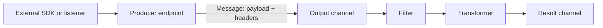
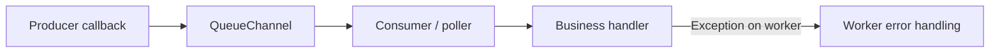

# MessageProducer

## 1. Objectives and Context

In the **SPRING_INTEGRATION_CORE** module, **Message endpoint** chapter, this lesson explains how a component brings messages into a Spring Integration flow. After this lesson, you will be able to:

- Distinguish the `MessageProducer` contract from polled sources, handlers, and gateways.
- Use `MessageProducerSupport` to turn callbacks into `Message<?>`.
- Connect a producer to a `MessageChannel` and Java DSL.
- Manage callback registration according to the endpoint's lifecycle.
- Predict where errors arise and write tests for success, error, and endpoint-stop paths.

The running context is an application receiving order-creation events from a callback-based SDK. The SDK only knows how to invoke a listener; Spring Integration handles filtering, transforming, and forwarding messages to the next step.

The examples use Java 17 and APIs available in Spring Integration 6.5.0. They require `spring-integration-core`; testing uses JUnit Jupiter. With Spring Boot, you can use `spring-boot-starter-integration` and `spring-boot-starter-test`, letting Boot's BOM manage compatible versions. The lesson requires no external broker or service.

## 2. MessageProducer Is an Output Contract

`org.springframework.integration.core.MessageProducer` describes a component capable of sending messages to a `MessageChannel`. Its main configuration methods are `setOutputChannel(MessageChannel)`, `getOutputChannel()`, and `setOutputChannelName(String)`. The interface does not declare a public `produce()` or `send()` operation. How channel names are resolved depends on the implementation. [MessageProducer Javadoc](https://docs.spring.io/spring-integration/docs/6.2.9/api/org/springframework/integration/core/MessageProducer.html).

This leads to two separate questions:

1. **When does a message appear?** It may happen when an SDK invokes a callback, when a protocol receives data, or when a handler produces a result.
2. **Where does the message go?** The producer sends it to the configured output channel.

The producer does not need to know about the business-processing layers behind the channel.



Do not equate "producer" with "input from an external system". A reply-producing handler can also implement `MessageProducer`; this interface represents the capability of having an output. Conversely, merely writing `channel.send(message)` inside a service does not turn that service into a Spring Integration lifecycle-managed endpoint.

## 3. Distinguishing Closely Related Roles

| Component | Primary Contract or Role | What Triggers It? |
| --- | --- | --- |
| `MessageProducer` | Configures where messages are sent | Implementation-specific; not defined by the interface |
| `MessageProducerSupport` | Base class for producer endpoints, with send utilities | Callback/listener wired by the subclass |
| `MessageSource<T>` | Supplies `Message<T>` via `receive()` | Called by an adapter or another component |
| `SourcePollingChannelAdapter` | Connects a source to a channel | Scheduled poller |
| `MessageHandler` | Processes messages via `handleMessage(...)` | Receiving a message from upstream |
| Messaging gateway | Exposes a Java interface for message-based communication | Application method call |

A `MessageSource` does not schedule itself. In a polling inbound setup, `SourcePollingChannelAdapter` invokes the source and sends any non-`null` result to a channel. An SDK actively calling a listener is a different scenario: you do not add a poller just to receive callbacks. [Channel Adapter](https://docs.spring.io/spring-integration/reference/channel-adapter.html).

Selection examples:

- "Ask an API every 5 seconds whether there are new orders": consider a source and polling adapter.
- "SDK notifies immediately when a new order arrives": consider a listener-based adapter.
- "Business code wants to call `submit(order)` to enter a flow": consider a messaging gateway.
- "Already have a message and need to normalize the order code": use a transformer.

Before writing your own producer, check whether an existing adapter covers the protocol you need. Standard adapters typically already handle harder concerns than a learning example, such as connection management, acknowledgment, reconnection, and transport configuration.

## 4. What Does MessageProducerSupport Provide?

`org.springframework.integration.endpoint.MessageProducerSupport` extends `AbstractEndpoint` and implements `MessageProducer`. Subclasses typically call `sendMessage(Message<?>)` when receiving a callback, use `doStart()` to register with the source, and `doStop()` to unregister. Useful settings include output channel, error channel, and send timeout. [MessageProducerSupport Javadoc](https://docs.spring.io/spring-integration/docs/7.0.x/api/org/springframework/integration/endpoint/MessageProducerSupport.html).

| API | Usage in a Custom Producer |
| --- | --- |
| `setOutputChannel(channel)` | Directly supplies the output channel |
| `setOutputChannelName(name)` | Lets the framework resolve the channel bean |
| `sendMessage(message)` | Sends a message using the base class's support mechanism |
| `setErrorChannel(channel)` | Specifies the channel for producer send errors |
| `setSendTimeout(milliseconds)` | Limits wait time when send operations support timeouts |
| `doStart()`, `doStop()` | Attaches or detaches the listener with lifecycle |
| `onInit()` | Additional initialization; call `super.onInit()` when overriding |

Do not send messages in the constructor: context wiring and lifecycle are not finished yet. Also do not call `doStart()` directly from application code; use `start()`, `stop()`, or let the context manage it.

Because `MessageProducer` is an output-configuration interface, you cannot assume every implementation extends `MessageProducerSupport` or shares the same error-handling mechanism.

## 5. Complete Example: Turning an Order-Creation Callback into a Message

### 5.1. The Components

The example below places helper types inside one configuration class so it is easy to copy and run in a small context.

- `OrderCreated` is an immutable payload.
- `LocalOrderEventClient` simulates an SDK with a single listener slot.
- `OrderEventProducer` registers the listener and builds messages.
- The flow accepts only orders with positive quantity, normalizes order IDs to uppercase, and pushes results into a queue.

```java
package example.integration;

import java.util.Locale;
import java.util.concurrent.atomic.AtomicReference;
import java.util.function.Consumer;

import org.springframework.beans.factory.annotation.Qualifier;
import org.springframework.context.annotation.Bean;
import org.springframework.context.annotation.Configuration;
import org.springframework.integration.channel.QueueChannel;
import org.springframework.integration.config.EnableIntegration;
import org.springframework.integration.dsl.IntegrationFlow;
import org.springframework.integration.endpoint.MessageProducerSupport;
import org.springframework.messaging.support.MessageBuilder;

@Configuration
@EnableIntegration
public class ProducerDemoConfig {

    public record OrderCreated(
            String eventId, String orderId, int quantity) {
    }

    public interface Registration {
        void cancel();
    }

    public interface OrderEventClient {
        Registration listen(Consumer<OrderCreated> listener);
    }

    public static final class LocalOrderEventClient
            implements OrderEventClient {

        private final AtomicReference<Consumer<OrderCreated>> listener =
                new AtomicReference<>();

        @Override
        public Registration listen(Consumer<OrderCreated> candidate) {
            if (!listener.compareAndSet(null, candidate)) {
                throw new IllegalStateException("Listener already registered");
            }
            return () -> listener.compareAndSet(candidate, null);
        }

        public void publish(OrderCreated event) {
            Consumer<OrderCreated> current = listener.get();
            if (current == null) {
                throw new IllegalStateException("No active listener");
            }
            current.accept(event);
        }

        public boolean hasListener() {
            return listener.get() != null;
        }
    }

    public static final class OrderEventProducer
            extends MessageProducerSupport {

        private final OrderEventClient client;
        private Registration registration;

        public OrderEventProducer(OrderEventClient client) {
            this.client = client;
        }

        @Override
        protected void doStart() {
            registration = client.listen(this::onEvent);
        }

        @Override
        protected void doStop() {
            try {
                Registration current = registration;
                registration = null;
                if (current != null) {
                    current.cancel();
                }
            }
            finally {
                super.doStop();
            }
        }

        private void onEvent(OrderCreated event) {
            sendMessage(MessageBuilder.withPayload(event)
                    .setHeader("sourceSystem", "local-order-sdk")
                    .setHeader("eventId", event.eventId())
                    .build());
        }
    }

    @Bean
    public LocalOrderEventClient orderEventClient() {
        return new LocalOrderEventClient();
    }

    @Bean
    public OrderEventProducer orderEventProducer(
            LocalOrderEventClient client) {
        OrderEventProducer producer = new OrderEventProducer(client);
        producer.setSendTimeout(500);
        return producer;
    }

    @Bean
    public QueueChannel acceptedOrders() {
        return new QueueChannel(20);
    }

    @Bean
    public IntegrationFlow ordersFlow(
            OrderEventProducer producer,
            @Qualifier("acceptedOrders") QueueChannel acceptedOrders) {

        return IntegrationFlow.from(producer)
                .filter(OrderCreated.class, order -> order.quantity() > 0)
                .<OrderCreated, OrderCreated>transform(order ->
                        new OrderCreated(
                                order.eventId(),
                                order.orderId().toUpperCase(Locale.ROOT),
                                order.quantity()))
                .channel(acceptedOrders)
                .get();
    }
}
```

`Registration` is an abstraction in this example, not a Spring API. With a real SDK, it can be replaced by a subscription, a listener-cancellation handle, or a pair of register/unregister methods.

### 5.2. Where Is the Message Created?

Inside `onEvent()`, the callback is converted into a message with:

- Payload: the `OrderCreated` object.
- Header `sourceSystem`: a source label for tracing.
- Header `eventId`: the business event identifier.

`MessageBuilder` here belongs to Spring Messaging: `org.springframework.messaging.support.MessageBuilder`.

Do not use the framework-generated message ID as the deduplication key for the source system. A redelivered event can be wrapped in a new message; a business key like `eventId` tells you whether two deliveries represent the same event.

### 5.3. How Does Java DSL Wire the Producer?

`IntegrationFlow.from(producer)` has an overload that accepts `MessageProducerSupport`. The DSL wires the producer's output to the rest of the flow, which is why the example does not call `setOutputChannel()` manually. Do not configure an extra independent output and assume the producer will send to both places. [IntegrationFlow 6.5.0 Javadoc](https://docs.spring.io/spring-integration/docs/6.5.0/api/org/springframework/integration/dsl/IntegrationFlow.html).

The flow above has two points to observe:

1. The filter can drop invalid-quantity orders without throwing an exception.
2. `acceptedOrders` simply holds results for another party to read; the lesson uses `receive(timeout)` in tests.

No poller is needed for this callback-based producer. If you later add a consuming endpoint reading from `acceptedOrders`, that endpoint needs an appropriate poller configuration because its input is a queue.

Here, results are buffered in memory. Surviving restarts requires durable storage or an appropriate transport; having a queue in the flow does not automatically provide durability.

## 6. Manually Wiring the Output Channel

When not using the producer as the DSL entry point, you can wire an explicit channel:

```java
@Bean
public DirectChannel incomingOrders() {
    return new DirectChannel();
}

@Bean
public OrderEventProducer orderEventProducer(
        LocalOrderEventClient client,
        @Qualifier("incomingOrders") DirectChannel incomingOrders) {

    OrderEventProducer producer = new OrderEventProducer(client);
    producer.setOutputChannel(incomingOrders);
    return producer;
}

@Bean
public IntegrationFlow ordersFlow(
        @Qualifier("incomingOrders") DirectChannel incomingOrders,
        @Qualifier("acceptedOrders") QueueChannel acceptedOrders) {

    return IntegrationFlow.from(incomingOrders)
            .filter(OrderCreated.class, order -> order.quantity() > 0)
            .channel(acceptedOrders)
            .get();
}
```

This is an **alternative** to the producer and flow beans in the previous example; you will need to import `org.springframework.integration.channel.DirectChannel`. Do not declare both sets of beans with the same names in one context.

If only the bean name is known where the producer is configured, you can use `producer.setOutputChannelName("incomingOrders")`. For Java configuration in the same context, passing the channel directly usually makes dependencies clearer.

## 7. The Channel Determines Execution Boundaries

A producer does not automatically spawn a new thread just because it extends `MessageProducerSupport`.

| Output Channel | Consequence to Account for in the Callback |
| --- | --- |
| `DirectChannel` | Handler runs on the sending thread; slow business logic holds the callback thread |
| `ExecutorChannel` | Hands processing off to an executor; must account for load limits and rejection policies |
| `QueueChannel` | Buffers messages; receiver pulls separately, and sending may wait if the queue is full |
| `PublishSubscribeChannel` | Broadcasts to subscribers; uses or omits an executor depending on configuration |

`DirectChannel` is point-to-point, not broadcast. `QueueChannel` stores in memory by default; send timeout matters when waiting for space. [Message Channel Implementations](https://docs.spring.io/spring-integration/reference/channel/implementations.html).

In the example, the steps before the queue run on the thread calling `publish()`. Therefore, `setSendTimeout(500)` does not mean the entire flow aborts after 500 ms. A send timeout does not cancel a slow handler running on a `DirectChannel`.

Capacity design example: the SDK may emit 200 events/second while business processing handles only 50 events/second. Adding a queue only delays the point of overload. You must define queue bounds, worker count, full-queue behavior, and a source backpressure or replay mechanism; otherwise, the producer can still block or data can still be lost.

## 8. Lifecycle: Register on Time and Cleanly Detach the Source

For a context-managed endpoint, lifecycle ties event reception to start/stop moments. In the example class:

- `doStart()` registers the listener.
- `doStop()` cancels the current registration and delegates to the superclass.
- If listener registration throws an exception, do not pretend the endpoint connected successfully.
- Shared resources belong to whatever created them; a producer should not shut down an entire SDK client shared by multiple flows just to detach its own listener.

Do not insert `if (!isRunning()) return;` into the callback as a complete concurrency solution. An SDK might invoke the listener right during registration before start finishes; another callback might be in flight when stop happens.

The local example intentionally keeps the mechanism simple: `cancel()` removes the listener for subsequent publishes. It does not wait for a callback that already read the listener reference to finish. In real environments, check whether the SDK guarantees stopping reception, draining in-flight callbacks, or handling acknowledgments on shutdown.

If the SDK must open a slow connection, do not hide connection opening inside the constructor. Design start/stop, connection timeouts, and resource cleanup according to the SDK's specific contract.

## 9. Error Handling at the Producer and Across Async Boundaries

### 9.1. Errors When Sending from the Producer

In the Spring Integration 6.5.0 `MessageProducerSupport` implementation, `sendMessage()` catches `RuntimeException` from sending. If the producer has an error channel, the base class attempts to send an `ErrorMessage` there; otherwise, the exception is rethrown. Sending the error message itself can also fail. [MessageProducerSupport 6.5.0 Source](https://raw.githubusercontent.com/spring-projects/spring-integration/v6.5.0/spring-integration-core/src/main/java/org/springframework/integration/endpoint/MessageProducerSupport.java).

You can configure the producer in the example:

```java
@Bean
public QueueChannel producerErrors() {
    return new QueueChannel(20);
}

@Bean
public OrderEventProducer orderEventProducer(
        LocalOrderEventClient client,
        @Qualifier("producerErrors") QueueChannel producerErrors) {

    OrderEventProducer producer = new OrderEventProducer(client);
    producer.setErrorChannel(producerErrors);
    producer.setSendTimeout(500);
    return producer;
}
```

This snippet replaces the original producer bean. To observe errors, something must read from `producerErrors`; an unread error queue will fill up.

Do not assume that merely having a global bean named `errorChannel` means all errors from a custom producer go there automatically. Also do not mechanically apply the asynchronous `errorChannel` header rule to this `sendMessage()` call.

### 9.2. Errors on Another Thread

Once a message is successfully placed into a queue, a later failure in the consumer cannot travel back in time to make the original callback invocation fail. The poller's or executor's error handler at that boundary must take responsibility for reporting the error. Spring Integration provides an `ErrorMessage` publishing mechanism for asynchronous processing; configure it at the right execution boundary. [Error Handling](https://docs.spring.io/spring-integration/reference/error-handling.html).



In this diagram, setting an error channel on the producer only handles errors the producer sees when sending into the queue, such as a full queue timing out. It does not replace error handling for worker-side handlers.

### 9.3. Errors Outside sendMessage()

If data conversion or message creation throws an exception before `sendMessage()` is called, the error-catching mechanism inside that method has not run yet.

For example, if the callback receives a different event type and parses a string into `OrderCreated`, parsing failures must have their own policy. You can explicitly call `sendErrorMessageIfNecessary(message, exception)` in the subclass once a relevant message exists, or handle it according to the SDK contract.

Avoid arbitrarily wrapping `sendMessage()` in a `catch` block and re-sending the error: send failures or error-message send failures may already have been handled by the base class.

## 10. Testing with a Small Context

Tests should verify observable behavior: that the listener is attached, payloads and headers emerge properly, filters drop the right cases, and stopping detaches the listener. No broker is needed to verify these.

The following example uses `ProducerDemoConfig` from Section 5:

```java
package example.integration;

import org.junit.jupiter.api.Test;
import org.springframework.context.annotation.AnnotationConfigApplicationContext;
import org.springframework.integration.channel.DirectChannel;
import org.springframework.integration.channel.QueueChannel;
import org.springframework.messaging.Message;
import org.springframework.messaging.MessagingException;
import org.springframework.messaging.support.ErrorMessage;

import example.integration.ProducerDemoConfig.LocalOrderEventClient;
import example.integration.ProducerDemoConfig.OrderCreated;
import example.integration.ProducerDemoConfig.OrderEventProducer;

import static org.junit.jupiter.api.Assertions.*;

class MessageProducerTest {

    @Test
    void producesTransformsFiltersAndUnregisters() {
        try (var context = new AnnotationConfigApplicationContext(
                ProducerDemoConfig.class)) {

            var client = context.getBean(LocalOrderEventClient.class);
            var producer = context.getBean(OrderEventProducer.class);
            var accepted = context.getBean(
                    "acceptedOrders", QueueChannel.class);

            assertTrue(producer.isRunning());
            assertTrue(client.hasListener());

            client.publish(new OrderCreated("evt-001", "od-001", 2));

            Message<?> result = accepted.receive(1000);
            assertNotNull(result);
            assertEquals(
                    new OrderCreated("evt-001", "OD-001", 2),
                    result.getPayload());
            assertEquals("local-order-sdk",
                    result.getHeaders().get("sourceSystem"));
            assertEquals("evt-001", result.getHeaders().get("eventId"));

            client.publish(new OrderCreated("evt-002", "od-002", 0));
            assertNull(accepted.receive(0));

            producer.stop();
            assertFalse(producer.isRunning());
            assertFalse(client.hasListener());
            assertThrows(IllegalStateException.class, () ->
                    client.publish(new OrderCreated(
                            "evt-003", "od-003", 1)));

            producer.start();
            assertTrue(client.hasListener());
            client.publish(new OrderCreated("evt-004", "od-004", 1));
            assertNotNull(accepted.receive(1000));
        }
    }

    @Test
    void publishesErrorMessageForSynchronousDownstreamFailure() {
        try (var context = new AnnotationConfigApplicationContext()) {
            var client = new LocalOrderEventClient();
            var input = new DirectChannel();
            var errors = new QueueChannel(10);

            input.subscribe(message -> {
                throw new IllegalStateException("Inventory unavailable");
            });

            context.registerBean("orderEventProducer",
                    OrderEventProducer.class, () -> {
                        var producer = new OrderEventProducer(client);
                        producer.setOutputChannel(input);
                        producer.setErrorChannel(errors);
                        producer.setSendTimeout(100);
                        return producer;
                    });
            context.refresh();

            assertDoesNotThrow(() -> client.publish(
                    new OrderCreated("evt-error", "od-error", 1)));

            Message<?> received = errors.receive(1000);
            assertInstanceOf(ErrorMessage.class, received);

            ErrorMessage error = (ErrorMessage) received;
            MessagingException failure = assertInstanceOf(
                    MessagingException.class, error.getPayload());
            assertInstanceOf(
                    IllegalStateException.class, failure.getCause());
            assertEquals("Inventory unavailable",
                    failure.getCause().getMessage());
        }
    }
}
```

The second test connects the producer to a `DirectChannel` whose handler throws an error. It tests the producer's synchronous send boundary, not asynchronous errors after a queue.

Additional cases to test when moving to a real SDK:

| Scenario | What to Verify |
| --- | --- |
| Source fails to start | Failure surfaces clearly; no leaked listeners or connections |
| Stop during an active callback | Wait/cancel contract and in-flight data handling are well defined |
| Output queue full | Timeout or backpressure/shedding policy behaves properly |
| Error channel also full | Errors are not silently lost; source receives appropriate signal |
| Event redelivered | Same `eventId` is handled per deduplication policy |
| Endpoint restarted repeatedly | No duplicate registration and no duplicate event emission |

These test snippets are practice code for the lesson; writing this document does not imply they have already been compiled and executed in your target project.

## 11. Relationship to Other Integration Patterns

The producer only needs to do a good job bringing messages into the flow; business steps are composed downstream:

- **Transformer:** Normalizes payloads, such as uppercasing `orderId` in the example.
- **Filter:** Accepts or drops events based on conditions.
- **Router:** Splits paths by order type or tenant; a producer does not replace a router.
- **Aggregator:** Combines multiple messages using a correlation key and release condition; a producer emitting multiple events does not by itself create a group.
- **Gateway:** Provides an entry point into a flow or request-reply communication when a scenario needs a return value.

For an aggregator, design the header or payload containing the business correlation key right at ingestion. `eventId` identifies a single event; multiple events belonging to the same order may need `orderId` as the grouping key. Those two roles are different.

A `void` callback as in the example fits one-way notifications. If the SDK requires a response or acknowledgment, model that contract explicitly. `sendMessage()` completing normally does not prove all business work finished: the message may just have been queued, dropped by a filter, or routed as an error to an error channel.

## 12. Common Design Mistakes

| Symptom | Possible Cause | Adjustment |
| --- | --- | --- |
| No callbacks arriving | Producer not started or SDK not connected | Check lifecycle and registration |
| Callback runs but no output | Filter dropped it, wrong channel, or downstream failure | Inspect producer output and each step in order |
| No-subscriber error | Sending to `DirectChannel` before consumer is wired | Check wiring, bean names, lifecycle order |
| SDK thread held too long | Slow synchronous business logic or full queue | Measure handler time, check queue bounds and worker model |
| Events processed twice after restart | Old listener not detached or source redelivered | Manage registration, add idempotency |
| Events still pass through after stop | Callback already started before cancel | Define drain/cancel semantics per SDK contract |
| Error queue exists but no alerts appear | No consumer reading errors | Wire a monitoring flow and store needed error details |
| Attached poller with no pull method | Confused callback producer with polling source | Choose the right adapter for the source mechanism |

Do not log full payloads as a default reflex. For order events, prioritize event ID, order ID, source name, endpoint name, and error type; sensitive data should be handled according to application policies.

## 13. Hands-On Exercises

1. Add a `receivedAt` header when the callback arrives; verify the header remains present after the transformer.
2. Add a router splitting orders by quantity, using two output queues for observation.
3. Replace the output queue with a capacity-1 queue, use a finite send timeout, and publish two events without draining the queue. Explain where the send failure occurs.
4. Use a polling endpoint reading the queue and intentionally throw an exception. Compare the error path with a producer sending directly into a handler.
5. Publish the same `eventId` twice. Determine where to place the deduplication mechanism and what policy applies when the first attempt fails.
6. Write a fake SDK with a callback running while `stop()` is called to clarify the shutdown contract needed for production.

## 14. Knowledge Self-Check

- Does `MessageProducer` have any method forcing the framework to pull data periodically? **No; that is not a polling contract.**
- Does every producer create its own thread? **No; you must inspect the source, channel, and executor.**
- Why use `MessageProducerSupport`? **To reuse endpoint mechanics, channel configuration, and send utilities instead of building everything from scratch.**
- Why is successful queuing of a message not enough to conclude order processing succeeded? **The processor may not have run yet.**
- Why must the listener be detached on stop? **To stop new reception and prevent lingering registrations across restarts.**
- Should router, filter, and aggregator logic be implemented inside the producer? **No; compose them downstream as separate endpoints by responsibility.**

When designing a producer, answer four questions: how do events arrive, which channel receives the message, what resources are managed on start/stop, and on which thread are errors observed? Those four answers determine how cleanly and safely the producer participates in an integration flow.