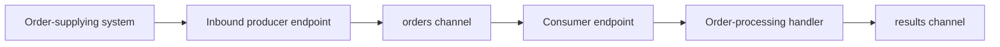

# Consumer Endpoint and Producer Endpoint

In the **Message endpoint** chapter of the `SPRING_INTEGRATION_CORE` module, distinguishing consumer endpoints from producer endpoints helps answer three questions when designing a flow: where do messages enter from, who receives messages from a channel, and which component manages that receiving/sending? This is the foundation for assembling `Message`, `MessageChannel`, endpoints, gateways, and Java DSL into an integration flow that can be operated and tested.

This lesson focuses on the standard messaging model with `SubscribableChannel`, `PollableChannel`, and inbound sources. Reactive endpoints have their own subscription mechanisms and must not be inferred solely from the endpoint-selection rules in this lesson.

## 1. Learning Objectives

After this lesson, you will be able to:

- Separate the responsibilities of endpoints, handlers, and channels in a flow.
- Distinguish between `EventDrivenConsumer`, `PollingConsumer`, and `SourcePollingChannelAdapter`.
- Recognize inbound producers based on polling or listener/callback mechanisms.
- Read DSL configurations to identify poller placement, thread boundaries, and error paths.
- Separately test channel sending, consumer processing, and emitting messages from a source.

## 2. Consumer and Producer Are Roles Relative to a Channel

Consider an order-receiving system:



**A producer endpoint** puts messages into a channel. It can periodically pull data from a source, or receive callbacks from a communication library and convert the data into internal messages.

**A consumer endpoint** connects an input channel to processing logic. It manages how the handler receives messages: subscribing to events from the channel or actively pulling messages using a poller. This division of responsibility is presented in [Message Endpoints](https://docs.spring.io/spring-integration/reference/endpoint.html).

These two roles do not mean two mutually exclusive sets of components at every level of abstraction. A transformer consumes a message from channel A and produces a result for channel B. Looking at data flow, it both receives and emits; looking at the input endpoint, the transformer handler is still attached to a consumer endpoint.

Similarly, an outbound adapter sends data to an external system, yet it is usually a **consumer of an internal channel**. The word "outbound" indicates direction across the integration application's boundary, not that it is a producer endpoint for an internal channel.

### 2.1. How Does an Endpoint Differ from a Handler?

| Component | Responsibility | Example in the Order Flow |
| --- | --- | --- |
| `Message<?>` | Carries payload and metadata | Order payload, `orderId` header |
| `MessageChannel` | Provides the connection point for exchanging messages | `DirectChannel`, `QueueChannel` |
| Handler | Performs the processing action for a message | Normalizes order code, checks conditions, calls service |
| Consumer endpoint | Connects input channel to handler, manages subscription or polling | `EventDrivenConsumer`, `PollingConsumer` |
| Inbound producer endpoint | Pulls/receives source data and sends messages into a channel | `SourcePollingChannelAdapter`, callback-receiving adapter |

A mental model worth keeping:

```text
Consumer: input channel --[endpoint manages reception]--> handler
Producer: source/listener --[endpoint manages emission]--> output channel
```

Do not put a scheduler inside a business method just because the channel uses polling. The endpoint handles that coordination; the handler focuses on data and business behavior.

## 3. Two Common Consumer Endpoints

### 3.1. EventDrivenConsumer: The Channel Actively Dispatches Messages

`EventDrivenConsumer` connects a `SubscribableChannel` to a `MessageHandler`. When the endpoint is running, the handler is subscribed to the channel; when the endpoint stops, the subscription is removed. Conceptually, receiving is based on `subscribe(handler)` rather than a loop calling `receive()`. See [Endpoint APIs](https://docs.spring.io/spring-integration/docs/6.2.6/api/org/springframework/integration/endpoint/package-summary.html).

Common channels in this group:

- `DirectChannel`: delivers a single message to one selected subscriber.
- `ExecutorChannel`: uses an executor to hand off processing work.
- `PublishSubscribeChannel`: delivers messages to subscribers using a broadcast mechanism.

Note that **event-driven does not automatically mean asynchronous**. With a standard `DirectChannel`, the handler runs on the thread calling `send()`. Switching to `ExecutorChannel` introduces an executor handoff boundary. With `PublishSubscribeChannel`, check whether an executor is configured. Details are in [Message Channel Implementations](https://docs.spring.io/spring-integration/reference/6.5/channel/implementations.html).

Reasoning example:

```text
HTTP thread -> DirectChannel -> order-validation handler -> DirectChannel -> order-persistence handler
```

If every step is synchronous, the HTTP thread remains busy until the entire processing chain finishes. The benefit of message channels here is structural decoupling of components, even without thread decoupling.

### 3.2. PollingConsumer: The Endpoint Actively Pulls Messages

`PollingConsumer` connects a `PollableChannel`, such as `QueueChannel`, to a handler. The poller triggers the receive task; the endpoint calls `receive()` on the channel and passes any retrieved message to the handler.

```text
Producer -> QueueChannel
                 ^
                 | receive()
              PollingConsumer -> handler
```

There are several settings to read separately:

| Setting | Question It Answers |
| --- | --- |
| Trigger/fixed delay/cron | When is a poll cycle triggered? |
| `maxMessagesPerPoll` | At most how many messages are processed in one cycle? |
| `receiveTimeout` | How long to wait when calling receive on the channel if no message is available yet? |
| Task executor, if present | Is polling work handed off to an executor? |

`maxMessagesPerPoll(5)` does not create five threads, nor does it mean the channel can hold only five messages. Queue capacity and concurrent execution are separate concerns. The [Poller](https://docs.spring.io/spring-integration/reference/6.5/polling-consumer.html) section distinguishes channel polling from inbound source polling.

Example: fixed-delay poller of 200 ms, at most 5 messages/poll. With synchronous polling work, the pause starts after the current cycle completes. If each message takes 100 ms and the queue always has data, one cycle can take about 500 ms before the pause begins. You cannot compute throughput as `5 / 0.2` while ignoring processing time.

### 3.3. Choosing a Consumer Based on Input Channel

| Input in the Standard Model | Message-Receiving Endpoint | Poller at Receive Step |
| --- | --- | --- |
| `DirectChannel` | `EventDrivenConsumer` | No |
| `ExecutorChannel` | `EventDrivenConsumer` | No |
| `PublishSubscribeChannel` | `EventDrivenConsumer` for each subscribed handler | No |
| `QueueChannel` | `PollingConsumer` | Yes, local or inheriting default poller config |

Choose the handler based on business function and choose the consumer based on how the channel delivers messages. Changing `.transform(...)` to `.handle(...)` does not turn polling into event-driven if the input channel is still a queue.

## 4. Inbound Producer Endpoints

### 4.1. Polled Sources: SourcePollingChannelAdapter

A source can be a method reading pending records, a file reader, or a `Supplier` generating data. For this kind of source, `SourcePollingChannelAdapter` manages invoking the source and sending messages to the output channel.

```text
Scheduler -> SourcePollingChannelAdapter -> source.receive()
                            |
                            +-> outputChannel.send(message)
```

`MessageSource<T>` provides the operation to receive a `Message<T>`; the `fromSupplier(...)` DSL configuration lets you supply payloads more conveniently. If a poll finds no data and returns `null`, the adapter emits no message for that cycle. See [Channel Adapter](https://docs.spring.io/spring-integration/reference/6.5/channel-adapter.html).

Distinguish the two types of polling:

| Endpoint | Object Being Polled | After Data Is Received |
| --- | --- | --- |
| `PollingConsumer` | Internal channel supporting `receive()` | Invokes handler |
| `SourcePollingChannelAdapter` | Inbound data source | Sends message to output channel |

Thus, two endpoints can both have pollers while holding two different positions in the topology. The API of [SourcePollingChannelAdapter](https://docs.spring.io/spring-integration/api/org/springframework/integration/endpoint/SourcePollingChannelAdapter.html) clearly shows both the source and the output channel.

### 4.2. Push Sources Using Listeners/Callbacks

Some protocols or libraries invoke a callback when data arrives. An adapter can register a listener, receive events, build a message, and send it to an internal channel.

```text
Protocol event -> adapter callback -> Message<?> -> output channel
```

`MessageProducerSupport` is the support class for many producer endpoints of this kind: it provides output-channel configuration and message-sending operations. The support class does not provide protocol connectivity itself; the concrete adapter must still manage listeners, connections, and proper lifecycle. See [MessageProducerSupport API](https://docs.spring.io/spring-integration/api/org/springframework/integration/endpoint/MessageProducerSupport.html).

Do not add a poller just because data enters the application. First determine whether the source library pushes via callback or requires active polling.

### 4.3. A `send()` Call Does Not Necessarily Create a Producer Endpoint

The following application code acts as a message sender:

```java
orders.send(MessageBuilder.withPayload("ORDER-42").build());
```

However, merely calling `send()` does not mean Spring created a producer endpoint bean with its own listener/poller lifecycle. A gateway also provides a messaging entry point for Java code; read the actual topology instead of equating every send site with `SourcePollingChannelAdapter`.

In the DSL, a flow can start from a gateway interface. This is one way to bring Java method calls into a flow, described in [IntegrationFlow as a Gateway](https://docs.spring.io/spring-integration/reference/6.5/dsl/integration-flow-as-gateway.html).

## 5. Practice with Three Java DSL Flows

The example below uses Spring Integration 6.x APIs and Java 17 or later. It requires `spring-integration-core` along with compatible Spring dependencies; tests require JUnit Jupiter. If using Spring Boot, let Boot's dependency management choose aligned Spring versions.

Three independent flows let you observe each mechanism without a broker or database:

1. Send an order to a `DirectChannel`, normalize the order code, and place the result into a queue.
2. Send an order to a `QueueChannel`, letting a polling consumer process it.
3. Put an order into a simulated source, letting an inbound producer poll and emit it to a queue.

The result queues are terminal points for tests to call `receive()`, with no downstream consumer endpoints registered on them.

### 5.1. Full Configuration

```java
package example.integration;

import java.time.Duration;
import java.util.Locale;
import java.util.Queue;
import java.util.concurrent.ConcurrentLinkedQueue;

import org.springframework.context.annotation.Bean;
import org.springframework.context.annotation.Configuration;
import org.springframework.integration.channel.DirectChannel;
import org.springframework.integration.channel.QueueChannel;
import org.springframework.integration.config.EnableIntegration;
import org.springframework.integration.dsl.IntegrationFlow;
import org.springframework.integration.dsl.Pollers;

@Configuration
@EnableIntegration
public class EndpointRolesConfig {

    public record Order(String id) {
    }

    // Simulates an external source; not a Spring MessageChannel.
    public static class PendingOrderSource {
        private final Queue<Order> pending = new ConcurrentLinkedQueue<>();

        public void offer(Order order) {
            pending.add(order);
        }

        public Order next() {
            return pending.poll();
        }
    }

    @Bean
    public DirectChannel directOrders() {
        return new DirectChannel();
    }

    @Bean
    public QueueChannel queuedOrders() {
        return new QueueChannel(20);
    }

    @Bean
    public QueueChannel normalizedOrders() {
        return new QueueChannel(20);
    }

    @Bean
    public QueueChannel queuedResults() {
        return new QueueChannel(20);
    }

    @Bean
    public QueueChannel sourceResults() {
        return new QueueChannel(20);
    }

    @Bean
    public PendingOrderSource pendingOrderSource() {
        return new PendingOrderSource();
    }

    @Bean
    public IntegrationFlow directOrderFlow() {
        return IntegrationFlow.from(directOrders())
                .transform(Order.class,
                        order -> order.id().trim().toUpperCase(Locale.ROOT),
                        endpoint -> endpoint.id("normalizeOrderEndpoint"))
                .channel(normalizedOrders())
                .get();
    }

    @Bean
    public IntegrationFlow queuedOrderFlow() {
        return IntegrationFlow.from(queuedOrders())
                .transform(Order.class,
                        order -> "ACCEPTED:" + order.id(),
                        endpoint -> endpoint
                                .id("queuedOrderEndpoint")
                                .poller(Pollers.fixedDelay(Duration.ofMillis(100))
                                        .maxMessagesPerPoll(5)
                                        .receiveTimeout(0)))
                .channel(queuedResults())
                .get();
    }

    @Bean
    public IntegrationFlow sourceOrderFlow() {
        return IntegrationFlow.fromSupplier(
                        () -> pendingOrderSource().next(),
                        endpoint -> endpoint
                                .id("orderSourceEndpoint")
                                .autoStartup(false)
                                .poller(Pollers.fixedDelay(Duration.ofMillis(100))
                                        .maxMessagesPerPoll(1)))
                .channel(sourceResults())
                .get();
    }
}
```

The DSL builds and registers the flow's components into the application context; the builder chain is not a user-written execution loop. See [Java DSL](https://docs.spring.io/spring-integration/reference/6.5/dsl.html).

### 5.2. Reading the Configuration by Endpoint

| Configured ID | Expected Endpoint Type | Reason |
| --- | --- | --- |
| `normalizeOrderEndpoint` | `EventDrivenConsumer` | Transformer receives from `DirectChannel` |
| `queuedOrderEndpoint` | `PollingConsumer` | Transformer receives from `QueueChannel` and has a poller |
| `orderSourceEndpoint` | `SourcePollingChannelAdapter` | Flow starts from a polled supplier |

The first flow shows that a consumer endpoint can still contain a handler that produces output. The `String` result goes to `normalizedOrders`; that does not change the transformer endpoint's input-receiving mechanism.

The second flow places the poller on the transformer endpoint, right after `queuedOrders`. Putting a poller on an upstream producer will not replace the poller required to read this queue.

The third flow intentionally uses `autoStartup(false)` for testing source population before starting the adapter. In a real application, the source can auto-start if that is the desired behavior. Returning `null` when the source has no data avoids emitting dummy messages or replaying the same order on every cycle.

In the equivalent annotation-based configuration, `@ServiceActivator` binds a processing method to an input channel; `@InboundChannelAdapter` uses a source method to emit data into a channel. The annotations serve two different roles, per [Annotation Support](https://docs.spring.io/spring-integration/reference/6.5/configuration/annotations.html).

## 6. Testing Endpoint Behavior

Do not check only transformed values; verify the exact entry and exit points of each flow. The following tests are in the same package as the configuration above, each creating its own context and closing it upon completion.

```java
package example.integration;

import org.junit.jupiter.api.Test;
import org.springframework.context.annotation.AnnotationConfigApplicationContext;
import org.springframework.integration.channel.DirectChannel;
import org.springframework.integration.channel.QueueChannel;
import org.springframework.integration.endpoint.EventDrivenConsumer;
import org.springframework.integration.endpoint.PollingConsumer;
import org.springframework.integration.endpoint.SourcePollingChannelAdapter;
import org.springframework.messaging.Message;
import org.springframework.messaging.support.MessageBuilder;

import static org.junit.jupiter.api.Assertions.*;

class EndpointRolesTest {

    @Test
    void directChannelUsesEventDrivenConsumer() {
        try (var context = new AnnotationConfigApplicationContext(
                EndpointRolesConfig.class)) {
            var endpoint = context.getBean(
                    "normalizeOrderEndpoint", EventDrivenConsumer.class);
            assertTrue(endpoint.isRunning());

            var input = context.getBean("directOrders", DirectChannel.class);
            var output = context.getBean("normalizedOrders", QueueChannel.class);

            assertTrue(input.send(MessageBuilder.withPayload(
                    new EndpointRolesConfig.Order("  order-42  ")).build(), 100));

            // Synchronous flow already placed the result into the queue before send() returned.
            Message<?> result = output.receive(0);
            assertNotNull(result);
            assertEquals("ORDER-42", result.getPayload());
        }
    }

    @Test
    void queueChannelUsesPollingConsumer() {
        try (var context = new AnnotationConfigApplicationContext(
                EndpointRolesConfig.class)) {
            var endpoint = context.getBean(
                    "queuedOrderEndpoint", PollingConsumer.class);
            assertTrue(endpoint.isRunning());

            var input = context.getBean("queuedOrders", QueueChannel.class);
            var output = context.getBean("queuedResults", QueueChannel.class);

            assertTrue(input.send(MessageBuilder.withPayload(
                    new EndpointRolesConfig.Order("order-43")).build(), 100));

            // Give the poller time to process, while always bounding the wait timeout.
            Message<?> result = output.receive(3000);
            assertNotNull(result);
            assertEquals("ACCEPTED:order-43", result.getPayload());
        }
    }

    @Test
    void sourceAdapterProducesMessageAfterStart() {
        try (var context = new AnnotationConfigApplicationContext(
                EndpointRolesConfig.class)) {
            var source = context.getBean(
                    EndpointRolesConfig.PendingOrderSource.class);
            var endpoint = context.getBean(
                    "orderSourceEndpoint", SourcePollingChannelAdapter.class);
            var output = context.getBean("sourceResults", QueueChannel.class);

            assertFalse(endpoint.isRunning());
            source.offer(new EndpointRolesConfig.Order("order-44"));
            assertNull(output.receive(0));

            endpoint.start();
            try {
                Message<?> result = output.receive(3000);
                assertNotNull(result);
                assertEquals(new EndpointRolesConfig.Order("order-44"),
                        result.getPayload());
            }
            finally {
                endpoint.stop();
            }
        }
    }
}
```

The tests check both endpoint types and observable flow behavior. Do not use `Thread.sleep()` to guess when the poller runs; `receive(timeout)` waits for the result right at the message boundary. The 3-second mark is an example limit and can be tuned to your test environment.

Fault tolerance cannot be inferred from these three tests alone. To verify deduplication or crash recovery, you need dedicated scenarios with real sources, message stores, and retry policies.

## 7. Threads, Errors, and the Meaning of a Successful Send

### 7.1. Thread Boundaries Determine Where Errors Are Caught

With a synchronous chain over `DirectChannel`, handler exceptions can propagate back to the caller of `send()`. With a polling consumer, the handler usually runs in work executed by a scheduler or executor; the sender into the queue no longer shares the same call stack. This general error mechanism is covered in [Error Handling](https://docs.spring.io/spring-integration/reference/6.5/error-handling.html).

In the example, if a null order code causes `directOrderFlow`'s transformer to throw an exception, the direct caller can receive the exception. If the queued flow's transformer throws an exception after the message has entered the queue, a `try/catch` around the enqueue operation will not catch the processing failure that happens later.

For errors in a polling task, the framework can use an error handler to wrap them in an `ErrorMessage` and forward them to an error channel. The concrete configuration determines the route: the message's `errorChannel` header or the default error channel when using the corresponding error-handling mechanism. Protocol adapters may have additional dedicated error mechanisms. Do not infer that every error in every producer automatically returns to the original sender.

### 7.2. `send` Returning `true` Is Not Enough to Conclude Business Success

In a queue-based flow, a successful `send()` indicates that the channel accepted the message according to its rules. It is not confirmation that the consumer has written data to an external system.

If the application needs to know an order has completed, design explicit business outcomes: a reply via a gateway, an `OrderAccepted`/`OrderRejected` event, or a status record with a correlation ID. Avoid using enqueue success as an "order processed successfully" response.

### 7.3. A Queue and Poller Do Not Automatically Guarantee Delivery

A standard `QueueChannel` stores messages in memory. It does not preserve messages when the process stops. Once a consumer pulls a message from the queue and the handler fails, recovery depends on the designed message store, transactions, source behavior, and retry policy.

The simulated source in this lesson uses `pending.poll()` to remove an order from the source. If sending to the output channel fails afterward, the example has no mechanism to return the order. Therefore, this is a model for learning endpoint roles, not a durable delivery design for order data.

A real-world design must specify the exact moment of source acknowledgment/deletion, the level of data preservation, and how duplicate side effects are prevented. Merely adding a poller does not resolve those decisions.

## 8. Common Design Mistakes

| Symptom or Misconception | Cause to Check | Remediation |
| --- | --- | --- |
| Message sits in queue but handler never runs | Endpoint reading the queue is not running or lacks required polling config | Check endpoint, lifecycle, and poller at the consumer |
| Sending to `DirectChannel` fails with no subscribers | Consumer not yet subscribed or stopped | Check flow and endpoint status before sending |
| Handler blocks HTTP thread for a long time | Flow runs over `DirectChannel` and performs slow work | Evaluate executor/queue boundaries alongside response requirements |
| Increasing `maxMessagesPerPoll` did not increase threads | Parameter limits messages per cycle | Design concurrency separately and check ordering |
| Inbound adapter repeatedly emits the same record | Source does not mark processed items; supplier keeps returning the same data | Design source state tracking and idempotent processing |
| Outbound adapter called a producer of the input channel | Confused direction across system boundary with role relative to channel | Identify the exact channel the component receives from |
| Caught errors around enqueue but saw no handler errors | Handler ran later on another thread | Monitor the error channel and business outcomes |
| Stopped consumer while producer still puts messages into queue | Component lifecycles are independent | Plan order of stopping sources, draining backlog, and wait limits |

Some configuration errors can prevent the context from starting rather than merely leaving messages in a queue. When diagnosing, distinguish startup configuration errors from a valid endpoint that is simply stopped.

## 9. Applying This to Other Integration Patterns

Transformers, filters, routers, and aggregators each have their own logic, yet all must be connected to an appropriate message-receiving mechanism. In standard topologies, the input channel determines whether the consumer uses subscription or polling; the handler's function determines how data continues onward.

Self-designed example:

```text
Polled order source
    -> orders: DirectChannel
    -> order-code validation filter
    -> normalization transformer
    -> region-based router
    -> channels handing off to processing services
```

The inbound producer is the adapter polling the source. The filter, transformer, and router are message-consuming steps; if the connecting links are `DirectChannel` instances, they are triggered via the event-driven mechanism within the same synchronous call chain.

If responses must be combined into a single result using an aggregator, beyond its consumer role you must design the correlation key, release strategy, and group state store. You cannot use "it has a poller so it will collect everything" as a substitute for aggregator rules.

Gateways address the boundary between Java calls and messaging; endpoints address how components operate at a channel or source. When reviewing a large flow, explicitly mark entry points from gateways, producers talking to external systems, and each consumer on internal channels.

## 10. Applied Exercises

1. Replace `directOrders` with a `QueueChannel`. Identify which endpoint must have a poller and what change is needed in the test currently calling `receive(0)`.
2. Add a handler that intentionally throws an exception to the queued flow. Design where errors are collected and explain why the enqueue caller cannot catch that error on the same call stack.
3. Route the source's output into `queuedOrders` instead of `sourceResults`. Draw the two distinct polling locations and explain which object each poller reads.
4. Make the simulated source return the same order across multiple cycles. Propose an appropriate idempotency key and the exact point when processed status is recorded.
5. Add a gateway accepting order-code normalization requests. Identify which calls need synchronous results and where thread assumptions would change.

Self-assessment criteria: for every component on the diagram, you can state where it receives from, where it sends to, what mechanism triggers it, and where errors are observed. If you can answer all four points, you have the basis to compose endpoints into testable, operable integration flows.