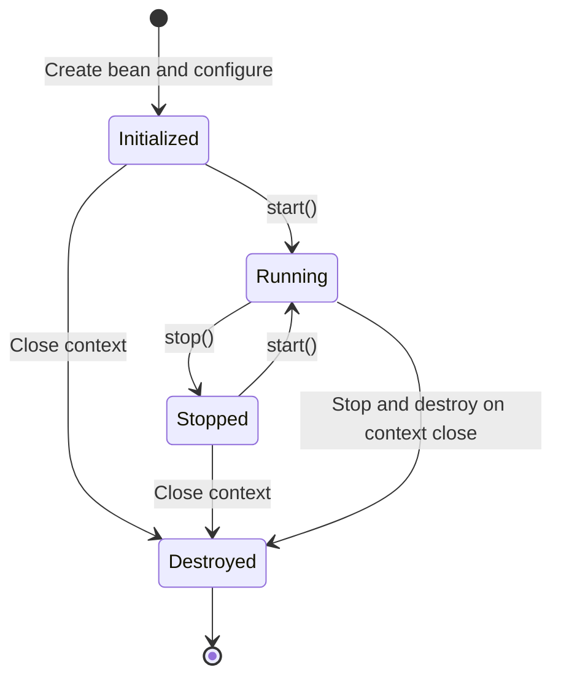

# Endpoint Lifecycle — The Lifecycle of a Message Endpoint

## 1. Objectives and Usage Scenario

In the `SPRING_INTEGRATION_CORE` module, a message endpoint is the component that connects message reception with processing logic in an integration flow. This lesson belongs to the **Message endpoint** chapter and focuses on starting, stopping, and coordinating endpoint lifecycles when building flows with Java DSL.

After this lesson, you will be able to:

- Distinguish a created bean from a running endpoint.
- Control an endpoint through `SmartLifecycle` and a stable bean name.
- Use `autoStartup` and `phase` to set up operational ordering.
- Predict the impact of `stop()` on consumers using `DirectChannel` or `QueueChannel`.
- Design controlled maintenance operations and choose the right observations when testing.

Suppose an order-receiving system must pause its data-persistence step during storage maintenance. Merely seeing that Spring has instantiated `OrderService` does not tell us whether the endpoint calling that service is ready to receive messages. Conversely, stopping the endpoint does not prove all in-flight orders have finished processing.

## 2. Endpoint, Handler, and Channel Have Distinct Roles

A consumer endpoint can be visualized as follows:

```text
MessageChannel --> endpoint manages receiving --> MessageHandler --> business logic
```

The handler performs work such as a transformer, filter, router, or service activator. The endpoint manages how the handler attaches to the input source, such as subscribing or running a poller. `EventDrivenConsumer` is an endpoint connecting a `MessageHandler` to a `SubscribableChannel`. See [EventDrivenConsumer API](https://docs.spring.io/spring-integration/docs/current/api/org/springframework/integration/endpoint/EventDrivenConsumer.html).

| Component in the Order Example | Responsibility | What Can Be Inferred from Its State? |
| --- | --- | --- |
| `orders.input` | Passes messages into the processing step | The channel existing does not prove a consumer is receiving |
| `orders.endpoint` | Enables or disables the receiving mechanism for the handler | Lifecycle state describes this endpoint |
| `OrderService.process()` | Executes order business logic | The service bean existing does not prove the endpoint is running |
| `orderFlow` | Declares the integration flow structure | The flow name is not automatically the endpoint name to control |

In Java DSL, setting `id()` in the endpoint configuration avoids relying on auto-generated names. Endpoint configuration and handler configuration can appear in the same DSL call, yet they still represent objects with separate responsibilities. See [DSL and Endpoint Configuration](https://docs.spring.io/spring-integration/reference/dsl/java-endpoints.html).

Therefore, maintenance on the order-processing step should target `orders.endpoint`. Calling `OrderService.process()` directly bypasses the receiving mechanism managed by the endpoint, so it is unsuitable for proving the endpoint has stopped receiving.

## 3. Lifecycle Stages

Many Spring Integration endpoints extend `AbstractEndpoint`, supporting lifecycle management, auto-startup, and bean destruction. The conceptual model below helps distinguish stages; it is not a framework state enum:



Initialization prepares the object and its dependencies. `start()` activates the endpoint's operational mechanism; `stop()` halts that mechanism while keeping the bean so it can be restarted. Closing the application context also destroys beans and reclaims resources. Do not hold onto an endpoint from a closed context and call `start()` to reuse it. The foundational methods are described in [AbstractEndpoint API](https://docs.spring.io/spring-integration/docs/current/api/org/springframework/integration/endpoint/AbstractEndpoint.html).

A common misconception is that `autoStartup(false)` equals lazy bean creation. The endpoint and its dependencies can still be instantiated during context preparation, while the message-receiving mechanism is simply not yet enabled.

## 4. The SmartLifecycle Contract

`SmartLifecycle` extends `Lifecycle` to support startup on context refresh, phase-based ordering, and stop callbacks. Key methods to understand include:

| Method | How to Read It in Operations |
| --- | --- |
| `start()` | Requests the component to start operating |
| `stop()` | Requests the component to stop according to its implementation |
| `isRunning()` | Reads the running state reported by the component |
| `isAutoStartup()` | Determines whether it starts automatically on context refresh |
| `getPhase()` | Determines the startup and shutdown ordering group |
| `stop(Runnable callback)` | Notifies the lifecycle processor when stopping completes |

Spring uses the callback variant when orchestrating the shutdown of `SmartLifecycle` components. In custom implementations, the callback must be invoked after the component has actually completed stopping according to its contract. See [SmartLifecycle API](https://docs.spring.io/spring-framework/docs/6.2.x/javadoc-api/org/springframework/context/SmartLifecycle.html).

`isRunning()` is not a measure of business health. For example, an endpoint can report running while the payment service is timing out. A stopped endpoint also does not automatically prove that a request running on another thread has finished. You must separately observe errors, in-flight task counts, and dependent resource states.

## 5. Java DSL Example: Starting and Stopping an Endpoint

The following example uses Java 17 and Spring Integration 6.x Java DSL APIs. The project needs `spring-integration-core` and compatible Spring dependencies; if using Spring Boot, let Boot's dependency management handle versions. This is a standalone example and does not require creating a Boot application.

Save the Java code as `EndpointLifecycleDemo.java` in a project with those dependencies:

```java
import org.springframework.context.SmartLifecycle;
import org.springframework.context.annotation.AnnotationConfigApplicationContext;
import org.springframework.context.annotation.Bean;
import org.springframework.context.annotation.Configuration;
import org.springframework.integration.channel.DirectChannel;
import org.springframework.integration.config.EnableIntegration;
import org.springframework.integration.dsl.IntegrationFlow;
import org.springframework.messaging.MessageChannel;
import org.springframework.messaging.MessageDeliveryException;
import org.springframework.messaging.support.MessageBuilder;

@Configuration
@EnableIntegration
public class EndpointLifecycleDemo {

    public record Order(String id) {
    }

    public static class OrderService {
        public void process(Order order) {
            System.out.println("Processed: " + order.id());
        }
    }

    @Bean(name = "orders.input")
    public DirectChannel ordersInput() {
        return new DirectChannel();
    }

    @Bean
    public OrderService orderService() {
        return new OrderService();
    }

    @Bean
    public IntegrationFlow orderFlow(OrderService orderService) {
        return IntegrationFlow.from("orders.input")
                .handle(orderService, "process", endpoint -> endpoint
                        .id("orders.endpoint")
                        .autoStartup(false)
                        .phase(100))
                .get();
    }

    public static void main(String[] args) {
        try (var context = new AnnotationConfigApplicationContext(
                EndpointLifecycleDemo.class)) {

            SmartLifecycle endpoint = context.getBean(
                    "orders.endpoint", SmartLifecycle.class);
            MessageChannel input = context.getBean(
                    "orders.input", MessageChannel.class);

            System.out.println("Initially running: " + endpoint.isRunning());

            endpoint.start();
            input.send(MessageBuilder.withPayload(new Order("ORD-001")).build());

            endpoint.stop();
            System.out.println("After stop: " + endpoint.isRunning());

            try {
                input.send(MessageBuilder.withPayload(new Order("ORD-002")).build());
                throw new IllegalStateException("Expected delivery to fail");
            }
            catch (MessageDeliveryException expected) {
                System.out.println("No active consumer for ORD-002");
            }

            endpoint.start();
            input.send(MessageBuilder.withPayload(new Order("ORD-003")).build());
        }
    }
}
```

Configuration notes:

- `orders.input` is a `DirectChannel` and has only the single consumer declared in the example.
- `orders.endpoint` is the explicit ID set for the `.handle(...)` step's endpoint.
- `autoStartup(false)` keeps the endpoint stopped after context refresh; the first `start()` turns it on.
- `phase(100)` is chosen for illustration. With only one endpoint to coordinate, this number provides no meaningful ordering benefit.
- `process()` returns `void`, so processing ends here and no output channel is needed for a reply.

Expected business output lines, excluding framework logs:

```text
Initially running: false
Processed: ORD-001
After stop: false
No active consumer for ORD-002
Processed: ORD-003
```

`ORD-002` is not buffered for automatic processing when the endpoint starts again. The sending application must decide whether to persist, retry, or return an error. The example intentionally finishes processing `ORD-001` before calling `stop()`; it does not simulate concurrent sending and stopping.

## 6. When Stopping an Endpoint, Where Do Messages Go?

### 6.1. Consumer Using DirectChannel

On the example's normal path, the caller sends and the handler executes on the same thread. The event-driven endpoint subscribes the handler when running and unsubscribes it when stopped. If that endpoint is the sole subscriber, sending after it stops fails due to having no subscribers.

If another consumer is subscribed to the same `DirectChannel`, stopping one endpoint does not mean the entire channel stops delivering messages. Furthermore, unsubscribing does not recall a handler invocation that another thread already started earlier. Coordination on the sender side is needed if you want a clean maintenance boundary.

### 6.2. Consumer Using QueueChannel

For a consumer reading from a `QueueChannel`, the endpoint is usually a `PollingConsumer`. The poller periodically fetches messages and hands them to the handler; `AbstractPollingEndpoint` manages the polling mechanism. See [AbstractPollingEndpoint API](https://docs.spring.io/spring-integration/docs/current/api/org/springframework/integration/endpoint/AbstractPollingEndpoint.html).

An alternative configuration for the flow above is:

```java
// Additional imports:
// import java.time.Duration;
// import org.springframework.integration.channel.QueueChannel;
// import org.springframework.integration.dsl.Pollers;

@Bean(name = "orders.queue")
public QueueChannel ordersQueue() {
    return new QueueChannel(100);
}

@Bean
public IntegrationFlow queuedOrderFlow(OrderService orderService) {
    return IntegrationFlow.from("orders.queue")
            .handle(orderService, "process", endpoint -> endpoint
                    .id("orders.queue.endpoint")
                    .autoStartup(false)
                    .poller(Pollers.fixedDelay(Duration.ofMillis(200))
                            .maxMessagesPerPoll(5)))
            .get();
}
```

This is a queued variant with its own endpoint name. Stopping the endpoint stops its polling mechanism; messages already inside the queue do not vanish automatically. Senders can still send while space remains in the queue. When full, behavior depends on the send timeout; you can use `send(message, 0)` to avoid waiting for space and check the boolean result. A standard `QueueChannel(100)` stores in memory and does not automatically preserve data if the process dies. See [Message Channel Implementations](https://docs.spring.io/spring-integration/reference/channel/implementations.html).

A polling task that already started may be executing the handler when stop is called. Do not treat `stop()` as an immediate cancellation guarantee for all already-accepted work, and do not treat `maxMessagesPerPoll(5)` as a cap on total backlog or thread count.

| Observation | DirectChannel in Example | QueueChannel in Variant |
| --- | --- | --- |
| Consumer stopped, send more | Fails if no subscribers remain | Can enter queue if space remains |
| Pending messages | Channel has no buffer waiting for consumer | Can remain in the queue |
| Consumer restarted | Receives new sends | Can resume draining backlog |
| What to monitor during maintenance | Callers invoking handler, send failures | Backlog, in-flight tasks, poller errors |

This compares two concrete configurations. For `PublishSubscribeChannel`, executors, or external protocol adapters, read their respective policies rather than generalizing `DirectChannel` behavior.

## 7. What Problems Do autoStartup and phase Solve?

### 7.1. autoStartup: Choosing When to Start

`autoStartup(false)` is useful when a condition must be checked before opening reception, such as verifying migrations completed. It controls automatic startup on refresh, not a lock preventing later `start()` calls. By `AbstractEndpoint` contract, endpoints auto-start by default; configure it explicitly when special operational requirements apply.

Do not treat `@Lazy` as an equivalent substitute. With `SmartLifecycle`, auto-startup limits the effect of lazy initialization, as described in [SmartLifecycle API](https://docs.spring.io/spring-framework/docs/6.2.x/javadoc-api/org/springframework/context/SmartLifecycle.html).

### 7.2. phase: Preparing Lifecycle Order

When the container coordinates components, lower phases start earlier and stop later. Higher phases start later and stop earlier. Components in the same phase have no guaranteed relative order; explicit `depends-on` relationships take precedence over phase. This rule belongs to the [SmartLifecycle contract](https://docs.spring.io/spring-framework/docs/6.2.x/javadoc-api/org/springframework/context/SmartLifecycle.html).

Example ordering design for a two-ended flow:

```text
Start: processing consumer (phase 100) --> external inbound source (phase 200)
Stop:  external inbound source (phase 200) --> processing consumer (phase 100)
```

The goal is to ready the receiver before opening the source, then close the source before stopping the receiver. These numbers are design choices, not default values for all endpoint types.

Phase does not order individual messages and does not automatically wait for queues to drain. Nor does it delay bean creation until an external service is ready. If calling `start()` directly on individual beans, the coordinating code itself must follow the desired order.

## 8. Controlled Endpoint and System Shutdown

Suppose the application has the following path:

```text
Inbound source --> validation --> orders.queue --> warehouse write --> send notification
```

If the warehouse-write step stops first while the source continues accepting orders, the queue can keep growing. A suitable maintenance procedure for this scenario is:

1. Stop or throttle acceptance at the source, with a clear error-return or hold policy.
2. Keep downstream consumers running to process already-received messages.
3. Wait with a timeout, monitoring both backlog and active task counts.
4. Stop consumers when the defined condition is met; if the timeout expires, apply a durable-storage, retry, or manual-handling policy.
5. Close resources after work depending on them has finished per policy.

A zero queue depth can still coincide with an in-flight transaction. With an aggregator, you must also consider partial groups accumulating in the message store, release/expiry timing, and recovery capability. With a router, determine which branches are still active; with a filter, distinguish messages dropped by condition from messages that never reached the endpoint.

Spring Integration supports orderly shutdown via `IntegrationMBeanExporter.stopActiveComponents(...)`, together with the `OrderlyShutdownCapable` contract for supporting components. This mechanism prepares to stop inputs and allows time for messages currently traversing the system; it does not happen automatically just by calling `stop()` on an arbitrary consumer. See [Orderly Shutdown](https://docs.spring.io/spring-integration/reference/shutdown.html).

A timeout is a wait bound, not proof that all business operations completed. Shutdown design must align with the semantics of the adapters, transactions, executors, and stores in use.

## 9. Controlling Endpoint Groups

When multiple endpoints serve one function, you can assign a role and use `SmartLifecycleRoleController` to control them as a group:

```java
// Inside the endpoint configuration of a DSL step:
endpoint -> endpoint
        .id("orders.import.endpoint")
        .role("orders-import")
        .autoStartup(false)
```

```java
import org.springframework.integration.support.SmartLifecycleRoleController;

SmartLifecycleRoleController controller = context.getBean(
        SmartLifecycleRoleController.class);

controller.startLifecyclesInRole("orders-import");
controller.stopLifecyclesInRole("orders-import");
```

A role name groups endpoints for control; it is not an access permission. The framework also supports using roles with leadership-granted or leadership-revoked events. When leadership should decide running time, configuring `autoStartup(false)` prevents the context from starting endpoints before leadership is acquired. See [Endpoint Roles](https://docs.spring.io/spring-integration/reference/6.3/endpoint-roles.html).

In simple applications, referencing endpoints directly by ID is usually easier to understand. Add grouping mechanisms only when operational procedures need to control multiple components together.

## 10. Lifecycle, Processing Errors, and Retries

Running state and processing outcomes are two orthogonal axes. An invalid order can cause a handler to throw an error while the endpoint keeps accepting subsequent orders. Do not design monitoring logic assuming every exception automatically stops the endpoint.

On a synchronous path, errors can return to the message sender. With a poller or an executor path, determine that configuration's error-reporting mechanism and where error messages are handled. If the endpoint has not received the message, retry advice placed around the handler will not necessarily run.

For example, `ORD-002` failed at delivery because no subscriber remained. Business retries inside `OrderService.process()` cannot solve that error. The sender side must hold or retry delivery if required by the system. When retries might resend an order that was already processed once, use a business identifier to prevent duplicate writes.

## 11. Testing Lifecycle Boundaries

Do not test `isRunning()` alone. Observe actual messages traversing the flow and the resulting business effects.

| Scenario | Action | What to Verify |
| --- | --- | --- |
| Auto-startup disabled | Refresh context with `autoStartup(false)` | Endpoint not running, handler not invoked |
| Manual start | `start()` then send one order | Result or processing trace appears for that order |
| Stop sole synchronous consumer | `stop()` then send via `DirectChannel` | Delivery error occurs, handler not called for that send |
| Restart | `start()` then send a new order | Endpoint resumes processing without creating a new context |
| Pause polling | Stop consumer then put order in queue | Order stays pending; consumer picks it up after restart |
| In-flight task | Block handler with a latch, coordinate stop from another thread | Know clearly how the already-started task finishes |
| Stop input first | Close source while keeping consumer alive | No more input from source, backlog drains per policy |

With polling or executors, use bounded-timeout wait conditions or `CountDownLatch` to synchronize tests. Avoid using a fixed `Thread.sleep()` and concluding the task definitely completed. For concurrent stop experiments, always set wait limits and close the context afterward to avoid leaking test threads.

Useful operational observations include endpoint state, succeeded/failed message counts, queue length, active task count, and stop completion timestamps. A dashboard showing only `running=true` will not reflect a growing backlog or a failing downstream service.

## 12. Hands-On Practice and Takeaways

Practice on the Java DSL example:

1. Run the `DirectChannel` flow and explain why `ORD-002` does not appear in processing logs.
2. Switch to the `QueueChannel` variant; send two orders while the consumer is stopped, then start the consumer and observe the backlog.
3. Set a small capacity, stop the consumer, and use `send(message, 0)` to observe a full queue.
4. Add a counter or latch in the handler to distinguish an empty queue from zero in-flight tasks.
5. Describe the stop order for source and consumer if the data store needs 30-second maintenance; specify what happens if the wait timeout expires.

Endpoint lifecycle governs when a component participates in receiving messages. When designing a flow, assign clear IDs, choose an appropriate startup policy, understand channel semantics, and verify business completion separately. These choices let you operate transformers, routers, filters, aggregators, and gateways within an integration process that has clear start and stop boundaries.