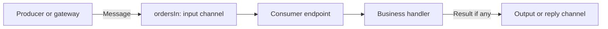
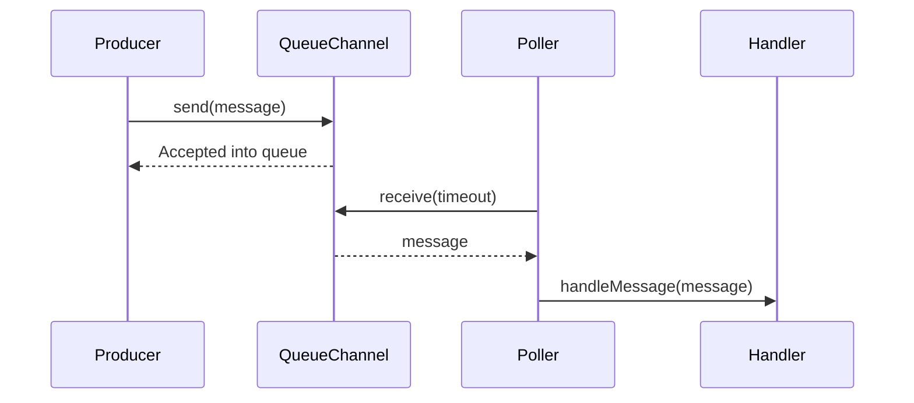

# Endpoint input-channel

In the **Message endpoint** chapter of **SPRING_INTEGRATION_CORE**, this lesson explains how to connect an endpoint to a message flow through `input-channel`. This is the connection point between messaging infrastructure and processing logic: the same business handler can be invoked immediately when a message arrives or invoked after a poller retrieves the message from a queue.

The goal is to read XML, annotation, and Java DSL configurations; choose the right channel; and predict the execution thread, replies, and errors when the endpoint operates.

## 1. What Is an Input Channel?

**An endpoint's input channel is the channel from which the endpoint receives messages to pass to its handler for processing.** In XML, `input-channel` typically holds the channel bean name. In annotations, the corresponding attribute is `inputChannel`.

Example:

```xml
<int:service-activator id="orderConsumer"
                       input-channel="ordersIn"
                       ref="orderService"
                       method="process"/>
```

Here:

- `orderConsumer` is the endpoint receiving messages.
- `ordersIn` is the name of the input channel.
- `orderService` is the bean containing business logic.
- `process` is the method invoked after the endpoint receives a message.

The name `ordersIn` is purely a configuration reference. It is not a URL, a thread name, or a method call. Sending a message into a channel also does not automatically create an endpoint to process business logic.



A message still consists of payload and headers as it travels through a channel. Declaring an input channel does not transform the payload; a transformer or handler performs that work.

You can think of the endpoint as the part that coordinates receiving messages, and the handler as the part that performs the task. This separation keeps business logic independent of the receiving mechanism. See [Message Endpoints in the Spring Integration docs](https://docs.spring.io/spring-integration/reference/endpoint.html).

## 2. Distinguishing Commonly Confused Names

| Component | Role | Example |
|---|---|---|
| Input channel | Where the endpoint receives messages | `ordersIn` |
| Endpoint ID | Identifies the endpoint for management and lifecycle tracking | `normalizeOrderEndpoint` |
| Handler or service bean | Object performing the processing | `orderService` |
| Output channel | Explicit destination for the endpoint's result | `normalizedOrders` |
| `replyChannel` header | Per-message reply address | Channel set by a gateway |
| `errorChannel` header | Error address for mechanisms supporting error publishing | `orderErrors` |

For a service activator returning a result, `output-channel` is used if configured; when there is no output channel, the endpoint can use the message's `replyChannel`. If the method returns `void`, the endpoint produces no reply from a return value. These rules are described in [Service Activator](https://docs.spring.io/spring-integration/reference/7.0/service-activator.html).

Therefore, `input-channel` does not decide where results are returned. An endpoint that receives messages properly but has a misconfigured reply destination can still run business logic and then fail when sending the result.

## 3. Input Channel Type Determines the Receiving Mechanism

Two key interface groups are `SubscribableChannel` and `PollableChannel`.

| Input Channel | Receiving Mechanism | Typical Consumer | Poller |
|---|---|---|---|
| `DirectChannel` | Subscribes handler and gets called on send | `EventDrivenConsumer` | Not used |
| `ExecutorChannel` | Subscribes handler, hands task off via executor | `EventDrivenConsumer` | Not used |
| `PublishSubscribeChannel` | Broadcasts to subscribers | `EventDrivenConsumer` per subscribed endpoint | Not used |
| `QueueChannel` | Calls `receive()` to pull from queue | `PollingConsumer` | Requires appropriate poller config |

### 3.1. SubscribableChannel: Event-Driven Reception

The endpoint subscribes its handler to the channel. When a producer sends a message, the channel dispatches it to the subscribed handler; the endpoint does not need to repeatedly check whether new data has arrived.

With `DirectChannel`, the handler runs on the thread calling `send()`. Therefore, a slow handler prolongs the send call. With `ExecutorChannel`, the executor introduces an execution boundary; executor selection and task rejection policies must be evaluated separately.

**Event-driven does not automatically mean asynchronous.** A `DirectChannel` is an example of event-driven reception with synchronous processing.

### 3.2. PollableChannel: Polling Reception

With `QueueChannel`, the producer puts messages into the queue. The polling consumer runs on a schedule and calls `receive()` to retrieve messages for the handler.



A successful `send()` to a queue does not prove business processing has completed. Moreover, the default in-memory queue does not guarantee message recovery after process shutdown. Channel semantics are presented in [Message Channel Implementations](https://docs.spring.io/spring-integration/reference/channel/implementations.html).

When configuring a consumer with a pollable input, declare a poller on the endpoint or provide a default poller. Do not assume that merely creating a `QueueChannel` tells the framework your desired polling schedule. See [Polling Consumer and Global Default Poller](https://docs.spring.io/spring-integration/reference/endpoint.html).

## 4. XML Examples: Same Logic, Different Receiving Mechanism

The XML snippets below belong to a Spring configuration with Spring Integration's `int` namespace. They are alternative configurations; do not declare two `ordersIn` beans in the same context.

### 4.1. Direct Reception

```xml
<int:channel id="ordersIn"/>

<int:channel id="normalizedOrders">
    <int:queue capacity="100"/>
</int:channel>

<int:transformer id="normalizeOrderEndpoint"
                 input-channel="ordersIn"
                 output-channel="normalizedOrders"
                 expression="payload.trim().toUpperCase()"/>
```

The `ordersIn` channel has no `<int:queue>` element, so this configuration uses a `DirectChannel`. When a string is sent to `ordersIn`, the transformer normalizes it and sends the result to `normalizedOrders`.

The output channel is a queue so the demo program can actively read results. This does not make the upstream transformer step run on a different thread.

### 4.2. Queued Reception

```xml
<int:channel id="ordersIn">
    <int:queue capacity="100"/>
</int:channel>

<int:channel id="normalizedOrders">
    <int:queue capacity="100"/>
</int:channel>

<int:transformer id="normalizeOrderEndpoint"
                 input-channel="ordersIn"
                 output-channel="normalizedOrders"
                 expression="payload.trim().toUpperCase()">
    <int:poller fixed-delay="200"
                max-messages-per-poll="5"
                receive-timeout="0"/>
</int:transformer>
```

This time the transformer receives from a `QueueChannel`, so the endpoint has a poller:

- `fixed-delay="200"`: pause interval in milliseconds after one polling task completes before the next one begins in this simple configuration.
- `max-messages-per-poll="5"`: each polling task pulls at most five messages; it does not create five threads.
- `receive-timeout="0"`: if the queue is empty, the receive call returns immediately.

Changing the input channel changed when and on which thread the handler is invoked. When applying this to real business logic, review error handling, transactions, and backlog capacity rather than just swapping the channel class name.

## 5. Annotations: Referencing inputChannel

An equivalent option is placing annotations on a method of a Spring-managed bean:

```java
import java.util.Locale;

import org.springframework.integration.annotation.MessageEndpoint;
import org.springframework.integration.annotation.ServiceActivator;

@MessageEndpoint
public class OrderNormalizer {

    @ServiceActivator(
        inputChannel = "ordersIn",
        outputChannel = "normalizedOrders"
    )
    public String normalize(String orderCode) {
        return orderCode.trim().toUpperCase(Locale.ROOT);
    }
}
```

This configuration requires Spring Integration infrastructure to be enabled and the `OrderNormalizer` bean to be registered, such as via component scanning. Both channels should be declared explicitly so readers know for sure which channel types are in use.

If `ordersIn` is a `QueueChannel`, replace the annotation above with:

```java
@ServiceActivator(
    inputChannel = "ordersIn",
    outputChannel = "normalizedOrders",
    poller = @Poller(
        fixedDelay = "200",
        maxMessagesPerPoll = "5",
        receiveTimeout = "0"
    )
)
```

Add the import:

```java
import org.springframework.integration.annotation.Poller;
```

The `String orderCode` parameter receives the payload; if headers are needed, the handler can accept `Message<?>` or use appropriate parameter-mapping annotations. The input, output, and poller attributes are described in [Annotation Support](https://docs.spring.io/spring-integration/reference/configuration/annotations.html).

Do not register this annotation endpoint and the earlier XML endpoint simultaneously just to "supplement" configuration. They create separate consumers. On a point-to-point channel, those consumers will compete for messages rather than forming a processing chain.

## 6. Java DSL: Self-Contained Example

The following example uses Spring Integration 6+ `IntegrationFlow` APIs and Java 17 or later. It requires `spring-integration-core` and compatible Spring dependencies; versions are managed consistently by your project or BOM. This is a plain Spring application and does not need Spring Boot to run.

Save the example class as `InputChannelDemo.java` in a practice project:

```java
import java.util.Locale;

import org.springframework.context.annotation.AnnotationConfigApplicationContext;
import org.springframework.context.annotation.Bean;
import org.springframework.context.annotation.Configuration;
import org.springframework.integration.channel.DirectChannel;
import org.springframework.integration.channel.QueueChannel;
import org.springframework.integration.config.EnableIntegration;
import org.springframework.integration.dsl.IntegrationFlow;
import org.springframework.messaging.Message;
import org.springframework.messaging.support.MessageBuilder;

@Configuration
@EnableIntegration
public class InputChannelDemo {

    @Bean
    public DirectChannel ordersIn() {
        return new DirectChannel();
    }

    @Bean
    public QueueChannel normalizedOrders() {
        return new QueueChannel(100);
    }

    @Bean
    public IntegrationFlow normalizationFlow() {
        return IntegrationFlow.from(ordersIn())
            .handle(String.class,
                (payload, headers) -> {
                    if (payload.isBlank()) {
                        throw new IllegalArgumentException("Order code is empty");
                    }
                    return payload.trim().toUpperCase(Locale.ROOT);
                },
                endpoint -> endpoint.id("normalizeOrderEndpoint"))
            .channel(normalizedOrders())
            .get();
    }

    public static void main(String[] args) {
        try (var context =
                 new AnnotationConfigApplicationContext(InputChannelDemo.class)) {

            var input = context.getBean("ordersIn", DirectChannel.class);
            var output = context.getBean("normalizedOrders", QueueChannel.class);

            Message<String> request = MessageBuilder
                .withPayload("  order-009  ")
                .setHeader("sourceSystem", "lesson")
                .build();

            boolean accepted = input.send(request, 1000);
            if (!accepted) {
                throw new IllegalStateException("Failed to send message");
            }

            Message<?> reply = output.receive(1000);
            if (reply == null) {
                throw new IllegalStateException("No result received");
            }

            System.out.println(reply.getPayload());
        }
    }
}
```

Expected output:

```text
ORDER-009
```

In this flow:

1. `.from(ordersIn())` selects the input channel for the first endpoint.
2. `.handle(...)` creates the service activator performing normalization.
3. `.id("normalizeOrderEndpoint")` names the endpoint without renaming the input channel.
4. `.channel(normalizedOrders())` specifies where the result is sent.
5. `output.receive(1000)` reads the result from the queue; this is an action of the demo program, not a poller on the normalization endpoint.

XML, annotation, and DSL configurations are alternative ways to express the same wiring. This example program does not need to load `OrderNormalizer` from the annotation section. Using `.handle()` to express a service activator is covered in [Service Activator Java DSL documentation](https://docs.spring.io/spring-integration/reference/7.0/service-activator.html).

### 6.1. Switching the Example to a Queued Input

In the same class, replace the `ordersIn()` bean and `normalizationFlow()` bean with the two methods below; keep `normalizedOrders()` unchanged:

```java
@Bean
public QueueChannel ordersIn() {
    return new QueueChannel(100);
}

@Bean
public IntegrationFlow normalizationFlow() {
    return IntegrationFlow.from(ordersIn())
        .handle(String.class,
            (payload, headers) -> {
                if (payload.isBlank()) {
                    throw new IllegalArgumentException("Order code is empty");
                }
                return payload.trim().toUpperCase(Locale.ROOT);
            },
            endpoint -> endpoint
                .id("normalizeOrderEndpoint")
                .poller(Pollers.fixedDelay(200)
                    .maxMessagesPerPoll(5)
                    .receiveTimeout(0)))
        .channel(normalizedOrders())
        .get();
}
```

Add the import `org.springframework.integration.dsl.Pollers`. In `main`, change how the input bean is retrieved to:

```java
var input = context.getBean("ordersIn", QueueChannel.class);
```

The poller is configured on the `.handle(...)` endpoint immediately following the queued input channel. It is not a property of `QueueChannel`.

The `1000` timeout in `output.receive(1000)` is the example program's wait limit, not a guarantee that the system always finishes within one second. Under high load or slow handlers, choose limits based on operational requirements.

## 7. Number of Consumers and Distribution Semantics

Suppose two endpoints both use `ordersIn`. The outcome depends on the channel:

- With `DirectChannel`, the two handlers are subscribers on a point-to-point channel; they do not form two sequential steps.
- With `QueueChannel`, polling consumers compete to pull elements from the queue.
- With `PublishSubscribeChannel`, messages are broadcast to subscribers.

If you need to **normalize and then persist data**, design two endpoints in a chain:

```text
ordersIn -> normalizeEndpoint -> normalizedOrders -> persistEndpoint
```

If you need to **notify both the email module and the analytics module**, use a publish-subscribe branch with clearly defined error and processing isolation requirements.

Incorrect example for sequential processing intent:

```text
ordersIn -> normalizeEndpoint
ordersIn -> persistEndpoint
```

These two arrows do not express a "persist after normalizing" dependency. When sketching flows, explicitly show intermediate channels rather than listing only endpoint names. Refer to [channel distribution characteristics](https://docs.spring.io/spring-integration/reference/channel/implementations.html).

## 8. Errors, Lifecycle, and Transactions

### 8.1. Errors with Direct Input

In the `DirectChannel` example, sending a whitespace-only payload makes the handler throw an exception. The `send()` call can throw a messaging exception wrapping the business cause. The producer can catch the exception at the call boundary.

Do not check only the boolean return value and conclude all error scenarios are handled. `send()` may not return normally.

### 8.2. Errors During Polling

With `QueueChannel`, the producer may have already finished sending before the handler fails. Errors from polling tasks must be observed via the poller's error-handling mechanism, typically via an `ErrorMessage` sent to an error channel. With the default infrastructure, the message's `errorChannel` header can specify the error destination; if absent, the error-handling mechanism uses the configured default destination.

Having an error channel does not mean all synchronous exceptions are automatically routed there. Distinguishing the two execution boundaries is explained in [Error Handling](https://docs.spring.io/spring-integration/reference/error-handling.html).

Errors also do not automatically create a retry policy or put messages back into an in-memory queue. If the business requires recovery, you must explicitly design retries, error persistence, and replay.

### 8.3. The Endpoint Must Be Running

An existing channel does not prove the endpoint is running. When an endpoint stops, send behavior depends on the channel type and any remaining consumers: direct input may have no subscribers, while a queue can keep accepting messages until capacity is reached.

When investigating, check both endpoint status and pending message counts. Messages sitting in a queue and messages successfully processed are two different states.

### 8.4. Input Channels Do Not Automatically Establish Transactions

Having a handler run on the same thread via `DirectChannel` allows it to participate in an existing transaction if the relevant components are configured appropriately. Adding a queue or executor typically introduces a thread boundary; a transaction bound to the producer's thread does not automatically propagate across that boundary.

A poller can be configured with its own transaction, but that does not turn an in-memory `QueueChannel` into a durable queue or automatically guarantee rollback of message retrieval. You must verify transactional capabilities of the message store, business resources, and transaction manager in use.

## 9. Observing Behavior with Small Scenarios

You can use the example in Section 6 to practice the checks below. Always use finite timeouts when sending to a queue or waiting for replies so exercises do not hang indefinitely.

| Scenario | What to Observe |
|---|---|
| Send `"  order-009  "` | Receive `ORDER-009` from the output channel |
| Send whitespace string via `DirectChannel` | Caller observes an exception; no normalized reply is produced |
| Send whitespace string via queued input | Send call may already succeed; error appears on the polling side |
| Stop endpoint then send to queue with remaining capacity | Queue can accept it, but no processing result appears yet |
| Send faster than processing speed | Queue grows, producer may wait or time out when full |
| Attach two endpoints to a point-to-point channel | Do not assume both act as sequential steps for every message |

To observe threads, temporarily log `Thread.currentThread().getName()` at the producer before sending and inside the handler. Compare the `DirectChannel` variant with the polled queue variant. Do not write assertions relying on exact thread names because names depend on configuration.

In the queued variant, wait for a result with a timeout instead of inserting a fixed `sleep()` and guessing the handler ran. When testing asynchronous errors, receive messages from the exercise's dedicated error channel as proof the error arrived at the right place.

## 10. Diagnosing Input Channel Configurations

| Symptom | Investigation Direction |
|---|---|
| Context fails to initialize consumer | Bean names, channel types, and endpoint poller |
| Sending to direct channel reports no subscribers | Whether endpoint is registered, started, and using the right channel |
| Queue keeps growing | Whether poller is running; whether handler is slow, failing, or blocked on output |
| Processing runs but no result appears at destination | Return value, `outputChannel`, and `replyChannel` |
| Only one of two tasks receives each message | Whether point-to-point was used for a broadcast intent |
| Caller waits long even without polling | Whether `DirectChannel` is running a synchronous handler |

For reference errors, inspect actual bean names instead of guessing from class names. Declaring channels explicitly makes typos between `ordersIn`, `orderIn`, and endpoint names easy to spot, while avoiding unintended reliance on auto-created channels in certain configuration styles.

When choosing an input channel, answer four questions: does the endpoint receive immediately or pull on a schedule; which thread runs the business logic; who are messages distributed to; and through what mechanism does the producer observe success or failure? These four decisions form the foundation for connecting transformers, filters, routers, aggregators, and gateways into an integration flow with predictable behavior.