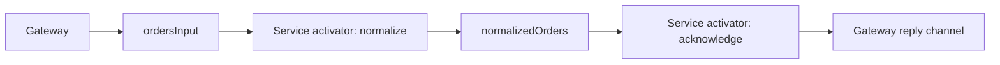
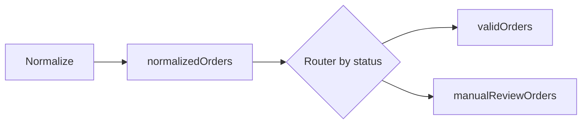

# Endpoint output-channel

## Objectives

In Spring Integration Core, a message endpoint connects processing behavior to messaging infrastructure. An endpoint can receive a message, transform the payload, invoke a business service, and send the result to the next step. `output-channel` specifies where that result is sent.

After this lesson, you will be able to:

- Distinguish the input channel, output channel, and reply address of a message.
- Configure outputs using annotations and Java DSL.
- Design an endpoint chain that forwards internal results and replies to a gateway.
- Explain what happens when a handler returns no result, cannot resolve a reply channel, or the target channel cannot receive the message.
- Choose tests to detect misconfigured outputs.

The scope of this lesson is the output mechanism of reply-producing endpoints, typically service activators and transformers. Not every endpoint produces a reply or uses a single `output-channel` attribute in the same way; routers and endpoints processing multiple messages have their own rules.

## 1. Role of the Output Channel

Suppose an application receives an order code, normalizes it, and builds an acknowledgment string:



For the normalization endpoint:

- `ordersInput` is the input channel.
- The handler method receives the payload, such as `"  order-42  "`.
- The method returns `"ORDER-42"`.
- `normalizedOrders` is the output channel.

The return value becomes the payload of the output message if the method returns a regular object. If the method returns a `Message<?>`, the handler can use both the payload and headers of that message according to its reply-creation mechanics.

The output channel is a `MessageChannel`, not a value the business method must return. The method returns data; Spring Integration infrastructure builds and sends the next message.

| Concept | Question Answered | Example |
|---|---|---|
| Input channel | Where does the endpoint receive messages from? | `ordersInput` |
| Handler method | What does the endpoint do with the data? | Normalizes the order code |
| Output channel | Where is the result sent next? | `normalizedOrders` |
| `replyChannel` header | Where can the reply for this request be returned? | Temporary reply channel set by a gateway |
| Return value | What is the business result? | `"ORDER-42"` |

A channel used as the output of an upstream endpoint is often simultaneously the input of a downstream endpoint. The "input" or "output" role depends on which endpoint you are inspecting.

## 2. Configuration Names Vary by Declaration Style

In documentation and XML configuration, this concept usually appears as `output-channel`. Annotations use the Java attribute `outputChannel`. Java DSL typically links steps with `.channel(...)` or lets the framework create internal channels between steps.

Conceptually equivalent XML example:

```xml
<int:service-activator
        input-channel="ordersInput"
        output-channel="normalizedOrders"
        ref="orderNormalizer"
        method="normalize" />
```

The XML snippet is a standalone configuration example assuming beans and the Spring Integration namespace are declared. You do not declare both XML and annotations for the same handler.

The Java examples in this lesson use Spring Integration with Java configuration, annotation support enabled, and compatible dependencies in the application. No external transport such as Kafka or AMQP is required to observe this mechanism.

## 3. Configuration with Annotations

Declare two channels and two service activators:

```java
import java.util.Locale;

import org.springframework.context.annotation.Bean;
import org.springframework.context.annotation.Configuration;
import org.springframework.integration.annotation.IntegrationComponentScan;
import org.springframework.integration.annotation.ServiceActivator;
import org.springframework.integration.channel.DirectChannel;
import org.springframework.integration.config.EnableIntegration;
import org.springframework.messaging.MessageChannel;

@Configuration
@EnableIntegration
@IntegrationComponentScan(basePackageClasses = OrderGateway.class)
public class OrderIntegrationConfiguration {

    @Bean
    public MessageChannel ordersInput() {
        return new DirectChannel();
    }

    @Bean
    public MessageChannel normalizedOrders() {
        return new DirectChannel();
    }

    @ServiceActivator(
        inputChannel = "ordersInput",
        outputChannel = "normalizedOrders",
        requiresReply = "true"
    )
    public String normalize(String orderCode) {
        return orderCode.strip().toUpperCase(Locale.ROOT);
    }

    @ServiceActivator(
        inputChannel = "normalizedOrders",
        requiresReply = "true"
    )
    public String acknowledge(String normalizedCode) {
        return "ACCEPTED:" + normalizedCode;
    }
}
```

The gateway is placed in a separate Java file in the same package so component scanning works in the example:

```java
import org.springframework.integration.annotation.Gateway;
import org.springframework.integration.annotation.MessagingGateway;

@MessagingGateway
public interface OrderGateway {

    @Gateway(requestChannel = "ordersInput", replyTimeout = 3000)
    String submit(String orderCode);
}
```

When invoked:

```java
String result = orderGateway.submit("  order-42  ");
// result: "ACCEPTED:ORDER-42"
```

The processing flow consists of these steps:

1. The gateway builds the request message, including reply-channel information in headers.
2. The `normalize` endpoint receives the payload from `ordersInput`.
3. Because `outputChannel = "normalizedOrders"` is configured, the normalized result goes to that channel.
4. The `acknowledge` endpoint receives the result and produces the acknowledgment string.
5. The final endpoint declares no output channel, so it uses the request's reply address to send the result back to the gateway.

`replyTimeout = 3000` sets the gateway's reply wait timeout in milliseconds; it is not an automatic cancellation mechanism for running business work. Specifically, with a `DirectChannel` chain, handler execution runs synchronously on the calling thread.

`@IntegrationComponentScan` discovers the gateway interface. The two handler methods live on the configuration bean and are detected by Spring Integration's annotation infrastructure. If moved to a separate service class, that class must also be registered as a Spring bean.

## 4. Output Channel and `replyChannel`: Resolution Order

For standard reply-producing endpoints like service activators, follow this practical rule:

1. If the endpoint has a configured output channel, the result is sent to that channel.
2. If there is no output channel, the framework looks up a reply address, typically the `replyChannel` header on the request.
3. If there is a result to send but no reply destination can be resolved, sending the reply fails.

The `replyChannel` header can hold a `MessageChannel` instance or a resolvable channel name. It is a per-message reply address, whereas an output channel is usually part of the handler's configuration.

```text
Request headers:
    replyChannel = caller's reply address

Endpoint:
    outputChannel = normalizedOrders

Result:
    goes to normalizedOrders
```

Configuring an output channel does not erase the `replyChannel` header. Across a normal chain of endpoints, this header is propagated so the final endpoint can reply to the caller.

That is why a gateway can wait for the final result of a multi-step flow. Intermediate endpoints forward data through explicit output channels; the final endpoint sends the reply back to the gateway.

### When Constructing New Messages Manually

Be careful when replacing the entire message or manually sending to a new branch. If you construct a message from a payload alone and send it without carrying required headers, the new branch can lose the reply address and correlation metadata.

When you need to preserve input headers in custom message-building code, you can start from:

```java
import org.springframework.messaging.Message;
import org.springframework.messaging.support.MessageBuilder;

Message<?> forwarded = MessageBuilder.fromMessage(incoming)
    .setHeader("processingStage", "normalized")
    .build();
```

This example illustrates preserving message context when building messages manually. Standard reply-producing handlers have their own header-propagation mechanisms; you do not need to reimplement that for every method returning a plain payload. With specialized endpoints or header-stripping configurations, inspect the corresponding header-propagation behavior.

## 5. Does Omitting Output Channel End the Flow?

You cannot conclude that from the missing attribute alone. Consider both the return value and the reply address.

| Processing Outcome | Output Channel Present? | Suitable Reply Address Present? | Typical Behavior |
|---|---|---|---|
| Returns payload or `Message<?>` | Yes | Yes or no | Sends result to the output channel |
| Returns payload or `Message<?>` | No | Yes | Sends reply to the reply address |
| Returns payload or `Message<?>` | No | No | Error resolving reply destination |
| Returns `null` or `void` method | Yes or no | Yes or no | No reply to send if reply is not required |
| Returns `null` with `requiresReply = true` | Yes or no | Yes or no | Throws missing-reply error |

Example of a side-effect-only business endpoint:

```java
@ServiceActivator(inputChannel = "auditInput")
public void audit(String event) {
    auditService.record(event);
}
```

This is a standalone example assuming `auditInput` and `auditService` are already declared. Because the method returns `void`, adding `outputChannel` does not fabricate an output message. If the caller needs a confirmation, the handler must return an appropriate confirmation value.

`requiresReply = "true"` checks whether the handler produces a reply. It does not guarantee the reply was processed successfully by all downstream steps, nor does it replace configuring a target channel.

If a response is required yet business rules may skip data, make the contract explicit: use a filter with a discard channel, return a result representing a rejected status, or design a one-way flow. Do not use `null` to hide an error case while a gateway is still waiting for a reply.

## 6. Wiring Output with Java DSL

Java DSL expresses the same idea as a chain of steps:

```java
import org.springframework.context.annotation.Bean;
import org.springframework.integration.dsl.IntegrationFlow;

@Bean
public IntegrationFlow orderFlow() {
    return IntegrationFlow.from("ordersInput")
        .<String, String>transform(
            value -> value.strip().toUpperCase(Locale.ROOT)
        )
        .channel("normalizedOrders")
        .<String, String>transform(
            value -> "ACCEPTED:" + value
        )
        .get();
}
```

This is an alternative implementation to the two `@ServiceActivator` methods in the previous section. If using the same gateway and channel beans, remove the two annotation-based handler methods before registering this flow. Do not leave both implementations consuming the same input channel if the goal is a single pipeline.

In this flow:

- `.channel("normalizedOrders")` places a channel at the boundary between the two transformers.
- The first transformer's output is sent to that channel.
- The next transformer receives messages from that channel.
- The final transformer produces a reply; with no downstream output channel configured, the request's reply address is used.

Java DSL can create internal channels between consecutive endpoints automatically. Thus, you do not need to name a channel for every step:

```java
@Bean
public IntegrationFlow compactOrderFlow() {
    return IntegrationFlow.from("ordersInput")
        .<String, String>transform(
            value -> value.strip().toUpperCase(Locale.ROOT)
        )
        .<String, String>transform(
            value -> "ACCEPTED:" + value
        )
        .get();
}
```

This is again an alternative implementation, not to be registered alongside `orderFlow`. Named channels are useful when connecting flows, adding monitoring, or placing an intentional processing boundary. For short internal steps, letting the DSL wire them automatically is often more readable.

A flow ending with `.channel("someChannel")` still sends the message to that channel. Ending the flow declaration does not mean ending the message's lifecycle. The target channel must have an appropriate consumer or be used per its queue design.

## 7. What Does the Output Channel Type Determine?

Declaring an output channel only determines the destination. The channel type determines how the message is delivered.

### `DirectChannel`

With `DirectChannel`, the next handler is usually invoked on the sending thread itself. In the example chain, normalizing, creating the acknowledgment, and returning the result can all execute on the same call stack.

If the next step throws an exception, the error can propagate back to the caller. When send finishes without error, it reflects synchronous execution of the subscriber; do not generalize this into a transaction guarantee across external systems.

A `DirectChannel` with multiple subscribers is not a broadcast mechanism. A single send dispatches to one subscriber; configuring multiple consumers can send requests to different handlers instead of running through all handlers.

### `QueueChannel`

If the output channel is a `QueueChannel`, the result is placed into the queue. To process it further with an endpoint, you need a consumer with a suitable poller.

```java
import org.springframework.integration.channel.QueueChannel;

@Bean
public QueueChannel normalizedOrders() {
    return new QueueChannel(100);
}
```

This is an example of swapping the channel type, not declaring a duplicate bean with the same name. The annotation consumer might look like:

```java
import org.springframework.integration.annotation.Poller;

@ServiceActivator(
    inputChannel = "normalizedOrders",
    poller = @Poller(fixedDelay = "100")
)
public String acknowledge(String normalizedCode) {
    return "ACCEPTED:" + normalizedCode;
}
```

A successful send to the queue only indicates the message was accepted into the queue per the channel's semantics. It does not indicate final business processing completed. An in-memory queue also provides no durability across process shutdowns.

If a gateway is still waiting for a result, the poller and processing time must fit within the reply timeout. Separating threads does not remove the need to preserve `replyChannel` and correlation context.

### `ExecutorChannel` and `PublishSubscribeChannel`

`ExecutorChannel` introduces an execution boundary through an executor. Do not expect exceptions from work running on another thread to unwind cleanly back up the sender's call stack as with `DirectChannel`.

`PublishSubscribeChannel` distributes messages to multiple subscribers. When an executor is present, execution and error handling differ from the synchronous case. If multiple branches hold the same gateway reply address, competing replies can occur; design which branch sends the reply, or aggregate results before replying.

The output channel's name does not reveal these behaviors. When reading configurations, always inspect the actual channel beans.

## 8. Output Channel Is Neither a Router Nor an Error Channel

### Choosing a Destination Based on Message Content

A fixed output channel works when every result follows the same route. If the destination changes based on order status, payload type, or headers, use a router to express that decision.



Do not confuse the `replyChannel` header with a business routing decision. One describes the reply address for a request; the other selects the next processing branch.

### Routing Errors

The output channel of a normal handler receives successful processing results. It does not automatically become a destination for exceptions.

For example, if `normalize()` throws an exception before producing a result, there is no successful reply to send to `normalizedOrders`.

How errors are handled depends on the execution boundary:

- With a synchronous chain over `DirectChannel`, errors usually propagate back to the caller or gateway.
- With a scheduled polling endpoint, the poller infrastructure handles errors via its configured error handler; standard configuration can publish an `ErrorMessage` to an error channel.
- With executor-based execution, check the error-handling mechanism of the channel/executor and corresponding flow.

Merely setting an `errorChannel` header does not turn every direct synchronous call into automatic error publishing. That header takes effect only when the corresponding error-handling component uses it.

## 9. Common Errors

### Result Exists but No Reply Destination

**Symptom:** The endpoint finishes processing and then reports a failure to resolve a reply channel, often as a `DestinationResolutionException` or an exception wrapped in a messaging context.

**Cause:** Sending a message directly with `send()` without a reply address while the handler returns a result and has no output channel.

**Fix:** Configure an output channel, use a proper request-reply gateway, or make the endpoint one-way if that is the true business contract.

### Output Channel Has No Subscribers

**Symptom:** Sending to a `DirectChannel` finds no subscribers and raises a delivery failure.

**Cause:** Missing downstream endpoint, configuration not loaded, or target endpoint is stopped.

**Fix:** Inspect the channel bean, consumer lifecycle, and flow registration. Matching channel names alone is not enough for a working pipeline.

### Queue Receives Messages but Nothing Processes Them

**Symptom:** The sender reports no error, queue depth grows, and the gateway receives no reply.

**Cause:** Missing poller, consumer not started, or processing rate lower than arrival rate.

**Fix:** Check poller settings, queue capacity, poll interval, processing time, and relevant send timeouts. Do not jump to concluding the output channel lost messages.

### Gateway Receives Only an Intermediate Result

**Symptom:** The gateway receives `ORDER-42` instead of `ACCEPTED:ORDER-42`.

**Possible cause:** The normalization endpoint lacks an output channel, so it replies directly via `replyChannel`, bypassing the acknowledgment step.

**Fix:** Check wiring between steps and ensure only the final result-producing step replies to the gateway in this design.

### Handler Returns `null` Despite Having an Output Channel

**Symptom:** The downstream consumer receives no message.

**Cause:** There is no result to send; the output channel attribute does not generate data on its own.

**Fix:** Clarify the return contract. Enable `requiresReply` on the service activator if missing replies should be treated as errors.

## 10. Testing Output Behavior

Tests should confirm that messages reach the right destination and the caller gets the right result. Simply testing that `normalize()` returns the expected string does not prove the endpoint's output channel is wired properly.

Useful scenarios:

| Scenario | What to Verify |
|---|---|
| Gateway calls two-step chain | Receives `ACCEPTED:ORDER-42`, not the intermediate result |
| Endpoint has output channel and request has `replyChannel` | Intermediate result goes to the configured output channel |
| Final endpoint has no output channel | Reply returns to the gateway via the reply address |
| Handler returns `null`, `requiresReply = true` | Missing-reply error is raised |
| Target channel is `QueueChannel` | Message can be retrieved with `receive(timeout)` at the tested boundary |
| No output channel and no reply address | Reply-destination resolution error occurs |
| Handler throws on `DirectChannel` chain | Caller observes the error, with no false success result |

For tests isolating output, you can use a `QueueChannel` as the target channel and receive messages with a finite timeout. In that test context, do not attach an active consumer to the same queue, as the consumer could pull the message before the assertion runs.

For flows with queues and pollers, use bounded wait operations instead of fixed `Thread.sleep()`. For one-way cases, verify side effects or messages on the target channel rather than waiting for a reply the design does not produce.

Do not register both the annotation version and the DSL version of the same example in one test context. On a `DirectChannel`, extra subscribers can route test messages down a different pipeline than intended.

## 11. Hands-On Exercises

1. Implement the annotation version with two `DirectChannel` instances. Call the gateway with `"  order-42  "` and verify the final result.
2. Remove `outputChannel` from the normalization endpoint. Observe which step replies to the gateway and which endpoint stops receiving data.
3. Restore the link, then replace `normalizedOrders` with a `QueueChannel` and add a poller to the consumer.
4. Make the normalization endpoint return `null`. Compare behavior when `requiresReply` is enabled versus when replies are optional.
5. Perform a direct send without a `replyChannel` header to an endpoint that returns a value and has no output channel. Explain why the handler method can succeed while completing the request still fails.
6. Rewrite the pipeline using Java DSL, registering only one implementation at a time, and verify the same input/output contract.

## 12. Key Takeaways

- `output-channel` specifies the destination for results from a reply-producing endpoint; it does not produce results on behalf of the handler.
- For a standard service activator, a configured output channel takes precedence over the request's reply address.
- Omitting an output channel can still return results via `replyChannel`, especially at the end of a flow invoked through a gateway.
- `void` or `null` normally produces no reply; `requiresReply` detects missing replies that violate the contract.
- The channel type governs synchronous, asynchronous, queued, or multi-subscriber delivery.
- A correct message route requires a valid destination, an active consumer, and a clear reply contract.