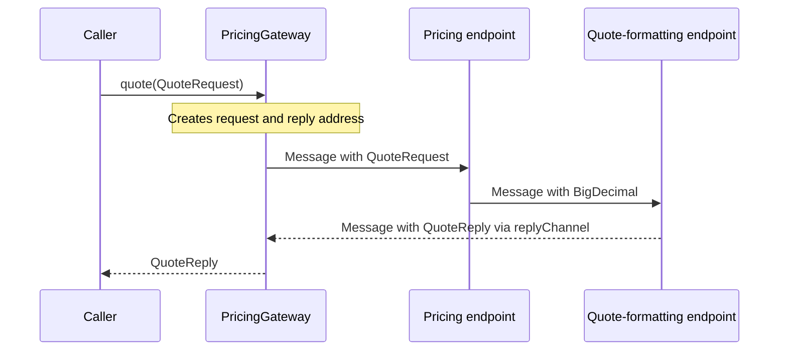

# Endpoint with Reply

## 1. Objectives and Usage Scenario

In the **Message endpoint** chapter of the **SPRING_INTEGRATION_CORE** module, this lesson explains how an endpoint receives a message and produces a reply so the next step or the sender can continue processing. The focus is on the relationship between `Message`, `MessageChannel`, service activators, gateways, and Java DSL.

After this lesson, you will be able to:

- Distinguish a business method's return value from a reply message in an integration flow.
- Determine where replies go when `outputChannel`, the `replyChannel` header, or a gateway is involved.
- Design a reply contract using `requiresReply`, business results, and technical errors.
- Identify scenarios where replies are lost due to filters, routers, aggregators, or channel configuration.
- Write tests that observe payload, headers, and reply routing.

Suppose a sales system receives a pricing request containing a product SKU and quantity. One endpoint calculates the total amount, the next endpoint builds a quote result, and the caller receives the result back. The caller needs a concrete result for each request; merely logging that the request was received does not satisfy this contract.

The examples use Java 17 or later and configuration APIs common in Spring Integration 6.x. They require `spring-integration-core`; tests require JUnit Jupiter. In a Spring Boot application, you can use `spring-boot-starter-integration` and the Boot-managed dependency set. Alternative configuration snippets in this lesson are meant to be used independently to avoid accidentally registering two consumers for the same request.

## 2. How Does an Endpoint Produce a Reply?

A message consists of a payload and headers. Channels transport messages; endpoints connect channels to processing logic. For a reply-capable endpoint, the logic's output is converted into a message to send onward.

```text
request Message
      |
      v
input channel -> endpoint invokes business logic
                              |
                              v
                     business result
                              |
                              v
                         reply Message
                              |
                              v
                    output channel / reply channel
```

Plain Java business example:

```java
public String normalizeSku(String sku) {
    return sku.trim().toUpperCase(java.util.Locale.ROOT);
}
```

When the method is invoked via a service activator, the returned string becomes the payload of the output message. The reply can flow to a transformer, router, or another service activator. It becomes the return value of a gateway call only when it reaches the reply path the gateway is waiting on.

An important detail: `MessageHandler.handleMessage(Message<?>)` has a `void` return type. Reply capability is provided by the implementation and message-sending mechanics inside the handler. Therefore, a `MessageHandler` lambda that only logs does not automatically produce a reply; a POJO method invoked by a service activator can return data so the framework builds a reply.

`AbstractReplyProducingMessageHandler` is the base class for many reply-capable handlers. Even when an endpoint is reply-capable, that does not mean every execution branch produces a reply. [Reply-producing handler Javadoc](https://docs.spring.io/spring-integration/api/org/springframework/integration/handler/AbstractReplyProducingMessageHandler.html).

### Concepts to Keep Distinct

| Concept | Responsibility | Example in the Quote Flow |
|---|---|---|
| Request payload | Carries input data | Product SKU and quantity |
| Input channel | Delivers the request to the endpoint | `quoteRequests` |
| Endpoint/handler | Performs the processing step | Calculates the line total |
| Reply payload | Carries a step's result | Total amount or quote result |
| Output channel | Output destination configured on the handler | `quoteFormatting` |
| `replyChannel` header | Carries the reply address for the exchange | Temporary channel created by a gateway |
| Gateway | Translates a Java call into a message exchange | `gateway.quote(request)` |

## 3. Rules for Selecting the Reply Destination

For a standard service activator, when the method returns a non-`null` result, the framework looks up the destination in this order:

1. Use `outputChannel` configured on the handler, if present.
2. Otherwise, use the **request's** `replyChannel` header.
3. If the request has no reply address and the result is a `Message<?>`, check the result message's `replyChannel` header.
4. If no destination can be resolved, sending the reply fails; the error typically indicates there is no output channel or reply channel.

The header can hold a `MessageChannel` instance or a string channel name for the framework to resolve. An unresolvable name leads to a destination-resolution error. [Service activator reply routing rules](https://docs.spring.io/spring-integration/reference/6.5/service-activator.html).

| `outputChannel` | `replyChannel` in Request | Destination Chosen First |
|---|---|---|
| Present | Present | `outputChannel` |
| Present | Absent | `outputChannel` |
| Absent | Present | `replyChannel` in request |
| Absent | Absent | Check header in result if result is `Message<?>`; error if still no destination |

For example, the request carries `replyChannel = callerReplies`, while the endpoint sets `outputChannel = quoteFormatting`. The endpoint's output goes to `quoteFormatting`. The final endpoint in the flow can still use the reply address propagated from the request to return the finished result to the caller.

This enables two design styles:

- **Fixed output:** Configure an output channel to define the next step of the pipeline.
- **Per-request reply address:** Let the final endpoint respond using the header provided by the caller or gateway.

Do not wire every step's output channel straight to the caller's reply channel. Doing so easily terminates the flow prematurely before mandatory steps have run.

## 4. Complete Example with Java DSL and a Gateway

### 4.1. Business Contract

The flow below accepts a purchase request for a product with a simulated unit price of 120,000 VND. The first endpoint calculates the total, and the second packages the result. The currency unit in the example is whole VND; this is only a learning model and does not implement price books, taxes, or discounts.



### 4.2. Complete Configuration

All of the code below can be placed in `ReplyEndpointConfig.java` in a project with the appropriate dependencies:

```java
package demo.reply;

import java.math.BigDecimal;

import org.springframework.context.annotation.Bean;
import org.springframework.context.annotation.Configuration;
import org.springframework.integration.annotation.Gateway;
import org.springframework.integration.config.EnableIntegration;
import org.springframework.integration.dsl.IntegrationFlow;

@Configuration
@EnableIntegration
public class ReplyEndpointConfig {

    public record QuoteRequest(String sku, int quantity) {
    }

    public record QuoteReply(BigDecimal total, String currency) {
    }

    public interface PricingGateway {

        @Gateway(requestTimeout = "1000", replyTimeout = "2000")
        QuoteReply quote(QuoteRequest request);
    }

    public static class PricingService {

        public BigDecimal calculate(QuoteRequest request) {
            if (request.sku() == null || request.sku().isBlank()) {
                throw new IllegalArgumentException("sku must have a value");
            }
            if (request.quantity() <= 0) {
                throw new IllegalArgumentException("quantity must be greater than 0");
            }
            return new BigDecimal("120000")
                    .multiply(BigDecimal.valueOf(request.quantity()));
        }
    }

    @Bean
    public PricingService pricingService() {
        return new PricingService();
    }

    @Bean
    public IntegrationFlow quoteFlow(PricingService pricingService) {
        return IntegrationFlow.from(PricingGateway.class)
                .handle(pricingService, "calculate",
                        endpoint -> endpoint.requiresReply(true))
                .<BigDecimal>handle((total, headers) ->
                        new QuoteReply(total, "VND"),
                        endpoint -> endpoint.requiresReply(true))
                .get();
    }
}
```

`IntegrationFlow.from(PricingGateway.class)` registers a gateway proxy and an internal input channel for the flow. With this style, you do not need `@MessagingGateway` or separate gateway scanning for the same interface. `@Gateway` annotations on methods can supply timeout attributes. [Creating a gateway from IntegrationFlow](https://docs.spring.io/spring-integration/reference/dsl/integration-flow-as-gateway.html).

Execution sequence for a call:

1. The caller passes `new QuoteRequest("BOOK-01", 2)`.
2. The gateway turns the call into a request message and provides a reply path.
3. The service activator calls `calculate` and receives the total `240000`.
4. Java DSL wires the result to the next handler, which creates `QuoteReply`.
5. The final handler has no fixed output channel, so it sends via the request's reply path.
6. The gateway extracts the returned payload and returns `QuoteReply` to the caller.

With plain Spring, you can observe the result as follows:

```java
try (var context = new org.springframework.context.annotation
        .AnnotationConfigApplicationContext(ReplyEndpointConfig.class)) {

    var gateway = context.getBean(ReplyEndpointConfig.PricingGateway.class);
    var reply = gateway.quote(
            new ReplyEndpointConfig.QuoteRequest("BOOK-01", 2));

    System.out.println(reply.total());    // 240000
    System.out.println(reply.currency()); // VND
}
```

In a Boot application, inject `PricingGateway` into the bean that needs it. The gateway is a proxy bean created by configuration; do not call the business method directly if the goal is to traverse the entire flow.

## 5. Variant Using Annotations and a Fixed Output Channel

When you need explicit channel names so multiple flows can connect, you can use annotation-based service activators. The snippet below is an **alternative** configuration to the Java DSL example above; it reuses the data types and `PricingService` already defined.

```java
package demo.reply;

import java.math.BigDecimal;

import org.springframework.context.annotation.Bean;
import org.springframework.context.annotation.Configuration;
import org.springframework.integration.annotation.ServiceActivator;
import org.springframework.integration.channel.DirectChannel;
import org.springframework.integration.config.EnableIntegration;
import org.springframework.messaging.MessageChannel;

@Configuration
@EnableIntegration
public class NamedChannelConfig {

    @Bean
    public MessageChannel quoteRequests() {
        return new DirectChannel();
    }

    @Bean
    public MessageChannel quoteFormatting() {
        return new DirectChannel();
    }

    @Bean
    public QuoteEndpoints quoteEndpoints() {
        return new QuoteEndpoints();
    }

    public static class QuoteEndpoints {

        private final ReplyEndpointConfig.PricingService pricingService =
                new ReplyEndpointConfig.PricingService();

        @ServiceActivator(
                inputChannel = "quoteRequests",
                outputChannel = "quoteFormatting",
                requiresReply = "true")
        public BigDecimal calculate(
                ReplyEndpointConfig.QuoteRequest request) {
            return pricingService.calculate(request);
        }

        @ServiceActivator(
                inputChannel = "quoteFormatting",
                requiresReply = "true")
        public ReplyEndpointConfig.QuoteReply format(BigDecimal total) {
            return new ReplyEndpointConfig.QuoteReply(total, "VND");
        }
    }
}
```

Here, the `calculate` endpoint sends the total to `quoteFormatting`, even if the request carries a `replyChannel` header. The `format` endpoint sends the final reply using the reply address still carried by the message.

This configuration does not register a gateway; a caller can construct the request and reply channel as shown in the next section. In real applications, `PricingService` is usually injected so pricing tables can be swapped or tested independently; instantiating it directly here only keeps the channel configuration example concise.

## 6. Directly Observing Replies with Message and QueueChannel

Using `NamedChannelConfig`, create a dedicated `QueueChannel` to receive the request's reply:

```java
try (var context = new org.springframework.context.annotation
        .AnnotationConfigApplicationContext(NamedChannelConfig.class)) {

    var input = context.getBean(
            "quoteRequests", org.springframework.messaging.MessageChannel.class);
    var replies = new org.springframework.integration.channel.QueueChannel(1);

    var request = org.springframework.messaging.support.MessageBuilder
            .withPayload(new ReplyEndpointConfig.QuoteRequest("BOOK-01", 2))
            .setHeader("businessRequestId", "quote-101")
            .setReplyChannel(replies)
            .build();

    boolean accepted = input.send(request, 1000);
    var response = replies.receive(1000);

    if (!accepted || response == null) {
        throw new IllegalStateException("No quote received");
    }

    var quote = (ReplyEndpointConfig.QuoteReply) response.getPayload();
    System.out.println(quote.total());
    System.out.println(response.getHeaders().get("businessRequestId"));
}
```

This `QueueChannel` holds the reply message for the caller to call `receive`. It is not an input queue, so no poller is needed on the endpoints in this example: both endpoints' input channels are still `DirectChannel`. The reply channel object is placed directly on the request and does not need to be registered as a bean for this mechanism to work.

`input.send(...)` returns a boolean indicating send acceptance, not the quote payload. With synchronous channels, processing and reply sending can occur right inside the `send` call before the caller calls `receive`. `QueueChannel` can buffer this result ahead of time. With an input queue in a different design, a successful send only indicates the message entered the queue, not that business work finished. [Characteristics of DirectChannel and QueueChannel](https://docs.spring.io/spring-integration/reference/channel/implementations.html).

Do not use a single shared reply queue and have multiple callers call `receive()` assuming each caller will pick up its own result. Waiting together on one queue lets a caller receive another request's result. A gateway or a properly designed correlation mechanism is much better suited for concurrent calls.

## 7. Returned Payload, Returned Message, and Headers

### 7.1. When Returning Only a Payload

In the example, `calculate` returns `BigDecimal`. The framework constructs the output message and normally propagates appropriate request headers; certain headers may be filtered out per propagation settings. Do not assume the output message keeps the exact same `id` or `timestamp` as the request: those are framework-managed metadata, not business keys for linking processing steps.

With standard reply-producing handlers, preserving business headers like `businessRequestId` aids tracing. Preserving the `replyChannel` path is especially critical at intermediate steps in a request–reply flow.

### 7.2. When Adding Headers to a Reply

You can return a `Message<?>` to express both data and metadata. Example method usable as a service activator:

```java
public org.springframework.messaging.Message<ReplyEndpointConfig.QuoteReply>
        addQuoteMetadata(
                org.springframework.messaging.Message<BigDecimal> request) {

    return org.springframework.messaging.support.MessageBuilder
            .withPayload(new ReplyEndpointConfig.QuoteReply(
                    request.getPayload(), "VND"))
            .copyHeaders(request.getHeaders())
            .setHeader("quoteSource", "local-catalog")
            .build();
}
```

This is a reply message whose payload is `QuoteReply`, not a payload nesting another `Message`. Read-only headers like `id` and `timestamp` are managed by the builder. `copyHeaders` makes context preservation explicit, though in large flows you should selectively copy headers per contract to avoid leaking unnecessary metadata.

The request's reply address still takes priority over an address on the returned message when the endpoint has no output channel. Thus, merely putting a different `replyChannel` on the reply message is not a reliable way to reroute a request that already has a reply address.

A channel object in a header is an in-process reference. When messages cross JSON, brokers, or storage boundaries, configure header mapping and transport-appropriate request–reply mechanisms; do not assume you can serialize and restore live Java channel references intact. A business key like `businessRequestId` aids correlation, though by itself it does not provide reply transport.

## 8. `null`, `void`, and `requiresReply`

A request–reply contract must specify what happens when data is not found. With a default service activator, returning `null` or using a `void` method can end processing without producing a reply. If `requiresReply` is enabled and the handler produces no result, the framework raises `ReplyRequiredException`. This attribute checks the handler's output; it does not guarantee the caller definitely receives a final result. [The requiresReply contract](https://docs.spring.io/spring-integration/reference/service-activator.html).

| Processing Result | `requiresReply` | Expected Meaning |
|---|---|---|
| Non-`null` object | `true` or `false` | Creates reply and resolves destination |
| `null` | `false` | Produces no reply |
| `null` | `true` | Raises missing-reply error |
| `void` method | Usually for one-way | Unsuitable for endpoints required to return data |
| Throws exception | Either | Enters corresponding error-handling mechanism |

Do not combine a `void` method with an expectation that data must be returned. Depending on method selection and configuration, such a setup may be rejected at startup.

### Modeling the Not-Found Case

If having no quote is a valid business outcome, define an explicit result type:

```java
public record QuoteOutcome(
        boolean available,
        BigDecimal total,
        String reason) {
}
```

For example, `new QuoteOutcome(false, BigDecimal.ZERO, "SKU_NOT_FOUND")` is still a non-`null` payload. The contract states that `total` is meaningful only when `available` is `true`. The caller does not have to guess whether missing a reply means the product was not found or the system failed.

If an endpoint intentionally ends a flow one-way even though the business method returns a value, the output can be sent to `nullChannel`. However, a caller waiting for a quote will receive nothing from that branch. Choose a one-way or request–reply contract consistently right from the entry point.

`requiresReply(true)` on the pricing step also cannot detect a downstream filter dropping the message, a router choosing a branch with no output, or an aggregator not yet meeting its release condition. You must examine the entire path to the final reply.

## 9. Replies and Thread Boundaries

Request–reply describes the relationship between a request and its result; it does not require the entire flow to run on the same thread.

| How Steps Are Connected | What to Understand When Waiting for a Reply |
|---|---|
| Standard `DirectChannel` | Handler runs on the sending thread; caller stays on the processing call stack |
| `ExecutorChannel` with async executor | Processing can move to a worker; plan for waiting and error handling |
| `QueueChannel` as endpoint input | Requires a consumer with a poller to pull and process messages |

A request sitting in an input queue without a poller will not process itself. Conversely, the reply queue in Section 6 is read directly by the caller via `receive`, so no extra poller is needed just for the caller to read the result.

### Distinguishing Types of Timeouts

- **Request send timeout:** Limits waiting to send into a channel if the implementation supports timed sends, such as when a queue is full.
- **Gateway reply timeout:** Bounds the phase where the gateway waits for a reply, not a hard deadline forcibly aborting every business step.
- **I/O timeout:** Bounds connections, HTTP reads, queries, or out-of-process operations at the respective client.

For example, `replyTimeout = "2000"` sets the reply wait time to 2,000 ms. If a handler runs directly on the caller's thread and calls an external service taking 8 seconds, the gateway does not interrupt the handler at the 2-second mark. With an asynchronous handoff, the gateway can time out before the worker produces a reply. Timing out also does not automatically cancel the task or roll back business side effects. [Gateway when no reply is received](https://docs.spring.io/spring-integration/reference/6.5/gateway.html).

With a synchronous gateway returning an object as in the example, receiving no reply can result in `null`; do not assume every timeout throws the exact same exception. Depending on the gateway, return type, and configuration policy, observed behavior can vary. Therefore, configure explicit timeouts and test missing-reply scenarios instead of relying on version-specific defaults.

If processing causes side effects such as charging money or reserving inventory, caller retries after a timeout can execute the action twice. A sound design needs a business request key and idempotency where the side effect happens; this is independent of whether the flow returned a reply on time.

## 10. Error Replies and Business Results

With a synchronous flow using `DirectChannel`, exceptions can unwind to the caller on the call stack. A gateway can surface exceptions to the caller, with the root exception wrapped in a messaging exception depending on context. Do not build contracts assuming a single fixed wrapper class.

Once execution moves to a worker or poller, errors cannot jump back up an already-ended call stack. Spring Integration's task error-handling mechanism can construct an `ErrorMessage`, prioritizing the `errorChannel` header and then the default error channel when applicable. A gateway can also provide an error path to complete a waiting call. Merely logging on the error channel does not necessarily produce a business reply for the caller. [Spring Integration error-handling mechanism](https://docs.spring.io/spring-integration/reference/error-handling.html).

Distinguish three cases:

| Scenario | Possible Contract Choice | What the Caller Needs to Know |
|---|---|---|
| Product discontinued | Return a `QuoteOutcome` indicating unavailable | This is a definite business result |
| Blank product SKU | Reject input with a validation error | The request must be fixed |
| Pricing service disconnected | Technical error or defined fallback | May require retry according to policy |

Do not catch every exception and return `null`: that turns a failure with a known cause into a silent missing-reply wait. Nor should you turn every failure into a zero price, since the caller might interpret that as free.

## 11. When a Flow Includes Transformers, Filters, Routers, or Aggregators

Reply capability must be evaluated across the entire processing path:

- **Transformer:** Output must match the data type expected by the next step or the gateway.
- **Filter:** Rejected branches need predetermined behavior. For request–reply, you can raise an error or produce a rejection outcome; silently dropping the message leaves the caller without a reply.
- **Router:** Every selectable branch must have a valid completion path. A side branch writing an audit log does not necessarily have to return the reply.
- **Aggregator:** Produces a result only after the group is released. You must define correlation, release conditions, and policies for incomplete groups.

For example, a quote request must query three suppliers: a router or publish-subscribe splits into multiple branches, each returning a separate quote. A standard gateway call does not automatically wait for all three messages to assemble a list. An explicit aggregation step with clear rules is required to produce **one** final result for that request.

Do not conflate business correlation with the reply address. `businessRequestId` answers "which request does this result belong to"; `replyChannel` answers "where should this result be sent". A flow needs both when branching and aggregating, and they do not replace each other's responsibilities.

## 12. Testing Reply Behavior

The JUnit example below uses the DSL configuration from Section 4. It checks the complete result and validation failure, not merely whether the input channel accepts messages:

```java
package demo.reply;

import java.math.BigDecimal;

import org.junit.jupiter.api.Test;
import org.springframework.context.annotation.AnnotationConfigApplicationContext;

import static org.junit.jupiter.api.Assertions.*;

class ReplyEndpointTest {

    @Test
    void returnsCompletedQuote() {
        try (var context = new AnnotationConfigApplicationContext(
                ReplyEndpointConfig.class)) {

            var gateway = context.getBean(
                    ReplyEndpointConfig.PricingGateway.class);
            var reply = gateway.quote(
                    new ReplyEndpointConfig.QuoteRequest("BOOK-01", 2));

            assertNotNull(reply);
            assertEquals(0,
                    new BigDecimal("240000").compareTo(reply.total()));
            assertEquals("VND", reply.currency());
        }
    }

    @Test
    void rejectsInvalidQuantity() {
        try (var context = new AnnotationConfigApplicationContext(
                ReplyEndpointConfig.class)) {

            var gateway = context.getBean(
                    ReplyEndpointConfig.PricingGateway.class);
            RuntimeException error = assertThrows(RuntimeException.class,
                    () -> gateway.quote(
                            new ReplyEndpointConfig.QuoteRequest("BOOK-01", 0)));

            Throwable root = error;
            while (root.getCause() != null) {
                root = root.getCause();
            }
            assertInstanceOf(IllegalArgumentException.class, root);
            assertEquals("quantity must be greater than 0", root.getMessage());
        }
    }
}
```

Use `BigDecimal.compareTo` because the test cares about monetary value without requiring identical scale. Checking the root cause keeps assertions from being tightly coupled to how the framework wraps exceptions.

Additional practice scenarios should have concrete expected observations:

| Scenario | Observation to Verify |
|---|---|
| Request has both output channel and reply address | Intermediate result goes to output channel; only final endpoint replies to caller |
| Handler returns `null`, `requiresReply=true` | Missing-reply error occurs instead of silent completion |
| Business header passes through two steps | `businessRequestId` remains intact in the reply of the configured flow |
| Handler produces data with no destination | Reply-routing error occurs |
| Filter rejects request | Caller receives rejection error/outcome per chosen contract |
| Input queue is not being consumed | No result arrives; test uses a finite timeout |
| Two concurrent requests | Each caller receives its own data |
| Worker finishes after timeout | Late-reply behavior and business side effects are clearly observed |

These test snippets are practice examples for learners to run in a project with the matching dependencies; they have not been executed within the scope of authoring this lesson.

## 13. Diagnosing Common Failures

| Symptom | Possible Cause | How to Check |
|---|---|---|
| Business method runs but caller gets no result | `null`, `void`, filter dropped it, or result went to another branch | Trace each endpoint through to the final output |
| Error: no output/reply channel | Incoming message lacks address, endpoint has no fixed destination | Inspect handler config and actual request headers |
| Caller receives data too early | Intermediate endpoint replied directly to reply channel | Wire output through the remaining steps |
| Gateway does not abort slow task on timeout | Task still runs on caller's thread | Check thread boundaries and I/O timeouts |
| Request sits in queue with no processing | Missing consumer/poller or endpoint not running | Check poller and endpoint lifecycle |
| Error logged yet caller still lacks reply | Error branch only logs without completing contract | Check output of the error flow |
| Wrong caller receives result under load | Multiple callers reading one shared reply queue | Use a gateway or proper correlation mechanism |

When diagnosing, log the business request ID, endpoint name, payload type, thread, and target destination. Avoid logging full payloads containing sensitive data just to debug reply routing. A useful trace answers: which step did the request reach, what result did that step produce, where was that result sent, and who is waiting at that destination?

## 14. Reinforcement Exercises

1. Run the quote example with quantities 1, 2, and 5; verify the totals change accurately.
2. Add a `businessRequestId` header to the request in the named-channel configuration, then verify the header in the reply.
3. Create a method returning `null` for an unknown SKU. Compare behavior with `requiresReply` enabled versus disabled, always using a finite timeout on the caller side.
4. Change the contract to `QuoteOutcome` so the not-found case still yields an explicit reply.
5. Add a maximum-quantity check. Choose either returning a rejection outcome or throwing an exception, and explain how the caller distinguishes the two.
6. Design a flow querying multiple pricing sources and aggregating results. Point out where correlation is set, the release condition, and the endpoint returning the final result.

A satisfactory solution must trace the paths of the request, the reply, and errors. Simply proving `send()` returned `true` is not enough to claim the quote contract completed.

## 15. References

- [Service Activator — Spring Integration 6.5](https://docs.spring.io/spring-integration/reference/6.5/service-activator.html): endpoint configuration and reply destination selection.
- [IntegrationFlow as a Gateway](https://docs.spring.io/spring-integration/reference/dsl/integration-flow-as-gateway.html): creating a gateway from an interface with DSL.
- [Messaging Gateways — Spring Integration 6.5](https://docs.spring.io/spring-integration/reference/6.5/gateway.html): gateway calls, reply paths, and timeouts.
- [Message Channel Implementations](https://docs.spring.io/spring-integration/reference/channel/implementations.html): send/receive semantics and execution boundaries across channel types.
- [Error Handling](https://docs.spring.io/spring-integration/reference/error-handling.html): exception propagation and error messages.
- [AbstractReplyProducingMessageHandler Javadoc](https://docs.spring.io/spring-integration/api/org/springframework/integration/handler/AbstractReplyProducingMessageHandler.html): base API for reply-producing handlers.