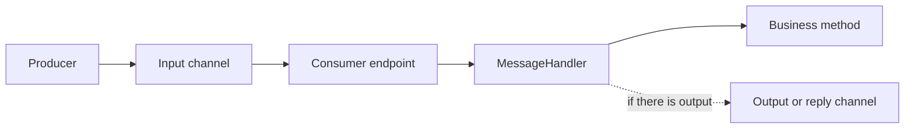

# Endpoint and MessageHandler

## 1. Objectives and Context

In the **Message endpoint** chapter of the **SPRING_INTEGRATION_CORE** module, this lesson explains how a processing component is wired into a message flow. Understanding the relationship between endpoints and handlers helps you read Java DSL configurations, place pollers in the right location, control lifecycle, and pinpoint why messages are not being processed.

After this lesson, you will be able to:

- Distinguish between `Message`, channel, consumer endpoint, and `MessageHandler`.
- Identify message reception via subscription or polling.
- Wire business methods using Java DSL and `@ServiceActivator`.
- Distinguish one-way processing from reply-producing processing.
- Design tests for business logic and for the channel–endpoint–handler wiring.

Suppose a system receives an order code, normalizes it, validates it, and produces a confirmation. When moving from direct Java calls to a message flow, two questions must be answered: **who receives the message from the channel**, and **who performs the work on that message**. These two responsibilities are related but must be kept distinct.

Examples use Java 17 or later and modern Spring Integration configuration APIs. Choose compatible dependency versions using your application's BOM; alternative configurations in this lesson must not be enabled simultaneously if they share channel names.

## 2. Four Components to Distinguish

| Component | Role | Example in the Order Flow |
| --- | --- | --- |
| `Message<T>` | Carries payload and metadata in headers | Payload `"ord-42"`, header `tenantId` |
| `MessageChannel` | Serves as the message-exchange point between components | `ordersInput` |
| Consumer endpoint | Connects input channel to handler; manages reception mechanism and lifecycle | `EventDrivenConsumer`, `PollingConsumer` |
| `MessageHandler` | Executes behavior when handed a message | Calls the order-confirmation service |

In the sense of Enterprise Integration Patterns, an endpoint is the point where an application participates in the messaging system. In Spring Integration configurations, the word "endpoint" also commonly refers to an entire step such as a transformer or service activator. When inspecting runtime beans, distinguish the **consumer endpoint** from the **handler behind it**. [Source: Overview of Spring Integration](https://docs.spring.io/spring-integration/reference/overview.html).

The diagram below depicts a typical consumer endpoint; it is not meant to cover inbound adapters or reactive endpoints:



The endpoint coordinates reception. The handler determines processing behavior. A business method such as `confirm(String orderId)` can be completely unaware that channels, pollers, or `Message` exist.

## 3. The MessageHandler Contract

The interface lives in package `org.springframework.messaging`:

```java
package org.springframework.messaging;

public interface MessageHandler {
    void handleMessage(Message<?> message) throws MessagingException;
}
```

This is the callback the infrastructure uses to deliver messages. In applications, you should generally use built-in handlers or let the framework adapt POJO methods instead of implementing this interface manually. [Source: Message Endpoints](https://docs.spring.io/spring-integration/reference/endpoint.html).

The `void` return type only describes the callback contract. An implementation can still construct a new message and send it to another channel. Therefore, `void handleMessage(...)` does not mean every handler ends the flow.

Minimal example of a one-way handler:

```java
import org.springframework.messaging.MessageHandler;

MessageHandler auditHandler = message -> {
    Object payload = message.getPayload();
    System.out.println("Received: " + payload);
};
```

This snippet only creates a handler. It has no channel wiring yet and is not activated by an endpoint. Declaring a `MessageHandler` bean alone also does not tell the framework where to pull messages from.

## 4. The Channel Determines How the Endpoint Receives

For standard channel consumers, two key combinations are:

| Input Channel | Consumer Endpoint | Reception Mechanism |
| --- | --- | --- |
| `SubscribableChannel` | `EventDrivenConsumer` | Handler is registered as a subscriber |
| `PollableChannel` | `PollingConsumer` | Poller calls `receive()` and passes the message to the handler |

Java DSL and annotations typically let the infrastructure create the matching consumer; `ConsumerEndpointFactoryBean` is a central component in this process. [Source: Message Endpoints](https://docs.spring.io/spring-integration/reference/endpoint.html).

### 4.1. Event-Driven Does Not Mean Asynchronous

`DirectChannel` invokes the subscriber on the sending thread. With `ExecutorChannel`, dispatching is handed off to an executor; typically the handler runs on a different thread. Both are subscribable channels. `PublishSubscribeChannel` serves multi-subscriber broadcasting, whereas `DirectChannel` has point-to-point semantics. [Source: Message Channel Implementations](https://docs.spring.io/spring-integration/reference/channel/implementations.html).

Therefore, when a handler is slow, inspect the channel and executor before concluding the endpoint "is not running asynchronously". Renaming a bean or adding `@ServiceActivator` does not create a thread boundary.

### 4.2. QueueChannel Requires an Active Receiver

`QueueChannel` holds messages until a consumer retrieves them. In the polling model of this lesson, the endpoint needs a local poller or an appropriate default poller. Successfully sending to a queue only proves the message was accepted, not that business processing completed.

Queues store in memory by default. To recover messages after application shutdown, design durable storage or use an appropriate messaging system. [Source: QueueChannel and message storage](https://docs.spring.io/spring-integration/reference/channel/implementations.html).

## 5. Complete Example with Java DSL

The first example uses `DirectChannel` as input. The service accepts an order code and returns a confirmation string. A `QueueChannel` at the output makes it easy to observe results with `receive()`.

Dependencies require `spring-integration-core`; in a Spring Boot application you can use the Integration starter managed by the BOM. The example below uses a standalone Java context and does not need a web server.

### 5.1. Flow Configuration

```java
import java.util.Locale;

import org.springframework.beans.factory.annotation.Qualifier;
import org.springframework.context.annotation.Bean;
import org.springframework.context.annotation.Configuration;
import org.springframework.integration.channel.DirectChannel;
import org.springframework.integration.channel.QueueChannel;
import org.springframework.integration.config.EnableIntegration;
import org.springframework.integration.dsl.IntegrationFlow;

@Configuration
@EnableIntegration
public class OrderFlowConfig {

    public static class OrderService {
        public String confirm(String rawOrderId) {
            String orderId = rawOrderId.trim().toUpperCase(Locale.ROOT);
            if (!orderId.matches("ORD-\\d+")) {
                throw new IllegalArgumentException("Invalid order id: " + orderId);
            }
            return "CONFIRMED:" + orderId;
        }
    }

    @Bean
    public DirectChannel ordersInput() {
        return new DirectChannel();
    }

    @Bean
    public QueueChannel ordersOutput() {
        return new QueueChannel(20);
    }

    @Bean
    public OrderService orderService() {
        return new OrderService();
    }

    @Bean
    public IntegrationFlow orderFlow(
            @Qualifier("ordersInput") DirectChannel input,
            @Qualifier("ordersOutput") QueueChannel output,
            OrderService service) {

        return IntegrationFlow.from(input)
                .handle(service, "confirm",
                        endpoint -> endpoint.id("confirmOrderEndpoint"))
                .channel(output)
                .get();
    }
}
```

`.handle(service, "confirm", ...)` represents a service activator step. The framework bridges the POJO method with message processing; the `service` variable is not the consumer endpoint. [Source: Service Activator](https://docs.spring.io/spring-integration/reference/service-activator.html).

In this example:

- `ordersInput` is where requests arrive.
- `confirmOrderEndpoint` is the explicitly named consumer endpoint.
- The handler of `.handle(...)` invokes `OrderService.confirm(...)`.
- `ordersOutput` is where result messages go, not an input channel requiring a poller for the confirmation step.

The DSL creates the corresponding channel, endpoint, and handler beans. `IntegrationFlow` describes how they are wired; it is not a Java loop stepping through a list for each message. [Source: DSL Basics](https://docs.spring.io/spring-integration/reference/dsl/java-basics.html).

### 5.2. Sending and Receiving Messages

Place the following class in the same package as `OrderFlowConfig`:

```java
import org.springframework.context.annotation.AnnotationConfigApplicationContext;
import org.springframework.integration.channel.QueueChannel;
import org.springframework.messaging.Message;
import org.springframework.messaging.MessageChannel;
import org.springframework.messaging.support.MessageBuilder;

public class OrderFlowDemo {
    public static void main(String[] args) {
        try (var context =
                     new AnnotationConfigApplicationContext(OrderFlowConfig.class)) {
            MessageChannel input =
                    context.getBean("ordersInput", MessageChannel.class);
            QueueChannel output =
                    context.getBean("ordersOutput", QueueChannel.class);

            Message<String> request = MessageBuilder
                    .withPayload(" ord-42 ")
                    .setHeader("tenantId", "shop-a")
                    .build();

            if (!input.send(request, 1_000)) {
                throw new IllegalStateException("Request was not accepted");
            }

            Message<?> reply = output.receive(1_000);
            if (reply == null) {
                throw new IllegalStateException("No confirmation received");
            }
            System.out.println(reply.getPayload());
        }
    }
}
```

Expected output:

```text
CONFIRMED:ORD-42
```

In this configuration, calling `confirm(...)` and sending the result to the output occur within the `input.send(...)` call. Calling `output.receive(...)` simply retrieves the result already placed into the queue; there is no consumer endpoint on the output in this example.

The timeout parameter on `send(...)` does not set an execution deadline for `confirm(...)`. If you need to bound an HTTP call inside business logic, configure timeouts on the HTTP client or corresponding execution mechanism.

## 6. Switching the Input to Polling While Keeping Business Logic Unchanged

To clearly see the separation of responsibilities, keep `OrderService` and `ordersOutput`, and replace the `ordersInput` bean with:

```java
@Bean
public QueueChannel ordersInput() {
    return new QueueChannel(100);
}
```

Then replace the `orderFlow(...)` method with the configuration below. Add imports for `java.time.Duration` and `org.springframework.integration.dsl.Pollers`:

```java
@Bean
public IntegrationFlow orderFlow(
        @Qualifier("ordersInput") QueueChannel input,
        @Qualifier("ordersOutput") QueueChannel output,
        OrderService service) {

    return IntegrationFlow.from(input)
            .handle(service, "confirm", endpoint -> endpoint
                    .id("confirmOrderEndpoint")
                    .poller(Pollers.fixedDelay(Duration.ofMillis(200))
                            .maxMessagesPerPoll(5)
                            .receiveTimeout(0)))
            .channel(output)
            .get();
}
```

`fixedDelay` governs the cadence of poll cycles; `maxMessagesPerPoll(5)` caps the number of messages per cycle and does not spawn five parallel workers. `receiveTimeout(0)` makes receive return immediately when the queue is empty. Handler execution time still affects poll-cycle duration. [Source: Polling Consumer configuration](https://docs.spring.io/spring-integration/reference/endpoint.html).

The business result is still `CONFIRMED:ORD-42`, but when the result appears has changed: `send()` can return before `confirm(...)` runs. The demo still receives with a finite timeout so it does not wait forever.

This is why you do not put a `while` loop calling `receive()` inside `OrderService`. The exact same business logic can be used with two different reception mechanisms without modifying `confirm(...)`.

## 7. Equivalent Configuration with Annotations

This is an alternative configuration to the DSL example, not a component to add to the existing flow. Create a Java configuration with `@EnableIntegration`, declare `ordersInput` and `ordersOutput`, and register the class below as a bean or via component scanning:

```java
import org.springframework.integration.annotation.ServiceActivator;
import org.springframework.messaging.handler.annotation.Header;
import org.springframework.stereotype.Component;

@Component
public class OrderEndpoint {

    @ServiceActivator(
            inputChannel = "ordersInput",
            outputChannel = "ordersOutput",
            requiresReply = "true")
    public String confirm(
            String orderId,
            @Header("tenantId") String tenantId) {

        return tenantId + ":CONFIRMED:" + orderId;
    }
}
```

The `String orderId` parameter receives the payload; `@Header` extracts a metadata value. The class name `OrderEndpoint` is purely an application-chosen name. Annotation processing builds the necessary messaging wiring around the method. [Source: Annotation Support](https://docs.spring.io/spring-integration/reference/configuration/annotations.html).

If the input is a `QueueChannel`, add a poller to the annotation along with the corresponding import:

```java
import org.springframework.integration.annotation.Poller;

// Apply this annotation to the confirm method above.
@ServiceActivator(
        inputChannel = "ordersInput",
        outputChannel = "ordersOutput",
        requiresReply = "true",
        poller = @Poller(fixedDelay = "200", maxMessagesPerPoll = "5"))
```

`@MessageEndpoint` is a stereotype that helps register a component; the class-level annotation itself does not specify the handler method, input channel, or polling schedule. In this example `@Component` already handles bean registration. [Source: Annotation Support](https://docs.spring.io/spring-integration/reference/configuration/annotations.html).

Do not enable both the annotation configuration and the DSL configuration on the same `ordersInput` when you only want a single confirmation step. Two consumers listening on one channel can cause unexpected dispatch behavior; they do not automatically form two sequential steps.

## 8. MessageHandler, GenericHandler, and POJO Methods

When reading `.handle(...)`, check which overload is actually used:

| Declaration Style | Input Data | Result Representation |
| --- | --- | --- |
| `MessageHandler` | Full `Message<?>` | Callback returns `void`; implementation handles behavior itself |
| `GenericHandler<P>` | Payload and `MessageHeaders` | Returns result object or `null` |
| POJO method | Payload, headers, or message per signature | Framework adapts the return value |

Example `GenericHandler` accepting payload and headers:

```java
.handle(String.class, (payload, headers) ->
        headers.get("tenantId") + ":" + payload.trim())
```

The `String.class` argument specifies the payload type for the corresponding overload. The two-parameter lambda here is not `MessageHandler.handleMessage(...)`. [Source: Service Activators and the .handle() method](https://docs.spring.io/spring-integration/reference/dsl/java-handle.html).

To use a custom one-way handler, register it explicitly like this:

```java
@Bean
public org.springframework.messaging.MessageHandler orderAuditHandler() {
    return message -> System.out.println("AUDIT: " + message.getPayload());
}

@Bean
public IntegrationFlow auditFlow(
        @Qualifier("ordersInput") DirectChannel input,
        @Qualifier("orderAuditHandler")
        org.springframework.messaging.MessageHandler handler) {

    return IntegrationFlow.from(input)
            .handle(handler, endpoint -> endpoint.id("orderAuditEndpoint"))
            .get();
}
```

This is also an alternative flow. The audit callback produces no reply, making it suitable at the end of a one-way flow. If you need to send audits alongside confirmations, design branches with publish-subscribe or a wire tap rather than adding another consumer to a `DirectChannel` and expecting both to be called.

## 9. Output and the Request–Reply Contract

For a standard service activator:

- Method returns a non-`null` result: the handler can create a reply message.
- Explicit output channel configured: the result goes to that output.
- No output channel configured: the framework looks up `replyChannel` per reply rules.
- Returns `void` or `null`: produces no reply by default; `requiresReply=true` requires a result and throws `ReplyRequiredException` if missing.

If a result exists but no destination can be resolved, that is a configuration error. `nullChannel` fits when intentionally discarding output. [Source: Service Activator](https://docs.spring.io/spring-integration/reference/service-activator.html).

For example, a gateway waiting for a confirmation would not fit an audit handler that only logs and ends. When designing the final step, clearly decide whether the caller needs a result or only needs to emit an event.

Do not assume every EIP produces exactly one reply per input: a filter can drop messages, a router selects destinations, a splitter creates multiple parts, and an aggregator can hold state waiting for a group to meet its condition. Java DSL provides dedicated operators to express those roles. [Source: EIPs in DSL Basics](https://docs.spring.io/spring-integration/reference/dsl/java-basics.html).

## 10. Lifecycle Belongs to Endpoint Configuration

Java DSL lets you set `id`, `autoStartup`, and endpoint options through the endpoint configuration callback. `id("confirmOrderEndpoint")` names the endpoint bean, without renaming the business bean `orderService`. [Source: DSL and Endpoint Configuration](https://docs.spring.io/spring-integration/reference/dsl/java-endpoints.html).

Example configuration to start the processing step manually:

```java
.handle(service, "confirm", endpoint -> endpoint
        .id("confirmOrderEndpoint")
        .autoStartup(false))
```

Once the context is initialized, you can control the endpoint via `Lifecycle`:

```java
import org.springframework.context.Lifecycle;

Lifecycle endpoint = context.getBean(
        "confirmOrderEndpoint", Lifecycle.class);

endpoint.start();
// Send messages while the endpoint is active.
endpoint.stop();
```

When the processing step is not started, a queued input can accumulate messages, whereas a direct-dispatch channel requires an active subscriber. In real deployments, check endpoint status alongside queued message counts to distinguish "not receiving" from "processing slowly".

Stopping an endpoint does not destroy the business bean. Nor should `stop()` be treated as an immediate cancellation of a running external task; design shutdown policies and timeouts suited to that task.

## 11. Where Do Errors Appear?

Switching the input to polling also changes the error path:

| Scenario in Lesson | What Does the Caller Observe? | Investigation Direction |
| --- | --- | --- |
| `DirectChannel`, handler throws | `send(...)` may throw an exception | Inspect exception and root cause |
| `QueueChannel`, poller processes later | `send(...)` may have already succeeded | Observe poller's error flow |
| Endpoint not yet active | Message does not reach business logic | Check lifecycle and channel type |
| Handler produces no reply | Waiting caller may time out | Check output contract |

In a default synchronous flow, handler errors propagate back to the calling thread. For asynchronous tasks managed by Spring Integration, error handling can emit an `ErrorMessage`, prioritizing the `errorChannel` header and falling back to the global error channel. Merely adding an `errorChannel` header does not convert an exception from a `DirectChannel` call into asynchronous handling. [Source: Error Handling](https://docs.spring.io/spring-integration/reference/error-handling.html).

With the polling configuration in Section 6, you can use a dedicated channel to observe errors in practice:

```java
QueueChannel failures = new QueueChannel(10);

Message<String> invalid = MessageBuilder
        .withPayload("invalid")
        .setErrorChannel(failures)
        .build();

boolean accepted = input.send(invalid, 1_000);
Message<?> error = failures.receive(2_000);
```

In this example, `input` is the `ordersInput` `QueueChannel` bean, and the poller still uses the default error-handling mechanism. `accepted` can be `true` while `error` holds an `ErrorMessage`. Inside, the error payload is typically a messaging exception wrapping the business cause; inspect the `cause` chain and failed message when diagnosing. [Source: Error Handling](https://docs.spring.io/spring-integration/reference/error-handling.html).

Having an error message does not automatically guarantee business work rolled back or the message returned to the queue. If `confirm(...)` writes to a database or calls an external service, design transactions, retries, and idempotency around the real resources. Do not enable retries by default on operations that can trigger duplicate side effects.

## 12. Testing at the Right Boundaries

Separate two goals: verifying business logic and verifying messaging wiring.

### 12.1. Business Logic Unit Tests

```java
import static org.junit.jupiter.api.Assertions.assertEquals;
import static org.junit.jupiter.api.Assertions.assertThrows;

import org.junit.jupiter.api.Test;

class OrderServiceTest {
    private final OrderFlowConfig.OrderService service =
            new OrderFlowConfig.OrderService();

    @Test
    void confirmsNormalizedOrderId() {
        assertEquals("CONFIRMED:ORD-42", service.confirm(" ord-42 "));
    }

    @Test
    void rejectsInvalidOrderId() {
        assertThrows(IllegalArgumentException.class,
                () -> service.confirm("invalid"));
    }
}
```

This unit test does not prove the endpoint subscribed, the output channel is named correctly, or a poller is configured.

### 12.2. Flow Wiring Integration Tests

The JUnit 5 example below uses the `OrderFlowConfig` from Section 5 directly:

```java
import static org.junit.jupiter.api.Assertions.assertEquals;
import static org.junit.jupiter.api.Assertions.assertNotNull;
import static org.junit.jupiter.api.Assertions.assertTrue;

import org.junit.jupiter.api.Test;
import org.springframework.context.annotation.AnnotationConfigApplicationContext;
import org.springframework.integration.channel.QueueChannel;
import org.springframework.messaging.Message;
import org.springframework.messaging.MessageChannel;
import org.springframework.messaging.support.MessageBuilder;

class OrderFlowTest {
    @Test
    void deliversConfirmationThroughConfiguredEndpoint() {
        try (var context =
                     new AnnotationConfigApplicationContext(OrderFlowConfig.class)) {
            MessageChannel input =
                    context.getBean("ordersInput", MessageChannel.class);
            QueueChannel output =
                    context.getBean("ordersOutput", QueueChannel.class);

            assertTrue(input.send(MessageBuilder
                    .withPayload(" ord-42 ")
                    .setHeader("tenantId", "shop-a")
                    .build(), 1_000));

            Message<?> reply = output.receive(2_000);
            assertNotNull(reply);
            assertEquals("CONFIRMED:ORD-42", reply.getPayload());
        }
    }
}
```

The test sends to the real channel and observes the real output, so it can catch flow-wiring errors. If you call `service.confirm(...)` directly in an integration test, you bypass the very endpoint you meant to verify.

For the polling variant, keep the output assertion and use a finite receive timeout suited to the test environment. Do not replace it with `Thread.sleep(...)` and assume the poller definitely ran. For error branches, observe a dedicated error channel; for one-way tasks, observe controlled side effects rather than waiting for a non-existent reply.

These test snippets are templates for learners to run in a project with compatible dependencies; this lesson does not include test execution results.

## 13. Practice Scenarios and Diagnostics

| Symptom | Hypothesis to Check | Concrete Check Step |
| --- | --- | --- |
| Handler bean exists but no logs appear | Handler not wired to input | Look for `.handle(...)` or `@ServiceActivator(inputChannel=...)` |
| Message queued but never processed | Missing poller or endpoint not running | Check poller config and `isRunning()` |
| Sending message slows caller down | Handler running on caller's thread | Check whether input is a `DirectChannel` |
| Gateway waits then times out | Final step returns no reply | Check `void`, `null`, output, and reply channel |
| Only one of two steps runs | Two consumers attached to one point-to-point input | Draw intermediate channels if sequential execution is intended |
| Exception does not reach caller after adding queue | Asynchronous boundary introduced | Inspect error channel and failed-message details |

Practice on the order example in order:

1. Run the `DirectChannel` flow; log the thread name inside `confirm(...)` and at the `send(...)` call site.
2. Switch the input to a `QueueChannel` with a poller; compare thread names and when `send(...)` returns.
3. Set `autoStartup(false)`, send a message into the queue, then explicitly `start()` the endpoint; observe when the result appears.
4. Send an invalid payload; compare the synchronous exception with the `ErrorMessage` in the polling variant.
5. Extract normalization into a `.transform(...)` step before confirmation. Identify the endpoint and handler of each step on the diagram.

In step 5, the goal is to keep business methods easy to test and use Spring Integration components to express the flow. When expanding to filters, routers, or aggregators, keep distinguishing the **message-receiving mechanism** from the **processing step's behavior**, while clearly defining the output and error path of each branch.