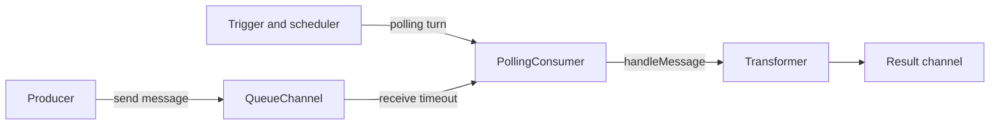

# Poller and PollingConsumer

## 1. Objectives and Use Cases

In Spring Integration Core, a message consisting of a payload and headers is transferred through a `MessageChannel` to endpoints. However, sending a message to a channel does not answer the question: **who retrieves the message, when, and on which thread?**

Suppose a service receives requests to normalize order codes. The producer pushes requests into the queue faster than the processing speed; the application wants to proactively pull small batches at a time to protect the downstream system. In this scenario, it is necessary to distinguish:

- **Poller**: how polling is configured, including the execution schedule and the per-poll limit.
- **PollingConsumer**: the endpoint that retrieves messages from a `PollableChannel` and then hands them to a `MessageHandler`.
- **Handler**: the component that performs the work, such as a transformer, filter, router, or service activator.

After this lesson, you will be able to choose an endpoint based on the channel type, place the poller in the right position, explain the basic parameters, and test an asynchronous flow. This lesson belongs to the **Poller** chapter of the **SPRING_INTEGRATION_CORE** module, focusing on the foundation for designing message flows using the Java DSL.

## 2. Separating Three Responsibilities: Channel, Endpoint, and Handler

Consider the flow:



`QueueChannel` holds waiting messages. `PollingConsumer` manages receiving messages on a schedule. The transformer only converts the content after the message has been received; it does not need to write its own loop to read the queue.

At the API level, `PollingConsumer` connects a `PollableChannel` to a `MessageHandler`. In an application, you typically declare the endpoint using annotations or the DSL and let the framework create the appropriate consumer type. [PollingConsumer Javadoc](https://docs.spring.io/spring-integration/api/org/springframework/integration/endpoint/PollingConsumer.html).

A service activator does not inherently imply "running periodically." With the same processing logic, the input channel type determines the message-receiving mechanism:

| Input channel | Typical receiving mechanism | Corresponding endpoint | Needs a poller for receiving? |
| --- | --- | --- | --- |
| `DirectChannel` | Channel invokes the registered handler | `EventDrivenConsumer` | No |
| `ExecutorChannel` | Channel dispatches to the handler via an executor | `EventDrivenConsumer` | No |
| `QueueChannel` | Endpoint proactively calls `receive(...)` | `PollingConsumer` | Yes |

`ExecutorChannel` shows that **asynchronous** and **polling** are two separate concepts. Offloading processing to an executor does not turn a channel into a queue read on a schedule. The distinction between consumers for `SubscribableChannel` and `PollableChannel` is described in the [Poller documentation](https://docs.spring.io/spring-integration/reference/polling-consumer.html).

## 3. PollingConsumer and SourcePollingChannelAdapter

Both endpoints can use a poller, but they receive messages from two different places:

```text
Reading an internal channel:
Producer -> QueueChannel -> PollingConsumer -> Handler

Reading a data source:
MessageSource -> SourcePollingChannelAdapter -> MessageChannel -> Handler
```

`PollingConsumer` receives a message that is already in a channel. `SourcePollingChannelAdapter` calls `MessageSource.receive()` to fetch a message from a source, then sends it to the target channel. The source can read external data or retrieve data provided by Java logic. These are two polling variants clearly distinguished by the framework in [Pollable Message Source](https://docs.spring.io/spring-integration/reference/polling-consumer.html#pollable-message-source).

For example, a source fetching order codes from a waiting list may return `null` when no data remains. `null` indicates a receive attempt with no message; it is not a `Message` with a `null` payload.

If the source pushes to a `DirectChannel`, the downstream handler is invoked on the thread executing the source poll. There is no need to place another poller on this handler. If the source pushes to a `QueueChannel`, another polling consumer is needed to pull data out of the queue. In that case, two independent cadences exist: the source-reading cadence and the queue-consuming cadence.

During design, sketch where data is held first. Every queue boundary needs a clear consumption mechanism; every polled source needs a clear source-reading schedule.

## 4. What Does One Poll Perform?

You can visualize the normal operation of `PollingConsumer` with the following pseudocode. This is an explanatory model, not the complete framework source code:

```text
when the trigger allows executing one poll:
    loop at most maxMessagesPerPoll times:
        message = inputChannel.receive(receiveTimeout)
        if message is null:
            end the poll
        handler.handleMessage(message)
    wait for the next trigger
```

One poll can process multiple messages. If the queue only has two messages and the limit is ten, the poller does not have to wait until ten arrive before processing. Each message is handed to the handler immediately after being received.

If the handler throws an exception, do not interpret the pseudocode as guaranteeing that all remaining messages will still be processed in that poll. You must consider the error mechanism and configured advice. Similarly, having a limit of ten messages does not mean the handler will receive a `List` containing ten elements.

### 4.1. Schedule: fixed delay, fixed rate, and cron

| Schedule type | How timing is determined | Suitable example |
| --- | --- | --- |
| Fixed delay | Measures the pause after the previous task completes | Giving the system a pause between polls |
| Fixed rate | Measures from the scheduled start times | Maintaining a desired polling cadence |
| Cron | Calculated from a schedule expression | Reading data only during business hours |

In synchronous processing, if one poll takes 300 ms and the fixed delay is 1,000 ms, the interval between two start times is approximately 1,300 ms. With a fixed rate of 1,000 ms, the desired start times are 1,000 ms apart; the scheduler may still execute late when resources are scarce. Fixed rate by itself is not a configuration for the number of parallel processing threads. The semantics of these two periodic modes are defined in [PeriodicTrigger](https://docs.spring.io/spring-framework/docs/current/javadoc-api/org/springframework/scheduling/support/PeriodicTrigger.html).

The Java DSL provides factories such as:

```java
Pollers.fixedDelay(Duration.ofSeconds(1));
Pollers.fixedRate(Duration.ofSeconds(1));
Pollers.cron("0 */5 * * * *"); // second 0, every 5 minutes
```

The expression above has six fields following Spring's cron syntax. For business-hour schedules, configure the time zone intentionally rather than implicitly relying on the runtime environment. These factories create `PollerSpec` configurations; they do not create a flow or trigger processing by themselves. [Pollers Javadoc](https://docs.spring.io/spring-integration/api/org/springframework/integration/dsl/Pollers.html).

### 4.2. maxMessagesPerPoll

`maxMessagesPerPoll` limits the number of messages received in **one poll**, not the number of messages per second and not a business batch size.

- Positive value: receive at most that count; end early if `null` is received.
- Negative value, commonly `-1`: no count limit; continue until a receive returns `null`.
- Value `0`: skip receiving on the polling endpoint in versions supporting this mechanism, added since 5.5.

The default differs between `PollingConsumer` (`-1`) and `SourcePollingChannelAdapter` (`1`). A source that always returns new data can cause a poll to never finish if a negative limit is set. While learning and when load control is needed, set an explicit positive limit. [Poller configuration and default values](https://docs.spring.io/spring-integration/reference/endpoint.html).

For example, suppose a queue has 23 messages, no new producers, `maxMessagesPerPoll=10`, and no errors:

| Poll | Messages received | Remaining |
| --- | --- | --- |
| 1 | 10 | 13 |
| 2 | 10 | 3 |
| 3 | 3 | 0 |

In poll 3, after the third message, the next receive call may wait up to `receiveTimeout` before returning `null`. Therefore, the duration of a poll does not consist solely of the processing time for the messages already received.

### 4.3. receiveTimeout

`receiveTimeout` is the wait time in a single receive operation from a `PollableChannel`, in milliseconds when using the configuration in the examples below. It is not an HTTP call timeout, a transformer timeout, or the pause between two polls.

With `receiveTimeout(0)`, the receive returns immediately if no message is present. With a positive timeout, the thread can wait and receive immediately when a message arrives within that window. This parameter does not automatically limit how long an arbitrary `MessageSource.receive()` performs I/O; source timeouts must be configured on the corresponding source or client. [PollingConsumer receive mechanism](https://docs.spring.io/spring-integration/api/org/springframework/integration/endpoint/PollingConsumer.html).

Suppose the fixed delay is 500 ms, receive timeout is 0, and the queue is empty. A message arriving right after the receive attempt will have to wait for the next poll. If the receive timeout is 1,000 ms, the waiting thread can pick up the message sooner, at the cost of occupying the thread while the queue is empty.

## 5. Java DSL Example: Normalizing Order Codes from a Queue

### 5.1. Prerequisites and Configuration

The example uses Java 17 or higher, Spring Integration 6.x, and the Java DSL API located in `spring-integration-core`. In a compatible Spring Boot project, you can use the `spring-boot-starter-integration` starter; let Boot manage versions instead of manually mixing different Spring library versions.

This is a configuration class that can be loaded into a Spring context. The example intentionally sets `autoStartup(false)` so tests decide when to start; when using it for an application that processes automatically right after startup, omit this setting or change it to `true`.

```java
package example.poller;

import java.time.Duration;
import java.util.Locale;

import org.springframework.context.annotation.Bean;
import org.springframework.context.annotation.Configuration;
import org.springframework.integration.channel.QueueChannel;
import org.springframework.integration.config.EnableIntegration;
import org.springframework.integration.dsl.IntegrationFlow;
import org.springframework.integration.dsl.Pollers;

@Configuration
@EnableIntegration
public class PollingOrderConfig {

    @Bean
    public QueueChannel incomingOrders() {
        return new QueueChannel(100);
    }

    @Bean
    public QueueChannel normalizedOrders() {
        return new QueueChannel(100);
    }

    @Bean
    public IntegrationFlow normalizeOrdersFlow() {
        return IntegrationFlow.from(incomingOrders())
                .<String, String>transform(
                        value -> value.trim().toUpperCase(Locale.ROOT),
                        endpoint -> endpoint
                                .id("normalizeOrderEndpoint")
                                .autoStartup(false)
                                .poller(Pollers
                                        .fixedDelay(Duration.ofMillis(200))
                                        .maxMessagesPerPoll(5)
                                        .receiveTimeout(0)))
                .channel(normalizedOrders())
                .get();
    }
}
```

The poller is attached to the transformer endpoint because **this endpoint's input** is `incomingOrders`, a `QueueChannel`. The framework creates a polling consumer to receive messages and then invoke the transformer. Both channel beans are managed by the `@Configuration` class with the default proxy mechanism.

`normalizedOrders` is the result queue. In the test, the test calls `receive(...)` directly to fetch the result, so an automatic consumer is not needed for this queue yet. If you chain a router, filter, or aggregator reading that queue, the next endpoint also needs its own poller or the default poller.

The queue limit of 100 merely illustrates a bounded buffer. It is independent of the five-message-per-poll limit. `QueueChannel` stores messages in a queue and supports configuring capacity; the API also exposes the pending count for observation. [QueueChannel Javadoc](https://docs.spring.io/spring-integration/api/org/springframework/integration/channel/QueueChannel.html).

### 5.2. Reading the Flow Behavior Accurately

With payload `"  ord-001  "`, the result is `"ORD-001"`. Finishing a send into `incomingOrders` by the producer does not mean the transformer has completed.

When the endpoint is started, the poller tries to fetch up to five messages per poll. The transformer is invoked sequentially on the thread executing the poll unless an executor boundary is added. Sending the result to the output queue completes before processing the next message in this simple model.

When the output queue is full, downstream can slow down the poll. In a real application, you must define the send timeout policy and overload handling; merely reducing the poll interval does not resolve a bottleneck in the receiving system.

### 5.3. Testing with Lifecycle Control

The test snippet uses JUnit Jupiter. `AnnotationConfigApplicationContext` loads the configuration above directly; there is no need to start a full Boot application.

```java
package example.poller;

import org.junit.jupiter.api.Test;
import org.springframework.context.annotation.AnnotationConfigApplicationContext;
import org.springframework.integration.channel.QueueChannel;
import org.springframework.integration.endpoint.AbstractEndpoint;
import org.springframework.messaging.Message;
import org.springframework.messaging.support.GenericMessage;

import static org.junit.jupiter.api.Assertions.assertEquals;
import static org.junit.jupiter.api.Assertions.assertNotNull;
import static org.junit.jupiter.api.Assertions.assertNull;
import static org.junit.jupiter.api.Assertions.assertTrue;

class PollingOrderConfigTest {

    @Test
    void normalizesOnlyAfterConsumerStarts() {
        try (var context = new AnnotationConfigApplicationContext(
                PollingOrderConfig.class)) {
            QueueChannel input = context.getBean(
                    "incomingOrders", QueueChannel.class);
            QueueChannel output = context.getBean(
                    "normalizedOrders", QueueChannel.class);
            AbstractEndpoint endpoint = context.getBean(
                    "normalizeOrderEndpoint", AbstractEndpoint.class);

            assertTrue(input.send(new GenericMessage<>("  ord-001  "), 0));
            assertNull(output.receive(0));
            assertEquals(1, input.getQueueSize());

            endpoint.start();
            try {
                Message<?> result = output.receive(3000);
                assertNotNull(result);
                assertEquals("ORD-001", result.getPayload());
            }
            finally {
                endpoint.stop();
            }
        }
    }
}
```

The test proves that a message can wait in the queue before the consumer runs, and then be transformed after the consumer starts. `receive(3000)` returns as soon as a result is available and waits at most three seconds; the test is not forced to sleep for the full three seconds.

This test does not prove an exact 200 ms interval, throughput, or the five-message limit per poll. Testing those properties requires separately observing poll boundaries or using a controllable trigger; you should not infer them solely from the final message count.

## 6. Two Other Configuration Approaches to Know

### 6.1. Annotations for a Handler Reading from a Queue

The snippet below is an **alternative** to the transformer endpoint in the previous example, using a service activator with no return value. Place the method in a Spring-managed bean and keep the `incomingOrders` bean:

```java
import org.springframework.integration.annotation.Poller;
import org.springframework.integration.annotation.ServiceActivator;

@ServiceActivator(
        inputChannel = "incomingOrders",
        poller = @Poller(fixedDelay = "200", maxMessagesPerPoll = "5"))
public void processOrder(String orderCode) {
    System.out.println("Processing " + orderCode);
}
```

Do not enable both endpoints reading the same `incomingOrders` simultaneously if the goal is for every message to pass through the exact normalization logic of the example. Multiple consumers on a single queue compete to receive messages; it does not automatically broadcast copies to all handlers.

### 6.2. Default Poller

You can declare a default poller in the application context:

```java
import java.time.Duration;

import org.springframework.context.annotation.Bean;
import org.springframework.integration.dsl.Pollers;
import org.springframework.integration.scheduling.PollerMetadata;

@Bean(name = PollerMetadata.DEFAULT_POLLER)
public PollerMetadata defaultPoller() {
    return Pollers.fixedDelay(Duration.ofSeconds(1))
            .maxMessagesPerPoll(5)
            .receiveTimeout(0)
            .getObject();
}
```

A polling endpoint without its own configuration can use this default. An endpoint with its own poller retains its own configuration. Setting a default poller reduces configuration repetition but also gives changes a broader impact; use dedicated pollers for sources or consumers with special load requirements. [Global Default Poller](https://docs.spring.io/spring-integration/reference/endpoint.html#global-default-poller).

## 7. Example Reading a Source with SourcePollingChannelAdapter

This is a standalone configuration, not connected to `incomingOrders` in the previous section. It illustrates polling a simulated source backed by an in-memory buffer:

```java
package example.poller;

import java.time.Duration;
import java.util.Queue;
import java.util.concurrent.ConcurrentLinkedQueue;

import org.springframework.context.annotation.Bean;
import org.springframework.context.annotation.Configuration;
import org.springframework.integration.config.EnableIntegration;
import org.springframework.integration.core.MessageSource;
import org.springframework.integration.dsl.IntegrationFlow;
import org.springframework.integration.dsl.Pollers;
import org.springframework.messaging.support.GenericMessage;

@Configuration
@EnableIntegration
public class SourcePollingConfig {

    @Bean
    public MessageSource<String> pendingOrderSource() {
        Queue<String> pending = new ConcurrentLinkedQueue<>();
        pending.add("ord-101");
        pending.add("ord-102");

        return () -> {
            String order = pending.poll();
            return order == null ? null : new GenericMessage<>(order);
        };
    }

    @Bean
    public IntegrationFlow readPendingOrdersFlow() {
        return IntegrationFlow.from(
                        pendingOrderSource(),
                        endpoint -> endpoint
                                .id("pendingOrdersSourceEndpoint")
                                .poller(Pollers
                                        .fixedDelay(Duration.ofSeconds(1))
                                        .maxMessagesPerPoll(1)))
                .handle(message -> System.out.println(message.getPayload()))
                .get();
    }
}
```

The poller is placed on the **source endpoint**, directly inside `IntegrationFlow.from(...)`. Each poll returns at most one message from the source due to the explicitly set limit. After two polls receive data, subsequent reads return `null` until new data arrives; in this example, there is no additional producer.

The downstream consumer after the source does not read from a `QueueChannel` in this flow, so do not put a poller on `.handle(...)`. This is the most important practical difference compared to a queue-reading flow.

## 8. Threads, Errors, and Guarantee Boundaries

### 8.1. Asynchronous Boundaries Change Where Errors Are Received

With `DirectChannel` running on the sender's thread, exceptions from the handler can propagate back to the send call. With a queue, the producer has already handed the message into the buffer; the handler runs later on the polling thread, so a `try/catch` around `send(...)` cannot catch business errors raised at that time.

In Spring Integration's standard error-handling mechanism, polling task errors are represented as an `ErrorMessage` and routed to the appropriate error channel. Per-message configuration can use the `errorChannel` header; otherwise, the framework has a global `errorChannel`. If customizing the scheduler or error handler, preserve the error-publishing mechanism expected by the flow. [Error Handling](https://docs.spring.io/spring-integration/reference/error-handling.html).

An error-handling flow can log the order code and exception type and decide to route to a manual processing channel. However, receiving an `ErrorMessage` does not automatically mean the source message has been put back into the queue.

### 8.2. Polling Does Not Automatically Provide Data Durability

In the example, `QueueChannel` uses memory. If the process stops, data in the buffer has no guarantee of surviving a restart. If the handler fails after the message has been pulled, retry or replay must be designed separately.

When durability is required, choose a suitable message store or source infrastructure, and define transaction boundaries, retries, and duplicate handling according to business requirements. For example, payment collection needs a stable operation ID to prevent the same request from causing multiple charges on retry.

A poller can participate in Spring's transaction mechanism, but a transaction does not automatically guarantee rollback of all external side effects. Switching to an executor also introduces a thread boundary that must be evaluated separately. In-depth transactions should be studied after clearly identifying where messages are received and where business logic is executed.

### 8.3. Scheduler and Executor Are Two Roles

The scheduler decides when to trigger. The executor, if configured for the poller, receives the execution work. When separating these two roles, the moment a task is submitted no longer means business processing has finished.

Before adding an executor, determine whether the source is safe for concurrent access, whether the handler depends on ordering, and how many concurrent requests downstream can tolerate. Do not infer from `maxMessagesPerPoll(10)` that ten threads or ten requests run in parallel.

## 9. Estimating Processing Capacity

For a synchronous polling consumer with a constant backlog, no errors, and processing the full `B` messages per poll, you can estimate:

```text
single-poll duration ≈ B × average processing time per message
fixed-delay throughput ≈ B / (single-poll duration + pause interval)
```

For an example assuming `B=5`, 40 ms per message, and a fixed delay of 200 ms:

```text
single-poll processing time ≈ 5 × 40 ms = 200 ms
interval between two starts ≈ 200 + 200 = 400 ms
approximate throughput ≈ 5 / 0.4 = 12.5 messages/second
```

This is an estimate from the stated model, not a framework guarantee. It omits overhead, I/O waits, receive timeouts when the queue is empty, and output bottlenecks. If the producer continuously sends 30 messages/second while the consumer only achieves around 12.5 messages/second, the backlog will grow.

Accordingly, measure at least queue depth, age of the oldest waiting message, processing time, and error rate. Change one parameter and re-measure; reducing the pause interval only helps when downstream still has processing capacity.

## 10. Common Configuration Mistakes

| Symptom | What to check | How to handle |
| --- | --- | --- |
| Messages stay in the queue forever | Whether the endpoint is started; whether a dedicated or default poller exists | Check lifecycle and consumer configuration |
| Thinking `fixedDelay(1000)` limits the handler to once per second | One poll can receive multiple messages | Set `maxMessagesPerPoll` explicitly |
| Increasing `receiveTimeout` to fix an HTTP timeout | This is the channel receive wait time | Configure timeout on the HTTP client/adapter |
| Attaching a poller to a handler reading `DirectChannel` | Input is not a pollable channel | Use a subscribing consumer |
| Source is read continuously within a single poll | Source always returns messages and the limit is negative | Use a positive limit and check the end-of-data condition |
| Producer cannot catch handler errors | Processing occurs after the queue on another thread | Observe the error flow |
| Messages do not pass through both handlers | Two consumers are competing to read the same queue | Chain the steps if sequential processing is needed |
| Queue keeps growing | Inbound rate exceeds processing speed | Measure backlog and downstream limits before tuning the poller |

## 11. Self-Practice

1. With the normalization flow, send three messages before starting the endpoint. Verify the input queue has three items, then receive all three results after starting.
2. Change `maxMessagesPerPoll` to one and set a longer pause interval to make it easier to observe. Distinguish what you observe in the demo from what is proven by automated tests.
3. Change the input to `DirectChannel`, remove the poller, and remove the auto-startup disabling configuration; explain why the handler can run directly inside the send call.
4. Make the transformer throw an exception on a specific order code. Trace the error flow and determine whether the message is actually retried.
5. In the source flow, change the limit from one to two. Predict the two order codes that will be emitted in the same receive poll before running a test.

When reading any flow, identify in order: whether the data is in a channel or a source, which endpoint proactively receives, which schedule triggers it, what limit applies per poll, and where errors are observed. Being able to answer those questions is the foundation for placing transformers, routers, filters, and aggregators at the right processing boundaries.