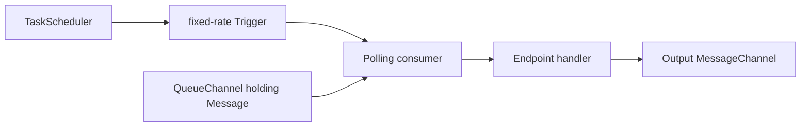

# fixed-rate: Scheduling a Poller on a Fixed Period

In the **Poller** chapter of the **SPRING_INTEGRATION_CORE** module, `fixed-rate` is used to instruct an endpoint to poll data at a periodic cadence. Understanding this cadence accurately helps design message flows whose pace matches the data source, queues, and receiving systems.

This lesson focuses on three questions: when is the poller expected to run, how many messages does each poll fetch, and what happens when processing takes longer than the period. The examples connect polling schedules with `Message`, `MessageChannel`, endpoints, and the Java DSL; the testing section helps observe both results and errors.

## 1. What Interval Does fixed-rate Measure?

`fixed-rate` measures the period between **scheduled start times**. It differs from waiting a fixed interval after the previous work completes. With `PeriodicTrigger`, fixed-rate mode is enabled via `setFixedRate(true)`; the default of a newly created `PeriodicTrigger` is fixed delay. [PeriodicTrigger Javadoc](https://docs.spring.io/spring-framework/docs/current/javadoc-api/org/springframework/scheduling/support/PeriodicTrigger.html).

Let:

- `P`: the polling period.
- `D`: the initial delay before the first poll.
- `t0`: the schedule start reference time.
- `S(n)`: the scheduled start time of the `n`-th poll, zero-indexed.

Ideal model:

```text
S(n) = t0 + D + n × P
```

For example, `P = 1 second`, `D = 0`, and each poll takes `300 ms`:

```text
Time:            0          1          2          3 seconds
Scheduled:       |          |          |          |
Processing:      [0--0.3]   [1--1.3]   [2--2.3]   [3--3.3]
```

If the same work uses a `1 second` fixed delay, the next poll is calculated from when the previous poll ends:

```text
Start:           0          1.3          2.6          3.9 seconds
Processing:      [0--0.3]   [1.3--1.6]   [2.6--2.9]   ...
```

This is a schedule-explanatory model, not a real-time guarantee. When the machine is busy, the actual execution time can be later than the scheduled time. Therefore, logs should distinguish scheduled time, actual start time, and completion time.

| Criterion | fixed-rate | fixed-delay |
|---|---|---|
| Period reference point | Scheduled start time | Completion time of the previous poll |
| Common purpose | Maintain a polling cadence | Provide a pause after work completes |
| When work runs long | Can fall behind schedule | Next start time shifts later automatically |
| Automatically increases thread count? | No | No |
| Governs messages per poll? | No | No |

## 2. Where Does the Poller Sit in a Message Flow?

There are two primary scenarios:

1. **Inbound channel adapter** calls `MessageSource.receive()` to pull data from outside and create messages.
2. **Polling consumer** pulls messages from a `PollableChannel`, such as a `QueueChannel`, and passes them to the endpoint handler.

An endpoint receiving from a `DirectChannel` is normally invoked on the message-send event. Do not attach a poller to that endpoint just to make it run periodically. A poller is appropriate when the input is a source that needs polling or a channel with an active receive mechanism. [Spring Integration — Message Endpoints](https://docs.spring.io/spring-integration/reference/endpoint.html).



In this flow, the trigger determines the schedule; the channel holds messages; the handler executes business logic. Increasing the polling cadence does not make the handler process faster.

Real-world example: a system receives requests to normalize order codes into a queue. Producers send `Message<String>` at any time. Roughly every second, the endpoint fetches up to five waiting messages, normalizes them, and forwards the results to the output channel.

## 3. Configuration with the Java DSL

### 3.1. QueueChannel Processing Flow

The example uses Java 17+, Spring Integration 6.x with a compatible Spring Framework 6.x; the `Duration` APIs are also available in subsequent generations. Use the version set managed by your project, such as the Spring Boot BOM. The primary dependency is `org.springframework.integration:spring-integration-core`; the test section below additionally requires Spring Test and JUnit Jupiter.

This is a standalone Spring configuration, loaded into the `ApplicationContext` of an application or test. `@EnableScheduling` is not required to activate Spring Integration pollers; the example uses `@EnableIntegration` to register the integration infrastructure.

```java
import java.time.Duration;
import java.util.Locale;

import org.springframework.context.annotation.Bean;
import org.springframework.context.annotation.Configuration;
import org.springframework.integration.channel.QueueChannel;
import org.springframework.integration.config.EnableIntegration;
import org.springframework.integration.dsl.IntegrationFlow;
import org.springframework.integration.dsl.Pollers;

@Configuration
@EnableIntegration
public class FixedRatePollerConfig {

    @Bean
    public QueueChannel jobs() {
        return new QueueChannel(100);
    }

    @Bean
    public QueueChannel results() {
        return new QueueChannel(100);
    }

    @Bean
    public QueueChannel pollerErrors() {
        return new QueueChannel(100);
    }

    @Bean
    public IntegrationFlow normalizeFlow() {
        return IntegrationFlow.from(jobs())
                .handle(String.class, (payload, headers) -> {
                    String normalized = payload.trim();
                    if (normalized.isEmpty()) {
                        throw new IllegalArgumentException(
                                "Order code must not be empty");
                    }
                    return normalized.toUpperCase(Locale.ROOT);
                }, endpoint -> endpoint
                        .id("normalizeEndpoint")
                        .poller(Pollers.fixedRate(Duration.ofSeconds(1))
                                .maxMessagesPerPoll(5)
                                .receiveTimeout(0)
                                .errorChannel("pollerErrors")))
                .channel(results())
                .get();
    }
}
```

Configurations to read together:

| Component | Role in the example |
|---|---|
| `jobs()` | Input queue with a capacity of 100 messages |
| `fixedRate(Duration.ofSeconds(1))` | Scheduled polling cadence of one second |
| `maxMessagesPerPoll(5)` | Maximum limit of five messages per poll |
| `receiveTimeout(0)` | When the queue is empty, receive returns immediately |
| `errorChannel("pollerErrors")` | Selects the channel receiving poller error messages |
| `results()` | Queue receiving normalized results |

In the Java DSL, `Pollers.fixedRate(...)` creates the poller configuration; the overload accepting `long` uses milliseconds. The overload accepting `Duration` makes the unit explicit at the call site. [Pollers Javadoc](https://docs.spring.io/spring-integration/api/org/springframework/integration/dsl/Pollers.html).

The poller is attached to the `.handle(...)` endpoint because this endpoint receives directly from `jobs`, a `QueueChannel`. In a multi-step flow, the poller must be placed on the endpoint with a pollable input; downstream transformer, filter, or router steps connected via direct channels do not each need a poller.

You can send data with:

```java
boolean accepted = jobs.send(
        new org.springframework.messaging.support.GenericMessage<>("  ord-001  "),
        1000);
```

In this snippet, `jobs` is the `QueueChannel` obtained from the context. `accepted == true` means the queue accepted the message; it does not yet prove business processing succeeded. The `1000` argument is the send timeout when the channel is full, not the polling period. The expected result in `results` has payload `ORD-001`.

The in-memory queues in the example are for learning purposes. Consumers are needed for both the results channel and the error channel in long-running use; if they fill up, sending to these channels can block the processing thread and prolong the poll.

### 3.2. First-Poll Delay

If you want to wait three seconds before the first poll, then maintain a one-second cadence, replace the trigger configuration with:

```java
Pollers.fixedRate(
        Duration.ofSeconds(1),
        Duration.ofSeconds(3))
    .maxMessagesPerPoll(5)
    .receiveTimeout(0);
```

The first argument is the period; the second argument is the initial delay. In the ideal model, polls start at `3, 4, 5, 6...` seconds from the scheduling baseline. Initial delay affects only the first poll and does not become an extra pause after every poll.

### 3.3. Inbound Adapter with Annotations

The following alternative example illustrates polling a simple source. You do not need to load it alongside the configuration in section 3.1:

```java
import java.util.concurrent.atomic.AtomicLong;

import org.springframework.context.annotation.Bean;
import org.springframework.context.annotation.Configuration;
import org.springframework.integration.annotation.InboundChannelAdapter;
import org.springframework.integration.annotation.Poller;
import org.springframework.integration.channel.QueueChannel;
import org.springframework.integration.config.EnableIntegration;

@Configuration
@EnableIntegration
public class HeartbeatConfig {

    private final AtomicLong sequence = new AtomicLong();

    @Bean
    public QueueChannel heartbeats() {
        return new QueueChannel(100);
    }

    @InboundChannelAdapter(
            channel = "heartbeats",
            poller = @Poller(
                    fixedRate = "1000",
                    maxMessagesPerPoll = "1"))
    public String nextHeartbeat() {
        return "heartbeat-" + sequence.incrementAndGet();
    }
}
```

`fixedRate = "1000"` uses milliseconds. The string attributes of `@Poller` support placeholders, so you can use `fixedRate = "${integration.heartbeat.period-ms:1000}"`. When complex configuration such as initial delay or advice is needed, you can declare a `PollerMetadata` bean and reference it via `@Poller("pollerBeanName")`. [@Poller Javadoc](https://docs.spring.io/spring-integration/api/org/springframework/integration/annotation/Poller.html).

The heartbeat source always returns a value. Therefore, the per-poll limit must be kept finite. Incrementing a counter merely simulates a data source; in a real application, this method might read pending records or status from another system.

### 3.4. Equivalent XML Syntax for the Schedule

The XML snippet below assumes the Spring Integration namespace is declared and a `normalizer` bean has a `normalize` method:

```xml
<int:channel id="jobs">
    <int:queue capacity="100"/>
</int:channel>

<int:channel id="results">
    <int:queue capacity="100"/>
</int:channel>

<int:service-activator input-channel="jobs"
                       output-channel="results"
                       ref="normalizer"
                       method="normalize">
    <int:poller fixed-rate="1000"
                max-messages-per-poll="5"
                receive-timeout="0"/>
</int:service-activator>
```

Do not declare both `fixed-rate` and `fixed-delay` simultaneously on the same poller. If using a custom `trigger` or referencing an existing poller, pick the corresponding configuration approach rather than mixing multiple scheduling mechanisms. [Spring Integration — Endpoint Configuration](https://docs.spring.io/spring-integration/reference/endpoint.html).

## 4. One Poll Differs from One Message

`fixed-rate` controls the cadence of **polls**; `maxMessagesPerPoll` limits the number of messages in a single poll. Exhausting the source or channel can end a poll early.

The two endpoint types have different defaults: `SourcePollingChannelAdapter` defaults to at most one message per poll, whereas `PollingConsumer` defaults to `-1`, meaning unlimited messages until receiving returns no data. If a source always returns data, an unbounded limit can prevent a poll from finishing. [Spring Integration — Channel Adapter](https://docs.spring.io/spring-integration/reference/channel-adapter.html).

With the example in section 3.1:

```text
Queue before poll:   A, B, C, D, E, F, G
maxMessagesPerPoll:  5

Poll 1:              fetches A, B, C, D, E
Remaining:           F, G
Poll 2:              fetches F, G; next receive sees empty and ends
```

There is no one-second pause between `A` and `B`. All five messages can be processed consecutively within the same poll.

For a rough estimate, assume a single synchronous worker, data always available, negligible receive/send overhead, and each message taking `h` seconds:

```text
Ceiling from schedule and per-poll limit ≈ M / P
Ceiling from sequential processing       ≈ 1 / h
Achievable long-term throughput          ≤ min(M / P, 1 / h)
```

With `M = 5`, `P = 1 second`, `h = 0.1 seconds`, the schedule ceiling is about `5 messages/second`. If `h = 0.4 seconds`, a full poll of five messages takes about two seconds; sequential processing only achieves about `2.5 messages/second`.

This is a planning calculation based on the example's assumptions, not a performance guarantee. I/O, errors, retries, output channel waits, and shared load can lower the result. If the source continuously pushes `4 messages/second` while processing capacity is only `2.5`, backlog will grow even though the poller is still configured for one second.

## 5. When Processing Takes Longer Than the Period

You must distinguish **the schedule**, **the poller execution thread**, and **asynchronous boundaries in the flow**.

### 5.1. Synchronous Processing on the Scheduler

With a typical `ThreadPoolTaskScheduler`, work runs on the scheduler thread. If a poll takes a long time, it holds that thread for the entire execution duration. Increasing the scheduler pool gives other tasks more threads, but does not automatically split business work inside a single poll into parallel parts. [ThreadPoolTaskScheduler Javadoc](https://docs.spring.io/spring-framework/docs/current/javadoc-api/org/springframework/scheduling/concurrent/ThreadPoolTaskScheduler.html).

Suppose a poller uses this scheduler, has no dedicated `taskExecutor`, and each poll always takes `1.6 seconds` while the period is `1 second`:

```text
Poll                    0          1          2
Scheduled start         0          1          2 seconds
Actual start            0          1.6        3.2 seconds
Actual completion       1.6        3.2        4.8 seconds
```

When the previous poll finishes, the next scheduled time may already be in the past, so the next poll can run as soon as the scheduler permits. This example is derived from fixed-rate calculation and the synchronous processing assumption; it should not be interpreted as the system pre-creating a separate message or worker for each missed tick.

### 5.2. Handing Polling Tasks to an Executor

A poller can use a `taskExecutor` to offload execution of the polling task to an executor. When the executor is asynchronous, polls can be running concurrently or queued; completion order is no longer guaranteed solely by the fixed-rate schedule. [Spring Integration — TaskExecutor Support](https://docs.spring.io/spring-integration/reference/endpoint.html).

If you choose this model, design the worker count, executor queue capacity, full-queue behavior, and thread safety of the data source together. In particular, multiple workers receiving from the same source does not mean the source itself supports concurrent access.

A boundary like `ExecutorChannel` mid-flow can also cause the poller to finish its handoff before downstream business work completes. In that case, low poll duration is insufficient to conclude the entire flow is keeping up with incoming data. Measure both queue length and queued task count.

## 6. receiveTimeout, Errors, and the Meaning of Success

### 6.1. Receive Timeout Is a Separate Parameter

`receiveTimeout` specifies how long to wait for a message when receiving from a channel, in milliseconds; it does not reset the trigger period. `taskExecutor`, `errorChannel`, and `maxMessagesPerPoll` are also separate options on `PollerSpec`. [PollerSpec Javadoc](https://docs.spring.io/spring-integration/api/org/springframework/integration/dsl/PollerSpec.html).

For example, `fixed-rate = 1000 ms` while a receive waits up to `5000 ms` when the queue is empty: the poll can stretch simply because it is waiting for data. When you want each tick to only perform a quick check for available data, `receiveTimeout(0)` makes the model easier to observe. When you want to wait for data, factor the wait time into a single poll's budget.

Do not use this parameter as a timeout for SQL queries, HTTP requests, or handlers. Those operations require timeouts on the component performing the I/O.

### 6.2. Pollers Run in the Background, So Errors Must Also Be Observed via a Background Flow

With a queue, the producer may have already finished sending before the handler runs. Processing exceptions cannot automatically return to the producer's already-finished call stack. Spring Integration represents background errors as an `ErrorMessage`, whose payload is the exception, and routes it to the appropriate error channel. [Spring Integration — Error Handling](https://docs.spring.io/spring-integration/reference/error-handling.html).

In the section 3.1 configuration, a whitespace-only string causes the handler to throw `IllegalArgumentException`; you must read `pollerErrors` to observe the error. Do not treat the fact that the next poll still runs as proof that the failed message was reprocessed.

Distinguish three events:

- The producer successfully sends into the queue.
- The poller has pulled the message out of the queue.
- Business processing completes and the result is accepted.

The in-memory `QueueChannel` in the example does not automatically return a message to the queue when the handler throws an exception. When business logic requires recovery, design retries, dead-letter storage, or an appropriate transaction-aware receive mechanism. Changing `fixed-rate` is no substitute for recovery design.

## 7. Testing Schedules and Testing Flows

The snippets below are reference test code for inclusion in a project. They separate schedule calculation from waiting on a real scheduler, thereby avoiding `Thread.sleep()` to guess when processing finishes.

### 7.1. Verifying Fixed-Rate Timestamps with TriggerContext

`SimpleTriggerContext` lets you supply the scheduled time, actual execution time, and completion time of the previous poll. [SimpleTriggerContext Javadoc](https://docs.spring.io/spring-framework/docs/current/javadoc-api/org/springframework/scheduling/support/SimpleTriggerContext.html).

```java
import java.time.Duration;
import java.time.Instant;

import org.junit.jupiter.api.Test;
import org.springframework.scheduling.support.PeriodicTrigger;
import org.springframework.scheduling.support.SimpleTriggerContext;

import static org.junit.jupiter.api.Assertions.assertEquals;

class FixedRateTriggerTest {

    @Test
    void fixedRateUsesScheduledStartInsteadOfCompletion() {
        Instant scheduled = Instant.parse("2026-01-01T00:00:00Z");
        Instant actual = scheduled.plusMillis(100);
        Instant completed = scheduled.plusMillis(600);

        SimpleTriggerContext context = new SimpleTriggerContext();
        context.update(scheduled, actual, completed);

        PeriodicTrigger rate = new PeriodicTrigger(Duration.ofSeconds(1));
        rate.setFixedRate(true);

        PeriodicTrigger delay = new PeriodicTrigger(Duration.ofSeconds(1));
        delay.setFixedRate(false);

        assertEquals(scheduled.plusSeconds(1), rate.nextExecution(context));
        assertEquals(completed.plusSeconds(1), delay.nextExecution(context));
    }
}
```

This test verifies the reference timestamp used to compute the next execution. It does not prove that the operating system will run the task at that exact instant, nor does it measure flow throughput.

### 7.2. Verifying Results and the Error Channel

Load the `FixedRatePollerConfig` class from section 3.1; place the example classes in an appropriate project package:

```java
import org.junit.jupiter.api.Test;
import org.springframework.beans.factory.annotation.Autowired;
import org.springframework.beans.factory.annotation.Qualifier;
import org.springframework.integration.channel.QueueChannel;
import org.springframework.messaging.Message;
import org.springframework.messaging.support.ErrorMessage;
import org.springframework.messaging.support.GenericMessage;
import org.springframework.test.context.junit.jupiter.SpringJUnitConfig;

import static org.junit.jupiter.api.Assertions.*;

@SpringJUnitConfig(FixedRatePollerConfig.class)
class FixedRateFlowTest {

    @Autowired
    @Qualifier("jobs")
    private QueueChannel jobs;

    @Autowired
    @Qualifier("results")
    private QueueChannel results;

    @Autowired
    @Qualifier("pollerErrors")
    private QueueChannel pollerErrors;

    @Test
    void processesQueuedMessage() {
        assertTrue(jobs.send(new GenericMessage<>("  ord-001  "), 1000));

        Message<?> result = results.receive(5000);

        assertNotNull(result);
        assertEquals("ORD-001", result.getPayload());
    }

    @Test
    void publishesProcessingFailure() {
        assertTrue(jobs.send(new GenericMessage<>("   "), 1000));

        Message<?> error = pollerErrors.receive(5000);

        assertNotNull(error);
        assertInstanceOf(ErrorMessage.class, error);
        assertInstanceOf(Throwable.class, error.getPayload());
    }
}
```

The `5000 ms` timeout is the test's wait budget for a result, not an assertion that the poller always runs after exactly one second. The test passes when the result or error appears within the allowed wait window. For the error case, you can extend assertions to check the cause chain and failure message to verify the business rule.

When you need to verify the five-messages-per-poll limit, control individual poll triggers in a dedicated test suite. Simply counting results after sleeping for one second can easily count both an immediate first poll and the following poll.

## 8. Choosing fixed-rate Through a Scenario

A service checks a list of pending tasks, targeting a poll roughly every two seconds. Each task takes `100 ms` on average, up to ten tasks should be processed per poll, and no extra rest interval is required after completion.

Initial configuration to try:

```java
Pollers.fixedRate(Duration.ofSeconds(2))
    .maxMessagesPerPoll(10)
    .receiveTimeout(0);
```

Under the assumptions above, a full poll takes about one second and the schedule ceiling is around five tasks per second. Before shortening the period, observe inbound volume, backlog, and end-to-end latency from arrival to completion. If the handler calls a slow system, increasing the cadence may only increase the number of waiting requests.

| Business requirement | Option to consider |
|---|---|
| Keep a relatively steady checking cadence | `fixed-rate` |
| Require at least a pause after each partner call | `fixed-delay`, provided the call lies within the measured synchronous portion |
| Run at specific times of day | `cron` schedule with an appropriate time zone |
| Incoming data can actively emit events | Event-driven receiving flow instead of continuous polling |

With multiple application instances, each instance can have its own poller. A one-second period in configuration does not automatically guarantee that only one instance reads or processes a record. Task claiming, locking, partitioning, and idempotency must be decided at the data-source and business levels.

## 9. Common Misconceptions to Avoid

| Misconception | Accurate understanding and handling |
|---|---|
| `fixed-rate=1000` means exactly one message processed per second | Message count also depends on the per-poll limit, available data, and processing time |
| `maxMessagesPerPoll=5` means five workers | This is a receive limit within one poll; concurrency requires an appropriate executor and source design |
| A shorter period always lowers latency | When the system is overloaded, backlog can grow and end-to-end latency stays high |
| If a handler fails, the next poll automatically retries the same message | A dedicated retry or recovery mechanism is needed |
| A fast poller means the entire flow is fast | You must also measure downstream asynchronous steps and queues |
| `@Scheduled(fixedRate=...)` alone turns an endpoint into a poller | Spring Integration endpoints require poller configuration and corresponding integration infrastructure |
| Changing fixed rate makes a task safe across multiple running instances | Task ownership and duplicate handling must be solved at the business layer |

When reading a fixed-rate configuration, identify what the input is, what reference point the period is measured from, how many items each poll receives at most, which parts run synchronously, and where errors are observed. Those five answers determine whether the configuration fits the message flow being designed.