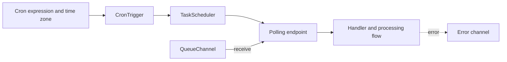

# Cron Trigger in Spring Integration

## 1. Objectives and Use Cases

In the Poller chapter of the `SPRING_INTEGRATION_CORE` module, a cron trigger lets an endpoint fetch messages on a calendar schedule: for example, every five minutes during business hours or at 02:30 daily. This is the link connecting business timing requirements to the `Message` → `MessageChannel` → endpoint flow.

After this lesson, you will be able to:

- Read and write Spring's six-field cron expressions.
- Attach a schedule to a polling consumer or message source using annotations and the Java DSL.
- Choose a time zone, limit messages per poll, and distinguish the schedule from the receive wait timeout.
- Predict what happens when a poll runs long or the application stops running.
- Verify scheduled slots using simulated time instead of waiting on a real clock.

Running scenario: orders wait in a `QueueChannel`. The operations team wants to fetch at most 20 orders per poll, at minutes 00, 05, 10, …, 55 of hours 08 through 17, Monday through Friday, in Vietnam time. A transformer, router, or aggregator can be chained after the order-receiving endpoint; cron only decides when data fetching starts.

The Java examples use Java 17, Spring Integration 6.x or later, and the corresponding Spring Framework APIs. The application requires `spring-integration-core`; if using Spring Boot, you can use `spring-boot-starter-integration` and let Boot's dependency management choose compatible versions. The test snippets use JUnit Jupiter. Quartz is not required to use Spring's `CronTrigger`.

## 2. Where Does Cron Sit in a Poller?

A poller has multiple distinct configuration responsibilities. **The trigger answers when a poll may start; the endpoint performs receiving and forwarding messages.**



Spring Integration uses `PollingConsumer` for an endpoint reading from a `PollableChannel`, typically a `QueueChannel`. For an actively pulled source such as a file source or data query, the endpoint can be a `SourcePollingChannelAdapter`. `DirectChannel` delivers messages to subscribers when sent and does not need a poller to receive. See [Spring Integration's Poller model](https://docs.spring.io/spring-integration/reference/polling-consumer.html).

For example, there are two different ways to organize the flow:

| Flow | Which endpoint needs a schedule? | Meaning of one receive |
| --- | --- | --- |
| `QueueChannel` → service activator | Service activator reading the queue | Fetch an existing `Message` from the queue |
| `MessageSource` → `DirectChannel` → handler | Inbound channel adapter reading the source | Call the source to find or create a `Message` |

One trigger firing can lead to multiple receives. Therefore, "runs every five minutes" does not mean "processes exactly one message every five minutes."

## 3. Six-Field Cron Syntax

Spring uses the following order:

```text
 second  minute  hour  day-of-month  month  day-of-week
   0     */5    8-17        *          *       MON-FRI
```

| Field | Common values | Example |
| --- | --- | --- |
| Second | `0`–`59` | `0`: at the first second of the minute |
| Minute | `0`–`59` | `*/5`: minutes 00, 05, …, 55 |
| Hour | `0`–`23` | `8-17`: includes both hour 08 and hour 17 |
| Day of month | `1`–`31` | `1`: first day of the month |
| Month | `1`–`12`, or `JAN`–`DEC` | `JAN,MAR`: January and March |
| Day of week | `0`–`7`, or `MON`–`SUN` | `MON-FRI`: Monday through Friday |

In Spring, both `0` and `7` denote Sunday. Prefer weekday names to reduce confusion when moving expressions across systems. Standard Linux cron has five fields; Spring prepends a seconds field. Do not add a seventh year field as in some Quartz configurations. See [Spring Framework's cron syntax](https://docs.spring.io/spring-framework/reference/integration/scheduling.html#scheduling-cron-expression).

### 3.1. Common Symbols

| Symbol | How to read it | Self-explanatory example |
| --- | --- | --- |
| `*` | Every valid value for the field | `*` in the hour field: every hour |
| `,` | List | `9,14` in the hour field: 09:00 and 14:00 |
| `-` | Inclusive range on both ends | `8-10` in the hour field: 08, 09, 10 |
| `/` | Step within the field's value range | `10/20` in the minute field: 10, 30, 50 |
| `?` | No specific constraint on the day | Can be used in day-of-month or day-of-week |
| `L` | Last value in the day context | `L` in day-of-month: last day of the month |
| `W` | Nearest Monday–Friday to the specified day | `15W` in day-of-month |
| `#` | Nth occurrence of a weekday in the month | `MON#2`: second Monday of the month |

`W` is unaware of company holidays. For banking calendars or special work schedules, keep business calendar conditions in a separate component.

### 3.2. Examples Tied to Business Requirements

| Requirement | Expression |
| --- | --- |
| At seconds 00 and 30 of every minute | `*/30 * * * * *` |
| At minutes 00, 10, …, 50 of every hour | `0 */10 * * * *` |
| 06:45 daily | `0 45 6 * * *` |
| 09:15 Monday through Friday | `0 15 9 * * MON-FRI` |
| Every five minutes during hours 08–17 on weekdays | `0 */5 8-17 * * MON-FRI` |
| 01:20 on the first day of the month | `0 20 1 1 * *` |
| 23:40 on the last day of the month | `0 40 23 L * *` |
| 08:00 on the second Monday of the month | `0 0 8 ? * MON#2` |

Special day symbols and expression parsing methods are documented in the [CronExpression API](https://docs.spring.io/spring-framework/docs/current/javadoc-api/org/springframework/scheduling/support/CronExpression.html).

Two common misinterpretations:

- `0 */5 8-17 * * MON-FRI` still has a run at **17:55**. If you only want runs before 17:00, the hour range must be `8-16`; if you also want exactly 17:00, express that slot separately.
- `0 */7 * * * *` matches minutes 00, 07, …, 56 and then wraps to minute 00 of the next hour. The gap 56 → 00 is four minutes, so this cannot be treated as a continuous seven-minute interval.

Cron fits when the requirement describes calendar points. If the requirement is "pause five minutes after the previous poll finishes," use fixed delay.

## 4. Java DSL: Fetching Orders from QueueChannel in Vietnam Time

The following example is a standalone configuration. Include it in an application with Spring configuration scanning or register it directly in an application context. The queue and handler are for illustration only; this queue is in-memory.

```java
package example.integration;

import java.time.ZoneId;
import java.util.TimeZone;

import org.springframework.context.annotation.Bean;
import org.springframework.context.annotation.Configuration;
import org.springframework.integration.channel.DirectChannel;
import org.springframework.integration.channel.QueueChannel;
import org.springframework.integration.config.EnableIntegration;
import org.springframework.integration.dsl.IntegrationFlow;
import org.springframework.integration.dsl.Pollers;
import org.springframework.messaging.MessageChannel;
import org.springframework.messaging.MessageHandler;

@Configuration
@EnableIntegration
public class OrderCronConfiguration {

    @Bean
    public QueueChannel pendingOrders() {
        return new QueueChannel(100);
    }

    @Bean
    public MessageChannel pollingErrors() {
        return new DirectChannel();
    }

    @Bean
    public IntegrationFlow processOrders() {
        TimeZone businessZone = TimeZone.getTimeZone(
                ZoneId.of("Asia/Ho_Chi_Minh"));

        return IntegrationFlow.from("pendingOrders")
                .handle(String.class, (orderId, headers) -> {
                    System.out.println("Processing order " + orderId);
                    return null;
                }, endpoint -> endpoint.poller(
                        Pollers.cron("0 */5 8-17 * * MON-FRI", businessZone)
                                .maxMessagesPerPoll(20)
                                .receiveTimeout(0)
                                .errorChannel("pollingErrors")))
                .get();
    }

    @Bean
    public IntegrationFlow observePollingErrors() {
        return IntegrationFlow.from("pollingErrors")
                .handle((MessageHandler) message ->
                        System.err.println(message.getPayload()))
                .get();
    }
}
```

`Pollers.cron(expression, timeZone)` creates a poller configuration with the specified schedule and time zone. You can use `Pollers.trigger(customTrigger)` when you want to supply a custom `Trigger` instance. See the [Pollers API](https://docs.spring.io/spring-integration/api/org/springframework/integration/dsl/Pollers.html).

To enqueue an order in the example, call the following in a component with the `pendingOrders` bean injected:

```java
import org.springframework.messaging.MessageChannel;
import org.springframework.messaging.support.MessageBuilder;

// pendingOrders is the MessageChannel bean injected from the application context.
boolean accepted = pendingOrders.send(
        MessageBuilder.withPayload("ORDER-20261118-001").build(),
        1_000);

if (!accepted) {
    throw new IllegalStateException("Queue is full");
}
```

The order is not processed immediately after `send`. It waits for a poll matching the schedule. If the application runs in the evening, on a weekend, or you just missed a five-minute mark, not seeing logs yet matches the configuration.

In this flow, the handler returns `null` to end message processing without producing a reply. If a downstream transformer or router is needed, the preceding handler must return appropriate data or use the corresponding DSL steps before the terminal handler.

### 4.1. Reading the Configuration by Responsibility

| Component | Responsibility in the example |
| --- | --- |
| Cron expression | Selects the timestamps allowed to start a poll |
| `businessZone` | Interprets those timestamps in Vietnam time |
| `maxMessagesPerPoll(20)` | Limits a normal poll to at most 20 successful receives |
| `receiveTimeout(0)` | Does not wait when the queue has no message yet |
| `pollingErrors` | Receives error messages from the poller's error-handling mechanism |
| Handler | Performs work with the received payload |

In a synchronous, error-free flow, the poller stops the poll when it hits the limit or when a receive returns no message. Thus, fewer than 20 orders may be processed. `receiveTimeout` applies to a polling consumer reading a channel; for external sources, wait time also depends on the adapter or client accessing the source. Attribute details are listed in the [Poller annotation API](https://docs.spring.io/spring-integration/docs/current/api/org/springframework/integration/annotation/Poller.html).

Do not equate `maxMessagesPerPoll` with the batch size of a remote API. An adapter may query or prefetch many records in one access, then emit each `Message` individually; inspect that adapter's configuration.

## 5. Annotations and Reusable Pollers

### 5.1. Directly Declared Cron

This is an alternative to the DSL order-processing flow; do not register both consumers on `pendingOrders` simultaneously if you want only one consumer.

In a `@Configuration` class with `@EnableIntegration` and the `pendingOrders` bean, you can declare:

```java
import org.springframework.context.annotation.Bean;
import org.springframework.integration.annotation.Poller;
import org.springframework.integration.annotation.ServiceActivator;
import org.springframework.messaging.MessageHandler;

@Bean
@ServiceActivator(
        inputChannel = "pendingOrders",
        poller = @Poller(
                cron = "${orders.poll.cron:0 */5 8-17 * * MON-FRI}",
                maxMessagesPerPoll = "20",
                receiveTimeout = "0"))
public MessageHandler orderHandler() {
    return message -> System.out.println(message.getPayload());
}
```

`@Poller.cron` accepts configuration placeholders. However, the `@Poller` annotation does not have a `zone` attribute like `@Scheduled`. If a dedicated time zone is needed, reference a poller bean configured with an explicit `CronTrigger`; do not invent a `zone` attribute on `@Poller`.

### 5.2. Poller Bean with an Explicit Time Zone

Replace the inline schedule declaration above with the following bean and reference:

```java
import java.time.ZoneId;

import org.springframework.context.annotation.Bean;
import org.springframework.integration.annotation.Poller;
import org.springframework.integration.annotation.ServiceActivator;
import org.springframework.integration.dsl.PollerSpec;
import org.springframework.integration.dsl.Pollers;
import org.springframework.messaging.MessageHandler;
import org.springframework.scheduling.support.CronTrigger;

@Bean
public PollerSpec ordersCronPoller() {
    return Pollers.trigger(new CronTrigger(
                    "0 */5 8-17 * * MON-FRI",
                    ZoneId.of("Asia/Ho_Chi_Minh")))
            .maxMessagesPerPoll(20)
            .receiveTimeout(0);
}

@Bean
@ServiceActivator(
        inputChannel = "pendingOrders",
        poller = @Poller(value = "ordersCronPoller"))
public MessageHandler orderHandler() {
    return message -> System.out.println(message.getPayload());
}
```

When returning `PollerSpec` from `@Bean`, let Spring manage creating `PollerMetadata`; do not manually call `getObject()` inside the bean declaration method. See the [Pollers with Java DSL guide](https://docs.spring.io/spring-integration/reference/dsl/java-pollers.html).

A reusable poller bean centralizes schedule configuration. It does not merge endpoints into a single task and does not create locking between them.

Do not combine `cron`, `fixedDelay`, `fixedRate`, or a trigger reference as if they were multiple schedule conditions for the same poller. Pick one scheduling mechanism; use separate business logic if additional conditions are needed. See [Poller configuration in Message Endpoints](https://docs.spring.io/spring-integration/reference/endpoint.html).

## 6. Time Zones and Execution Times

The expression `0 30 2 * * *` is not enough to answer "02:30 where?" If an explicit time zone is omitted, the schedule is affected by whatever time zone the scheduler or trigger context uses. Development and deployment machines can yield different actual run times.

In the example, `Asia/Ho_Chi_Minh` expresses the business schedule in Vietnam. In this time zone, 08:00 on 2026-11-18 corresponds to 01:00 UTC on the same day. Log both the UTC instant and the business date when investigating a run.

Use `ZoneId.of(...)` to validate the time zone name before converting to `TimeZone`; this catches invalid names early. For regions with daylight saving time, list the runs around transition dates and test against business requirements. Do not assume "once per day in local time" is always separated by exactly 24 hours.

For the order example, clarify three additional questions before deploying:

1. Do orders arriving after 17:55 wait until the next morning or get processed by another flow?
2. Are public holidays considered working days?
3. Is the business date derived from runtime, order creation time, or a dedicated data field?

Cron only expresses the declared schedule part. It does not know the answers to these business questions.

## 7. Does a Long Poll Cause Missed Schedule Slots?

A `CronTrigger` created with the standard constructor uses lenient semantics: it calculates the next slot based on the previous task's completion time. When a scheduler runs tasks synchronously on a standard pool, slots falling while the task is still running may be skipped. Spring Framework also provides `CronTrigger.forFixedExecution(...)` since version 6.1.3 to calculate from scheduled slots; actual behavior still depends on the scheduler. See the [CronTrigger 6.2.15 API](https://docs.spring.io/spring-framework/docs/6.2.15/javadoc-api/org/springframework/scheduling/support/CronTrigger.html).

Self-analysis example for the schedule `0 * * * * *`, with no dedicated executor configured and a synchronous handler:

```text
09:00:00  Poll A starts
09:01:00  A is still running
09:02:00  A is still running
09:02:20  A finishes
09:03:00  Next slot of standard CronTrigger
```

In this situation, do not expect two catch-up runs for 09:01 and 09:02.

If a fixed-execution policy is required, you can pass a specific trigger:

```java
// Policy choice illustration only; requires Spring Framework >= 6.1.3.
Pollers.trigger(CronTrigger.forFixedExecution("0 * * * * *"))
        .maxMessagesPerPoll(20)
        .receiveTimeout(0);
```

The snippet above does not specify a business time zone; it uses the scheduler's time context. Do not treat it as an as-is replacement for the Vietnam time configuration in the previous section.

Also distinguish three completion scopes:

- The poller finishes receiving and handing off messages.
- The synchronous handler finishes its work.
- All downstream asynchronous processing completes.

If the handler sends to an `ExecutorChannel`, or the poller hands the task to a separate executor, these timestamps can differ. Therefore, a cron schedule alone is not enough to guarantee that two business jobs never run concurrently.

## 8. Schedules Do Not Replace Processing Reliability

### 8.1. Throughput Limits

Suppose each order takes 200 ms, the flow is completely synchronous, and one poll processes the full 20 orders. Handler processing time is approximately:

```text
20 × 200 ms = 4 seconds
```

This is an estimate from the example's assumptions, excluding I/O, transactions, message receiving, or errors. If the source always has data, a configuration of 20 orders every five minutes yields a nominal service rate of about 240 orders per hour during the scheduled window. If the arrival rate is 500 orders per hour, the queue will accumulate even though cron runs properly.

The solution must evaluate the schedule, per-poll limit, handler capacity, and backlog storage together. Increasing `maxMessagesPerPoll` can make each poll run longer and occupy the scheduler longer.

### 8.2. Errors and Re-receiving Messages

`errorChannel` creates a path for observing or handling errors; it does not automatically define retries or restore a message already pulled from the queue. With an in-memory `QueueChannel`, do not assume that a handler throwing an exception will automatically return the order to the queue.

The `System.err` example only makes errors visible during learning. For real orders, explicitly design the success-commit point, error storage, retry policy, and idempotency key. An order ID can serve as part of a business key if appropriate for the domain.

### 8.3. Restarts and Multiple Replicas

An in-memory cron trigger is not a durable log of missed runs. If the application shuts down at 09:00 and restarts at 10:00, a typical configuration does not automatically recover all jobs that would have run during that hour. Resumption APIs are only useful when the application proactively supplies the timestamp state to resume from; no automatic persistence comes along simply because cron is used.

Catch-up designs can rely on a persistently stored watermark: each poll looks for unprocessed records since the confirmed checkpoint, rather than fetching only data from the "current minute." With multiple replicas, define a record-claiming mechanism, partitioning, or schedule-owner coordination. The same cron expression does not create a cluster-wide singleton.

Specifically for the lesson's queue, unprocessed data is lost when the process exits. To preserve backlog, choose an appropriate message store and design corresponding transactions.

## 9. Testing Schedules with Deterministic Time

You do not need to wait until Monday or use `Thread.sleep` for several minutes to test an expression. Separate schedule testing from endpoint testing.

### 9.1. Verifying Syntax and Slots After the Weekend

```java
package example.integration;

import java.time.ZoneId;
import java.time.ZonedDateTime;

import org.junit.jupiter.api.Test;
import org.springframework.scheduling.support.CronExpression;

import static org.junit.jupiter.api.Assertions.assertEquals;
import static org.junit.jupiter.api.Assertions.assertFalse;

class OrderCronExpressionTest {

    @Test
    void nextSlotAfterFridayClosingIsMondayMorning() {
        CronExpression cron = CronExpression.parse(
                "0 */5 8-17 * * MON-FRI");
        ZoneId zone = ZoneId.of("Asia/Ho_Chi_Minh");
        ZonedDateTime fridayLastSlot = ZonedDateTime.of(
                2026, 11, 20, 17, 55, 0, 0, zone);
        ZonedDateTime expected = ZonedDateTime.of(
                2026, 11, 23, 8, 0, 0, 0, zone);

        assertEquals(expected, cron.next(fridayLastSlot));
    }

    @Test
    void rejectsFiveFieldExpression() {
        assertFalse(CronExpression.isValidExpression("*/5 * * * *"));
    }
}
```

`next(...)` finds the slot after the input value. Since the input timestamp in the test is 17:55 on Friday, the result must be 08:00 on Monday rather than repeating 17:55. You can add a 17:54:59 case to confirm that the 17:55 slot is still in the schedule.

### 9.2. Verifying the Impact of Completion Time

```java
package example.integration;

import java.time.Clock;
import java.time.Instant;
import java.time.ZoneId;

import org.junit.jupiter.api.Test;
import org.springframework.scheduling.support.CronTrigger;
import org.springframework.scheduling.support.SimpleTriggerContext;

import static org.junit.jupiter.api.Assertions.assertEquals;

class OrderCronTriggerTest {

    @Test
    void ordinaryTriggerSkipsSlotsBeforeLastCompletion() {
        ZoneId zone = ZoneId.of("Asia/Ho_Chi_Minh");
        Clock clock = Clock.fixed(
                Instant.parse("2026-11-18T02:00:00Z"), zone);
        SimpleTriggerContext context = new SimpleTriggerContext(clock);

        Instant started = Instant.parse("2026-11-18T02:00:00Z");
        Instant completed = Instant.parse("2026-11-18T02:02:20Z");
        context.update(started, started, completed);

        CronTrigger trigger = new CronTrigger("0 * * * * *", zone);

        assertEquals(
                Instant.parse("2026-11-18T02:03:00Z"),
                trigger.nextExecution(context));
    }
}
```

This test proves how the trigger calculates the next slot from the supplied context. It does not prove the behavior of executors, routers, transactions, or the entire running application.

At the integration test level, you can use a shorter schedule via test configuration, push a few messages into the queue, and wait for an observable result with a finite timeout. Ensure the test does not accidentally register both the DSL and annotation endpoint versions from the lesson. Beyond processing results, test the per-poll limit and error paths according to the flow's specific requirements.

The test snippets here are sample code for inclusion in a project with appropriate dependencies; the lesson does not include build or test execution results for a project.

## 10. Diagnosing Common Situations

| Symptom | What to check | How to handle |
| --- | --- | --- |
| Cron parse error at startup | Field count, second/minute values, placeholders | Use a six-field expression and check resolved values |
| Running at an unexpected hour | Scheduler and trigger time zone | Specify the business time zone and cross-check UTC instants |
| Orders not processed right after sending | Next cron slot and weekday/hour window | Verify whether that matches the required behavior |
| Orders still processed at 17:55 | Hour range `8-17` | Adjust the expression to match the actual business boundary |
| Queue grows continuously | Arrival rate, per-poll limit, handler duration | Estimate service capacity and monitor backlog |
| Next poll is farther away than expected | Previous poll ran long or scheduler is busy | Measure poll duration and review trigger policy |
| Duplicate work execution | Replicas, multiple endpoints, asynchronous processing | Define ownership and idempotency/claim mechanisms |
| Error logs exist but orders are lost | In-memory queue with no recovery mechanism | Design explicit durability, retries, and error storage |

When logging an incident, record the endpoint name, cron expression, time zone, start/end timestamps, number of messages received, and backlog depth if measurable. This data helps distinguish "not yet on schedule," "no data," and "slow processing."

## 11. Practice Exercise

1. Use the DSL flow and change the schedule in a learning environment to `*/10 * * * * *`. Push three orders into the queue, set `maxMessagesPerPoll(2)`, and observe the remaining order move to the next poll when the handler finishes quickly enough.
2. Keep the business-hours schedule and compute the next five slots starting from Friday evening using `CronExpression.next`. Record both Vietnam time and UTC.
3. Use a simulated context to compare results when the previous poll ends after 10 seconds versus after 140 seconds on an every-minute schedule.
4. Make the handler throw an exception for a fixed order code. Observe the error channel and verify your assumption about whether the order automatically reappears in the queue.
5. Write a plan for a two-hour application outage: where should data be stored, how are unprocessed records selected, and at which step is success confirmed?

The result must explain both the start schedule and the message lifecycle. A valid cron expression is only one part of a properly behaving integration flow.