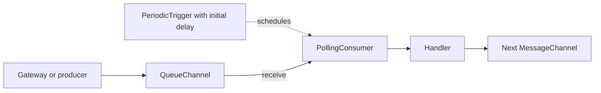

# initial-delay: Delaying the First Poll

In Spring Integration, `initial-delay` specifies the wait duration before **the first execution of a polling schedule**. It helps stagger when a flow begins fetching data after application startup or when an endpoint becomes active. The default for `PeriodicTrigger` is no initial delay. [PeriodicTrigger Javadoc](https://docs.spring.io/spring-framework/docs/current/javadoc-api/org/springframework/scheduling/support/PeriodicTrigger.html).

This lesson belongs to the **Poller** chapter of the `SPRING_INTEGRATION_CORE` module. The focus is placing the wait interval at the right position in the `Message` → `MessageChannel` → endpoint flow, configuring it with the Java DSL and XML, and then observing and testing the poller's initial behavior. The examples use Java 17+, Spring Integration 6.2+ with a compatible Spring Framework version managed by the project's dependency management; the project already includes the `spring-integration-core` dependency. The test section uses JUnit Jupiter.

## 1. The Scenario to Solve

A service receives reconciliation requests through a gateway and places them into an internal queue. After the service starts, the operations team wants to reserve about 10 seconds for resource warm-up before the consumer starts pulling requests. After that, the consumer checks the queue on a 2-second cycle.

The two independent timing requirements are:

- **Initial wait:** 10 seconds before the first poll.
- **Operating cadence:** with fixed delay, wait 2 seconds after one poll task completes before executing the next task.

If you only set a 10-second period, you slow down all subsequent polls as well. If you insert `Thread.sleep(10_000)` inside the handler, the message has already been received before waiting, and an execution thread is occupied. `initial-delay` directly expresses the requirement to delay the start of polling.

The 10-second wait is an operational policy in this example. If the hard requirement is "the partner service is ready," you must check that condition and control lifecycle or skip polls appropriately; elapsed time alone does not prove readiness.

## 2. Where Does the Poller Sit in the Flow?

Spring Integration uses polling in two typical places: `PollingConsumer` fetches messages from a `PollableChannel`, such as `QueueChannel`; `SourcePollingChannelAdapter` calls `MessageSource` to fetch data from a source. With a `SubscribableChannel`, such as `DirectChannel`, endpoints receive messages via subscription and do not use a poller at that input. [Poller documentation](https://docs.spring.io/spring-integration/reference/polling-consumer.html).



In this diagram, the wait sits before the first `receive` triggered by the polling schedule. It does not delay sending into `QueueChannel`: producers can still push messages into the queue while the consumer has not yet polled. Appropriate capacity limits and send policies are needed if early incoming volume can be large.

For a directly polled data source, the corresponding structure is:

```text
PeriodicTrigger → SourcePollingChannelAdapter → MessageSource.receive()
                                              ↓
                                    MessageChannel → processing
```

Delaying this adapter only delays scheduled calls to the source. Bean creation, opening connections during initialization, or starting other resources still depend on each component's lifecycle.

## 3. Reading the Execution Schedule Accurately

Let `t0` be the time the trigger first computes a schedule in a new scheduling context, `I` be the initial delay, and `P` be the period. For the example `I = 10 s`, `P = 2 s`, and each poll task taking `0.5 s`, the illustrative schedule is:

| Milestone | Fixed delay | Fixed rate |
|---|---:|---:|
| First poll scheduled | `t0 + 10 s` | `t0 + 10 s` |
| Assumed completion of first poll | `t0 + 10.5 s` | `t0 + 10.5 s` |
| Second poll scheduled | `t0 + 12.5 s` | `t0 + 12 s` |
| Third poll scheduled | `t0 + 15 s` | `t0 + 14 s` |

The trigger formulas are:

```text
First run:    current clock time + I
Fixed delay:  previous completion time + P
Fixed rate:   previous scheduled time + P
```

`initial-delay` is not added to every period. Once execution history exists, the trigger calculates the next run from that history. With a new scheduling context that has no history, the initial wait is applied again; therefore, it should not be understood as a "once per entire deployment lifetime" flag. [Spring Framework 6.2 PeriodicTrigger source](https://raw.githubusercontent.com/spring-projects/spring-framework/v6.2.0/spring-context/src/main/java/org/springframework/scheduling/support/PeriodicTrigger.java).

The numbers in the table are planned schedule timestamps, assuming the scheduler has available resources and synchronous processing. When the handler actually runs also depends on threads, message receive time, and steps in the flow. Nor does `t0` necessarily coincide with when the Java process was created or when the application signaled ready.

## 4. Configuration with the Java DSL

### 4.1. Consumer Receiving Messages from QueueChannel

The following example has an input queue and a result queue. Each poll fetches at most one message, normalizes the payload, and forwards it to the result queue for easy observation.

```java
package example.integration;

import java.time.Duration;
import java.util.Locale;

import org.springframework.context.annotation.Bean;
import org.springframework.context.annotation.Configuration;
import org.springframework.integration.channel.QueueChannel;
import org.springframework.integration.config.EnableIntegration;
import org.springframework.integration.dsl.IntegrationFlow;
import org.springframework.integration.dsl.Pollers;

@Configuration
@EnableIntegration
public class InitialDelayFlowConfiguration {

    @Bean
    public QueueChannel pendingRequests() {
        return new QueueChannel(100);
    }

    @Bean
    public QueueChannel processedRequests() {
        return new QueueChannel(100);
    }

    @Bean
    public IntegrationFlow delayedConsumerFlow(
            QueueChannel pendingRequests,
            QueueChannel processedRequests) {

        return IntegrationFlow.from(pendingRequests)
                .<String, String>transform(
                        payload -> payload.trim().toUpperCase(Locale.ROOT),
                        endpoint -> endpoint
                                .id("delayedRequestTransformer")
                                .poller(Pollers.fixedDelay(
                                                Duration.ofSeconds(2),
                                                Duration.ofSeconds(10))
                                        .maxMessagesPerPoll(1)
                                        .receiveTimeout(0)))
                .channel(processedRequests)
                .get();
    }
}
```

`Pollers.fixedDelay(period, initialDelay)` takes the period as its first argument and the initial delay as its second argument; `fixedRate` has a matching overload. Using `Duration` makes the unit explicit. For example, `Pollers.fixedDelay(2_000, 10_000)` uses the integer overload in milliseconds. [Pollers Javadoc](https://docs.spring.io/spring-integration/api/org/springframework/integration/dsl/Pollers.html).

Here, the poller is placed on the transformer endpoint because the transformer reads directly from `pendingRequests`, a `QueueChannel`. `processedRequests` stores the output for this example; a real application can chain a handler or other endpoints.

To observe in an application with this configuration loaded:

```java
// Both beans are retrieved from the ApplicationContext or injected into the caller.
boolean accepted = pendingRequests.send(
        new org.springframework.messaging.support.GenericMessage<>("  order-42  "),
        0);

if (!accepted) {
    throw new IllegalStateException("Input queue is full");
}

org.springframework.messaging.Message<?> result =
        processedRequests.receive(15_000);

if (result == null) {
    throw new IllegalStateException("Result not received within observation window");
}

System.out.println(result.getPayload()); // ORDER-42
```

Send the message right after the flow starts to clearly observe the initial wait. If sent after the poller has already been running for a while, the message is processed on the current polling cadence; it does not receive an extra initial delay of its own.

Two additional options make the example easy to observe:

- `maxMessagesPerPoll(1)` caps each poll task at one message. Initial delay does not limit batch size by itself.
- `receiveTimeout(0)` makes queue receives non-blocking when the queue is empty. Receive timeout is the wait time for a message within a single receive call, independent of when the schedule starts. [Endpoint and poller configuration](https://docs.spring.io/spring-integration/reference/endpoint.html).

If you add a `TaskExecutor` to the poller or add an asynchronous thread handoff downstream, you must re-evaluate the task completion time observed by the scheduler. Do not use the synchronous timeline table above to infer when all business processing has completed in an asynchronous configuration.

### 4.2. Polling a Data Source

When the flow starts with a supplier, the poller configuration belongs on the source endpoint:

```java
@Bean
public IntegrationFlow heartbeatFlow() {
    return IntegrationFlow
            .fromSupplier(
                    () -> "heartbeat",
                    endpoint -> endpoint.poller(
                            Pollers.fixedDelay(
                                            Duration.ofSeconds(5),
                                            Duration.ofSeconds(3))
                                    .maxMessagesPerPoll(1)))
            .handle(message ->
                    System.out.println(message.getPayload()))
            .get();
}
```

Place this method in a configuration class that already has `@EnableIntegration` and the corresponding imports from the previous example. The supplier is first invoked on schedule after a 3-second wait; subsequent runs use a 5-second fixed delay. The example needs no input queue because the supplier itself generates data.

Do not place the source's wait interval on a downstream transformer and expect the source to stop being called: each endpoint has its own responsibility and operating schedule.

## 5. Annotation and XML Configuration

### 5.1. Annotation: Referencing PollerMetadata

Spring Integration's `@Poller` does not have an `initialDelay` attribute. Do not use syntax like `@Poller(initialDelay = "10000")` and do not extrapolate this annotation's attributes from `@Scheduled`. To configure an initial delay, create a `PollerMetadata` bean and reference it by name. When using `value` to reference metadata, do not combine other poller configuration attributes on the same annotation. [@Poller Javadoc](https://docs.spring.io/spring-integration/api/org/springframework/integration/annotation/Poller.html).

This is an **alternative configuration approach** to the consumer in section 4.1; do not register both consumers on the same queue simultaneously when testing single-consumer behavior:

```java
package example.integration;

import java.time.Duration;

import org.springframework.context.annotation.Bean;
import org.springframework.context.annotation.Configuration;
import org.springframework.integration.annotation.Poller;
import org.springframework.integration.annotation.ServiceActivator;
import org.springframework.integration.channel.QueueChannel;
import org.springframework.integration.config.EnableIntegration;
import org.springframework.integration.scheduling.PollerMetadata;
import org.springframework.scheduling.support.PeriodicTrigger;

@Configuration
@EnableIntegration
public class InitialDelayAnnotationConfiguration {

    @Bean
    public QueueChannel pendingRequests() {
        return new QueueChannel(100);
    }

    @Bean
    public PollerMetadata startupPoller() {
        PeriodicTrigger trigger = new PeriodicTrigger(Duration.ofSeconds(2));
        trigger.setInitialDelay(Duration.ofSeconds(10));
        trigger.setFixedRate(false);

        PollerMetadata metadata = new PollerMetadata();
        metadata.setTrigger(trigger);
        metadata.setMaxMessagesPerPoll(1);
        metadata.setReceiveTimeout(0);
        return metadata;
    }

    @ServiceActivator(
            inputChannel = "pendingRequests",
            poller = @Poller("startupPoller"))
    public void handle(String payload) {
        System.out.println("Received: " + payload);
    }
}
```

`PeriodicTrigger(Duration)` and `setInitialDelay(Duration)` are Spring Framework APIs since 6.0; fixed delay is the default mode, and `setFixedRate(false)` in the example clarifies intent. In legacy code using constructors with `TimeUnit` and `long` setters, verify the unit applied to both the period and initial delay. [PeriodicTrigger API](https://docs.spring.io/spring-framework/docs/current/javadoc-api/org/springframework/scheduling/support/PeriodicTrigger.html).

### 5.2. XML: The initial-delay Attribute

Since Spring Integration 6.2, the XML namespace directly supports `initial-delay` with either a numeric value according to `time-unit` or an ISO 8601 duration string. The example below uses `PT2S` and `PT10S` to clearly express 2 seconds and 10 seconds. [Message Endpoints — poller](https://docs.spring.io/spring-integration/reference/endpoint.html).

```xml
<?xml version="1.0" encoding="UTF-8"?>
<beans xmlns="http://www.springframework.org/schema/beans"
       xmlns:xsi="http://www.w3.org/2001/XMLSchema-instance"
       xmlns:int="http://www.springframework.org/schema/integration"
       xsi:schemaLocation="
         http://www.springframework.org/schema/beans
         https://www.springframework.org/schema/beans/spring-beans.xsd
         http://www.springframework.org/schema/integration
         https://www.springframework.org/schema/integration/spring-integration.xsd">

    <int:channel id="pendingRequests">
        <int:queue capacity="100"/>
    </int:channel>

    <int:channel id="processedRequests">
        <int:queue capacity="100"/>
    </int:channel>

    <int:transformer input-channel="pendingRequests"
                     output-channel="processedRequests"
                     expression="payload.trim()">
        <int:poller fixed-delay="PT2S"
                    initial-delay="PT10S"
                    max-messages-per-poll="1"
                    receive-timeout="0"/>
    </int:transformer>
</beans>
```

This is a standalone XML configuration to illustrate timing; the transformer only calls `trim()`. Do not load it alongside the configuration classes above that have beans with the same names. When maintaining Spring Integration versions prior to 6.2, check the schema in use and configure a `PeriodicTrigger` bean with a `trigger` reference if the namespace does not support this attribute yet.

`cron` uses `CronTrigger`, so do not treat `initial-delay` as a way to automatically add a delay to a cron expression. If there is a requirement to "start running cron only after a startup condition is met," express that condition via endpoint lifecycle or a trigger designed for that requirement.

## 6. Distinguishing from Other Timing Mechanisms

| Mechanism | What question does it answer? | Example |
|---|---|---|
| Initial delay | When does the polling schedule start? | Wait 10 seconds before the first poll |
| Fixed delay | After one poll task completes, how long to wait? | Wait 2 seconds before the next task |
| Fixed rate | How far apart are scheduled start times? | Planned starts are 2 seconds apart |
| Receive timeout | How long does one receive from a pollable channel wait for a message? | Wait up to 200 ms when the queue is empty |
| Retry backoff | After a failed processing attempt, how long to wait before retrying? | Wait 1 second then retry per policy |
| Per-message delay | When is a specific message forwarded? | Hold a request until a scheduled time |
| Endpoint lifecycle | Is the component permitted to operate yet? | Start the consumer only when dependencies are ready |

These mechanisms can work together, but they solve different timing points. For example, a message failing on the tenth poll does not re-apply the 10-second initial wait; the retry policy or the next polling cadence determines the next attempt.

## 7. Operational Limitations

### 7.1. Startup Wait and Readiness

Suppose a partner API normally takes 8 seconds to become ready. Choosing a 10-second initial delay can reduce failed calls during deployment. However, when the API needs 20 seconds, the first poll can still fail.

If readiness is a hard prerequisite, keep the endpoint from auto-starting, monitor the condition with a dedicated mechanism, and call start when met. Restarting must be weighed alongside the initial wait to avoid adding unintended wait time. When errors occur during polling, an error-handling path and appropriate retry policy are still needed.

### 7.2. Multiple Instances Starting Together

If 20 instances all have a 10-second initial delay and start close together, they can still call the target system simultaneously after 10 seconds. When load spreading is needed, choose different wait intervals per instance or pick a random one once when creating the configuration:

```java
Duration startupDelay = Duration.ofMillis(
        java.util.concurrent.ThreadLocalRandom.current()
                .nextLong(5_000, 15_001));

// Pass startupDelay as the second argument to Pollers.fixedDelay(...).
```

This is application-chosen startup jitter; it is not a built-in random behavior of `initial-delay`. Nor does it replace distributed locks, work partitioning, or duplicate-processing prevention when instances read from a shared source.

### 7.3. Busy Scheduler and Thread Handoff Points

A reasonable wait interval can still result in the first processing occurring later than expected if the scheduler lacks threads, the source reads slowly, or downstream is congested. Record separately the endpoint start timestamp, poll task start timestamp, message receive timestamp, and handler completion timestamp.

For flows with an executor, know which parts run on the scheduler and which are handed off to another thread. The interval between handler logs alone is not enough to conclude that initial delay or fixed delay is misconfigured.

## 8. Testing Without Relying on Long Sleeps

There are two layers to distinguish: the trigger's schedule calculation and the flow's behavior when running with a real scheduler. The unit test below checks the first layer using a fixed clock. `SimpleTriggerContext` lets you provide a clock and update scheduled, actual, and completion timestamps. [SimpleTriggerContext Javadoc](https://docs.spring.io/spring-framework/docs/current/javadoc-api/org/springframework/scheduling/support/SimpleTriggerContext.html).

```java
package example.integration;

import java.time.Clock;
import java.time.Duration;
import java.time.Instant;
import java.time.ZoneOffset;

import org.junit.jupiter.api.Test;
import org.springframework.scheduling.support.PeriodicTrigger;
import org.springframework.scheduling.support.SimpleTriggerContext;

import static org.junit.jupiter.api.Assertions.assertEquals;

class InitialDelayTriggerTest {

    @Test
    void appliesInitialDelayBeforeFirstPollOnly() {
        Instant base = Instant.parse("2026-01-01T00:00:00Z");
        Clock clock = Clock.fixed(base, ZoneOffset.UTC);
        SimpleTriggerContext context = new SimpleTriggerContext(clock);

        PeriodicTrigger trigger = new PeriodicTrigger(Duration.ofSeconds(2));
        trigger.setInitialDelay(Duration.ofSeconds(10));

        Instant first = trigger.nextExecution(context);
        assertEquals(base.plusSeconds(10), first);

        // Simulate the first run starting on schedule and taking 500 ms.
        Instant completed = first.plusMillis(500);
        context.update(first, first, completed);

        // Fixed delay counts from completion; initial delay is not added again.
        assertEquals(completed.plusSeconds(2),
                trigger.nextExecution(context));

        // Fixed rate counts from the previous scheduled time.
        trigger.setFixedRate(true);
        assertEquals(first.plusSeconds(2),
                trigger.nextExecution(context));
    }
}
```

The test does not wait 10 real seconds. It proves the expected calculation in the example, though it does not yet prove that the endpoint referenced the right poller or that the scheduler works properly in the application.

To integration-test the flow in section 4.1, use a short timing configuration dedicated to testing and follow these steps:

1. Initialize the context with the endpoint not auto-starting; retrieve the endpoint and both channels from the context.
2. Push a message into `pendingRequests`, verify the send succeeded, then start the endpoint to control the start reference point.
3. Observe `processedRequests` over a window shorter than the initial delay; no result must appear yet. Choose a wide enough margin, avoiding assertions right on millisecond boundaries.
4. Wait with a bounded timeout for the result afterward, then verify the payload and actual message count received.
5. Stop the endpoint and close the context to release the scheduler. If stop/start behavior needs testing, run it as a separate scenario.

Example test timings might be a 1-second initial delay, 100 ms period, and a result deadline of a few seconds. Avoid asserting "the handler must run at exact millisecond 1000": CI environments can schedule late. A complete test must detect both running too early and the endpoint never processing the message.

## 9. Common Errors and How to Diagnose Them

| Symptom | What to check | How to handle |
|---|---|---|
| First run executes immediately | Is the poller attached to the right endpoint? Is another consumer reading the same queue? | Check the actual endpoint and input channel type |
| Late-sent messages do not wait 10 seconds | Had the poller already passed its initial phase before the message arrived? | Use a per-message delay mechanism if that is the requirement |
| Every processing run waits a long time | Is there a `sleep` in the handler, a long receive timeout, or an overly large fixed delay? | Measure each stage and set parameters for their proper purpose |
| `@Poller(initialDelay = ...)` fails to compile | Confusing the API with `@Scheduled`? | Reference a `PollerMetadata` bean with a `PeriodicTrigger` |
| XML rejects `initial-delay` | Does the Spring Integration version support this attribute? | Check the version, schema, or use a trigger bean |
| First poll still fails with connection errors | Is the target system truly ready? | Check readiness and handle errors rather than just increasing the wait |
| Multiple instances cause a simultaneous load spike | Do they share the same startup time and initial delay? | Use startup jitter and appropriate work coordination |
| First run arrives later than expected | Is the scheduler, source read, or downstream congested? | Compare logs at each milestone; check threads and executors |

## 10. Consolidation Practice

Use the `QueueChannel` flow in section 4.1, set an initial delay of 3 seconds, a fixed delay of 1 second, and one message per poll. Send three payloads before the endpoint starts. Predict the earliest time each result can appear when processing is nearly instantaneous, then compare against actual logs.

Next, send a fourth message after the flow has been running steadily. This message waits for the next polling tick rather than restarting the 3-second wait. Switch to fixed rate, add synchronous processing taking about 200 ms, and compare the intervals between start times.

At the end of the lesson, you should be able to explain three points: initial delay applies to the start of the polling schedule; subsequent periods are governed by fixed delay or fixed rate; and delaying startup must be placed on the endpoint that actually reads the source or queue. From there, you can choose the right tool when the requirement is readiness, retry, or per-message delay.