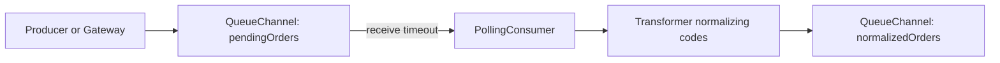

# receive-timeout: Poller Message Receive Wait Time

In the **SPRING_INTEGRATION_CORE** module, `receive-timeout` adjusts how an endpoint waits to retrieve a `Message` from a pollable channel. Understanding this parameter helps design message flows that respond appropriately when the queue alternates between having data and being empty, while making sensible use of execution resources.

This lesson belongs to the **Poller** chapter, focusing on `PollingConsumer`, `PollableChannel`, and Java DSL configuration. The examples use an in-memory `QueueChannel` to observe behavior without needing a broker or database.

After this lesson, you will be able to:

- Explain where a `receive()` call waits and when it terminates.
- Distinguish `receive-timeout`, `fixed-delay`, `max-messages-per-poll`, and gateway timeouts.
- Configure finite wait times, immediate receives, and indefinite waits.
- Analyze latency, empty polls, and impact on threads.
- Write behavioral tests without depending on exact scheduler timing.

## 1. Where receive-timeout Sits in the Message Flow

Consider the order-code normalization flow:



The producer sends a `Message` into `pendingOrders`. An endpoint proactively pulls messages from the channel and invokes the transformer. The poller controls when the endpoint tries to receive; `receive-timeout` controls how long **each receive call** is allowed to wait.

`PollingConsumer` connects a `PollableChannel` to a `MessageHandler`. With a non-negative timeout, the receive operation uses `inputChannel.receive(timeout)`. With a negative value, the implementation calls `inputChannel.receive()` to wait indefinitely. See the [PollingConsumer source code](https://github.com/spring-projects/spring-integration/blob/main/spring-integration-core/src/main/java/org/springframework/integration/endpoint/PollingConsumer.java).

Do not attach a poller to a `DirectChannel` to create this behavior: `DirectChannel` delivers messages to subscribers on the send call and does not provide a receive operation under this model.

### A single receive has three notable outcomes

1. **A message is already available:** pulls the message and passes it to processing immediately.
2. **The channel is empty, and a message arrives during the wait:** the receive operation returns upon acquiring the message.
3. **The timeout expires before receiving anything:** the receive operation returns `null`; the handler is not invoked for that receive attempt.

`null` indicates no message was received, not a `Message` with a `null` payload. By the [PollableChannel](https://docs.spring.io/spring-framework/docs/current/javadoc-api/org/springframework/messaging/PollableChannel.html) contract, receive can also return `null` when interrupted.

## 2. Values, Units, and Configuration Names

| Configuration style | Name used in configuration |
|---|---|
| XML | `receive-timeout="800"` |
| Java DSL | `.receiveTimeout(800)` |
| `@Poller` annotation | `receiveTimeout = "800"` |
| `PollerMetadata` | `setReceiveTimeout(800)` |
| Direct `PollingConsumer` | `setReceiveTimeout(800)` |

Values are in **milliseconds**. `800` means at most about `0.8` seconds of waiting to receive, not 800 seconds. The Java DSL takes a `long` argument; annotation declarations take a string to support configuration placeholders. The [PollerSpec.receiveTimeout](https://docs.spring.io/spring-integration/api/org/springframework/integration/dsl/PollerSpec.html#receiveTimeout(long)) documentation confirms the unit and the default value of `1000` ms.

For the `QueueChannel` in this lesson:

| Value | Meaning |
|---|---|
| `> 0`, e.g. `800` | Wait at most about 800 ms if no message is available yet |
| `0` | Check immediately; return `null` if the queue is currently empty |
| `< 0`, commonly `-1` | Wait indefinitely to receive a message, unless interrupted |

In XML, a poller's `time-unit` applies to trigger period attributes; do not use it to change the unit of `receive-timeout`. The examples below intentionally use explicit millisecond counts for every attribute.

Timeout is a wait-time limit on the receive operation per the API contract. It does not guarantee the thread is awakened by the scheduler down to the exact millisecond in every environment.

## 3. Distinguishing Easily Confused Parameters

| Parameter | Question the parameter answers | What it does not control |
|---|---|---|
| `fixed-delay` | After a scheduled task finishes, how long to wait before scheduling the next? | Maximum duration of a single receive |
| `fixed-rate` | On what period is the schedule determined? | Thread count or parallel execution guarantees |
| `receive-timeout` | How long may each message-receive attempt wait? | Business processing deadline |
| `max-messages-per-poll` | How many messages may a single poll receive at most? | Completion deadline for the whole poll |
| Gateway `replyTimeout` | How long does the gateway caller wait for a reply? | Automatic cancellation of running business work |
| HTTP/JDBC client timeout | How long may an I/O operation wait per its API? | Polling schedule or channel wait time |

For example, suppose you set `receiveTimeout(100)` and the handler calls an external service for 5 seconds. Once the message has been received, the handler can still run for 5 seconds or longer if other mechanisms do not constrain it. The value `100` does not create a deadline for the handler.

Similarly, `maxMessagesPerPoll(5)` is a count limit. Five messages are not merged into one batch message, and the poller does not wait until five messages arrive before handing them to the handler.

## 4. Model of a Single Poll

You can picture a typical poll with pseudocode:

```text
when trigger fires:
    received = 0
    while message limit not yet reached:
        message = receive from channel with receive-timeout
        if message is null:
            end the poll
        call handler(message)
        received = received + 1
```

The pseudocode omits lifecycle, advice, transactions, and error handling. The key point is that encountering `null` ends the poll, even if the count limit has not been reached; see [AbstractPollingEndpoint](https://github.com/spring-projects/spring-integration/blob/main/spring-integration-core/src/main/java/org/springframework/integration/endpoint/AbstractPollingEndpoint.java).

Suppose:

```text
receive-timeout       = 800 ms
max-messages-per-poll = 5
initial queue         = 2 messages
```

If no new messages arrive:

- The first two receives pull the two available messages.
- The handler processes each message according to the configured flow.
- The third receive waits about 800 ms and returns `null`.
- The poll ends; it does not continue waiting for a fourth and fifth attempt.

Conversely, if messages arrive one by one before each receive expires, a single poll can wait multiple times. Therefore, `receive-timeout = 800` does not cap the entire poll at 800 ms.

If you use a negative limit to receive continuously within one poll, a queue that always has data can keep the poll running indefinitely. Combining that limit with an infinite receive wait makes boundaries between polls even harder to observe. In learning examples, set an explicit positive limit for easier analysis.

## 5. Timeline: Message Arriving While Waiting

Suppose the poller uses the default synchronous executor, with no advice altering behavior, and:

```text
fixed-delay           = 200 ms
receive-timeout       = 800 ms
max-messages-per-poll = 1
```

Scenario A — a message arrives while the thread is receiving:

```text
T =    0 ms: trigger runs; queue is empty; starts receive(800)
T =  300 ms: producer sends a message
T ≈  300 ms: receive returns; handler starts
T ≈  320 ms: handler finishes; poll ends
T ≈  520 ms: next poll can start
```

The timestamps are idealized examples, not timing guarantees. The message does not have to wait the full 800 ms. `800` is the maximum wait when nothing has been received yet, not a mandatory delay.

Scenario B — the queue remains empty:

```text
T =    0 ms: starts receive(800)
T ≈  800 ms: expires; receives null; poll ends
T ≈ 1000 ms: after 200 ms fixed-delay, next poll can run
```

Scenario C — a message arrives during the pause interval:

```text
T ≈  800 ms: empty poll just ended
T =  850 ms: producer sends message
T ≈ 1000 ms: next poll picks up the message
```

Increasing `receive-timeout` does not eliminate the pause interval between two polls. To evaluate latency, consider receive wait time, trigger, handler duration, and scheduler availability together.

Under the assumptions above, when the queue is always empty:

```text
time between two poll starts ≈ receive-timeout + fixed-delay
```

This formula is a model for analysis, and does not apply verbatim when the poller offloads tasks to an asynchronous executor or when the system experiences resource contention.

## 6. Complete Java DSL Example

The example uses Java 17+, Spring Integration 6.x Java DSL APIs, `spring-integration-core`, and compatible Spring libraries. The configuration class needs no external services. Place the class in `ReceiveTimeoutConfig.java` in your practice application.

```java
package example.integration;

import java.time.Duration;
import java.util.Locale;

import org.springframework.context.annotation.Bean;
import org.springframework.context.annotation.Configuration;
import org.springframework.integration.channel.QueueChannel;
import org.springframework.integration.config.EnableIntegration;
import org.springframework.integration.dsl.IntegrationFlow;
import org.springframework.integration.dsl.Pollers;

@Configuration
@EnableIntegration
public class ReceiveTimeoutConfig {

    @Bean
    public QueueChannel pendingOrders() {
        return new QueueChannel(100);
    }

    @Bean
    public QueueChannel normalizedOrders() {
        return new QueueChannel(100);
    }

    @Bean
    public QueueChannel pollErrors() {
        return new QueueChannel(100);
    }

    @Bean
    public IntegrationFlow normalizeOrderCodes() {
        return IntegrationFlow.from(pendingOrders())
                .transform(String.class,
                        code -> code.trim().toUpperCase(Locale.ROOT),
                        endpoint -> endpoint
                                .id("normalizeOrderCodeEndpoint")
                                .poller(Pollers.fixedDelay(Duration.ofMillis(200))
                                        .receiveTimeout(800)
                                        .maxMessagesPerPoll(1)
                                        .errorChannel("pollErrors")))
                .channel(normalizedOrders())
                .get();
    }
}
```

The poller is configured on **the transformer endpoint reading from `pendingOrders`**. `normalizedOrders` simply holds results for the caller or test to pull out.

Example of sending a message after the application context has started:

```java
boolean sent = pendingOrders.send(
        org.springframework.messaging.support.MessageBuilder
                .withPayload("  order-007  ")
                .setHeader("correlationId", "request-007")
                .build(),
        1000);

if (!sent) {
    throw new IllegalStateException("Failed to send order to queue");
}

org.springframework.messaging.Message<?> result =
        normalizedOrders.receive(5000);
```

This snippet uses beans retrieved from the context. The two numbers `1000` and `5000` have distinct roles:

- `send(..., 1000)` limits the send wait when the input channel is full.
- `normalizedOrders.receive(5000)` limits waiting for the result on the caller's side.

Neither changes the endpoint's `receiveTimeout(800)`.

The capacity of `100` is simply a choice for the example. If the result channel becomes full, subsequent sends can introduce extra wait time depending on handler configuration. Therefore, a slow poll alone is not enough to conclude the cause lies in the input receive operation.

## 7. Equivalent XML and Annotation Configurations

### XML

The following fragment uses Spring Integration's `int` namespace; embed it in a Spring XML document with the corresponding namespace and schema declarations:

```xml
<int:channel id="pendingOrders">
    <int:queue capacity="100"/>
</int:channel>

<int:channel id="normalizedOrders">
    <int:queue capacity="100"/>
</int:channel>

<int:transformer id="normalizeOrderCodeEndpoint"
                 input-channel="pendingOrders"
                 output-channel="normalizedOrders"
                 expression="payload.trim().toUpperCase(T(java.util.Locale).ROOT)">
    <int:poller fixed-delay="200"
                receive-timeout="800"
                max-messages-per-poll="1"/>
</int:transformer>
```

All attributes are in milliseconds in this fragment. The [Message Endpoints](https://docs.spring.io/spring-integration/reference/endpoint.html) documentation describes nested poller configuration inside an endpoint and how to reference a shared poller.

### Annotation

This is an alternative to the DSL flow; do not register two consumers onto the same queue simultaneously when trying to observe a single consumer:

```java
import java.util.Locale;

import org.springframework.integration.annotation.Poller;
import org.springframework.integration.annotation.Transformer;

public class OrderCodeNormalizer {

    @Transformer(
            inputChannel = "pendingOrders",
            outputChannel = "normalizedOrders",
            poller = @Poller(
                    fixedDelay = "200",
                    receiveTimeout = "${orders.poller.receive-timeout:800}",
                    maxMessagesPerPoll = "1"))
    public String normalize(String code) {
        return code.trim().toUpperCase(Locale.ROOT);
    }
}
```

Register `OrderCodeNormalizer` as a Spring bean in an application with integration infrastructure enabled and both corresponding channels declared. To use placeholders, the application needs a property resolution mechanism; Spring Boot provides this in standard configurations. A configuration value can be:

```properties
orders.poller.receive-timeout=800
```

`@Poller.receiveTimeout` applies to polling consumers. For an inbound channel adapter reading from a `MessageSource`, whether reading blocks or not depends on the source implementation; do not infer HTTP, JDBC, or SFTP timeouts solely from this attribute. See [@Poller Javadoc](https://docs.spring.io/spring-integration/api/org/springframework/integration/annotation/Poller.html).

## 8. Choosing Wait Times by Scenario

There is no single optimal value for every flow. The following configurations are starting points for experimentation:

| Assumed scenario | Experimental configuration | What to measure |
|---|---|---|
| Queue usually empty, second-level latency acceptable | `receiveTimeout(0)`, `fixedDelay(1000)` | Latency when a message arrives right after a poll |
| Sparse incoming data, want early pickup during wait window | `receiveTimeout(800)`, `fixedDelay(200)` | Thread waiting and latency during the pause interval |
| Queue often has backlog | Finite timeout, controlled increase of per-poll message limit | Processing speed and handler duration |
| Multiple endpoints sharing execution resources | Finite timeout and pool sized to measured load | Delayed tasks, active thread count, executor queue |

These are experimental hypotheses for the stated conditions, not default production settings.

A long timeout creates a window to pick up messages early when they appear during the wait. In return, the task still occupies an execution slot while waiting. A blocked thread usually does not burn CPU like a busy loop, yet still affects capacity to serve other tasks.

If no dedicated executor is configured, synchronous receiving and processing can hold the scheduler thread. If offloading to an asynchronous executor, distinguish two timestamps: the scheduler finishing task submission and the worker finishing receiving/processing. `fixed-delay` then does not automatically guarantee the interval between two worker business executions.

In particular, do not treat `receiveTimeout(-1)` as a free speedup. If the channel stays silent for long, the thread can wait correspondingly long. Nor should you deduce shutdown duration solely from the timeout value: lifecycle, interruption, and channel implementation all play a role.

## 9. Receive Expiration, Processing Errors, and Transactions

A queue remaining empty until timeout expires is normal. It does not mean an order failed and should not automatically create an `ErrorMessage` for every empty poll.

In the DSL example, `pollErrors` is for actual errors occurring during the polling task, such as the transformer receiving an invalid payload and throwing an exception. The error queue must be consumed or monitored if applied in a real application; declaring it does not automatically create a retry mechanism.

You can use the following table to avoid choosing the wrong remedy:

| Symptom | Question to check |
|---|---|
| No message after a poll | Is the channel currently empty and did the wait timeout expire? |
| Message is at input but no output yet | Has the endpoint started, is a worker tied up, is the handler blocked? |
| Exception appears in error channel | Did the receive step or the processing step throw the error? |
| Message lost after handler error | Does the channel support transactions and is there a recovery policy? |

The in-memory `QueueChannel` in the example does not guarantee returning a message to the queue when the handler fails. Decreasing or increasing the wait timeout creates neither delivery guarantees nor idempotency.

If transaction advice wraps the entire polling task, the receive wait time may sit inside an open transaction's duration. Inspect the advice boundary and actual resources before increasing timeout. A transactional poller does not automatically make every channel a transactional resource.

## 10. Behavioral Testing

The tests below use JUnit Jupiter. The first two tests examine `QueueChannel`'s contract; the last test runs the flow in an application context. They are examples for learners to practice, without claiming the current project has run them.

```java
package example.integration;

import org.junit.jupiter.api.Test;
import org.springframework.context.annotation.AnnotationConfigApplicationContext;
import org.springframework.integration.channel.QueueChannel;
import org.springframework.messaging.Message;
import org.springframework.messaging.support.MessageBuilder;

import static org.junit.jupiter.api.Assertions.assertEquals;
import static org.junit.jupiter.api.Assertions.assertNotNull;
import static org.junit.jupiter.api.Assertions.assertNull;
import static org.junit.jupiter.api.Assertions.assertTrue;

class ReceiveTimeoutTest {

    @Test
    void emptyQueueReturnsNullAfterFiniteWait() {
        QueueChannel channel = new QueueChannel();

        Message<?> result = channel.receive(20);

        assertNull(result);
    }

    @Test
    void zeroTimeoutStillReceivesAnAvailableMessage() {
        QueueChannel channel = new QueueChannel();
        assertTrue(channel.send(
                MessageBuilder.withPayload("order-007").build(), 0));

        Message<?> result = channel.receive(0);

        assertNotNull(result);
        assertEquals("order-007", result.getPayload());
        assertNull(channel.receive(0));
    }

    @Test
    void pollerDeliversMessageToTransformer() {
        try (AnnotationConfigApplicationContext context =
                     new AnnotationConfigApplicationContext(
                             ReceiveTimeoutConfig.class)) {
            QueueChannel input = context.getBean(
                    "pendingOrders", QueueChannel.class);
            QueueChannel output = context.getBean(
                    "normalizedOrders", QueueChannel.class);
            QueueChannel errors = context.getBean(
                    "pollErrors", QueueChannel.class);

            assertTrue(input.send(MessageBuilder
                    .withPayload("  order-007  ")
                    .setHeader("correlationId", "request-007")
                    .build(), 1000));

            Message<?> result = output.receive(5000);

            assertNotNull(result);
            assertEquals("ORDER-007", result.getPayload());
            assertEquals("request-007",
                    result.getHeaders().get("correlationId"));
            assertNull(errors.receive(0));
        }
    }
}
```

The second test shows that a `0` timeout still receives data already present. The integration test verifies payload and headers passing through the endpoint; it does not separately measure whether the thread had entered `receive(800)` at send time.

To test the "message arrives while waiting" scenario, you can add a `ChannelInterceptor` signaling via a `CountDownLatch` in `preReceive` before letting the producer send. Do not use `Thread.sleep(100)` as proof that the poller has definitely started receiving.

If the goal is to measure wait duration, use a monotonic clock like `System.nanoTime()` and an environment-appropriate tolerance. Avoid asserting an exact time of `800` ms: CI machines can pause threads longer while receive behavior remains correct.

## 11. Practice Exercise: Changing One Parameter at a Time

Keep `maxMessagesPerPoll(1)` for easy observation, then run these experiments:

1. Set timeout to `0` and delay to `1000`. Send messages at different instants and record latency from send to handler.
2. Change timeout to `800` and delay to `200`. Observe messages arriving inside the receive window versus inside the pause interval.
3. Keep the step 2 configuration and add business processing taking about 2 seconds. Verify that the `800` timeout does not terminate the handler early.
4. Set per-poll limit to `3` and preload two messages. Watch the third receive return empty when no new data arrives.
5. Record configuration, message count, latency, and execution resources before concluding which configuration fits.

Simulated processing durations are only for experimentation. In automated tests, prefer synchronization signals and assertions on outcomes.

When reading results, distinguish "time producer send succeeded," "time message was pulled from channel," and "time processing finished." These three milestones answer three different questions; measuring only end-of-flow completion makes it hard to tell where waiting occurred.

## 12. Self-Check Questions

**Does setting `receiveTimeout(3000)` slow every message down by 3 seconds?**

No. If a message is received early, the receive operation finishes early. A message already sitting in `QueueChannel` can be picked up as soon as the poller executes the receive call.

**Does setting timeout to `0` make the poller run continuously?**

Not automatically. The trigger still decides the schedule; the count limit still decides how many messages one poll can receive. However, an overly tight schedule combined with non-blocking receives can produce many empty polls.

**If the per-poll limit is `10` and timeout is `500` ms, does a poll always take 5 seconds?**

No. If the first receive returns `null`, the poll ends right after that wait. If ten messages are already available, the receiving part can be very fast. If messages trickle in, a poll may include multiple waits and multiple processing runs.

**When a gateway times out waiting for a reply, does the poller cancel the handler?**

You cannot infer that. Gateway timeout and endpoint processing lifecycle are separate mechanisms; canceling work requires a dedicated design supporting it.

**Does increasing timeout solve an ever-growing queue?**

Not enough. When data is already present, receive calls usually do not wait until timeout expires. You must measure inbound rate, processing duration, per-poll limit, and execution capacity to find the bottleneck.