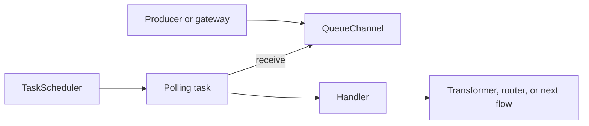

# TaskScheduler in Spring Integration

## 1. Objectives and Scope

In Spring Integration Core, a message flow needs more than just `Message`, channels, and endpoints. For an endpoint that actively pulls data, the application also needs a mechanism that decides **when to perform the next fetch**. `TaskScheduler` provides that scheduling mechanism for pollers.

This lesson belongs to the **Poller** chapter of the `SPRING_INTEGRATION_CORE` module, focusing on the relationship between the scheduler, trigger, polling task, and execution resources. After this lesson, you will be able to:

- Recognize which endpoints need a scheduler and which are triggered directly by messages.
- Distinguish `TaskScheduler`, `Trigger`, and `TaskExecutor`.
- Configure a shared scheduler and poller in the Java DSL.
- Explain why a slow task can delay other pollers' schedules.
- Choose how to separate scheduling from business processing while controlling backlog and errors.
- Test asynchronous behavior without depending on a fixed sleep interval.

## 2. What Problem Does TaskScheduler Solve?

Suppose orders are written to a `QueueChannel`. The downstream handler is not invoked immediately when the producer sends a message: the queue holds the message until a consumer calls `receive()`. A polling consumer must repeat this work on a schedule.

There are three separate questions:

| Question | Primarily responsible component |
|---|---|
| When should the next polling attempt be triggered? | `Trigger` or corresponding schedule configuration |
| Who registers and fires the task on schedule? | `TaskScheduler` |
| Once fired, how are messages received, sent, or processed? | Polling endpoint and integration flow components |

`TaskScheduler` is Spring Framework's scheduling abstraction. In Spring Integration, the framework uses the scheduler to drive scheduled tasks, including pollers. You typically configure the scheduler as a Spring bean; you do not write your own `while` loop, create threads manually, or call `Thread.sleep()` inside the flow.

The scheduler is not where transformers, routers, filters, or aggregators are defined. It provides the execution trigger so an endpoint can run; the components in the flow still decide the content and routing of messages.

## 3. Which Endpoints Need a Poller?

### 3.1. Polling Consumer on PollableChannel

`QueueChannel` implements `PollableChannel`. An endpoint consuming from this channel needs a poller to call `receive()` and pass messages to the handler.



The `receive` arrow represents an active call pulling messages from the queue. The producer does not directly invoke the handler behind the queue.

### 3.2. Inbound Channel Adapter with MessageSource

A `MessageSource` can actively read data when the poller calls `receive()`, then send the message to an output channel. This is a common pattern for periodically polled data sources.

```text
TaskScheduler
    -> polling task
        -> MessageSource.receive()
            -> output channel
                -> downstream flow
```

When a source has no data, it can return `null`. That result normally stops fetching further messages in the current poll; do not turn it into a fake business message merely to keep the task busy.

### 3.3. Event-Driven Consumer on SubscribableChannel

`DirectChannel` is a `SubscribableChannel`: messages are dispatched to subscribers on a send operation. An endpoint consuming directly from this channel does not need a poller to be triggered.

A gateway sending to a `DirectChannel` therefore does not automatically create a need for a scheduler. If the gateway sends into a queue and a downstream endpoint polls that queue, the need appears at the queue → consumer segment.

> Identify polling boundaries in the flow before configuring a scheduler. Do not add a poller to every endpoint out of habit.

## 4. Distinguishing Scheduler, Trigger, and Executor

### 4.1. TaskScheduler: Managing Execution Over Time

The `TaskScheduler` API allows scheduling a task to run at a given instant, at a fixed rate, with a fixed delay, or according to a `Trigger`. Scheduling calls return a handle that can be used to manage task cancellation.

In a typical Spring Integration setup, polling endpoints register tasks with the scheduler on startup and manage them according to the endpoint lifecycle. There is no need to call the `schedule()` API directly to create an extra polling loop for the same endpoint.

### 4.2. Trigger: Policy for Computing the Next Run

A trigger is a timing policy, not a thread pool. Two pollers can share the same scheduler while having different periods or cron expressions.

For triggers that depend on task completion time, understand where the task tracked by the scheduler actually finishes. If the task merely hands work off to an executor and returns, that completion time differs from when business processing finishes.

### 4.3. TaskExecutor: Executing Delegated Work

`TaskExecutor` answers "which thread should execute this delegated work?" and does not itself provide a periodic schedule policy for the poller.

| Component | Role | Example implementation |
|---|---|---|
| `TaskScheduler` | Registers and triggers tasks on schedule | `ThreadPoolTaskScheduler` |
| `Trigger` | Determines execution schedule | `PeriodicTrigger`, `CronTrigger` |
| `TaskExecutor` | Executes submitted work | `ThreadPoolTaskExecutor` |
| `PollerMetadata` | Describes the poller: trigger, message limit, executor, and related properties | Created from the Java DSL or a configuration bean |

With `ThreadPoolTaskScheduler`, the scheduler's own threads execute the scheduled task. This is critical: if a polling task runs through a synchronous flow and hits a slow handler, the scheduler thread stays busy for that duration.

## 5. Fixed Delay, Fixed Rate, and Cron

### 5.1. Fixed Delay

Fixed delay waits a duration after the task tracked by the scheduler completes before running again.

For example, with a 1-second delay and a poll taking 400 ms:

```text
0 ms       400 ms                 1400 ms      1800 ms
|-- poll 1 --|------ wait 1 s -------|-- poll 2 --|
```

Without a separate executor, the poll duration includes any downstream work running synchronously inside the poller's call. Thus, configuring a 1-second delay does not mean messages are guaranteed to be processed every second.

### 5.2. Fixed Rate

Fixed rate sets execution marks on a periodic cadence. If a task takes a long time or the scheduler lacks threads, actual start times can be delayed.

For a periodic task registered via `ThreadPoolTaskScheduler`'s fixed-rate mechanism, increasing the pool size does not cause executions of that same task to overlap each other. However, if the polling task submits work to an executor and returns quickly, business jobs submitted from different trigger firings may exist or execute concurrently.

Do not use fixed rate as a guarantee of business completion speed.

### 5.3. Cron

Cron fits when the schedule is tied to a clock: every minute, during business hours, or at preset times.

Spring uses cron expressions with a seconds field. For example:

```text
0 */5 * * * *
```

This expression represents second 0, every 5 minutes. When business logic depends on a time zone, configure the appropriate time zone on the trigger and check how the Spring version in use supports that option. Do not infer the business time zone solely from the development machine's OS settings.

Cron does not automatically provide durable schedule storage or replay missed runs when the application stops.

## 6. Configuring a Shared Scheduler

Spring Integration looks up the infrastructure scheduler by the bean name `taskScheduler`. If no suitable scheduler is provided, Spring Integration infrastructure can register a default scheduler when enabled. In real applications, explicit declaration gives better resource control and observability.

The following example uses `ThreadPoolTaskScheduler`:

```java
import org.springframework.context.annotation.Bean;
import org.springframework.context.annotation.Configuration;
import org.springframework.integration.config.EnableIntegration;
import org.springframework.scheduling.concurrent.ThreadPoolTaskScheduler;

@Configuration
@EnableIntegration
public class SchedulingConfiguration {

    @Bean(name = "taskScheduler")
    public ThreadPoolTaskScheduler taskScheduler() {
        ThreadPoolTaskScheduler scheduler = new ThreadPoolTaskScheduler();
        scheduler.setPoolSize(4);
        scheduler.setThreadNamePrefix("si-poller-");
        scheduler.setRemoveOnCancelPolicy(true);
        return scheduler;
    }
}
```

Key points to understand:

- A manually created `ThreadPoolTaskScheduler` as above has a default pool size of 1 if `setPoolSize()` is not called. Do not generalize this number as the default of every scheduler provided by Spring Integration or Spring Boot.
- `poolSize = 4` is an illustrative choice. It gives different tasks using the scheduler a chance to execute concurrently, but guarantees no specific latency or throughput.
- The thread prefix helps identify activity in logs and thread dumps.
- `removeOnCancelPolicy` removes canceled tasks from the underlying executor's scheduling queue. It is not a message backlog limit policy.
- Spring manages bean initialization and destruction. You do not need to call `initialize()` manually inside this `@Bean` method.

In Spring Boot, having a `TaskScheduler` bean present can alter auto-configuration conditions. Check the actual bean name and instance used by the application when multiple configuration sources exist. Simply marking a differently named bean as `@Primary` does not replace understanding Spring Integration infrastructure's name-based lookup.

## 7. Complete Example: Polling QueueChannel with the Java DSL

The configuration below creates an order-receiving queue and an endpoint that fetches up to 5 messages per poll, with a 1-second fixed delay. It uses the scheduler from the previous section in the same application context.

```java
import org.springframework.context.annotation.Bean;
import org.springframework.context.annotation.Configuration;
import org.springframework.integration.channel.QueueChannel;
import org.springframework.integration.dsl.IntegrationFlow;
import org.springframework.integration.dsl.Pollers;
import org.springframework.messaging.PollableChannel;

@Configuration
public class OrderPollingConfiguration {

    @Bean
    public PollableChannel ordersQueue() {
        return new QueueChannel(100);
    }

    @Bean
    public IntegrationFlow orderPollingFlow() {
        return IntegrationFlow.from("ordersQueue")
                .handle(String.class, (payload, headers) -> {
                    System.out.println(
                            Thread.currentThread().getName()
                                    + " processed " + payload);
                    return null;
                }, endpoint -> endpoint.poller(
                        Pollers.fixedDelay(1000)
                                .maxMessagesPerPoll(5)))
                .get();
    }
}
```

In the example, the numeric value of `fixedDelay(1000)` is in milliseconds. The application needs compatible Spring Integration Core and Spring Context dependencies; if using Spring Boot, let the project's dependency management select a compatible version set.

Sending an illustrative message from a producer component:

```java
import org.springframework.messaging.support.MessageBuilder;

boolean accepted = ordersQueue.send(
        MessageBuilder.withPayload("ORDER-1001").build(),
        500);

if (!accepted) {
    throw new IllegalStateException("Failed to send order to queue");
}
```

In the producer snippet, `ordersQueue` is the injected `PollableChannel`. The 500 ms timeout limits the wait to send into the queue when full; it is not the wait time for the consumer to finish processing.

How the flow works:

1. The producer puts a message into the queue of capacity 100.
2. The scheduler triggers the polling task according to the trigger.
3. The poller receives each message and invokes the handler, up to 5 messages in one poll.
4. The handler returns `null`, so no reply message is created to forward.
5. When the task completes, the fixed-delay schedule determines the next run.

`maxMessagesPerPoll(5)` is a maximum; it neither requires the queue to hold 5 messages before running nor creates 5 threads. A poll can finish early when no more messages are received.

Do not add a default poller just to make this example work: the endpoint already has its own poller.

## 8. Default Poller and Scheduler Are Two Different Configurations

A default poller allows endpoints that need polling but lack their own configuration to share one set of metadata. The scheduler remains the scheduled execution infrastructure.

An alternative configuration can declare:

```java
import org.springframework.context.annotation.Bean;
import org.springframework.integration.dsl.Pollers;
import org.springframework.integration.scheduling.PollerMetadata;

@Bean(name = PollerMetadata.DEFAULT_POLLER)
public PollerMetadata defaultPoller() {
    return Pollers.fixedDelay(1000)
            .maxMessagesPerPoll(5)
            .getObject();
}
```

Place this method in a configuration class. If you want an endpoint to use the default poller, omit the endpoint's local poller configuration.

| What you want to change | Where to configure |
|---|---|
| Scheduler thread count, thread prefix | `taskScheduler` bean |
| Polling period, per-poll message limit | Endpoint's poller metadata or default poller |
| How polling work is dispatched to workers | Poller's `taskExecutor` |
| Message waiting capacity | Storing channel, such as `QueueChannel` |

The default poller is not a shared queue and not an execution pool. Multiple endpoints sharing the default configuration still have their own polling tasks.

## 9. How Does a Slow Handler Affect the Scheduler?

Suppose the scheduler has one thread. Poller A reads orders and calls an external API for 3 seconds; poller B needs to scan lightweight tasks every second.

If A runs synchronously on the scheduler thread, B must wait for a free thread. Even though B's trigger is ready, its actual start time is delayed.

```text
Scheduler has only one thread:

0 s                    3 s
|--- A calls external API ---|--- B can only start here ---|
```

Increasing the pool can reduce contention among independent tasks. However, if all tasks frequently block or wait long on I/O, merely increasing the pool easily turns into hiding a downstream bottleneck.

A poll can also hold a thread for a long time because:

- `maxMessagesPerPoll` is large and each message has many synchronous processing steps.
- The message receive call waits for data per the polling consumer's `receiveTimeout`.
- A downstream transformer, filter, router, or handler performs blocking operations.
- An aggregator releases results and triggers a time-consuming synchronous downstream segment.
- Other infrastructure tasks share the same scheduler.

Rough estimate for a synchronous poll receiving `N` messages:

```text
T_poll ≈ total message receive time
         + total synchronous processing time of N messages
         + dispatch overhead
```

This is an explanatory model, not a performance-guarantee formula. In actual measurement, also account for resource waits, retries, and error-handling time.

## 10. Offloading Polling to a TaskExecutor

When polling or downstream work may run long, you can configure an executor for the poller. Example variation of the previous configuration:

```java
import org.springframework.context.annotation.Bean;
import org.springframework.scheduling.concurrent.ThreadPoolTaskExecutor;

@Bean
public ThreadPoolTaskExecutor pollingExecutor() {
    ThreadPoolTaskExecutor executor = new ThreadPoolTaskExecutor();
    executor.setCorePoolSize(4);
    executor.setMaxPoolSize(4);
    executor.setQueueCapacity(20);
    executor.setThreadNamePrefix("si-poll-worker-");
    return executor;
}
```

Inject the executor into the flow-declaring method, then replace the poller part with:

```java
endpoint -> endpoint.poller(
        Pollers.fixedDelay(1000)
                .maxMessagesPerPoll(5)
                .taskExecutor(pollingExecutor))
```

In the snippet above, `pollingExecutor` is an injected parameter, not a variable that appears automatically in every flow.

The execution flow becomes:

```text
Scheduler thread
    -> scheduled task
        -> submit polling work
            -> worker thread receives and processes message
```

The benefit is that the scheduler thread can quickly return to serving other schedules. In exchange, you must handle the following consequences:

- **There are two waiting places:** messages can sit in `QueueChannel`; polling tasks can sit in the executor's queue.
- **Fixed delay changes its observed meaning:** the task tracked by the scheduler may finish right after submission. Do not interpret the delay as a mandatory pause after business work on the worker finishes.
- **Multiple polling tasks may run concurrently:** check thread safety of `MessageSource`, handlers, and downstream resources.
- **Completion order may change:** receiving from a queue in order does not guarantee finishing processing in that order when multiple workers exist.
- **Saturation must be visible:** when the pool and queue are full, submissions may be rejected. With a caller-runs policy, work can occupy the scheduler thread again.

Do not pick an unbounded executor queue just to avoid submission errors. That can cause latency and queued work to grow uncontrollably.

Another architectural option is keeping polling short and placing an asynchronous boundary inside the flow. Whenever changing thread boundaries, revisit transactions, error propagation, and ordering requirements for the entire affected segment.

## 11. Coordinating Parameters to Control Load

Parameters often mistaken as interchangeable:

| Parameter | What does it control? | What does it not guarantee? |
|---|---|---|
| Scheduler pool size | Concurrent execution capacity of scheduled tasks | Does not automatically increase consumers of a synchronous polling task |
| Polling period | Desired trigger cadence | Does not guarantee exact start or completion times |
| `maxMessagesPerPoll` | Maximum messages processed in one poll | Not concurrency and not total queue capacity |
| `receiveTimeout` | Wait time to receive a message on a polling consumer | Not an HTTP call timeout or business timeout |
| Executor pool size | Concurrent worker task execution level | Does not automatically give downstream more capacity |
| Executor queue capacity | Number of submitted tasks allowed to wait | Does not directly limit messages across all channels |
| Channel capacity | Number of messages that can be held in that channel | Does not control the entire system's backlog |

In the example with a 1-second fixed delay and at most 5 messages per poll, do not conclude the system always processes 5 messages/second. If one synchronous poll takes 2 seconds, there is still the delay wait before the next poll. If the source only has one message, that poll will not manufacture four missing messages.

A practical way to choose configuration:

1. Measure message receive and processing times, including slow scenarios.
2. Set a per-poll limit so one poller does not hold resources too long.
3. Choose a polling cadence based on acceptable latency and the cost of querying an empty source.
4. Offload long-running work when needed, with bounded pools and queues.
5. Monitor backlog and tune within what downstream can tolerate.

## 12. Error Handling at the Schedule and Message Boundary

The scheduler does not replace Spring Integration's error-handling mechanism.

In a synchronous flow, business exceptions can propagate back to the polling task. Spring Integration supports routing polling task errors to an error channel via the poller's error-handling mechanism. When a specific handling destination is needed, you can configure:

```java
Pollers.fixedDelay(1000)
        .maxMessagesPerPoll(5)
        .errorChannel("pollingErrors")
```

The `pollingErrors` channel must exist and have a suitable consumer. If no dedicated channel is configured, understand the application's default `errorChannel` and error handler mechanism rather than assuming all errors are handled according to business requirements.

Error consumers typically receive an `ErrorMessage` whose payload is the exception. Not every exception carries a failed message: an error can occur while querying the source, before an input message is even created.

Separate three concerns:

- **Error recording:** logs, metrics, and alerts.
- **Business decision:** retry, skip, compensate, or route to dead-letter storage.
- **Data preservation:** transactions, acknowledgments, and durable storage when required.

An in-memory `QueueChannel` does not automatically restore a pulled message when the handler fails. Nor does the scheduler know which order must be re-sent. If reliable reprocessing is required, design the corresponding mechanism and idempotency.

If the flow crosses an `ExecutorChannel` or another asynchronous boundary, downstream exceptions may be handled at that boundary. Setting an error channel on the poller does not mean every error on every later thread returns to that same poller.

## 13. Lifecycle and Application Shutdown

Polling endpoints have their own lifecycle. When an endpoint stops, the framework manages canceling that endpoint's scheduled task. That does not mean every already-submitted or already-started task immediately stops safely.

When designing shutdown, determine:

- When to stop accepting more messages from producers.
- When to stop starting new polls.
- How in-flight work completes, gets interrupted, or is recovered.
- Whether in-memory queues still hold data.
- Which schedulers and executors are shared resources, and who manages them.

Do not call `shutdown()` on a shared scheduler just to stop one flow. Stopping the endpoint fits that purpose and leaves closing shared resources to the application context lifecycle.

Shutdown await-termination options should be chosen based on allowed stop duration and work characteristics. Merely increasing the wait time will not resolve an infinitely hung handler; external calls still need timeouts.

## 14. Multiple Instances and Exactly-Once Processing Requirements

Each application context typically has its own scheduler and polling endpoints. If you deploy three instances with the same configuration, you may have three independent polling triggers.

`TaskScheduler` does not inherently provide:

- Electing a single instance allowed to poll.
- Distributed locking for a shared dataset.
- Durable schedule persistence and replay of missed runs.
- Exactly-once business processing guarantees.

Those requirements need coordination mechanisms from the data source, broker, transactions, locks, or leader election depending on architecture. For example, multiple instances reading the same orders table must have a safe record-claiming mechanism; staggering polling periods is not a duplicate-prevention mechanism.

For flows with aggregators sharing state, you must also consider the message store and corresponding synchronization mechanism. Adding scheduler threads does not replace aggregator state design.

## 15. Observation and Diagnostics

To distinguish scheduling issues from processing issues, observe at least:

| Signal | Possible meaning |
|---|---|
| Actual start time lags behind desired schedule | Scheduler lacks threads, tasks are blocking, or system is overloaded |
| A single poll runs long | Long receive wait, slow processing, per-poll limit too large |
| Message queue grows continuously | Processing capacity is lower than inbound rate |
| Executor queue grows | Tasks are submitted faster than workers process them |
| Submit errors increase | Executor is saturated or shutting down |
| High frequency of empty source returns | Polling too frequently relative to data volume |
| Processing time increases alongside downstream errors | Check external resources and timeouts |

Logs should include endpoint or flow id, thread name, timestamp, and message correlation id. When suspecting a poller is hogging the scheduler, thread dumps help locate where `si-poller-*` threads are waiting.

Remember to distinguish **poll count** from **message count**. A poll receiving 5 messages and an empty poll are both one trigger firing, but their business impact differs.

## 16. Testing Polling Behavior

Tests should verify that messages are processed and resources are not misused, rather than asserting a handler ran at an exact millisecond.

A minimal integration test can:

1. Start a context with a scheduler and short periods dedicated to testing.
2. Send a message to the input queue.
3. Wait for an observable result with a finite timeout.
4. Assert the payload or expected side effect.
5. Close the context to stop the scheduler and executor.

If the test flow routes results to a `QueueChannel` named `results`, you can wait using the channel API itself:

```java
ordersQueue.send(MessageBuilder.withPayload("ORDER-1001").build(), 500);

Message<?> result = results.receive(3000);
assertNotNull(result);
assertEquals("ORDER-1001", result.getPayload());
```

This snippet illustrates waiting for a result in a test flow with output. The `return null` handler in the main example does not automatically send a message to `results`; configure a test flow accordingly or observe a properly synchronized side effect.

Avoid using `Thread.sleep(1000)` and inferring that a poller with a 1-second period has definitely finished. CI machines, startup order, and scheduler load can all invalidate that assumption.

For concurrency requirements, add a two-endpoint scenario: one endpoint is blocked in a controlled way while the other still completes within a timeout compatible with the scheduler configuration. Use latches or synchronization tools to control blocking and release, avoiding leaving a hung task after the test ends.

## 17. Common Misconceptions

### "If the scheduler has 8 threads, each poller processes 8 messages at once"

The pool serves scheduled tasks. A synchronous polling task does not split each message into a separate task simply because the pool is larger.

### "A 1-second fixed delay always waits after business work completes"

This depends on execution boundaries. When a poller has an executor, the task tracked by the scheduler can finish right after submission while business work is still running on a worker.

### "Increasing maxMessagesPerPoll will always reduce backlog"

It can increase work per poll, but it also holds threads longer and affects other pollers. If downstream is saturated, this setting adds no extra capacity.

### "With a scheduler, application restarts will not lose messages"

The scheduler manages timing. Message durability depends on channels, message stores, brokers, or data sources and corresponding acknowledgment mechanisms.

### "If the poller has an errorChannel, all errors will be retried"

An error channel is a path for forwarding errors to be handled. Retries must be configured or implemented deliberately; consider both retry scope and the risk of repeating side effects.

## 18. Practice Exercise

Build two flows reading from two independent `QueueChannel` instances:

- Flow A processes a message using a bounded simulated long-running operation.
- Flow B writes a short message to an output queue.

Perform step by step:

1. Configure `ThreadPoolTaskScheduler` with one thread and observe B's latency while A is running.
2. Increase the pool to two threads, keeping the message count and work unchanged to compare.
3. Move A's polling to an executor with a bounded pool and queue, then track where work waits.
4. Push inputs faster than downstream and identify when backlog or rejection appears.
5. Make handler A throw an exception, inspect the error channel, and verify whether the message is recovered per design.

Results should be explained in terms of thread boundaries, scheduling policies, and storage mechanisms, not merely the count of processed messages.

## 19. Key Takeaways

`TaskScheduler` provides the timing infrastructure for pollers; the trigger defines the schedule, while the endpoint performs message receiving and processing. With `ThreadPoolTaskScheduler`, a synchronous task can hold the scheduler thread throughout the downstream segment.

Effective configuration coordinates polling period, per-poll limit, receive timeout, pools, and queues. If offloading work to an executor, revisit backlog, ordering, thread safety, and the interpretation of fixed delay.

The scheduler does not provide message durability, distributed locks, or exactly-once business guarantees. Those requirements must be solved alongside the integration flow's channel, data source, transaction, and error-handling design.