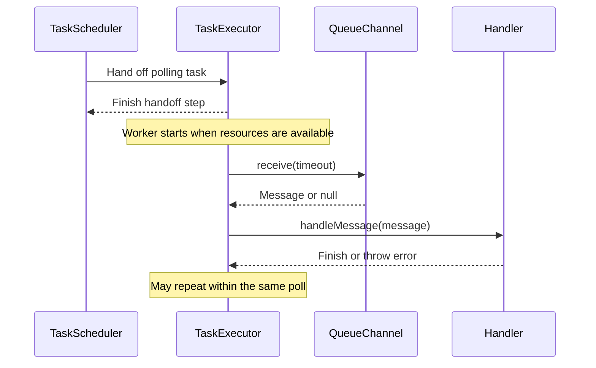

# TaskExecutor in Pollers

In **SPRING_INTEGRATION_CORE**, a poller connects scheduling with the message-processing flow. When an endpoint receives data from a `QueueChannel` or an inbound adapter actively reads an external source, the key question is: **which thread performs the receive operation and runs the downstream endpoints?**

This lesson belongs to the **Poller** chapter and explains how to use `TaskExecutor` to separate polling work from the scheduling thread. The goal is to design flows with appropriate concurrency, understand resource limits, and predict behavior under slow processing or failure.

## 1. Separating Schedule from Execution Location

Three components hold three distinct responsibilities:

| Component | Responsibility | Example |
| --- | --- | --- |
| `Trigger` | Determines when the next firing occurs | Fixed delay, fixed rate, cron |
| `TaskScheduler` | Performs scheduling and invokes due tasks | Scheduler managed by Spring Integration |
| Poller's `TaskExecutor` | Executes delegated polling work | `ThreadPoolTaskExecutor` |

`TaskExecutor` is not synonymous with asynchronous: `SyncTaskExecutor` runs directly on the calling thread; `ThreadPoolTaskExecutor` normally delegates work to a worker in a pool. Therefore, examine the implementation and execution policy rather than seeing `taskExecutor` and assuming a new thread is used. [Task Execution and Scheduling documentation](https://docs.spring.io/spring-framework/reference/integration/scheduling.html).

For a typical poller without an asynchronous executor configured, synchronous receive and processing work run on the thread invoking the scheduled task. A slow handler occupies that thread. Increasing the scheduler pool can help other scheduled tasks, but is no substitute for designing a dedicated executor for endpoint work.

## 2. What Task Is Delegated to the Executor?

Consider a service activator endpoint reading from a `QueueChannel`:

```text
Producer -> QueueChannel -> PollingConsumer -> Handler
```

Distinguish two endpoint types:

- `PollingConsumer` receives from a `PollableChannel`, such as `QueueChannel`.
- `SourcePollingChannelAdapter` calls a `MessageSource`, then sends the received message into the flow.

Both can be triggered by a poller, though the data source and concurrent-read guarantees depend on the implementation. Do not attach a poller to a handler that only receives from a `DirectChannel`, because that handler is invoked via message subscription. [Poller Overview](https://docs.spring.io/spring-integration/reference/polling-consumer.html).

When using an asynchronous executor, you can visualize the path as follows:



The executor receives **a task executing one poll**, not by default a separate task for each message. With `maxMessagesPerPoll(5)`, one worker can sequentially receive and process up to five messages in one poll. The number five does not create five workers.

If the handler forwards over a `DirectChannel`, the next transformer, filter, router, or handler typically continues running on the same worker. When the flow hits an `ExecutorChannel`, another `QueueChannel`, or an asynchronous component, it can switch to another execution boundary.

Task submission and the polling loop can be inspected in the [AbstractPollingEndpoint source code](https://raw.githubusercontent.com/spring-projects/spring-integration/main/spring-integration-core/src/main/java/org/springframework/integration/endpoint/AbstractPollingEndpoint.java).

## 3. Java DSL Example with a Bounded Pool

The following example is for an application that already has `spring-integration-core` and compatible Spring libraries. This is an illustrative configuration using the Java DSL; it does not assume dependency versions of a specific project.

The flow receives job strings into `jobs`, processes them on a dedicated pool, and routes polling errors to `pollerFailures`. The numbers are chosen for practice and should be re-measured when applied in production.

```java
import java.util.concurrent.ThreadPoolExecutor;

import org.springframework.context.annotation.Bean;
import org.springframework.context.annotation.Configuration;
import org.springframework.integration.channel.QueueChannel;
import org.springframework.integration.config.EnableIntegration;
import org.springframework.integration.dsl.IntegrationFlow;
import org.springframework.integration.dsl.Pollers;
import org.springframework.messaging.Message;
import org.springframework.scheduling.concurrent.ThreadPoolTaskExecutor;

@Configuration
@EnableIntegration
public class PollerExecutorConfiguration {

    @Bean
    public QueueChannel jobs() {
        return new QueueChannel(100);
    }

    @Bean
    public QueueChannel pollerFailures() {
        return new QueueChannel(100);
    }

    @Bean
    public ThreadPoolTaskExecutor pollerExecutor() {
        ThreadPoolTaskExecutor executor = new ThreadPoolTaskExecutor();
        executor.setCorePoolSize(2);
        executor.setMaxPoolSize(2);
        executor.setQueueCapacity(4);
        executor.setThreadNamePrefix("job-poller-");
        executor.setRejectedExecutionHandler(
                new ThreadPoolExecutor.AbortPolicy());
        executor.setWaitForTasksToCompleteOnShutdown(true);
        executor.setAwaitTerminationSeconds(10);
        return executor;
    }

    @Bean
    public IntegrationFlow jobsFlow(
            QueueChannel jobs,
            QueueChannel pollerFailures,
            ThreadPoolTaskExecutor pollerExecutor) {

        return IntegrationFlow.from(jobs)
                .handle(String.class, (payload, headers) -> {
                    process(payload);
                    return null;
                }, endpoint -> endpoint.poller(
                        Pollers.fixedDelay(200)
                                .maxMessagesPerPoll(1)
                                .receiveTimeout(0)
                                .taskExecutor(pollerExecutor)
                                .errorChannel(pollerFailures)))
                .get();
    }

    @Bean
    public IntegrationFlow failuresFlow(QueueChannel pollerFailures) {
        return IntegrationFlow.from(pollerFailures)
                .handle((Message<?> message) -> {
                    Throwable failure = (Throwable) message.getPayload();
                    System.err.println("Polling failed: " + failure);
                }, endpoint -> endpoint.poller(
                        Pollers.fixedDelay(500)
                                .maxMessagesPerPoll(10)
                                .receiveTimeout(0)))
                .get();
    }

    private static void process(String job) {
        System.out.printf("START %s on %s%n",
                job, Thread.currentThread().getName());
        if ("FAIL".equals(job)) {
            throw new IllegalArgumentException("Rejected job: " + job);
        }
        try {
            Thread.sleep(700); // Only to simulate slow processing in the lesson.
        }
        catch (InterruptedException ex) {
            Thread.currentThread().interrupt();
            throw new IllegalStateException("Job interrupted", ex);
        }
        System.out.printf("DONE  %s on %s%n",
                job, Thread.currentThread().getName());
    }
}
```

`ThreadPoolTaskExecutor` is a Spring-managed lifecycle bean, so the example does not call `initialize()` manually. If creating an executor outside the container, you must initialize and release resources appropriately yourself. The shutdown wait options in the example do not guarantee processing every message; you must also consider processing duration, endpoint stop order, and how long the process is allowed to stay alive. [ThreadPoolTaskExecutor Javadoc](https://docs.spring.io/spring-framework/docs/current/javadoc-api/org/springframework/scheduling/concurrent/ThreadPoolTaskExecutor.html).

`taskExecutor`, `receiveTimeout`, `errorChannel`, and `maxMessagesPerPoll` belong to poller configuration. In the Java DSL, they are placed on the endpoint reading from the queue, not on `QueueChannel`. [PollerSpec Javadoc](https://docs.spring.io/spring-integration/api/org/springframework/integration/dsl/PollerSpec.html).

To send data from test code or a producer, retrieve the `jobs` bean from the application context and send messages:

```java
import org.springframework.integration.channel.QueueChannel;
import org.springframework.messaging.support.MessageBuilder;

// context is the ApplicationContext running the configuration above.
QueueChannel jobs = context.getBean("jobs", QueueChannel.class);
for (int i = 1; i <= 8; i++) {
    boolean accepted = jobs.send(
            MessageBuilder.withPayload("JOB-" + i).build(), 1000);
    if (!accepted) {
        throw new IllegalStateException("Input queue is full");
    }
}
jobs.send(MessageBuilder.withPayload("FAIL").build(), 1000);
```

Both thread names `job-poller-1` and `job-poller-2` may appear interleaved. A message being accepted into `jobs` does not mean business processing has finished. In an example with a bounded queue, the producer must also check the result of `send` or have a dedicated strategy when space runs out.

## 4. Fixed Delay Does Not Guarantee Workers Run Sequentially

A common misconception is: "Since fixed delay is used, the next poll only runs after the previous handler completes."

That does not hold verbatim when the scheduler merely hands work to an asynchronous executor. The step observed by the scheduler as finished may only be **task submission**, while a worker is still processing. Consequently, multiple polls can exist concurrently, or sit waiting in the executor's queue.

Hypothetical example assuming fast submission and sufficient resources:

```text
0 ms:    scheduler dispatches poll A; worker 1 processes JOB-1
200 ms:  scheduler dispatches poll B; worker 2 processes JOB-2
400 ms:  scheduler dispatches poll C; task waits in executor
600 ms:  scheduler dispatches poll D; task waits in executor
700 ms:  worker 1 finishes JOB-1, can start poll C
```

Timestamps are meant to explain the mechanism, not serve as real-time guarantees. The scheduler, JVM, resource waits, and rejection policy can all change the sequence.

If you need strictly one business job running at a time, one option is a single-worker pool with a bounded queue, while also ensuring no other consumer or asynchronous branch processes the same work. If you need a pause after **business work** finishes, design a corresponding throttling mechanism; simply changing `fixedRate` to `fixedDelay` on an asynchronous poller does not solve that requirement.

## 5. Two Independent Queues

In the configuration above, there are two different waiting places:

```text
jobs:             [Message A, Message B, Message C, ...]
executor queue:   [polling task 1, polling task 2, ...]
```

| Property | What does it store? | Who is affected when full? |
| --- | --- | --- |
| Capacity of `QueueChannel` | Business messages not yet received | Producer sending messages |
| `queueCapacity` of executor | Polling tasks not yet started | Thread submitting tasks, usually the scheduler |

A waiting task has not necessarily received any message yet. Conversely, a running task may already have pulled a message from `jobs` and be calling an external service. Therefore, monitoring only the depth of `jobs` misses in-flight work and backlogged polling tasks.

When business load drops, the executor may still have old polling tasks in its queue. Those tasks run later and may simply receive `null`. A very large executor queue can mask the fact that the schedule is firing faster than processing capacity.

With an in-memory `QueueChannel`, data does not automatically have durability across process stops. `send(..., timeout)` and `receive(timeout)` control wait times at the channel, not business deadlines. [MessageChannel Implementations](https://docs.spring.io/spring-integration/reference/channel/implementations.html).

## 6. Core Pool, Max Pool, and Rejection Policy

With the typical `ThreadPoolExecutor` configuration, once core workers are full, new tasks go into the queue first; the pool only grows beyond core when the queue cannot accept more tasks and pool size is below max. An unbounded queue can prevent `maxPoolSize` from taking effect as the author expected.

Example:

```text
corePoolSize = 2
maxPoolSize  = 8
queueCapacity = 1000
```

In many situations, this configuration still has only two workers processing while tasks keep queuing up. If a test's goal is to observe four tasks running concurrently and steadily, start with `corePoolSize = maxPoolSize = 4` and a small queue, then measure.

When both the pool and queue are saturated:

| Policy | Main behavior | Consequence for poller |
| --- | --- | --- |
| `AbortPolicy` | Throws an error when rejecting a task | Must observe submit errors and saturation state |
| `CallerRunsPolicy` | Can run the task on the submitting thread when executor is not shut down | Scheduler may end up doing business work, affecting other schedules |
| `DiscardPolicy` | Drops the rejected task | Loses a poll without a clear error |
| `DiscardOldestPolicy` | Drops the oldest queued task and retries submitting the new one | Order and trace of polls become hard to track |

Dropping a poll does not necessarily delete a message: at submission time, the task usually has not called `receive` yet. Still, it skips a scheduled execution and its impact on latency must be evaluated. Rejection policies have specific behaviors once the executor has shut down. [ThreadPoolExecutor Javadoc](https://docs.oracle.com/en/java/javase/21/docs/api/java.base/java/util/concurrent/ThreadPoolExecutor.html).

Do not pick `CallerRunsPolicy` just to make saturation errors disappear. It changes the execution thread, and therefore changes how you reason about isolation between flows sharing the scheduler.

## 7. Impact of maxMessagesPerPoll and receiveTimeout

`maxMessagesPerPoll` limits the number of successful receives in one poll. A poller can end early when no messages remain or when processing throws an error. `receiveTimeout` is the wait time when receiving from a wait-capable channel, not a timeout for handlers or HTTP clients.

| Illustrative configuration | What to expect |
| --- | --- |
| `maxMessagesPerPoll(1)` | One poll processes at most one message; multiple polls may run concurrently |
| `maxMessagesPerPoll(10)` | One worker can be held longer to sequentially process multiple messages |
| `receiveTimeout(0)` | Empty queue returns immediately, reducing time workers are held with no work |
| `receiveTimeout(5000)` | One worker can wait up to five seconds for a message on a single receive when the queue is empty |

For endpoints permitting unlimited polling with a negative value, one poll can stretch if the source continuously has data. While learning concurrency control, set an explicit positive limit. Do not rely on a single default value across all endpoint types. [Message Endpoints Configuration](https://docs.spring.io/spring-integration/reference/endpoint.html).

Reasoning example: a pool has four workers, the input queue is currently empty, and each worker waits five seconds to receive. Even without high CPU, all four workers may appear active. A thread waiting for data still occupies a slot in the pool; distinguish "active" from "computing."

For file-reading sources or sources returning immediately, increasing `receiveTimeout` does not necessarily create long polling. This timeout only matters where the implementation supports waiting receives; network timeouts on adapters must be configured separately.

## 8. Completion Order and Concurrency Safety

Suppose the input contains three jobs:

| Message | Hypothetical processing time |
| --- | --- |
| `A` | 900 ms |
| `B` | 100 ms |
| `C` | 100 ms |

Two workers can take `A` and `B`, and the worker processing `B` can go on to take `C`. Completion order can be `B`, `C`, `A`. Do not use completion order as proof that the queue received messages out of order.

When business logic requires sequential updates by `orderId`, partition work by key onto suitable sequential processing streams, or enforce ordering via versions and locks at the data layer. Increasing threads without considering business locks can let two updates for the same order overwrite each other.

Components to review before increasing concurrency include:

- Stateful singleton handlers with mutable state, plain counters, or shared lists/maps.
- Clients, sessions, and data sources that do not permit concurrent use.
- Connection pool limits, concurrent request counts, and target service quotas.
- Operations with side effects that require idempotency under retries or replay.

A pure transformer converting independent payloads is usually much easier to parallelize than a handler keeping state from "the previous message." Aggregators also need proper correlation and state store configuration; the poller's pool does not replace the aggregator's synchronization mechanism.

## 9. Transaction Boundaries

Spring transactions are normally bound to a thread. An existing transaction on the producer does not automatically propagate to a worker merely because the producer sent a message to `QueueChannel`.

With transaction advice on the poller, a transaction can be opened on the polling work actually running in the worker. A synchronous downstream chain can join that transaction when using the right transaction manager and compatible resources. Handing off to another thread creates a boundary that must be re-analyzed. [Transaction Support](https://docs.spring.io/spring-integration/reference/transactions.html).

You can add this to the poller configuration when the application provides an appropriate transaction manager:

```java
Pollers.fixedDelay(200)
        .maxMessagesPerPoll(1)
        .receiveTimeout(0)
        .taskExecutor(pollerExecutor)
        .transactional(transactionManager);
```

This is a configuration replacement snippet to illustrate advice placement, not a standalone bean. The original example did not declare a transaction manager.

Separately check the question: **does the received resource participate in rollback?** With a regular in-memory `QueueChannel`, a handler error does not automatically put the just-received message back into the queue. Adding a transaction for database writes does not turn an in-memory queue into a transactional queue.

Similarly, a successful HTTP call is not automatically undone simply because a database transaction rolls back. For business logic with side effects, decide on state storage, idempotency, retries, or compensation rather than assuming an executor or transaction guarantees exactly-once processing.

## 10. Error Handling in Workers and Task Submission Errors

You must observe two distinct moments:

1. **Task already running:** receiving a message or running the handler throws an exception. The flow needs a suitable error handler or error channel to record and handle it.
2. **Task not yet accepted:** a saturated or shut-down executor causes submission to fail. Inspect the scheduler's error-handling path and rejection policy; do not assume a business message is guaranteed to be inside the error.

In the example, `.errorChannel(pollerFailures)` configures the poller's default error channel. When an exception occurs while processing a message that carries an `errorChannel` header, the error-channel resolution mechanism may prioritize that header. Errors are wrapped in an `ErrorMessage` with the `Throwable` as payload; a `failedMessage` field may be present if the exception is a `MessagingException`, though do not assume it always exists. [Error Handling](https://docs.spring.io/spring-integration/reference/error-handling.html).

The producer sending to `jobs` already finished its operation before the handler ran, so a `try/catch` around `jobs.send(...)` cannot catch business errors raised later inside the worker.

Logging errors does not automatically create retries. To retry, explicitly specify where advice applies, attempt counts, wait intervals, and exhaustion actions. Retrying a handler can hold a worker longer; replaying a message can repeat side effects. A bounded error channel also needs an active consumer and a full-channel policy.

## 11. Sizing the Pool with Measurable Assumptions

An estimation model for practice:

```text
Required number of workers ≈
    message arrival rate × time one message occupies a worker
```

Suppose incoming load is 20 messages/second and each message occupies a worker for 0.2 seconds on average. Average demand is roughly four continuously busy workers. This is a starting point for measurement, before accounting for variance, tail latency, connection waits, retries, or target service limits.

You must also check poll generation capacity. If each poll processes only one message and the schedule dispatches around five polls/second, even a huge pool will not produce 20 receives/second in steady state. Increasing `maxMessagesPerPoll` can change messages per poll, while also increasing worker hold time.

With the simulated 700 ms handler in the example, two workers have an ideal ceiling around `2 / 0.7`, or 2.86 messages/second if always busy. A 200 ms schedule can submit nearly five polls/second, so during a sustained load burst, queued tasks can grow to the limit and get rejected. This calculation explains what to observe; it does not replace benchmarking.

Prioritize monitoring:

| Metric | Question to answer |
| --- | --- |
| Queued messages and oldest message age | How much business latency is building up at the input? |
| Active workers and queued executor tasks | Is the pool under-provisioned or is the schedule submitting too fast? |
| Rejection count | Are polls being dropped? |
| Processing time, errors, and retries | Is the bottleneck CPU, I/O, or target service? |
| Connection pool and in-flight requests | Does adding workers exceed downstream dependency capacity? |

If multiple pollers share an executor, one slow flow can consume resources needed by another flow. Use separate pools when clear isolation is needed, but sum total threads and connections across the entire application before scaling up.

## 12. Practice and Behavior Verification

Do not verify concurrency with a single `sleep` and declare "it must have finished." In automated tests, use `CountDownLatch`, finite timeouts, and thread-safe counters.

### Exercise A: Prove the Handler Runs on a Worker

1. Start the example configuration and send a valid message.
2. Record the thread name in the producer and in the handler.
3. Confirm the handler runs with the `job-poller-` prefix.
4. Remove `.taskExecutor(...)` in a separate test configuration and observe the execution thread again.

### Exercise B: Prove Two Handlers Overlap in Time

Use two latches: `entered` initialized to two, `release` initialized to one. The handler decrements `entered` and then awaits `release` with a finite timeout. Send two messages and wait for `entered` to reach zero; only then open `release`. If the pool has only one worker and the first handler is not released yet, the condition of both entering the handler simultaneously is not met within the timeout.

Always count down `release` in a `finally` block and close the application context so threads are not leaked after the test. When tracking active handler count, use `AtomicInteger` and decrement the counter in `finally`.

### Exercise C: Observe Ordering and Saturation

- Make `JOB-1` run slower than `JOB-2`, and record start order and completion order separately.
- Send a sufficiently large burst of messages, observing the input queue and executor queue simultaneously.
- Shrink the executor queue to observe rejections sooner, then change polling cadence or processing time to explain the outcome.
- Send `FAIL`, verify the error reaches `pollerFailures`, and do not assume the message will be re-received.

In the error test, you can stop `failuresFlow` or use a configuration without an error consumer registered, then receive directly from `pollerFailures` with a finite timeout. If the demo consumer remains running, it may consume the error before the test does and cause flaky results.

These exercises are verification guidelines in a practice application. This lesson does not claim the examples were executed in the project environment.

## 13. Common Misconceptions to Avoid

| Claim | Accurate understanding |
| --- | --- |
| Having `TaskExecutor` always runs on another thread | Also depends on implementation and rejection policy |
| `maxMessagesPerPoll(10)` creates ten threads | It is the message limit for a single poll |
| Fixed delay prevents all polls from overlapping | An asynchronous executor can allow multiple polls to run or queue concurrently |
| Executor queue stores business messages | It stores tasks waiting to execute |
| Increasing `maxPoolSize` immediately enlarges the pool | Queue and core pool govern worker creation decisions |
| `receiveTimeout` limits handler duration | It controls receive wait on supporting channels |
| Producer send succeeding means business work succeeded | The producer may only have placed the message into the queue |
| Adding transactions automatically returns failed messages to the queue | Depends on the receiving resource and actual rollback mechanism |

When designing a poller with an executor, be able to describe the entire path: **who schedules, who accepts the task, where tasks wait, which thread receives the message, where asynchronous boundaries sit, and where errors are routed**. Only from that description should you choose the polling cadence, worker count, queue bounds, and business-appropriate recovery strategy.