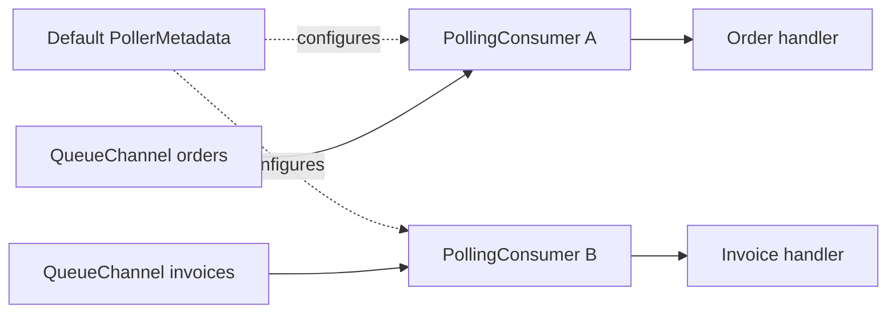

# Global Default Poller

## 1. Objectives and Use Cases

In the **SPRING_INTEGRATION_CORE** module, a poller determines when an endpoint proactively pulls a message for processing. This lesson belongs to the **Poller** chapter, focusing on how to declare a shared default polling configuration, how endpoints select that configuration, and how to create exceptions for individual flows.

Suppose an application has three queues: orders to normalize, invoices to transform, and notifications to send. All consumers need to check their queues periodically. If every endpoint repeats the same schedule and receive limit, one operational change requires editing multiple places. A global default poller centralizes common configuration and keeps flow definitions cleaner.

After this lesson, you will be able to:

- Declare a default poller in Java, Java DSL, and XML.
- Distinguish endpoints that need polling from event-driven endpoints.
- Choose the default poller or a dedicated configuration based on a flow's needs.
- Explain the impact of schedule, message limits, and receive wait times.
- Write a test proving a flow works without declaring a poller on the endpoint.

The examples use APIs available in Spring Integration 6.5 and Java 17 or higher. The `spring-integration-core` dependency is required; the test section uses JUnit Jupiter. Use a compatible dependency set managed by your project or Spring Boot, rather than mixing arbitrary Spring versions.

## 2. What Is a Global Default Poller?

A **global default poller** is a fallback polling configuration for endpoints that require polling but have not been assigned their own poller. With Java configuration, Spring Integration identifies this configuration by the bean name `PollerMetadata.DEFAULT_POLLER`. With XML, declare a top-level `<int:poller>` with `default="true"`. This selection rule is described in [Message Endpoints — Global Default Poller](https://docs.spring.io/spring-integration/reference/endpoint.html).

The word "global" should be understood within the scope of a Spring `ApplicationContext` configuration. Another application or another process does not automatically receive that configuration. When multiple contexts exist in a parent–child hierarchy, consider bean visibility and each context's configuration; do not assume all contexts share one default regardless of how they are initialized.

A Java method name does not determine the default role:

```java
@Bean
public PollerMetadata defaultPoller() {
    // Bean is named "defaultPoller" after the method name.
    // Not yet registered under the default name that Spring Integration looks up.
    return new PollerMetadata();
}
```

The snippet above is also missing a trigger, so it is not yet a usable polling configuration. The proper registration will appear in the complete example section.

### 2.1. Shared Metadata, Independent Endpoint Execution

Do not picture the default poller as a single loop iterating sequentially over all queues.



Each endpoint has its own lifecycle and polling task. They may share scheduler infrastructure, yet sharing metadata does not create a processing order between the two queues or cap total application throughput.

`PollerMetadata` has properties such as trigger, per-poll message limit, receive timeout, executor, error handler, and advice chain. See the [PollerMetadata API](https://docs.spring.io/spring-integration/api/org/springframework/integration/scheduling/PollerMetadata.html). Treat this as configuration established before endpoints initialize; do not use mutating the bean at runtime as a mechanism to bulk-update endpoints.

## 3. Which Endpoints Use the Default Poller?

There are two main polling situations:

1. **Polling consumer** receiving from a `PollableChannel`, such as a `QueueChannel`.
2. **Polling inbound channel adapter** actively calling a `MessageSource` to fetch data, such as a file source or an application-provided source.

Conversely, a consumer connected to a `DirectChannel` receives messages via subscription. Adding a default poller does not turn that consumer into a scheduled consumer. The distinction among `PollingConsumer`, `EventDrivenConsumer`, and `SourcePollingChannelAdapter` is explained in [Poller](https://docs.spring.io/spring-integration/reference/polling-consumer.html).

| Case | Uses default poller? | Explanation |
|---|---|---|
| Service activator receiving from `QueueChannel`, no poller specified | Yes | Endpoint must actively call receive |
| Transformer receiving from `QueueChannel`, no poller specified | Yes | Input channel type dictates polling need |
| Polling inbound adapter with no dedicated poller | Yes | Adapter needs a schedule to call the source |
| Service activator receiving from `DirectChannel` | No | Messages arrive via subscription |
| Endpoint with its own declared poller | No | Endpoint-level configuration is selected |
| Application manually calls `queue.receive(...)` | No | That is a direct application call |
| Messaging gateway sending to a channel | Not directly | The gateway does not itself become a polling endpoint |

The configuration resolution flow can be read in order:

```text
Does the endpoint need polling?
├─ No: processed per the endpoint/channel mechanism.
└─ Yes:
   ├─ Has its own poller: use the own poller.
   └─ No own poller:
      ├─ Default poller found: use default configuration.
      └─ Not found: missing configuration, endpoint fails to initialize properly.
```

With message-handling annotations, omitting `@Poller` on an endpoint whose input is a `PollableChannel` allows using the default metadata if that bean exists. See [Annotation Support](https://docs.spring.io/spring-integration/reference/6.5/configuration/annotations.html).

## 4. Complete Java DSL Example

The following example places a message into the `orders` queue, converts the payload to uppercase, and sends the result to `normalizedOrders`. The transformer endpoint configures no dedicated poller, so it will use the default.

```java
package example.integration;

import java.time.Duration;
import java.util.Locale;

import org.springframework.context.annotation.Bean;
import org.springframework.context.annotation.Configuration;
import org.springframework.integration.channel.QueueChannel;
import org.springframework.integration.config.EnableIntegration;
import org.springframework.integration.dsl.IntegrationFlow;
import org.springframework.integration.dsl.PollerSpec;
import org.springframework.integration.dsl.Pollers;
import org.springframework.integration.scheduling.PollerMetadata;

@Configuration
@EnableIntegration
public class GlobalDefaultPollerConfig {

    @Bean(name = PollerMetadata.DEFAULT_POLLER)
    public PollerSpec defaultPoller() {
        return Pollers.fixedDelay(Duration.ofSeconds(1))
                .maxMessagesPerPoll(5)
                .receiveTimeout(0);
    }

    @Bean
    public QueueChannel orders() {
        return new QueueChannel(100);
    }

    @Bean
    public QueueChannel normalizedOrders() {
        return new QueueChannel(100);
    }

    @Bean
    public IntegrationFlow normalizeOrdersFlow() {
        return IntegrationFlow.from("orders")
                .transform(
                        String.class,
                        payload -> payload.toUpperCase(Locale.ROOT),
                        endpoint -> endpoint.id("normalizeOrders"))
                .channel("normalizedOrders")
                .get();
    }
}
```

Configuration explanation:

- `@EnableIntegration` registers Spring Integration infrastructure for this plain Spring example.
- `PollerMetadata.DEFAULT_POLLER` provides the bean name the framework uses to locate the default.
- `fixedDelay(Duration.ofSeconds(1))` sets a pause after the previous poll completes in this example's configuration without offloading to a separate executor.
- `maxMessagesPerPoll(5)` limits the number of messages fetched in a single poll.
- `receiveTimeout(0)` makes queue receives return immediately if no message is available yet.
- Both `QueueChannel` instances have a capacity of 100 messages; this is a buffer limit, independent of the per-poll limit.

`PollerSpec` is a `FactoryBean` that creates `PollerMetadata`. When declaring it as a `@Bean`, return the spec so Spring manages initialization; do not manually call `getObject()` inside the bean method. This is noted in [Java DSL — Pollers](https://docs.spring.io/spring-integration/reference/6.5/dsl/java-pollers.html).

### 4.1. Sending and Receiving Messages

The following class runs in the same package as the configuration class:

```java
package example.integration;

import org.springframework.context.annotation.AnnotationConfigApplicationContext;
import org.springframework.integration.channel.QueueChannel;
import org.springframework.messaging.Message;
import org.springframework.messaging.support.GenericMessage;

public class GlobalDefaultPollerDemo {

    public static void main(String[] args) {
        try (var context = new AnnotationConfigApplicationContext(
                GlobalDefaultPollerConfig.class)) {

            QueueChannel input = context.getBean("orders", QueueChannel.class);
            QueueChannel output =
                    context.getBean("normalizedOrders", QueueChannel.class);

            boolean accepted =
                    input.send(new GenericMessage<>("ord-101"), 1_000);

            if (!accepted) {
                throw new IllegalStateException("Input queue is full");
            }

            Message<?> result = output.receive(5_000);

            if (result == null) {
                throw new IllegalStateException("No result received");
            }

            System.out.println(result.getPayload()); // ORD-101
        }
    }
}
```

A return value of `true` from `input.send(...)` indicates the queue accepted the message. Business results are observed at the output afterward. Closing the context shuts down all polling infrastructure managed by the context.

## 5. Declaring Directly with PollerMetadata

If you want Java configuration without builders, you can **replace** the `defaultPoller()` method above with:

```java
@Bean(name = PollerMetadata.DEFAULT_POLLER)
public PollerMetadata defaultPoller() {
    PollerMetadata metadata = new PollerMetadata();
    metadata.setTrigger(
            new org.springframework.scheduling.support.PeriodicTrigger(
                    java.time.Duration.ofSeconds(1)));
    metadata.setMaxMessagesPerPoll(5);
    metadata.setReceiveTimeout(0);
    return metadata;
}
```

This is another expression of the same idea. Do not register both methods as two default pollers in the same context.

With annotations, a consumer can use the default without writing `@Poller`:

```java
@org.springframework.integration.annotation.ServiceActivator(
        inputChannel = "orders")
public void consumeOrder(String orderId) {
    System.out.println("Received: " + orderId);
}
```

The method must be on a Spring-managed bean. This annotation example is an **alternative to the consumer in the DSL**, not an additional consumer to receive every message copy from `orders`. If multiple consumers read from the same `QueueChannel`, they compete for messages.

## 6. Configuring a Dedicated Poller for One Endpoint

Suppose a priority flow needs to check more frequently. You can replace just the flow method with:

```java
@Bean
public IntegrationFlow normalizeOrdersFlow() {
    return IntegrationFlow.from("orders")
            .transform(
                    String.class,
                    payload -> payload.toUpperCase(Locale.ROOT),
                    endpoint -> endpoint
                            .id("normalizeOrders")
                            .poller(Pollers.fixedDelay(
                                            Duration.ofMillis(200))
                                    .maxMessagesPerPoll(2)
                                    .receiveTimeout(0)))
            .channel("normalizedOrders")
            .get();
}
```

The `normalizeOrders` endpoint now has its own poller. Other endpoints without a specified poller still use the default configuration.

Do not treat a dedicated configuration as a patch that automatically merges field-by-field with the default. Explicitly declare the properties the dedicated endpoint needs, especially per-poll limits, receive timeouts, and error-handling mechanisms if the application customized them on the default.

With annotations, the equivalent idea is:

```java
@org.springframework.integration.annotation.ServiceActivator(
        inputChannel = "orders",
        poller = @org.springframework.integration.annotation.Poller(
                fixedDelay = "200",
                maxMessagesPerPoll = "2",
                receiveTimeout = "0"))
public void consumePriorityOrder(String orderId) {
    System.out.println("Priority order: " + orderId);
}
```

Numeric timing attributes in the annotation above use milliseconds. This is also an alternative example; do not register it alongside a flow that already has a consumer unless you intend to create competition.

## 7. Polling Inbound Adapter and Per-Poll Limits

The default poller can also be used when a flow starts from a supplier generating messages:

```java
@Bean
public IntegrationFlow heartbeatFlow() {
    return IntegrationFlow.fromSupplier(() -> "heartbeat")
            .handle(message -> System.out.println(message.getPayload()))
            .get();
}
```

If you add this bean to a configuration with a default `maxMessagesPerPoll(5)`, a supplier that always returns data can be invoked five times per poll. A configuration meaning "check once per second" does not mean "emit exactly one message per second."

If the requirement is one source invocation per poll, declare it explicitly:

```java
@Bean
public IntegrationFlow heartbeatFlow() {
    return IntegrationFlow.fromSupplier(
                    () -> "heartbeat",
                    endpoint -> endpoint.poller(
                            Pollers.fixedDelay(Duration.ofSeconds(1))
                                    .maxMessagesPerPoll(1)))
            .handle(message -> System.out.println(message.getPayload()))
            .get();
}
```

A `MessageSource` returning `null` indicates no data is available yet, causing the poll to stop receiving more. A supplier that always returns a value lacks this natural stopping point. Therefore, do not set an unbounded limit on such a source unless you deliberately control the receive loop.

`@Poller` has different default limits between polling consumers and polling inbound adapters when no value is specified. Setting an explicit number avoids accidentally relying on an endpoint type's default. See [Poller annotation API](https://docs.spring.io/spring-integration/docs/current/api/org/springframework/integration/annotation/Poller.html).

## 8. Equivalent XML Configuration

This is a standalone configuration; do not load it alongside Java beans with the same names:

```xml
<?xml version="1.0" encoding="UTF-8"?>
<beans xmlns="http://www.springframework.org/schema/beans"
       xmlns:xsi="http://www.w3.org/2001/XMLSchema-instance"
       xmlns:int="http://www.springframework.org/schema/integration"
       xsi:schemaLocation="
           http://www.springframework.org/schema/beans
           https://www.springframework.org/schema/beans/spring-beans.xsd
           http://www.springframework.org/schema/integration
           https://www.springframework.org/schema/integration/spring-integration.xsd">

    <int:poller id="sharedPoller"
                default="true"
                fixed-delay="1000"
                max-messages-per-poll="5"
                receive-timeout="0"/>

    <int:channel id="orders">
        <int:queue capacity="100"/>
    </int:channel>

    <int:channel id="normalizedOrders">
        <int:queue capacity="100"/>
    </int:channel>

    <int:transformer id="normalizeOrders"
                     input-channel="orders"
                     output-channel="normalizedOrders"
                     expression="payload.toUpperCase()"/>
</beans>
```

The transformer has no child `<int:poller>` element, so it uses the default. Do not mark multiple top-level pollers as `default="true"` in the same context.

A named non-default poller can be referenced on an endpoint:

```xml
<int:poller id="priorityPoller"
            fixed-delay="200"
            max-messages-per-poll="2"
            receive-timeout="0"/>

<int:transformer id="normalizePriorityOrders"
                 input-channel="priorityOrders"
                 output-channel="normalizedOrders"
                 expression="payload.toUpperCase()">
    <int:poller ref="priorityPoller"/>
</int:transformer>
```

This extension snippet requires also declaring the `priorityOrders` channel. The `ref` attribute here sits on the poller nested inside the endpoint.

## 9. Reading Operational Parameters Accurately

### 9.1. Fixed Delay and Processing Duration

In the example without a dedicated executor, if a poll takes 400 ms and fixed delay is 1,000 ms, the next start is roughly 1,400 ms after the previous start, plus scheduling jitter.

```text
t = 0 ms       First poll starts
t ≈ 400 ms     First poll ends
t ≈ 1,400 ms   Next poll starts
```

Fixed rate calculates cadence from scheduled start points; fixed delay calculates the pause after completion. Do not use fixed rate as a guarantee that parallel processing is automatically created. The corresponding builders are documented in the [Pollers API](https://docs.spring.io/spring-integration/api/org/springframework/integration/dsl/Pollers.html).

### 9.2. Max Messages per Poll

This limit applies to one endpoint in one poll. It is not queue size, worker count, or a per-second message limit for the entire application.

In a simple model with one consumer, a queue that always has data, sequential processing, and no separate executor, you can estimate:

```text
Approximate throughput ≈ N / (D + N × H)

N: number of messages processed per poll
D: fixed delay, in seconds
H: average processing time per message, in seconds
```

For example, `N = 5`, `D = 1`, `H = 0.1` yields about 3.33 messages/second. This is an estimate to understand the impact of processing time, not a throughput guarantee. Empty queues, receive timeouts, scheduler load, errors, and I/O can all alter the outcome.

### 9.3. Receive Timeout

`receiveTimeout` is how long a single receive operation from a pollable channel can wait for a message, not a timeout for the handler or the entire poll.

Setting `receiveTimeout(0)` lets the example finish a poll quickly when the queue is empty. A positive value can suit waiting for data, yet also holds the execution thread while waiting. For inbound adapters, I/O wait time also depends on the source and corresponding client configuration.

## 10. Errors During Asynchronous Processing

When a producer puts a message into a `QueueChannel`, the consumer normally processes it later on the polling thread. Exceptions from the handler do not return to the producer's already-completed `send()` call.

Spring Integration has a mechanism to wrap exceptions into an `ErrorMessage`. The standard error handler can pick a channel from the message's `errorChannel` header or use the default error channel; when customizing handlers, read the specific configuration. See [Error Handling](https://docs.spring.io/spring-integration/reference/error-handling.html).

Consequences when designing a default poller:

- Errors must be observable on the asynchronous processing path.
- Succeeding to send into the queue does not prove business processing succeeded.
- The default poller does not automatically provide retries or a mechanism to return failed messages to the queue.
- Transactions, if any, must fit participating resources; do not assume an in-memory queue automatically gains rollback capability merely by adding transaction advice.

If advice or an executor is shared in metadata, each endpoint applies them to its own operation. When different endpoints need different retry policies, transactions, or execution resources, create dedicated pollers for endpoints with distinct requirements.

## 11. Testing That a Flow Actually Uses the Default

A useful test checks both the default bean and the processing outcome. Asserting only that a `PollerMetadata` bean exists does not prove the flow is wired properly.

Save the following test example in the same package as the configuration when practicing:

```java
package example.integration;

import org.junit.jupiter.api.Test;
import org.springframework.context.annotation.AnnotationConfigApplicationContext;
import org.springframework.integration.channel.QueueChannel;
import org.springframework.integration.scheduling.PollerMetadata;
import org.springframework.messaging.Message;
import org.springframework.messaging.support.GenericMessage;

import static org.junit.jupiter.api.Assertions.assertEquals;
import static org.junit.jupiter.api.Assertions.assertNotNull;
import static org.junit.jupiter.api.Assertions.assertTrue;

class GlobalDefaultPollerConfigTest {

    @Test
    void processesOrderWithoutEndpointSpecificPoller() {
        try (var context = new AnnotationConfigApplicationContext(
                GlobalDefaultPollerConfig.class)) {

            PollerMetadata metadata = context.getBean(
                    PollerMetadata.DEFAULT_POLLER,
                    PollerMetadata.class);

            assertEquals(5L, metadata.getMaxMessagesPerPoll());
            assertEquals(0L, metadata.getReceiveTimeout());

            QueueChannel input = context.getBean("orders", QueueChannel.class);
            QueueChannel output =
                    context.getBean("normalizedOrders", QueueChannel.class);

            assertTrue(input.send(new GenericMessage<>("ord-101"), 1_000));

            Message<?> result = output.receive(5_000);

            assertNotNull(result, "Flow must produce a result within the timeout");
            assertEquals("ORD-101", result.getPayload());
        }
    }
}
```

`normalizeOrdersFlow()` in the original configuration does not call `.poller(...)`, so testing the result simultaneously confirms the processing path initialized with the default. `receive(5_000)` waits conditionally until data arrives, avoiding a fixed `Thread.sleep()` before asserting.

This test confirms one message passed through the flow. It does not prove the five-message-per-poll limit or schedule accuracy. Testing those behaviors requires controlling triggers, synchronization points, and endpoint lifecycles appropriately.

## 12. Common Configuration Errors

| Symptom | Cause to check | How to handle |
|---|---|---|
| Polling endpoint fails to initialize | No dedicated poller and no default found | Check bean name and which context loads the configuration |
| Bean named `defaultPoller` exists but is unused | Relied solely on method name | Register under `PollerMetadata.DEFAULT_POLLER` |
| Conflict at startup | Multiple configurations register a default | Choose a single owner for the default |
| `DirectChannel` still processes immediately on send | Consumer is event-driven | Use `QueueChannel` when a polling boundary is needed |
| A heartbeat appears multiple times per poll | Source always has data, per-poll limit > 1 | Set `maxMessagesPerPoll(1)` for that source |
| Dedicated poller loses default's error behavior | A separate configuration was chosen | Explicitly declare all required policies |
| Two consumers do not both receive every order | Both are reading the same queue | Design publish-subscribe if copies must be broadcast |
| Queue grows continuously | Arrival rate exceeds processing capacity | Measure handler duration, backlog, and polling cadence |

When investigating, check in order: input channel type, endpoint definition, default bean name, and configured poller properties. Only then adjust scheduler or concurrency settings based on observed metrics.

## 13. Practice Exercise

Starting from the original configuration, make independent changes:

1. Add a `QueueChannel` for invoices and a transformer flow without declaring a poller. Send messages to both flows and observe that both work.
2. Change the default to a two-second fixed delay. Identify which endpoints are affected, including a polling inbound adapter if added.
3. Assign a dedicated 200 ms poller to the orders flow. Verify the invoices flow still uses the default.
4. Replace one flow's input channel with a `DirectChannel`. Explain why that endpoint no longer needs polling.
5. Add a supplier that always returns data. Compare per-poll limits of 1 and 5.
6. In a separate test configuration, remove the default while the consumer still reads from a queue and has no dedicated poller. Observe the initialization error instead of waiting for a message that will never be processed.

When explaining the results, separate three questions: which endpoints need polling, which configuration is selected, and how many receives each poll performs. These three questions help apply the global default poller properly across transformer, filter, router, or service activator flows without obscuring per-endpoint requirements.