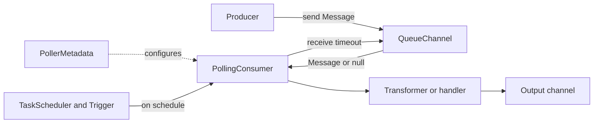

# PollerMetadata

## 1. Objectives and Context

In the **Poller** chapter of the `SPRING_INTEGRATION_CORE` module, `PollerMetadata` centralizes polling policies: when to fetch messages, how many to fetch at most, how long to wait for a receive, and how to handle errors. It connects the scheduling mechanism with endpoints in an integration flow using `Message`, `MessageChannel`, transformers, filters, routers, or service activators.

After this lesson, you will be able to:

- Distinguish the `PollerMetadata` configuration object from the endpoint that executes polling.
- Declare named pollers and default pollers, and use them in annotations or the Java DSL.
- Coordinate `Trigger`, `maxMessagesPerPoll`, `receiveTimeout`, and executors.
- Identify error, advice, and transaction boundaries as messages traverse the flow.
- Observe polling outcomes using an example and a test with a finite wait timeout.

**Example baseline:** Java 17 or higher, Spring Integration 6.5.x, and a compatible Spring Framework 6.2.x. The configuration classes below use `spring-integration-core` and `@EnableIntegration`; the test section requires JUnit Jupiter. Use a compatible dependency set managed by your project or its BOM. This lesson does not assume a specific Spring Boot version.

## 2. What Configuration Does PollerMetadata Hold?

The `org.springframework.integration.scheduling.PollerMetadata` class is the object holding options for polling. Key configuration points include `trigger`, `maxMessagesPerPoll`, `receiveTimeout`, `taskExecutor`, `errorHandler`, `adviceChain`, and `transactionSynchronizationFactory`. Corresponding setters allow creating the bean via Java configuration. See [PollerMetadata 6.5.x API](https://docs.spring.io/spring-integration/docs/6.5.x/api/org/springframework/integration/scheduling/PollerMetadata.html).

Distinguish three responsibilities:

| Component | Responsibility |
| --- | --- |
| `PollerMetadata` | Holds policies to configure polling |
| `PollingConsumer` | Pulls messages from a `PollableChannel`, forwards to handler |
| `SourcePollingChannelAdapter` | Calls a `MessageSource`, sends received messages to output channel |

`PollingConsumer` typically appears when an endpoint reads from a `QueueChannel`. `SourcePollingChannelAdapter` typically appears at an ingress pulling data from an actively polled source. Both are polling endpoints; declaring a lone metadata bean does not by itself create a message-processing flow. Refer to [Poller and the two endpoint types](https://docs.spring.io/spring-integration/reference/6.5/polling-consumer.html).



In the diagram, the arrow from metadata represents a configuration relationship. Messages flow from the queue to the endpoint and then to the handler; they do not pass through the metadata bean.

A `DirectChannel` delivers messages via handler subscription, so typical consumers on this channel do not need a poller. Do not attach a poller merely because a handler runs a "periodic" job from a business perspective; first determine accurately which source is actually being polled. See [Message Endpoints](https://docs.spring.io/spring-integration/reference/6.5/endpoint.html).

## 3. How Does a Polling Cycle Unfold?

For a consumer reading a queue, you can picture the cycle with the following pseudocode:

```text
when scheduled to run:
    if maxMessagesPerPoll == 0:
        end poll, do not receive messages

    processed_count = 0
    while limit not reached:
        message = inputChannel.receive(receiveTimeout)
        if message == null:
            end poll
        pass message to handler
        increment processed_count
```

This is a conceptual model for the success path, not the complete source code: in reality, advice, errors, lifecycle, and transactions are also involved.

In Spring Integration 6.5, a positive limit caps the number of messages for a poll; a negative value allows continuing until the source runs out of data; `0` skips fetching messages. A poll can terminate early upon receiving `null`. Therefore, explicitly use `-1` when you want unlimited, rather than assuming all non-positive values mean the same thing. Execution rules are described in the [AbstractPollingEndpoint API](https://docs.spring.io/spring-integration/docs/6.5.0/api/org/springframework/integration/endpoint/AbstractPollingEndpoint.html#setMaxMessagesPerPoll(long)).

**The limit counts messages, not elements inside a payload.** If a message contains a list of 500 orders, `maxMessagesPerPoll(1)` can still pass that entire list to the handler. To process each order individually, consider a splitter or changing how the source emits messages.

## 4. Three Parameters to Read Together

### 4.1. Trigger Decides When to Run

`PeriodicTrigger` supports fixed delay and fixed rate; the default is fixed delay. With fixed delay, the pause interval is measured from when the previous task finishes. With fixed rate, reference marks are based on scheduled start times. The constructor accepting `Duration` makes units explicit. See the [PeriodicTrigger API](https://docs.spring.io/spring-framework/docs/6.2.x/javadoc-api/org/springframework/scheduling/support/PeriodicTrigger.html).

```java
PeriodicTrigger trigger = new PeriodicTrigger(Duration.ofSeconds(1));
trigger.setInitialDelay(Duration.ofSeconds(2));
trigger.setFixedRate(false);
```

Suppose synchronous polling and processing for one poll takes 300 ms, followed by a 1-second pause: the time between two starts is approximately 1,300 ms. This is an estimate for synchronous execution, ignoring OS and scheduler latency.

Fixed rate does not automatically add workers and does not guarantee on-time execution when resources are already busy. When speedup is needed, measure processing time and resource utilization instead of merely changing the trigger type.

### 4.2. maxMessagesPerPoll Sets the Budget per Poll

Suppose a queue has 23 messages, each poll allows at most 10, and there are no new producers. Ignoring errors, the polls can fetch 10, 10, and then 3 messages respectively. The number 10 does not mean merging into one batch payload, nor does it mean 10 threads running in parallel.

Configure an explicit positive value in examples and flows requiring a finite budget. Defaults also depend on the endpoint type and configuration style: the documentation states `PollingConsumer` is typically unbounded, while inbound `SourcePollingChannelAdapter` typically fetches one message per poll. See [poller configuration and defaults](https://docs.spring.io/spring-integration/reference/6.5/endpoint.html).

With a source that always returns a non-`null` message, an unlimited setting can cause a single poll to run continuously. A supplier that always generates the current timestamp is a common example: every invocation creates new data, so the "out of data" condition never occurs.

### 4.3. receiveTimeout Is the Receive Wait Time

`receiveTimeout` on a consumer reading a `PollableChannel` is measured in milliseconds. For example, `100` allows each receive call to wait up to 100 ms when no message is available yet; `0` requests checking without waiting. This property does not set a timeout for all business processing. Refer to [Polling Consumer](https://docs.spring.io/spring-integration/reference/6.5/endpoint.html).

If a poll is allowed to fetch 10 messages but only 3 exist, after processing the third message, the next receive call may have to wait out the timeout before returning `null`. Conversely, if all 10 messages are fetched, the poll can stop immediately because the limit is reached.

Do not use `receiveTimeout` to control how long an HTTP call or database query inside a `MessageSource` takes. Those sources have their own timeout mechanisms; the `MessageSource.receive()` interface does not take `PollableChannel`'s timeout parameter.

## 5. Complete Example with a Named Poller

Problem statement: a producer sends order codes into a queue; a transformer fetches codes on schedule, trims whitespace, and normalizes them to uppercase. Results are sent to a second queue for observation.

```java
import java.time.Duration;
import java.util.Locale;

import org.springframework.context.annotation.Bean;
import org.springframework.context.annotation.Configuration;
import org.springframework.integration.annotation.Poller;
import org.springframework.integration.annotation.Transformer;
import org.springframework.integration.channel.QueueChannel;
import org.springframework.integration.config.EnableIntegration;
import org.springframework.integration.scheduling.PollerMetadata;
import org.springframework.scheduling.support.PeriodicTrigger;

@Configuration
@EnableIntegration
public class PollerMetadataLessonConfig {

    @Bean
    public QueueChannel orderQueue() {
        return new QueueChannel(100);
    }

    @Bean
    public QueueChannel processedOrders() {
        return new QueueChannel(100);
    }

    @Bean
    public PollerMetadata orderPoller() {
        PeriodicTrigger trigger =
                new PeriodicTrigger(Duration.ofMillis(200));
        trigger.setFixedRate(false);

        PollerMetadata metadata = new PollerMetadata();
        metadata.setTrigger(trigger);
        metadata.setMaxMessagesPerPoll(5);
        metadata.setReceiveTimeout(0);
        return metadata;
    }

    @Bean
    public OrderNormalizer orderNormalizer() {
        return new OrderNormalizer();
    }

    public static class OrderNormalizer {

        @Transformer(
                inputChannel = "orderQueue",
                outputChannel = "processedOrders",
                poller = @Poller("orderPoller"))
        public String normalize(String orderCode) {
            return orderCode.trim().toUpperCase(Locale.ROOT);
        }
    }
}
```

`@EnableIntegration` registers the required infrastructure in this plain Spring configuration. The `OrderNormalizer` bean is Spring-managed; the annotation on the method creates a transformer endpoint reading `orderQueue`.

`@Poller("orderPoller")` references the exact metadata bean name. When using the `value` attribute to reference a bean, other polling options must be placed in that bean; do not combine `fixedDelay`, `cron`, or `maxMessagesPerPoll` on the same referencing annotation. See [Using the @Poller Annotation](https://docs.spring.io/spring-integration/reference/6.5/configuration/annotations.html#annotations-poller).

In the example, one poll fetches up to 5 available messages without waiting on an empty queue, then pauses 200 ms before the next poll once synchronous processing finishes. Both queues have finite capacity so the example clearly shows where data is buffered. Results must be read out; if the output queue fills up, sending results can slow down or block the flow depending on the endpoint's send configuration.

## 6. Default Poller and Scope of Application

When multiple queue-reading endpoints share the same policy, you can declare a bean with the conventional name `PollerMetadata.DEFAULT_POLLER`:

```java
@Bean(name = PollerMetadata.DEFAULT_POLLER)
public PollerMetadata defaultPoller() {
    PollerMetadata metadata = new PollerMetadata();
    metadata.setTrigger(new PeriodicTrigger(Duration.ofSeconds(1)));
    metadata.setMaxMessagesPerPoll(10);
    metadata.setReceiveTimeout(0);
    return metadata;
}
```

This is a replacement for the poller selection in the previous example: place this bean in the configuration class and omit the `poller` attribute on `@Transformer` if you want the endpoint to use the default.

An endpoint reading a `PollableChannel` in the same `ApplicationContext` without declaring its own poller can use this default bean. An arbitrarily named `defaultPoller` bean is not enough; what matters is the conventional name, so use the framework constant. See [Global Default Poller](https://docs.spring.io/spring-integration/reference/6.5/endpoint.html).

Design rules for the order example:

| Need | How to choose |
| --- | --- |
| One shared policy across multiple simple queues | Default poller |
| Payment queue with dedicated timeouts, advice, or error handling | Named poller, referenced explicitly |
| A small endpoint with simple configuration | Inline `@Poller` or inline DSL |
| Regular endpoint receiving from `DirectChannel` | Use an event-driven consumer |

Sharing metadata does not mean endpoints share a single message-fetch counter. If two endpoints both have a limit of 10, treat that as the per-poll budget on each endpoint. If the business requirement is that the entire system calls an external service at most 10 times per second, design an appropriate throttling mechanism and also account for application instance count.

## 7. Usage in the Java DSL

The Java DSL still creates Spring Integration components in the application context. `ConsumerEndpointSpec.poller(PollerMetadata)` lets you pass metadata directly into endpoint configuration. See the [ConsumerEndpointSpec API](https://docs.spring.io/spring-integration/docs/6.5.0/api/org/springframework/integration/dsl/ConsumerEndpointSpec.html#poller(org.springframework.integration.scheduling.PollerMetadata)).

To convert the example to the DSL, keep the two queue beans and `orderPoller`, **remove the `orderNormalizer()` bean**, and add the following method to the configuration class:

```java
import org.springframework.beans.factory.annotation.Qualifier;
import org.springframework.integration.dsl.IntegrationFlow;

@Bean
public IntegrationFlow normalizeOrdersFlow(
        @Qualifier("orderQueue") QueueChannel input,
        @Qualifier("processedOrders") QueueChannel output,
        @Qualifier("orderPoller") PollerMetadata metadata) {

    return IntegrationFlow.from(input)
            .transform(String.class,
                    value -> value.trim().toUpperCase(Locale.ROOT),
                    endpoint -> endpoint
                            .id("normalizeOrdersEndpoint")
                            .poller(metadata))
            .channel(output)
            .get();
}
```

The `import` lines belong at the top of the Java file. This snippet represents an alternative configuration approach. If you keep both the annotation endpoint and the DSL endpoint reading the same `orderQueue`, they become competing consumers; observed outcomes will no longer describe a single transformer.

When a reusable bean is not needed, you can replace `.poller(metadata)` with inline configuration:

```java
endpoint -> endpoint.poller(poller -> poller
        .fixedDelay(Duration.ofMillis(200))
        .maxMessagesPerPoll(5)
        .receiveTimeout(0))
```

Another variant is using `Pollers.fixedDelay(Duration.ofMillis(200))` as the starting point of a `PollerSpec`. `Pollers` is a utility for creating poller configurations with fixed delay, fixed rate, cron, or a custom trigger; see the [Pollers API](https://docs.spring.io/spring-integration/docs/6.5.0/api/org/springframework/integration/dsl/Pollers.html).

The declaration must be placed on the exact endpoint reading the queue. If you add a `DirectChannel` after the transformer and attach a router to that channel, the router receives messages via channel subscription; it does not need a second poller. If you add a `QueueChannel` between two steps, define a polling policy for the consumer behind the new queue.

## 8. Scheduler, Executor, and Concurrency

The scheduler decides when to trigger the task. The executor, when configured, receives the task to execute. These are two separate points to examine when explaining a delayed flow.

The extension example below sets up a bounded worker pool; add the bean to the configuration and pass it into the metadata factory method:

```java
import org.springframework.scheduling.concurrent.ThreadPoolTaskExecutor;

@Bean
public ThreadPoolTaskExecutor pollWorkers() {
    ThreadPoolTaskExecutor executor = new ThreadPoolTaskExecutor();
    executor.setCorePoolSize(2);
    executor.setMaxPoolSize(2);
    executor.setQueueCapacity(10);
    executor.setThreadNamePrefix("order-poll-");
    return executor;
}
```

In the `orderPoller` method, accept `@Qualifier("pollWorkers") ThreadPoolTaskExecutor workers`, then add `metadata.setTaskExecutor(workers)` before returning. Spring manages initialization and shutdown of this bean's executor.

Configuring an executor alters timing assumptions: the task triggered by the scheduler may simply hand work to a worker and finish. Therefore, do not use the synchronous example's fixed-delay calculation to claim two business runs are always 200 ms apart after processing finishes. Polling tasks can queue up or overlap; review thread safety and result ordering.

If the trigger schedule fires faster than workers can finish, the task queue grows even while the message queue may be empty. The documentation clearly describes executor task accumulation caused by polling with long receive wait times; see [Asynchronous Polling](https://docs.spring.io/spring-integration/reference/6.5/endpoint.html).

For the order problem, before adding workers, measure:

- Waiting message count and age of the oldest message in `orderQueue`.
- Processing time for one message and external service wait time.
- Busy worker count, queued task count, and executor rejection count.
- Output order when two messages are processed with different durations.

A pool capped at two threads does not turn `maxMessagesPerPoll(5)` into five workers. It limits how many executor tasks can run concurrently; within each task, fetching multiple messages still follows poller logic.

## 9. ErrorHandler and the Error Path

A producer's successful send into a queue only proves the queue accepted the message. When the transformer runs later on the polling thread and throws an exception, a `try/catch` wrapping the earlier `send()` cannot catch that processing exception like a synchronous call.

Spring Integration has a mechanism to represent errors as `ErrorMessage`; the standard handling path inspects the message's `errorChannel` header when the corresponding context exists, and otherwise uses the default error channel. Scheduled polling tasks also participate in the framework's error-handling mechanism. See [Error Handling](https://docs.spring.io/spring-integration/reference/6.5/error-handling.html).

To illustrate a dedicated error path in the lesson, you can add an observation error queue and an error handler that publishes messages:

```java
import org.springframework.integration.channel.QueueChannel;
import org.springframework.integration.channel.MessagePublishingErrorHandler;

@Bean
public QueueChannel pollErrors() {
    return new QueueChannel(20);
}

@Bean
public MessagePublishingErrorHandler orderPollErrorHandler(
        @Qualifier("pollErrors") QueueChannel errors) {
    MessagePublishingErrorHandler handler =
            new MessagePublishingErrorHandler();
    handler.setDefaultErrorChannel(errors);
    return handler;
}
```

Continue extending the `orderPoller` factory method to inject the `orderPollErrorHandler` bean, then call:

```java
metadata.setErrorHandler(orderPollErrorHandler);
```

`pollErrors` is an observation queue in the example; read it with `receive(timeout)` or attach an appropriate consumer. If you attach an endpoint that automatically consumes from this queue, that endpoint also needs a poller policy. In production systems, consider capacity and behavior when the error path fills up.

Manually setting `setErrorHandler(error -> ...)` replaces the error-handling mechanism at that point. If the lambda merely logs and returns, do not expect it to automatically emit an `ErrorMessage` or retry the message. Publishing errors, retrying, and preventing data loss are distinct decisions.

In particular, a standard in-memory `QueueChannel` does not automatically return a pulled message to the queue simply because the transformer threw an error. When recovery is required, explicitly design the data source, persistence, retries or dead-letter queue, and idempotency of the business operation.

## 10. Where Do Advice and Transactions Attach?

`adviceChain` lets you wrap logic around the polling operation. General advice covers both receiving and processing within the advised scope; `ReceiveMessageAdvice` specializes in the receive phase. Advice placed on a handler is a different interception point, so the two positions cannot be treated as equivalent. See [Conditional Pollers and advice](https://docs.spring.io/spring-integration/reference/6.5/polling-consumer.html).

For example, you can use poller advice to check conditions on whether to continue fetching data; use handler advice to time or retry a specific service call. Before adding retries, answer: "which call is being retried, and has that call already caused external side effects?"

Transaction advice on a poller can bring the `receive()` operation of a transaction-capable resource into the same boundary as synchronous downstream processing. Whether rollback restores data depends on the resources participating in the transaction. A plain in-memory `QueueChannel` does not become a rollback-capable queue merely by adding transaction advice. See [Poller Transaction Support](https://docs.spring.io/spring-integration/reference/6.5/transactions.html).

`transactionSynchronizationFactory` serves to register callbacks based on transaction outcomes. It does not replace a transaction manager or transaction advice for starting a transaction.

When a flow switches to another thread via `ExecutorChannel` or an intermediate queue, do not assume the transaction bound to the previous thread covers downstream processing as well. For example, a database write and an HTTP call do not automatically become one atomic transaction simply because both originated from one poller.

## 11. Reusing Configuration and Runtime Changes

A metadata bean is suited for centralizing configuration at initialization time. Distinguish:

| Action | What to understand |
| --- | --- |
| Two endpoints reference the same metadata | Shared configuration source; each endpoint still has its own lifecycle |
| Mutating numeric fields on metadata after application initialization | Does not automatically update fields already applied to endpoints |
| Sharing a stateful advice or trigger object | Must check whether that state is shared across usages |
| Wanting to stop an endpoint | Control the lifecycle of the running endpoint |

For example, calling `metadata.setMaxMessagesPerPoll(0)` after startup should not be used as a reliable pause mechanism for all endpoints configured from that metadata. When dynamic control is needed, work with the corresponding managed endpoint or framework-supported control mechanisms; thoroughly test behavior on your project's version.

In design, you can use a default poller for simple flows and create dedicated beans for endpoints needing independent throttling state. This makes it clear where to make changes when a partner service has special requirements.

## 12. Testing Outcomes Without Depending on Exact Timing

The following example tests the annotation configuration in section 5, without enabling the executor and error-handler extensions. It waits for the result using the output queue's timeout rather than using `Thread.sleep()` to guess when the poller ran.

```java
import org.junit.jupiter.api.Test;
import org.springframework.context.annotation.AnnotationConfigApplicationContext;
import org.springframework.integration.channel.QueueChannel;
import org.springframework.messaging.Message;
import org.springframework.messaging.support.MessageBuilder;

import static org.junit.jupiter.api.Assertions.assertEquals;
import static org.junit.jupiter.api.Assertions.assertNotNull;
import static org.junit.jupiter.api.Assertions.assertTrue;

class PollerMetadataLessonTest {

    @Test
    void normalizesAnOrderThroughThePollingEndpoint() {
        try (AnnotationConfigApplicationContext context =
                     new AnnotationConfigApplicationContext(
                             PollerMetadataLessonConfig.class)) {

            QueueChannel input =
                    context.getBean("orderQueue", QueueChannel.class);
            QueueChannel output =
                    context.getBean("processedOrders", QueueChannel.class);

            boolean accepted = input.send(
                    MessageBuilder.withPayload("  order-42  ").build(),
                    1_000);
            assertTrue(accepted);

            Message<?> result = output.receive(3_000);

            assertNotNull(result);
            assertEquals("ORDER-42", result.getPayload());
        }
    }
}
```

The 3-second timeout is a wait budget in the example, not a promise that the endpoint always completes within that window under every load. This test proves a message passes through the polling endpoint and the transformer returns the expected result; it does not yet prove the per-poll limit or concurrency level.

To investigate the per-poll limit in a controlled way, configure the endpoint with auto-startup disabled, preload the queue, use a trigger allowing exactly one firing, and then measure the result count. This avoids multiple firings interfering with the measurement. For the error path, deliberately make the handler throw an error and confirm the error arrives on the chosen channel.

## 13. Estimating Capacity in a Concrete Scenario

Suppose there is a synchronous endpoint, the queue always has enough data, and these conditions hold:

- Each poll processes at most 10 messages.
- Each message takes 40 ms on average.
- Fixed delay is 600 ms.
- Receive, send, and scheduling overhead are ignored.

One processing poll takes about `10 × 40 = 400 ms`; total time for processing plus pause is `400 + 600 = 1,000 ms`. Estimated capacity under these assumptions is `10 / 1 = 10 messages/second`.

If you raise the limit to 20, processing time becomes `800 ms`; total becomes `1,400 ms`, or about `14.3 messages/second`. Doubling the limit does not double capacity because processing time also grows.

If each message must call a service limited to 8 requests/second, both configurations still need a proper throttling mechanism. `maxMessagesPerPoll` limits a single poll, whereas partner quotas usually apply over a time window and may sum across multiple instances.

## 14. Diagnosing Common Confusions

| Symptom | Direction to investigate |
| --- | --- |
| Metadata bean exists, yet queue is not read | Which endpoint references the metadata? Has the endpoint started? |
| Queue-reading endpoint lacks poller configuration | Did it reference a named poller or declare the proper default bean? |
| Data processed in two places unexpectedly | Are both an annotation endpoint and a DSL endpoint reading the same queue? |
| One poll runs very long | Is a negative limit used with a source continuously returning data? Is the handler or output blocked? |
| Queue is empty yet workers stay busy | Is `receiveTimeout` long, schedule dense, and tasks queuing up? |
| Error catching around `send()` misses handler errors | Does post-queue processing run on a different polling thread? |
| Errors are logged but no retry happens | Does the error handler actually implement a recovery mechanism? |
| Metadata mutated but behavior unchanged | Are you modifying the configuration object instead of the running endpoint? |

When configuring a new endpoint, trace one specific message: which source is it in, who calls receive, which schedule triggers it, which thread processes it, where does it cross an asynchronous boundary, and on which channel are errors observed. Answering that chain of questions helps you choose the right `PollerMetadata` before tuning the numbers.