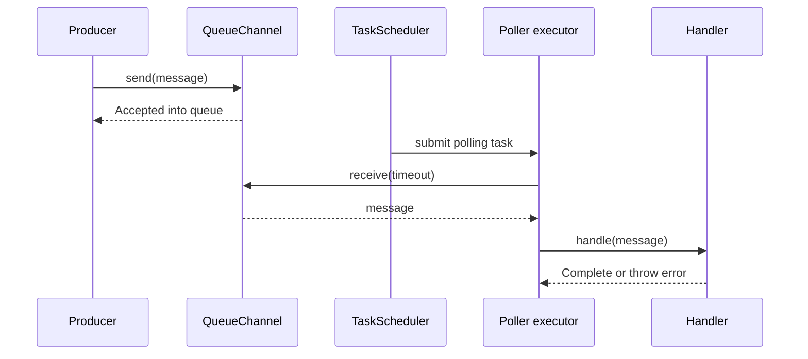

# Poller and Asynchronous Processing

## 1. Objectives and Use Cases

In the `SPRING_INTEGRATION_CORE` module, this lesson belongs to the **Poller** chapter and focuses on organizing the execution flow when an endpoint actively pulls messages and processes them on worker threads. After this lesson, you will be able to trace the path of a `Message`, identify where threads switch, configure the Java DSL, and explain the impact on errors, ordering, load, and testing.

Suppose the application accepts invoice issuance requests. Each request must call an external service, which may take several seconds. If all work runs on the scheduler thread, one slow call occupies the resource used to trigger periodic tasks. We want to separate deciding **when to poll** from executing **the poll and processing**.

Distinguish three business states:

- **Accepted**: the request has been placed into a channel or a storage mechanism.
- **Processing**: a worker has pulled the request and started executing.
- **Completed**: business side effects succeeded and the result has been recorded.

These are three distinct instants. An API returning after sending a message is not enough to prove the invoice has been issued.

## 2. Polling, Asynchrony, and Parallelism Are Different Concepts

**Polling** is how an endpoint actively calls receive on a trigger. It does not by itself assert that handlers run in parallel.

**Asynchrony** means the sender does not execute all processing on the same call stack. **Parallelism** requires multiple pieces of work to genuinely have an opportunity to run simultaneously. An executor with only one worker still creates an asynchronous boundary, yet only processes one job at a time.

In Spring Integration, `PollingConsumer` fetches messages from a `PollableChannel`; an inbound polling adapter fetches data from a `MessageSource`. A poller can delegate tasks to an executor. Without a dedicated executor configured, the handler normally runs on the scheduler thread that fired the poll. [Message Endpoints Reference](https://docs.spring.io/spring-integration/reference/endpoint.html).

| Component | Role in the execution model |
| --- | --- |
| `Message` | Carries payload and headers across steps |
| `TaskScheduler` | Triggers tasks according to the trigger |
| Poller's executor | Accepts polling tasks for workers to execute |
| `QueueChannel` | Holds messages waiting for a consumer to receive |
| `DirectChannel` | Forwards to handler on the sending thread |
| `ExecutorChannel` | Delegates dispatching to the channel's executor |
| Endpoint | Combines channel, handler, and operational configuration |

Specifying an `Executor` is not enough to guarantee a thread switch: for example, `SyncTaskExecutor` runs directly on the calling thread. This lesson uses `ThreadPoolTaskExecutor` to create real workers. [Task Execution and Scheduling](https://docs.spring.io/spring-framework/reference/integration/scheduling.html).

## 3. Identifying Thread Boundaries on Diagrams

### 3.1. QueueChannel and a Poller Without a Dedicated Executor

```text
request-thread: send Message --> QueueChannel --> return
                                  |
scheduler-thread:                 receive --> transformer --> handler
```

The producer is decoupled from the consumer by the queue. However, the synchronous processing chain behind the poller can still hold the scheduler thread for a long time.

### 3.2. QueueChannel and an Executor on the Poller



In this model, a worker picks up the poll task, fetches the message, and runs the synchronous handler chain downstream. If you place another channel with an executor mid-chain, steps after that channel can move to another worker.

### 3.3. Placing ExecutorChannel After the Receive Step

```text
scheduler --> receive --> ExecutorChannel --> business-worker --> handler
```

This approach separates business processing after the message has already been received. The split point differs from placing the executor on the poller, so error-handling and transaction scopes must be re-evaluated accordingly.

`QueueChannel` requires a consumer to actively receive; `ExecutorChannel` dispatches to subscribers and needs no poller to consume from it. `DirectChannel` keeps the same thread when dispatching. [Message Channel Implementations](https://docs.spring.io/spring-integration/reference/channel/implementations.html).

**Thread-tracing exercise:** given the flow `QueueChannel -> transformer -> DirectChannel -> service activator -> ExecutorChannel -> final handler`, mark the portion running on the poller worker and the portion running on the channel's executor. Adding a transformer, router, or filter does not by itself create a new worker.

## 4. Understanding the Unit of Work Before Increasing Concurrency

One **polling task** can perform multiple message receives within the same poll. `maxMessagesPerPoll` limits messages in the poll; it is not the worker count and does not automatically split each message into a separate task. With a synchronous chain, messages in one poll are still processed sequentially on the worker executing that poll. [Polling Consumers](https://docs.spring.io/spring-integration/reference/7.0/endpoint.html).

Self-constructed example:

```text
maxMessagesPerPoll = 3

worker-1, poll A: receive A1 -> process A1 -> receive A2 -> process A2 -> receive A3 -> process A3
worker-2, poll B: receive B1 -> process B1 -> ...
```

Two polls can overlap if the trigger keeps submitting while the previous poll is still running and the executor still has capacity to accept work. Conversely, configuring four workers while only one poll runs still does not make three messages in that poll run in parallel.

When using an asynchronous executor, do not deduce that `fixedDelay` always waits for business work to finish before starting the pause interval. The work visible to the scheduler may finish right after handing the task to the executor, while the worker is still processing. If the business requirement is zero overlapping runs, design a sequential mechanism or control in-flight task count; merely switching from fixed rate to fixed delay is not sufficient proof.

## 5. Java DSL Example: Processing Orders with Poller Workers

The following example uses Java 17 or higher and Spring Integration 6.x/7.x Java DSL APIs. Assume the application already has `spring-integration-core` and a compatible Spring context; if using Spring Boot, manage versions via the project's BOM. `@EnableAsync` does not need to be enabled for the poller's executor to work.

This is a configuration used in a standalone Spring context or imported into an application. The result queues are for observation in the lesson only; in production, a component must consume or persist results.

```java
import java.time.Duration;
import java.util.concurrent.ThreadPoolExecutor;

import org.springframework.beans.factory.annotation.Qualifier;
import org.springframework.context.annotation.Bean;
import org.springframework.context.annotation.Configuration;
import org.springframework.integration.channel.DirectChannel;
import org.springframework.integration.channel.QueueChannel;
import org.springframework.integration.config.EnableIntegration;
import org.springframework.integration.dsl.IntegrationFlow;
import org.springframework.integration.dsl.Pollers;
import org.springframework.messaging.MessagingException;
import org.springframework.scheduling.concurrent.ThreadPoolTaskExecutor;

@Configuration
@EnableIntegration
public class PollerAsyncConfiguration {

    public record Order(String id) { }

    public record ProcessedOrder(String id, String workerThread) { }

    @Bean
    public QueueChannel orders() {
        return new QueueChannel(100);
    }

    @Bean
    public QueueChannel completedOrders() {
        return new QueueChannel(100);
    }

    @Bean
    public DirectChannel orderPollerErrors() {
        return new DirectChannel();
    }

    @Bean
    public ThreadPoolTaskExecutor orderPollExecutor() {
        ThreadPoolTaskExecutor executor = new ThreadPoolTaskExecutor();
        executor.setCorePoolSize(4);
        executor.setMaxPoolSize(4);
        executor.setQueueCapacity(20);
        executor.setThreadNamePrefix("order-poll-");
        executor.setRejectedExecutionHandler(
                new ThreadPoolExecutor.AbortPolicy());
        return executor;
    }

    @Bean
    public IntegrationFlow orderProcessing(
            @Qualifier("orders") QueueChannel orders,
            @Qualifier("completedOrders") QueueChannel completedOrders,
            ThreadPoolTaskExecutor orderPollExecutor,
            @Qualifier("orderPollerErrors") DirectChannel orderPollerErrors) {

        return IntegrationFlow.from(orders)
                .<Order>handle((order, headers) -> {
                    if ("FAIL".equals(order.id())) {
                        throw new IllegalStateException("Cannot process FAIL order");
                    }
                    return new ProcessedOrder(
                            order.id(), Thread.currentThread().getName());
                }, endpoint -> endpoint
                        .id("orderPollingConsumer")
                        .poller(Pollers.fixedRate(Duration.ofMillis(100))
                                .maxMessagesPerPoll(1)
                                .receiveTimeout(0)
                                .taskExecutor(orderPollExecutor)
                                .errorChannel(orderPollerErrors)))
                .channel(completedOrders)
                .get();
    }

    @Bean
    public IntegrationFlow orderErrorFlow(
            @Qualifier("orderPollerErrors") DirectChannel errors) {
        return IntegrationFlow.from(errors)
                .handle(message -> {
                    Throwable failure = (Throwable) message.getPayload();
                    Object failedId = "unknown";
                    if (failure instanceof MessagingException messagingException
                            && messagingException.getFailedMessage() != null
                            && messagingException.getFailedMessage().getPayload()
                                    instanceof Order order) {
                        failedId = order.id();
                    }
                    System.err.printf("orderId=%s, thread=%s, failure=%s%n",
                            failedId,
                            Thread.currentThread().getName(),
                            failure);
                })
                .get();
    }
}
```

The `ThreadPoolTaskExecutor` returned from `@Bean` will have its lifecycle managed by Spring; there is no need to call `initialize()` manually in this configuration. The Poller DSL provides configuration points `taskExecutor`, `receiveTimeout`, and `errorChannel`. [PollerSpec API](https://docs.spring.io/spring-integration/api/org/springframework/integration/dsl/PollerSpec.html).

Decisions in the example:

- Input queue holds at most 100 messages so the exercise has a clear bound.
- Fixed pool of four workers makes observing and reasoning about concurrent tasks straightforward.
- Executor queue holds at most 20 **polling tasks**, not 20 already-received orders.
- Each poll fetches only one message to make tracking which task handles which order easy.
- `receiveTimeout(0)` makes empty-queue polls return immediately.
- `AbortPolicy` turns task-acceptance exhaustion into an observable error instead of silently dropping tasks.

Do not treat 4, 20, or 100 as default configurations for every system. They are choices made for the lesson.

### Sending a Request and Waiting Separately for the Result

Place the following snippet in code that has `ApplicationContext context`:

```java
QueueChannel orders = context.getBean("orders", QueueChannel.class);
QueueChannel results = context.getBean("completedOrders", QueueChannel.class);

boolean accepted = orders.send(
        org.springframework.messaging.support.MessageBuilder
                .withPayload(new PollerAsyncConfiguration.Order("ORD-001"))
                .setHeader("requestId", "REQ-001")
                .build(),
        200);

if (!accepted) {
    throw new IllegalStateException("Input queue is full");
}

org.springframework.messaging.Message<?> result = results.receive(5000);
if (result == null) {
    throw new IllegalStateException("No result within wait timeout");
}
System.out.println(result.getPayload());
```

`accepted` is the queue acceptance result. Receiving `ProcessedOrder` is what signals the sample handler finished running. In a multi-request system, route or correlate results by identifier; do not let every request arbitrarily pull the first result from a shared queue.

A `void`-returning gateway can serve as a convenient entry point, yet must still clearly define the acceptance contract. With a request–reply gateway, the caller may still wait for the reply even though the internal flow uses another worker; switching threads does not mean the calling API always returns immediately.

## 6. Two Queues and the Overload Problem

In the example, there are two kinds of backlog:

```text
Pending orders:        QueueChannel orders
Pending polling turns: orderPollExecutor task queue
```

There is also `completedOrders`, which holds unread results. If the result queue fills up, sending results can block workers and subsequently grow upstream backlogs. Therefore, observe the output side too when diagnosing a slow poller.

Suppose each order takes 0.4 seconds on average, each poll processes one order, and other overhead is ignored:

```text
4 workers / 0.4 seconds ≈ 10 orders/second
100 ms trigger          ≈ 10 polls/second
```

This is an idealized scenario estimate, not a performance measurement. If inbound rate is 15 orders/second while the system completes 10 orders/second, backlog grows by about 5 orders/second. A queue with 100 free slots can fill up in roughly 20 seconds. Increasing capacity only delays filling up if processing speed remains lower than arrival rate.

When experimenting, record:

| Metric | Question to answer |
| --- | --- |
| Input queue depth | Are messages accumulating or being processed in time? |
| Oldest message age | How long have users been waiting? |
| Active workers | Is the pool saturated? |
| Queued tasks in executor | Are unstarted polls building up? |
| Result queue depth | Has the output consumer slowed down or stopped? |
| Rejection rate | Is the executor rejecting new poll schedules? |
| External service latency | Would adding workers still improve anything? |

A larger pool does not always make the system faster. For instance, if the invoice service only permits five concurrent requests, increasing to 50 workers may mostly generate more timeouts and retries.

In a standard thread pool, tasks are queued once core workers are busy; scaling up to `maxPoolSize` depends on queue capacity. Thus, a huge queue can keep `corePoolSize=2`, `maxPoolSize=20` running with two workers for a long time. `CallerRunsPolicy` may run tasks on the submitting thread when saturated, so if using it, accept that the scheduler may end up executing business work. [Executor configuration](https://docs.spring.io/spring-framework/reference/integration/scheduling.html).

## 7. Receive Timeout, Per-Poll Limit, and Empty Tasks

`receiveTimeout` is the wait time for **receiving a message**, not an HTTP timeout, business processing timeout, or total request deadline. It only has an appropriate effect when the receive operation supports waiting. A poller fetching from a source that returns instantaneously does not gain wait capability from this parameter. [Polling and receive timeout](https://docs.spring.io/spring-integration/reference/endpoint.html).

Another experiment on the main example:

```text
trigger every 100 ms
receiveTimeout = 5 seconds
queue has no data
pool has 4 workers
```

Workers can be tied up waiting for data while the trigger continues creating tasks. Executor backlog grows even though message backlog is zero. If you see low CPU yet a full executor, check where workers are waiting before enlarging the pool.

For sources that frequently have data, setting a finite `maxMessagesPerPoll` gives each poll a clearer stopping point. A large value can reduce poll-setup overhead, but also keeps one worker busy longer. Do not use this parameter as a global cap on total messages currently being processed across the application.

## 8. Errors Across Asynchronous Boundaries

Once the producer has sent a message into the queue and moved on, exceptions raised later on a worker cannot automatically return to the old call stack via `try/catch`. Spring Integration uses `ErrorMessage` for framework-managed asynchronous error paths. Resolution typically prioritizes the message's `errorChannel` header, followed by the configured default error channel. The example chose `orderPollerErrors` for the poller. [Error Handling](https://docs.spring.io/spring-integration/reference/error-handling.html).

Try sending `new Order("FAIL")`: the request can be accepted successfully, yet produce no `ProcessedOrder`; the error flow records the failure. The error handler in the example only prints to console for observation and does not yet implement business recovery.

When designing a recovery flow for the invoice scenario, answer specifically:

1. Which errors are retried, with what wait interval and maximum attempt count?
2. Where are requests that exhaust retries stored so they can be reprocessed?
3. Which key prevents issuing two invoices when a previous request succeeded but its response was lost?
4. How is failure status surfaced to the user?

Separate **message-processing errors** from **task-submission errors**. A task rejected by the executor may not have received any message yet, so do not require every error to carry a `failedMessage`. For submission rejections, observe both the scheduler's and executor's error reporting paths; an error flow attached only to worker processing is no proof all cases are covered. [Scheduled poller error mechanism](https://docs.spring.io/spring-integration/reference/error-handling.html).

In the example using an in-memory queue, a message already pulled does not automatically return to the queue just because the handler threw an error. To recover, add retries, failure storage, or a source design capable of appropriate redelivery.

## 9. Ordering, Shared State, and Transactions

### 9.1. Completion Order

Consider two orders pulled in sequence A then B:

```text
worker-1: A -------- processing 2 seconds -------- complete
worker-2:   B -- processing 0.1 seconds -- complete
```

B finishes before A. If business rules require sequential processing per `customerId`, design routing that preserves per-key ordering, or use appropriate state synchronization. An input FIFO queue is insufficient to guarantee completion order when multiple workers exist.

An aggregator relies on correlation and release conditions to group results; do not rely on random worker completion order as the condition deciding when a group is complete. If ordering within a group is required, pass explicit sequence information and handle it according to business rules.

### 9.2. Shared Payloads and Handlers

Messages passed to workers can still reference the same payload object. Therefore, after sending a mutable order object, the producer must not continue mutating fields that a worker is about to read. In the example, a record with `String` fields helps reduce this risk; a record containing a mutable list still requires separate scrutiny.

A singleton handler can serve multiple workers. Avoid using fields like `currentOrderId` to hold temporary per-invocation state. Use local variables or a state mechanism designed for concurrent access.

### 9.3. Transactions and Thread-Bound Information

With standard thread-bound transactions, do not expect the producer's transaction to automatically cover post-queue processing. Similarly, when placing an `ExecutorChannel` mid-flow, determine which transaction covers segments before and after that boundary. [ExecutorChannel and transactions](https://docs.spring.io/spring-integration/reference/channel/implementations.html).

If you put transaction advice on the poller, still check whether the source or channel and business resources actually participate in the transaction. Marking something transactional does not turn a plain in-memory queue into durable storage.

`requestId` in headers is a useful choice for linking logs across steps. MDC, security context, and other `ThreadLocal` values need explicit propagation or initialization mechanisms when switching threads; do not assume they exist on a worker merely because they existed on the producer.

## 10. Testing Asynchronous Behavior

Tests must await a bounded condition rather than sleeping a fixed interval and guessing work is done. This lesson provides illustrative code; running a build is not required while writing documentation.

The following JUnit 5 snippet uses the exact configuration above and closes the context after checking:

```java
import static org.junit.jupiter.api.Assertions.*;

import java.util.HashSet;
import java.util.Set;

import org.junit.jupiter.api.Test;
import org.springframework.context.annotation.AnnotationConfigApplicationContext;
import org.springframework.integration.channel.QueueChannel;
import org.springframework.messaging.Message;
import org.springframework.messaging.support.MessageBuilder;

class PollerAsyncConfigurationTest {

    @Test
    void processesMessagesOnPollerWorkers() {
        try (var context = new AnnotationConfigApplicationContext(
                PollerAsyncConfiguration.class)) {
            QueueChannel input = context.getBean("orders", QueueChannel.class);
            QueueChannel output = context.getBean(
                    "completedOrders", QueueChannel.class);

            for (String id : Set.of("ORD-A", "ORD-B")) {
                assertTrue(input.send(MessageBuilder.withPayload(
                        new PollerAsyncConfiguration.Order(id)).build(), 200));
            }

            Set<String> receivedIds = new HashSet<>();
            for (int i = 0; i < 2; i++) {
                Message<?> message = output.receive(5000);
                assertNotNull(message, "Timed out waiting for result");
                var result = assertInstanceOf(
                        PollerAsyncConfiguration.ProcessedOrder.class,
                        message.getPayload());
                receivedIds.add(result.id());
                assertTrue(result.workerThread().startsWith("order-poll-"));
            }
            assertEquals(Set.of("ORD-A", "ORD-B"), receivedIds);
        }
    }
}
```

This test proves two results were produced and the handler ran on a thread with the configured executor's prefix. It **does not measure concurrency**: both messages could have been processed by the same worker at two different times.

To verify that multiple handlers genuinely overlap, design a separate test with a latch or barrier with a timeout: wait until at least two handlers enter the processing region before releasing them to finish. Always release the latch in `finally` so a failing test does not hang workers forever.

Further practice cases:

| Test case | Condition to observe |
| --- | --- |
| `FAIL` order | Capture the error event containing the identifier when a failed message exists |
| Input full and consumer paused | `send(message, timeout)` fails in a controlled manner |
| Workers held and task queue full | Rejection signal appears, without assuming the order was processed |
| Two orders with different processing times | Results are not asserted in a fixed completion order |
| Result consumer stopped | Detect output backlog and workers blocked sending |
| Context closed while work remains | Clearly observe completed work versus interrupted work |

## 11. Design Choices for Each Requirement

| Requirement | Design direction to consider |
| --- | --- |
| Receive from `QueueChannel` and process on dedicated workers | Configure an executor on the poller |
| Poll sequentially, process downstream independently | Split via an executor channel, redefine handoff boundaries |
| Preserve order across the entire flow | Single sequential processing pipeline with no parallel boundary downstream |
| Preserve order per customer | Route by key to sequential per-key pipelines |
| Survive application restarts | Design durable storage or broker and acknowledgment rules |
| Caller needs business result | Request–reply contract or status query API |
| Downstream has concurrency limit | Cap workers to downstream capacity and measure in practice |

Before changing configuration, write down a concrete flow: where the producer sends, which thread receives, which segments remain synchronous, where errors surface, and when the request is considered complete. This map helps surface false assumptions about transactions, ordering, and recoverability early.

## 12. Self-Check Knowledge Questions

1. Why, when `QueueChannel` already decouples producer from consumer, is there still reason to configure an executor on the poller?
2. With four workers and `maxMessagesPerPoll(10)`, can you conclude 40 messages are always processing concurrently? Distinguish messages within a poll from running polls.
3. When the message queue is empty yet the executor task queue fills up, which `receiveTimeout` and blocking point should you check?
4. Under which model is `send()` returning success followed by the handler reporting an error a valid outcome?
5. Why does FIFO not guarantee completion order when multiple workers exist?
6. When moving a processing step across an `ExecutorChannel`, how must transactions and error reporting be re-examined?
7. Why does checking thread names alone not prove parallel processing?
8. If outputs are not being consumed, will increasing the worker count solve the root cause?

You have mastered the lesson when you can answer these questions using concrete message and thread paths, and then adjust the design to business requirements rather than merely increasing pools or shortening poll intervals.