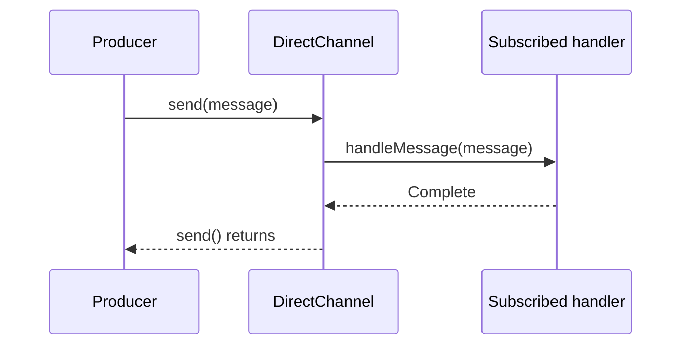
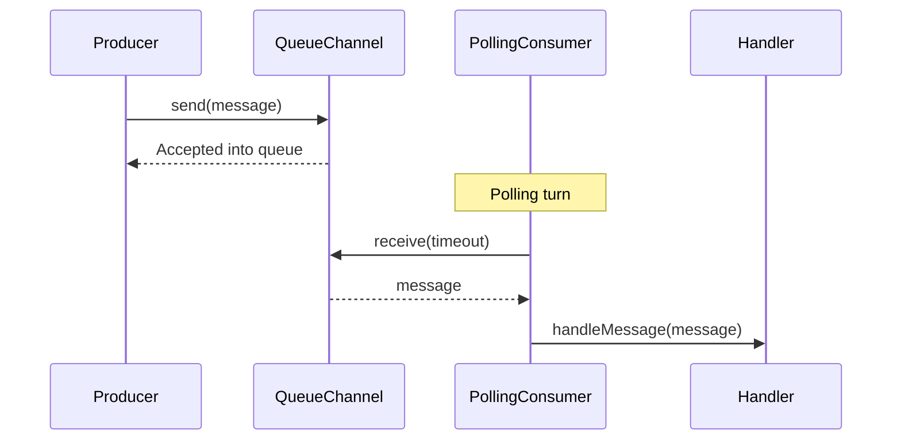
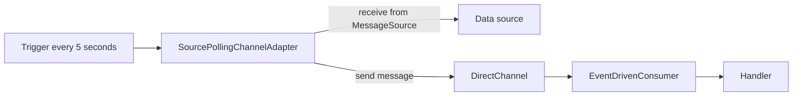

# Pollers Do Not Fit SubscribableChannel

In Spring Integration Core, a poller decides when an endpoint actively retrieves a message. For a consumer reading from a channel, that operation requires the `PollableChannel.receive()` contract. Conversely, a `SubscribableChannel` delivers messages to registered handlers on a send call; the consumer needs no scheduled message-fetching loop.

Therefore, **do not attach a poller to a consumer whose input channel is `DirectChannel`, `ExecutorChannel`, or `PublishSubscribeChannel`**. Distinguish this rule from a polled source that sends results into those channels: such a source wiring remains valid.

This lesson belongs to the **Poller** chapter of the `SPRING_INTEGRATION_CORE` module, focusing on coordinating Message, MessageChannel, endpoints, and the Java DSL to choose the right handler activation mechanism. The examples use Spring Integration 6.x+ style APIs; the project requires `spring-integration-core` and compatible Spring dependencies.

## 1. Two Message-Receiving Contracts

The signatures below are condensed to highlight differences, not the full interface source code:

```java
// Channel supporting active message retrieval.
interface PollableChannel extends MessageChannel {
    Message<?> receive();
    Message<?> receive(long timeout);
}

// Channel supporting handler subscription.
interface SubscribableChannel extends MessageChannel {
    boolean subscribe(MessageHandler handler);
    boolean unsubscribe(MessageHandler handler);
}
```

`send()` exists on both channel families via `MessageChannel`. The critical difference is whether the consumer side pulls messages via `receive()` or gets invoked via `handleMessage()`.

| Consumer's input channel | Receiving mechanism | Typical endpoint | Poller on consumer |
|---|---|---|---|
| `DirectChannel` | Channel invokes one registered handler | `EventDrivenConsumer` | Not configured |
| `ExecutorChannel` | Channel dispatches via an executor | `EventDrivenConsumer` | Not configured |
| `PublishSubscribeChannel` | Channel broadcasts to subscribers | `EventDrivenConsumer` | Not configured |
| `QueueChannel` | Consumer calls `receive()` | `PollingConsumer` | Dedicated or default required |

These are the two common mechanisms examined in this lesson; do not use this table to extrapolate how every reactive or custom channel works. The [Message Endpoints](https://docs.spring.io/spring-integration/reference/endpoint.html) documentation describes selecting endpoints based on the input channel's contract.

## 2. Why Does a Poller Have Nothing to Do on a SubscribableChannel?

Consider an order-approval request sent into a `DirectChannel`:



The handler has already been invoked by the very act of sending the message. There is no waiting for a poller to become due. With `DirectChannel`, the handler call runs on the sender's thread in typical configurations.

If you add the idea "every second, pull one message from `DirectChannel`," an immediate question arises: pull via which method? `SubscribableChannel` does not provide `receive()` and makes no promise to retain a queue for a consumer to read later.

Nor does a poller turn a channel into a queue. Configurations such as `fixedDelay`, `cron`, `receiveTimeout`, or `maxMessagesPerPoll` do not add message-buffering capability to `DirectChannel`.

Compare with a queue-based flow:



In the second flow, the polling schedule has an object to act upon: the consumer calls `receive()` on the queue. Always ask **where the endpoint is pulling data from** before choosing a schedule configuration.

## 3. Incorrect Example: Putting @Poller on a DirectChannel Consumer

Suppose the application declares the following channel:

```java
import org.springframework.context.annotation.Bean;
import org.springframework.integration.channel.DirectChannel;
import org.springframework.messaging.SubscribableChannel;

@Bean
public SubscribableChannel orders() {
    return new DirectChannel();
}
```

Then configures the handler like this:

```java
import org.springframework.integration.annotation.Poller;
import org.springframework.integration.annotation.ServiceActivator;

// WRONG: orders is a DirectChannel, not a PollableChannel.
@ServiceActivator(
    inputChannel = "orders",
    poller = @Poller(fixedDelay = "1000", maxMessagesPerPoll = "1")
)
public void approve(String orderId) {
    System.out.println("Approved: " + orderId);
}
```

The intent might be "process at most one order per second," yet this configuration puts a schedule on a consumer incapable of polling its input channel. That is an endpoint-and-channel mismatch error, not a bug in `approve()`'s business logic.

In normal endpoint creation, the framework rejects a poller attached directly to a consumer of a subscription-only channel. The error typically appears when initializing the application context, possibly wrapped in a bean-creation exception. Do not depend on a fixed exception string across versions. Read the root cause and the relevant input channel name. Endpoint creation mechanics can be inspected in [ConsumerEndpointFactoryBean](https://github.com/spring-projects/spring-integration/blob/main/spring-integration-core/src/main/java/org/springframework/integration/config/ConsumerEndpointFactoryBean.java).

Note: `@Bean` and annotation snippets must reside in a Spring-managed class. Simply putting them on an object manually instantiated with `new` does not create an integration endpoint.

## 4. First Fix: Keep DirectChannel and Remove the Poller

Choose this when the requirement is immediate processing upon message arrival. The complete example below uses the Java DSL, needing no extra `@ServiceActivator`:

```java
import org.springframework.context.annotation.Bean;
import org.springframework.context.annotation.Configuration;
import org.springframework.integration.channel.DirectChannel;
import org.springframework.integration.config.EnableIntegration;
import org.springframework.integration.dsl.IntegrationFlow;
import org.springframework.messaging.SubscribableChannel;

@Configuration
@EnableIntegration
public class ImmediateOrdersConfig {

    @Bean
    public SubscribableChannel orders() {
        return new DirectChannel();
    }

    @Bean
    public IntegrationFlow approveOrders() {
        return IntegrationFlow.from("orders")
            .handle(String.class, (orderId, headers) -> {
                System.out.println("Approved: " + orderId);
                return null; // Handler terminates flow, emits no reply.
            })
            .get();
    }
}
```

After the context starts, test sending:

```java
import org.springframework.messaging.MessageChannel;
import org.springframework.messaging.support.MessageBuilder;

MessageChannel orders = context.getBean("orders", MessageChannel.class);
orders.send(MessageBuilder.withPayload("ORDER-013").build());
```

`context` here is the application context running the configuration above. The handler is invoked during `send()`. There is no one-second wait automatically added by the framework.

If the handler is a transformer, filter, or router, the principle for choosing the receiving mechanism remains the same: inspect that endpoint's input channel. Business operation type does not by itself create a polling need. For an aggregator, group timeout schedules or release times are a separate mechanism; do not use a poller on `DirectChannel` as a substitute for aggregator configuration.

## 5. Second Fix: Use QueueChannel and a Polling Consumer

If the real requirement is accept first and process later on a cadence, represent the buffer with a pollable channel. This is an alternative configuration to the previous example; do not load both classes having the same `orders` and `approveOrders` bean names simultaneously.

```java
import java.time.Duration;

import org.springframework.context.annotation.Bean;
import org.springframework.context.annotation.Configuration;
import org.springframework.integration.channel.QueueChannel;
import org.springframework.integration.config.EnableIntegration;
import org.springframework.integration.dsl.IntegrationFlow;
import org.springframework.integration.dsl.Pollers;

@Configuration
@EnableIntegration
public class QueuedOrdersConfig {

    @Bean
    public QueueChannel orders() {
        return new QueueChannel(100);
    }

    @Bean
    public IntegrationFlow approveOrders() {
        return IntegrationFlow.from("orders")
            .handle(String.class, (orderId, headers) -> {
                System.out.println("Approved: " + orderId);
                return null;
            }, endpoint -> endpoint.poller(
                Pollers.fixedDelay(Duration.ofSeconds(1))
                    .maxMessagesPerPoll(1)
                    .receiveTimeout(0)
            ))
            .get();
    }
}
```

In this DSL, `endpoint -> endpoint.poller(...)` configures the consumer hosting the handler at `.handle(...)`. That consumer's input is the `orders` bean, which is now a `QueueChannel`.

The chosen values have specific meanings:

- Capacity `100`: a finite buffer for the example.
- One-second `fixedDelay`: pause between when a polling execution finishes and the next one in a configuration without a dedicated executor on this poller.
- `maxMessagesPerPoll(1)`: one poll fetches at most one message; not a payload batch size.
- `receiveTimeout(0)`: if the queue is empty, the receive operation returns immediately.

With a consumer like the above, processing duration also contributes to the interval between polls. This is not an exact throughput guarantee of one message per second. Adding another consumer or an executor alters execution and must be evaluated separately.

Do not call `Thread.sleep()` inside a handler to simulate a poller: that holds the processing thread and creates no new message-receiving contract. Poller configuration syntax in the DSL is introduced in [Pollers](https://docs.spring.io/spring-integration/reference/dsl/java-pollers.html).

Switching to a queue also changes the semantics of sending. A successful send now only indicates the queue accepted the message, not that business processing has finished. A send call with a finite timeout can be written as:

```java
boolean accepted = orders.send(
    MessageBuilder.withPayload("ORDER-013").build(),
    500
);
if (!accepted) {
    throw new IllegalStateException("Queue did not accept the order");
}
```

Do not switch channels just to make a configuration error disappear while ignoring changes in completion timing, capacity, and error handling.

## 6. Valid Case: A Polled Source Sending into DirectChannel

A system can check a source every five seconds and immediately process the result. The poller belongs to the source endpoint, not the `DirectChannel` consumer:



The following example generates dummy data via a counter; it only illustrates poller placement, not durability or acknowledgment mechanisms of an external source:

```java
import java.time.Duration;
import java.util.concurrent.atomic.AtomicInteger;

import org.springframework.context.annotation.Bean;
import org.springframework.context.annotation.Configuration;
import org.springframework.integration.channel.DirectChannel;
import org.springframework.integration.config.EnableIntegration;
import org.springframework.integration.dsl.IntegrationFlow;
import org.springframework.integration.dsl.Pollers;
import org.springframework.messaging.SubscribableChannel;

@Configuration
@EnableIntegration
public class PolledSourceConfig {

    private final AtomicInteger sequence = new AtomicInteger();

    @Bean
    public SubscribableChannel fetchedOrders() {
        return new DirectChannel();
    }

    @Bean
    public IntegrationFlow fetchOrders() {
        return IntegrationFlow
            .fromSupplier(
                () -> "ORDER-" + sequence.incrementAndGet(),
                source -> source.poller(
                    Pollers.fixedDelay(Duration.ofSeconds(5))
                        .maxMessagesPerPoll(1)
                )
            )
            .channel("fetchedOrders")
            .get();
    }

    @Bean
    public IntegrationFlow consumeFetchedOrders() {
        return IntegrationFlow.from("fetchedOrders")
            .handle(message -> System.out.println(message.getPayload()))
            .get();
    }
}
```

The supplier returns the payload; the adapter is responsible for creating the message.

Here there are two independent endpoints:

1. The source adapter is woken on schedule to call the supplier and send the message.
2. The consumer on `fetchedOrders` registers a handler and is invoked when the adapter sends.

The handler behind `DirectChannel` may run on the thread executing the source's polling task. That does not turn it into a `PollingConsumer`: distinguish **the origin of the thread** from **the endpoint's message-receiving contract**. See source polling mechanics in [Channel Adapter](https://docs.spring.io/spring-integration/reference/channel-adapter.html).

## 7. Asynchrony Is Not Synonymous with Polling

A common confusion is seeing a handler run on another thread and concluding there must be a poller. Two questions must be answered independently:

- **Who triggers message reception?** Does the channel dispatch to subscribers, or does the consumer actively call `receive()`?
- **Which thread executes?** The sender thread, an executor, or a thread running a polling task?

`ExecutorChannel` is still subscribable: it uses an executor to run work instead of providing a queue with `receive()` for the endpoint. `PublishSubscribeChannel` can execute subscribers synchronously or via an executor depending on configuration; neither case requires a poller on subscribers.

An executor may have an internal task queue, yet that is not a channel's message-polling API. You cannot use `receiveTimeout` to read that task queue. Likewise, do not attach `cron` onto a subscriber to schedule handler invocations.

When the requirement is separating threads, consider `ExecutorChannel`. When you need to accumulate messages and fetch them on a schedule, you need a buffer with a suitable contract such as `QueueChannel`. When you need to broadcast an event to multiple branches, consider `PublishSubscribeChannel`. These choices solve different requirements; see [Message Channel Implementations](https://docs.spring.io/spring-integration/reference/channel/implementations.html).

## 8. Changes Regarding Errors, Transactions, and Gateways

### 8.1. Synchronous Errors vs. Errors in a Polling Task

In a typical `DirectChannel` flow, exceptions from the handler propagate along the sender's call stack. When using a queue and a polling consumer, the sender may already have received a success return from `send()` before the handler runs. You cannot catch later processing errors simply with a `try/catch` wrapping the initial send call.

Spring Integration provides a mechanism to emit an `ErrorMessage` for errors in polling tasks. When designing error configuration, identify the error handler in use, the message's or poller's error channel, and where error messages are consumed; do not assume merely declaring a channel gives you a recovery workflow. Error propagation and routing are described in [Error Handling](https://docs.spring.io/spring-integration/reference/error-handling.html).

Do not add a poller to `DirectChannel` just to force errors onto `errorChannel`. If retries or recovery at the handler are needed, choose advice and error-handling strategies matching the execution model.

### 8.2. Transactions Do Not Automatically Cross Buffers

Placing a queue between two steps creates an execution boundary that must be explicitly designed. The sending thread's transaction does not automatically become the polling thread's transaction. Nor does a standard in-memory `QueueChannel` guarantee messages survive after the process stops.

For example, "successfully enqueued, then database update failed" needs its own recovery policy. A poller only creates a message-fetching schedule; by itself it guarantees neither retries, duplicate prevention, nor exactly-once processing.

### 8.3. Gateways Still Need Timely Replies

If the entry point is invoked through a request-reply messaging gateway, adding a queue does not automatically turn the gateway call into fire-and-forget. Check the reply channel, whether the handler emits a reply, and a timeout suitable for polling latency plus processing duration.

Handlers returning `null` or merely printing to console in this lesson are examples ending a one-way flow. Do not copy them verbatim as an example for a gateway awaiting an order-approval result.

## 9. A Default Poller Does Not Change the Channel Type

An application can have a global default poller for polling endpoints to use when they lack their own configuration. That does not mean every endpoint runs on a schedule.

For example, if a context has both `DirectChannel` and `QueueChannel`:

- A `QueueChannel` consumer can use the default poller when no dedicated poller is declared.
- A `DirectChannel` consumer still operates via subscription.

Therefore, the presence of a default poller does not imply a configuration error. Look for which endpoint actually has a poller attached. If a `DirectChannel` flow processes "immediately" despite the application having a five-second default poller, that behavior matches the channel type.

## 10. How to Observe and Verify

The tests below are for learners to run in a project with appropriate dependencies; this lesson does not include assumed run outputs.

### 10.1. Verifying DirectChannel Does Not Wait for a Schedule

Standalone example using JUnit Jupiter, without starting a Spring context:

```java
import java.util.concurrent.atomic.AtomicReference;

import org.junit.jupiter.api.Test;
import org.springframework.integration.channel.DirectChannel;
import org.springframework.messaging.support.MessageBuilder;

import static org.junit.jupiter.api.Assertions.assertSame;
import static org.junit.jupiter.api.Assertions.assertTrue;

class DirectChannelDispatchTest {

    @Test
    void handlerRunsOnSenderThreadBeforeSendReturns() {
        DirectChannel channel = new DirectChannel();
        AtomicReference<Thread> handlerThread = new AtomicReference<>();
        channel.subscribe(message -> handlerThread.set(Thread.currentThread()));

        Thread senderThread = Thread.currentThread();
        boolean accepted = channel.send(
            MessageBuilder.withPayload("ORDER-013").build()
        );

        assertTrue(accepted);
        assertSame(senderThread, handlerThread.get());
    }
}
```

The test verifies direct dispatch behavior; it does not test Spring endpoint selection or poller configuration.

### 10.2. Verifying Queue Boundaries

With a `QueueChannel` that has no consumer yet, send a message and then call `receive(0)`: the message is retrieved without needing a subscriber. When a `PollingConsumer` is placed behind it, that consumer performs the receive operation on schedule.

When writing integration tests for queue configurations, use a result channel or `CountDownLatch` to wait for processing with a bounded timeout. Do not simply sleep a fixed duration and conclude the flow works properly. Nor should test code call `receive()` on the input queue concurrently with the polling consumer, because the test will compete with the consumer for messages.

### 10.3. Verifying Rejected Configurations

In a separate test context, declare a `DirectChannel` and attach an explicit poller to its consumer. Expect the context to fail creating the endpoint and inspect the root cause relating to a non-pollable input channel. Then remove the poller, confirm the context starts, and verify messages reach the handler.

Avoid matching entire exception messages; wrapping details can change across Spring versions or configuration styles.

## 11. Quick Diagnostic Procedure

When encountering an inappropriate poller error, proceed in order:

1. Identify the endpoint carrying the poller configuration: `@ServiceActivator`, transformer, bridge, or a specific DSL step.
2. Get the name of **that endpoint's input channel**; do not confuse it with an upstream source adapter's output channel.
3. Inspect the actual channel object created by Spring. A variable declared as `MessageChannel` does not reveal whether it supports `receive()` or subscription.
4. Locate explicit pollers: `poller = @Poller(...)`, `.poller(...)`, or the XML `<poller>` element.
5. If event-driven processing is desired, keep a subscribable channel and remove the poller from the consumer.
6. If scheduled receiving from a buffer is desired, choose a pollable channel and configure a polling endpoint; simultaneously review errors, capacity, transactions, and reply wait times.

| Symptom | What to check |
|---|---|
| Context fails when adding `@Poller` | Is the endpoint's input channel actually pollable? |
| Handler runs immediately despite a default poller | Is the endpoint receiving via subscription? |
| Slow handler slows down the sender | Is `DirectChannel` being used on the same thread? |
| Switched to a queue and messages are not processed | Was the polling endpoint created, does it have a poller, and has it started? |
| Sender cannot catch business errors after enqueuing | On which polling task did the error occur, and where was it routed? |
| Source is polled yet output is `DirectChannel` | This can be a valid configuration; inspect poller placement rather than just channel name |

## 12. Practice Exercise

Design a flow that receives order codes, normalizes whitespace with a transformer, filters out empty codes, and forwards valid codes to a processing handler.

Implement two independent versions:

1. Use `DirectChannel` at the input and observe the handler running within the send call.
2. Use a bounded `QueueChannel` at the input, with the first consumer having a one-second poller and at most one message per poll. Subsequent segments can use direct channels, with no need to add a poller for every handler.

Be able to explain why the transformer right after the queue needs a polling mechanism while the filter and handler behind direct channels receive on an event-driven basis. Try adding a router to branch valid orders into two paths, then identify each endpoint's input channel before deciding whether a poller is needed.

The completion criterion is pointing out **the message-pull point**, **the subscriber-dispatch point**, and **the execution boundary** of each version. Those three factors determine where to place pollers and how to observe errors in an integration flow.