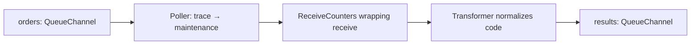

# Advice chains on a poller

## 1. Goals and context

In the **SPRING_INTEGRATION_CORE** module, a poller is where a message flow actively pulls data to start processing. For the **Poller transaction** chapter, the key question is: should additional behavior wrap the message receive step, a single endpoint, or the entire synchronous processing triggered by the poller?

This lesson focuses on reading advice scopes accurately, ordering transactions and retries deliberately, writing poller observation advice, and testing outcomes via `MessageChannel`. The examples use **Java 17+, Spring Integration 6.5.x**, and **Spring Retry 2.x** for retries. These serve as API baselines for the examples, not a requirement to change your project's versions.

Prerequisites: `Message`, `QueueChannel`, `DirectChannel`, endpoints, Java DSL, and Spring transaction commit/rollback concepts.

## 2. Where is advice attached?

An advice chain is a collection of behaviors applied via AOP, such as timing, pausing polling, opening a transaction, or retrying. Choosing where to attach advice determines which part of the work is affected.

| Attachment point | Scope to picture | Suitable examples |
| --- | --- | --- |
| Poller, with a standard `MethodInterceptor` | One receive-and-process execution, including subsequent synchronous calls | Timing processing from receive; opening a transaction before receive |
| Poller, with `ReceiveMessageAdvice` | The `receive()` call | Counting empty source polls; observing the just-received message |
| Handler, with request handler advice | The advised operation at that endpoint; exact scope depends on the advice type | Retrying a service call |
| Channel, with `ChannelInterceptor` | Send/receive operations through the channel | Inspecting headers or observing channel traffic |

`PollingConsumer` receives from a `PollableChannel`, such as `QueueChannel`. `SourcePollingChannelAdapter` receives from a `MessageSource`, such as a database-reading source. Both can be configured with a poller. See [Poller in Spring Integration](https://docs.spring.io/spring-integration/reference/polling-consumer.html).

### A scheduled trigger can include multiple receives

In the example's synchronous poller model, distinguish between:

- **Scheduled poll execution**: the scheduler triggers the poller on a trigger event.
- **Single poll**: receiving one message and processing it if present.
- **Maximum attempts per execution**: bounded by `maxMessagesPerPoll`.

For example, `maxMessagesPerPoll(3)` allows one scheduled run to perform up to three polls. The chain applies to each individual receive/process cycle; it does not automatically combine all three messages into one shared transaction. When `null` is received, the receive loop stops early. This detail is shown in [AbstractPollingEndpoint 6.5.0 source code](https://raw.githubusercontent.com/spring-projects/spring-integration/v6.5.0/spring-integration-core/src/main/java/org/springframework/integration/endpoint/AbstractPollingEndpoint.java).

In this lesson, we set `maxMessagesPerPoll(1)` so advice ordering and observed results are easy to correlate.

## 3. Reading chain order as nested calls

With three standard advices `A`, `B`, and `C`, the declaration order is the entry order; the first advice is outermost:

```text
A.before
  B.before
    C.before
      receive() -> synchronous processing
    C.after
  B.after
A.after
```

If an error occurs, the exception unwinds outward through the layers wrapping the call. `finally` blocks still execute; code placed after `proceed()` runs only when that invocation returns normally. This is the around-advice model described in [Ordering Advices](https://docs.spring.io/spring-integration/reference/6.5/handler-advice/order.html).

`invocation.proceed()` hands control to the next advice or target object. A standard observation advice calls it exactly once, returns the result, and lets exceptions propagate. Skipping the call to `proceed()` is a blocking decision that requires clear semantics, such as skipping a poll.

### When mixing two kinds of advice

Spring Integration separates `ReceiveMessageAdvice` from the group that wraps the entire poll. Within each group, declaration order is preserved. For example:

```text
Declared:     trace, receiveA, transaction, receiveB

Executed:     trace
                transaction
                  receiveA
                    receiveB
                      receive()
                synchronous processing
```

Therefore, placing `receiveA` before `transaction` in the list does not make it run outside the transaction. For a source that is already proxied, receive advice must also be evaluated alongside any advice already on the proxy. The grouping rule is documented in [Smart Polling and Advice Chain Ordering](https://docs.spring.io/spring-integration/reference/6.5/polling-consumer.html).

## 4. Java DSL example: observing, pausing polling, and counting messages

Suppose a system receives order codes into an internal queue, normalizes each code, and sends the result to an output channel. When downstream services require maintenance, the application temporarily skips new polls.

The example below only needs `spring-integration-core` and compatible Spring dependencies. Two in-memory `QueueChannel` beans illustrate the advice chain; transaction setup is added separately in a later section.

```java
package example.integration;

import java.time.Duration;
import java.util.Locale;
import java.util.concurrent.atomic.LongAdder;

import org.aopalliance.intercept.MethodInterceptor;
import org.aopalliance.intercept.MethodInvocation;
import org.springframework.context.annotation.Bean;
import org.springframework.context.annotation.Configuration;
import org.springframework.integration.aop.ReceiveMessageAdvice;
import org.springframework.integration.channel.QueueChannel;
import org.springframework.integration.config.EnableIntegration;
import org.springframework.integration.dsl.IntegrationFlow;
import org.springframework.integration.dsl.Pollers;
import org.springframework.integration.scheduling.PollSkipAdvice;
import org.springframework.integration.scheduling.SimplePollSkipStrategy;
import org.springframework.messaging.Message;

@Configuration
@EnableIntegration
public class PollerAdviceConfiguration {

    @Bean
    QueueChannel orders() {
        return new QueueChannel(100);
    }

    @Bean
    QueueChannel results() {
        return new QueueChannel(100);
    }

    @Bean
    SimplePollSkipStrategy maintenanceGate() {
        return new SimplePollSkipStrategy();
    }

    @Bean
    PollSkipAdvice maintenanceAdvice(SimplePollSkipStrategy maintenanceGate) {
        return new PollSkipAdvice(maintenanceGate);
    }

    @Bean
    PollTraceAdvice pollTraceAdvice() {
        return new PollTraceAdvice();
    }

    @Bean
    ReceiveCounters receiveCounters() {
        return new ReceiveCounters();
    }

    @Bean
    IntegrationFlow orderFlow(
            QueueChannel orders,
            QueueChannel results,
            PollTraceAdvice pollTraceAdvice,
            PollSkipAdvice maintenanceAdvice,
            ReceiveCounters receiveCounters) {

        return IntegrationFlow
                .from(orders, endpoint -> endpoint
                        .id("ordersPollingEndpoint")
                        .autoStartup(false)
                        .poller(Pollers.fixedDelay(Duration.ofMillis(250))
                                .maxMessagesPerPoll(1)
                                .receiveTimeout(0)
                                .advice(pollTraceAdvice,
                                        maintenanceAdvice,
                                        receiveCounters)))
                .<String, String>transform(value ->
                        value.trim().toUpperCase(Locale.ROOT))
                .channel(results)
                .get();
    }

    public static final class PollTraceAdvice implements MethodInterceptor {

        private static final System.Logger LOG =
                System.getLogger(PollTraceAdvice.class.getName());

        @Override
        public Object invoke(MethodInvocation invocation) throws Throwable {
            long started = System.nanoTime();
            LOG.log(System.Logger.Level.DEBUG, "poll.enter");
            try {
                Object result = invocation.proceed();
                LOG.log(System.Logger.Level.DEBUG, "poll.returned");
                return result;
            }
            catch (Throwable failure) {
                LOG.log(System.Logger.Level.WARNING, "poll.failed", failure);
                throw failure;
            }
            finally {
                long elapsedMicros =
                        (System.nanoTime() - started) / 1_000;
                LOG.log(System.Logger.Level.DEBUG,
                        "poll.elapsedMicros={0}", elapsedMicros);
            }
        }
    }

    public static final class ReceiveCounters implements ReceiveMessageAdvice {

        private final LongAdder messages = new LongAdder();
        private final LongAdder emptyReceives = new LongAdder();

        @Override
        public Message<?> afterReceive(Message<?> result, Object source) {
            if (result == null) {
                emptyReceives.increment();
            }
            else {
                messages.increment();
            }
            return result;
        }

        public long messageCount() {
            return messages.sum();
        }

        public long emptyReceiveCount() {
            return emptyReceives.sum();
        }
    }
}
```

`Pollers.fixedDelay(Duration)` specifies the pause between runs; `receiveTimeout(0)` lets the example read from the queue without waiting when empty. `advice(...)` is where advices are passed to the poller. Corresponding APIs are at [Pollers 6.5.0](https://docs.spring.io/spring-integration/docs/6.5.0/api/org/springframework/integration/dsl/Pollers.html) and [PollerSpec 6.5.0](https://docs.spring.io/spring-integration/docs/6.5.0/api/org/springframework/integration/dsl/PollerSpec.html).

Flow of the example:



The diagram shows advice placement according to execution logic. `ReceiveCounters` runs inside the receive operation from `orders`; it is not a standalone forwarding endpoint.

### Running without Spring Boot

Place the following class in the same package as the configuration. The endpoint is started after sending data so the example is easy to observe:

```java
package example.integration;

import org.springframework.context.Lifecycle;
import org.springframework.context.annotation.AnnotationConfigApplicationContext;
import org.springframework.integration.channel.QueueChannel;
import org.springframework.integration.support.MessageBuilder;
import org.springframework.messaging.Message;

public class PollerAdviceDemo {

    public static void main(String[] args) {
        try (var context = new AnnotationConfigApplicationContext(
                PollerAdviceConfiguration.class)) {

            var input = context.getBean("orders", QueueChannel.class);
            var output = context.getBean("results", QueueChannel.class);
            var endpoint = context.getBean(
                    "ordersPollingEndpoint", Lifecycle.class);

            if (!input.send(MessageBuilder.withPayload(" order-42 ")
                    .build(), 1_000)) {
                throw new IllegalStateException("Input queue is full");
            }

            endpoint.start();
            Message<?> result = output.receive(2_000);
            if (result == null) {
                throw new IllegalStateException("No result within 2 seconds");
            }
            System.out.println(result.getPayload()); // ORDER-42
            endpoint.stop();
        }
    }
}
```

The timeout is a verifiable failure condition, not a guarantee that the scheduler will always finish within two seconds in every environment.

### How to read the results

- `messageCount()` increments when a message is received, before the transformer finishes.
- `emptyReceiveCount()` increments when the receive call returns `null`.
- `poll.returned` only indicates that the advised invocation returned normally; the poll might have been skipped or the source might have been empty.
- With `DEBUG` logging enabled, elapsed time is recorded both when the invocation succeeds and when an exception occurs.

Do not use `messageCount()` as the count of successfully processed orders. To measure business success, record after the business operation; to measure commits, observe transaction completion.

## 5. Poll skipping differs from message filtering

`PollSkipAdvice` uses a `PollSkipStrategy` to decide whether to continue polling. With the `maintenanceGate` bean in the example:

```java
// maintenanceGate is an injected SimplePollSkipStrategy bean.
maintenanceGate.skipPolls(); // Skip subsequent polls.
maintenanceGate.reset();     // Allow polling again on the next trigger event.
```

This is the API of [SimplePollSkipStrategy](https://docs.spring.io/spring-integration/api/org/springframework/integration/scheduling/SimplePollSkipStrategy.html). The corresponding advice belongs to package `org.springframework.integration.scheduling`, as seen in [PollSkipAdvice API](https://docs.spring.io/spring-integration/api/org/springframework/integration/scheduling/PollSkipAdvice.html).

In the chain `trace → maintenance → receiveCounters`, when skipping is active, trace still wraps the call; message retrieval and `ReceiveCounters` are not executed. The queue in the example retains the unreceived message. Work that has already passed the skip check can still continue; enabling skip does not cancel in-flight work.

A filter solves a different problem: it decides whether to accept or discard a **message that has already been pulled into the flow**. If you only want to pause pulling new work, skipping before `receive()` avoids receiving a message and then having to handle a discard path.

## 6. Receive advice must respect the receive contract

`ReceiveMessageAdvice` provides two extension points:

- `beforeReceive(source)`: return `false` to skip making the receive call.
- `afterReceive(result, source)`: inspect the message or `null`; return the message to continue processing, optionally replacing it.

See the contract at [ReceiveMessageAdvice 6.5.0](https://docs.spring.io/spring-integration/docs/6.5.0/api/org/springframework/integration/aop/ReceiveMessageAdvice.html).

In `ReceiveCounters`, always return `result` itself. If you change it to `return null` after already receiving an order, downstream processing will not see that order. With an in-memory queue, the message has already been removed from the queue; there is no automatic mechanism to put it back just because advice returned `null`.

`afterReceive` is also not a post-business-processing callback. Counting a message here is still compatible with the transformer or downstream handler failing later. If `receive()` itself throws an exception, this hook should not be treated as a place to catch all source errors; an around advice is needed to observe that exception.

The counter example only updates a `LongAdder`. When advice also modifies source or trigger state, concurrent access must be designed safely. In particular, the [Smart Polling guide](https://docs.spring.io/spring-integration/reference/6.5/polling-consumer.html) notes not to attach a `TaskExecutor` to a poller if advice modifies the source without ensuring thread safety.

## 7. Adding a transaction to the chain

### Creating an explicit transaction advice

When a poll needs to cover both data retrieval and database processing, you can create the following bean and add it to the chain. This snippet assumes the application already has a `PlatformTransactionManager` managing the right resource:

```java
import org.springframework.context.annotation.Bean;
import org.springframework.integration.transaction.TransactionInterceptorBuilder;
import org.springframework.transaction.PlatformTransactionManager;
import org.springframework.transaction.annotation.Propagation;
import org.springframework.transaction.interceptor.TransactionInterceptor;

// Place inside @Configuration class.
@Bean
TransactionInterceptor pollTransactionAdvice(
        PlatformTransactionManager transactionManager) {

    return new TransactionInterceptorBuilder()
            .transactionManager(transactionManager)
            .propagation(Propagation.REQUIRED)
            .timeout(10)
            .build();
}
```

`timeout(10)` on the builder is the transaction timeout in seconds; it differs from `receiveTimeout(0)` in milliseconds. The builder is documented in [TransactionInterceptorBuilder API](https://docs.spring.io/spring-integration/docs/6.5.0/api/org/springframework/integration/transaction/TransactionInterceptorBuilder.html). A transaction timeout does not replace an HTTP client's connection or read timeout.

Inject `TransactionInterceptor pollTransactionAdvice` into the `orderFlow` method, then replace the advice list with:

```java
.advice(pollTraceAdvice,
        maintenanceAdvice,
        pollTransactionAdvice,
        receiveCounters)
```

Design rationale for this ordering:

1. Trace observes both skip decisions and errors escaping the transaction advice.
2. Skip blocks before the transaction, avoiding opening a transaction for a rejected poll.
3. Transaction advice wraps the receive operation and subsequent synchronous processing.
4. Receive counter only observes the receive operation inside that scope.

Merely adding the transaction bean to the string-normalization example will not produce any database changes. To practice commit/rollback, add write operations using a resource managed by the transaction manager.

### Transactions protect participating resources

With a `receive → transform → write order → write history` flow, a failure can roll back database changes participating in the transaction. If the receive step also uses a resource with matching transaction support, it can participate in the same scope. The foundation of this design is outlined in [Poller Transaction Support](https://docs.spring.io/spring-integration/reference/6.5/transactions.html).

Separate three questions when evaluating a real-world example:

| Question | What to verify |
| --- | --- |
| Where is the transaction opened? | Which advice opens it and which propagation is used |
| Which resources participate? | Whether the connection, message store, or session is managed by that manager |
| Which errors trigger rollback? | Whether the exception reaches the transaction advice and matches rollback rules |

The `QueueChannel` in the example uses memory. Attaching a JDBC transaction manager to the poller does not cause removals from this queue to be undone. Likewise, sent emails or HTTP requests that have already taken effect are not rolled back by a database rollback. For effects on external systems, design idempotency or an outbox fitting the business domain.

### Equivalent XML configuration for ordering

If using XML, place transaction advice inside the chain when coordinating with other advices. The following snippet illustrates placement, assuming corresponding beans and namespaces exist:

```xml
<int:poller fixed-delay="250" max-messages-per-poll="1">
    <int:advice-chain>
        <ref bean="pollTraceAdvice"/>
        <ref bean="maintenanceAdvice"/>
        <ref bean="pollTransactionAdvice"/>
        <ref bean="receiveCounters"/>
    </int:advice-chain>
</int:poller>
```

In XML, `<transactional/>` and `<advice-chain/>` are mutually exclusive options on the same poller. Once using a chain, the transaction must be placed inside the chain. This rule is specific to XML configuration; Java DSL has its own API for building the advice list. See [Transaction Support](https://docs.spring.io/spring-integration/reference/6.5/transactions.html).

## 8. Retry and transaction: order changes behavior

### Retry outside, transaction inside

With all advices here wrapping the entire poll, the following chain represents retrying the receive/process unit:

```text
trace → maintenance → retry → transaction → receive + process
```

When there is no outer transaction and `REQUIRED` is used, each attempt entering the transaction advice can open a fresh transaction; a failed attempt rolls back before the next retry. If an outer transaction exists, review propagation. `REQUIRED` can join the existing transaction; `REQUIRES_NEW` creates an independent transaction. See [Transaction Propagation](https://docs.spring.io/spring-framework/reference/data-access/transaction/declarative/tx-propagation.html).

To build an interceptor suitable for a **poller**, Spring Retry 2.x provides the builder below. This is a separate configuration requiring the `spring-retry` dependency; the returned variable can be placed in the `retry` position shown above:

```java
import org.aopalliance.intercept.MethodInterceptor;
import org.springframework.retry.interceptor.RetryInterceptorBuilder;

MethodInterceptor pollRetry = RetryInterceptorBuilder.stateless()
        .maxAttempts(3)
        .backOffOptions(100, 2.0, 500)
        .build();
```

`maxAttempts(3)` includes the initial call plus up to two retries. The backoff intervals in the configuration are in milliseconds. Use the retry-capable builder/interceptor instead of manually calling `invocation.proceed()` multiple times on the same invocation. API reference: [RetryInterceptorBuilder](https://docs.spring.io/spring-retry/docs/2.0.11/apidocs/org/springframework/retry/interceptor/RetryInterceptorBuilder.html).

In production environments, also restrict which exception types are retried. The short snippet above demonstrates chain order, not a specific system's error-classification policy.

### Transaction outside, retry inside

```text
trace → maintenance → transaction → retry → receive + process
```

Attempts run inside the same outer transaction scope. One failure can leave the transaction in a rollback-only state; a subsequent successful attempt cannot clear that state. Waiting for backoff also happens while the outer transaction remains open. A comparison of both orders is presented in [Ordering Advices](https://docs.spring.io/spring-integration/reference/6.5/handler-advice/order.html).

Design example: a database operation hitting a deadlock typically needs the next attempt on a clean transaction. Merely changing the retry count while keeping an unusable transaction will not solve the problem.

### Poller retry may receive a different message

Consider an in-memory queue with two codes `A` and `B`, configured with `retry → transaction`:

```text
Attempt 1: receive A → handler error → database rollback
Attempt 2: receive B → handler succeeds
```

`A` was already removed from the in-memory queue. The second attempt re-runs the poll unit, so it may receive `B` or see an empty source. Hence: **poller retry does not automatically guarantee retrying the same Message**. This is a consequence of the `receive + process` scope and the source type in the example, not a redelivery mechanism of the in-memory queue.

Even with sources that support rollback/redelivery, verify the contract of the adapter and resource. Do not assume a database transaction manager automatically coordinates non-database sources.

### To retry only a single call, attach advice on the handler

Suppose the business flow is:

```text
poller → normalize → call pricing service → write order
```

If only the pricing call experiences transient network errors, placing retry on the service-calling handler expresses the requirement more clearly. The snippet below is a replacement fragment illustrating attachment placement, assuming `pricingService` and `pricingRetry` are injected:

```java
.handle(pricingService, "quote",
        endpoint -> endpoint.advice(pricingRetry))
```

`pricingRetry` can be a `RequestHandlerRetryAdvice`; in version 6.5.x, this advice uses Spring Retry's `RetryTemplate`. It is designed for request handlers, not as a mechanical substitute for a poller interceptor. See [Provided Advice Classes](https://docs.spring.io/spring-integration/reference/6.5/handler-advice/classes.html).

Keep the design intent specific: retrying a pricing call for the same request differs from re-running both receiving and all synchronous steps of the poller. The motivation for separating these two scopes is explained in [Adding Behavior to Endpoints](https://docs.spring.io/spring-integration/reference/6.5/handler-advice.html).

## 9. Exceptions, error channels, and flow boundaries

### Let errors pass through the layer that decides rollback

An advice that catches an exception to log it and returns normally can alter the transaction decision. The pattern below loses the failure signal:

```java
try {
    return invocation.proceed();
}
catch (Exception failure) {
    logFailure(failure);
    return null; // Outer advice only sees a normal completion.
}
```

In the `PollTraceAdvice` example, the exception is rethrown after logging. With intentional recovery advice, clearly determine whether the error was resolved from a business perspective or still requires rollback. If an inner layer has already marked rollback-only, swallowing the exception still will not restore the transaction to normal.

### Error channel is not an undo button

For scheduled pollers, escaping errors can be published by an error handler as an `ErrorMessage`. You can configure a dedicated destination with `.errorChannel("pollErrors")` on the poller and define the channel along with its consumer. The `ErrorMessage` mechanism is described in [Error Handling](https://docs.spring.io/spring-integration/reference/6.5/error-handling.html).

In the lesson's chain, the exception exits the transaction advice before reaching the error handler outside the polling task. A handler reading the `ErrorMessage` can write logs or create recovery requests; reading the error message does not automatically return `A` to the in-memory queue.

If recovery catches the error inside the chain without rethrowing, check whether the transaction advice can still observe the error. Where an error is caught directly affects the transaction outcome.

### Handing off to another thread changes what the poller observes

```text
poller transaction
  receive → transform → DirectChannel → write database
                                          same call stack

poller transaction
  receive → ExecutorChannel → hand-off accepted
                     another thread → handler → may fail later
```

When an asynchronous hand-off succeeds, the poller may complete before the handler runs on the other thread. The transaction bound to the poller thread does not automatically follow the new work; errors occurring afterward do not unwind into the old call stack. Refer to [Transaction Boundaries](https://docs.spring.io/spring-integration/reference/transactions.html).

Therefore, adding `ExecutorChannel` for concurrency must be paired with decisions about consumer transactions, error handling, and replayability. If the goal is rolling back as one unit of work, pinpoint exactly where synchronous processing ends before choosing the channel.

## 10. Behavioral testing practice

You can use the Java DSL example to test without depending on HTTP, a broker, or a database. The JUnit 5 test below opens its own context, enqueues a message before starting the endpoint, and checks the output with a finite timeout:

```java
package example.integration;

import org.junit.jupiter.api.Test;
import org.springframework.context.Lifecycle;
import org.springframework.context.annotation.AnnotationConfigApplicationContext;
import org.springframework.integration.channel.QueueChannel;
import org.springframework.integration.support.MessageBuilder;
import org.springframework.messaging.Message;

import static org.junit.jupiter.api.Assertions.*;

class PollerAdviceTest {

    @Test
    void receivesAndTransformsOneMessage() {
        try (var context = new AnnotationConfigApplicationContext(
                PollerAdviceConfiguration.class)) {

            var input = context.getBean("orders", QueueChannel.class);
            var output = context.getBean("results", QueueChannel.class);
            var endpoint = context.getBean(
                    "ordersPollingEndpoint", Lifecycle.class);
            var counters = context.getBean(
                    PollerAdviceConfiguration.ReceiveCounters.class);

            assertTrue(input.send(MessageBuilder
                    .withPayload(" order-42 ").build(), 1_000));

            endpoint.start();
            try {
                Message<?> result = output.receive(2_000);
                assertNotNull(result);
                assertEquals("ORDER-42", result.getPayload());
                assertEquals(1L, counters.messageCount());
            }
            finally {
                endpoint.stop();
            }
        }
    }
}
```

The assertions check the output message and receive counter, not a fixed sleep duration. This example does not prove commit/rollback because there is no database. Extended test cases should tie directly to specific requirements:

| Scenario | Setup and what to observe |
| --- | --- |
| Skip before running | Call `skipPolls()` before `start()`; use a latch or observation advice to confirm a poll ran; verify input remains intact and receive counter did not increment |
| Re-enable receiving | After confirming skip, call `reset()`; wait for output via `results.receive(timeout)` |
| Empty source | Confirm the poll ran and empty counter incremented; do not treat this as a business error |
| Handler throws error | Use a handler that throws an exception and configure a dedicated error channel; verify an `ErrorMessage` arrives and no business output is produced |
| Advice ordering | Use two advices recording events into a thread-safe list; use a completion latch then compare entry/exit order |
| Database rollback | Write to a real test database, throw an error after writing; wait for the transaction to finish then read with an independent connection/transaction |
| Scoped retry | Record business key and invocation counts at each step; distinguish redelivery, full reprocessing, and retrying only a service call |
| Thread hand-off impact | Log thread names at the poller and handler; make the asynchronous handler fail after hand-off succeeds |

For transaction tests, verify both database changes and message state at the source. Counting handler invocations alone does not prove a message was redelivered properly. With schedulers, do not assume a short wait without output means advice ran; require a signal confirming a poll occurred.

## 11. Common configuration mistakes

| Symptom | Wrong assumption to revisit | Fix |
| --- | --- | --- |
| Receive count exceeds successful processing count | Counting in `afterReceive` is treated as business success | Add metrics after processing or after commit |
| Receive advice runs after transaction despite being declared first | Treating a mixed list as one flat chain | Separate whole-poll and receive-only groups when tracing the call stack |
| Transaction opens during maintenance | Skip sits after transaction | Move the skip decision earlier if that is the requirement |
| Rollback loses messages in RAM | Attaching a transaction manager makes every channel transactional | Choose a source/store with a matching transaction contract or design recovery |
| Retry picks up a different order code | Retrying the whole poll is assumed to retry the same message | Place retry on the handler when you want to keep the same request |
| Error logged but database still commits | Inner advice swallows exception before transaction advice | Redefine recovery and exception propagation |
| Handler fails after poller has finished | Work was handed off to another thread | Design transactions and error handling on the downstream consumer |
| One run processes multiple messages but rollback affects only part | `maxMessagesPerPoll` is mistaken for transaction batch size | Design explicit batching if whole-batch atomicity is required |

## 12. Suggestion for applying to the order flow

For the requirement "pause receiving during maintenance, write to the database atomically, and retry only the pricing service", you can start with this layout:

```text
Poller chain:
  trace → skip → transaction → receive

Synchronous processing:
  normalize → pricing handler with dedicated retry → write order + history
```

Before implementing, answer in terms of testable behavior: where the order is after pricing fails, which transaction is responsible for both records, and which business key prevents duplicate effects upon replay. These answers determine the right source, retry placement, and recovery strategy.
