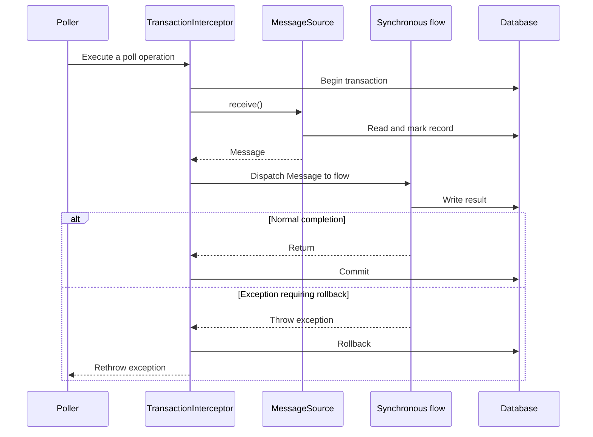

# TransactionInterceptor

## 1. Role in the Poller transaction chapter

In the `SPRING_INTEGRATION_CORE` module, a message flow is composed of `Message`, `MessageChannel`, and endpoints. A transformer can normalize data, a filter can reject messages, and a service activator can update a database. When a flow starts with a poller, you must determine which operations must succeed together or be rolled back together.

For example, an application reads a record from an `inbox` table, marks it as received, and writes the result to a `ledger` table. If writing the result fails while the received marker is still committed, the record may never be picked up again. Placing the transaction at the right point protects this consistency.

`TransactionInterceptor` is a **Spring Framework** AOP advice located in package `org.springframework.transaction.interceptor`. Spring Integration uses this advice to apply transactions to polling operations. The interceptor coordinates the invocation through the transaction infrastructure; the transaction manager handles the actual resource. See [TransactionInterceptor API](https://docs.spring.io/spring-framework/docs/current/javadoc-api/org/springframework/transaction/interceptor/TransactionInterceptor.html).

This lesson focuses on imperative flows using JDBC and `PlatformTransactionManager`. The Java examples use Java 17 or higher and the Java DSL API available in Spring Integration 6.x. Reactive flows have their own context propagation mechanism and must be designed around reactive transactions rather than directly applying the thread assumptions in this lesson.

## 2. Three components to distinguish

| Component | Responsibility | Example in this lesson |
| --- | --- | --- |
| `TransactionInterceptor` | Wraps the invocation, selects transaction attributes, handles normal completion or exceptions | Advice attached to the poller |
| `TransactionAttribute` | Describes propagation, isolation, timeout, read-only, and rollback rules | `DefaultTransactionAttribute`, `RuleBasedTransactionAttribute` |
| `PlatformTransactionManager` | Begins, commits, rolls back, or joins a resource's transaction | `DataSourceTransactionManager` for JDBC |

Merely declaring an interceptor as a bean does not create transactions for every endpoint. It must be attached to the execution point that needs protection. Similarly, using a transaction manager for database A does not make operations on database B automatically join that transaction.

For JDBC, `DataSourceTransactionManager` manages a `DataSource` and binds a connection to the executing thread. `JdbcTemplate` can use this connection through Spring's connection-lookup mechanism. Therefore, the transaction manager and the JDBC operations in the example must share the same `DataSource`. See [DataSourceTransactionManager](https://docs.spring.io/spring-framework/docs/current/javadoc-api/org/springframework/jdbc/datasource/DataSourceTransactionManager.html).

## 3. Why attach advice on the poller?

A poller can serve two scenarios:

- `SourcePollingChannelAdapter` calls `MessageSource.receive()` to pull data from a source.
- `PollingConsumer` calls `receive()` on a `PollableChannel` and dispatches the message to a handler.

Both initiate work from a polling schedule rather than a direct user business call. This is where advice can be attached for the poll operation. See [Poller in Spring Integration](https://docs.spring.io/spring-integration/reference/polling-consumer.html).

The decisive point is that the transaction can start **before `receive()`**, covering data retrieval as well if the source supports transactions. Placing `@Transactional` only on a downstream processing service can leave the receive operation outside the protected scope. This mechanism is described in [Poller Transaction Support](https://docs.spring.io/spring-integration/reference/transactions.html#transaction-support).

Illustrative flow when the poller opens a new transaction:



The diagram omits proxies and internal layers to highlight business boundaries. If `REQUIRED` joins an existing transaction, leaving the interceptor's scope is not necessarily the physical commit point; the outer transaction still determines the final outcome.

## 4. Configuring TransactionInterceptor with Java DSL

### 4.1. Creating the advice

Spring Integration provides `TransactionInterceptorBuilder` to build the interceptor using a fluent API:

```java
@Bean
TransactionInterceptor pollerTx(PlatformTransactionManager txManager) {
    return new TransactionInterceptorBuilder()
            .transactionManager(txManager)
            .propagation(Propagation.REQUIRED)
            .isolation(Isolation.DEFAULT)
            .timeout(10)
            .readOnly(false)
            .build();
}
```

Related imports:

```java
import org.springframework.context.annotation.Bean;
import org.springframework.integration.transaction.TransactionInterceptorBuilder;
import org.springframework.transaction.PlatformTransactionManager;
import org.springframework.transaction.annotation.Isolation;
import org.springframework.transaction.annotation.Propagation;
import org.springframework.transaction.interceptor.TransactionInterceptor;
```

Pass the transaction manager explicitly when the application has multiple managers. The builder also accepts a complete `TransactionAttribute`; when using that approach, individual attribute settings on the builder are ignored. See [TransactionInterceptorBuilder](https://docs.spring.io/spring-integration/api/org/springframework/integration/transaction/TransactionInterceptorBuilder.html).

### 4.2. Attaching the advice to the poller

```java
Pollers.fixedDelay(Duration.ofSeconds(1))
        .maxMessagesPerPoll(1)
        .transactional(pollerTx)
```

`PollerSpec` supports the following options:

| Configuration method | Meaning |
| --- | --- |
| `.transactional(txManager)` | Creates transaction advice with the given manager and default attributes |
| `.transactional(pollerTx)` | Uses a separately configured interceptor |
| `.advice(pollerTx)` | Places the interceptor into the general advice chain |

Choose one way to attach the same interceptor; do not add it twice via both `transactional` and `advice`. Detailed APIs are in [PollerSpec](https://docs.spring.io/spring-integration/api/org/springframework/integration/dsl/PollerSpec.html).

`fixedDelay` controls the polling schedule, whereas the transaction's `timeout` controls the transaction deadline. These two values address two different concerns.

## 5. Complete example: processing a JDBC inbox

### 5.1. Requirements and assumptions

A single worker process fetches a record with `status = 'NEW'`, normalizes the payload, and writes to `ledger`. We must ensure:

1. Success: the record transitions to `DONE`, with a corresponding row in `ledger`.
2. Error after writing the result: the record returns to `NEW`, and the uncommitted result is rolled back.
3. Data validation failure: the record is not marked as successfully processed.

The example uses a custom `MessageSource` so the JDBC operations inside `receive()` are clearly visible. The application needs `spring-integration-core`, `spring-jdbc`, `spring-tx`, a JDBC driver, and a configured `DataSource` bean. If using Spring Boot, manage dependency versions via the application's BOM.

The SQL below uses syntax suitable for an H2 or PostgreSQL practice environment. Initialize the tables and seed data before enabling the endpoint. This example considers only a single worker and does not implement multi-process safe work claiming.

### 5.2. Practice data

```sql
create table inbox (
    id bigint primary key,
    payload varchar(100) not null,
    status varchar(20) not null
);

create table ledger (
    inbox_id bigint primary key,
    normalized_payload varchar(100) not null
);

insert into inbox (id, payload, status) values
    (100, '  order-created  ', 'NEW'),
    (101, '  fail  ', 'NEW');
```

`ledger.inbox_id` is the business identifier key in this example. The primary key constraint helps detect duplicate writes, though by itself it does not form a complete duplicate-message handling strategy.

### 5.3. Flow configuration

```java
import java.time.Duration;
import java.util.List;
import java.util.Locale;

import javax.sql.DataSource;

import org.springframework.beans.factory.annotation.Qualifier;
import org.springframework.context.annotation.Bean;
import org.springframework.context.annotation.Configuration;
import org.springframework.integration.annotation.IntegrationComponentScan;
import org.springframework.integration.channel.DirectChannel;
import org.springframework.integration.config.EnableIntegration;
import org.springframework.integration.core.MessageSource;
import org.springframework.integration.dsl.IntegrationFlow;
import org.springframework.integration.dsl.Pollers;
import org.springframework.integration.support.MessageBuilder;
import org.springframework.integration.transaction.TransactionInterceptorBuilder;
import org.springframework.jdbc.core.JdbcTemplate;
import org.springframework.jdbc.datasource.DataSourceTransactionManager;
import org.springframework.transaction.PlatformTransactionManager;
import org.springframework.transaction.annotation.Isolation;
import org.springframework.transaction.annotation.Propagation;
import org.springframework.transaction.interceptor.TransactionInterceptor;
import org.springframework.transaction.support.TransactionSynchronizationManager;

@Configuration
@EnableIntegration
public class InboxPollingConfiguration {

    public record WorkItem(long id, String payload) {
    }

    @Bean
    JdbcTemplate inboxJdbc(DataSource dataSource) {
        return new JdbcTemplate(dataSource);
    }

    @Bean
    PlatformTransactionManager inboxTxManager(DataSource dataSource) {
        return new DataSourceTransactionManager(dataSource);
    }

    @Bean
    TransactionInterceptor pollerTx(
            @Qualifier("inboxTxManager") PlatformTransactionManager txManager) {

        return new TransactionInterceptorBuilder()
                .transactionManager(txManager)
                .propagation(Propagation.REQUIRED)
                .isolation(Isolation.DEFAULT)
                .timeout(10)
                .readOnly(false)
                .build();
    }

    @Bean
    MessageSource<WorkItem> inboxSource(
            @Qualifier("inboxJdbc") JdbcTemplate jdbc) {

        return () -> {
            requireTransaction();

            List<WorkItem> rows = jdbc.query("""
                    select id, payload
                    from inbox
                    where status = 'NEW'
                    order by id
                    limit 1
                    """, (rs, rowNum) -> new WorkItem(
                            rs.getLong("id"), rs.getString("payload")));

            if (rows.isEmpty()) {
                return null;
            }

            WorkItem item = rows.get(0);
            int claimed = jdbc.update("""
                    update inbox
                    set status = 'PROCESSING'
                    where id = ? and status = 'NEW'
                    """, item.id());

            if (claimed != 1) {
                throw new IllegalStateException("Cannot claim item " + item.id());
            }

            return MessageBuilder.withPayload(item)
                    .setHeader("inboxId", item.id())
                    .build();
        };
    }

    @Bean
    IntegrationFlow inboxFlow(
            @Qualifier("inboxSource") MessageSource<WorkItem> source,
            @Qualifier("inboxJdbc") JdbcTemplate jdbc,
            @Qualifier("pollerTx") TransactionInterceptor pollerTx) {

        return IntegrationFlow
                .from(source, endpoint -> endpoint
                        .id("inboxPollingEndpoint")
                        .autoStartup(false)
                        .poller(Pollers.fixedDelay(Duration.ofSeconds(1))
                                .maxMessagesPerPoll(1)
                                .transactional(pollerTx)))
                .channel(new DirectChannel())
                .transform(WorkItem.class, item -> new WorkItem(
                        item.id(), item.payload().strip().toUpperCase(Locale.ROOT)))
                .filter(WorkItem.class, item -> !item.payload().isBlank(),
                        filter -> filter.throwExceptionOnRejection(true))
                .handle(WorkItem.class, (item, headers) -> {
                    requireTransaction();

                    jdbc.update("""
                            insert into ledger (inbox_id, normalized_payload)
                            values (?, ?)
                            """, item.id(), item.payload());

                    if ("FAIL".equals(item.payload())) {
                        throw new IllegalStateException(
                                "Simulated failure for item " + item.id());
                    }

                    int completed = jdbc.update("""
                            update inbox
                            set status = 'DONE'
                            where id = ? and status = 'PROCESSING'
                            """, item.id());

                    if (completed != 1) {
                        throw new IllegalStateException(
                                "Cannot complete item " + item.id());
                    }

                    return null;
                })
                .get();
    }

    private static void requireTransaction() {
        if (!TransactionSynchronizationManager.isActualTransactionActive()) {
            throw new IllegalStateException("Expected an active transaction");
        }
    }
}
```

`@EnableIntegration` enables Spring Integration infrastructure in this configuration. You do not need to add `@EnableTransactionManagement` just to use an interceptor directly on a poller; that annotation serves annotation-driven transaction mechanisms such as `@Transactional`.

`autoStartup(false)` keeps the endpoint stopped at application startup so you can prepare data and observe each scenario. In a practice application, you can retrieve the `inboxPollingEndpoint` bean as a `Lifecycle` and call `start()`; call `stop()` when finished observing:

```java
import org.springframework.context.Lifecycle;

Lifecycle endpoint = applicationContext.getBean(
        "inboxPollingEndpoint", Lifecycle.class);
endpoint.start();

// After observing enough results, stop polling:
endpoint.stop();
```

The two calls represent two separate points in time. Calling `stop()` immediately after `start()` may mean no poll has had a chance to run yet. Do not use a fixed-duration `sleep` as the criterion for concluding that transactions work properly.

### 5.4. Interpreting the behavior

`MessageSource` returns `null` when there is no data; this is a normal result, not an error signal. When data exists, it returns a `Message<WorkItem>` containing the payload and an `inboxId` header for correlation during error handling.

The transformer normalizes the payload. The filter is configured to throw an exception on rejection because the example requires that empty data must not be treated as successful processing. The final handler returns `null` after writing to end the flow with no reply.

SQL operations use `JdbcTemplate`; using callbacks to map rows and pass parameters to `update` is documented in [Spring JDBC Core](https://docs.spring.io/spring-framework/reference/data-access/jdbc/core.html).

After record `100` is processed and record `101` is attempted:

| Data | Expected outcome |
| --- | --- |
| `inbox.id = 100` | `status = 'DONE'` |
| `ledger.inbox_id = 100` | One row with payload `ORDER-CREATED` |
| `inbox.id = 101` | Remains `NEW` after rollback |
| `ledger.inbox_id = 101` | No committed row |

For record `101`, the `INSERT` executed before the simulated failure. The absence of a committed row shows that the transaction rolled back both the result write and the status update inside `receive()`.

The failing record remains at the front of the work query, so it will be attempted again on subsequent polls. This is a consequence of the query and polling schedule in the example, not a bounded retry policy. Stop the endpoint after observing to avoid continuous error loops.

The two `requireTransaction()` calls help detect spots missing a transaction during practice. Checking this flag alone does not prove every connection participates in the same transaction; the persisted data after an error is the key evidence for the example.

## 6. Is one poll one transaction for an entire batch?

Distinguish between **a scheduler-triggered cycle**, **a single message receive operation**, and **the number of records in a payload**.

In the standard imperative polling mechanism, the `maxMessagesPerPoll` loop invokes the advised task for each individual poll operation. Therefore, setting `maxMessagesPerPoll(10)` does not mean ten messages are guaranteed to be processed in one shared transaction. When each invocation opens a fresh `REQUIRED` transaction, each receive-and-synchronous-process cycle has its own scope. You can verify this structure in [AbstractPollingEndpoint version 6.5.0](https://github.com/spring-projects/spring-integration/blob/v6.5.0/spring-integration-core/src/main/java/org/springframework/integration/endpoint/AbstractPollingEndpoint.java).

In the example, `limit 1` bounds the data per receive, while `maxMessagesPerPoll(1)` bounds the number of receives per cycle. If a source returns a list of 50 records in one message and a splitter processes all of them synchronously, one transaction can cover multiple records within that payload.

With the built-in JDBC inbound adapter, `max-rows` limits the rows per result set, whereas `max-messages-per-poll` controls the number of receive calls per cycle. The adapter can execute both `SELECT` and `UPDATE` inside the poller's transaction. See [Polling and Transactions of the JDBC inbound adapter](https://docs.spring.io/spring-integration/reference/jdbc/inbound-channel-adapter.html#jdbc-polling-transactions).

Batch design must therefore be based on the actual unit of data and invocation scope, rather than just looking at `maxMessagesPerPoll`.

## 7. Choosing transaction attributes

| Attribute | Meaning in this lesson | Considerations |
| --- | --- | --- |
| `REQUIRED` | Joins an existing transaction or starts a new one | Usually sufficient when the poller starts the work |
| `REQUIRES_NEW` | Uses a physical transaction independent of any active one | Can commit independently; consider connection count |
| `ISOLATION_DEFAULT` | Uses the resource's default isolation level | Does not imply work-claiming contention is solved |
| `timeout(10)` | Transaction deadline in seconds | Not the polling interval or HTTP timeout |
| `readOnly(false)` | Allows business logic that writes data | Appropriate for updating status and writing to `ledger` |

Isolation and timeout apply primarily when starting a new transaction. `readOnly` is a hint to the infrastructure and resource; do not rely on it as a safeguard guaranteeing that all write statements are blocked. See [TransactionDefinition](https://docs.spring.io/spring-framework/docs/current/javadoc-api/org/springframework/transaction/TransactionDefinition.html).

If an inner service uses `REQUIRED`, it typically shares the poller's physical transaction. When an inner scope marks rollback-only, catching the exception outside does not necessarily save the transaction; at commit time you may receive `UnexpectedRollbackException`.

If a service uses `REQUIRES_NEW`, its committed results can persist even if the poller transaction ultimately rolls back. This alters the example's "succeed together or roll back together" requirement. See [Transaction Propagation](https://docs.spring.io/spring-framework/reference/data-access/transaction/declarative/tx-propagation.html).

In a multi-worker environment, you must also design a database-appropriate record-claiming mechanism, such as locking or conditional updates with contention handling. Do not assume merely adding an interceptor completely solves concurrent work distribution.

## 8. Which exceptions does rollback depend on?

### 8.1. Default rules

With default transaction attributes, `RuntimeException` and `Error` trigger rollback; checked exceptions do not follow the same rule by default. The interceptor inspects the exception exiting the advised scope.

In messaging, the original exception may be wrapped in `MessagingException` or `MessageHandlingException`, which are runtime exceptions. Therefore, when checking rollback behavior, examine the actual exception reaching the interceptor rather than just looking at `throws` declarations on business methods. The baseline rules are described in [Rolling Back a Declarative Transaction](https://docs.spring.io/spring-framework/reference/data-access/transaction/declarative/rolling-back.html).

The following example loses the failure signal if no component has marked the transaction rollback-only:

```java
try {
    writeResult();
} catch (RuntimeException ex) {
    log.warn("Cannot write result", ex);
    // Returning normally allows the outer scope to commit.
}
```

If the requirement is to roll back the entire unit of work, let an appropriate exception escape or rethrow a business exception configured for rollback. Logging does not replace a failure signal.

### 8.2. Declaring explicit rules

You can replace the `pollerTx` bean body in the example with a configuration using `RuleBasedTransactionAttribute`. The snippet below requires rollback for any `Exception` observed at the advice boundary; the default rule for `Error` remains in effect:

```java
import org.springframework.transaction.TransactionDefinition;
import org.springframework.transaction.interceptor.RollbackRuleAttribute;
import org.springframework.transaction.interceptor.RuleBasedTransactionAttribute;

@Bean
TransactionInterceptor pollerTx(
        @Qualifier("inboxTxManager") PlatformTransactionManager txManager) {

    RuleBasedTransactionAttribute attributes =
            new RuleBasedTransactionAttribute();
    attributes.setPropagationBehavior(TransactionDefinition.PROPAGATION_REQUIRED);
    attributes.setIsolationLevel(TransactionDefinition.ISOLATION_DEFAULT);
    attributes.setTimeout(10);
    attributes.setReadOnly(false);
    attributes.setRollbackRules(List.of(
            new RollbackRuleAttribute(Exception.class)));

    return new TransactionInterceptorBuilder()
            .transactionManager(txManager)
            .transactionAttribute(attributes)
            .build();
}
```

Keep only one `pollerTx` bean when applying this variant. Using concrete exception classes expresses intent more clearly than broad name strings that may match unexpectedly. The rules API is described in [RuleBasedTransactionAttribute](https://docs.spring.io/spring-framework/docs/current/javadoc-api/org/springframework/transaction/interceptor/RuleBasedTransactionAttribute.html).

## 9. Thread boundaries and rollback capability

Thread-bound imperative transactions do not automatically propagate to another worker. `DirectChannel` allows processing on the sending thread; `ExecutorChannel` typically delegates work to an executor; `QueueChannel` buffers messages for a consumer to retrieve later. See [Message Channel Implementations](https://docs.spring.io/spring-integration/reference/channel/implementations.html).

| Change in the example flow | Expected consequence |
| --- | --- |
| Keep synchronous processing path | Handler errors can unwind to the poller advice |
| Insert `ExecutorChannel` before handler | Poller transaction does not follow work to the executor thread |
| Insert `QueueChannel` before handler | Successful send to queue does not prove the handler succeeded |
| Use `@Async`, `CompletableFuture`, or spawn threads manually | Must design transactions for work running on the new thread |
| Use a queue with a transactional message store | Can protect enqueue/dequeue operations on that resource, depending on manager and configuration |

Handing a message across an asynchronous boundary does not cause the interceptor to commit immediately on the send line. The current transaction still ends when the advised scope returns. However, it does not wait for business logic on the other thread and does not receive late exceptions through the normal call stack.

An in-memory `QueueChannel` cannot automatically return a pulled message just because a JDBC transaction rolls back. Message store durability and transaction participation are also two separate properties that must be checked independently.

If migrating the example to an asynchronous architecture, define separate transactional segments: receiving and persisting the work; the consumer processing the work; and publishing downstream events. Then add replay and deduplication mechanisms suited to each segment.

## 10. Poller advice vs. handler advice

Where advice is attached determines which method is wrapped:

| Attachment point | Scope to understand |
| --- | --- |
| `poller(...transactional(pollerTx))` | Wraps the poll operation, including data retrieval and its synchronous downstream flow |
| `@Transactional` on a service | Wraps the service call via proxy; does not automatically bring the earlier receive operation into the transaction |
| `TransactionInterceptor` in request handler advice | For a reply-producing handler, typically wraps `handleRequestMessage()`, not sending the reply down the rest of the flow |
| `TransactionHandleMessageAdvice` | Wraps `handleMessage()`, and can cover synchronous downstream processing in that call |

Spring Integration provides `TransactionHandleMessageAdvice` for cases needing `handleMessage()` scope. You can create this variant via `new TransactionInterceptorBuilder(true)` and attach it to the appropriate endpoint. It still does not propagate transactions across thread boundaries. See [Transaction Support for handler advice](https://docs.spring.io/spring-integration/reference/handler-advice/tx-handle-message.html).

For example, if service A updates a table and returns a reply, and then transformer B throws an error, a transaction wrapping only method A may have already completed before B runs. When the business requirement includes B, choose a boundary wrapping the entire synchronous call, such as the poller advice in the example.

For flows initiated via a messaging gateway, a service annotated with `@Transactional` can open a transaction before calling the gateway and cover the synchronous downstream processing. Ensure the call actually passes through the proxy; self-invocation within the same object does not create a new transaction scope under standard proxy mechanics.

## 11. Transactions, retry, and errorChannel

### 11.1. Retry does not equal rollback

A transaction decides whether to commit or roll back one execution. Retry decides whether to execute again. If the same record is picked up on the next poll after a rollback, that is the behavior of the source and polling schedule; it does not inherently provide backoff, a max-attempt limit, or quarantine for failing records.

In terms of advice ordering, these two structures have different meanings:

```text
Retry outside:
retry -> transaction -> receive and process
         transaction -> receive and reprocess

Transaction outside:
transaction -> retry -> receive and process
                       retry within the same transaction scope
```

If each attempt needs a fresh transaction, a compatible retry advice must wrap outside the transaction advice, and each entry into the transaction must actually be able to open a new transaction. Conversely, retrying inside a transaction already marked rollback-only may fail to commit even if a later attempt throws no error.

The diagram illustrates wrapping order only, not a configuration to copy verbatim. `RequestHandlerRetryAdvice` is designed for request handlers; do not attach it to a poller as a generic `MethodInterceptor`. See [Provided Advice Classes](https://docs.spring.io/spring-integration/reference/handler-advice/classes.html).

### 11.2. ErrorMessage serves error handling

Along a synchronous execution path, an exception can unwind back to the poller, pass through the transaction advice, and then reach the polling task's error-handling mechanism. Under standard error configuration, task errors are published as an `ErrorMessage` to an error channel. See [Error Handling](https://docs.spring.io/spring-integration/reference/error-handling.html).

An `errorChannel` handler does not need to rethrow the error to trigger rollback for a poller transaction that already ended when the exception exited the advice. Conversely, if a recovery callback inside the advice scope swallowed the error and returned normally, additionally sending an `ErrorMessage` does not substitute for a rollback decision.

In the JDBC inbox example, observe `inboxId`, the exception, the number of times a record was attempted, and committed data state together. Seeing an error log alone is not enough to conclude all changes were rolled back.

## 12. Limits regarding resources and integration patterns

### 12.1. Operations outside a JDBC transaction

Suppose a handler makes an HTTP call to charge a payment, and then a JDBC write fails. Rolling back JDBC does not undo an HTTP request already accepted by an external system. Sending emails, calling remote services, or modifying files must also be treated as independent side effects when those resources do not participate in the transaction.

When an event must be emitted after updating data, one design option is writing an outbox record in the same JDBC transaction and letting another process publish it. Publishing still needs deduplication and outcome tracking; the interceptor does not provide system-wide exactly-once guarantees.

Spring Integration has transaction synchronization to run actions tied to commit or rollback. This coordinates work lifecycle, not turning non-transactional resources into rollback-capable ones. An `afterCommit` callback that fails also does not revert already-committed data. See [Transaction Synchronization](https://docs.spring.io/spring-integration/reference/transactions.html#transaction-synchronization).

### 12.2. Transformer, filter, router, and aggregator

| Component | Question to ask about transactions |
| --- | --- |
| Transformer | Should a data-normalization exception cause the source item to be reprocessed? |
| Filter | Is rejection a valid business outcome, or should it throw an error to roll back? |
| Router | Does the chosen branch run on the current thread or hand off to an async mechanism? |
| Aggregator | Is the message being stored in a group, or has the group completed and released output in this call? |

In the example, the filter sets `throwExceptionOnRejection(true)` because the requirement is to roll back on an empty payload. If the filter simply drops the message and returns normally, the poller may treat the work as complete; the `PROCESSING` status could then be committed.

With an aggregator, a group may receive messages across multiple polls and release at a later time. Do not picture a single JDBC transaction staying open from receiving the first element until the whole group completes. Define transactions for updating the message store and for the specific call that emits the aggregated result.

## 13. Observation and diagnostics practice

Run each scenario on isolated test data, resetting the data while the endpoint is stopped. When querying results, use a separate connection after work finishes to avoid mistaking uncommitted data for final state.

```sql
select id, payload, status from inbox order by id;
select inbox_id, normalized_payload from ledger order by inbox_id;
```

| Practice scenario | Result to observe |
| --- | --- |
| Process record `100` | One `ledger` row, status `DONE` |
| Process record `101` | No committed `ledger` row, status returns to `NEW` |
| Use whitespace-only payload | Filter throws error, claiming the record is rolled back |
| Remove transaction advice | Guard inside `receive()` reports missing transaction before running SQL |
| Insert executor before handler | Guard inside handler may report missing transaction; source status may have committed separately |
| Swallow simulated error in handler and continue | JDBC work may commit if not marked rollback-only |

To observe autocommit consequences when removing advice, also remove the guard in a separate practice copy. Then a handler error can leave a `PROCESSING` record alongside a written `ledger` row. That is why the guard is placed before SQL in the original example.

When turning scenarios into integration tests, prefer waiting on data conditions or completion signals with a timeout, manage endpoint start/stop explicitly, and isolate state between tests. A test method's own transaction does not automatically wrap work running on the poller thread.

Especially for the scenario where an executor is inserted, do not keep synchronous-flow assertions and treat every difference as a framework bug. That change altered the design's transaction boundary.

Some clues to pinpoint root causes:

| Symptom | Where to check |
| --- | --- |
| No transaction inside `receive()` | Is the advice attached to the right poller, or only declared as a bean? |
| Source status changed but downstream result failed | Is there a thread boundary or a service opening an independent transaction? |
| Transaction exists yet some JDBC statements commit separately | Do all operations share the same `DataSource` and Spring connection lookup? |
| Catching error still yields `UnexpectedRollbackException` | Did a participating scope already mark rollback-only? |
| Same failing record keeps appearing repeatedly | Is there a retry-limit policy and quarantine for failing data? |
| Log reports error after commit yet data remains | Did the exception come from a callback or work running after the transaction ended? |

When evaluating a flow using `TransactionInterceptor`, cross-check three concrete factors: which invocation the advice wraps, which resources actually participate, and which exceptions return to that boundary. The data outcomes in the practice exercise directly reflect the consequences of these three choices.
