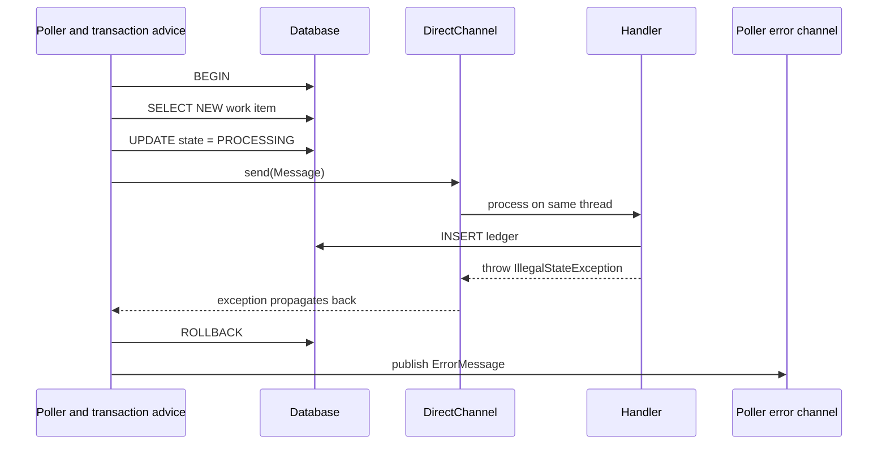

# Rollback when a handler fails

In the **Poller transaction** chapter of the **SPRING_INTEGRATION_CORE** module, this lesson explains how a handler error determines the outcome of a transaction opened by a poller. The goal is to design a Message → MessageChannel → endpoint flow using Java DSL while verifying which data returns to its prior state when processing fails.

Ongoing scenario: a poller reads a work item from a database, marks it as processing, and calls a handler that writes to a business ledger. The handler throws an error after writing to the ledger. The requirement is that the work item remains available for the next read and the uncommitted ledger record disappears.

## 1. Conditions for a handler error to trigger rollback

A handler throwing an exception is not enough to conclude the entire flow will roll back. Four factors must be confirmed:

1. A transaction has been opened before the operations that need protection.
2. Those operations actually participate in a resource managed by the transaction manager.
3. The error reaches the transaction interceptor before the transaction scope ends.
4. Rollback rules apply to the exception that the interceptor receives.

A poller supports transactions to wrap both the `receive()` operation and subsequent synchronous processing. With imperative transactions, context is bound to the thread; any segment handed off to another thread does not automatically inherit this transaction. [Spring Integration: Transaction Support](https://docs.spring.io/spring-integration/reference/6.5/transactions.html).

You can picture the execution decision as follows:

```text
begin transaction
    receive from source
    send message through synchronous channel
    handler performs business work
if completes normally and transaction is not marked rollback-only:
    attempt commit
if exception escapes and matches rollback rules:
    rollback
```

A commit can still fail due to data constraints or resource errors. Thus, a handler returning normally only indicates the handler body finished, not that the commit succeeded.

## 2. Tracing a failed execution

Suppose work item `id = 7` currently has `state = 'NEW'` and has no corresponding record in the `ledger` table.



The diagram shows the standard configuration in the example below: the error is not swallowed by another advice, and error publication for the polling task happens after the transaction advice has handled the exception.

Expected results after the failure:

| Data or action | After rollback in the example |
| --- | --- |
| `work_item.state` updated to `PROCESSING` | Reverts to `NEW` |
| Newly inserted `ledger` record | Absent from committed data |
| Incremented Java counter | Keeps its new value |
| Exception recorded on error channel | Readable for failure observation |
| Work item `id = 7` | Still matches the next poll query |

The counter is an intentional detail in this lab: it demonstrates that a database rollback does not rewind all application memory to the past.

## 3. Poller scope vs. handler scope

Placing a transaction on the poller means something different from placing `@Transactional` only on a service called by the handler.

```text
Poller transaction:
    [receive + source update + handler + business write]

Transaction only on downstream service:
    receive + source update
    [business write inside service]
```

In the second configuration, the source update may already have committed before the service starts. Rolling back the service does not undo work already completed outside that transaction.

For the JDBC inbound adapter, `SELECT` produces a list payload of results; the optional `UPDATE` runs inside the receive operation. Putting the transaction on the poller brings both statements into the same scope as subsequent synchronous processing. [JDBC Inbound Channel Adapter](https://docs.spring.io/spring-integration/reference/6.5/jdbc/inbound-channel-adapter.html).

Conversely, adding `@Transactional` to a `@Bean` configuration method does not cause every future poll to run in a transaction. The configuration must attach transaction advice to the endpoint executing the task.

## 4. Java DSL example with JDBC and H2

### 4.1. Baseline of the example

The snippets use **Java 17 or higher, Spring Integration 6.5.x, and Spring Framework 6.2.x** as an API baseline. This is an illustrative baseline, not a claim about the latest release. If migrating to another major version, verify packages and APIs accordingly.

The application needs the corresponding dependencies:

- `org.springframework.integration:spring-integration-core`.
- `org.springframework.integration:spring-integration-jdbc`.
- `org.springframework:spring-jdbc`.
- `com.h2database:h2` for the example database.
- When running tests: `spring-test`, JUnit Jupiter, and `org.awaitility:awaitility`.

Use your project's dependency management to keep library versions aligned. Do not add a separate Java DSL library for this configuration.

The example has only **one poller, one source, and one handler**. Concurrent work claiming across multiple instances requires an additional locking or claim strategy; the sample query does not address that problem.

### 4.2. Full configuration

Place the class below in `RollbackDemoConfig.java` in a practice project:

```java
package example.integration;

import java.time.Duration;
import java.util.List;
import java.util.Map;
import java.util.concurrent.atomic.AtomicBoolean;
import java.util.concurrent.atomic.AtomicInteger;

import javax.sql.DataSource;

import org.springframework.context.annotation.Bean;
import org.springframework.context.annotation.Configuration;
import org.springframework.integration.channel.DirectChannel;
import org.springframework.integration.channel.QueueChannel;
import org.springframework.integration.config.EnableIntegration;
import org.springframework.integration.dsl.IntegrationFlow;
import org.springframework.integration.dsl.Pollers;
import org.springframework.integration.jdbc.JdbcPollingChannelAdapter;
import org.springframework.jdbc.core.JdbcTemplate;
import org.springframework.jdbc.datasource.DataSourceTransactionManager;
import org.springframework.jdbc.datasource.embedded.EmbeddedDatabase;
import org.springframework.jdbc.datasource.embedded.EmbeddedDatabaseBuilder;
import org.springframework.jdbc.datasource.embedded.EmbeddedDatabaseType;
import org.springframework.messaging.Message;
import org.springframework.transaction.PlatformTransactionManager;
import org.springframework.transaction.support.TransactionSynchronizationManager;

@Configuration
@EnableIntegration
public class RollbackDemoConfig {

    @Bean(destroyMethod = "shutdown")
    public EmbeddedDatabase dataSource() {
        return new EmbeddedDatabaseBuilder()
                .generateUniqueName(true)
                .setType(EmbeddedDatabaseType.H2)
                .build();
    }

    @Bean
    public JdbcTemplate jdbcTemplate(DataSource dataSource) {
        JdbcTemplate jdbc = new JdbcTemplate(dataSource);
        jdbc.execute("""
                CREATE TABLE work_item (
                    id BIGINT PRIMARY KEY,
                    amount DECIMAL(12, 2) NOT NULL,
                    state VARCHAR(20) NOT NULL
                )
                """);
        jdbc.execute("""
                CREATE TABLE ledger (
                    work_id BIGINT PRIMARY KEY,
                    amount DECIMAL(12, 2) NOT NULL
                )
                """);
        jdbc.update("""
                INSERT INTO work_item (id, amount, state)
                VALUES (?, ?, ?)
                """, 7L, new java.math.BigDecimal("125000.00"), "NEW");
        return jdbc;
    }

    @Bean
    public PlatformTransactionManager transactionManager(DataSource dataSource) {
        return new DataSourceTransactionManager(dataSource);
    }

    @Bean
    public JdbcPollingChannelAdapter workItemSource(JdbcTemplate jdbcTemplate) {
        JdbcPollingChannelAdapter source = new JdbcPollingChannelAdapter(
                jdbcTemplate,
                "SELECT id, amount FROM work_item WHERE state = 'NEW' ORDER BY id");
        source.setMaxRows(1);
        source.setRowMapper((rs, rowNum) -> Map.of(
                "id", rs.getLong("id"),
                "amount", rs.getBigDecimal("amount")));
        source.setUpdateSql("""
                UPDATE work_item
                SET state = 'PROCESSING'
                WHERE id IN (:id)
                """);
        return source;
    }

    @Bean
    public DirectChannel workItems() {
        DirectChannel channel = new DirectChannel();
        channel.setFailover(false);
        return channel;
    }

    @Bean
    public QueueChannel pollerErrors() {
        return new QueueChannel(10);
    }

    @Bean
    public WorkItemHandler workItemHandler(JdbcTemplate jdbcTemplate) {
        return new WorkItemHandler(jdbcTemplate);
    }

    @Bean
    public IntegrationFlow workItemFlow(
            JdbcPollingChannelAdapter workItemSource,
            WorkItemHandler workItemHandler,
            PlatformTransactionManager transactionManager) {

        return IntegrationFlow
                .from(workItemSource, endpoint -> endpoint
                        .id("workItemPoller")
                        .autoStartup(false)
                        .poller(Pollers.fixedDelay(Duration.ofHours(1))
                                .maxMessagesPerPoll(1)
                                .transactional(transactionManager)
                                .errorChannel("pollerErrors")))
                .channel("workItems")
                .handle(workItemHandler, "handle")
                .get();
    }

    public static final class WorkItemHandler {
        private final JdbcTemplate jdbc;
        private final AtomicBoolean failOnce = new AtomicBoolean(true);
        private final AtomicInteger attempts = new AtomicInteger();

        public WorkItemHandler(JdbcTemplate jdbc) {
            this.jdbc = jdbc;
        }

        public void handle(Message<?> message) {
            if (!TransactionSynchronizationManager.isActualTransactionActive()) {
                throw new IllegalStateException("Handler has no transaction");
            }

            List<?> rows = (List<?>) message.getPayload();
            Map<?, ?> row = (Map<?, ?>) rows.get(0);
            long id = ((Number) row.get("id")).longValue();
            attempts.incrementAndGet();

            jdbc.update("INSERT INTO ledger (work_id, amount) VALUES (?, ?)",
                    id, row.get("amount"));

            if (failOnce.getAndSet(false)) {
                throw new IllegalStateException("Simulated failure after INSERT ledger");
            }

            jdbc.update("UPDATE work_item SET state = 'DONE' WHERE id = ?", id);
        }

        public int attempts() {
            return attempts.get();
        }
    }
}
```

### 4.3. Why can this configuration roll back both tables?

`transactionManager`, the source, and the handler all share the same `DataSource`. `JdbcTemplate` acquires connections via Spring's transaction context; therefore, the `UPDATE` in the source and the `INSERT` in the handler participate together in the transaction opened at the poller. [Spring Framework: Controlling Database Connections](https://docs.spring.io/spring-framework/reference/data-access/jdbc/connections.html).

The `workItems` channel is a `DirectChannel`, so the handler runs synchronously on the thread executing the poll. The handler throws `IllegalStateException` after `INSERT`; the exception propagates outward, allowing the transaction advice to perform a rollback. You do not need to add `@Transactional` to the handler for these JDBC operations to join the existing transaction.

Some details to interpret accurately:

| Configuration | Role in the practice exercise |
| --- | --- |
| `source.setMaxRows(1)` | Each receive payload contains at most one row |
| `maxMessagesPerPoll(1)` | Each trigger execution performs at most one receive |
| `WHERE id IN (:id)` | Uses the list of IDs from the query result to update the source |
| `autoStartup(false)` | The test starts the poller explicitly once observation is ready |
| `fixedDelay(Duration.ofHours(1))` | Prevents the next poll from interfering while inspecting data |
| `pollerErrors` | Queue for observing polling task errors |
| `failOnce` | Triggers failure only on the first invocation in the bean's lifecycle |

`setMaxRows` is a row limit on the source; it differs from the receive count controlled by the poller. Setting both to `1` helps the lab avoid confusing one message containing multiple rows with multiple messages. Do not infer that increasing `maxMessagesPerPoll` groups all receives into one large transaction. [JdbcPollingChannelAdapter 6.5 API](https://docs.spring.io/spring-integration/docs/6.5.0/api/org/springframework/integration/jdbc/JdbcPollingChannelAdapter.html), [PollerSpec 6.5 API](https://docs.spring.io/spring-integration/docs/6.5.0/api/org/springframework/integration/dsl/PollerSpec.html).

The one-hour delay serves testing; the first execution still has a default initial delay of `0`. In a continuously running application, choose an appropriate poll interval and allow the endpoint to auto-start. [PeriodicTrigger API](https://docs.spring.io/spring-framework/docs/current/javadoc-api/org/springframework/scheduling/support/PeriodicTrigger.html).

DDL and sample data are initialized directly inside the bean so the example is self-contained. Real applications should manage schemas and migrations separately.

## 5. Testing rollback via data state

A test that only asserts "an exception was received" is incomplete: the handler may have failed while the source update already committed, or the business record may have slipped into another transaction.

The test below observes the real poller and verifies three outcomes after the failure:

1. The work item returns to `NEW`.
2. `ledger` does not contain the newly inserted record.
3. The handler was actually invoked once.

Then the test restarts the endpoint to prove the same work item can be read again and processed successfully.

```java
package example.integration;

import java.time.Duration;

import org.junit.jupiter.api.Test;
import org.springframework.beans.factory.annotation.Autowired;
import org.springframework.beans.factory.annotation.Qualifier;
import org.springframework.integration.channel.QueueChannel;
import org.springframework.integration.endpoint.SourcePollingChannelAdapter;
import org.springframework.jdbc.core.JdbcTemplate;
import org.springframework.messaging.Message;
import org.springframework.messaging.support.ErrorMessage;
import org.springframework.test.annotation.DirtiesContext;
import org.springframework.test.context.junit.jupiter.SpringJUnitConfig;

import static org.awaitility.Awaitility.await;
import static org.junit.jupiter.api.Assertions.*;

@SpringJUnitConfig(RollbackDemoConfig.class)
@DirtiesContext(classMode = DirtiesContext.ClassMode.AFTER_CLASS)
class RollbackDemoTest {

    @Autowired
    JdbcTemplate jdbc;

    @Autowired
    @Qualifier("workItemPoller")
    SourcePollingChannelAdapter poller;

    @Autowired
    @Qualifier("pollerErrors")
    QueueChannel errors;

    @Autowired
    RollbackDemoConfig.WorkItemHandler handler;

    @Test
    void rollbackThenCommitWhenTheSameWorkIsReadAgain() {
        Message<?> error;
        poller.start();
        try {
            error = errors.receive(5000);
        }
        finally {
            poller.stop();
        }

        ErrorMessage errorMessage = assertInstanceOf(ErrorMessage.class, error);
        Throwable cause = errorMessage.getPayload();
        while (cause.getCause() != null) {
            cause = cause.getCause();
        }
        assertInstanceOf(IllegalStateException.class, cause);
        assertEquals("Simulated failure after INSERT ledger", cause.getMessage());

        assertEquals("NEW", state());
        assertEquals(Integer.valueOf(0), ledgerCount());
        assertEquals(1, handler.attempts());

        poller.start();
        try {
            await().atMost(Duration.ofSeconds(5)).untilAsserted(() -> {
                assertEquals("DONE", state());
                assertEquals(Integer.valueOf(1), ledgerCount());
            });
        }
        finally {
            poller.stop();
        }

        assertEquals(2, handler.attempts());
        assertNull(errors.receive(0));
    }

    private String state() {
        return jdbc.queryForObject(
                "SELECT state FROM work_item WHERE id = 7", String.class);
    }

    private Integer ledgerCount() {
        return jdbc.queryForObject(
                "SELECT COUNT(*) FROM ledger WHERE work_id = 7", Integer.class);
    }
}
```

Do not put `@Transactional` on this test: the test thread and the poller thread have separate boundaries. Verification queries must see results after the poller's transaction has completed. The `ErrorMessage` from the failure run acts as the synchronization point to observe rollback; for the success run, Awaitility waits until committed data becomes readable.

Result table across both executions:

| Moment | `state` of work item 7 | `ledger` row count | `attempts` |
| --- | --- | --- | --- |
| Before running | `NEW` | 0 | 0 |
| After handler throws error | `NEW` | 0 | 1 |
| After successful reread | `DONE` | 1 | 2 |

`failOnce` flipped to `false` on the first run and was not rolled back, so the reread can complete the handler. This is a failure-injection mechanism for the test, not a durable retry-counter design.

These code snippets are practice documentation; saving this lesson does not mean they have been compiled or executed in this repository.

## 6. Which exceptions determine rollback?

Under Spring's default transaction settings, `RuntimeException` and `Error` trigger rollback; checked exceptions do not automatically carry the same rollback rule. This can be customized with rollback rules. [Spring Framework: Rolling Back a Declarative Transaction](https://docs.spring.io/spring-framework/reference/data-access/transaction/declarative/rolling-back.html).

In Spring Integration, business exceptions may be wrapped in `MessageHandlingException` or another `MessagingException`. Therefore, examine the actual exception crossing the transaction boundary, not just the `throws` signature of a business method. A checked exception acting as the cause of a runtime wrapper can still trigger default rollback.

In particular, do not assume `noRollbackFor` on a business exception type will automatically match when the interceptor only sees the wrapper. Class-based rules do not traverse the entire `cause` chain by default.

If the poller's policy is to roll back on any escaping `Exception`, you can declare explicit advice:

```java
import java.util.List;

import org.springframework.context.annotation.Bean;
import org.springframework.transaction.PlatformTransactionManager;
import org.springframework.transaction.TransactionDefinition;
import org.springframework.transaction.interceptor.NameMatchTransactionAttributeSource;
import org.springframework.transaction.interceptor.RollbackRuleAttribute;
import org.springframework.transaction.interceptor.RuleBasedTransactionAttribute;
import org.springframework.transaction.interceptor.TransactionInterceptor;

@Bean
public TransactionInterceptor pollerTransactionAdvice(
        PlatformTransactionManager transactionManager) {
    RuleBasedTransactionAttribute attribute = new RuleBasedTransactionAttribute();
    attribute.setPropagationBehavior(TransactionDefinition.PROPAGATION_REQUIRED);
    attribute.setRollbackRules(List.of(new RollbackRuleAttribute(Exception.class)));

    NameMatchTransactionAttributeSource attributes =
            new NameMatchTransactionAttributeSource();
    attributes.addTransactionalMethod("*", attribute);

    TransactionInterceptor advice = new TransactionInterceptor();
    advice.setTransactionManager(transactionManager);
    advice.setTransactionAttributeSource(attributes);
    return advice;
}
```

Then pass this advice bean into the flow factory method and **replace** the `.transactional(transactionManager)` call with:

```java
.transactional(pollerTransactionAdvice)
```

Do not stack two transaction advices just to add a rollback rule. `RuleBasedTransactionAttribute` picks the closest matching rule by inheritance hierarchy; if no explicit rule matches, default behavior still applies. [RuleBasedTransactionAttribute API](https://docs.spring.io/spring-framework/docs/6.2.0/javadoc-api/org/springframework/transaction/interceptor/RuleBasedTransactionAttribute.html), [TransactionInterceptor API](https://docs.spring.io/spring-framework/docs/6.2.0/javadoc-api/org/springframework/transaction/interceptor/TransactionInterceptor.html).

## 7. Catching exceptions can cause a transaction to commit

Consider replacing the error-throwing section in the handler with:

```java
try {
    performBusinessOperation();
}
catch (RuntimeException ex) {
    logger.warn("Processing failed", ex);
    return;
}
```

If no inner scope or resource has marked rollback-only, the handler returns normally and the poller can commit earlier changes. Logging an error is not a rollback signal.

When the business requirement is for the whole unit to fail, let the exception propagate outward after adding diagnostic context:

```java
catch (RuntimeException ex) {
    logger.warn("Processing failed, workId={}", workId, ex);
    throw ex;
}
```

There is another case: a child service joining the same transaction with `REQUIRED` has marked rollback-only; the outer handler catches the error and continues. The transaction still cannot commit and may terminate with `UnexpectedRollbackException`. With `REQUIRES_NEW`, the child service uses an independent physical transaction, so what it committed is not rolled back with the outer transaction. [Spring Framework: Transaction Propagation](https://docs.spring.io/spring-framework/reference/data-access/transaction/declarative/tx-propagation.html).

Therefore, when you see "exception was caught yet it still rolled back", check inner transaction scopes as well. When you see "handler failed yet data persisted", check whether the exception was caught before the transaction boundary or whether the data was written using an independent transaction.

## 8. What is the role of `errorChannel`?

`errorChannel` is a route to forward error information to an error-observing or error-handling handler. It does not replace transaction advice.

With a synchronous flow, an exception can unwind up the call stack. With a scheduled polling task, error-handling infrastructure can wrap the exception in an `ErrorMessage` and send it to the error channel. Configuring `.errorChannel("pollerErrors")` in the example selects the poller's error destination. [Spring Integration: Error Handling](https://docs.spring.io/spring-integration/reference/error-handling.html).

Distinguish two points in time:

| Case | What to consider |
| --- | --- |
| Error already exited the transaction advice before being published | A logging handler on the error channel does not undo an already-completed rollback |
| A handler or recovery advice catches the error and returns before transaction advice | The outer scope may see normal completion and attempt to commit |

Do not conclude "the error handler returned normally, so the business transaction committed" without identifying where the error handler runs in the execution chain.

In the example, `pollerErrors` is an in-memory queue for testing. Long-running applications need a consumer on the error channel; continually pushing errors into a bounded queue without draining it will fill the queue. Publishing errors itself can fail, so monitor infrastructure logs as well.

If audit records must be persisted after failures, choose a separate transaction or an appropriate persistence mechanism and test it independently. Inserting audit rows inside the transaction about to roll back causes the audit records to be discarded alongside the business data.

## 9. Changing threads alters rollback outcomes

Replacing the synchronous channel with an `ExecutorChannel` backed by a thread pool introduces a different boundary:

```text
Poller thread:
    begin T1 → read source → update source → dispatch task to executor → end T1

Worker thread:
    run handler → write business data → error
```

Once the task hand-off succeeds, T1 can commit before the worker throws an error. Any transaction on the worker is a separate scope that must be configured independently; a failure there does not turn back time to roll back T1.

`QueueChannel` also separates sending into a queue from a consumer receiving and processing later. `DirectChannel` supports calling the handler on the sending thread; executor-backed channels allow execution on another thread. [Message Channel Implementations](https://docs.spring.io/spring-integration/reference/6.5/channel/implementations.html).

The table below applies to the imperative transaction model in this lesson:

| Junction | Is downstream handler part of poller transaction by default? |
| --- | --- |
| `DirectChannel`, synchronous processing, same participating resource | Can belong to the same scope |
| `ExecutorChannel` using a thread pool | No |
| Send to a queue and a consumer receives later | No |
| Call a service with `REQUIRES_NEW` | Service portion uses an independent transaction |
| Make HTTP call or send email | External side effects do not become transactional JDBC data |

A thread pool assigned to **the poller itself** differs from an executor placed **mid-flow**. The poller can open a transaction on the thread assigned to run the task, and then invoke synchronous handlers on that same thread. What matters is which thread holds the transaction at the start and whether processing switches threads afterward.

## 10. Rollback does not guarantee messages return to the source automatically

In the JDBC example, the work item is read again because `UPDATE state = 'PROCESSING'` was rolled back, leaving the row with `state = 'NEW'`. This is a consequence of how source state is persisted.

If the source is an in-memory `QueueChannel`, `receive()` has already removed the message, and `DataSourceTransactionManager` cannot automatically compensate for it. Durability and transactionality are also two separate properties to check independently: adding a store does not prove receives/sends participate in the right transaction. [Configuring Message Channels and Message Stores](https://docs.spring.io/spring-integration/reference/6.5/channel/configuration.html).

| Source or side effect | How to evaluate recoverability |
| --- | --- |
| JDBC row marked in the same transaction | Inspect row state after rollback |
| Standard in-memory queue | Do not rely on JDBC rollback to put the message back |
| Broker with transactional receive | Check the exact transaction manager, session, and redelivery policy |
| Renamed file or executed HTTP call | Requires compensating design or a separate coordination mechanism |

For example, sending an email before inserting into `ledger` can leave the email delivered to the recipient while the database transaction rolls back. A better design writes the send request to an outbox table in the same business transaction; another component reads committed requests and sends them. Even then, deduplication and retry tracking are needed on the sending step.

Do not use the assumption "if the poller is transactional, everything inside the handler can be undone" as a design criterion.

## 11. Retry and rollback must be ordered properly

Retry means trying an operation again; rollback means discarding uncommitted changes inside a transaction scope. The two mechanisms interact in multiple ways.

```text
Transaction(
    receive + Retry(handler)
)
```

This layout does not automatically create a new transaction for each handler invocation. In our lab, the handler inserted into `ledger` before throwing; retrying immediately in the same transaction can hit a duplicate primary key or find the resource already in rollback-only state.

A conceptually different structure is:

```text
Retry(
    Transaction(receive + handler)
)
```

This structure helps only when each attempt genuinely enters a fresh transaction scope and the source allows re-receiving the work after rollback. This is a diagram for analyzing advice order, not a DSL snippet to copy verbatim.

`RequestHandlerRetryAdvice` supports handler-level retry; a recovery callback can handle errors once attempts are exhausted. If the callback consumes the exception and returns normally before the outer transaction sees the error, review whether commit or rollback is desired. [Provided Advice Classes: Retry Advice](https://docs.spring.io/spring-integration/reference/6.5/handler-advice/classes.html).

In the example, starting the poller a second time is **a fresh source read after rollback**, not an internal handler retry. The `work_id` primary key helps detect duplicate writes, though by itself it is not a complete idempotency mechanism: the application still must decide whether an already-existing work item counts as success or failure.

## 12. Continuously failing items and tracking data

If `failOnce` is replaced with an error that always occurs, work item `id = 7` will keep returning to `NEW`. With a query ordered by ID taking one row, that item can starve subsequent rows from being processed.

An operational design must decide clearly:

- Which transient errors to retry and the delay between attempts.
- Which data errors must transition to a rejected state or quarantine area.
- Where to store failure counts so the information is not lost with the rolled-back transaction.
- Conditions allowing a work item to be reprocessed once its data is fixed.

If `attempt_count` is incremented inside the same failing transaction, that increment will also roll back. The `AtomicInteger` counter in the example avoids that effect for test observation, but it is lost on process restart and not shared across instances. Thus, it is unsuitable for enforcing retry limits in distributed environments.

With multiple concurrent pollers, add a claiming or locking mechanism and test against the actual database engine used in production. Transactions protect atomicity within the chosen scope; they do not automatically turn a simple work-selection query into a distributed queue.

## 13. Diagnosing unexpected results

You can enable logging for the practice exercise:

```properties
logging.level.org.springframework.integration=DEBUG
logging.level.org.springframework.transaction.interceptor=TRACE
logging.level.org.springframework.jdbc.datasource.DataSourceTransactionManager=DEBUG
```

The lines above use Spring Boot logging configuration syntax. With plain Spring, configure the corresponding loggers in your logging framework.

Track `workId`, thread name, and root cause rather than logging only `message.getHeaders().getId()`. When reread from JDBC, the new message can carry a new message ID while still representing the same work item.

| Symptom | First thing to check |
| --- | --- |
| Handler fails yet `state = PROCESSING` remains | Does the transaction cover receive as well; does the source use the same DataSource? |
| `ledger` still has a row after error | Was the error swallowed; did the ledger write use a different transaction or connection? |
| `UnexpectedRollbackException` at the end | Did an inner `REQUIRED` scope mark rollback-only? |
| Worker error happens after source committed | Is there an executor or queue splitting threads mid-flow? |
| Message disappears from in-memory queue | Did you wrongly assume a JDBC transaction can restore the queue? |
| Same work item keeps appearing in logs | Re-selection criteria, retry policy, and where failure state is stored |
| Test does not see expected data | Did it wait for the poller transaction to finish, and is the test wrapped in its own transaction? |

When verifying rollback, the most important evidence is data read from an independent scope after the poller's transaction has ended. Exception logs only help explain the cause; query results show whether the state-recovery requirement was achieved.