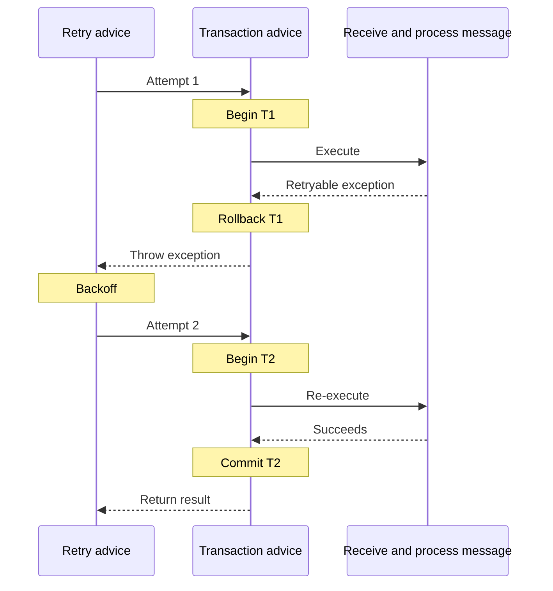

# Order of retry advice and transaction advice

In the **Poller transaction** chapter of the **SPRING_INTEGRATION_CORE** module, advice ordering determines whether a retry opens a fresh transaction or simply re-runs the operation inside an existing transaction. This decision directly impacts rollback, lock duration, message redelivery, and the risk of duplicate writes.

For a poller that needs to retry the entire read-and-process operation on transient failures, the required structure is typically:

```text
Retry advice
└── Transaction advice
    └── receive → synchronous processing → end poll
```

In this layout, retry sits outside so it can re-invoke the transaction advice. However, each attempt genuinely gets a new transaction only when the transaction advice creates a new physical transaction. If `REQUIRED` joins an already active transaction, that assumption no longer holds.

## 1. Goals and background knowledge

After this lesson, you will be able to:

- Read an advice chain from outside in and determine the retried scope.
- Distinguish logical transactions from physical transactions across attempts.
- Configure a poller in Java DSL with retry and transaction in an explicit order.
- Explain why placing transaction outside retry can retain a broken transaction across attempts.
- Recognize when rollback fails to restore a message or external side effects.
- Design observability and verification scenarios for transient errors, commit failures, and final failure handling.

You should know `Message`, `MessageChannel`, endpoints, `MessageSource`, pollers, and how a handler processes payloads. Distinguish `DirectChannel`, which typically invokes subscribers on the sending thread, from asynchronous boundaries such as `ExecutorChannel` or placing a message onto a queue for later processing.

Spring transactions are typically thread-bound. Therefore, a message passing through a transformer, filter, router, service activator, or gateway does not automatically prove all those operations share the same transaction. Track the actual call path, which channels are used, and which transaction manager manages which resources.

## 2. Earlier advice wraps later advice

Advice wraps an invocation. For interceptors wrapping the same join point, the sequence:

```text
[Retry, Transaction, Target]
```

means `Retry` is invoked first, delegates to `Transaction`, and then reaches `Target`. Return values or exceptions unwind in the reverse direction.

You can read this sequence as nested calls:

```java
retry(() -> transaction(() -> target()));
```

Reversing the list to `[Transaction, Retry, Target]` creates a different structure:

```java
transaction(() -> retry(() -> target()));
```

Both structures can yield the same result when everything succeeds immediately. When errors or rollbacks occur, their behavior diverges.

In this lesson, `Target` represents the operation wrapped by the poller's advice. With an example limited to one message per poll, picture this as receiving a message and passing it through the corresponding synchronous flow segment. Do not conflate this scope with a multi-message business batch or the scheduler's entire schedule.

### 2.1. Retry must wrap the right operation

Before choosing an order, answer the business question: which operation is allowed to re-run?

| Wrapped scope | Operations that may repeat | What must be proven |
| --- | --- | --- |
| Poller receiving and forwarding a message | Reading source, building message, running synchronous flow segment | Source can be safely reread after rollback |
| A specific handler | Handler logic inside the advised callback | Handler tolerates re-execution and its transaction is placed properly |
| HTTP call inside a handler | Request to an external system | Receiver has deduplication/idempotency protection |
| Data write operations | Statements within the retried scope | Next attempt does not reuse a broken transaction |

Retrying a handler with an already-received message and retrying a poller by re-invoking `receive()` are two different choices. This distinction matters when designing endpoints, gateways, and integration patterns.

## 3. Retry outside, transaction inside

Consider the sequence:

```text
Retry → Transaction → Target
```

Assume:

- When polling begins, no transaction is active on the thread.
- Transaction advice uses `PROPAGATION_REQUIRED`.
- The failing attempt's exception meets rollback criteria.
- The retry policy allows retrying that exception type.
- Protected operations participate in the transaction and run synchronously within this scope.

Then the first attempt opens transaction T1. If processing fails, transaction advice rolls back T1 and throws the error outward. Retry advice catches the error, waits per backoff, and calls the inner chain again. The next attempt opens T2.



Key consequences:

1. Each attempt's error passes through the transaction advice before reaching the retry advice.
2. If rollback is required, that attempt's transaction finishes before backoff begins.
3. The next attempt can read fresh data, re-acquire locks, and re-run the entire unit of work.
4. Errors raised when the transaction advice commits also lie within the retry advice's observation scope.

Point 4 describes only where the exception can be caught. Whether to retry commit errors depends on the retry policy and whether the commit outcome can be determined. An exception at commit time does not always prove the data was not committed.

### 3.1. Is backoff truly outside the transaction?

Under the assumptions above, T1 rolled back before retry waited. This avoids holding that attempt's transaction across the sleep interval.

However, if an outer transaction T0 exists and the advice uses `REQUIRES_NEW`, once T1 ends, T0 resumes. The backoff wait then still happens during T0's lifetime. Do not generalize that putting retry outside eliminates every transaction or lock from the wait interval.

### 3.2. Not every error triggers rollback

Spring transactions typically default to rolling back on `RuntimeException` and `Error`; checked exceptions follow configured rollback rules. If the target throws a checked exception for which the transaction advice permits commit, an outer retry may re-run after an attempt that already committed data.

Therefore, design these together:

```text
Which errors are retried?
Do those errors cause the transaction to roll back?
If effects have already committed, is re-running safe?
```

The right order cannot compensate for mismatched rollback rules.

## 4. Transaction outside, retry inside

Consider the reversed sequence:

```text
Transaction → Retry → Target
```

Transaction advice opens T1 and then invokes retry advice. Inner attempts occur inside the same outer transaction scope unless another transaction boundary creates an independent transaction.

```text
Begin T1
  Attempt 1 → error → retry catches error
  Backoff while T1 remains active
  Attempt 2 → continues in T1
  Attempt 3 → continues in T1
Commit or roll back T1 after retry finishes
```

### 4.1. The outer transaction interceptor may never see per-attempt errors

Retry advice catches the first attempt's exception. If a later attempt succeeds, the outer transaction advice may see only a normal completion.

Therefore, it is inaccurate to state that every exception caught by retry automatically marks the outer transaction as `rollback-only`. Actual state depends on the resource and the transaction boundaries traversed.

For example:

- A Java calculation throwing an exception before touching a resource may leave the current transaction intact.
- A database error may leave the transaction unusable for subsequent statements.
- An inner `@Transactional(REQUIRED)` proxied method may mark the shared transaction as `rollback-only` before throwing to retry.

Do not treat any one of these cases as a universal rule for all exceptions.

### 4.2. Retrying on an already-broken transaction

If the first attempt causes the transaction to be marked `rollback-only`, the next attempt can still run Java code, yet its work is not guaranteed to commit.

When the outer transaction ends, it may roll back or throw `UnexpectedRollbackException`, depending on the path and how rollback was marked. With certain database errors, subsequent statements already fail immediately because the transaction has not been rolled back.

That is why increasing retry attempts cannot fix retrying inside a transaction that is no longer usable.

### 4.3. Attempts may leave partial changes behind

Suppose the target performs:

```text
1. Write record A.
2. Call a Java operation that can fail.
3. Write record B.
```

If step 2 fails while the transaction stays usable, retrying inside T1 may execute step 1 again. Data from the prior attempt has not been rolled back independently. The result can be duplicate writes, double-incremented balances, or unique constraint violations.

The outer transaction only enforces a final commit/rollback boundary for participating resources. It does not perform separate rollbacks between retry attempts.

### 4.4. Commit errors lie outside the inner retry

When retry returns a successful result, the transaction advice then attempts to commit. If commit fails, retry has already exited its callback and cannot retry that error.

| Criterion | Retry → Transaction → Target | Transaction → Retry → Target |
| --- | --- | --- |
| Position of transaction advice | Invoked on each attempt | Wraps the entire retry |
| Fresh transaction per attempt | Yes when advice creates a new transaction | Not created by the outer transaction itself |
| Rollback before next attempt | Yes if rules require it and it is a separate transaction | No separate rollback from outer advice between attempts |
| Backoff | After the attempt's own transaction ends | While the outer transaction remains open |
| Exception on commit | Can reach retry advice | Outside inner retry |
| Scenario to consider | Retrying a complete transactional unit of work | Retrying a small step that remains safe inside the same transaction |

Transaction outside retry is not always wrong. It fits when you intentionally want to keep one transaction, the repeated step leaves no partial changes, and failures do not break the transaction. Verify those conditions against your specific business logic and resources.

## 5. Propagation determines the physical transaction

Advice order tells you which interceptor is re-invoked. Propagation tells you whether that interceptor opens a new transaction, joins an active one, or establishes another scope.

### 5.1. `REQUIRED` with no outer transaction

```text
Retry
  Attempt 1: REQUIRED → creates T1 → rollback
  Attempt 2: REQUIRED → creates T2 → commit
```

This is the baseline case for the poller example in this lesson. With no outer transaction to join, each entry into the transaction advice after the previous one finished opens a new transaction.

### 5.2. `REQUIRED` when T0 already exists

```text
T0 is active
└── Retry
    ├── Attempt 1: REQUIRED → joins T0
    └── Attempt 2: REQUIRED → still joins T0
```

Each call to the transaction advice may create a logical transaction scope, yet physically join T0. If an inner scope marks rollback, subsequent attempts do not restore T0 to a committable state.

Takeaway to remember:

> Placing retry before transaction is a call-structure condition; whether each attempt gets a fresh physical transaction still depends on propagation and any active outer transaction.

### 5.3. `REQUIRES_NEW`

`REQUIRES_NEW` can suspend an outer transaction and open a separate one when the advice is called:

```text
T0
└── Retry
    ├── Suspend T0 → T1 → rollback → resume T0
    └── Suspend T0 → T2 → commit   → resume T0
```

This creates an independent boundary per attempt, while also changing business atomicity. Once T2 commits, it will not roll back simply because T0 rolls back later.

Additionally, the outer transaction may continue holding its connection or locks while the new transaction needs another resource. Evaluate connection pool sizing and lock relationships before using this approach across concurrent pollers.

### 5.4. `NESTED` and savepoints

`NESTED`, when supported by the transaction manager, can use savepoints inside the existing physical transaction. Rolling back to a savepoint is not equivalent to opening a new physical transaction.

Locking, resource state, and ability to continue after errors must be evaluated per database and transaction manager. Do not treat `NESTED` as a blanket guarantee that retry can recover from every failed transaction.

## 6. Java DSL configuration with explicit ordering

The example below uses Spring Retry APIs such as `RetryTemplate`, `RetryOperationsInterceptor`, and Spring Integration Java DSL. This uses Spring Retry's interceptor-based retry; if your project uses another retry mechanism, match the corresponding API and advice scope.

The project needs Spring Integration Core, Spring Retry, Spring Transaction, and an appropriate data-access library. The configuration assumes the application supplies:

- A `PlatformTransactionManager` managing the resource used in the flow.
- A `MessageSource<Job>` reading from a source capable of participating in that transaction.
- A bean implementing `JobService` to process jobs.

`Job` and `JobService` in the example are business contracts for the application to implement; this configuration does not create a datasource or database itself.

```java
import java.util.List;
import java.util.Map;

import org.springframework.beans.factory.annotation.Qualifier;
import org.springframework.context.annotation.Bean;
import org.springframework.context.annotation.Configuration;
import org.springframework.dao.TransientDataAccessException;
import org.springframework.integration.channel.DirectChannel;
import org.springframework.integration.core.MessageSource;
import org.springframework.integration.dsl.IntegrationFlow;
import org.springframework.integration.dsl.Pollers;
import org.springframework.retry.backoff.FixedBackOffPolicy;
import org.springframework.retry.interceptor.RetryOperationsInterceptor;
import org.springframework.retry.policy.SimpleRetryPolicy;
import org.springframework.retry.support.RetryTemplate;
import org.springframework.transaction.PlatformTransactionManager;
import org.springframework.transaction.TransactionDefinition;
import org.springframework.transaction.interceptor.MatchAlwaysTransactionAttributeSource;
import org.springframework.transaction.interceptor.RollbackRuleAttribute;
import org.springframework.transaction.interceptor.RuleBasedTransactionAttribute;
import org.springframework.transaction.interceptor.TransactionInterceptor;

@Configuration
public class PollerRetryTransactionConfig {

    public record Job(long id, String payload) {
    }

    public interface JobService {
        void process(Job job);
    }

    @Bean
    public RetryOperationsInterceptor pollRetryAdvice() {
        SimpleRetryPolicy retryPolicy = new SimpleRetryPolicy(
                3,
                Map.of(TransientDataAccessException.class, true),
                true); // Allow inspecting causes inside wrapped exceptions.

        FixedBackOffPolicy backOff = new FixedBackOffPolicy();
        backOff.setBackOffPeriod(200L);

        RetryTemplate retryTemplate = new RetryTemplate();
        retryTemplate.setRetryPolicy(retryPolicy);
        retryTemplate.setBackOffPolicy(backOff);

        RetryOperationsInterceptor interceptor =
                new RetryOperationsInterceptor();
        interceptor.setRetryOperations(retryTemplate);
        return interceptor;
    }

    @Bean
    public TransactionInterceptor pollTransactionAdvice(
            PlatformTransactionManager transactionManager) {

        RuleBasedTransactionAttribute attribute =
                new RuleBasedTransactionAttribute();
        attribute.setPropagationBehavior(
                TransactionDefinition.PROPAGATION_REQUIRED);
        attribute.setRollbackRules(
                List.of(new RollbackRuleAttribute(Exception.class)));

        MatchAlwaysTransactionAttributeSource attributeSource =
                new MatchAlwaysTransactionAttributeSource();
        attributeSource.setTransactionAttribute(attribute);

        return new TransactionInterceptor(
                transactionManager, attributeSource);
    }

    @Bean
    public DirectChannel jobChannel() {
        return new DirectChannel();
    }

    @Bean
    public IntegrationFlow jobFlow(
            MessageSource<Job> jobSource,
            JobService jobService,
            @Qualifier("jobChannel") DirectChannel jobChannel,
            @Qualifier("pollRetryAdvice")
            RetryOperationsInterceptor retryAdvice,
            @Qualifier("pollTransactionAdvice")
            TransactionInterceptor transactionAdvice) {

        return IntegrationFlow
                .from(jobSource, endpoint -> endpoint.poller(
                        Pollers.fixedDelay(1_000)
                                .maxMessagesPerPoll(1)
                                .advice(retryAdvice, transactionAdvice)))
                .channel(jobChannel)
                .handle(jobService, "process")
                .get();
    }
}
```

### 6.1. Meaningful choices in the configuration

**Advice order:** `.advice(retryAdvice, transactionAdvice)` puts retry around transaction in the poller's advice chain. Declaring it this way lets you read the intended order directly. Avoid adding another transaction advice elsewhere without knowing which portion of the flow it wraps.

**Attempt count:** `SimpleRetryPolicy` sets a maximum of `3` executions—the initial attempt plus up to two retries. It does not mean one initial run plus three retries.

**Error classification:** Only `TransientDataAccessException` and its subclasses—including when found in the cause chain inspected by the policy—are retried. Validation errors or programming bugs do not automatically become retryable. If your data access layer does not translate exceptions into this hierarchy, classify according to your application's actual exceptions.

**Rollback:** The example specifies rollback on `Exception` to prevent a checked exception from escaping while the transaction still commits. This is an illustrative choice for the lesson's unit of work; real business logic must define its own rollback rules.

**No fake successful recovery:** The example configures no recoverer to turn the final failure into a normal return. When retries are exhausted or a non-retryable error occurs, the exception keeps propagating outward.

**One message per poll:** `maxMessagesPerPoll(1)` limits messages per poll tick so the illustrative scope stays easy to trace. It does not prevent retry from re-invoking the source read multiple times on errors.

**Synchronous processing segment:** `DirectChannel` keeps the handler call inside the poller's synchronous call stack. This allows exceptions from `JobService.process()` to unwind to the transaction advice and retry advice.

**Shared resource:** A transaction manager for database A does not automatically manage database B, an HTTP request, or any message broker. Verify every participating resource.

### 6.2. Data source contract

For the example to retry the entire unit of work, `jobSource` must behave accordingly. For instance, a source reading a job table can select a pending job and update its claim status inside the same transaction as the business write.

If processing fails and rolls back:

```text
Claim status update    → rollback
Business data write    → rollback
Next attempt           → source can supply unfinished work
```

How records are locked, how two workers are prevented from claiming the same work, and how status updates work depend on the specific data source. Merely adding transaction advice to a poller does not supply those mechanisms.

With multiple workers, a retry attempt may also pick up a different job because ordering or ownership changed. Retrying the whole poll is not a promise to preserve the exact job ID across attempts.

## 7. Poller retry may receive a different message

This is an easy risk to miss when looking only at a transaction diagram.

Suppose an in-memory `QueueChannel` holds M1 and M2:

```text
Attempt 1:
  receive() removes M1 from queue
  handler fails processing M1
  database transaction rolls back

Attempt 2:
  receive() pulls M2
  handler processes M2 successfully
```

A database rollback does not automatically put M1 back into an in-memory `QueueChannel`. Retry may report success because the next poll handles M2, while M1 remains unfinished.

Hence distinguish two requirements:

| Business requirement | Design direction to evaluate |
| --- | --- |
| Retry the complete receive-and-process operation | Source supports rollback/redelivery or an appropriate recovery mechanism |
| Retry processing the exact received message | Keep the message at handler scope; design each processing attempt's transaction |
| Return failed messages to the system | Requeue, nack, redelivery, or error persistence supported by the source |
| Prevent work loss on process stop | Durable source and explicit completion acknowledgment |

Even a persistent message store must be evaluated by how it updates state, its transaction manager, and actual configuration. Persistence does not automatically imply transactional rollback of message retrieval in every setup.

### 7.1. Poller advice vs. handler retry advice

Spring Integration offers `RequestHandlerRetryAdvice` for handler request-processing scope. This advice expresses retrying a handler with the current message, unlike a retry interceptor wrapping the poll operation.

When using it, verify the exact callback wrapped by the advice and whether exceptions occur inside that callback. Do not assume it retries the entire inbound source, the entire downstream flow, or errors happening on another thread.

If handler retry runs inside the poller's transaction, handler attempts still share that same transaction. To give each handler attempt its own transaction, place an invoked transaction boundary inside the retry and evaluate propagation as discussed earlier.

Therefore, `RequestHandlerRetryAdvice` and `RetryOperationsInterceptor` are not interchangeable labels across configuration points.

## 8. Thread boundaries and flow components

### 8.1. Synchronous path

```text
Poller [Retry → Transaction]
  → DirectChannel
  → transformer
  → filter
  → router
  → service activator
```

If all involved calls run synchronously on the same thread and no transaction boundary alters participation, an exception at the end of the path can unwind back to the poller.

However, a filter dropping a message as configured is normally a regular completion. It does not raise an exception to trigger retry or rollback. If business logic treats rejection as failure, configure or handle that case explicitly.

### 8.2. Handing off to another thread

```text
Poller [Retry → Transaction]
  → ExecutorChannel
      → separate worker thread
          → service activator
```

The poller can finish sending and end its transaction before the handler on the other thread finishes processing. Errors on that thread do not unwind into the poller's already-completed retry. The transaction bound to the poller thread does not automatically propagate to the new thread either.

If retry and transactions are needed for an asynchronous handler, design them on that execution side alongside appropriate message persistence and error reporting.

### 8.3. Gateways, aggregators, and integration state

A gateway does not automatically turn an entire call to another system into a single database transaction. Inspect which channels the message traverses, where the reply is produced, and how errors are propagated or transformed.

An aggregator may accumulate messages across multiple receives. A single poller transaction does not wrap the entire wait until a group completes. Group persistence, completion marking, and output handling must be evaluated per the message store and resources actually involved.

These components follow the same general rule: only operations inside the right invocation scope and participating in the right transaction are protected by that transaction.

## 9. Exceptions, error channels, and recovery

### 9.1. Retry needs to receive the exception

If code catches the error and returns as if successful:

```java
try {
    writeBusinessData();
} catch (RuntimeException ex) {
    logFailure(ex);
    // Do not rethrow, do not mark rollback.
}
```

Outer advice no longer receives that exception to classify for retry. The transaction may also commit if the resource has not already entered rollback-only state.

Sending an `ErrorMessage` to a channel from application code is also not automatically equivalent to letting an exception cross transaction advice. Inspect the actual return value and exception leaving the callback.

### 9.2. Task error handler vs. errors inside advice

Distinguish where the poller task receives its final unhandled error from where retry catches errors inside the advice chain. When an exception passes through transaction advice, the transaction may already have rolled back before the task's error-handling layer receives the final error.

Conversely, if an inner component turns an error into a normal completion before it reaches transaction advice, transaction advice may not apply rollback for that exception.

Thus, seeing a message on `errorChannel` is not enough to conclude whether the transaction committed or rolled back. Trace where `ErrorMessage` is produced, call order, and transaction completion status.

### 9.3. Recovery alters the outcome seen by outer advice

After retries are exhausted, a recovery mechanism may record the error, send the message to a failure path, or return a fallback value.

Both positions yield different consequences:

- **Retry outside transaction:** If each attempt had its own transaction and rolled back, recovery runs after those attempts. Database writes inside recovery are not automatically wrapped by the already-finished per-attempt transactions.
- **Retry inside transaction:** Recovery returning normally can let the outer transaction proceed to commit, including remaining changes from earlier attempts if the transaction was not marked rollback-only.

The recovery return value must also satisfy the contract of the advised join point. Do not arbitrarily return a payload or `null` from a poller's recoverer as if recovering a handler with a different return type.

If you need to persist failure state durably or move the message to a dead-letter destination, define the transaction for that operation. Logging alone cannot replace retaining failed work.

### 9.4. Stateless retry vs. stateful retry

The example in this lesson uses stateless retry: attempts occur within the same interceptor execution, with backoff between calls.

Stateful retry can store state by key and rethrow between redeliveries, giving the source's transaction or redelivery mechanism a chance to act. It requires a source that can redeliver the exact same work and a stable identifying key.

Do not swap stateless for stateful merely looking for a way to get a new transaction. First establish who re-invokes, when it re-invokes, and whether the message still represents the same work item.

## 10. Retry does not guarantee exactly-once

Consider a handler:

```text
1. Write database data.
2. Call HTTP to charge payment.
3. Run another database operation and fail.
```

A database rollback does not refund the charge already processed by the HTTP system. If retry re-runs the handler, the charge request may repeat.

Design options must match the type of side effect:

| Side effect | Mechanism to consider |
| --- | --- |
| Recording the same business event multiple times | Stable business key and unique constraint |
| Updating data then emitting an event | Transactional outbox in the same DB transaction, with deduplicating consumer |
| Calling an API supporting deduplication | Idempotency key kept constant across attempts |
| Redelivering messages from a broker | Work identifier key and appropriate deduplication |
| Failure after a point where commit may have occurred | Reconcile state by business key before re-executing |

The deduplication key should represent the same business action, such as `paymentRequestId`. If every poll creates a message with a new `MessageHeaders.ID`, using that ID may fail to recognize duplicate work.

Outbox and deduplication still require duplicate-tolerant design on the receiving side. Changing advice order alone does not make an integration flow exactly-once.

## 11. Backoff, poll schedule, and resource hold times

A poller's `fixedDelay` sets the task's schedule. Retry's backoff sets the wait between attempts inside the active execution. These two settings play different roles.

For a synchronous task with three attempts, each taking roughly 100 ms and two 200 ms backoffs:

```text
Approximate task execution time:
100 + 200 + 100 + 200 + 100 = 700 ms
```

With a 1,000 ms fixed delay, the next scheduled run starts after that run finishes plus the delay interval, ignoring scheduling jitter. If you add a task executor or another execution mechanism, assess actual task hand-off and completion times.

Blocking backoff still occupies the executing thread while waiting. When multiple pollers fail simultaneously, held threads and cumulative execution time can become an issue even if individual transactions have ended.

For loaded systems, define:

- Maximum total duration for one retry cycle.
- Attempt count and backoff intervals aligned with expected outage duration.
- Limits on threads, connection pools, and concurrent pollers.
- How to avoid synchronized retries across workers, such as jittered backoff when supported.
- Interaction with retries at the broker, HTTP client, or another layer.

If two layers each allow up to three attempts and the outer layer re-invokes the entire inner layer, target calls can reach nine. Count actual executions rather than inspecting a single retry config in isolation.

## 12. Practice scenario: claiming a job and writing results

A system reads a `pending_job` table and writes processing results to the same database. Each job has a stable `jobId`.

Desired unit of work:

```text
Receive a pending job
→ write result by jobId
→ mark job complete
→ commit
```

Assume the source and handler share one transaction; the poller has no outer transaction; retry applies only to transient data-access errors.

### 12.1. First attempt fails

1. Retry invokes transaction advice, opening T1.
2. The source receives job J42 inside T1.
3. The handler writes data but encounters a transient error configured for retry.
4. The exception leaves the handler, crosses `DirectChannel`, and reaches transaction advice.
5. T1 rolls back; the claim update and business data from T1 are undone.
6. Retry receives the exception and backs off.

### 12.2. Subsequent attempt succeeds

1. Retry re-invokes transaction advice, opening T2.
2. The source receives an eligible job; this may be J42 if it is still the selected job.
3. The handler writes the result and completion status.
4. T2 commits.

If business rules mandate retrying J42 specifically rather than picking up any eligible job, design an identifier-pinning or J42-specific redelivery mechanism. The poller's advice chain does not automatically guarantee that.

### 12.3. Changes that break the scenario's assumptions

| Change | Consequence that must be re-evaluated |
| --- | --- |
| Source marks claim in a separate committed transaction | Handler rollback does not return the job to pending |
| Replace `DirectChannel` with `ExecutorChannel` | Handler errors may happen after the poller finishes |
| Handler writes to a different database | One local transaction manager does not protect both |
| Handler catches error and returns | Retry may not run and transaction may commit |
| Calling an external API inside the handler | External side effects may repeat after rollback |
| Using `REQUIRED` inside an existing T0 | Attempts may share the same physical transaction |

## 13. How to verify ordering and outcomes

Do not verify only that the handler was called three times. Verify transaction boundaries, post-rollback data, and the processed work identifier as well.

### 13.1. Verification scenarios

| Scenario | What to observe |
| --- | --- |
| Succeeds on first attempt | Single execution, transaction commits, business outcome is correct |
| Transient error before write | Exact retry count; when configured for separate transactions, each attempt enters a new transaction |
| Partial write then retryable error | Failed attempt's data is rolled back before next attempt |
| Error outside retry policy | Does not exhaust all attempts; exception escapes and rolls back per rule |
| Checked exception | Rollback outcome matches configuration instead of relying on defaults |
| Retries exhausted | No fake success; final error reaches chosen handling mechanism |
| Outer transaction T0 present | Confirm `REQUIRED` joins T0 and rollback state propagates properly |
| Non-transactional source | Track M1/M2 to detect retry pulling a different message |
| Switch to another thread | Confirm downstream errors lie outside poller retry scope |
| Error at commit time | Verify policy and reconciliation flow when commit outcome is uncertain |

With `Retry → Transaction`, three failing attempts with matching rollback rules and no outer transaction produce three transaction begins and three rollbacks. When the third attempt succeeds, expect three begins, two rollbacks, and one commit.

This expectation holds for the stated assumptions, not as a rule for every propagation setting, message source, or recovery path.

### 13.2. Useful observability

Logs or metrics should correlate:

- The work item's business key, such as `jobId`.
- Attempt index within a retry cycle.
- Executing thread and corresponding endpoint.
- Final exception type and the cause used for classification.
- Transaction begin, commit, rollback, or joining an outer transaction.
- Processing duration, backoff time, and count of items entering error handling.

Calling `isActualTransactionActive()` or logging transaction names alone does not prove two attempts used two distinct physical transactions. Observe begin/commit/rollback events on the transaction manager or add resource-appropriate instrumentation.

Also do not infer that a new transaction was not created just because the same pooled connection object is seen. One physical connection can be reused across sequential transactions.

When writing JDBC integration tests, verify database state after each outcome rather than only counting mock invocations. Avoid letting a test class's automatic transaction unintentionally invalidate the no-outer-transaction assumption.

Tests for lock or commit errors should rely on the actual database and driver behavior in use. A manually thrown Java exception helps test advice flow, but does not represent every failure mode of a real resource.

## 14. Common mistakes and adjustments

| Symptom | Possible cause | Adjustment |
| --- | --- | --- |
| Retries multiple times yet ultimately rolls back | Retry runs inside a shared transaction already marked rollback-only | Check order, propagation, and outer transactions |
| Partial data from prior attempt remains in next attempt | Outer transaction wraps retry or rollback rules do not match | Align rollback boundary with unit of work |
| Poller reports success yet one message vanishes | Whole-poll retry picked up a different message from a non-rollback-capable source | Choose message retention or source redelivery appropriately |
| Handler fails yet poller does not retry | Async boundary or exception caught inside | Place retry where failure occurs and clarify exception propagation |
| Payment charged or email sent multiple times | External side effects are not rolled back | Use idempotency keys or decouple via durable persistence |
| Increasing retries slows down the system | Backoff holds threads, holds outer transaction, or multiple retry layers stack | Bound total time and coordinate layers |
| Commit error occurs with no retry | Transaction advice sits outside retry or error is excluded from policy | Identify commit position and safety before changing policy |
| Recovery runs yet error is not durably saved | Recovery runs outside the finished transaction | Provide an appropriate transaction boundary for persisting errors |

## 15. Self-check questions

1. With `.advice(retryAdvice, transactionAdvice)`, what guarantees the transaction advice is called again? What guarantees a fresh physical transaction is created?
2. Why can `REQUIRED` produce T1 and T2 in one setup yet still use T0 in another?
3. When transaction wraps retry, why can't you state the first exception always marks `rollback-only`?
4. If the second attempt succeeds yet `UnexpectedRollbackException` occurs at the end, which transaction boundaries should you inspect?
5. If the source is an in-memory `QueueChannel`, does a database rollback restore the removed message?
6. When inserting an `ExecutorChannel` into the flow, which failure scope still returns to the poller?
7. If a commit error happens after the database might already have committed, what conditions make retrying safe?
8. Why can a recoverer returning a normal result change the commit decision of an outer advice?

Base your answers on the same four factors: **the scope of the re-invoked operation, advice ordering, actual propagation, and the resource's rollback or re-execution capabilities**. Once these four factors are clear, retry and transaction configuration will accurately reflect the message flow's business requirements.
